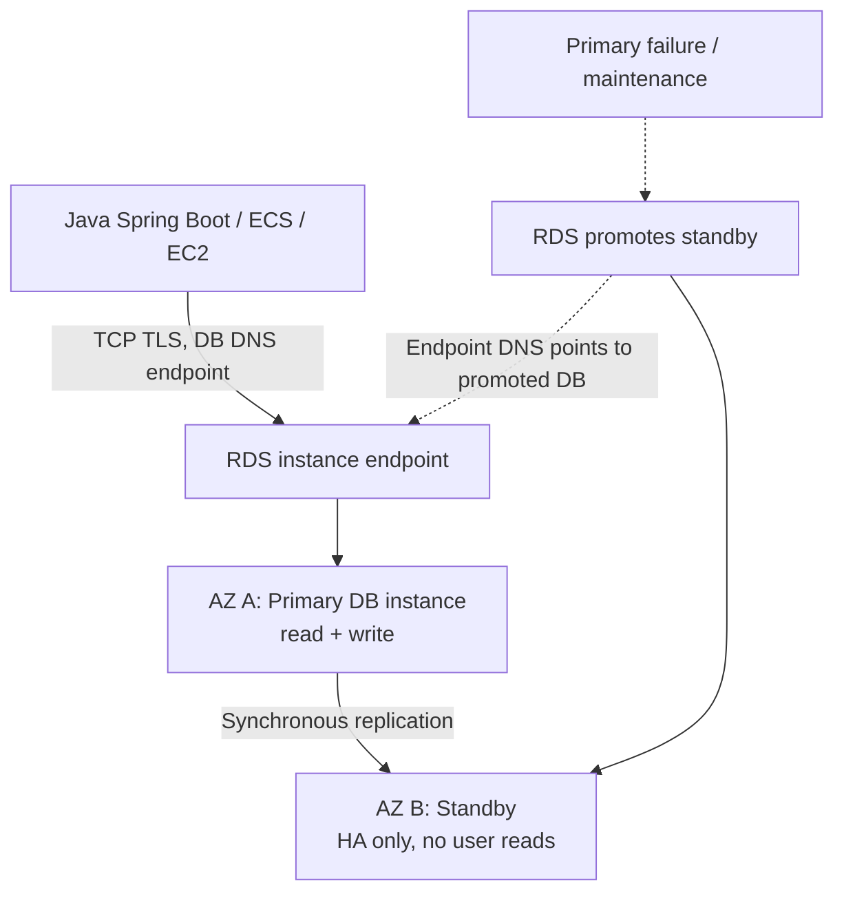
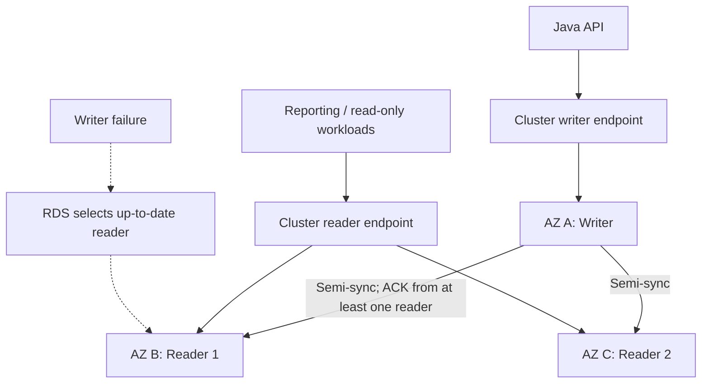
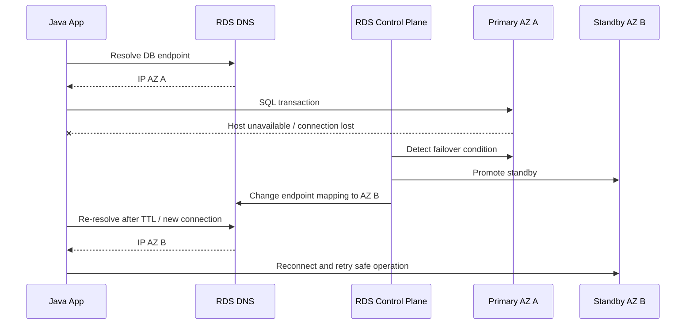
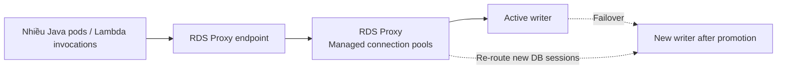
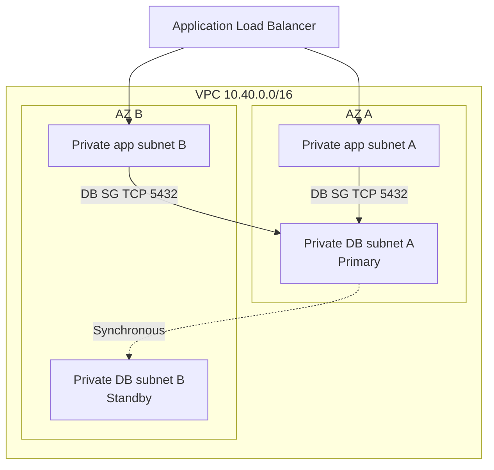
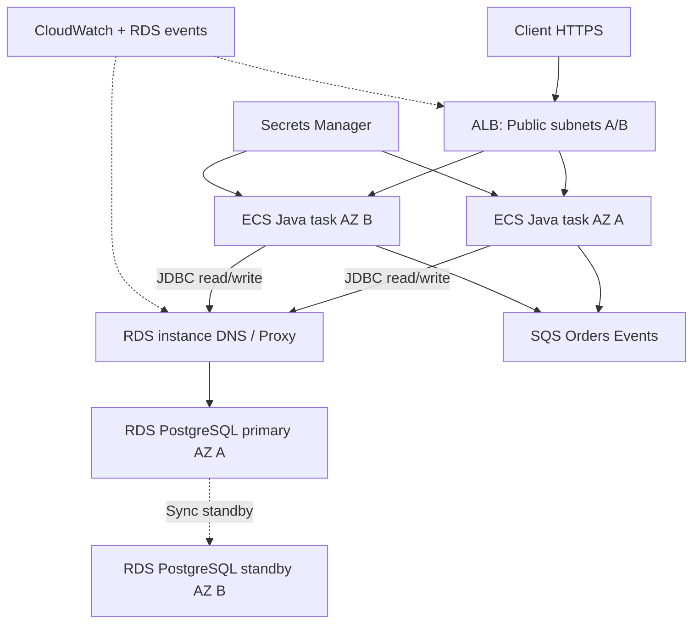

# RDS Multi-AZ và cơ chế failover

Một hệ thống thương mại điện tử chạy **Java Spring Boot** trên Amazon ECS/EC2 có cơ sở dữ liệu PostgreSQL trong **Amazon RDS**. Vào giờ cao điểm, máy chủ database chính gặp sự cố. Ứng dụng bắt đầu ghi lỗi kết nối, một số giao dịch `COMMIT` trả timeout, và mọi người muốn biết: dữ liệu còn an toàn không, ứng dụng sẽ kết nối đến đâu, khi nào phục hồi, có cần đổi connection string hoặc khôi phục snapshot không?

Để trả lời chính xác, đội vận hành phải phân biệt ba cấu hình hay bị gọi chung là “Multi-AZ”:

- **RDS Multi-AZ DB instance deployment:** một primary và một **standby đồng bộ** ở AZ khác. Standby phục vụ **failover**, **không** phục vụ read traffic.
- **RDS Multi-AZ DB cluster deployment:** một writer và **hai readable readers** trên ba AZ, replication **bán đồng bộ (semisynchronous)**; có writer/reader endpoints và cơ chế promotion riêng.
- **Amazon Aurora DB cluster:** engine/kiến trúc storage riêng, phân tán dữ liệu nhiều AZ, có writer và tùy chọn Aurora Replicas; **không phải** cùng loại tài nguyên với RDS Multi-AZ DB cluster.

Cả ba đều giúp tăng **high availability (HA)** nhưng không tự đem lại zero downtime, exactly-once transaction processing, point-in-time recovery (PITR) hay **disaster recovery liên Region**.

Bài học thuộc chương **Cơ sở dữ liệu RDS và Aurora** của module **CLOUD_PROVIDERS_AWS**. Từ nền tảng Region/AZ, IAM, VPC, compute, storage, database, giám sát, khôi phục và chi phí, người học sẽ chọn mô hình RDS có thể vận hành an toàn cho Java production.

> **Phạm vi:** tập trung vào Amazon RDS Multi-AZ **DB instance** và **DB cluster**, bổ sung Aurora để so sánh đúng. Các số liệu failover là **mức điển hình theo tài liệu AWS**, không phải SLA cứng; mức hỗ trợ engine/version/instance class/Region và hành vi DNS, networking có thể thay đổi. Kiểm tra tài liệu và cấu hình thực tế trước khi áp dụng.

## 1. Mục tiêu học tập

Sau bài này, bạn có thể:

1. Phân biệt **Single-AZ**, **Multi-AZ DB instance**, **Multi-AZ DB cluster**, **Aurora** và **read replica**.
2. Mô tả synchronous standby replication của Multi-AZ DB instance và semisynchronous replication của Multi-AZ DB cluster.
3. Nhận diện **planned/unplanned failover**, sự kiện kích hoạt và chuỗi promotion/recovery.
4. Giải thích vai trò của **RDS endpoint, DNS, AZ, DB subnet group, SG và connection pooling** khi failover.
5. Ước lượng phạm vi **RTO/RPO** hợp lý, hiểu lỗi giao dịch chưa biết kết quả và rủi ro retry gây double write.
6. Thiết kế Spring Boot/JDBC/HikariCP có DNS TTL, timeout, reconnect và retry **idempotent**.
7. Chọn RDS Proxy khi cần pooling/failover resilience; phân biệt proxy với **read replica** và backup.
8. Giám sát RDS events, CloudWatch, replication lag, SQL errors, logs và end-to-end SLO.
9. Thực hành AWS CLI/CloudFormation và **diễn tập failover có phê duyệt**, không gây gián đoạn production ngoài ý muốn.
10. Lập kế hoạch HA, backup/PITR/DR, IAM/KMS và chi phí.

## 2. Availability Zone, HA, RTO, RPO: khái niệm trước kiến trúc

**AWS Region** gồm nhiều **Availability Zones (AZ)** độc lập về mặt hạ tầng theo thiết kế AWS, kết nối qua mạng độ trễ thấp. Multi-AZ đặt các thành phần database ở các AZ khác nhau để giảm phụ thuộc vào **một AZ**.

| Thuật ngữ | Ý nghĩa | Ví dụ phải hỏi |
|---|---|---|
| **High availability (HA)** | Duy trì/khôi phục dịch vụ khi lỗi máy chủ hoặc AZ | Writer bị lỗi thì ai tiếp nhận? |
| **Failover** | Chuyển vai trò primary/writer sang tài nguyên khác | Ứng dụng có reconnect được không? |
| **RTO** | Thời gian gián đoạn chấp nhận trước khi khôi phục phục vụ nghiệp vụ | Có thể mất 60 giây hay chỉ 10 giây? |
| **RPO** | Lượng dữ liệu theo thời gian được phép mất khi sự cố | Có chấp nhận mất một giao dịch đã ACK? |
| **Replication** | Sao chép thay đổi sang node/volume khác | Đồng bộ, bán đồng bộ hay bất đồng bộ? |
| **Read replica** | Bản sao phục vụ đọc, thường có replication lag | Có tự động tiếp nhận writer khi lỗi không? |
| **Backup / PITR** | Khôi phục dữ liệu về thời điểm trước đó | Ai khôi phục nếu người dùng `DELETE` nhầm? |
| **Disaster recovery (DR)** | Phục hồi khi vùng/hệ thống lớn hỏng | Region A mất thì Region B có sẵn không? |

### 2.1. Không có “zero downtime” chỉ nhờ Multi-AZ

Trong failover, những việc sau vẫn có thể xảy ra:

- SQL connection hiện tại bị cắt, requests bị lỗi/timeout.
- Các transactions chưa commit bị rollback khi primary biến mất.
- Một `COMMIT` đã thành công trong database nhưng response tới client bị mất, gây **unknown outcome**.
- DNS của endpoint trỏ sang địa chỉ writer mới, nhưng JVM/driver/OS/pool có thể còn giữ kết nối hoặc IP cũ.
- Application vừa phục hồi kết nối đã tạo quá nhiều connection cùng lúc, khiến DB mới nhận tải vượt giới hạn.

Vì vậy, **database HA và application resilience** là hai điều kiện bổ trợ nhau, không thay thế nhau.

## 3. So sánh các mô hình RDS/Aurora

| Đặc tính | **RDS Single-AZ instance** | **RDS Multi-AZ DB instance** | **RDS Multi-AZ DB cluster** | **Aurora DB cluster** |
|---|---|---|---|---|
| Cấu trúc | Một DB instance | Primary + **1 standby** ở AZ khác | **1 writer + 2 readers** ở **3 AZ** | Aurora cluster volume đa AZ; writer + 0/nhiều Aurora Replicas |
| Replication | Không có standby HA mặc định | **Synchronous** tới standby | **Semisynchronous**, ACK từ ít nhất một reader trước commit | Storage phân tán/replicated theo kiến trúc Aurora |
| Read từ secondary | Không | **Không** | **Có**, reader endpoints | **Có** nếu có Aurora Replicas |
| Failover tự động | Không có standby để tự promotion | Có | Có | Có, nếu có replica thì promote replica; không có thì có thể phải tạo writer mới |
| Phạm vi | Một AZ | Hai AZ (primary + standby) | Ba AZ | Storage trải nhiều AZ; số compute replicas do cấu hình |
| Endpoint ứng dụng | DB instance endpoint | **Cùng DB instance endpoint**, DNS chuyển IP | **Writer cluster endpoint** và **reader endpoint** | **Writer/reader cluster endpoints**, instance endpoints |
| Engine | Nhiều RDS engines | Theo hỗ trợ từng engine | **RDS MySQL/PostgreSQL** theo hỗ trợ | **Aurora MySQL/PostgreSQL** |
| Scale read | Không tự có | Standby không được dùng đọc | Hai readers có thể phục vụ đọc | Aurora Replicas phục vụ đọc |
| Phù hợp | Dev/test hoặc workload chấp nhận downtime | Production HA không cần readers tích hợp | Production HA + read scaling, hỗ trợ engine phù hợp | Cần kiến trúc/khả năng riêng của Aurora |

**Điểm mấu chốt:** “Multi-AZ = reader có thể dùng cho báo cáo” là **sai** đối với **Multi-AZ DB instance**. Muốn tách truy vấn đọc, dùng **RDS read replica**, **Multi-AZ DB cluster**, hoặc **Aurora reader** theo yêu cầu. Tham khảo tài liệu [Multi-AZ DB instance](https://docs.aws.amazon.com/AmazonRDS/latest/UserGuide/Concepts.MultiAZSingleStandby.html) và [Multi-AZ DB cluster](https://docs.aws.amazon.com/AmazonRDS/latest/UserGuide/multi-az-db-clusters-concepts.html).

### 3.1. Những con số failover thường được dẫn

| Mô hình | Thời gian điển hình theo AWS | Không nên suy ra |
|---|---|---|
| **RDS Multi-AZ DB instance** | **60–120 giây** | Luôn phục hồi trong 120 giây |
| **RDS Multi-AZ DB cluster** | Thường **dưới 35 giây** | Bất kỳ SQL request nào cũng không lỗi |
| **Aurora với ít nhất một replica phù hợp** | Thường **dưới 60 giây**, nhiều trường hợp dưới 30 giây | Mọi Aurora cluster, kể cả không có replica, đều dưới 30 giây |

Các mốc bao gồm hoạt động phía database nhưng **không bảo đảm application RTO**. App có thể mất thêm thời gian do DNS cache, pool, transaction retry hoặc downstream recovery. Đo thực tế bằng chaos drills. Xem các trang AWS về [DB instance failover](https://docs.aws.amazon.com/AmazonRDS/latest/UserGuide/Concepts.MultiAZ.Failover.html), [DB cluster failover](https://docs.aws.amazon.com/AmazonRDS/latest/UserGuide/multi-az-db-clusters-concepts-failover.html) và [Aurora HA](https://docs.aws.amazon.com/AmazonRDS/latest/AuroraUserGuide/Concepts.AuroraHighAvailability.html).

## 4. RDS Multi-AZ DB instance: primary và một standby

Trong mô hình **Multi-AZ DB instance deployment**, Amazon RDS tạo và quản lý một **synchronous standby** trong AZ khác. Primary nhận read/write từ ứng dụng; standby không mở để xử lý queries của ứng dụng.



### 4.1. Vì sao standby không phục vụ đọc?

Standby của **Multi-AZ DB instance** là thành phần **HA**, không phải read-scaling node. AWS sử dụng công nghệ replication/failover khác nhau tùy database engine; nhưng hợp đồng chung là standby duy trì tính sẵn sàng để tiếp nhận primary.

**Không dùng hostname/IP ẩn của standby hoặc truy cập trực tiếp** để cố khai thác hiệu năng đọc. Nó không được cung cấp cho application queries theo cấu hình này.

### 4.2. Synchronous replication nghĩa gì?

Trong mô hình phù hợp với engine, primary đồng bộ thay đổi sang standby theo công nghệ AWS để bảo vệ trước lỗi máy chủ/AZ. Vì có bước đồng bộ, **write commit latency** có thể tăng so với Single-AZ.

Điều này **không đồng nghĩa** ứng dụng có zero RPO trong mọi loại lỗi tưởng tượng: ví dụ thao tác đang in-flight, app timeout ở thời điểm không rõ đã commit, lỗi vùng toàn bộ, dữ liệu bị xóa nhầm hoặc lỗi logic không được giải quyết chỉ bằng replication.

### 4.3. Lợi ích của Multi-AZ DB instance

- Chuyển đổi sang standby tự động trong nhiều trường hợp lỗi hạ tầng.
- Giảm gián đoạn trong một số đợt bảo trì và backup theo engine.
- Không bắt buộc ứng dụng đổi endpoint sau failover nếu **sử dụng hostname RDS chuẩn**.
- Đơn giản hơn một kiến trúc tự vận hành PostgreSQL streaming replicas + fencing/leader election.

### 4.4. Giới hạn

- Standby **không đọc được**.
- Failover vẫn có mất kết nối trong một khoảng thời gian.
- Không thay PITR, backups, cross-Region DR hoặc business idempotency.
- Synchronous replication và hạ tầng thứ hai phát sinh chi phí/latency.
- Tính năng cụ thể khác nhau với MySQL, MariaDB, PostgreSQL, Oracle và SQL Server; không suy công nghệ replication nội bộ giống nhau cho mọi engine.

Nguồn: [Multi-AZ DB instance deployments](https://docs.aws.amazon.com/AmazonRDS/latest/UserGuide/Concepts.MultiAZSingleStandby.html).

## 5. RDS Multi-AZ DB cluster: writer + hai readers

**Multi-AZ DB cluster** là loại triển khai riêng của Amazon RDS cho các phiên bản **MySQL/PostgreSQL được hỗ trợ**. Nó gồm **ba DB instances trong ba AZ của cùng Region**:

- **Một writer** nhận writes và reads.
- **Hai readers** có thể phục vụ read queries.
- RDS có thể promote một reader khi writer không khả dụng.



### 5.1. Semisynchronous replication rất dễ bị diễn giải sai

Đối với **RDS Multi-AZ DB cluster**, AWS mô tả replication **bán đồng bộ**: một thay đổi từ writer cần được **ít nhất một reader xác nhận nhận** trước khi commit; **không yêu cầu cả hai readers đều đã áp dụng và commit đầy đủ** thay đổi tại cùng thời điểm. Xem [AWS: Multi-AZ DB cluster architecture](https://docs.aws.amazon.com/AmazonRDS/latest/UserGuide/multi-az-db-clusters-concepts.html).

Do đó:

- **Reader lag vẫn có thể tồn tại**.
- Một query ngay sau write tại reader endpoint có thể thấy dữ liệu **chưa cập nhật**.
- Khi failover, RDS chọn reader phù hợp/dữ liệu cập nhật nhất và xử lý các transactions còn chưa áp dụng theo cơ chế dịch vụ.
- Không mô tả chính xác Multi-AZ DB cluster bằng câu “hai replicas đều synchronous fully committed trước mỗi write”.

### 5.2. HA và read scaling cùng tồn tại

Ưu điểm so với standby DB instance deployment:

- Có **hai readable readers** phục vụ các workload đọc.
- Writer/reader endpoints thuận tiện cho ứng dụng tách read/write.
- Thời gian failover **thường dưới 35 giây** theo tài liệu AWS, tùy tình trạng database/replication.

Tuy nhiên read capacity thực tế phụ thuộc instance size, indexes, query plans, replication lag, throughput/quota và tỉ lệ writes. Không xem hai readers là hai bản sao với dữ liệu **luôn hoàn toàn đồng bộ cho mọi truy vấn**.

### 5.3. Hai loại “read replica” không giống nhau

Trong Multi-AZ DB cluster:

- **Reader DB instances tích hợp** là hai thành viên cluster, **có thể được tự động promote** khi failover.
- **RDS DB instance read replicas tạo ngoài cluster** là tài nguyên riêng, thường sao chép **bất đồng bộ**, dùng để scale read/DR; **không tự là failover target** của cơ chế Multi-AZ DB cluster.

Nguồn: [Multi-AZ DB cluster deployments](https://docs.aws.amazon.com/AmazonRDS/latest/UserGuide/multi-az-db-clusters-concepts.html), [Reader vs DB instance read replicas](https://docs.aws.amazon.com/AmazonRDS/latest/UserGuide/multi-az-db-clusters-create-instance-read-replica.html).

## 6. Aurora có giống RDS Multi-AZ DB cluster không?

**Không.** Amazon Aurora có engine/kiến trúc storage riêng:

- **Aurora DB cluster volume** được replicated trên nhiều AZ trong cùng Region, tách biệt với compute nodes theo thiết kế dịch vụ.
- Cluster có **writer** và có thể có **Aurora Replicas**.
- Khi writer lỗi, RDS/Aurora có thể promote một Aurora Replica; nếu không có suitable replica, phải tạo/rebuild writer, thường lâu hơn.
- **Aurora cluster endpoint** hướng tới writer hiện tại; **reader endpoint** phục vụ read workloads khi có readers.
- Aurora có **promotion tiers** (ưu tiên promote) cho Aurora Replicas theo engine/điều kiện hỗ trợ.

Không giả định “Aurora storage đa AZ” tự có một reader compute khác sẵn sàng khi không tạo Aurora Replica.

### 6.1. Aurora và RDS Multi-AZ DB cluster: cách chọn

| Câu hỏi | RDS Multi-AZ DB cluster | Aurora |
|---|---|---|
| Cần PostgreSQL/MySQL managed theo RDS engine? | Có nếu version/Region/class hỗ trợ | Aurora-compatible PostgreSQL/MySQL, khác implementation |
| Cần hai readers tích hợp sẵn trong loại cluster? | Có | Thêm Aurora Replicas theo thiết kế |
| Cơ chế replicate? | Semisynchronous giữa three DB instances | Aurora distributed storage và compute replicas |
| Cách failover? | RDS promote reader member | Aurora promote reader hoặc tạo writer mới |
| Có thể áp dụng nguyên mọi extension/engine feature? | Không; kiểm tra RDS engine/version | Không; kiểm tra Aurora compatibility/features |

Nguồn: [Aurora high availability](https://docs.aws.amazon.com/AmazonRDS/latest/AuroraUserGuide/Concepts.AuroraHighAvailability.html).

## 7. Những sự kiện nào gây failover?

Không phải mọi lỗi SQL đều dẫn đến promotion. Failover thường liên quan đến **tình trạng primary/writer hoặc thao tác vận hành**:

| Tình huống | Có thể gây failover? | Hành động đội vận hành |
|---|---|---|
| Primary host hỏng/unhealthy | Có | Theo dõi RDS events và application error rates |
| Network connectivity đến primary mất | Có | Kiểm tra reachability, CloudWatch, route/security changes |
| Underlying storage hoặc host bị lỗi | Có | RDS tự xử lý; xem sự kiện và recovery |
| Một số hoạt động bảo trì/OS patch | Có, tùy engine/update | Lập maintenance window và theo dõi |
| `Reboot with failover` được yêu cầu | Có | Chỉ làm khi đã phê duyệt chaos drill |
| Writer bận/unresponsive | Có thể | Xem CPU, memory, locks, connection limits |
| Ứng dụng gửi SQL sai cú pháp | Thông thường không | Sửa query/client, không gọi failover |
| Query dài hoặc deadlock cá biệt | Không mặc định | Kiểm tra DB locks/SQL plans |
| SG chặn app → DB | Không tự đảm bảo RDS failover sẽ chữa | Sửa SG/route, kiểm tra network |
| IAM/Secrets Manager credentials sai | Không | Sửa auth/secret rotation |

### 7.1. Failover do dịch vụ quản lý khác crash thủ công

Khi RDS phát hiện primary không hoạt động, nó điều phối chuyển đổi/fencing theo kiến trúc. **Không tự thiết lập failover bằng DNS record riêng** hoặc tạo script “chỉ cần đổi IP” nếu không hiểu split brain, transaction consistency và quản lý leader của database.

### 7.2. Planned và unplanned

- **Planned:** bảo trì hoặc diễn tập `reboot with failover`/cluster manual failover. Có thể chọn thời điểm ít traffic, chuẩn bị metrics và rollback plan.
- **Unplanned:** lỗi host/AZ/network/storage. App phải chịu được mà **không chờ con người thao tác**.
- Sau planned/unplanned event, read/write workloads có thể tiếp tục lỗi trong giai đoạn reconnect, transaction retry và DNS refresh.

Nguồn: [RDS DB instance failover reasons](https://docs.aws.amazon.com/AmazonRDS/latest/UserGuide/Concepts.MultiAZ.Failover.html).

## 8. Chuỗi failover điển hình

### 8.1. Multi-AZ DB instance



Các bước có thể chồng lấn và khác tùy engine. **Không diễn giải sơ đồ như giao thức/số giây cố định của AWS.**

### 8.2. Multi-AZ DB cluster

```text
AZ A Writer thất bại
    ↓
RDS phát hiện, đánh giá readers và replication state
    ↓
Promote một reader (AZ B hoặc AZ C)
    ↓
Writer endpoint trỏ tới writer mới
    ↓
App mở kết nối mới; giao dịch bị ngắt được xử lý theo retry policy
    ↓
RDS khôi phục topology / reader capacity theo dịch vụ
```

**RDS cluster reader endpoint** có thể tạm hướng một số read connections tới writer trong giai đoạn topology thay đổi; vì vậy cần dùng **read-only** semantics đúng ở ứng dụng, không hứa reader endpoint sẽ luôn chỉ trỏ reader trong mọi microsecond. Xem [AWS: Connection management](https://docs.aws.amazon.com/AmazonRDS/latest/UserGuide/multi-az-db-clusters-concepts-connection-management.html).

### 8.3. Có gì được giữ, có gì bị mất?

- **Application DNS hostname:** giữ nguyên ở lớp endpoint chuẩn.
- **Underlying IP:** có thể đổi.
- **Existing TCP/JDBC connections:** có thể bị cắt; pool phải thay connections.
- **In-flight uncommitted transactions:** có thể rollback/đứt kết nối.
- **Transactions đã được ACK commit rõ ràng:** đánh giá theo replication/durability contract; không suy từ client timeout rằng chúng chưa commit.
- **Application in-memory session, cursor, temp tables, session variables:** có thể mất hoặc cần khởi tạo lại.
- **Business idempotency:** ứng dụng phải tự giữ ở database/nguồn bền vững.

## 9. Endpoint và DNS: ứng dụng nên kết nối vào đâu?

### 9.1. Với Multi-AZ DB instance

Ứng dụng dùng **DB instance endpoint** do RDS cấp, ví dụ:

```text
orders-db.xxxxxxxxxxxx.ap-southeast-1.rds.amazonaws.com:5432
```

Trong failover, RDS cập nhật DNS mapping của endpoint để chỉ tới primary mới. Không gán cố định một private IP trong `application.yml` hoặc `/etc/hosts`.

**Không lấy endpoint của một read replica** làm failover endpoint thay thế primary: read replica thường replication bất đồng bộ, không tự có quyền writer khi primary bị lỗi nếu chưa được promote theo quy trình riêng.

### 9.2. Với Multi-AZ DB cluster

| Endpoint | Chỉ tới | Dùng cho |
|---|---|---|
| **Cluster writer endpoint** | Writer hiện tại | `INSERT/UPDATE/DELETE`, DDL, read-after-write cần consistency |
| **Cluster reader endpoint** | Reader instances theo cơ chế phân phối của RDS | Reporting/queries chấp nhận replica lag |
| **Instance endpoint** | Một DB instance thành viên cụ thể | Chẩn đoán, theo dõi; **không** làm connection string HA cố định |

**Đừng trỏ write traffic tới instance endpoint của writer hiện tại**, vì sau failover instance đó có thể là reader hoặc unavailable; client cần dùng writer endpoint để theo chuyển đổi.

### 9.3. DNS cache và kết nối lâu sống

Thời gian RDS failover đã kết thúc **không đồng nghĩa** client phục hồi ngay. DNS propagation/caching có thể trì hoãn việc lookup IP mới, nhất là khi JVM cache DNS quá lâu.

AWS khuyến nghị với Java **DNS TTL không quá 60 giây** cho trường hợp endpoint có thể thay đổi khi failover; thực tế có thể chọn 30–60 giây và kiểm thử theo runtime/OS. Xem [AWS: Setting JVM DNS TTL](https://docs.aws.amazon.com/AmazonRDS/latest/UserGuide/Concepts.MultiAZ.Failover.html).

## 10. JVM và DNS TTL: lỗi khó thấy trong Java production

### 10.1. Vấn đề

JVM có cơ chế cache hostname → IP. Nếu cache giữ IP primary cũ suốt đời process, ứng dụng tiếp tục thử kết nối vào IP không còn là writer sau khi failover dù RDS DNS đã đổi đúng.

Property liên quan: `networkaddress.cache.ttl` (Java security property), không nhầm với JDBC pool lifetime hoặc Cloud DNS TTL.

### 10.2. Kiểm tra giá trị hiện tại

```java
import java.security.Security;

public final class DnsCacheSettings {
    public static void main(String[] args) {
        String ttl = Security.getProperty("networkaddress.cache.ttl");
        System.out.println("Configured JVM DNS TTL=" + ttl);
    }
}
```

`null` không nhất thiết nghĩa “cache vô hạn”: JVM default phụ thuộc runtime/version/security settings. Đo và kiểm tra cấu hình thực tế.

### 10.3. Đặt TTL trước khi kết nối

```java
import java.security.Security;

public final class OrdersApplication {
    public static void main(String[] args) {
        // Must run before hostname is first resolved.
        Security.setProperty("networkaddress.cache.ttl", "30");
        org.springframework.boot.SpringApplication.run(
            OrdersApplication.class, args
        );
    }
}
```

Có thể cấu hình tương đương trong **`$JAVA_HOME/conf/security/java.security`** với JDK hiện đại:

```properties
networkaddress.cache.ttl=30
```

**Chú ý:**

- Tùy container image, Java runtime, SDK driver và security settings, vị trí file/security property có thể khác.
- **Không lấy `-Dnetworkaddress.cache.ttl=30` như một Java system property chắc chắn có hiệu lực** khi chưa xác minh: đây là **security property**, không phải mọi cơ chế startup đều áp dụng như system properties thông thường.
- DNS TTL ngắn giúp refresh IP, **không tự retry failed SQL transactions**.
- Có thể tồn tại cache khác ở OS, application driver, sidecar/proxy; kiểm tra toàn đường kết nối.

## 11. JDBC connection pool và HikariCP phải được thiết kế chịu lỗi

Ứng dụng Java thường dùng **HikariCP** (Spring Boot mặc định trong nhiều starter). Pool tái sử dụng JDBC connections; khi writer failover, những connections cũ có thể không còn hợp lệ.

### 11.1. Cấu hình tham khảo Spring Boot / PostgreSQL

```yaml
spring:
  datasource:
    url: jdbc:postgresql://orders-db.xxxxxxxxxxxx.ap-southeast-1.rds.amazonaws.com:5432/orders?sslmode=verify-full
    username: app_user
    # Cấp password an toàn từ Secrets Manager / runtime secret,
    # không commit plaintext ở file cấu hình.
    hikari:
      maximum-pool-size: 15
      minimum-idle: 2
      connection-timeout: 5000
      validation-timeout: 3000
      idle-timeout: 300000
      max-lifetime: 1500000
      keepalive-time: 120000
```

Đây là **giá trị ví dụ**, không phải AWS-recommended defaults cho mọi RDS/Java workload. Phải:

- Đồng bộ hostname với **endpoint đang active**, không hardcode IP.
- Với `sslmode=verify-full`, cấu hình CA/trust đúng cho RDS; không tắt TLS validation chỉ để vượt lỗi.
- Đo DB connection limits và `DatabaseConnections`, số pods/tasks × pool size.
- Bảo đảm `connection-timeout` đủ ngắn để request không treo vô hạn nhưng phù hợp p95 thực tế.
- Kiểm thử `max-lifetime`/`keepalive-time` với mạng/proxy/idle timeout, tránh kết nối chết hàng loạt đồng thời.
- Khi pool bị lỗi sau failover, xác minh tạo connections mới được; không cần restart toàn bộ service nếu driver/pool đã phục hồi đúng.

### 11.2. Đừng đọc max-lifetime thành DNS TTL

| Cấu hình | Tác dụng |
|---|---|
| JVM `networkaddress.cache.ttl` | Thời gian cache **hostname → IP** |
| Hikari `maxLifetime` | Giới hạn tuổi một JDBC connection trong pool |
| Hikari `connectionTimeout` | Thời gian chờ lấy một connection từ pool |
| PostgreSQL JDBC `connectTimeout` | Thời gian TCP connection attempt theo driver |
| SQL statement timeout | Giới hạn thời gian chạy query |
| RDS `FailoverDuration` quan sát | Thời gian RDS chuyển vai trò, không đảm bảo request RTO |

Cần kiểm tra naming/units theo JDBC driver và Hikari version thực tế trước khi đặt trong production.

### 11.3. Connection pool “tự reconnect” không làm request tự thành công

Nếu một transaction đã lỗi ở giữa, pool thường **không thể** an toàn phát lại toàn transaction một cách vô hình, nhất là khi có external side effects. App phải xác định retry ở **business service boundary**, mỗi lần thử dùng **transaction mới** và idempotency.

## 12. Failover-safe transaction retry và unknown commit

Giả sử:

```text
T0: Java gửi BEGIN
T1: UPDATE inventory SET available = available - 1
T2: Gửi COMMIT
T3: Primary crash, TCP connection reset trước khi app nhận ACK
T4: App không biết COMMIT đã được ghi hay chưa
```

**Không được mặc định retry cùng câu UPDATE** — nếu COMMIT trước đó thành công, hàng tồn kho sẽ bị trừ **hai lần**.

### 12.1. Tách hai kiểu lỗi

| Lỗi | Ứng xử |
|---|---|
| Connection refused/reset trước khi transaction bắt đầu | Có thể retry sau khi DB available, với request-level idempotency |
| Connection lost trong transaction/COMMIT | **Kết quả không xác định**, cần kiểm tra business operation ID trước retry |
| PostgreSQL `40001` serialization failure | Có thể retry **toàn transaction** từ đầu theo quy tắc concurrency |
| PostgreSQL deadlock `40P01` | Có thể retry **toàn transaction** với backoff |
| PostgreSQL `23505` unique violation | Có thể là duplicate/idempotency conflict, cần so sánh payload/state |
| Connection pool timeout/too many connections | Backpressure, circuit breaker và hạn chế retry storm |
| SQL syntax/permission failure | Không chữa bằng retry vô hạn, sửa code/IAM/role |

Một số SQLException có SQLSTATE class `08` (connection exceptions), nhưng **chỉ mã lỗi không đủ** kết luận một nghiệp vụ có thể replay an toàn.

### 12.2. Transactional idempotency bằng SQL

Ví dụ PostgreSQL:

```sql
CREATE TABLE inventory (
    sku VARCHAR(80) PRIMARY KEY,
    available INTEGER NOT NULL CHECK (available >= 0)
);

CREATE TABLE processed_operations (
    operation_id UUID PRIMARY KEY,
    order_id VARCHAR(80) NOT NULL,
    result VARCHAR(20) NOT NULL,
    processed_at TIMESTAMPTZ NOT NULL DEFAULT now()
);
```

Trong **một database transaction**:

```sql
BEGIN;

-- 1. Claim đúng một business operation.
INSERT INTO processed_operations(operation_id, order_id, result)
VALUES (:operation_id, :order_id, 'IN_PROGRESS')
ON CONFLICT (operation_id) DO NOTHING
RETURNING operation_id;

-- APPLICATION BRANCH:
-- Nếu INSERT không trả row, đọc kết quả cũ và
-- KHÔNG trừ tồn kho thêm. So sánh payload/business identity.

-- 2. Chỉ invocation claim thành công mới chạy:
UPDATE inventory
SET available = available - :quantity
WHERE sku = :sku AND available >= :quantity
RETURNING available;

-- APPLICATION BRANCH:
-- Nếu UPDATE không trả row, ROLLBACK (không giữ marker
-- IN_PROGRESS), hoặc commit một business rejection
-- được mô hình hóa rõ ràng tùy nghiệp vụ.

-- 3. Đánh dấu kết quả trong CÙNG transaction.
UPDATE processed_operations
SET result = 'RESERVED', processed_at = now()
WHERE operation_id = :operation_id;

COMMIT;
```

**Đây là pseudocode SQL có điều kiện do ứng dụng điều khiển**, không phải script chạy tuần tự mù quáng. Với SQL transaction đúng:

- Nếu COMMIT lần đầu thành công nhưng app mất ACK, retry có cùng `operation_id` sẽ thấy marker/result và không trừ tồn kho lại.
- Nếu transaction bị rollback, cả claim lẫn update không tồn tại, retry mới có thể thực hiện.
- Nếu key trùng nhưng payload khác, phải trả **conflict**, không nuốt lỗi.
- Nếu side effect là **external payment API**, không thể đưa API đó vào PostgreSQL transaction; cần downstream idempotency key, outbox/saga và reconciliation.

### 12.3. Spring Retry / resilience pattern

Một mô hình Spring production:

```text
HTTP / SQS event
    ↓
Read business operation ID (stable)
    ↓
Retry wrapper (bounded attempts + exponential backoff + jitter)
    ↓
NEW database transaction per attempt
    ↓
Check prior business result / conditional effect
    ↓
Commit durable result and return
```

**Không đặt retry bên trong một transaction đã bị lỗi**, vì transaction/session có thể không còn hợp lệ. Với Spring `@Transactional`/AOP, cần hiểu proxy boundaries để mỗi attempt thực sự tạo transaction mới và tránh self-invocation bỏ qua interceptors.

**Tránh retry mọi SQL operation vô điều kiện**. Retries phải có **bounded attempts**, timeout tổng, circuit breaker và classification theo lỗi. Nếu một primary đang failover 90 giây, retry 100 request/giây × mỗi app pod có thể tạo connection storm.

## 13. RDS Proxy có giúp failover không?

**Amazon RDS Proxy** là dịch vụ proxy quản lý kết nối database, có khả năng:

- Pooling/multiplexing connections để giảm tải connection management cho DB.
- Giữ endpoint proxy tương đối ổn định và giúp application **đỡ chịu tác động** khi writer chuyển.
- Giảm nhiều connection handshakes đồng thời, hữu ích với Lambda hoặc microservices scale mạnh.
- Tích hợp auth/Secrets Manager/TLS theo engine và cấu hình hỗ trợ.



### 13.1. Proxy không tự cứu SQL transaction đang chạy

RDS Proxy có thể giảm **connection disruption** và tăng tốc khôi phục connectivity, nhưng **không hứa một transaction đang dở được commit tự động**. Kết nối pinned/session state, temporary tables hoặc long-running transactions có thể làm giảm hiệu quả multiplexing.

Nếu logic nghiệp vụ có side effects, app vẫn cần idempotency và retry an toàn. RDS Proxy cũng có giá/giới hạn/engine compatibility, phải tính ngân sách riêng. Xem [AWS: RDS Proxy concepts](https://docs.aws.amazon.com/AmazonRDS/latest/UserGuide/rds-proxy.howitworks.html).

### 13.2. Khi nào nên dùng?

| Workload | Có thể cân nhắc RDS Proxy vì sao? |
|---|---|
| AWS Lambda nhiều invocations ngắn | Tránh mỗi invocation mở DB connection riêng |
| ECS/EKS autoscaling mạnh | Connection pooling, giảm burst lên writer |
| Java services gặp gián đoạn khi failover | Đường proxy giúp giảm cấu hình reconnect phức tạp |
| App đã pool hiệu quả, ít clients | Lợi ích có thể ít so với chi phí bổ sung |
| Dùng long session/temporary tables | Xem connection pinning, tối ưu/giới hạn lợi ích |

Nguồn: [RDS Proxy concepts](https://docs.aws.amazon.com/AmazonRDS/latest/UserGuide/rds-proxy.howitworks.html).

## 14. DB subnet groups, VPC, IP và security groups

Để RDS triển khai trong VPC, bạn cần **DB subnet group** chứa các subnets phù hợp:

- Thông thường có subnets ở **ít nhất hai AZ**; với **Multi-AZ DB cluster** cần subnets trong **ba AZ** theo topology của cluster.
- Chọn **private DB subnets**, không bật public access cho production chỉ để dễ kết nối.
- Giữ **free IP addresses** ở mỗi subnet cho DB ENIs, failover, bảo trì, scaling.
- SG của DB thường chỉ cho phép từ **application SG hoặc proxy SG** trên đúng cổng database (ví dụ PostgreSQL TCP 5432).
- Khi failover sang AZ khác, route/NACL/SG phải cho phép application kết nối đến **địa chỉ mới** trong toàn DB subnet group.
- VPC DNS hostnames/resolution phải hoạt động, custom DNS resolvers/forwarders không cache sai.

### 14.1. Ví dụ topology hai AZ



Sau failover, cả app subnets A/B cần đường tới DB_B. **Không khóa SG theo một private IP của primary hiện tại** vì IP có thể đổi khi failover.

### 14.2. Những lỗi mạng phổ biến

| Triệu chứng | Kiểm tra |
|---|---|
| Một AZ app không connect được sau failover | Route/NACL/SG theo IP mới, cross-AZ network |
| DNS trả IP cũ trong JVM | `networkaddress.cache.ttl`, JVM/process/container DNS |
| DB endpoints trỏ private IP nhưng client từ laptop Internet | Cần VPN/bastion/SSM path được duyệt, không bật public DB |
| RDS Proxy có endpoint nhưng app timeout | Proxy SG, target SG, auth/Secrets Manager, subnet IP |
| Cluster failover rồi reader endpoints lỗi | New topology, reader lag/endpoint DNS, pool refresh |
| Mất Internet outbound từ private subnet | Không liên quan trực tiếp tới DB local VPC; nhưng AWS APIs cần NAT/endpoints tùy workflow |

Nguồn: [RDS DB instances in VPC](https://docs.aws.amazon.com/AmazonRDS/latest/UserGuide/USER_VPC.WorkingWithRDSInstanceinaVPC.html).

## 15. Reader endpoint, replica lag và tính nhất quán

Với **Multi-AZ DB cluster**, các reader instances phục vụ queries nhưng có thể bị **replica lag** so với writer, vì replication bán đồng bộ không yêu cầu cả hai readers đã áp dụng đầy đủ mọi commit.

### 15.1. Một ví dụ sai vì read-after-write

```text
Client POST /orders
    → Writer INSERT order 123 → COMMIT
Client GET /orders/123 ngay lập tức
    → Reader endpoint → Reader chưa apply change
    → Response "không tìm thấy"
```

Điều này có thể xảy ra mà **không phải failover**.

### 15.2. Chọn read path

- **Write và read-after-write nhất quán**: dùng writer endpoint hoặc consistency mechanism phù hợp.
- **Reporting/analytics/dashboard chấp nhận trễ**: dùng reader endpoint.
- **Read replica RDS truyền thống**: chấp nhận asynchronous lag; không coi là standby auto failover của Multi-AZ DB instance.
- Với những truy vấn rất nhạy cảm về ordering/transaction visibility, dùng transaction/locking/DB semantics phù hợp.

**Không chọn reader endpoint chỉ để giảm CPU writer** khi nghiệp vụ yêu cầu mọi request đọc dữ liệu vừa commit ngay.

### 15.3. Giám sát lag

Theo dõi replication lag và các metrics phù hợp **theo engine/kiểu cluster**; không giả định tất cả DB engines phát metric cùng tên hoặc cùng cách đo. Quan sát cả query latency, read throughput và application stale-read rate.

## 16. Backup, PITR và DR là các lớp khác HA

### 16.1. Multi-AZ không giúp khôi phục `DELETE` nhầm

Nếu app chạy:

```sql
DELETE FROM orders WHERE created_at < now() - interval '1 day';
```

và query xóa nhầm dữ liệu, replication có thể **sao chép cả thao tác xóa** sang standby/readers. Failover không quay lại trạng thái trước khi xóa.

Cần **RDS automated backups**, **PITR**, manual snapshots/AWS Backup và backup testing theo workload.

### 16.2. PITR có tính chất gì?

Với RDS DB instance được hỗ trợ và đã cấu hình backup retention, **point-in-time restore tạo một DB instance mới** đến thời điểm trong retention window. Nó **không sửa lại database source in place**. Cần sau đó xác minh restore, dữ liệu, IAM/SG/secrets và chuyển ứng dụng có kiểm soát.

Các loại RDS DB clusters/Aurora có quy trình restore riêng; đừng copy lệnh DB instance PITR sang Aurora cluster không kiểm tra API/engine.

Nguồn: [RDS point-in-time restore](https://docs.aws.amazon.com/AmazonRDS/latest/UserGuide/USER_PIT.html).

### 16.3. Multi-AZ trong một Region khác cross-Region DR

- **AZ-level failure**: Multi-AZ giúp chuyển sang standby/reader trong cùng Region.
- **Regional outage**: Multi-AZ ở cùng Region không đủ để phục vụ từ Region khác; cần thiết kế cross-Region replication/backup/Global Database khi loại engine hỗ trợ, VPC/DNS/IAM/credentials ở DR Region.
- **Logical corruption/ransomware/operator error**: snapshots/PITR/backup isolation và kiểm thử restore mới là lớp bảo vệ quan trọng.
- **Application outage**: DB healthy không đồng nghĩa Java services/ALB/SQS/workflows healthy.

### 16.4. RTO/RPO theo yêu cầu nghiệp vụ

| Tình huống | Multi-AZ có đủ? | Bổ sung |
|---|---|---|
| Hỏng một host primary | Thường đúng use case HA | Retry/reconnect/metrics |
| Một AZ DB hỏng | Đây là mục tiêu Multi-AZ | App multi-AZ, SG/routing phù hợp |
| Xóa nhầm 1000 orders | **Không** | PITR/snapshot, kiểm chứng restore |
| Lộ credential và ghi dữ liệu trái phép | **Không** | IAM, rotation, audit, backup isolation |
| Toàn Region unavailable | **Không** | Cross-Region DR/replication |
| DB commit result trả timeout | **Không tự giải quyết ở app** | Idempotency/reconciliation |

## 17. Giám sát failover và health

Không nên chỉ dựa vào ping hoặc RDS Console. Cần quan sát **RDS events + CloudWatch + application metrics + business outcomes**.

### 17.1. Sự kiện failover

RDS events có thể có category `failover`:

- `RDS-EVENT-0013`: bắt đầu failover Multi-AZ instance.
- `RDS-EVENT-0015`: chuyển sang standby hoàn tất, **DNS propagation có thể cần thêm thời gian**.
- `RDS-EVENT-0049`: Multi-AZ instance failover completed.
- `RDS-EVENT-0071`: DB cluster failover completed.
- `RDS-EVENT-0073`: DB cluster cross-AZ failover started.

Các event IDs/messages có thể thay đổi theo loại resource/engine, nên cảnh báo dựa vào categories/filters được AWS hỗ trợ thay vì một ID duy nhất. Xem [AWS: RDS event categories and messages](https://docs.aws.amazon.com/AmazonRDS/latest/UserGuide/USER_Events.Messages.html).

### 17.2. Metrics cần đo

| Nhóm | Metrics / tín hiệu | Giúp trả lời |
|---|---|---|
| RDS CPU/memory | `CPUUtilization`, `FreeableMemory` | Writer bị quá tải trước sự cố? |
| DB connections | `DatabaseConnections`, max connections, connection churn | App tạo connection storm khi failover? |
| I/O | `ReadLatency`, `WriteLatency`, IOPS/throughput | Storage bottleneck hay SQL workload? |
| Storage | `FreeStorageSpace` nếu áp dụng | Gần đầy storage có làm DB suy giảm? |
| Replication | Reader lag/cluster replication metrics theo engine | Reader có đủ mới để serve reads/promote? |
| RDS Events | Failover started/completed, maintenance, failures | Thời điểm RDS chuyển role? |
| App | JDBC connection errors, SQLSTATE, Hikari pool active/pending | Client recovery mất bao lâu? |
| API/business | HTTP 5xx, p95/p99, order success/unknown outcomes | Người dùng bị ảnh hưởng như thế nào? |
| RDS Proxy | Connections, target health, proxy connection errors/pinning | Proxy có giảm áp lực kết nối không? |
| Logs/audit | DB engine logs, CloudTrail management events | Tìm root cause/config changes |

RDS có thêm **Enhanced Monitoring** và **Database Insights/Performance Insights** tùy loại resource, version và gói tính năng. Tránh dùng mọi metric/lịch sử dài hạn mặc định khi chi phí và quyền không phù hợp.

### 17.3. Alerts và ownership

- RDS failover/availability events gửi đến SNS/email/on-call.
- RDS CPU/connection saturation, free storage/replica lag theo ngưỡng workload.
- App `SQLTransientConnectionException`/SQLSTATE class 08 tăng.
- Hikari pending/timeout tăng bất thường.
- Business transaction failure/unknown commit tăng.
- Backup window/PITR/restore test thất bại.
- Chi phí RDS/Proxy/CloudWatch vượt budget.

**Không đánh giá diễn tập đạt chỉ vì RDS event “failover complete”.** Phải đo **end-to-end**: từ request lỗi đầu tiên đến request nghiệp vụ thành công ổn định.

## 18. AWS CLI: kiểm tra cấu hình và sự kiện (read-only)

Các identifiers trong ví dụ là giả định; chỉ chạy với AWS account/Region/profiles có quyền. Những lệnh này không tạo/xóa resources.

### 18.1. Nhận diện caller và DB instance Multi-AZ

```bash
aws sts get-caller-identity --profile learning

aws rds describe-db-instances \
  --db-instance-identifier orders-db-prod \
  --region ap-southeast-1 \
  --profile learning \
  --query 'DBInstances[0].{Id:DBInstanceIdentifier,Status:DBInstanceStatus,MultiAZ:MultiAZ,AZ:AvailabilityZone,SecondaryAZ:SecondaryAvailabilityZone,Endpoint:Endpoint.Address,Engine:Engine,BackupRetention:BackupRetentionPeriod}' \
  --output json
```

Nếu `MultiAZ=true` và resource là DB instance deployment truyền thống, có một standby được AWS quản lý. **Không dùng trường MultiAZ đơn lẻ** để nhầm với Multi-AZ DB cluster hoặc Aurora; xem resource type/topology.

### 18.2. Xem Multi-AZ DB cluster và members

```bash
aws rds describe-db-clusters \
  --db-cluster-identifier orders-cluster-prod \
  --region ap-southeast-1 \
  --profile learning \
  --query 'DBClusters[0].{Id:DBClusterIdentifier,Status:Status,Engine:Engine,WriterEndpoint:Endpoint,ReaderEndpoint:ReaderEndpoint,Members:DBClusterMembers}' \
  --output json
```

`DBClusterMembers[].IsClusterWriter` giúp biết thành viên writer **hiện tại**. Endpoint hostname writer được application sử dụng thay cho pin vào member cố định.

### 18.3. Xem RDS Events trước/sau failover

```bash
# Multi-AZ DB instance events
aws rds describe-events \
  --source-type db-instance \
  --source-identifier orders-db-prod \
  --duration 120 \
  --region ap-southeast-1 \
  --profile learning

# Multi-AZ DB cluster events
aws rds describe-events \
  --source-type db-cluster \
  --source-identifier orders-cluster-prod \
  --duration 120 \
  --region ap-southeast-1 \
  --profile learning
```

`--duration 120` là khoảng truy vấn **phút**, không phải failover time. Kiểm tra timestamp UTC/local timezone và correlate với CloudWatch/app logs.

### 18.4. Xem DB subnet group

```bash
aws rds describe-db-subnet-groups \
  --db-subnet-group-name orders-db-subnets \
  --region ap-southeast-1 \
  --profile learning \
  --query 'DBSubnetGroups[0].{Name:DBSubnetGroupName,VPC:VpcId,Status:SubnetGroupStatus,Subnets:Subnets[].{Id:SubnetIdentifier,AZ:SubnetAvailabilityZone.Name,Status:SubnetStatus}}'
```

Kiểm tra có đủ hai/ba AZ và free IP theo EC2 subnet metadata (nếu bạn được cấp quyền). Không chạy kết nối database từ laptop ngoài VPC chỉ vì `describe` API hoạt động: **AWS RDS management API** và **DB TCP data path** là hai đường khác nhau.

## 19. Diễn tập manual failover: thao tác thay đổi thật

Các lệnh dưới đây **có thể gây gián đoạn** và thay đổi database writer. Chỉ minh họa để chuẩn bị runbook; **không thực thi trên production** nếu chưa có phê duyệt, cửa sổ bảo trì và kế hoạch khôi phục.

### 19.1. Multi-AZ DB instance: reboot with failover

```bash
# CHỈ MINH HỌA: AWS CLI write operation, có thể làm gián đoạn SQL.
aws rds reboot-db-instance \
  --db-instance-identifier orders-db-prod \
  --force-failover \
  --region ap-southeast-1
```

`--force-failover` là lựa chọn cần có trong kịch bản thử promotion sang standby; một thao tác reboot bình thường không phải lúc nào cũng có cùng hiệu ứng. Điều kiện engine/DB status/permission cần kiểm tra trước.

### 19.2. Multi-AZ DB cluster: failover cluster

```bash
# CHỈ MINH HỌA: promote reader theo cơ chế RDS.
aws rds failover-db-cluster \
  --db-cluster-identifier orders-cluster-prod \
  --region ap-southeast-1
```

Không áp `reboot-db-instance --force-failover` cho cluster rồi suy ra sẽ thay writer theo cùng cơ chế. API manual failover cho cluster là `FailoverDBCluster`.

### 19.3. Kế hoạch cho một lần diễn tập

1. Thông báo người dùng nội bộ và owner; phê duyệt thời điểm/risk.
2. Đảm bảo automated backups, PITR, instance/cluster health và quyền truy cập đang hoạt động.
3. Chụp baseline `AZ`, `Endpoint`, `DBClusterMembers`, connections, SQL error rates, SLO.
4. Gửi **idempotent synthetic transactions**, ghi thời điểm start/commit/result.
5. Thực hiện failover ở **staging** trước; production chỉ khi được phê duyệt.
6. Quan sát failover events, writer AZ chuyển, DNS re-resolution và app pool recovery.
7. Đối soát idempotency keys/transactions, bảo đảm không mất/nhân đôi business effects.
8. Ghi lại **RTO thực tế**, 5xx/timeout, restore path và các config phải thay.
9. Không yêu cầu failover lại liên tục nếu deployment chưa ổn định; RDS có thể hạn chế/có cooldown.
10. Cập nhật runbook và thresholds dựa trên kết quả đo.

## 20. CloudFormation: Multi-AZ DB instance PostgreSQL minh họa

Mẫu IaC sau chỉ dùng để học cách khai báo **MultiAZ: true** với hai private DB subnets. Triển khai thực tế phát sinh chi phí và tạo database; không chạy khi chưa được phê duyệt.

```yaml
AWSTemplateFormatVersion: '2010-09-09'
Description: Example private Multi-AZ RDS PostgreSQL DB instance

Parameters:
  VpcId:
    Type: AWS::EC2::VPC::Id
  DbSubnetA:
    Type: AWS::EC2::Subnet::Id
  DbSubnetB:
    Type: AWS::EC2::Subnet::Id
  AppSecurityGroupId:
    Type: AWS::EC2::SecurityGroup::Id

Resources:
  DatabaseSecurityGroup:
    Type: AWS::EC2::SecurityGroup
    Properties:
      GroupDescription: Allow PostgreSQL only from application SG
      VpcId: !Ref VpcId
      SecurityGroupIngress:
        - IpProtocol: tcp
          FromPort: 5432
          ToPort: 5432
          SourceSecurityGroupId: !Ref AppSecurityGroupId

  DatabaseSubnetGroup:
    Type: AWS::RDS::DBSubnetGroup
    Properties:
      DBSubnetGroupDescription: Private DB subnets across two AZs
      SubnetIds:
        - !Ref DbSubnetA
        - !Ref DbSubnetB

  Database:
    Type: AWS::RDS::DBInstance
    DeletionPolicy: Snapshot
    UpdateReplacePolicy: Snapshot
    Properties:
      DBInstanceIdentifier: orders-multi-az-example
      Engine: postgres
      DBInstanceClass: db.m6g.large
      AllocatedStorage: 30
      StorageType: gp3
      MultiAZ: true
      DBName: orders
      MasterUsername: dbadmin
      ManageMasterUserPassword: true
      DBSubnetGroupName: !Ref DatabaseSubnetGroup
      VPCSecurityGroups:
        - !Ref DatabaseSecurityGroup
      PubliclyAccessible: false
      StorageEncrypted: true
      BackupRetentionPeriod: 7
      DeletionProtection: true

Outputs:
  DatabaseEndpoint:
    Value: !GetAtt Database.Endpoint.Address
```

**Điều kiện quan trọng:**

- Hai subnets phải ở **hai AZ khác nhau**, đủ IP, private theo route/network thực tế.
- `db.m6g.large` và gp3 phải được hỗ trợ với PostgreSQL engine/Region/phiên bản và limits hiện tại; có thể chọn class khác trong môi trường học.
- `ManageMasterUserPassword: true` để RDS quản lý master password qua Secrets Manager; app production nên dùng **database user riêng có quyền tối thiểu**, không dùng master account.
- `DeletionProtection: true` bảo vệ khỏi xóa nhầm nhưng sẽ cản thao tác cleanup stack cho tới khi tắt theo quy trình. `DeletionPolicy: Snapshot` không thay backup policy của tổ chức.
- `MultiAZ: true` tạo **một standby không phục vụ đọc**, **không** tạo Multi-AZ DB cluster ba nodes.
- DB identifier cố định có thể conflict khi triển khai lại; production cần naming/tags/stack policy phù hợp.
- Không mở inbound `0.0.0.0/0` vào cổng 5432 và không hardcode master password.

### 20.1. Cách tạo Multi-AZ DB cluster khác hoàn toàn

Multi-AZ DB cluster dùng resource/API **`AWS::RDS::DBCluster`/`CreateDBCluster` với cấu hình engine/type/instances phù hợp**, không chỉ thay `MultiAZ:true` của `AWS::RDS::DBInstance`.

Đối với cluster RDS MySQL/PostgreSQL, AWS có yêu cầu về **EngineMode, DBClusterInstanceClass, storage, IOPS, subnets 3 AZ, version và constraints**; phải tham khảo tài liệu CloudFormation/Region hiện hành, không copy template instance rồi giả định thành cluster.

## 21. Kiểm soát chi phí và hiệu năng

### 21.1. Các thành phần tính phí

| Hạng mục | Có thể phát sinh |
|---|---|
| **Multi-AZ DB instance** | Compute cho primary + standby theo mô hình giá, storage/IOPS, backup và các thuộc tính khác |
| **Multi-AZ DB cluster** | Writer + **2 readers**, storage/IOPS, backup và data transfer theo biểu giá/Region |
| **Aurora** | Instance/serverless compute, distributed storage, I/O theo cấu hình giá, backup |
| **RDS Proxy** | Proxy capacity/usage theo engine/model pricing hiện hành |
| **CloudWatch/Database Insights** | Logs, metrics, advanced monitoring/retention |
| **VPC networking** | Network transfer/NAT/interface endpoints tùy đường truy cập |
| **Data restore/DR** | Snapshot retention, cross-Region copies, DR resources |

**Không kết luận** Multi-AZ DB cluster luôn rẻ hoặc nhanh hơn Aurora, hoặc Multi-AZ instance “gấp đôi Single-AZ đúng mọi hạng mục”. Chi phí và hiệu năng phụ thuộc engine/version/class/storage, I/O, read/write ratio, Region và thời điểm.

### 21.2. Ví dụ trade-off

Một hệ thống Java chủ yếu **writes**, read traffic ít:

- **Multi-AZ DB instance** có thể đáp ứng HA mà không cần trả chi phí 2 readable readers.
- Nếu SLO yêu cầu fast failover và workload có nhiều đọc, **Multi-AZ DB cluster** đáng đánh giá.
- Nếu muốn storage/replication/features của Aurora, đánh giá **Aurora** và số Aurora Replicas theo RTO.

Một hệ thống báo cáo 80% read:

- Standby của Multi-AZ DB instance không hỗ trợ báo cáo; cần read replica riêng hoặc cluster.
- Multi-AZ DB cluster cung cấp 2 readers nhưng cần xác minh **lag**/query/indexes.
- So sánh Aurora readers, cache, warehouse/reporting offload theo nhu cầu.

### 21.3. Benchmark phải bao gồm failover

Không chỉ đo TPS khi ổn định. Đo:

- P95/P99 latency trước và sau promotion.
- Số giao dịch lỗi trong failover window.
- Thời gian pool/JVM/DNS recovery.
- Rate of retried transactions và số unknown outcomes.
- Replica lag khi đọc từ readers.
- Tổng chi phí RDS + Proxy + DB storage/IOPS/logs.

## 22. Kiến trúc tham chiếu: Java orders API hai AZ

**Bối cảnh:** orders API chạy trên ECS Fargate ở hai AZ, ALB internet-facing, RDS PostgreSQL private, có SQS cho việc nền và Secrets Manager cho credentials.



### 22.1. Thiết kế cụ thể

| Thành phần | Lựa chọn | Vì sao |
|---|---|---|
| App tasks | ECS services phân bố 2 AZ | Giảm single-AZ application failure |
| DB subnet group | Private DB subnets ở AZ A/B | Standby ở AZ khác, DB không public |
| RDS | Multi-AZ DB instance, PostgreSQL | HA cho writer, không cần read scaling |
| DB SG | TCP 5432 chỉ từ ECS SG hoặc Proxy SG | Least privilege |
| Credentials | Secrets Manager + app user privilege tối thiểu | Không hardcode/giới hạn blast radius |
| Connections | JDBC + HikariCP + DNS TTL <=60 s | Tăng khả năng re-resolve/reconnect |
| Writes | Business operation ID unique, transactional idempotency | Chống double write khi COMMIT outcome không rõ |
| Async | SQS + DLQ cho email/inventory | Không giữ HTTP request chờ tác vụ lâu |
| Observability | RDS events/CloudWatch, JVM/Hikari, business metrics | Đo end-to-end RTO |
| DR | Backup/PITR và restore drill | Bảo vệ lỗi dữ liệu ngoài AZ failure |

### 22.2. Kịch bản failover kiểm thử

1. `POST /orders` được gọi với `Idempotency-Key` ổn định.
2. Primary AZ A được chủ động failover trong staging.
3. App nhận transient connection failures, retry có backoff.
4. RDS DNS trỏ sang promoted standby AZ B.
5. JVM/pool tạo connection mới, app đọc lại result của operationId chưa rõ commit.
6. API trả trạng thái đã commit hoặc thực hiện giao dịch **một lần** nếu chưa.
7. Đối soát DB rows, SQS events và order statuses; không đếm HTTP retries là nhiều đơn.
8. Đo application recovery time so với **SLO**, không chỉ sự kiện RDS hoàn tất.

## 23. Runbook xử lý failover thật

### 23.1. Khi incident bắt đầu

1. Xác định database **DB instance Multi-AZ** hay **Multi-AZ DB cluster/Aurora**.
2. Kiểm tra `describe-events` hoặc RDS Console để biết **failover hay chỉ app network/auth**.
3. Đọc CloudWatch RDS CPU/connections/storage, application SQL errors, pool metrics và request 5xx.
4. Kiểm tra endpoint DNS, VPC SG/route, credentials, đúng Region và DB status.
5. Hạn chế **retry storm**: giữ bounded attempts/circuit breaker, giảm concurrency cần thiết.
6. Đánh dấu những business operations có **unknown commit outcome** để reconciliation, không phát lại mù.
7. Để RDS hoàn tất promotion; không liên tục reboot/promote trong lúc recovery.
8. Khi writer available, kiểm tra read/write bằng account test có giới hạn; theo dõi app tự reconnect.
9. Đối soát orders/payments/inventory; audit any duplicate or missing outcomes.
10. Đánh giá RTO/RPO thực tế, phục hồi downstream và ghi incident timeline.

### 23.2. Sau failover

- Kiểm tra DB đã có standby/readers khỏe ở AZ phù hợp.
- Kiểm tra backup jobs/PITR tiếp tục cập nhật.
- Khôi phục app concurrency từ từ nếu có giảm.
- Xác nhận security group/route không bị thay đổi thiếu kiểm soát.
- Nếu reader lag cao, giảm critical reads ở reader endpoint.
- Ghi root cause, phần downtime do RDS vs do JVM/driver/pool.
- Mở ticket cải thiện game day để đo cùng tình huống sau thay đổi.

### 23.3. Không nên làm

- Không xóa database hay restore snapshot **trước khi** xác định đây là failover thông thường.
- Không chuyển application sang **IP của standby** bằng tay.
- Không đổi SG mở `0.0.0.0/0` chỉ để khắc phục timeout.
- Không retry raw SQL non-idempotent hoặc gọi payment API lại khi chưa biết kết quả.
- Không đẩy tất cả applications/containers restart cùng lúc gây connection storm.
- Không dùng read replica async như thể nó là Multi-AZ standby tự động.

## 24. Các lỗi thường gặp và cách chẩn đoán

| Triệu chứng | Nguyên nhân khả dĩ | Hướng xác minh |
|---|---|---|
| RDS Console báo failover complete nhưng Java vẫn lỗi | JVM DNS TTL/cache, stale Hikari connections | TTL, resolver, pool metrics, driver logs |
| DatabaseConnectionException trong 1–2 phút | Chuyển writer/endpoint | RDS failover events, DB availability và app retry |
| Writes trả “read-only transaction” | App pin instance endpoint/reader hoặc role chưa đổi trong pool | Dùng writer endpoint, refresh pool |
| Read-after-write không thấy record | Reader lag | Query qua writer endpoint/consistency policy |
| Một app AZ không kết nối sau failover | SG/NACL/route chỉ hợp primary AZ cũ | Kiểm tra DB subnets, IP, SG source rules |
| Multi-AZ instance standby không đọc được | Đúng by design | Dùng read replica hoặc Multi-AZ DB cluster |
| Read replica vẫn chậm/lag | Async replication, heavy writes, replica resource | Lag metrics, query optimization |
| DB failover xong vẫn nhiều `too many connections` | App instances/pools tạo đồng loạt connections | Tính tổng pool, RDS Proxy, connection caps |
| Một order được tạo hai lần | Unknown COMMIT outcome + retry không idem | Operation ID, unique constraint, reconciliation |
| API bị mất dữ liệu sau `DELETE` nhầm | Replication đã sao chép lệnh xóa | PITR/restore, không failover |
| Không tạo được Multi-AZ cluster | Thiếu AZ, engine/version/class/storage không hỗ trợ | Cluster prerequisites/Region docs |
| Failover không hoàn tất đúng 35 giây | Data activity, lag/recovery, network, client | RDS events, lag, SQL errors và thực đo |
| `AccessDenied` khi describe RDS | IAM management API | Role, policy, SCP, Region |
| App timeout vào TCP 5432 nhưng AWS CLI describe OK | DB data plane khác RDS API | VPC route/SG/DNS/TLS |
| RDS Proxy không giảm lỗi transaction | Proxy không tái thực thi SQL đang dở | Idempotency, retry whole transaction |

### 24.1. Thứ tự điều tra giúp tránh sửa sai

1. **Resource type**: RDS DB instance hay Multi-AZ DB cluster/Aurora?
2. **Endpoint**: instance, writer, reader hay proxy?
3. **RDS events**: có failover thật không, hoàn tất lúc nào?
4. **DNS path**: hostname được JVM/container/OS resolve thành gì?
5. **Network**: SG, NACL, subnets, VPN/peering nếu remote?
6. **DB credentials/TLS**: auth, CA, expired secret?
7. **App pool and transactions**: stale connections, SQLSTATE, unknown commit?
8. **Business data**: duplicate/unprocessed operations?
9. **SLO/DR**: có cần khôi phục snapshot hay chỉ reconnect?

## 25. Bài thực hành tình huống

### Bài A — Chọn Multi-AZ loại nào?

Một app PostgreSQL cần writer HA nhưng không có read-only load đáng kể, ngân sách hạn chế.

**Gợi ý:** bắt đầu đánh giá **RDS Multi-AZ DB instance**; standby không cho reads, nhưng cung cấp failover. So sánh chi phí và RTO yêu cầu với cluster/Aurora.

### Bài B — Standby dùng cho analytics?

Đội BI muốn query standby của Multi-AZ DB instance để giảm tải primary.

**Đáp án:** **không thể** trong mô hình này. Dùng read replica riêng, Multi-AZ DB cluster readers hoặc Aurora readers theo khả năng hỗ trợ; kiểm soát replica lag.

### Bài C — Semisynchronous có nghĩa mọi reader đều giống writer ngay?

RDS Multi-AZ DB cluster có writer + 2 readers. Một transaction được commit khi một reader ACK nhưng reader còn lại chưa apply xong.

**Đáp án:** đúng semantics bán đồng bộ; **không nên** hứa read-after-write từ bất kỳ reader nào. Critical reads dùng writer hoặc consistency-aware design.

### Bài D — DNS đã đổi nhưng Java vẫn connect IP cũ

Sau failover, AWS CLI resolve endpoint sang AZ B nhưng Java app vẫn lỗi 10 phút.

**Gợi ý:** kiểm tra JVM `networkaddress.cache.ttl`, Hikari stale connections, DNS resolvers/sidecars; AWS khuyến nghị JVM TTL <=60 giây. Kiểm thử refresh trong môi trường staging.

### Bài E — Commit có thể đã thành công?

`UPDATE inventory SET available = available - 1`; app nhận socket reset ngay khi gửi COMMIT.

**Đáp án:** không biết chắc transaction đã commit hay chưa. Dùng operationId và kết quả bền vững để **reconcile** trước khi retry; không gọi lại UPDATE trần.

### Bài F — Dùng RDS read replica để chữa failover?

Production RDS Single-AZ có một read replica ở AZ khác. Team giả định khi primary lỗi read replica tự biến thành primary, giữ nguyên endpoint.

**Đáp án:** **không phải** cơ chế Multi-AZ DB instance automatic failover. Read replica được tạo cho đọc/replication; việc promote độc lập có quy trình/endpoint/lag riêng. Chọn Multi-AZ deployment cho HA writer.

### Bài G — CloudFormation property

`AWS::RDS::DBInstance` có `MultiAZ: true`. Developer kỳ vọng nhận một writer + hai readers.

**Đáp án:** property này tạo **Multi-AZ DB instance deployment với một standby**, không tạo Multi-AZ DB cluster. Cấu hình cluster phải dùng resource/API/tùy chọn riêng.

### Bài H — Multi-AZ cứu lỗi xóa nhầm?

Developer chạy migration `DROP TABLE orders` rồi định force failover để lấy lại bảng.

**Đáp án:** replication có thể truyền cả DDL phá hoại. Cần **PITR/snapshot/restore** và kế hoạch hợp nhất dữ liệu, không failover.

### Bài I — Chọn RTO/RPO

Doanh nghiệp yêu cầu “RTO = 10 giây không gián đoạn một request, RPO=0 trong mọi sự cố kể cả mất Region”.

**Gợi ý:** không thể hứa chỉ bằng Multi-AZ; cần phân tích service contract, application retry/async semantics, cross-Region DR và đo game days. RTO/RPO phải gắn failure scope và business SLO có thể kiểm chứng.

### Bài J — ECS task tăng gấp đôi sau sự cố

Khi DB writer mới available, 100 tasks mỗi task tạo Hikari pool 30 connections; DB max connections thấp hơn tổng 3000.

**Gợi ý:** giảm/tune pool, connection backoff, stagger ramp-up, cân nhắc RDS Proxy, tăng DB capacity hợp lý. Không xem DB failover complete là tín hiệu cho 3000 kết nối đến đồng loạt.

### Bài K — Read-after-write với reader endpoint

Mobile app POST order, ngay sau GET qua reader endpoint nhận 404.

**Gợi ý:** đọc lại qua writer endpoint cho flow cần consistency hoặc dùng read-your-writes/replication lag-aware logic; không mặc định thất bại write.

### Bài L — Diễn tập staging

Viết checklist đo: failover event start/completed, writer AZ, JDBC error start/end, HTTP 5xx, app reconnect, unknown commits, duplicate orders, backup, chi phí. Chỉ chạy lệnh manual failover khi có **phê duyệt và rollback**.

### Câu hỏi ôn tập

1. Multi-AZ DB instance có bao nhiêu standby?
2. Standby của Multi-AZ DB instance có phục vụ SELECT không?
3. Multi-AZ DB cluster có bao nhiêu AZ và reader instances?
4. Replication của RDS Multi-AZ DB cluster synchronous hoàn toàn hay semisynchronous?
5. Mọi readers phải apply xong mới commit ở Multi-AZ DB cluster không?
6. Aurora cluster có cùng loại resource với RDS Multi-AZ DB cluster không?
7. Một Aurora cluster không có Aurora Replica có writer failover nhanh như cluster có reader không?
8. Multi-AZ DB instance failover thường bao lâu theo AWS?
9. Multi-AZ DB cluster failover thường bao lâu theo AWS?
10. Failover có giữ nguyên các TCP/JDBC connections không?
11. Vì sao không hardcode RDS private IP?
12. Java property nào quyết định DNS hostname caching?
13. AWS khuyến nghị TTL JVM tối đa bao nhiêu giây?
14. Hikari `maxLifetime` có thay thế DNS TTL không?
15. Có thể retry COMMIT chưa biết kết quả bằng raw UPDATE không?
16. Vì sao RDS Proxy có ích nhưng không đủ cho exactly-once transaction?
17. Read replica async có tự thay writer Multi-AZ DB instance không?
18. Multi-AZ có rollback thao tác DELETE nhầm không?
19. RPO và RTO khác nhau thế nào?
20. Các RDS failover events nên được theo dõi ở đâu?
21. SG DB nên cho nguồn nào truy cập TCP 5432?
22. RDS Multi-AZ trong Region A có tự đảm bảo DR ở Region B không?
23. Cluster reader endpoint có phù hợp read-after-write nhất quán tuyệt đối không?
24. Khi application đổi AZ, database network path cần điều kiện gì?
25. Lệnh CLI tạo failover thủ công cho DB cluster là gì?

**Đáp án nhanh:** (1) một; (2) không; (3) ba AZ, hai readers; (4) semisynchronous; (5) không; (6) không; (7) không nhất thiết, có replica thường nhanh hơn; (8) 60–120 giây điển hình; (9) thường dưới 35 giây; (10) không; (11) IP có thể đổi; (12) `networkaddress.cache.ttl`; (13) 60 giây; (14) không; (15) không, cần idempotency/reconciliation; (16) proxy giúp connection pooling/reconnect, không phát lại SQL transaction một cách an toàn; (17) không; (18) không; (19) thời gian phục hồi vs dữ liệu tối đa có thể mất; (20) RDS events/CloudWatch/SNS; (21) application/proxy security groups được phép; (22) không; (23) không mặc định; (24) route/SG/NACL/DNS đến DB subnet AZ mới; (25) `aws rds failover-db-cluster`.

## 26. Checklist trước production

- [ ] Đã xác định chính xác loại tài nguyên: Single-AZ, Multi-AZ DB instance, Multi-AZ DB cluster hay Aurora.
- [ ] Đã định nghĩa workload read/write, engine/Region support và SLO RTO/RPO theo phạm vi lỗi.
- [ ] DB subnet group có đủ AZ/subnets, mỗi subnet còn IP cho failover/scaling.
- [ ] Database private, SG chỉ mở port cho app/proxy, không public tùy tiện.
- [ ] App dùng đúng **RDS DB endpoint hoặc cluster writer endpoint**, không pin instance IP.
- [ ] Multi-AZ DB instance standby không bị dùng cho read traffic.
- [ ] Multi-AZ DB cluster readers được dùng đọc chỉ khi consistency/lag cho phép.
- [ ] JVM DNS cache TTL được xác minh, hướng tới ≤60 giây theo khuyến nghị AWS.
- [ ] JDBC/Hikari pool có timeout/lifetime hợp lý, phục hồi stale connections sau failover.
- [ ] App retry có bound/backoff/jitter, không gây connection storm.
- [ ] Có business operationId và idempotency, đặc biệt với COMMIT unknown outcome.
- [ ] External payment/inventory APIs có idem key/reconciliation ngoài DB transaction.
- [ ] Cân nhắc RDS Proxy khi cần connection pooling/short-lived connections.
- [ ] Monitor RDS events, failover timeline, DB connections, CPU/memory, reader lag.
- [ ] Có dashboard application 5xx/SQLSTATE/pool timeout, đo end-to-end RTO.
- [ ] Automated backups, PITR, snapshots và restore drills được kiểm chứng.
- [ ] Có chiến lược region-level DR nếu business yêu cầu; Multi-AZ trong một Region không đủ.
- [ ] Credentials qua Secrets Manager/IAM theo engine hỗ trợ, TLS và KMS least privilege.
- [ ] Có maintenance windows, owner/on-call, quyền tạo planned failover giới hạn.
- [ ] Đã diễn tập failover trong staging và kiểm tra dữ liệu/transactions sau đó.
- [ ] Đã dự toán RDS primary+standby hoặc writer+readers, Proxy, storage/IOPS, logs, DR.
- [ ] Có runbook triage các lỗi network/auth/query vs lỗi database host/failover.

## 27. Tổng kết

**RDS Multi-AZ** là năng lực **high availability**, nhưng có **nhiều mô hình** không thể dùng thay tên cho nhau:

- **Multi-AZ DB instance**: primary + **một synchronous standby**, standby không đọc; failover thường **60–120 giây** theo AWS.
- **Multi-AZ DB cluster**: writer + **hai readable readers ở ba AZ**, replication **semisynchronous** và failover thường **dưới 35 giây**, theo điều kiện AWS.
- **Aurora**: DB cluster có distributed storage và khả năng promote Aurora Replica; kiến trúc/giới hạn khác RDS Multi-AZ DB cluster.
- **Read replica**: thường phục vụ read scaling với replication bất đồng bộ, không mặc định là automatic failover target của Multi-AZ DB instance.

Khi failover, **hostname chuẩn tiếp tục được dùng**, nhưng IP và các JDBC connections có thể đổi/hỏng. Java cần **DNS TTL phù hợp, pool tự phục hồi, retry giới hạn và idempotency** để xử lý giao dịch không rõ kết quả commit.

Cuối cùng, **Multi-AZ không phải backup, PITR hoặc cross-Region DR**. Một hệ thống RDS an toàn phải kết hợp DB subnets và IAM/VPC least privilege, giám sát, backups, RDS Proxy khi phù hợp, thử lỗi có kiểm soát, đối soát business transactions và dự toán chi phí.

### Tài liệu AWS chính thức

1. [Configuring and managing a Multi-AZ deployment for Amazon RDS](https://docs.aws.amazon.com/AmazonRDS/latest/UserGuide/Concepts.MultiAZ.html)
2. [Multi-AZ DB instance deployments](https://docs.aws.amazon.com/AmazonRDS/latest/UserGuide/Concepts.MultiAZSingleStandby.html)
3. [Failing over a Multi-AZ DB instance](https://docs.aws.amazon.com/AmazonRDS/latest/UserGuide/Concepts.MultiAZ.Failover.html)
4. [Multi-AZ DB cluster deployments](https://docs.aws.amazon.com/AmazonRDS/latest/UserGuide/multi-az-db-clusters-concepts.html)
5. [Failing over a Multi-AZ DB cluster](https://docs.aws.amazon.com/AmazonRDS/latest/UserGuide/multi-az-db-clusters-concepts-failover.html)
6. [Connecting to a Multi-AZ DB cluster](https://docs.aws.amazon.com/AmazonRDS/latest/UserGuide/multi-az-db-clusters-concepts-connection-management.html)
7. [Creating a Multi-AZ DB cluster](https://docs.aws.amazon.com/AmazonRDS/latest/UserGuide/create-multi-az-db-cluster.html)
8. [Read replicas and failover roles](https://docs.aws.amazon.com/AmazonRDS/latest/UserGuide/USER_ReadRepl.html)
9. [RDS DB instance in a VPC / DB subnet groups](https://docs.aws.amazon.com/AmazonRDS/latest/UserGuide/USER_VPC.WorkingWithRDSInstanceinaVPC.html)
10. [RDS event categories and messages](https://docs.aws.amazon.com/AmazonRDS/latest/UserGuide/USER_Events.Messages.html)
11. [RDS Proxy concepts and failover](https://docs.aws.amazon.com/AmazonRDS/latest/UserGuide/rds-proxy.howitworks.html)
12. [RDS point-in-time restore](https://docs.aws.amazon.com/AmazonRDS/latest/UserGuide/USER_PIT.html)
13. [Aurora high availability](https://docs.aws.amazon.com/AmazonRDS/latest/AuroraUserGuide/Concepts.AuroraHighAvailability.html)
14. [AWS RDS pricing](https://aws.amazon.com/rds/pricing/)
15. [Amazon Aurora pricing](https://aws.amazon.com/rds/aurora/pricing/)
16. [RDS Proxy pricing](https://aws.amazon.com/rds/proxy/pricing/)
17. [Amazon RDS monitoring](https://docs.aws.amazon.com/AmazonRDS/latest/UserGuide/CHAP_Monitoring.html)
18. [AWS CloudFormation RDS DBInstance resource](https://docs.aws.amazon.com/AWSCloudFormation/latest/TemplateReference/aws-resource-rds-dbinstance.html)
19. [AWS Well-Architected Reliability Pillar](https://docs.aws.amazon.com/wellarchitected/latest/reliability-pillar/welcome.html)
