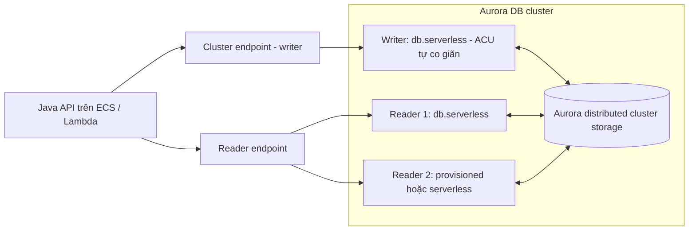
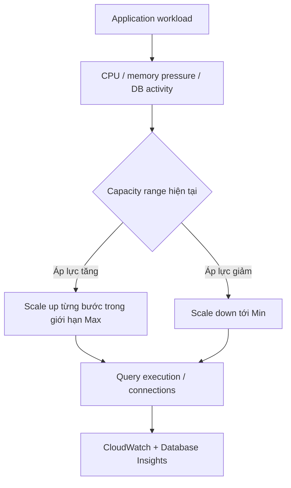
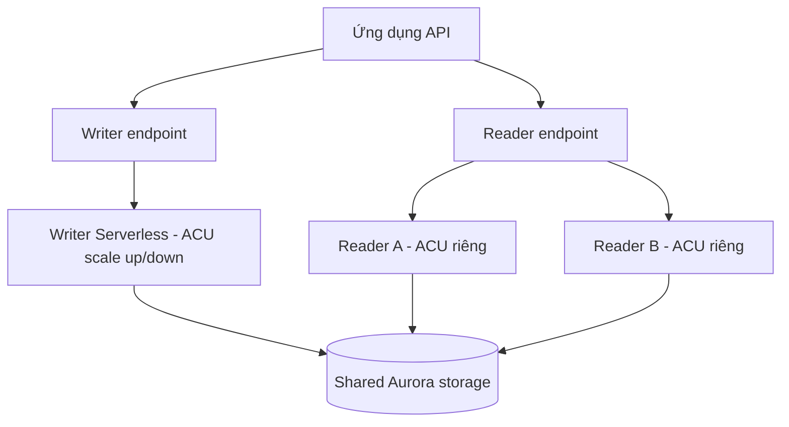
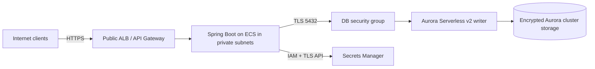
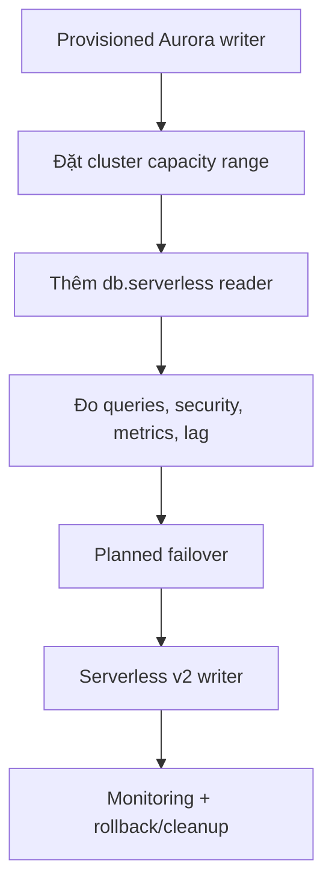
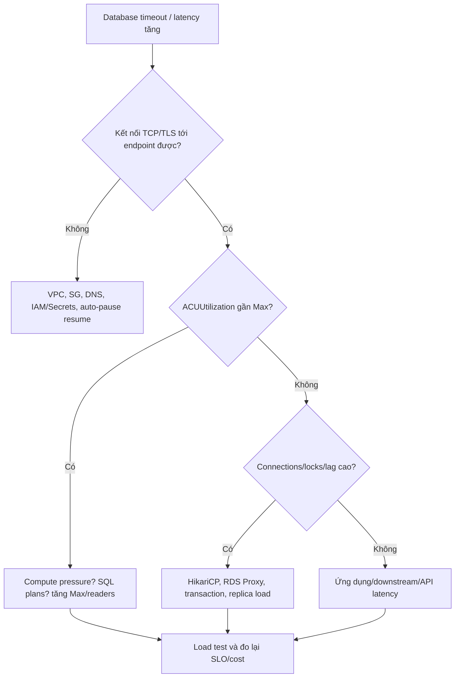

# Aurora Serverless v2 và lựa chọn capacity

## 1. Bối cảnh: database tự co giãn không có nghĩa không cần thiết kế

Một website thương mại điện tử chạy Java Spring Boot trên Amazon ECS. Ban ngày lượng truy vấn đặt hàng tăng mạnh, ban đêm chỉ còn vài công việc đối soát. Đội phát triển đang chọn một cơ sở dữ liệu quan hệ có transaction, SQL, khả năng phục hồi và tự điều chỉnh năng lực. Một DB instance provisioned lớn chạy 24/7 có thể lãng phí ở giờ thấp điểm; nhưng chọn database quá nhỏ lại gây timeout khi khuyến mãi bắt đầu.

**Amazon Aurora Serverless v2** cung cấp **compute capacity tự điều chỉnh** cho các DB instances Aurora, tính theo **Aurora Capacity Units (ACUs)**. Bạn khai báo khoảng **minimum–maximum capacity** và Aurora tăng/giảm năng lực theo nhu cầu trong phạm vi đó. Tuy nhiên, engine vẫn chạy MySQL/PostgreSQL-compatible database; bạn vẫn phải quản lý SQL schema, index, transaction, connection pools, network, IAM, backups, độ trễ và ngân sách.

Bài học thuộc chương **Cơ sở dữ liệu RDS và Aurora** của lộ trình **CLOUD_PROVIDERS_AWS**: khám phá Region/AZ, IAM, VPC, compute, storage, database, tích hợp và serverless; rèn kỹ năng chọn dịch vụ, triển khai an toàn, giám sát, phục hồi và kiểm soát chi phí. Trọng tâm của bài là **Aurora Serverless v2 và cách lựa chọn capacity**, không chỉ thao tác tạo database trong console.

Sau bài, bạn có thể:

- Giải thích **Aurora cluster**, **writer/reader**, shared storage và **ACU**.
- Chọn khoảng `MinCapacity–MaxCapacity` có cơ sở từ tải, latency SLO và ngân sách.
- Phân biệt **auto scaling**, **auto-pause về 0 ACU**, **provisioned instances** và **read scaling**.
- Hiểu tác động của **failover promotion tiers 0–1 / 2–15**, RDS Proxy, Data API, connection pools và parameter groups.
- Đọc CloudWatch `ServerlessDatabaseCapacity`, `ACUUtilization` và các metrics liên quan để quyết định capacity.
- Tạo, kiểm tra và sửa capacity bằng AWS CLI; đánh giá thay đổi với ứng dụng Java.
- Thiết kế mạng/bảo mật, HA, backup, chi phí và kế hoạch đổi từ provisioned sang Serverless v2.

## 2. Aurora Serverless v2 nằm ở đâu trong hệ sinh thái RDS?

**Amazon RDS** là nền tảng quản lý nhiều relational database engines. **Amazon Aurora** là họ database tương thích MySQL và PostgreSQL của AWS với kiến trúc **compute tách khỏi distributed storage**. **Aurora Serverless v2** là lựa chọn **capacity của DB instances Aurora**, không phải một database engine mới và không phải database NoSQL.



### 2.1. Cluster, DB instance và storage là ba lớp khác nhau

| Thành phần | Vai trò | Tác động khi chọn Serverless v2 |
| --- | --- | --- |
| **DB cluster** | Nhóm instances dùng chung Aurora cluster storage, metadata, endpoints | Đặt **ServerlessV2ScalingConfiguration** ở cấp cluster |
| **Writer DB instance** | Nhận các thao tác write và read theo quyền kết nối | Có thể là `db.serverless` hoặc provisioned khi topology hỗ trợ |
| **Reader DB instance** | Nhận read queries, có thể được promote khi failover | Có capacity riêng; liên quan **promotion tier** |
| **Cluster storage** | Lưu dữ liệu được Aurora nhân bản/điều phối trong Region | Không biến mất hoặc về giá bằng 0 khi compute auto-paused |
| **Cluster/reader endpoints** | DNS routing đến writer hoặc readers | Ứng dụng cần xử lý reconnect/failover và read-after-write consistency |

**Aurora Serverless v2 có thể dùng trong cùng cluster với provisioned Aurora instances** khi engine/config hỗ trợ. Bạn không cần tạo một sản phẩm database riêng chỉ để thêm Serverless v2 reader. Ngược lại, nếu cluster chưa có `ServerlessV2ScalingConfiguration`, AWS CLI sẽ không cho tạo instance class `db.serverless` cho tới khi đặt khoảng capacity.

### 2.2. Serverless v2 không giống Aurora Serverless v1

| Khía cạnh | Aurora Serverless v1 | Aurora Serverless v2 |
| --- | --- | --- |
| Kiến trúc scaling | Mô hình legacy, có khác biệt về quản lý instances/scaling | Sử dụng DB instances `db.serverless` trong Aurora cluster |
| Tương thích tính năng | Nhiều ràng buộc khác với provisioned | Tương thích nhiều tính năng Aurora/provisioned hơn, nhưng vẫn phải kiểm tra engine/version |
| Writer/reader | Mô hình cũ hạn chế | Có Serverless v2 writer, readers và mixed topology theo hỗ trợ |
| Tính sẵn sàng | Cần xem chế độ/phiên bản cũ | Failover/promote readers theo mô hình Aurora, có promotion tiers |
| Lựa chọn mới | Không dùng khái niệm v1 để suy tính năng v2 | Ưu tiên đánh giá **v2** và phiên bản engine mới được AWS hỗ trợ |

Không dùng tài liệu/tutorial của **Serverless v1** để cấu hình v2: những khái niệm như **scaling pause behavior, instance class và API fields** có thể khác đáng kể.

## 3. ACU: đơn vị capacity thực tế

**ACU (Aurora Capacity Unit)** là tổ hợp memory, CPU và networking capacity. Theo AWS, **1 ACU tương ứng khoảng 2 GiB bộ nhớ** cộng năng lực CPU/network liên quan. ACU **không đồng nghĩa một vCPU cố định**, và đừng suy ra hiệu năng QPS từ ACU như một phép nhân tuyến tính duy nhất.

Ví dụ về memory **xấp xỉ**:

| Current capacity | Memory tương ứng (ước lượng) | Nhận xét |
| ---: | ---: | --- |
| 0 ACU | Compute instance đang **auto-paused**, nếu được hỗ trợ | Không phục vụ query cho đến khi resume |
| 0,5 ACU | ~1 GiB | Nhỏ, thường chỉ thích hợp workload nhẹ |
| 2 ACU | ~4 GiB | Một mức thử nghiệm hoặc nền tùy ứng dụng |
| 8 ACU | ~16 GiB | Tải vừa; cần đo query latency/connections |
| 32 ACU | ~64 GiB | Năng lực lớn hơn; không suy ra QPS theo memory |
| 128 ACU | ~256 GiB | Cần xem engine/platform, network và giới hạn liên quan |

Trong vận hành, **mỗi writer/reader có current ACU riêng**, có thể tăng/giảm bằng bước nhỏ trong khoảng cấu hình. Cluster có **một min/max range dùng chung cho các Serverless v2 instances**, nhưng **không phải cả cluster dùng chung một current ACU**. Ví dụ:

```text
Cluster range: MinCapacity=2, MaxCapacity=32

Writer:   current 16 ACU
Reader A: current 16 ACU (promotion tier 1, giữ khả năng failover)
Reader B: current  4 ACU (promotion tier 10, read workload nhẹ)

Capacity hiện tại của 3 instances cộng lại ≈ 36 ACU.
Không phải cluster chỉ dùng 16 ACU.
```

### 3.1. Khoảng capacity được hỗ trợ năm 2026

AWS cập nhật tài liệu tháng **10/2026**: với engine/platform đủ mới, **Aurora PostgreSQL có thể đạt 384 ACU**, còn **Aurora MySQL có thể đạt 256 ACU**. Một số phiên bản cũ chỉ hỗ trợ tối đa **128 ACU** hoặc **256 ACU**. Mức **0 ACU** chỉ dùng khi engine/version có tính năng auto-pause; phiên bản không hỗ trợ 0 có minimum **0,5 ACU**.

Với các giá trị không âm hợp lệ, AWS cho phép bước nhảy **0,5 ACU** (như 8, 8,5, 9). **Không lấy 384 làm mặc định cho mọi Aurora PostgreSQL cluster**; khả năng thực tế còn phụ thuộc **engine version, platform version, Region**. Xác minh bằng tài liệu compatibility và AWS APIs trong tài khoản thật trước khi ghi cấu hình.

### 3.2. Capacity tự điều chỉnh, không phải quota mở vô hạn

Min và max đều có ý nghĩa:

- **MinCapacity** quyết định mức floor cho mỗi instance hoạt động (hoặc bật auto-pause khi là 0 và được hỗ trợ).
- **MaxCapacity** quyết định trần compute mỗi Serverless v2 instance được tăng lên.
- **Current ACU** do Aurora điều chỉnh theo tải trong phạm vi này; không phải giá trị bạn trực tiếp tăng bằng SQL.

Nếu query CPU-heavy liên tục khiến instance cần hơn MaxCapacity, Aurora **không thể tự tăng vượt trần**. Lúc đó phải tăng max (nếu được hỗ trợ và có cơ sở), tối ưu query/index/schema, tách read workload sang readers hoặc thay đổi kiến trúc.

## 4. Aurora tự scale khi nào và nhanh đến đâu?

Aurora quan sát **CPU usage, memory pressure và những tín hiệu workload** để tăng/giảm capacity tự động. Khả năng scale chịu ảnh hưởng của current ACU, khoảng min/max, engine/platform và kiểu tải. Không có cam kết rằng “từ 0,5 lên 128 ACU ngay trong vài mili giây”.



### 4.1. Minimum ảnh hưởng khả năng tăng tốc

AWS lưu ý **tốc độ scale-up phụ thuộc current capacity**. Từ một instance đang ở 16 ACU, Aurora có thể tăng theo những bước lớn hơn khi so với lúc bắt đầu từ 0,5 ACU. Vì vậy workload có các spike đột ngột lên mức rất cao có thể cần **MinCapacity cao hơn** để giảm thời gian tăng capacity, dù ban đêm CPU thấp.

Ví dụ một API thanh toán có SLO p99 chặt, 7:55 sáng DB đang ở 0,5 ACU và đúng 8:00 mở flash sale. MaxCapacity=64 là cần thiết nhưng **không đủ** nếu startup/connections và scale-up không theo kịp spike. Cân nhắc min 4–8 ACU, warmup có kiểm soát hoặc load test/capacity planning; quyết định theo telemetry thay vì đặt max rất lớn và hy vọng tự giải quyết.

### 4.2. Maximum là giới hạn và tín hiệu cấu hình

Nếu CloudWatch `ACUUtilization` tiến sát **100%**, instance đang tiến sát **MaxCapacity** được cấu hình. Điều này không có nghĩa CPU đang đúng 100%; đây là **tỷ số current ACU / maximum ACU**, cần xem thêm CPU, connections, memory và query latency.

Với read-heavy workload chỉ làm reader chạm trần nhưng writer vẫn còn headroom, **thêm Aurora readers hoặc tối ưu truy vấn đọc** có thể tốt hơn tăng max cho toàn cluster. Với write-heavy workload, chỉ thêm read replicas không biến một writer thành nhiều writers cùng lúc.

### 4.3. Auto scaling compute khác thay đổi schema/plan

Autoscaling **không tự tạo index, sửa query N+1, loại deadlocks hay tối ưu transaction dài**. Nếu query chạy full-table scan, nó có thể dùng thêm CPU/ACUs và tạo **hóa đơn cao hơn** mà chưa đáp ứng latency SLO. Luôn xem **slow queries/EXPLAIN, database load waits, lock contention và index health** khi capacity tăng bất thường.

## 5. Chọn MinCapacity: hiệu năng nền, memory và cold start

MinCapacity tối ưu phải đảm bảo đủ memory/cache và tốc độ scale-up cho **giờ thấp điểm**, đồng thời không trả quá nhiều tiền compute khi workload ít.

| Workload | MinCapacity nên đánh giá | Vì sao |
| --- | --- | --- |
| Sandbox/dev chỉ dùng vài giờ/ngày | **0 ACU** nếu auto-pause tương thích | Không phải trả compute khi paused, chấp nhận resume delay |
| Internal dashboard ít request nhưng cần phản hồi nhanh | 0,5–2 ACU hoặc cao hơn theo đo đạc | Tránh pause nếu người dùng không chấp nhận cold start |
| API 24/7 cần p99 chặt | 2–8 ACU hoặc baseline thực đo | Memory/cache/connection overhead và spike |
| Hệ thống doanh thu có burst lớn | Chọn floor theo load test, có thể cao hơn 8 | Tăng từ mức quá thấp có thể chậm |
| Reader báo cáo độc lập | Min thấp hơn writer nếu tier 2–15 và SLO cho phép | Scale theo truy vấn riêng |

**Các con số trong bảng chỉ để bắt đầu đánh giá**, không phải cấu hình AWS mặc định, không phải khuyến nghị áp dụng thẳng cho production. Một app có 1.000 connections ngủ vẫn có memory footprint đáng kể, dù tỷ lệ CPU gần 0.

### 5.1. Memory footprint không tự biến mất khi CPU thấp

Một Aurora PostgreSQL instance có background processes, shared buffers, per-connection state, maintenance work và các extension. Nếu MinCapacity quá thấp, database có thể gặp **out-of-memory/connection pressure** hoặc phải scale lên để đáp ứng hoạt động nền. Theo dõi memory và query waits thay vì chỉ CPU.

### 5.2. Tác động của các tính năng bổ sung

AWS khuyến nghị **minimum cao hơn** đối với một số tính năng/workload; tài liệu performance guidance có ví dụ **Performance Insights: 2 ACU**, **Aurora Global Database primary Region: 8 ACU** trong những ngữ cảnh nhất định. Những mức này là **khuyến nghị phụ thuộc phiên bản/chế độ**, không phải mọi tổ hợp đều bị API bắt buộc.

Một số tính năng như **Aurora Global Database, log exports, pgAudit, giám sát và replication activity** có thể giữ instance hoạt động hoặc làm tăng resource footprint. Để tối ưu, cần xem tài liệu tương thích của **engine/version/feature set** và đo mức thấp nhất ổn định.

## 6. Chọn MaxCapacity: headroom thay vì chỉ tiết kiệm

**MaxCapacity** là giới hạn cao nhất mỗi Aurora Serverless v2 instance được tự tăng tới. Trong nhiều mô hình tính tiền dựa trên actual ACU usage, **đặt max cao không tự tính phí như đang chạy ở max**. Tuy nhiên max cũng liên quan đến **một số tham số cấu hình database**, có thể ảnh hưởng memory commitments, connection limits và quyết định vận hành.

Giả sử theo load test:

```text
Baseline: 3–4 ACU
Traffic bình thường giờ cao điểm: 10–14 ACU
Flash sale dự kiến: 22–24 ACU
Giới hạn SLO khi target load: p95 < 200 ms

Ứng viên để thử:
  MinCapacity = 4 ACU
  MaxCapacity = 32 ACU

Cách đánh giá:
  kiểm tra p95/p99, ACUUtilization, database waits,
  connections, rollback/failover và chi phí ACU-hours.
```

**Max=32 không đảm bảo DB phục vụ mọi truy vấn** nếu query locks, các writes, storage I/O, database connection storms hoặc downstream latency mới là nút thắt. Nếu load test vẫn quá chậm, phải xác định nguồn nghẽn thay vì chỉ tăng max lên 64.

### 6.1. Headroom không phải khoảng trống lãng phí bắt buộc

Một instance đang dùng 12 ACU trong khoảng 4–32 còn **20 ACU headroom** để tự tăng; bạn vẫn trả theo mức actual usage chứ không trả 32 ACU liên tục theo mô hình compute của Serverless v2. Nhưng storage, I/O, backup, network và các components khác có phí riêng. Có thể tăng max khi cần spike lớn mà **không đồng thời tăng min**, miễn là engine/version và parameter effects đã được đánh giá.

### 6.2. Khi thay max, hãy kiểm tra `max_connections`

AWS tính default **`max_connections`** của Aurora Serverless v2 dựa trên memory ứng với **MaxCapacity**, không phải current ACU. Khi thay max, tham số này có thể thay đổi nhưng là **static parameter**, vì thế **cần reboot DB instance** để áp dụng giá trị mặc định mới.

Đặc biệt với **Aurora PostgreSQL** khi **MinCapacity = 0 hoặc 0,5 ACU**, default `max_connections` bị giới hạn ở **2.000** theo quy định của Aurora Serverless v2, kể cả khi max ACU tương đối cao. Không áp dụng quy luật “max càng cao thì luôn có vô hạn DB connections”.

**Cảnh báo:** thay capacity range có thể áp dụng ngay, nhưng **một số parameter group changes ở trạng thái `pending-reboot`**. Reboot production gây gián đoạn cần được lên lịch, kiểm tra Multi-AZ failover và application connection recovery.

### 6.3. Một vài static/dynamic parameters chịu ảnh hưởng scaling

| Parameter/nhóm | Hành vi cần hiểu |
| --- | --- |
| `max_connections` | Giá trị mặc định phụ thuộc MaxCapacity; thay đổi tối đa có thể cần reboot |
| `shared_buffers` (Aurora PostgreSQL) | Aurora điều chỉnh theo scaling; không thể ép custom value có hiệu lực như provisioned |
| `innodb_buffer_pool_size` (Aurora MySQL) | Aurora quản lý theo compute capacity |
| `autovacuum_*`, `maintenance_work_mem`, `effective_cache_size` | Một số default Aurora PostgreSQL được tính theo maximum ACU, cần xem performance guide |
| Custom parameter groups | Dynamic params có thể áp dụng ngay; static params cần reboot theo engine |

Không dùng cấu hình bộ nhớ được copy từ một RDS provisioned instance lớn để ép cố định Aurora Serverless v2; các tham số tự điều chỉnh có thể **bỏ qua custom value** hoặc mang lại kết quả không như dự kiến.

## 7. Auto-pause về 0 ACU: khi nào đáng dùng?

Với **engine/version hỗ trợ**, đặt **`MinCapacity=0`** sẽ bật khả năng **tự pause và tự resume** các Aurora Serverless v2 DB instances khi không có hoạt động kết nối theo điều kiện của AWS. Khi instance đã paused, **compute ACU charge của instance là 0** trong khoảng paused; **Aurora storage, backup và những khoản không gắn với compute vẫn có thể tính phí**.

### 7.1. Cấu hình và giới hạn

| Thuộc tính | Điều kiện |
| --- | --- |
| `MinCapacity=0` | Chỉ engine versions hỗ trợ auto-pause |
| `SecondsUntilAutoPause` | **300–86.400 giây** (5 phút đến 24 giờ) |
| Default idle threshold | **300 giây** khi không khai báo |
| Resume | Khi có kết nối/query yêu cầu, Aurora tự resume |
| Resume latency | AWS mô tả trường hợp điển hình **khoảng 15 giây**, có thể lâu hơn |
| Paused quá 24 giờ | Có thể vào trạng thái ngủ sâu hơn, resume **30 giây hoặc hơn** |

Đây là thời gian điển hình, **không phải SLO hoặc cam kết thời gian cố định**. Với ứng dụng cần trang API phản hồi dưới 500 ms, một database paused sẽ không đáp ứng tốt request đầu tiên nếu không có cơ chế warmup/timeout/retry phù hợp.

### 7.2. Một số engine versions tối thiểu hỗ trợ auto-pause

Theo AWS documentation, phạm vi ví dụ để kiểm tra:

- **Aurora MySQL:** phiên bản **3.08.0 trở lên** trong Region được hỗ trợ.
- **Aurora PostgreSQL:** các nhánh hỗ trợ có mốc như **13.15, 14.12, 15.7, 16.3** trở lên; những nhánh mới hơn cũng cần kiểm tra bảng support chính thức.

Không suy luận “mọi engine version lớn hơn về số” trong một nhánh đều có cùng tính năng. Phải đọc bảng **Aurora Serverless v2 supported engine versions/Regions**, vì hỗ trợ còn phụ thuộc **platform version** và phiên bản maintenance hiện hành.

### 7.3. Kết nối mở có thể ngăn auto-pause

Một database chỉ pause khi thỏa điều kiện **không có kết nối được khởi tạo bởi hoạt động người dùng** trong thời gian định trước, cùng điều kiện hệ thống. Ví dụ:

- Java HikariCP giữ **idle connections** liên tục có thể khiến DB không bao giờ idle đủ lâu.
- Một job health check chạy `SELECT 1` mỗi phút có thể chặn tự pause.
- **RDS Proxy** giữ kết nối tới các DB instances trong cluster, nên các Aurora Serverless v2 instances **không tự pause** khi cluster dùng proxy.
- **Aurora Global Database** có ràng buộc: writer primary Region không auto-pause; instances ở secondary clusters cũng không auto-pause theo tài liệu hiện hành.
- Một số hoạt động nền/tính năng như log exports, replication và maintenance có thể khiến database không pause dù workload người dùng nhẹ.

Vì thế, **`MinCapacity=0` không đồng nghĩa thực tế sẽ đạt 0 ACU hoặc luôn tiết kiệm tiền**. Phải kiểm tra metrics paused, connections và business activity.

### 7.4. Auto-pause và nhiều readers

Trong cluster nhiều Serverless v2 instances:

- **Writer và readers ở promotion tier 0/1** liên hệ chặt về scaling và thường pause/resume cùng nhau khi toàn nhóm đủ điều kiện.
- **Readers ở tier 2–15** có thể tự scale và auto-pause độc lập nếu idle.
- Một số thao tác đọc ở reader có thể **làm writer resume**, nên tưởng “chỉ reader đang có request” không đảm bảo writer tiếp tục paused.
- Nếu cluster có **provisioned instances** và Serverless v2 readers, cần hiểu những readers nào thực sự có thể pause; topology ảnh hưởng hiệu quả tiết kiệm.

### 7.5. Lập trình ứng dụng chịu được resume latency

Khi kết nối đến database đã paused, lần mở kết nối đầu tiên có thể chờ resume. Với Spring Boot/HikariCP, cần:

1. Đặt **JDBC connectionTimeout/socketTimeout hợp lý**, có tính đến 15–30+ giây khi resume nếu auto-pause được bật.
2. Retry **chỉ những lỗi kết nối tạm thời**, với exponential backoff + jitter; không retry vô hạn các lỗi authentication.
3. Không tự scale ECS/Lambda vì nhận hàng loạt DB connection timeouts trong thời gian resume.
4. Giới hạn concurrency và pool size để tránh **thundering herd** ngay sau khi DB resume.
5. Bảo đảm API response contract: timeout dễ hiểu, circuit breaker/backpressure, synthetic warmup khi cần.

**Khuyến nghị thiết kế:** dev/test, dashboard nội bộ ít truy cập hoặc ứng dụng có thời gian nghỉ dài có thể hưởng lợi từ Min=0. Với API giao dịch production cần availability/latency chặt, hãy thử **Min>0** hoặc topology HA phù hợp thay vì mặc định pause mọi DB.

## 8. Writer, reader endpoints và khả năng mở rộng đọc

Aurora cluster thường có **một writer instance** để nhận cập nhật dữ liệu, cùng các **Aurora readers** nhận read-only queries và có thể được promote trong failover. Aurora storage được quản lý ở tầng cluster, không hoạt động như các RDS read replicas truyền thống sao chép toàn bộ storage thành từng bản độc lập.

| Endpoint | Thường trỏ tới | Dùng khi |
| --- | --- | --- |
| **Cluster endpoint (writer)** | Writer hiện tại | Transactions ghi, read-after-write cần nhất quán với writer |
| **Reader endpoint** | Phân phối connection tới readers hiện có | Read scaling, báo cáo, queries đọc có thể chịu replica lag |
| **Instance endpoint** | Một instance cụ thể | Chẩn đoán, pinned workloads, quản trị |
| **Custom endpoint** | Tập instances chỉ định | Điều phối read workload riêng theo topology |

**Reader endpoint không tự cân bằng từng SQL query trên mọi read replicas.** Thông thường, DNS/connection được phân phối tại thời điểm kết nối; một **connection pool giữ nhiều connections** có thể làm traffic lệch nếu không refresh/size phù hợp. Reader có thể có replica lag, vì vậy không gửi read-after-write bắt buộc phải thấy dữ liệu mới nhất qua reader endpoint mà không có biện pháp nhất quán ứng dụng.

### 8.1. Scaling chiều dọc và chiều ngang khác nhau



- **Vertical/elastic scaling:** tăng ACU trên một writer hoặc reader hiện có khi tải trên instance đó cao.
- **Horizontal read scaling:** thêm reader instances, phân bổ các connection/read queries qua reader endpoint hoặc custom endpoints.
- **Write scaling:** với một writer chuẩn, tối ưu writes/transactions/sharding ở tầng ứng dụng hoặc chọn giải pháp phù hợp; thêm nhiều readers **không tự tăng số writer**.

Trong mỗi Aurora DB cluster, AWS hỗ trợ nhiều read replicas (thường tối đa **15 reader instances** theo kiến trúc Aurora). Giới hạn thực tế phụ thuộc engine/Region/features và quotas.

## 9. Promotion tier 0/1 và 2–15: capacity gắn với HA

**Promotion tier** hay **failover priority** là thuộc tính từ **0 đến 15** để Aurora xét chọn reader nào được promote thành writer khi failover. Với **Aurora Serverless v2**, tier còn chi phối **cách reader scale**:

| Tier của Serverless reader | Capacity behavior | Mục đích phổ biến |
| --- | --- | --- |
| **0 hoặc 1** | Reader giữ minimum capacity **ít nhất ngang writer current capacity** hoặc tương đương writer provisioned | HA, sẵn sàng tiếp nhận tải writer khi failover |
| **2 đến 15** | Reader **scale độc lập** dựa theo workload, có thể xuống cluster minimum | Read scaling linh hoạt, báo cáo, tiết kiệm ở tải thấp |

Đây là khác biệt quan trọng so với **provisioned reader**, nơi promotion tier chủ yếu điều chỉnh **thứ tự failover**, không làm instance class tự đổi theo writer.

### 9.1. Minh họa: 3 instances, hai mục tiêu khác nhau

```text
Cluster Min=2 Max=32 ACU

Writer          current 20 ACU
HA Reader tier 1 current >= 20 ACU (theo writer)
Report Reader tier 10 current  3 ACU (scale độc lập)

Nếu writer bị lỗi:
  Reader tier 1 đã có capacity gần đủ để tiếp quản.

Nếu report chạy nặng:
  Reader tier 10 có thể tăng theo workload của nó,
  không bắt buộc writer tăng cùng.
```

**Đánh đổi:** tier 0/1 giúp HA nhưng có thể tăng chi phí khi writer đang ở mức ACU cao: một writer 32 ACU có reader HA scale theo 32 ACU dù reader không chịu bao nhiêu query. Một reader tier 10 có thể tiết kiệm nhưng **không được chuẩn bị sẵn capacity theo writer** khi phải promote.

### 9.2. Failover và Multi-AZ

Aurora lưu trữ dữ liệu phân tán trong Region qua nhiều Availability Zones. Để có **compute HA**, nên có **writer + ít nhất một reader trong AZ khác**, với promotion tier phù hợp. Aurora có thể tự failover khi writer hoặc AZ gặp sự cố; ứng dụng kết nối qua cluster endpoint cần **re-resolve DNS và reconnect/retry**.

Một cluster **chỉ có writer** có Aurora storage durability nhưng **không tương đương với Multi-AZ compute failover có standby sẵn**. Khi writer/AZ hỏng, tạo compute thay thế có thể mất lâu hơn và chịu rủi ro capacity tại AZ đó.

### 9.3. HA cần trả bằng capacity của standby

Khi chọn Aurora Serverless v2, đừng so chi phí của **một writer 2–16 ACU** với một hệ thống production có **writer + reader HA** mà bỏ reader khỏi báo giá. Một topology có tier 0/1 standby có thể chạy ACU gần writer, ảnh hưởng tổng compute ACU-hours.

**Không giả định tier 0/1 bằng một “hot standby miễn phí”.** Đặt cảnh báo cho từng instance và mô phỏng failover trong môi trường kiểm soát để xác minh thời gian ứng dụng phục hồi và capacity sau khi role đổi.

## 10. Kết nối từ Java/ECS/Lambda: pool size, RDS Proxy và Data API

Một database autoscale không tự loại bỏ giới hạn **số kết nối**. Java Spring Boot thường dùng JDBC connection pool (ví dụ HikariCP), trong khi Lambda có thể tạo nhiều execution environments song song. Một đợt tăng quy mô ứng dụng có thể tạo **connection storm** ngay khi DB đang ở MinCapacity thấp, dù truy vấn chưa thực sự nặng.

### 10.1. Công thức kiểm tra sơ bộ connection budget

Giả sử:

```text
20 ECS tasks
Mỗi task có HikariCP maximumPoolSize = 20

Upper bound lý thuyết của application connections:
20 × 20 = 400

Ngoài ra còn:
  monitoring, migrations, admin sessions, readers,
  các ứng dụng khác và kết nối nội bộ cần thiết.
```

Nếu autoscale ECS từ 20 lên 100 tasks, cùng pool settings đó có thể dẫn đến **2.000 kết nối tiềm năng**. Đây không phải load test QPS, mà là **rủi ro connection amplification**. Chọn pool size trên cơ sở thực đo và DB connection budget, không để mỗi app instance tự giữ pool 100 connections chỉ vì dự định tăng Aurora MaxCapacity.

### 10.2. Ví dụ Java HikariCP (minh họa)

```java
import com.zaxxer.hikari.HikariConfig;
import com.zaxxer.hikari.HikariDataSource;

public final class DatabasePoolExample {
    public static HikariDataSource createPool(
            String jdbcUrl, String username, String password) {

        HikariConfig config = new HikariConfig();
        config.setJdbcUrl(jdbcUrl);
        config.setUsername(username);
        config.setPassword(password);

        config.setMaximumPoolSize(10);  // Cần đo tải thực tế
        config.setMinimumIdle(2);       // Không phù hợp nếu muốn DB auto-pause
        config.setConnectionTimeout(30_000); // Cần thử nghiệm khi DB resume
        config.setMaxLifetime(1_800_000);

        return new HikariDataSource(config);
    }
}
```

**Không sao chép thành production config nguyên vẹn**: username/password cần lấy an toàn từ Secrets Manager/IAM authentication theo thiết kế, TLS phải được bật/verify phù hợp, error handling phải chống lộ credential. Với Aurora PostgreSQL auto-pause, **minimumIdle > 0** hoặc health checks đều có thể giữ connections và ngăn DB pause. Nếu muốn **MinCapacity=0**, phải thiết kế connection lifecycle phù hợp với thời gian idle và chấp nhận cold start.

### 10.3. Khi nào dùng Amazon RDS Proxy?

**Amazon RDS Proxy** hỗ trợ connection pooling/multiplexing và có thể giúp ứng dụng Lambda/ECS có nhiều kết nối ngắn tới RDS/Aurora mà không đẩy toàn bộ connection storms vào DB. Nó cũng giúp điều hướng kết nối khi failover theo các khả năng hỗ trợ của engine/topology.

Ưu điểm:

- Giảm chi phí quản trị connections và những connection spikes từ nhiều clients.
- Có thể cải thiện khả năng hồi phục kết nối khi writer failover.
- Quản lý truy cập DB bằng IAM/secrets theo thiết kế.

Giới hạn/đánh đổi:

- **RDS Proxy có phí riêng** và phải dùng networking/IAM/Secrets/KMS phù hợp.
- Transactions dài, session state, prepared statements hoặc pinning behavior có thể giảm hiệu quả multiplexing.
- **RDS Proxy duy trì open connection đến Aurora instances**, vì vậy **cluster dùng RDS Proxy không thực sự auto-pause** theo AWS. Đừng tính chi phí Min=0 với proxy như thể DB sẽ ngủ 12 giờ/ngày.

**Quy tắc chọn:** API production 24/7 chịu connection bursts có thể hưởng lợi RDS Proxy và đặt MinCapacity > 0. Môi trường dev hiếm truy cập muốn **auto-pause thật** có thể **không dùng RDS Proxy**, kiểm soát client connection pool và timeout/retry khi thức dậy.

### 10.4. RDS Data API là một mô hình kết nối khác

Với engine/version và Region hỗ trợ **Amazon RDS Data API**, ứng dụng có thể thực thi SQL qua **HTTPS API** thay vì giữ một số lượng lớn TCP connections dài hạn. Điều này có thể hữu ích cho Lambda hoặc ứng dụng quản trị với truy cập không thường xuyên.

- Data API có mô hình API, IAM và khả năng transaction khác trực tiếp JDBC; **không tự phù hợp cho mọi ứng dụng OLTP nhiều truy vấn/transaction phức tạp**.
- Một request Data API tới Aurora Serverless v2 đang paused có thể **kích hoạt resume writer**.
- Nếu Data API được gọi thường xuyên, DB không có đủ idle window để pause. Không xem Data API là cách đảm bảo 0 ACU liên tục.
- Xem giới hạn payload, engine/version, Regions, IAM/Secrets Manager/KMS và transaction semantics trước khi chọn.

### 10.5. Kiểm tra kết nối và SQL locks trước khi tăng ACU

Aurora PostgreSQL:

```sql
-- Xem connection limit của instance hiện tại
SHOW max_connections;

-- Xem số kết nối theo trạng thái
SELECT state, COUNT(*) AS connection_count
FROM pg_stat_activity
GROUP BY state
ORDER BY connection_count DESC;

-- Xem các truy vấn đang hoạt động lâu (cần quyền thích hợp)
SELECT pid, now() - query_start AS duration, wait_event_type, wait_event
FROM pg_stat_activity
WHERE state = 'active' AND query_start IS NOT NULL
ORDER BY duration DESC
LIMIT 10;
```

Đây là **lệnh đọc metadata** khi được cấp quyền; tránh hiện query text chứa PII/secrets trong logs. Với Aurora MySQL, có thể dùng `SHOW GLOBAL STATUS LIKE 'Threads_connected';`, `SHOW VARIABLES LIKE 'max_connections';` và Performance Schema/slow query log theo quyền/cấu hình.

## 11. Preflight: engine version, Region, VPC và quyền trước khi tạo

Trước khi tạo Aurora Serverless v2, kiểm tra:

1. **Region** hỗ trợ engine version và instance class `db.serverless`.
2. Engine **Aurora PostgreSQL** hoặc **Aurora MySQL** phù hợp với ứng dụng, extensions, migration và SQL semantics.
3. **DB subnet group** có private subnets trong ít nhất hai AZ phù hợp; SG chỉ mở DB port từ application SG.
4. **KMS encryption**, backup retention, deletion protection và Secrets Manager phù hợp chính sách.
5. Capacity min/max hợp lệ theo **engine/platform version**, có thể bật auto-pause hay không.
6. **Cluster endpoint, reader endpoint**, availability topology và read scaling mong muốn.
7. Dự toán **ACU-hours, số reader instances, storage/I/O/backup và các proxy/network charges**.

### 11.1. AWS CLI read-only preflight

```bash
# Chắc chắn thao tác đúng AWS account
aws sts get-caller-identity

# Liệt kê những engine versions có orderable db.serverless instances
aws rds describe-orderable-db-instance-options \
  --engine aurora-postgresql \
  --db-instance-class db.serverless \
  --region ap-southeast-1 \
  --query 'OrderableDBInstanceOptions[*].[EngineVersion,DBInstanceClass]' \
  --output table

# Kiểm tra subnet group được platform tạo sẵn
aws rds describe-db-subnet-groups \
  --db-subnet-group-name shop-db-private-subnets \
  --region ap-southeast-1

# Xem các DB clusters đã có trước khi dùng tên mới
aws rds describe-db-clusters \
  --region ap-southeast-1 \
  --query 'DBClusters[*].[DBClusterIdentifier,Engine,EngineVersion,Status]' \
  --output table
```

`db.serverless` trong danh sách orderable versions chỉ cho thấy **hỗ trợ class cơ bản**; nó không chứng minh mọi version đều hỗ trợ **MinCapacity=0** hoặc MaxCapacity=384. Đối chiếu thêm bảng **Supported Regions and Aurora DB engines for Aurora Serverless v2** và thông tin platform version hiện hành.

## 12. AWS CLI: tạo Aurora PostgreSQL Serverless v2 cluster

Các lệnh tạo/sửa/xóa database **phát sinh chi phí AWS và có thể thay đổi tài nguyên thật**. Chỉ dùng trên sandbox hoặc môi trường được phê duyệt; thay mọi tên/ARN/subnet/security group/engine version đúng tài khoản. Không chạy trên production trước khi review IAM, backup, network, recovery và kế hoạch dọn tài nguyên.

### 12.1. Tạo DB cluster với capacity range

Giả sử đã có subnet group `shop-db-private-subnets`, DB SG `sg-0123456789abcdef0` và engine version tương thích. Lệnh minh họa:

```bash
aws rds create-db-cluster \
  --db-cluster-identifier shop-aurora-v2-demo \
  --engine aurora-postgresql \
  --engine-version 'ENGINE_VERSION_SUPPORTED_IN_REGION' \
  --db-subnet-group-name shop-db-private-subnets \
  --vpc-security-group-ids sg-0123456789abcdef0 \
  --database-name shopdb \
  --master-username shopadmin \
  --manage-master-user-password \
  --storage-encrypted \
  --serverless-v2-scaling-configuration MinCapacity=1,MaxCapacity=16 \
  --region ap-southeast-1
```

**Lệnh này chỉ tạo cluster metadata/storage**, không tự tạo writer DB instance khi dùng AWS CLI theo quy trình Serverless v2. Trong ví dụ sử dụng AWS-managed Secrets Manager master password để không phải đưa mật khẩu database lên command line/shell history. Quản lý secrets và IAM permissions vẫn phải được phê duyệt.

### 12.2. Tạo writer `db.serverless`

```bash
aws rds create-db-instance \
  --db-cluster-identifier shop-aurora-v2-demo \
  --db-instance-identifier shop-aurora-v2-writer \
  --db-instance-class db.serverless \
  --engine aurora-postgresql \
  --no-publicly-accessible \
  --region ap-southeast-1

aws rds wait db-instance-available \
  --db-instance-identifier shop-aurora-v2-writer \
  --region ap-southeast-1
```

**DB cluster và DB instance là hai resources**: không kiểm tra mỗi `create-db-cluster` response rồi kết luận database đã có compute/writer sẵn sàng. Khi instance xuất hiện, dùng `describe-db-clusters` và `describe-db-instances` để lấy endpoint, kiểm tra SG, subnet, status và capacity.

### 12.3. Readback cluster, scaling config và endpoints

```bash
aws rds describe-db-clusters \
  --db-cluster-identifier shop-aurora-v2-demo \
  --region ap-southeast-1 \
  --query 'DBClusters[0].{Engine:Engine,Version:EngineVersion,Status:Status,Scaling:ServerlessV2ScalingConfiguration,WriterEndpoint:Endpoint,ReaderEndpoint:ReaderEndpoint,Members:DBClusterMembers}' \
  --output json

aws rds describe-db-instances \
  --db-instance-identifier shop-aurora-v2-writer \
  --region ap-southeast-1 \
  --query 'DBInstances[0].{Identifier:DBInstanceIdentifier,Class:DBInstanceClass,Status:DBInstanceStatus,AZ:AvailabilityZone,PubliclyAccessible:PubliclyAccessible,Endpoint:Endpoint.Address}' \
  --output json
```

Chỉ kết nối thử từ host/container có route hợp lệ tới private DB subnet và SG được cho phép. Đừng thay `--publicly-accessible` thành true để “thử kết nối nhanh”; nên kiểm tra VPN/bastion/SSM Session Manager/VPC network hoặc chạy ứng dụng trong private subnet.

### 12.4. Thêm Serverless v2 reader làm HA standby

Sau khi cluster hoạt động, cân nhắc reader ở AZ khác, với tier 0 hoặc 1 để sẵn sàng failover:

```bash
aws rds create-db-instance \
  --db-cluster-identifier shop-aurora-v2-demo \
  --db-instance-identifier shop-aurora-v2-reader-ha \
  --db-instance-class db.serverless \
  --engine aurora-postgresql \
  --promotion-tier 1 \
  --no-publicly-accessible \
  --region ap-southeast-1
```

Kiểm tra **AZ placement thực** của reader và writer, không chỉ giả định AWS tự chọn AZ khác theo ý muốn; có thể chỉ định Availability Zone khi triển khai topology nếu cần và hợp lệ. Một reader tier 1 có thể scale theo writer và **tăng chi phí ACU-hours đáng kể** dù không nhận nhiều read queries.

### 12.5. Thử sửa khoảng capacity

Khi đo tải cho thấy Min=1 gây phản hồi chậm lúc traffic spike:

```bash
# Lệnh thay đổi tài nguyên thật: chỉ thực hiện sau khi review
aws rds modify-db-cluster \
  --db-cluster-identifier shop-aurora-v2-demo \
  --serverless-v2-scaling-configuration MinCapacity=4,MaxCapacity=32 \
  --apply-immediately \
  --region ap-southeast-1
```

Theo tài liệu AWS, **capacity range modification có hiệu lực ngay** bất kể bạn chọn apply immediately hay đợi maintenance window; một số **static parameter default values** (đặc biệt `max_connections`) vẫn cần reboot từng DB instance để áp dụng. Trước khi reboot production, xem `pending-reboot`, chuẩn bị failover/connection handling và change window.

Đọc lại:

```bash
aws rds describe-db-clusters \
  --db-cluster-identifier shop-aurora-v2-demo \
  --region ap-southeast-1 \
  --query 'DBClusters[0].ServerlessV2ScalingConfiguration'

aws rds describe-db-clusters \
  --db-cluster-identifier shop-aurora-v2-demo \
  --region ap-southeast-1 \
  --query 'DBClusters[0].DBClusterMembers[*].[DBInstanceIdentifier,IsClusterWriter,PromotionTier,DBClusterParameterGroupStatus]' \
  --output table
```

**Không đổi Min/Max cùng lúc với schema migration nặng hoặc đổi engine version** nếu không cần, vì khi latency/availability thay đổi sẽ khó xác định nguyên nhân. Lưu baseline metrics và có phương án rollback.

## 13. Bật auto-pause và kiểm tra trạng thái thực

Ví dụ chỉ áp dụng nếu **engine version** của cluster `shop-aurora-v2-demo` đã hỗ trợ auto-pause và không có tính năng cấu hình ngăn pause:

```bash
# Thay đổi tài nguyên thật: môi trường dev/test phù hợp, review trước khi chạy
aws rds modify-db-cluster \
  --db-cluster-identifier shop-aurora-v2-demo \
  --serverless-v2-scaling-configuration MinCapacity=0,MaxCapacity=16,SecondsUntilAutoPause=900 \
  --apply-immediately \
  --region ap-southeast-1
```

`SecondsUntilAutoPause=900` nghĩa là **15 phút idle**. AWS chỉ chấp nhận minimum 0 với engine versions hỗ trợ; dùng với RDS Proxy hoặc Aurora Global Database trong những topology không tương thích thì **không được tự suy ra sẽ pause**. Cần kiểm tra kết quả thực tế và thời gian resume khi client tạo kết nối trở lại.

### 13.1. Dùng metric, không chỉ DBInstanceStatus

Khi Serverless v2 instance **auto-paused**, AWS vẫn có thể báo `DBInstanceStatus=available`. Đừng xem trạng thái available là bằng chứng instance đang tốn ACU compute. Thay vào đó:

- `ServerlessDatabaseCapacity=0` cho thấy instance đang ở capacity 0.
- `ACUUtilization=0` và `CPUUtilization=0` được phát trong giai đoạn pause theo mô hình hỗ trợ.
- Aurora phát DB events khi auto-pause/resume bắt đầu/hoàn tất.
- Các metrics khác có thể **không có datapoints** và database logs có thể không phát sinh khi instance paused.

**Quan sát tối thiểu vài chu kỳ idle/resume** trong môi trường thử: một phiên JDBC hoặc terminal admin giữ kết nối có thể ngăn DB pause ngay cả khi không chạy query.

### 13.2. Auto-pause không phải stop cluster thủ công

| Cơ chế | Trigger | Ảnh hưởng | Phù hợp |
| --- | --- | --- | --- |
| **Aurora Serverless v2 auto-pause** | Min=0 + đủ idle time và feature compatibility | Instance tự về 0 ACU; lần kết nối sau kích hoạt resume | Dev/test, tải gián đoạn |
| **Stop/start DB cluster** | API/manual/automation theo điều kiện AWS | Cluster bị dừng và cần start lại; latency/behavior khác | Môi trường dùng theo ca hoặc sandbox |
| **Scale down tới Min>0** | Aurora autoscaling | Compute vẫn active và có charge ACU | Production cần phản hồi ổn định |
| **Xóa cluster** | Thao tác phá hủy tài nguyên | Mất compute/cluster, dữ liệu phụ thuộc snapshot/backup | Chỉ cleanup được phê duyệt |

Không thay auto-pause bằng xóa cluster để tiết kiệm tiền. Database production cần backup, retention, restore tests và cơ chế ngăn xóa ngoài ý muốn.

## 14. CloudWatch metrics: đọc ACU đúng cách

AWS phát các metrics Aurora Serverless v2 trong **`AWS/RDS`** theo DB instance hoặc cluster tùy metric. Để ra quyết định capacity, phải nhìn **cùng lúc ACUs, CPU/memory, connections, latency và query waits**.

| Metric | Ý nghĩa | Cách dùng |
| --- | --- | --- |
| **`ServerlessDatabaseCapacity`** | Current compute capacity theo ACU | Tính pattern ACU thực và so min/max |
| **`ACUUtilization`** | **Current ACU / MaxConfiguredACU × 100%** | Sắp chạm trần max khi gần 100% |
| **`CPUUtilization`** | CPU sử dụng so với capacity CPU tại **configured Max ACU** | Không hiểu như CPU% của kích thước provisioned cố định |
| **`FreeableMemory`** | Một số đo memory headroom tính trong mô hình Serverless capacity tối đa | Không diễn giải máy móc như “memory còn rảnh ở current ACU” |
| **`DatabaseConnections`** | Số DB connections | Phát hiện connection storms và pool leak |
| **`ConnectionAttempts`** | Số lần thử kết nối | Điều tra tăng kết nối khi resume |
| **`ReadLatency` / `WriteLatency`** | Latency tầng storage I/O tương ứng | Tìm nghẽn I/O, cần kết hợp query latency |
| **`ReadIOPS` / `WriteIOPS`** | Cường độ I/O | Theo dõi lưu trữ và chi phí khi dùng Aurora Standard |
| **`VolumeBytesUsed`** | Dung lượng cluster storage được ghi nhận | Dự toán GB-month storage và tăng trưởng |
| **`ServerlessV2Usage`** | Số ACU dùng để đo billing usage | Theo dõi compute, bằng 0 trong giai đoạn paused |
| **`ReplicaLag`** và metrics replication phù hợp | Độ trễ read replica theo engine | Đánh giá consistency/read load/HA |
| **`Deadlocks`** hoặc Performance Insights waits | Khóa và truy vấn có vấn đề | Tìm nguyên nhân không giải bằng thêm ACU |

### 14.1. Cẩn thận với metric theo cluster

Theo tài liệu AWS, **`ServerlessDatabaseCapacity` ở cấp DB instance là ACU hiện tại của instance đó**, nhưng **giá trị ở cấp cluster có thể biểu diễn mức trung bình các Serverless instances**, **không phải tổng ACUs tính tiền**. Nếu muốn tính tổng capacity consumption, quan sát **từng writer/reader** và tổng hợp theo thời gian; đừng lấy cluster average nhân giá mà không tính số instances.

### 14.2. Ví dụ AWS CLI đọc capacity trong CloudWatch

```bash
# Khoảng thời gian UTC minh họa; thay bằng thời gian thử tải thực tế
aws cloudwatch get-metric-statistics \
  --namespace AWS/RDS \
  --metric-name ServerlessDatabaseCapacity \
  --dimensions Name=DBInstanceIdentifier,Value=shop-aurora-v2-writer \
  --start-time '2026-11-20T00:00:00Z' \
  --end-time '2026-11-20T03:00:00Z' \
  --period 300 \
  --statistics Minimum Average Maximum \
  --region ap-southeast-1 \
  --output json

aws cloudwatch get-metric-statistics \
  --namespace AWS/RDS \
  --metric-name ACUUtilization \
  --dimensions Name=DBInstanceIdentifier,Value=shop-aurora-v2-writer \
  --start-time '2026-11-20T00:00:00Z' \
  --end-time '2026-11-20T03:00:00Z' \
  --period 300 \
  --statistics Average Maximum \
  --region ap-southeast-1 \
  --output json
```

Các lệnh trên **chỉ đọc**, nhưng thời gian lịch sử là **ví dụ**, không đảm bảo có datapoints trong account. Đặt đúng `DBInstanceIdentifier`, timezone UTC, CloudWatch statistic và period. Với app production, dùng dashboards theo **cluster → writer/reader → service API → business SLO**.

### 14.3. Ba dấu hiệu nên tăng MaxCapacity

1. `ACUUtilization` gần 100% kéo dài trong các đỉnh tải có thật.
2. Query/business latency tăng, memory/CPU pressure hoặc database load waits cho thấy **thiếu compute**, không chỉ slow SQL/index.
3. Backend concurrency/connection caps đã được kiểm soát, không có dấu hiệu cache stampede hoặc lặp request vô ích.

Ngược lại, nếu **ACUUtilization chỉ 25%** nhưng query 2 giây, tăng max có thể không tác dụng: xem **database locks, missing indexes, transaction duration, network, reader lag và CPU/database waits**.

### 14.4. Khi nào nên tăng MinCapacity?

- Ngay sau giờ thấp điểm, database scale-up không bắt kịp một spike đã biết.
- Ở current ACU rất thấp, memory pressure/connection churn khiến ứng dụng chậm.
- Một tính năng bổ sung cần baseline resources lớn hơn.
- Reader HA tier 0/1 cần sẵn sàng failover và p95/p99 response time phải ổn định.

Min là **chi phí nền thực tế**, nên chỉ tăng theo load test/observability; tăng Min từ 2 lên 8 ACU có thể làm bill nền tăng mạnh cho cả writer và reader tier 1.

## 15. Aurora Standard, I/O-Optimized và mô hình chi phí

Aurora có hai kiểu cấu hình lưu trữ phổ biến:

- **Aurora Standard**: chi trả compute + database storage + I/O requests theo bảng giá.
- **Aurora I/O-Optimized**: chi trả compute/storage theo giá của cấu hình này, **không tính riêng read/write I/O requests** theo mô hình Aurora I/O-Optimized.

Lựa chọn này **độc lập với việc DB instance là provisioned hay Serverless v2**, nhưng làm thay đổi tổng chi phí và điểm hòa vốn. Aurora I/O-Optimized thường đáng đánh giá khi I/O charges chiếm phần lớn hóa đơn Standard; không phải luôn rẻ hơn cho workload ít I/O.

### 15.1. Compute charge theo ACU-time

Theo AWS pricing, **Aurora Serverless v2 tính compute theo ACU dùng thực, billed per second**, thường quy đổi thành **ACU-hours** để dự toán.

```text
Compute ACU-hours ≈ ∑ (current ACU của từng DB instance × thời gian theo giờ)

Compute cost ≈ ACU-hours × đơn giá ACU-hour theo:
              Region + engine + storage configuration

Tổng hóa đơn còn cộng:
  storage GB-month, I/O (nếu Standard),
  backup/snapshot, data transfer, logs/monitoring,
  RDS Proxy, KMS, network và các dịch vụ liên quan.
```

### 15.2. Ví dụ giả định có writer và hai readers

Giả sử mỗi ngày workload:

| DB instance | 18 giờ tải thấp | 6 giờ tải cao | ACU-hours/ngày |
| --- | ---: | ---: | ---: |
| Writer | 2 ACU | 10 ACU | `18×2 + 6×10 = 96` |
| HA reader tier 1 | 2 ACU | 10 ACU | `96` |
| Read-only reader tier 10 | 2 ACU | 2 ACU | `24×2 = 48` |
| **Tổng** | | | **240 ACU-hours/ngày** |

Trong tháng giả định 30 ngày: **7.200 ACU-hours**. Nếu dùng **đơn giá hoàn toàn giả định** `0,10 USD/ACU-hour`, compute chỉ riêng ba instances là **720 USD/tháng**; chưa tính storage, I/O, backups, Proxy hay network. **0,10 USD chỉ là số luyện tính, không phải bảng giá AWS Singapore hay giá niêm yết năm 2026**.

Điểm cần nhớ là **HA reader tier 1 có thể cần capacity theo writer**, nên giả định “writer 96 ACU-hours/ngày thì cả cluster chỉ 96” sẽ sai. Khi dùng Provisioned readers hoặc backup/Global DB, chi phí phải được tính theo quy tắc riêng.

### 15.3. Ví dụ dev auto-pause

Giả sử DB dev hoạt động khoảng **4 giờ/ngày ở 2 ACU**, còn **20 giờ/ngày thực sự paused tại 0 ACU**:

```text
Dev compute = 4h × 2 ACU + 20h × 0 ACU
            = 8 ACU-hours/ngày

Nếu thay bằng DB luôn hoạt động ở 1 ACU:
            = 24h × 1 ACU
            = 24 ACU-hours/ngày
```

So sánh này chỉ minh họa **phần compute**. Thực tế DB có thể cần nhiều thời gian hoạt động hơn dự kiến vì sessions, backups/maintenance, health checks hoặc RDS Proxy; paused không làm storage biến mất. Cần đo **`ServerlessV2Usage` và `ServerlessDatabaseCapacity`** thay vì tự giả định DB ngủ đúng 20 giờ.

### 15.4. Serverless v2 không mặc định rẻ hơn provisioned

| Workload | Nghiêng về Serverless v2 | Cân nhắc provisioned |
| --- | --- | --- |
| Tải biến động lớn ngày/đêm | Tự giảm ACU thấp điểm | Instance lớn trả phí cả ngày |
| Tải thất thường, tăng đột biến | Elastic capacity trong khoảng min/max | Fixed capacity có thể cần headroom lớn |
| Workload ổn định 24/7 ở mức cao | Có lợi nếu cần elasticity hoặc linh hoạt HA | **Provisioned/Reserved Instances** có thể có tổng chi phí tốt hơn |
| Dev/test bỏ trống lâu | Auto-pause 0 nếu tương thích | Stop/start hoặc class nhỏ cũng đáng so |
| HA có reader luôn ngang writer | Tự cân capacity khi tải thay đổi | Tính riêng fixed standby instance |
| Query chậm vì thiếu index/lock | Thêm ACU chưa chắc cải thiện | Tối ưu SQL ở cả hai mô hình |

**Đừng chọn theo tên “Serverless”.** Lập bảng workload theo giờ, peak/p95/p99, những điều kiện HA, kết nối, storage/I/O và **tổng chi phí**, rồi benchmark cả hai cấu hình phù hợp.

## 16. Giám sát truy vấn, database health và tối ưu performance

Aurora Serverless v2 có thể tăng ACU khi database bị tải nặng nhưng nguồn tải đến từ **queries không hiệu quả**. Một hệ thống có SQL N+1 hoặc transaction giữ lock nhiều phút có thể “scale up rất tốt” rồi vẫn timeout.

### 16.1. Những tín hiệu cần ghép

| Nếu thấy | Cần kiểm tra |
| --- | --- |
| Current ACU tăng liên tục, QPS không tăng | Slow SQL, full scans, lock waits, memory/cache miss, background job |
| ACU gần max, CPU/network thực cao | Tăng max hoặc thêm readers, tối ưu query/index |
| Connection count tăng theo ECS/Lambda concurrency | Connection pools, RDS Proxy, backpressure |
| Reader lag cao | Write burst, reader capacity, replication activities và topology |
| Storage I/O tăng lớn | Query pattern, indexes, transaction log, chọn Standard vs I/O-Optimized |
| Deadlocks/long transactions | Transaction isolation, lock ordering và retry logic |
| p99 API cao nhưng DB queries bình thường | Application/runtime/network, DNS, connection setup, external API |
| ACU không giảm khi idle | Sessions còn mở, feature/resource overhead, replication, minimum quá cao |

### 16.2. Database Insights/Performance Insights

AWS có **Performance Insights/CloudWatch Database Insights** theo engine và mức hỗ trợ, cho phép nhìn **database load, top SQL, wait events** và các chỉ số chi tiết. Với Aurora Serverless v2, những metrics như `os.general.serverlessDatabaseCapacity` có thể cung cấp current ACU. Tính năng, retention và chi phí phụ thuộc cấu hình/Region; xem khả năng hỗ trợ hiện tại trước khi bật.

Ví dụ:

- CPUUtilization cao, top SQL là truy vấn full-table scan → tối ưu index và filter.
- `wait_event_type=Lock` → điều tra transaction dài, không chỉ tăng ACU.
- ConnectionAttempts cao sau resume → kiểm soát application pool/concurrency.
- Reader ở tier 10 bị query report nặng → scale reader/đặt custom endpoint hoặc tách báo cáo.

### 16.3. Alert có ngữ cảnh

Một vài alarm ý nghĩa:

1. `ACUUtilization > 85%` trong nhiều khoảng quan sát **và** p95 latency/DB load tăng.
2. DatabaseConnections gần connection budget đã kiểm chứng.
3. Aurora replication lag, DB instance failover hoặc `pending-reboot` kéo dài.
4. Auto-pause không diễn ra trong môi trường dev sau nhiều giờ idle.
5. Billing ACU-hours/day tăng bất thường so với traffic/business metrics.

Ngưỡng 85% chỉ là **giá trị khởi đầu để hiệu chỉnh**, không phải khuyến cáo chung của AWS. Một batch job ngắn chạm 100% ACU nhưng vẫn hoàn tất đúng SLO có thể chấp nhận; một API thanh toán chạm 70% mà timeout do lock đã là sự cố.

## 17. Bảo mật: VPC, SG, TLS, IAM, KMS và secrets

Aurora Serverless v2 **không phải dịch vụ database có public HTTP URL**. DB instances thường được đặt trong VPC, với **private subnets** và **security groups** kiểm soát inbound/outbound. ECS tasks, EC2 services hoặc Lambda function cần có **network path** và quyền xác thực database tương ứng.

### 17.1. Kiến trúc mạng đề xuất



| Kiểm soát | Khuyến nghị |
| --- | --- |
| **DB subnet group** | Chọn private subnets thuộc nhiều AZ được hỗ trợ |
| **Public accessibility** | Tắt nếu không có yêu cầu đặc biệt; không mở database public để debug |
| **Inbound SG** | Chỉ cho phép application SG hoặc CIDR được duyệt tới đúng DB port |
| **TLS** | Xác thực certificate của database, cấu hình Java JDBC SSL phù hợp |
| **Secrets** | AWS Secrets Manager/rotating credentials hoặc IAM DB authentication khi được hỗ trợ |
| **IAM roles** | ECS task role/Lambda execution role chỉ có quyền đọc secret/KMS cần thiết |
| **Encryption at rest** | KMS key cho Aurora storage, quản lý key policy và quy trình recovery |
| **Audit/Logs** | Database logs/CloudWatch/CloudTrail theo retention bảo mật; không ghi mật khẩu/PII |

**Aurora PostgreSQL** mặc định sử dụng cổng **5432**; **Aurora MySQL** thường dùng **3306**, nhưng phải kiểm tra cổng thật trên cluster. SG cho phép TCP 5432 **không tự cấp quyền PostgreSQL SELECT/INSERT**: người dùng database còn cần database grants. Ngược lại, IAM cho phép `rds:DescribeDBClusters` không đồng nghĩa IAM principal có thể đăng nhập SQL vào DB.

### 17.2. Secrets Manager và IAM DB authentication

Ví dụ lệnh tạo cluster dùng `--manage-master-user-password` để AWS quản lý master secret thông qua Secrets Manager theo khả năng hỗ trợ. Với ứng dụng:

1. Tạo **application DB user** có quyền tối thiểu, không dùng master user cho mọi request.
2. Lưu credentials ở secret store hoặc dùng **IAM database authentication** khi engine/version/workload hỗ trợ.
3. Cấp quyền ECS/Lambda đọc đúng secret và KMS key cần thiết, không `secretsmanager:*` toàn account.
4. Rotate credentials có kế hoạch; connection pool phải reconnect/refresh khi secret đổi.

IAM DB authentication không thay network SG/TLS, và có đặc tính về token lifetime/connections cần kiểm thử nếu ứng dụng tạo kết nối thường xuyên. Một database có Min=0 vẫn có thể bị giữ thức bởi background sessions.

### 17.3. Giới hạn quyền quản trị database

Policy của deployment/CI cần có những quyền RDS phù hợp **cấp cluster/instance cụ thể**, hạn chế `iam:PassRole` và KMS key management. Thao tác `ModifyDBCluster` đổi min/max có thể **tác động cả cluster**; `DeleteDBCluster` có thể hủy dữ liệu. Với production, dùng IaC change review, deletion protection, snapshots/backup và người vận hành có trách nhiệm.

## 18. High availability, backup, RPO/RTO và disaster recovery

### 18.1. Durability của Aurora storage khác compute HA

Aurora cluster storage được thiết kế để phân tán dữ liệu trên nhiều Availability Zones trong một Region. Điều này mang lại durability/availability storage, nhưng **nếu chỉ có một writer compute**, ứng dụng có thể cần chờ một DB instance mới khi writer gặp sự cố.

Một topology **writer + reader HA ở AZ khác, promotion tier 0/1** thường phù hợp hơn với workload giao dịch quan trọng. Failover thay writer bằng reader được promote; ứng dụng cần xử lý **connection reset, DNS cache và retry an toàn**.

### 18.2. Backup và point-in-time recovery

Aurora hỗ trợ automated backups và khả năng khôi phục đến một thời điểm theo các điều kiện của dịch vụ. Một kế hoạch cần làm rõ:

- **Backup retention period** và nghĩa vụ lưu trữ (ví dụ 7/14/35 ngày tùy policy/engine).
- **Snapshot trước major upgrade hoặc schema migration**; export/copy snapshot khi cần.
- **Point-in-time recovery (PITR)**: thử khôi phục ra cluster mới, không chỉ xem cờ “automated backups enabled”.
- **KMS encryption**: restore sang Region/account khác có thể cần copy key grants và quản lý secrets/SG/subnet mới.
- **RPO/RTO đo được** khi restore, không suy ra từ thời gian failover AZ.

**Auto-pause ở 0 ACU không làm xóa dữ liệu** và không tự thay backup policy. **Xóa cluster** thì khác: phải xác minh final snapshot/retained backups và deletion protection theo chính sách.

### 18.3. Multi-AZ không thay thế Multi-Region DR

Aurora reader ở AZ B giúp xử lý sự cố writer/AZ trong **cùng Region**, nhưng nếu cả Region bị lỗi nghiêm trọng, bạn cần chiến lược khác:

- **Aurora Global Database** nếu engine/version/Region và yêu cầu replication phù hợp.
- Backup/cross-Region snapshot copy và khôi phục trên Region dự phòng.
- Tái tạo application, VPC, IAM, Secrets Manager, KMS, DNS, observability và connection routing.

Aurora Global Database cũng ảnh hưởng **auto-pause**: primary writer và secondary clusters có những điều kiện khiến instances không pause. Không đưa Global Database vào hệ thống “Min=0 nghỉ 20 giờ/ngày” rồi tính bill dựa trên assumption pause.

### 18.4. RDS Proxy và failover

RDS Proxy có thể hỗ trợ failover connection handling cho nhiều ứng dụng; nhưng không làm cho một transaction đang chạy giữa lỗi failover được commit tự động đúng một lần. Consumer/API phải xử lý:

1. Lỗi transient connect/connection reset.
2. Retry theo idempotency key, không thực thi lặp lại payment/order.
3. Reconnect tới cluster/Proxy endpoint hiện hành.
4. Validation sau failover về quyền write/read-only role.
5. Khả năng HA reader nhận vai trò writer mới nhưng vẫn chịu spike tải lớn.

**Không chạy failover test trên production mà chưa có change window và business approval**. Trong sandbox có thể sử dụng RDS failover APIs trong điều kiện cluster hỗ trợ, ghi lại failover time và kết quả từ phía app.

## 19. Chuyển đổi Provisioned ↔ Serverless v2 trong cùng Aurora cluster

Một đặc điểm linh hoạt của Aurora là có thể **trộn provisioned và Serverless v2 DB instances** trong một cluster khi được hỗ trợ. Vì thế, migration có thể triển khai từng bước thay vì bắt buộc export/import toàn database.

### 19.1. Quy trình khái niệm từ provisioned writer

1. **Kiểm tra engine version/Region/platform** có hỗ trợ Serverless v2; nâng version nếu cần theo lịch riêng.
2. Đặt **ServerlessV2ScalingConfiguration** trên cluster, ví dụ Min=4 Max=32.
3. Tạo một **Serverless v2 reader** `db.serverless` và kiểm tra reader endpoint, TLS, application queries, metrics.
4. Cấu hình **promotion tier** để DB instance mong muốn được ưu tiên failover.
5. Thực hiện **planned failover** trong maintenance window để Serverless reader được promote thành writer; kiểm thử API/reconnect/transactions.
6. Theo dõi writer ACUs, latency, locks, DB connections, chi phí và failover readiness.
7. Chỉ xóa/đổi provisioned instance cũ khi đã xác minh topology mới và có rollback/backup.



**Không xóa writer hiện hữu trước khi Serverless reader thực sự sẵn sàng và failover path được thử nghiệm**. Nếu hệ thống vẫn cần provisioned reader làm HA hoặc cost optimization, cluster có thể duy trì mixed topology theo yêu cầu.

### 19.2. Chuyển lại provisioned nếu tải ổn định

Nếu Aurora Serverless v2 chạy 16–24 ACU gần như 24/7 trong nhiều tháng, có thể đánh giá provisioned instance class tương đương với Reserved Instances hoặc các lựa chọn chi phí khác. Một hướng là thêm **provisioned reader**, kiểm tra năng lực, planned failover rồi thay Serverless writer theo kế hoạch.

**Không coi 1 ACU = 1 vCPU hoặc 1 ACU = fixed DB instance class**; phải benchmark SQL workload thực, memory/cache, connection limits, storage I/O, throughput và chi phí. Provisioned class và Serverless capacity có pricing/characteristics riêng.

### 19.3. Thay parameter groups và max có thể yêu cầu reboot

Trong quá trình migration, thay engine/instance class/ACU max có thể làm parameter group status `pending-reboot`. Một số giá trị default như `max_connections` chỉ phản ánh Max ACU mới **sau khi reboot**. Kiểm tra engine docs, backup và thời gian downtime; không giả định đổi capacity range luôn zero-downtime ở mọi khía cạnh.

## 20. Chọn provisioned hay Serverless v2: ma trận quyết định

| Yêu cầu | Aurora Serverless v2 | Aurora provisioned | Ghi chú |
| --- | --- | --- | --- |
| Tải biến động và khó dự báo | **Ưu tiên đánh giá** | Có thể overprovision peak | Serverless scaling trong min/max |
| Tải cao, ổn định 24/7 | Có thể phù hợp nếu cần elasticity | **So chi phí nghiêm túc**, RI nếu có | Không mặc định Serverless rẻ hơn |
| Dev/test nghỉ dài | Min=0 auto-pause nếu compatible | Stop/start hoặc class nhỏ | Serverless có resume latency và feature caveats |
| Write-heavy OLTP p99 chặt | Min đủ cao và max có headroom | Instance ổn định, scale thủ công | SQL/lock/connection bottlenecks quan trọng |
| Read-heavy, nhiều client queries | Thêm Serverless readers, tier 2–15 | Provisioned readers | Đánh giá replica lag/read consistency |
| Multi-AZ failover nhanh | Reader tier 0/1 theo writer | Reader provisioned tương ứng | Tính tổng chi phí standby |
| RDS Proxy có nhiều connections | Dùng được nếu hỗ trợ | Dùng được | Proxy làm auto-pause không hiệu quả |
| Tính năng engine/extension đặc thù | Kiểm tra support matrix | Có thể có hỗ trợ rộng hơn tùy version | Không giả định v2 tương đương 100% |
| DR toàn Region | Global DB/snapshot tùy support | Global DB/snapshot tùy support | Feature incompatibility với auto-pause |

### 20.1. Quy trình ra quyết định thực tế

1. **Phân loại workload**: OLTP/analytical, write/read ratio, steady vs burst, SLO p95/p99, RTO/RPO.
2. **Thu thập dữ liệu**: CPU, database load, memory, current connections, top SQL, read/write IOPS, active hours.
3. **Chọn hai cấu hình ứng viên**: Serverless Min/Max + topology readers vs provisioned instance classes + topology readers.
4. **Load test** vào giờ thấp/peak và lúc failover; đo application latency, error rate, throughput, backlog, ACU/instance-hours.
5. **Tính full cost**: compute + storage/I/O + backup + data transfer + observability + proxy.
6. **Chọn và đặt guardrails**: max ACU, alerts, budget, parameter group review, rollback path.
7. **Đánh giá định kỳ** sau khi traffic thay đổi; tối ưu không phải quyết định thực hiện một lần rồi bỏ quên.

## 21. Tình huống thực tế: chọn capacity theo hành vi tải

### 21.1. Trường hợp A — Dev database dùng vài giờ mỗi ngày

Một đội phát triển có Aurora PostgreSQL tương thích, chỉ mở database khi làm việc. Mỗi ngày hệ thống có khoảng 3–5 giờ activity, còn lại không có kết nối thực. Không yêu cầu request đầu tiên phải phản hồi trong 1 giây.

**Phương án đánh giá:**

- Xác nhận Aurora PostgreSQL engine/version hỗ trợ **MinCapacity=0**.
- Chọn min 0, max 4 hoặc 8 ACU **sau khi load test**; đặt `SecondsUntilAutoPause` theo nhu cầu nhóm.
- Không gắn RDS Proxy nếu mục tiêu chính là auto-pause, vì proxy giữ connections.
- Đóng database clients/connection pools sau khi sử dụng, không chạy health-check liên tục vào DB.
- Theo dõi `ServerlessDatabaseCapacity=0` trong những giờ không làm việc.
- Thử JDBC timeout/retry khi instance thức dậy; chấp nhận resume delay.
- Giữ snapshot/backup, KMS và storage cost trong dự toán.

**Không nên**: đặt min 0 cho một database giao dịch phải xử lý payment 24/7 rồi giả định DB luôn phản hồi p99 200 ms.

### 21.2. Trường hợp B — Spring Boot API 24/7, flash sale mỗi tối

Ứng dụng có traffic nền vừa phải nhưng 20:00 thường tăng lên 5–10 lần trong vài phút. Hệ thống lưu đơn trong Aurora và cần tránh transaction timeout.

**Phương án đánh giá:**

1. Load test xác định cần khoảng 4 ACU lúc bình thường và 24–32 ACU khi peak.
2. Chọn khoảng ban đầu **Min=4, Max=32 hoặc 64** nếu platform/engine hỗ trợ, có headroom.
3. Không bật auto-pause; pool JDBC giới hạn hợp lý và cân nhắc RDS Proxy nếu có connection storm.
4. Có HA reader tier 0/1 ở AZ khác, dự toán reader capacity **scale theo writer**.
5. Đưa read-only traffic tới reader endpoint nếu cần và theo dõi replica lag.
6. Đặt alerts cho `ACUUtilization`, DatabaseConnections, latency, deadlocks và ErrorRate API.
7. Kiểm thử sudden spike **từ mức min**, không chỉ benchmark DB khi đã ở 32 ACU.

**Kết quả mong đợi:** DB có đủ memory/CPU lúc đột biến, không mở quá nhiều connections từ ECS tasks, không tăng bill vô tội vạ vì thiếu index.

### 21.3. Trường hợp C — Hệ thống báo cáo analytics cuối tháng

OLTP writer có tải bình thường; một báo cáo nặng cuối tháng truy vấn hàng triệu bản ghi và có thể kéo dài 20 phút. Chạy báo cáo thẳng trên writer làm chậm nghiệp vụ đặt hàng.

**Phương án đánh giá:**

- Thêm **Serverless v2 reader tier 2–15** chuyên cho báo cáo, dùng custom endpoint hoặc instance endpoint theo topology.
- Reader tự tăng capacity lúc báo cáo, tự giảm khi idle; nếu cho phép pause cần engine/version/feature tương thích.
- Không dùng reader tier 0/1 cho báo cáo rồi mong nó tách khỏi writer capacity; tiers này ưu tiên HA.
- Tính replica lag, read consistency, I/O storage, query plans và deadline báo cáo.
- Nếu workload là analytical scan rất lớn, cân nhắc **S3/Athena/Redshift** theo nhu cầu thay vì đẩy toàn bộ BI vào Aurora OLTP.

### 21.4. Trường hợp D — Ứng dụng có nhiều Lambda invocations ngắn

Một API dùng Lambda nhận orders và gọi database. Khi tăng từ 10 lên vài trăm executions đồng thời, mỗi invocation tạo một JDBC connection, khiến Aurora từ 2 ACU scale chậm và chạm max connections.

**Phương án đánh giá:**

- Giới hạn Lambda concurrency theo sức chịu tải DB, có backpressure.
- Dùng connection reuse khi phù hợp với Lambda execution environments, tránh mở connection mỗi request một cách không cần thiết.
- Xem **RDS Proxy** nếu cần pooling và HA; khi dùng Proxy thì **không lập ngân sách với auto-pause 0 ACU**.
- Dùng SQS buffering/async processing nếu nghiệp vụ cho phép.
- Test idempotent writes và connection retries sau failover.

## 22. Troubleshooting: biết lỗi thuộc capacity hay ứng dụng

| Triệu chứng | Nguyên nhân có thể | Cách xử lý |
| --- | --- | --- |
| Không tạo được `db.serverless` | Engine version/Region không hỗ trợ hoặc cluster thiếu scaling config | Kiểm tra `describe-orderable-db-instance-options`, engine/version, `ServerlessV2ScalingConfiguration` |
| `MinCapacity=0` bị từ chối | Engine version chưa hỗ trợ auto-pause | Xem supported versions, nâng version hoặc dùng min 0,5 |
| DB không pause dù min 0 | HikariCP giữ connections, RDS Proxy, replication/Global DB hoặc feature activity | Kiểm tra `DatabaseConnections`, `ConnectionAttempts`, auto-pause logs/events, topology |
| DB pause nhưng app báo timeout lúc request đầu | Thời gian resume ~15–30+ giây, client timeout quá thấp | Điều chỉnh timeout/retry, warmup hoặc chọn min>0 |
| `ACUUtilization` luôn gần 100% | Chạm MaxCapacity, workload compute/memory cao | Kiểm tra queries/waits, tăng max hoặc read scale khi phù hợp |
| CPU thấp nhưng response chậm | Lock waits, I/O, network, slow queries, connection setup | Query plan, DB load, Performance Insights, application traces |
| Thêm read replica nhưng write throughput không tăng | Vẫn chỉ có một writer tiêu chuẩn | Tối ưu write/transaction; readers dùng cho read/HA |
| Reader tier 1 tốn ACU dù ít read requests | Reader giữ capacity theo writer phục vụ failover | Chấp nhận HA cost hoặc dùng tier 2–15 nếu role là reporting |
| `max_connections` không đổi sau tăng max | Static parameter chờ reboot | Xem `pending-reboot`, lên kế hoạch reboot theo maintenance window |
| App không kết nối được qua VPC | SG/subnet/DNS/routes/TLS/credentials sai | VPC reachability, DB endpoint, TLS và DB user |
| RDS Proxy làm tăng chi phí, min 0 không giúp | Proxy giữ DB connections open | Chọn Proxy + min>0 theo SLA hoặc bỏ Proxy nếu auto-pause quan trọng hơn |
| Cluster charge cao dù CPU gần 0 | Min ACU cao, HA reader capacity, connections, storage/I/O | Xem ServerlessV2Usage per instance, reader tiers, cost allocation |
| Reader lag tăng khi writer bận | Reader capacity thấp, replication/workload quá nặng | Tăng min/reader count, điều tra replication lag và queries |
| DB failover nhưng API vẫn 500 lâu | JDBC connections/DNS stale, retries thiếu | RDS Proxy nếu phù hợp, DNS TTL/reconnect, retry idempotent |
| Crash/OOM khi min thấp | Feature/background memory overhead hoặc quá nhiều connections | Tăng min, điều chỉnh pool/parameters, giám sát memory |
| ACU tăng mà QPS không tăng | SQL N+1, thiếu index, transaction dài, vacuum/maintenance | Xem top SQL/waits, EXPLAIN, locks và app regression |

### 22.1. Sơ đồ phân tích nhanh



### 22.2. Bộ lệnh read-only cho on-call

```bash
# Xác minh account và DB cluster đang gặp sự cố
aws sts get-caller-identity

aws rds describe-db-clusters \
  --db-cluster-identifier shop-aurora-v2-demo \
  --region ap-southeast-1 \
  --query 'DBClusters[0].{Status:Status,Engine:Engine,Version:EngineVersion,Scaling:ServerlessV2ScalingConfiguration,Members:DBClusterMembers}' \
  --output json

# Xác minh instance class và trạng thái/parameter groups
aws rds describe-db-instances \
  --db-instance-identifier shop-aurora-v2-writer \
  --region ap-southeast-1 \
  --query 'DBInstances[0].{Class:DBInstanceClass,Status:DBInstanceStatus,ParameterGroups:DBParameterGroups,VpcSecurityGroups:VpcSecurityGroups}' \
  --output json

# Ghi nhận sự kiện Aurora gần đây (điều chỉnh thời gian/identifier thật)
aws rds describe-events \
  --source-type db-instance \
  --source-identifier shop-aurora-v2-writer \
  --duration 120 \
  --region ap-southeast-1 \
  --output json
```

**Không thực thi `reboot-db-instance`, `failover-db-cluster`, `modify-db-cluster` hoặc mở DB SG ở production như bước debug đầu tiên.** Các lệnh ấy thay đổi tài nguyên, có thể gây gián đoạn hoặc phát sinh chi phí. Đọc metrics/logs và xác định nguyên nhân trước.

## 23. Checklist production: capacity, bảo mật và vận hành

1. **Engine/version/Region:** xác thực Serverless v2 availability, 0/256/384 ACU limits thực tế, feature compatibility.
2. **Capacity range:** dựa trên tải thấp/peak, current ACU, query latency và headroom; không chọn Min/Max bằng cảm tính.
3. **Auto-pause:** chỉ khi có idle window thật, client chịu được resume; kiểm tra RDS Proxy/Global Database/feature compatibility.
4. **Topology:** writer + cross-AZ reader cho HA khi cần, failover priority tier 0/1 vs 2–15 theo vai trò.
5. **Reader endpoint:** phân tách reads khi cần; kiểm tra read consistency, replica lag, DNS và pooling.
6. **Database connections:** HikariCP/Lambda concurrency có ngân sách, RDS Proxy khi phù hợp; không để connection storm phá DB.
7. **Parameter groups:** hiểu `max_connections` phụ thuộc max ACU và static settings có thể cần reboot.
8. **Network:** private DB subnet group đa AZ, DB SG least privilege, TLS, kiểm tra route/DNS từ ECS/Lambda.
9. **Credentials:** ứng dụng dùng DB user ít quyền, Secrets Manager/IAM DB auth khi phù hợp, KMS key policy.
10. **Backup/DR:** automated backups, snapshots/PITR, restore test, deletion protection, Multi-AZ và Multi-Region strategy.
11. **Monitoring:** ServerlessDatabaseCapacity, ACUUtilization, CPUUtilization, connections, latency, I/O, reader lag, database wait events.
12. **Cost:** tính **tất cả writer/readers** theo ACU-hours, Standard/I/O-Optimized, storage/IO/backup, Proxy và logs.
13. **Load test:** giờ thấp/peak, sudden spike từ min, auto-pause resume, failover và app recovery.
14. **Change management:** IaC, rollback, kiểm tra `pending-reboot` và change window khi đổi max/engine/parameter groups.

## 24. Câu hỏi tự kiểm tra

**Câu 1.** 1 ACU của Aurora Serverless v2 có phải chính xác một vCPU không?

**Gợi ý:** Không. 1 ACU là tổ hợp khoảng 2 GiB memory, CPU và networking tương ứng; không có mapping vCPU cố định cho mọi workload.

**Câu 2.** Cluster có Min=2 Max=32, writer 16 ACU, reader tier 1 16 ACU, reader tier 10 4 ACU. Tổng compute chỉ tính 16 ACU đúng không?

**Gợi ý:** Không. Mỗi DB instance sử dụng và được tính theo capacity riêng; tổng current capacity ví dụ là **36 ACU**.

**Câu 3.** Vì sao không được khẳng định Aurora PostgreSQL Serverless v2 luôn có max 384 ACU?

**Gợi ý:** 384 ACU dành cho những engine/platform versions đủ mới; những phiên bản khác có trần 128/256. Cần kiểm tra Region/version support.

**Câu 4.** Khi bật Min=0, vì sao database có thể không bao giờ auto-pause?

**Gợi ý:** Client connections, RDS Proxy, Global Database topology, replication/background activity hoặc tính năng không tương thích có thể ngăn pause.

**Câu 5.** Auto-paused DBInstanceStatus vẫn `available` có bất thường không?

**Gợi ý:** Không nhất thiết. Xem `ServerlessDatabaseCapacity=0`, `ACUUtilization=0` và events để xác nhận.

**Câu 6.** MaxCapacity tăng từ 16 lên 64 thì `max_connections` tăng ngay không?

**Gợi ý:** Không chắc. Default max_connections phụ thuộc max ACU nhưng là static parameter; có thể phải reboot instance mới áp dụng.

**Câu 7.** Tại sao nên dùng reader tier 0/1 khi cần failover sẵn sàng?

**Gợi ý:** Serverless reader tier 0/1 được giữ capacity theo writer để có thể tiếp quản load, nhưng tốn ACU compute tương ứng.

**Câu 8.** Reader tier 10 có bắt buộc giữ current ACU bằng writer không?

**Gợi ý:** Không. Tier 2–15 scale độc lập theo workload trong cluster range.

**Câu 9.** `ACUUtilization=100%` và `CPUUtilization=100%` có phải là một chỉ số?

**Gợi ý:** Không. ACUUtilization là current ACU/max ACU; CPUUtilization phản ánh CPU dùng so với CPU capacity ứng với max ACU theo metric Aurora Serverless.

**Câu 10.** API đang chậm do deadlocks, tăng MaxCapacity có chữa khỏi không?

**Gợi ý:** Không chắc; phải sửa transaction/lock ordering, retry, SQL schema/index trước. Thêm compute có thể không giải quyết deadlock.

**Câu 11.** Nếu production dùng RDS Proxy, có nên dự toán DB paused 20 giờ/ngày nhờ Min=0?

**Gợi ý:** Không. Proxy duy trì kết nối và ngăn instances tự pause theo AWS. Phải dùng metrics usage thực tế.

**Câu 12.** Writer ở AZ A chết, cluster chỉ có đúng một writer và không có reader. Có được bảo đảm failover nhanh như cluster có reader AZ B không?

**Gợi ý:** Không. Storage durability không đồng nghĩa compute standby đã sẵn; nên có reader cross-AZ nếu RTO cần thấp.

**Câu 13.** Một database chủ yếu đọc báo cáo có nên chạy báo cáo trên writer chỉ vì writer đã tự scale ACU không?

**Gợi ý:** Cân nhắc reader tier 2–15/custom endpoint, read scaling và query optimization để tránh ảnh hưởng OLTP.

**Câu 14.** Serverless v2 có luôn rẻ hơn provisioned nếu database luôn dùng khoảng 16 ACU không?

**Gợi ý:** Không. Với tải cao ổn định, cần so với provisioned và lựa chọn giá/RI, tính đủ readers, storage, I/O, Proxy và network.

## 25. Ghi nhớ

**Aurora Serverless v2** cung cấp compute autoscaling cho những DB instances Aurora thuộc cluster với **MinCapacity–MaxCapacity** đo bằng **ACU**, mỗi ACU tương ứng khoảng **2 GiB RAM** và CPU/network tương ứng. Capacity là **theo từng DB instance**, còn cluster storage, endpoints và HA topology là những lớp riêng. Trong những phiên bản hỗ trợ năm 2026, Aurora MySQL có thể đạt **256 ACU**, Aurora PostgreSQL có thể đạt **384 ACU**; các version cũ có giới hạn thấp hơn.

**MinCapacity** ảnh hưởng memory nền, tốc độ scale-up và chi phí; **MaxCapacity** đặt trần autoscaling và có liên hệ với database parameters như `max_connections`. **Min=0** chỉ bật auto-pause nếu engine/version/features tương thích; resume có độ trễ và RDS Proxy giữ connections làm auto-pause không thực tế. **Reader tier 0/1** duy trì capacity theo writer để phục vụ HA, còn **tier 2–15** scale độc lập cho read workloads. Cần cộng ACU-hours của **mọi writer/reader** và toàn bộ storage/I/O/backup/network để dự toán chi phí.

Lựa chọn capacity tốt nhất phải được chứng minh bằng **CloudWatch metrics, database load/top SQL, load test, p95/p99 latency, failover drill và chi phí thực tế**. Autoscaling không thay transaction design, indexing, connection management, backups, IAM, VPC hay ứng dụng idempotent. Khi so Aurora Serverless v2 với provisioned, hãy chọn theo SLO, tải nền/đột biến và total cost, không chỉ tên “serverless”.

### Tài liệu AWS tham khảo

- [Amazon Aurora — How Aurora Serverless v2 works](https://docs.aws.amazon.com/AmazonRDS/latest/AuroraUserGuide/aurora-serverless-v2.how-it-works.html)
- [Amazon Aurora — Aurora Serverless v2 capacity ranges and supported versions](https://docs.aws.amazon.com/AmazonRDS/latest/AuroraUserGuide/aurora-serverless-v2.requirements.html)
- [Amazon Aurora — Supported Regions and DB engine versions](https://docs.aws.amazon.com/AmazonRDS/latest/AuroraUserGuide/Concepts.Aurora_Fea_Regions_DB-eng.Feature.ServerlessV2.html)
- [Amazon Aurora — Creating an Aurora Serverless v2 DB cluster](https://docs.aws.amazon.com/AmazonRDS/latest/AuroraUserGuide/aurora-serverless-v2.create.html)
- [Amazon Aurora — Performance and scaling, ACU and database parameters](https://docs.aws.amazon.com/AmazonRDS/latest/AuroraUserGuide/aurora-serverless-v2.setting-capacity.html)
- [Amazon Aurora — Managing Aurora Serverless DB clusters](https://docs.aws.amazon.com/AmazonRDS/latest/AuroraUserGuide/aurora-serverless-v2-administration.html)
- [Amazon Aurora — Scaling to zero ACUs and auto-pause](https://docs.aws.amazon.com/AmazonRDS/latest/AuroraUserGuide/aurora-serverless-v2-auto-pause.html)
- [Amazon RDS API — ServerlessV2ScalingConfiguration](https://docs.aws.amazon.com/AmazonRDS/latest/APIReference/API_ServerlessV2ScalingConfiguration.html)
- [Amazon Aurora — High availability and failover](https://docs.aws.amazon.com/AmazonRDS/latest/AuroraUserGuide/Concepts.AuroraHighAvailability.html)
- [Amazon Aurora — Aurora cluster endpoints](https://docs.aws.amazon.com/AmazonRDS/latest/AuroraUserGuide/Aurora.Overview.Endpoints.html)
- [Amazon RDS — RDS Proxy for Aurora](https://docs.aws.amazon.com/AmazonRDS/latest/AuroraUserGuide/rds-proxy.html)
- [Amazon RDS — RDS Proxy best practices](https://docs.aws.amazon.com/AmazonRDS/latest/AuroraUserGuide/rds-proxy-best-practices.html)
- [Amazon RDS — Using RDS Data API](https://docs.aws.amazon.com/AmazonRDS/latest/AuroraUserGuide/data-api.html)
- [Amazon Aurora — Monitoring DB clusters with CloudWatch](https://docs.aws.amazon.com/AmazonRDS/latest/AuroraUserGuide/monitoring-cloudwatch.html)
- [Amazon Aurora — Monitoring metrics reference](https://docs.aws.amazon.com/AmazonRDS/latest/AuroraUserGuide/Aurora.AuroraMonitoring.Metrics.html)
- [Amazon Aurora — Automated backups and recovery](https://docs.aws.amazon.com/AmazonRDS/latest/AuroraUserGuide/Aurora.Managing.Backups.html)
- [Amazon Aurora — Aurora Global Database](https://docs.aws.amazon.com/AmazonRDS/latest/AuroraUserGuide/aurora-global-database.html)
- [Amazon Aurora — Security](https://docs.aws.amazon.com/AmazonRDS/latest/AuroraUserGuide/UsingWithRDS.html)
- [Amazon Aurora pricing](https://aws.amazon.com/rds/aurora/pricing/)


