# Connection pooling và Amazon RDS Proxy

> **Học phần:** CLOUD_PROVIDERS_AWS  
> **Chương:** Cơ sở dữ liệu RDS và Aurora  
> **Bài học:** Connection pooling và Amazon RDS Proxy  
> **Ngữ cảnh:** Amazon RDS, Amazon Aurora, AWS Lambda, ECS/Fargate, EC2, Java/Spring Boot, JDBC và Amazon CloudWatch.  
> **Mục tiêu:** Giảm chi phí tạo kết nối, tránh quá tải cơ sở dữ liệu khi scale, cải thiện phục hồi khi failover và thiết kế truy cập database an toàn.

## 1. Tại sao database connection lại là tài nguyên đắt?

Giả sử hệ thống học trực tuyến có:

- Một ứng dụng `course-api` viết bằng Java/Spring Boot chạy trên **ECS Fargate**, tự mở rộng từ 5 lên 40 tasks.
- Một hàm **AWS Lambda** xử lý sự kiện thanh toán, có thể tăng đồng thời lên hàng trăm invocations.
- Cơ sở dữ liệu **Amazon Aurora PostgreSQL** lưu học viên, khóa học và đơn đăng ký.
- Một số tác vụ báo cáo đọc nhiều dữ liệu hơn API thông thường.

Mỗi lần Java mở một kết nối PostgreSQL mới, driver và database phải thực hiện kết nối mạng, xác thực, thiết lập TLS và khởi tạo session. Sau khi kết nối được tạo, database còn phải dành CPU và bộ nhớ để quản lý trạng thái session.

Nếu mỗi Fargate task có HikariCP pool 20 connections, khi autoscaling lên 40 tasks:

```text
40 ECS tasks × 20 connections/task
= 800 kết nối ứng dụng tới database
```

Chưa kể Lambda, workers, migration jobs và quản trị viên. Khi database chạm `max_connections` hoặc áp lực memory/CPU tăng cao, API có thể lỗi mặc dù CPU của ECS vẫn còn.

**Connection pooling** giải quyết một phần bằng cách tái sử dụng các kết nối đã mở. **Amazon RDS Proxy** bổ sung một lớp proxy được AWS quản lý giữa client và database, có khả năng **pooling và multiplexing** để nhiều client sessions chia sẻ một tập kết nối backend nhỏ hơn khi giao dịch cho phép.

### Sau bài học, bạn có thể

1. Phân biệt connection, session, transaction, pooling, multiplexing và **session pinning**.
2. Giải thích vì sao **HikariCP** và **RDS Proxy** bổ sung cho nhau, không nhất thiết loại trừ nhau.
3. Dự toán connection budget của ECS/Lambda/Aurora bằng số liệu tải và thời gian giao dịch.
4. Thiết lập RDS Proxy cho RDS/Aurora được hỗ trợ, cấu hình target group và endpoint.
5. Chọn **Secrets Manager authentication** hay **IAM authentication**, bao gồm **end-to-end IAM** khi engine hỗ trợ.
6. Kết nối Spring Boot JDBC/HikariCP hoặc Lambda tới proxy bằng TLS và IAM tối thiểu.
7. Nhận diện các câu SQL gây **pinning**, đặc biệt PostgreSQL `SET`, prepared statements và temporary tables.
8. Xử lý failover, timeout, retry, idempotency và read replica endpoint đúng cách.
9. Theo dõi CloudWatch metrics, phân tích borrowing latency và tối ưu chi phí.
10. Hoàn thành lab và các câu hỏi tự kiểm tra với tình huống thực tế.

## 2. Connection, session và transaction là ba khái niệm khác nhau

| Khái niệm | Giải thích | Ví dụ |
|---|---|---|
| **Client connection** | Kết nối TCP/TLS giữa ứng dụng và RDS Proxy hoặc database trực tiếp. | JDBC socket từ `course-api` |
| **Database connection** | Kết nối backend giữa RDS Proxy và RDS/Aurora instance. | PostgreSQL backend session |
| **Session state** | Trạng thái gắn với một phiên kết nối: biến SQL, temporary table, prepared statements. | `SET search_path TO tenant_a` |
| **Transaction** | Tập lệnh SQL kết thúc bằng `COMMIT` hoặc `ROLLBACK`. | Cập nhật enrollment và trừ chỗ |
| **Pool** | Tập các kết nối mở sẵn hoặc có thể tái sử dụng. | HikariCP pool 8 connections |
| **Multiplexing** | Tái sử dụng cùng một database connection cho nhiều client connections **ở các thời điểm giao dịch khác nhau**. | Client A giao dịch xong, client B mượn connection |
| **Pinning** | Proxy giữ một database connection riêng cho một client session khi không an toàn để tái sử dụng. | Client tạo temp table tồn tại theo session |

Trong JDBC, `Connection.close()` khi dùng HikariCP thường **trả connection về pool** chứ không thực sự đóng socket. Cách này hiệu quả nhưng vẫn giữ một số lượng kết nối tới database nếu không có proxy trung gian.

### 2.1. Thiết kế không dùng pool

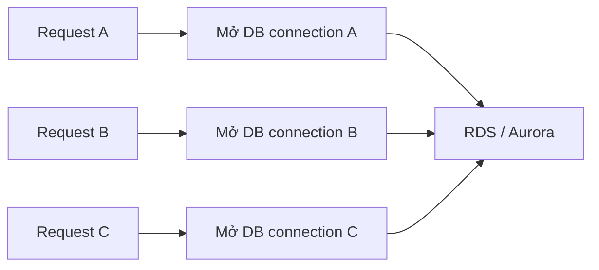

Mỗi request mở/đóng connection độc lập, tạo chi phí TLS/auth/session và tăng độ trễ trong burst traffic. Đây thường không phải lựa chọn tốt cho HTTP APIs có traffic lặp.

### 2.2. Dùng HikariCP trong từng ứng dụng

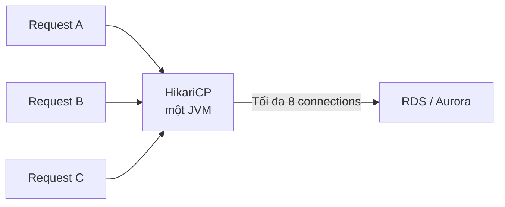

HikariCP có ích vì giới hạn số connection **trong một tiến trình Java** và trả connection về pool khi xong. Nhưng có 50 JVM instances, mỗi pool 8, thì tổng trần lý thuyết vẫn là **400 app-to-database connections**.

### 2.3. Dùng thêm Amazon RDS Proxy

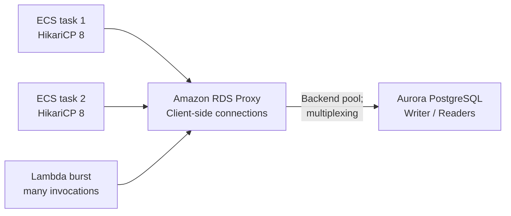

RDS Proxy không phải nơi chạy SQL logic thay database. Nó **hiểu database protocol** để điều phối và tái sử dụng backend connections khi an toàn, giảm áp lực mở nhiều sessions lên database.

**Không khẳng định:** 1.000 client connections luôn chỉ cần 10 database connections. Tỷ lệ phụ thuộc thời gian transaction, session state, user names, workload concurrency và pinning. Khi mọi client giữ giao dịch lâu hoặc bị pinned, số database connections vẫn có thể cao.

## 3. Pooling và multiplexing: lợi ích và điều kiện

**Connection pooling** giữ các database connections đã mở để tránh chi phí khởi tạo lại.

**Connection multiplexing** trả database connection về pool **sau khi transaction hoàn tất**, để một client khác mượn cho transaction tiếp theo.

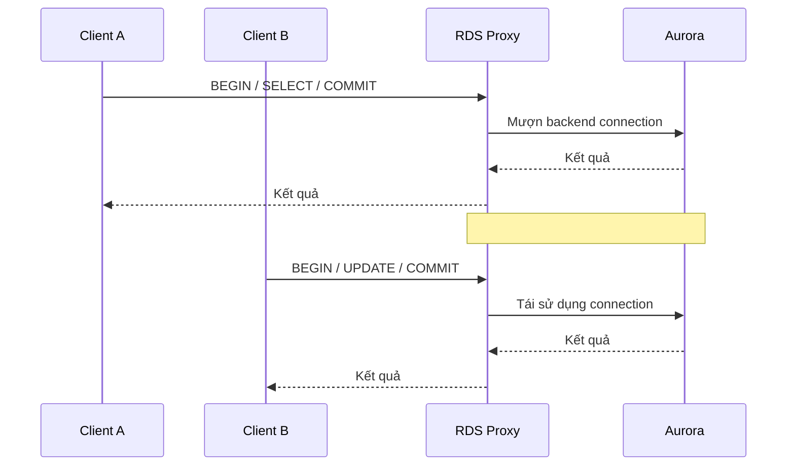

### 3.1. Cái gì giới hạn hiệu quả multiplexing?

- **Transaction dài:** connection bị giữ cho đến lúc commit/rollback.
- **Session pinning:** một client gắn cứng với backend connection do sử dụng trạng thái session.
- **Nhiều database users khác nhau:** proxy thường không thể tái sử dụng connection của `db_user_A` cho `db_user_B`; backend pools bị phân mảnh theo user.
- **Số backend connections tối đa:** chịu ảnh hưởng bởi `max_connections` và `MaxConnectionsPercent`.
- **Các tác vụ nặng:** SQL query mất 30 giây vẫn dùng tài nguyên database; proxy không làm SQL tự nhanh.
- **Lock contention:** kết nối mới không giải quyết transaction đang giữ lock.

**Nguyên tắc:** Proxy giảm overhead **quản lý kết nối**, không phải công cụ tối ưu truy vấn chậm hay thay thế index, query tuning, CPU/RAM của database.

### 3.2. So sánh HikariCP và RDS Proxy

| Tiêu chí | **HikariCP** | **Amazon RDS Proxy** |
|---|---|---|
| Nằm ở đâu? | Trong process Java/Spring Boot | Dịch vụ AWS giữa client và RDS/Aurora |
| Tái sử dụng ở mức nào? | Trong cùng JVM | Trên nhiều application instances |
| Tự biết writer mới khi failover? | Phụ thuộc JDBC/network/reconnect | Proxy theo dõi database targets và route tới writer phù hợp |
| Multiplex nhiều client sessions vào DB connections? | Không, mỗi Hikari physical connection là một client socket | Có, sau transaction nếu không pinned |
| Áp dụng cho Lambda? | Có thể nhưng phải quản lý theo execution environment | Đặc biệt hữu ích khi Lambda có burst connections |
| IAM/TLS | Theo JDBC/app config | Proxy hỗ trợ TLS, IAM auth/Secrets Manager và VPC |
| Chi phí | Thư viện; trả compute app và DB connections | **Có phí RDS Proxy riêng** |
| Thay thế hoàn toàn database? | Không | Không |

**Khuyến nghị thực tế:** Với Java trên ECS, vẫn có thể dùng **HikariCP nhỏ và được tuning** để tái sử dụng socket tới **proxy endpoint**. Không đặt pool hàng trăm connections/JVM chỉ vì proxy có multiplexing. Với Lambda, cân nhắc cấu hình mỗi execution environment và tránh tạo connection/pool mới cho từng invocation nếu có thể reuse hợp lý.

## 4. Dự toán connection budget

Một cách kiểm tra ban đầu:

```text
Tổng client connections tiềm năng
≈ số ECS tasks × max pool mỗi task
 + số Lambda environments × connections/environment
 + số worker processes × pool riêng
 + số admin/migration/batch connections
```

Ví dụ **minh họa**, không phải benchmark:

| Thành phần | Số lượng | Connection/pool | Trần client connections |
|---|---:|---:|---:|
| ECS API | 30 tasks | 8 | 240 |
| ECS worker | 10 tasks | 4 | 40 |
| Lambda | 150 concurrent environments | 1 | 150 |
| Batch/admin | 5 | 2 | 10 |
| **Tổng tối đa** | | | **440** |

Nếu không có proxy, database có thể cần phục vụ gần 440 sessions khi cùng hoạt động. Với proxy, **440 client connections không đồng nghĩa 440 backend connections**, nhưng phải đo pinning và số giao dịch thực để xác định mức giảm.

### 4.1. Dựa vào độ dài transaction thay vì chỉ số lượng request

Theo trực giác định luật Little (*Little's Law*), số công việc đang được xử lý đồng thời xấp xỉ:

```text
Concurrency hoạt động ≈ throughput × latency

Ví dụ:
200 transactions/giây × 0,040 giây/transaction
≈ 8 transactions đang xử lý đồng thời
```

**Cảnh báo:** Đây chỉ là ước tính cho hệ thống ổn định, không tính bursts, transactions dài, locks, session pinning, replication, connection setup và reserve capacity. Không dùng kết quả 8 để cấu hình proxy chỉ có đúng 8 backend connections mà không có headroom.

### 4.2. Hành vi queue khi pool đầy

- **HikariCP:** Thread gọi `DataSource.getConnection()` đợi tối đa `connectionTimeout`; hết thời gian có thể ném exception.
- **RDS Proxy:** Khi chưa có backend connection khả dụng, request có thể đợi tới `ConnectionBorrowTimeout`; vượt giới hạn nhận lỗi.
- **Database:** Nếu vượt `max_connections`, có thể từ chối kết nối trực tiếp hoặc thiếu tài nguyên.
- **API Gateway/client:** Có deadline riêng; có thể timeout sớm hơn cả Hikari/proxy.

Cần phối hợp các timeout theo **ngân sách response**, thay vì tăng tất cả lên vài phút khiến request treo, queue tích lũy và làm hệ thống khó phục hồi.

## 5. RDS Proxy hoạt động như thế nào?

Amazon RDS Proxy là dịch vụ **fully managed, highly available**, được AWS triển khai qua nhiều Availability Zones. Proxy dùng các endpoints riêng trong VPC và quản lý backend connections tới một RDS DB instance hoặc database cluster phù hợp.

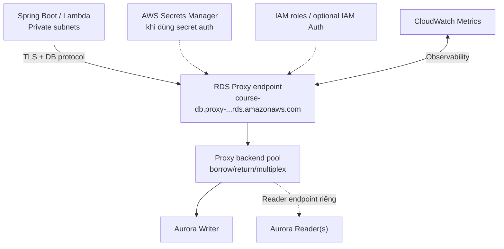

**Hai hướng kết nối:**

1. **Client connection:** Ứng dụng → RDS Proxy endpoint.
2. **Database connection:** RDS Proxy → RDS/Aurora target.

RDS Proxy có thể dùng nhiều proxy endpoints để phân loại traffic theo ứng dụng/VPC và tạo **read-only endpoint** với cluster có reader phù hợp. **Default endpoint** thường là read/write vào writer.

### 5.1. Điều kiện và giới hạn cần kiểm tra

- RDS Proxy hỗ trợ các engine/version/Region cụ thể của **RDS MySQL, PostgreSQL, MariaDB, SQL Server và Aurora MySQL/PostgreSQL**. Không tự giả định tương thích với mọi edition/version.
- **Aurora Serverless v2** có thể kết hợp proxy theo điều kiện hiện hành; **Aurora Serverless v1** không được hỗ trợ.
- Proxy phải ở **cùng VPC với target database**. Có thể tạo **additional cross-VPC proxy endpoints** theo tính năng được hỗ trợ, nhưng không biến proxy thành public Internet endpoint.
- Subnets/SG phải cho phép proxy tới database và applications tới proxy.
- Proxy target phải được đăng ký vào target group mặc định `default`.
- RDS Proxy không thay thế security groups, DB authentication, IAM hoặc network routing.
- Xác minh quotas với AWS Service Quotas, nhất là số proxies, endpoints, secrets/users, engine/version hỗ trợ.

### 5.2. Không dùng RDS Proxy làm public database gateway

RDS Proxy endpoint là **private**. Dù RDS instance có thể được cấu hình public trong một số môi trường, proxy không được thiết kế để cho máy bất kỳ ngoài Internet kết nối trực tiếp.

Một client ngoài VPC muốn test cần VPN, Direct Connect, host test có quyền trong VPC hoặc mô hình kết nối mạng được phê duyệt. **Không mở DB security group ra `0.0.0.0/0` để sửa lỗi kết nối.**

## 6. Cấu hình pooling trên proxy

| Cấu hình | Mục đích | Ghi chú |
|---|---|---|
| `MaxConnectionsPercent` | Phần trăm giới hạn connections DB được proxy sử dụng so với `max_connections` của target | **Default 100** trong hướng dẫn cấu hình hiện hành; cần để headroom. |
| `MaxIdleConnectionsPercent` | Tỷ lệ idle backend connections mà proxy có thể giữ | Không vượt `MaxConnectionsPercent`; mặc định tùy engine, với phần lớn engines là 50% của MaxConnectionsPercent. |
| `ConnectionBorrowTimeout` | Thời gian tối đa đợi mượn backend connection | Default **120 giây**; có thể chỉnh phù hợp request deadline. |
| `IdleClientTimeout` | Đóng client connection rỗi sau thời gian đã cấu hình | Default **1.800 giây**; không phải idle timeout của backend pool. |
| `InitQuery` | SQL statements chạy khi proxy tạo **backend connection mới** | Có thể tránh client khởi tạo session state gây pinning. |
| `SessionPinningFilters` | Điều chỉnh pinning trong những trường hợp engine hỗ trợ | Không dùng bừa; phải chứng minh an toàn session state. |

### 6.1. MaxConnectionsPercent không đồng nghĩa số kết nối thực

Giả sử database có:

```text
max_connections = 1000
MaxConnectionsPercent = 80

Giới hạn lý thuyết theo phần trăm ≈ 800 DB connections.
```

Proxy **không mở sẵn tất cả 800 connections**. Nó tăng/giảm backend connections theo nhu cầu. AWS dành một phần connections cho **monitoring, failover và hoạt động nội bộ**, nên metric `MaxDatabaseConnectionsAllowed` thực tế có thể **thấp hơn 800**.

AWS khuyến nghị giữ khoảng **30% headroom** giữa usage đỉnh đã đo và capacity được phép để proxy phân phối các connections nội bộ và chống spikes. Đây là **hướng dẫn tối ưu dựa trên đo kiểm**, không phải quy tắc nhân cứng cho mọi workload.

### 6.2. ConnectionBorrowTimeout

Tham số này giới hạn thời gian proxy chờ một backend connection rảnh, hoặc chờ target phù hợp có sẵn trong giai đoạn failover.

Ví dụ API có deadline tổng 10 giây nhưng proxy giữ `ConnectionBorrowTimeout=120` giây, một query có thể chờ lâu hơn thời gian người dùng chấp nhận (trừ khi driver/connection-level timeout cắt trước).

Một ứng viên cấu hình cho API sandbox: `ConnectionBorrowTimeout=5` giây, sau đó đo `DatabaseConnectionsBorrowLatency` và error rate. Không sao chép con số 5 sang mọi hệ thống; jobs nền có nhu cầu chờ khác.

### 6.3. IdleClientTimeout và pool Java

RDS Proxy có giới hạn tuổi thọ **client connection tối đa 24 giờ**, không cấu hình được. HikariCP nên đặt `maxLifetime` **ngắn hơn** giới hạn này và cân nhắc idle timeout của proxy.

- HikariCP keepalive/validation pings có thể làm client connection không được coi là rỗi đối với proxy.
- Nếu HikariCP giữ kết nối rỗi nhưng proxy đã đóng, request sau có thể gặp lỗi và phải reconnect.
- Không tạo pool khổng lồ rồi bật keepalive liên tục vì có thể làm tăng network và giảm hiệu quả multiplexing khi có pinning.

Chọn cấu hình bằng số liệu load test, log lifecycle của pool và CloudWatch metrics; không chỉ dựa trên default.

## 7. Session pinning: giới hạn quan trọng nhất của multiplexing

Proxy có thể **pin một client session vào một database connection** khi state của session không an toàn để chia sẻ với client khác. Khi pinned:

```text
Client A <------------------> DB connection #1
Client B <------------------> DB connection #2
Client C <------------------> DB connection #3
```

Kết nối #1 không thể được mượn bởi B hoặc C cho đến khi A kết thúc session hoặc điều kiện proxy hỗ trợ giải phóng. Nếu phần lớn sessions pinned, khả năng multiplexing giảm mạnh và proxy gần giống kết nối 1:1.

### 7.1. Các nguyên nhân thường gặp

| Động tác SQL / driver | Khả năng gây pinning | Ghi chú |
|---|---|---|
| Transaction dài chưa commit | Backend connection không sẵn cho client khác trong thời gian transaction | Không nhầm borrowed với session pinned; metric riêng. |
| PostgreSQL `SET search_path TO ...` | **Có thể pin** | PostgreSQL SET/session state làm giảm multiplexing. |
| PostgreSQL `PREPARE` / `EXECUTE` / `DEALLOCATE` / `DISCARD ALL` | **Có thể pin** | Chú ý JDBC server-side prepared statement threshold. |
| PostgreSQL `SET LOCAL` trong explicit transaction | **Ngoại lệ có thể tránh pin** | Chỉ dùng trong phạm vi transaction, kiểm thử driver và nghiệp vụ. |
| Temporary tables, session cursors | **Có thể pin** | Session state không thể chuyển sang backend khác tùy ý. |
| MySQL/MariaDB user/system variable `SET` | **Có thể pin**, có tracked exceptions | Xem engine-specific rules; có filter nếu thực sự an toàn. |
| MySQL/MariaDB `GET_LOCK`, `LOCK TABLES` | **Có thể pin** | Giữ trạng thái connection/lock. |
| MySQL/MariaDB prepared statements | **Có thể pin** | Driver configuration ảnh hưởng. |
| SQL statement dài **hơn 16 KB** | **Có thể pin** theo quy tắc AWS | Giới hạn này liên quan text của statement, không phải kích thước result set. |
| SQL Server MARS/temp tables/DTC | **Có thể pin** | Phụ thuộc engine, protocol và câu lệnh. |

**Không khẳng định:** mọi lệnh `SELECT` hoặc JDBC `PreparedStatement` đều luôn pin PostgreSQL/MySQL. Hành vi phụ thuộc protocol, server-side preparation, phiên bản driver và engine. **Đo `DatabaseConnectionsCurrentlySessionPinned` thực tế** là bắt buộc khi tối ưu.

### 7.2. Ví dụ PostgreSQL dễ gây pinning

```sql
-- Thay đổi trạng thái session:
SET search_path TO tenant_school_01;

SELECT course_id, title
FROM courses
WHERE tenant_id = 'school_01';
```

Với nhiều tenant mà ứng dụng thay `search_path` hoặc session variables trên mỗi kết nối, pinning có thể tăng; đồng thời nếu không reset session đúng cách sẽ có nguy cơ rò trạng thái tenant.

**Thiết kế ưu tiên:** Truy vấn có điều kiện tenant rõ ràng, dùng prepared parameters và DB row-level security khi được thiết kế/kiểm chứng, không phụ thuộc session state thiếu kiểm soát.

### 7.3. PostgreSQL SET LOCAL

Trong một explicit transaction:

```sql
BEGIN;
SET LOCAL statement_timeout = '5s';
SELECT count(*) FROM courses WHERE tenant_id = 'school_01';
COMMIT;
```

AWS nêu `SET LOCAL` bên trong transaction là một trường hợp có thể tránh pinning cho PostgreSQL, nhưng hàm `set_config(name, value, true)` có thể có hành vi khác. Không dùng ví dụ này để thay thế toàn bộ kiểm thử session state/connection pool.

### 7.4. PostgreSQL JDBC connection startup settings

AWS khuyến nghị với PostgreSQL JDBC khi qua RDS Proxy:

- Đặt `assumeMinServerVersion` đủ cao (ít nhất 9.0) để driver tránh query `SET extra_float_digits` khi mở connection.
- Đặt `ApplicationName` trong JDBC connection parameters để driver gửi thông tin startup thay vì chạy một `SET application_name` riêng.
- Nếu ứng dụng sử dụng server-side prepared statements, kiểm tra `prepareThreshold` và tỷ lệ pinning; tắt server-side preparation có thể giảm pinning nhưng cũng có đánh đổi hiệu năng parse/plan.

Mẫu JDBC URL **minh họa**:

```text
jdbc:postgresql://course-db.proxy-example.ap-southeast-1.rds.amazonaws.com:5432/coursedb?sslmode=require&assumeMinServerVersion=9.0&ApplicationName=course-api
```

**Bảo mật TLS:** `sslmode=require` ép mã hóa nhưng **không tương đương** kiểm tra đầy đủ server identity. Trong production, ưu tiên xác minh chứng chỉ/hostname khi driver và môi trường hỗ trợ; RDS Proxy dùng certificate từ ACM, không nhất thiết dùng cùng CA bundle như RDS DB instance.

### 7.5. InitQuery và session pinning filters

Nếu **mọi** client dùng cùng một biến session, có thể cân nhắc `InitQuery` chạy khi proxy tạo backend connection, sau đó **bỏ những câu SET tương ứng khỏi client code**. Không đưa password/secrets vào InitQuery, vì config này có thể được đọc bởi người có quyền xem proxy.

Với **MySQL/MariaDB**, AWS có `EXCLUDE_VARIABLE_SETS` filter để bỏ pin cho một loại thao tác SET. **Không dùng filter để bỏ qua trạng thái tenant/timezone/collation quan trọng** nếu câu SQL tiếp theo phụ thuộc giá trị đó. PostgreSQL không có cùng tùy chọn filter theo cách này; theo tài liệu AWS nó dành cho engine family hỗ trợ.

## 8. Failover: lợi ích thật và giới hạn

Với Aurora hoặc RDS có HA phù hợp, failover làm writer/primary instance thay đổi. Nếu client kết nối trực tiếp tới database endpoint, nó có thể phải chờ DNS, reconnect và khởi tạo TLS/session lại.

RDS Proxy duy trì một endpoint riêng, theo dõi writer mới và giúp **giảm gián đoạn kết nối**:

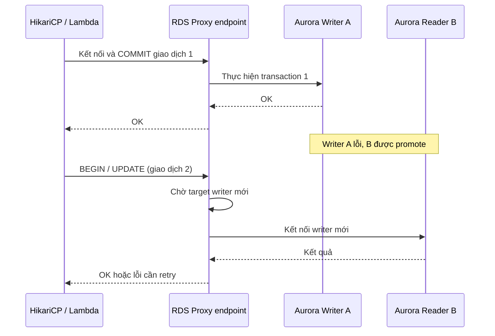

**Điều RDS Proxy giúp:**

- Ít phụ thuộc DNS propagation của database endpoint.
- Nhiều idle client connections có thể tiếp tục tồn tại.
- Proxy điều phối writer mới và chờ target trở lại trong giới hạn.
- Giảm số lượng database handshakes sau failover.

**Điều RDS Proxy không bảo đảm:**

- Transaction đang chạy giữa chừng **không tự được commit an toàn**.
- SQL đang thực thi có thể bị hủy hoặc nhận connection exception.
- Ứng dụng vẫn phải reconnect/retry khi thích hợp.
- Không biến một **single-AZ DB không có standby** thành HA multi-AZ chỉ nhờ thêm proxy.
- Không tự phục hồi business consistency sau thanh toán/ghi dữ liệu chưa rõ kết quả.

### 8.1. Idempotency khi transaction không rõ trạng thái

Ví dụ `CreateEnrollment(orderId)`:

1. Giao dịch có thể đã commit vào RDS.
2. Client mất response do failover.
3. Nếu retry bằng lệnh `INSERT` mới không có uniqueness/idempotency, có thể tạo trùng.

Thiết kế:

```sql
-- Ví dụ PostgreSQL: order_id là khóa nghiệp vụ duy nhất.
CREATE TABLE enrollment (
    order_id text PRIMARY KEY,
    student_id text NOT NULL,
    course_id text NOT NULL,
    status text NOT NULL
);

INSERT INTO enrollment(order_id, student_id, course_id, status)
VALUES ('order-001', 'student-17', 'java-101', 'PENDING')
ON CONFLICT (order_id) DO NOTHING;
```

Cách này chỉ minh họa **một phần**. Trong production, xác nhận lại row hiện có, trạng thái thanh toán và quyền sở hữu thay vì báo thành công một cách mù quáng sau `DO NOTHING`.

## 9. Writer và reader proxy endpoints trên Aurora

Một **default proxy endpoint** thường phục vụ **read/write** và chuyển truy vấn tới **writer** của cluster.

Với Aurora có một hoặc nhiều reader instances, có thể tạo **read-only proxy endpoint** để các truy vấn đọc sử dụng reader capacity. Multi-AZ DB clusters của RDS cũng hỗ trợ reader endpoints theo tính năng hiện hành; **single DB instance không tự có một read-only proxy endpoint để scale read**.

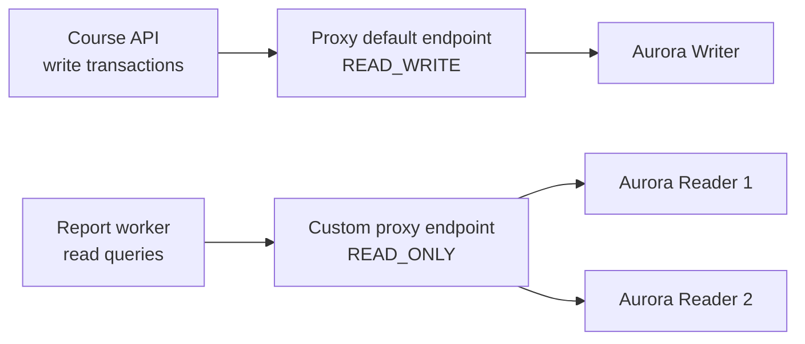

### 9.1. Các điểm cần nhớ

- Default endpoint **không tự load-balance reads** sang reader; nó đi vào writer.
- Reader endpoint phải được tạo riêng, cấu hình network và bảo mật phù hợp.
- Mỗi additional proxy endpoint có thể tạo **PrivateLink interface endpoint** và có phí riêng.
- Không dùng read-only endpoint cho transaction ghi.
- Read replicas có **replication lag**: sau khi ghi qua writer, đọc ngay trên reader có thể chưa thấy dữ liệu.
- Đường read/write và read-only cần đánh giá transaction consistency, không chỉ chọn endpoint theo tên hàm Java.

### 9.2. Đọc dữ liệu ngay sau ghi

Nếu một workflow đăng ký khóa học ghi vào writer rồi phải kiểm tra kết quả **read-your-writes** ngay lập tức, có thể cần đọc qua **writer endpoint** hoặc dùng cơ chế consistency phù hợp. Không dùng reader endpoint bất chấp replication lag.

## 10. Chọn Secrets Manager hay IAM authentication?

AWS RDS Proxy hỗ trợ những mô hình authentication khác nhau. Từ các tài liệu AWS hiện hành (2026), cần phân biệt rõ **Secrets Manager backend auth** và **end-to-end IAM**.

### 10.1. Secrets Manager làm backend authentication

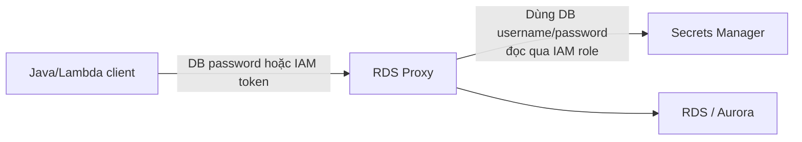

Proxy dùng một **IAM role** để đọc secret chứa username/password database. Client có thể kết nối tới proxy bằng database credentials hoặc cấu hình **IAM authentication ở phía client**, tùy `AuthConfig`.

**Ví dụ hai biến thể:**

1. Client **password** → proxy xác thực password, proxy dùng secret để kết nối DB.
2. Client **IAM token** → proxy xác thực IAM, proxy dùng secret để kết nối DB.

Đây **không** phải end-to-end IAM nếu proxy vẫn dùng DB password phía backend.

### 10.2. End-to-end IAM authentication

Trong cấu hình hỗ trợ (đặc biệt **MySQL/PostgreSQL/MariaDB** theo tài liệu AWS hiện hành), RDS Proxy có thể dùng **IAM auth cả phía client và giữa proxy với database**.

- Chọn `DefaultAuthScheme=IAM_AUTH`.
- Database target phải bật IAM database authentication.
- IAM role của RDS Proxy phải có `rds-db:connect` vào database user/resource ID phù hợp.
- Không cần đăng ký secret DB password tương ứng trong proxy cho mô hình **end-to-end IAM**.
- Client vẫn cần IAM permission, TLS và token được tạo đúng host/port/username.

**Không áp dụng bừa:** SQL Server và mọi engine version không nhất thiết hỗ trợ end-to-end IAM; kiểm tra Region/engine support.

### 10.3. Bảng lựa chọn

| Câu hỏi | Secrets Manager backend auth | End-to-end IAM |
|---|---|---|
| Backend DB dùng password? | Có | Không, dùng IAM DB auth |
| Cần Secrets Manager secret cho DB user? | Có | Không cho connection auth dạng này |
| Client có thể dùng IAM? | Có, nếu cấu hình `IAMAuth=REQUIRED` theo cách phù hợp | Có, là trọng tâm |
| Proxy role cần `secretsmanager:GetSecretValue`? | Có | Không cho auth kiểu này |
| Proxy role cần `rds-db:connect` đến DB target? | Không theo cơ chế password thông thường | Có |
| Phù hợp khi | DB user/password đang vận hành, cần rotation/đơn giản | Muốn bỏ DB password trong auth path được hỗ trợ |
| Vẫn cần | IAM least privilege, TLS, SG, secret rotation | IAM least privilege, TLS, SG, DB IAM config |

**Cảnh báo thuật ngữ:** IAM **execution role của Lambda/ECS task** khác IAM **service role của RDS Proxy**. Một role có thể gọi Secrets Manager nhưng không tự được database chấp nhận nếu thiếu database grants hoặc `rds-db:connect` theo mô hình sử dụng.

## 11. IAM role và Secrets Manager cho proxy

Nếu chọn **Secrets Manager-backed auth**, cần chuẩn bị:

1. Secret chứa username/password **đúng với database user đã tạo**.
2. IAM role được service `rds.amazonaws.com` assume.
3. Quyền `secretsmanager:GetSecretValue` trên đúng secret ARN.
4. Quyền `kms:Decrypt` với KMS customer managed key nếu dùng và các điều kiện phù hợp.
5. SG cho proxy → RDS target.

### 11.1. Ví dụ secret data structure

Secret value dạng JSON minh họa:

```json
{
  "username": "course_app",
  "password": "REPLACE_WITH_A_STRONG_SECRET"
}
```

**Không đặt password thật vào Markdown, Git, ticket, lệnh CLI hoặc IaC template**. Tạo secret qua cơ chế được phê duyệt (Console/Secrets Manager rotation pipeline) và không in secret plaintext.

### 11.2. Trust policy của proxy role

```json
{
  "Version": "2012-10-17",
  "Statement": [
    {
      "Effect": "Allow",
      "Principal": {
        "Service": "rds.amazonaws.com"
      },
      "Action": "sts:AssumeRole"
    }
  ]
}
```

### 11.3. Secrets Manager read policy

```json
{
  "Version": "2012-10-17",
  "Statement": [
    {
      "Sid": "ReadCourseDbSecret",
      "Effect": "Allow",
      "Action": "secretsmanager:GetSecretValue",
      "Resource": "arn:aws:secretsmanager:ap-southeast-1:123456789012:secret:course/db/app-EXAMPLE"
    }
  ]
}
```

Nếu secret dùng **customer managed KMS key**, cần thêm đúng `kms:Decrypt` theo ARN/key policy/conditions phù hợp. IAM role trên **chỉ** để RDS Proxy đọc secret, không phải giao toàn quyền IAM cho ứng dụng.

### 11.4. IAM permission của caller khi dùng IAM auth

Client IAM auth cần action:

```text
rds-db:connect
```

**Resource ARN phải là DB user resource ID đúng của proxy**, không phải proxy endpoint hostname hoặc RDS DB identifier hiển thị.

Ví dụ kiểu ARN cho client kết nối qua proxy:

```json
{
  "Version": "2012-10-17",
  "Statement": [
    {
      "Effect": "Allow",
      "Action": "rds-db:connect",
      "Resource": "arn:aws:rds-db:ap-southeast-1:123456789012:dbuser:prx-EXAMPLEID/course_app"
    }
  ]
}
```

Đối với **end-to-end IAM**, **proxy service role** cần một ARN `rds-db:connect` khác trỏ đúng **DB instance resource ID hoặc cluster resource ID** của target database user. Đừng copy ARN `prx-...` của client sang proxy role mà không kiểm tra resource ID.

## 12. TLS, VPC và security groups

RDS Proxy được dùng bên trong VPC. Ví dụ:

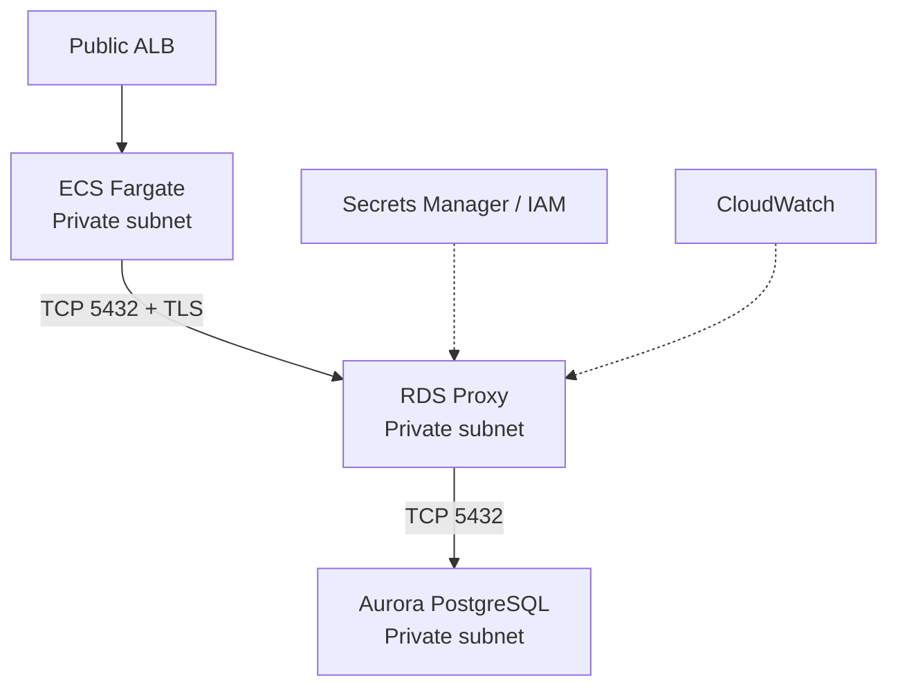

### 12.1. SG least privilege

| SG | Inbound | Outbound |
|---|---|---|
| `sg-course-api` | Từ ALB vào HTTP app port (ví dụ 8080) | TCP 5432 tới `sg-rds-proxy` theo egress policy |
| `sg-rds-proxy` | TCP 5432 từ `sg-course-api`/Lambda SG | TCP 5432 tới `sg-database` |
| `sg-database` | TCP 5432 **chỉ từ `sg-rds-proxy`** và admin sources đã duyệt | Theo policy network tổ chức |

Đây là mô hình tư duy. AWS security groups là **stateful**, NACLs là **stateless**; route/subnet/VPC DNS vẫn phải cho phép kết nối. Nếu database nhận traffic trực tiếp của migration/replication, cần cân nhắc riêng.

### 12.2. TLS và server identity

- Khi tạo proxy, bật `RequireTLS=true` để **bắt buộc TLS cho client connections**.
- RDS Proxy sử dụng certificates do AWS Certificate Manager quản lý; client phải dùng driver hỗ trợ TLS và kiểm tra chứng chỉ/hostname khi có khả năng.
- Kiểm tra settings của PostgreSQL JDBC/MySQL driver, trust store, hostname và phiên bản TLS; không nên tắt verify để chữa lỗi test.
- Proxy cũng quản lý kết nối tới database; tuân thủ chế độ bảo mật/SSL của RDS target theo AWS.
- Bật **CloudWatch metric `ClientConnectionsNoTLS`** để nhận biết các client connections không mã hóa nếu cấu hình cho phép chúng.

**Không nhầm:** Port 5432 mở trong SG không đồng nghĩa TLS đã được bật; `RequireTLS` và JDBC URL/driver phải phù hợp.

## 13. AWS Console: tạo RDS Proxy và đăng ký target

**Điều kiện lab** (sandbox):

- Một Aurora PostgreSQL cluster hoặc RDS PostgreSQL instance tương thích, có database user `course_app`.
- VPC có **ít nhất hai private subnets ở các AZ phù hợp**, đủ networking cho proxy.
- SG tách application/proxy/database như trên.
- Secrets Manager secret của `course_app`.
- IAM service role cho proxy đọc secret.
- IAM quyền tạo RDS proxy, register targets, quản lý SG/role theo quy trình.
- Region `ap-southeast-1` chỉ là ví dụ, cần kiểm tra engine version support.

### 13.1. Tạo proxy trên Console

1. Mở **Amazon RDS Console → Proxies → Create proxy**.
2. Đặt tên `course-db-proxy`.
3. Chọn engine family tương thích (ví dụ **PostgreSQL**).
4. Chọn **Secrets Manager credentials** hoặc **IAM authentication** theo kiến trúc đã quyết định.
5. Nếu dùng Secrets Manager, chọn secret và IAM role được phép đọc secret.
6. Chọn VPC **cùng VPC với DB target**, private subnets ở các AZ cần thiết và SG `sg-rds-proxy`.
7. Bật **Require TLS**.
8. Chọn target database/cluster trong cùng VPC phù hợp.
9. Xem logging/debug options, không bật debug logs chứa query/metadata nhạy cảm vô thời hạn.
10. Tạo, chờ proxy và target chuyển sang trạng thái healthy/available.
11. Ghi **default proxy endpoint** thật, thay endpoint trong cấu hình ứng dụng.
12. Từ một host/test task trong cùng VPC, kiểm thử TLS, login và query `SELECT 1`.

**Nếu chọn end-to-end IAM**: target phải bật IAM DB authentication, proxy role có `rds-db:connect` trên resource ID của DB, caller có quyền IAM vào proxy resource ID; không áp dụng các bước secret/password của mô hình trước.

### 13.2. Khi chưa có target

Proxy có thể đã được tạo nhưng target group chưa đăng ký DB hoặc trạng thái `UNAVAILABLE`. Không chuyển Java production sang proxy khi target chưa healthy và kết nối test chưa thành công.

## 14. AWS CLI: tạo proxy dùng Secrets Manager

**Các lệnh minh họa cho shell POSIX/bash**. Thay account ID, ARNs, subnet/SG IDs, secret và cluster names bằng giá trị thật do bạn sở hữu; tạo tài nguyên có chi phí.

### 14.1. Đọc metadata trước khi tạo

```bash
aws sts get-caller-identity

aws rds describe-db-clusters \
  --db-cluster-identifier course-aurora \
  --region ap-southeast-1

aws secretsmanager describe-secret \
  --secret-id arn:aws:secretsmanager:ap-southeast-1:123456789012:secret:course/db/app-EXAMPLE \
  --region ap-southeast-1
```

Không gọi `get-secret-value` rồi dán output vào log để "kiểm tra nhanh". Cần kiểm tra **secret ARN và quyền** mà không tiết lộ mật khẩu.

### 14.2. Tạo RDS Proxy

Ví dụ cấu hình **password ở cả client/backend**. Auth scheme của proxy là `SECRETS`, và `IAMAuth=DISABLED` cho client trong mẫu này.

```bash
aws rds create-db-proxy \
  --db-proxy-name course-db-proxy \
  --engine-family POSTGRESQL \
  --role-arn arn:aws:iam::123456789012:role/course-rds-proxy-role \
  --vpc-subnet-ids subnet-11111111 subnet-22222222 \
  --vpc-security-group-ids sg-0123456789abcdef0 \
  --require-tls \
  --auth '[{"AuthScheme":"SECRETS","SecretArn":"arn:aws:secretsmanager:ap-southeast-1:123456789012:secret:course/db/app-EXAMPLE","IAMAuth":"DISABLED"}]' \
  --region ap-southeast-1
```

Sau đó đăng ký Aurora cluster:

```bash
aws rds register-db-proxy-targets \
  --db-proxy-name course-db-proxy \
  --target-group-name default \
  --db-cluster-identifiers course-aurora \
  --region ap-southeast-1
```

Nếu dùng **RDS DB instance đơn**, thay `--db-cluster-identifiers` bằng `--db-instance-identifiers instance-identifier`, không dùng cả hai tùy tiện.

### 14.3. Xem proxy, target và endpoint

```bash
aws rds describe-db-proxies \
  --db-proxy-name course-db-proxy \
  --region ap-southeast-1 \
  --query 'DBProxies[].{Name:DBProxyName,Status:Status,Endpoint:Endpoint,RequireTLS:RequireTLS}'

aws rds describe-db-proxy-target-groups \
  --db-proxy-name course-db-proxy \
  --region ap-southeast-1

aws rds describe-db-proxy-targets \
  --db-proxy-name course-db-proxy \
  --target-group-name default \
  --region ap-southeast-1
```

Đợi proxy target `AVAILABLE` hoặc trạng thái phù hợp rồi mới test. Các lệnh đọc có thể cần IAM permissions nhưng không thay đổi resource.

### 14.4. Điều chỉnh pool

```bash
aws rds modify-db-proxy-target-group \
  --db-proxy-name course-db-proxy \
  --target-group-name default \
  --connection-pool-config '{"MaxConnectionsPercent":70,"MaxIdleConnectionsPercent":35,"ConnectionBorrowTimeout":10}' \
  --region ap-southeast-1
```

Giá trị 70/35/10 chỉ là **lab example**. Đặt `MaxConnectionsPercent` quá thấp có thể tăng BorrowLatency và timeouts; quá cao có thể chiếm kết nối của admin/ứng dụng khác.

### 14.5. Điều chỉnh idle client timeout

```bash
aws rds modify-db-proxy \
  --db-proxy-name course-db-proxy \
  --idle-client-timeout 1800 \
  --require-tls \
  --region ap-southeast-1
```

**Cẩn trọng:** Thay target/proxy configuration trên production có thể thay đổi behavior của tất cả applications dùng chung. Có changelog, test và rollback trước khi chạy.

## 15. End-to-end IAM authentication: mẫu cấu hình riêng

Đối với engine có hỗ trợ:

1. Bật IAM DB authentication trên Aurora/RDS target, tạo database user tương ứng và gán quyền database tối thiểu.
2. IAM role **của proxy** phải có `rds-db:connect` tới **database user resource ARN**.
3. Client **IAM workload role** có `rds-db:connect` tới **proxy user resource ARN**.
4. Chọn `DefaultAuthScheme=IAM_AUTH` cho proxy.
5. Client tạo IAM DB auth token bằng AWS SDK và dùng TLS khi mở kết nối.

Mẫu CLI cơ bản **không chứa secret auth**:

```bash
aws rds create-db-proxy \
  --db-proxy-name course-db-proxy-iam \
  --engine-family POSTGRESQL \
  --default-auth-scheme IAM_AUTH \
  --role-arn arn:aws:iam::123456789012:role/course-rds-proxy-iam-role \
  --vpc-subnet-ids subnet-11111111 subnet-22222222 \
  --vpc-security-group-ids sg-0123456789abcdef0 \
  --require-tls \
  --region ap-southeast-1
```

**Đây chưa phải quy trình chạy độc lập:** Database IAM auth, database user grants, role policies, target registration và SDK token generation phải được hoàn tất trước. Nếu dùng một engine/version không hỗ trợ end-to-end IAM, chọn Secrets Manager mode.

### 15.1. IAM token có thời hạn 15 phút

IAM DB authentication token **có hiệu lực 15 phút để thiết lập một kết nối mới**. Kết nối đã xác thực có thể tiếp tục hoạt động sau khi token ban đầu hết hạn trong giới hạn connection lifecycle, nhưng **mỗi kết nối mới phải có token còn hạn**.

Không tạo một token lúc JVM start rồi đặt nó cố định làm password trong HikariCP suốt nhiều giờ. Khi pool tạo một physical connection mới sau 20 phút, token cũ sẽ không còn hợp lệ.

**Thiết kế:** Tạo token **theo lần thiết lập physical connection mới** qua data source/driver integration phù hợp, và vẫn cần refresh AWS IAM credentials của workload role nếu chúng sắp hết hạn.

## 16. Spring Boot + HikariCP: cấu hình với proxy endpoint

Spring Boot thông thường dùng **HikariCP** khi có Spring JDBC/JPA starter phù hợp. Với RDS Proxy, **JDBC URL phải trỏ vào proxy endpoint**, không phải cluster/instance endpoint gốc.

### 16.1. application.yml cho password auth

```yaml
spring:
  datasource:
    url: jdbc:postgresql://course-db.proxy-example.ap-southeast-1.rds.amazonaws.com:5432/coursedb?sslmode=require&assumeMinServerVersion=9.0&ApplicationName=course-api
    username: course_app
    password: ${DB_PASSWORD}
    hikari:
      pool-name: course-api-pool
      maximum-pool-size: 8
      minimum-idle: 1
      connection-timeout: 3000
      validation-timeout: 1000
      idle-timeout: 600000
      max-lifetime: 1200000
      keepalive-time: 120000
```

Giải thích các con số (đơn vị HikariCP mặc định **milliseconds**):

| Cấu hình | Giá trị mẫu | Vai trò |
|---|---:|---|
| `maximum-pool-size` | 8 | Trần kết nối trong một JVM, không phải toàn bộ cluster |
| `minimum-idle` | 1 | Duy trì ít nhất một connection rỗi, giảm nhu cầu giữ quá nhiều |
| `connection-timeout` | 3000 ms | Thread đợi mượn connection từ Hikari tối đa 3 giây |
| `validation-timeout` | 1000 ms | Giới hạn thời gian kiểm tra connection |
| `idle-timeout` | 600000 ms | Có thể thu hẹp các connection rỗi vượt minimum-idle |
| `max-lifetime` | 1200000 ms | Chu kỳ thay physical connection khoảng 20 phút; dưới giới hạn proxy 24 giờ |
| `keepalive-time` | 120000 ms | Có thể ping idle connections để tránh stale; cũng có chi phí |

**Các giá trị chỉ để bắt đầu thử nghiệm**, không phải lời khuyên áp dụng cố định mọi service. Với Hikari, `minimumIdle` mặc định có thể bằng `maximumPoolSize` nếu không cấu hình, dẫn tới duy trì nhiều connections hơn dự tính. Tối ưu cần dựa trên active threads, duration và metric DatabaseConnections.

**Cần xem xét TLS production:** `sslmode=require` mã hóa nhưng không luôn kiểm chứng danh tính server. Kiểm tra CA/trust store, hostname verification và chế độ `verify-full` theo driver/proxy certificate được hỗ trợ.

### 16.2. Không giữ connection quá lâu trong business code

Với Spring Boot:

```java
package example.course.repository;

import org.springframework.jdbc.core.JdbcTemplate;
import org.springframework.stereotype.Repository;

@Repository
public class CourseRepository {
    private final JdbcTemplate jdbc;

    public CourseRepository(JdbcTemplate jdbc) {
        this.jdbc = jdbc;
    }

    public int countCoursesForTenant(String tenantId) {
        return jdbc.queryForObject(
            "SELECT COUNT(*) FROM courses WHERE tenant_id = ?",
            Integer.class,
            tenantId);
    }
}
```

`JdbcTemplate` mượn/trả JDBC connections theo Spring transaction management; khi không có transaction bao bên ngoài, thao tác DB ngắn giúp sớm trả connection về pool.

**Tránh:** Bắt đầu `@Transactional`, gọi API thanh toán bên ngoài mất 10 giây, sau đó mới commit; transaction giữ DB connection suốt thời gian chờ HTTP. Tách I/O bên ngoài khỏi phạm vi DB transaction hoặc thiết kế Saga/outbox, không để database locks/connection chờ không cần thiết.

### 16.3. Ví dụ xử lý transaction với idempotency

```java
import org.springframework.jdbc.core.JdbcTemplate;
import org.springframework.stereotype.Service;
import org.springframework.transaction.annotation.Transactional;

@Service
public class EnrollmentService {
    private final JdbcTemplate jdbc;

    public EnrollmentService(JdbcTemplate jdbc) {
        this.jdbc = jdbc;
    }

    @Transactional
    public void recordEnrollment(
            String orderId, String studentId, String courseId) {

        jdbc.update("""
            INSERT INTO enrollment(order_id, student_id, course_id, status)
            VALUES (?, ?, ?, 'PENDING')
            ON CONFLICT (order_id) DO NOTHING
            """, orderId, studentId, courseId);

        // Production: kiểm tra row hiện tại và tính hợp lệ theo tenant,
        // rồi chỉ cho phép thay đổi state transition hợp lệ.
        // Không gọi payment provider HTTP bên trong transaction DB này.
    }
}
```

Cách này minh họa **transaction ngắn và SQL parameterized**, chưa bao gồm kiểm tra quyền sở hữu/đảm bảo nghiệp vụ đầy đủ. Nếu request trả `orderId` trùng nhưng dữ liệu student/course khác, phải phát hiện conflict chứ không mặc định chấp nhận.

### 16.4. Password rotation với HikariCP

Proxy có thể sử dụng Secrets Manager để lấy password backend, nhưng **password của client tới proxy** cũng cần đúng theo kiểu authentication đã chọn:

- Với **client password auth**, ứng dụng cần secret/password được cấp an toàn, có chiến lược cập nhật khi rotate.
- Với **client IAM auth**, ứng dụng tạo auth token đúng cách; không giữ token cũ trong static pool password.
- Đừng cho rằng việc rotate Secret Manager backend làm **tất cả app environment variables tự đổi** ngay tức thì.
- Theo dõi authentication failures sau rotation, xử lý kết nối cũ và tái tạo pools khi cần.

## 17. Java SDK 2.x: tạo IAM authentication token khi mở kết nối

AWS SDK for Java 2.x cung cấp `RdsUtilities.generateAuthenticationToken`. Đây là **ví dụ khởi tạo một kết nối mới**, không phải cấu hình HikariCP production hoàn chỉnh.

```java
package example.course.database;

import java.sql.Connection;
import java.sql.DriverManager;
import java.util.Properties;

import software.amazon.awssdk.auth.credentials.DefaultCredentialsProvider;
import software.amazon.awssdk.regions.Region;
import software.amazon.awssdk.services.rds.RdsClient;
import software.amazon.awssdk.services.rds.model.GenerateAuthenticationTokenRequest;

public final class IamProxyJdbcExample {
    public static void main(String[] args) throws Exception {
        String host = "course-db.proxy-example.ap-southeast-1.rds.amazonaws.com";
        int port = 5432;
        String dbName = "coursedb";
        String dbUser = "course_app";

        try (RdsClient rds = RdsClient.builder()
                .region(Region.AP_SOUTHEAST_1)
                .build()) {

            String token = rds.utilities().generateAuthenticationToken(
                GenerateAuthenticationTokenRequest.builder()
                    .hostname(host)
                    .port(port)
                    .username(dbUser)
                    .credentialsProvider(
                        DefaultCredentialsProvider.create())
                    .build());

            Properties props = new Properties();
            props.setProperty("user", dbUser);
            props.setProperty("password", token);
            props.setProperty("sslmode", "require");

            String jdbcUrl = "jdbc:postgresql://" + host + ":" + port
                    + "/" + dbName;

            try (Connection connection =
                     DriverManager.getConnection(jdbcUrl, props)) {
                try (var stmt = connection.prepareStatement("SELECT 1");
                     var rs = stmt.executeQuery()) {
                    if (rs.next()) {
                        System.out.println("DB reachable: " + rs.getInt(1));
                    }
                }
            }
        }
    }
}
```

**Điều kiện:**

- Project dùng Java 17, `software.amazon.awssdk:rds` và PostgreSQL JDBC driver.
- Endpoint, user, Region, IAM permissions và database grants chính xác.
- Proxy được cấu hình chấp nhận IAM authentication; target auth mode hỗ trợ.
- Có đường mạng tới proxy và TLS trust/cert config phù hợp.
- Không log hoặc lưu token ở địa điểm không an toàn.

**Tính đúng IAM token:** Token tạo cho **host cụ thể và port/username** của kết nối. Không dùng CNAME tùy ý để tạo token nếu AWS yêu cầu hostname endpoint chính thức. Token dùng cho authentication lúc **kết nối mới**, không thay thế pool connection lifecycle.

**Với HikariCP production**, cần một cơ chế cung cấp **token mới trước mỗi physical connection** (credential provider/driver plugin tùy AWS JDBC driver hoặc DataSource factory được kiểm thử), không lấy một token rồi cố định trong `spring.datasource.password` hàng giờ.

## 18. AWS Lambda: giảm connection storms

Một Lambda function có thể tạo ra nhiều execution environments khi concurrency tăng. Nếu mỗi invocation mở 1–2 database connections, database rất dễ quá tải khi burst.

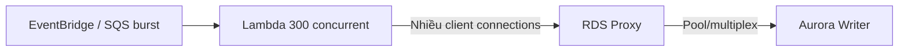

### 18.1. Các nguyên tắc cho Lambda

1. Tạo JDBC client/pool **ngoài handler** hoặc reuse qua warm execution environment khi phù hợp.
2. Không giả định tất cả invocations dùng **cùng** environment hoặc cùng pool.
3. Với Lambda Java, tránh HikariCP `maximumPoolSize=10` trong mỗi environment nếu một invocation xử lý tuần tự và không cần 10 kết nối.
4. Đặt concurrency controls, SQS batch/window phù hợp để giới hạn áp lực xuống DB.
5. Mở transaction sát thời điểm cần SQL và đóng/rollback ngay khi xong.
6. Timeout tổng của Lambda phải lớn hơn hợp lý so với JDBC connection/query timeouts nhưng không quá cao.
7. Xử lý retry idempotent vì SQS/EventBridge/Lambda có thể thực thi lại.
8. Giám sát `ClientConnections`, `DatabaseConnections`, `DatabaseConnectionsBorrowLatency` và pinned sessions.

### 18.2. Một mô hình ngân sách

Giả sử:

```text
Lambda reserved concurrency = 200
Connections mỗi warm environment = 1
=> tối đa khoảng 200 client connections từ Lambda
```

Không có RDS Proxy, 200 sessions trực tiếp có thể tốn đáng kể DB memory khi bùng tải. Có proxy, những transaction ngắn/không pinned có thể chia sẻ backend pool hiệu quả hơn.

**Không suy ra** 200 sessions đảm bảo xuống đúng 20 DB connections: phải đo concurrency SQL thực tế, duration, pinning và user-specific pools.

## 19. Giám sát RDS Proxy bằng CloudWatch

Các metrics quan trọng của RDS Proxy có trong namespace `AWS/RDS` và các dimension sets như `ProxyName`, `EndpointName`, `TargetGroup`, `TargetRole` theo hướng dẫn AWS.

| Metric | Ý nghĩa | Cách sử dụng |
|---|---|---|
| `ClientConnections` | Số client connections đang mở tới proxy | Phát hiện app pool bùng lên |
| `DatabaseConnections` | Số DB backend connections proxy đang giữ | So sánh với client connections |
| `MaxDatabaseConnectionsAllowed` | Trần connections dành cho workload proxy (đã tính reservation) | Kiểm tra saturation/headroom |
| `DatabaseConnectionsBorrowLatency` | Thời gian mượn backend connection, **microseconds** | Phát hiện pool thiếu capacity |
| `DatabaseConnectionsCurrentlyBorrowed` | Backend connections đang được mượn | Chỉ báo active transactions/queries |
| `DatabaseConnectionsCurrentlyInTransaction` | Backend connections đang trong transaction | Nhận biết transaction dài |
| `DatabaseConnectionsCurrentlySessionPinned` | Backend connections gắn cứng vào sessions | Đo hiệu quả multiplexing |
| `ClientConnectionsSetupFailedAuth` | Client connection setup/auth/TLS thất bại | Chẩn đoán IAM/secret/TLS |
| `ClientConnectionsNoTLS` | Client connections không mã hóa | Giám sát policy TLS |
| `DatabaseConnectionRequests` | Lượng yêu cầu mở backend connections | Quan sát churn |
| `AvailabilityPercentage` | Mức khả dụng của target group/role | Theo dõi failover/availability |

**Không chỉ so ClientConnections và DatabaseConnections rồi kết luận hiệu quả.** Cần xem role/target dimensions, pinned/borrowed, thời gian giao dịch, tỷ lệ lỗi và SQL throughput. Một hệ thống vừa mới khởi động có 10 clients/10 database sessions không nhất thiết cấu hình sai.

### 19.1. Những tín hiệu cảnh báo

- `DatabaseConnectionsBorrowLatency` tăng rõ trong giờ cao điểm.
- `DatabaseConnections` tiệm cận `MaxDatabaseConnectionsAllowed`.
- `DatabaseConnectionsCurrentlySessionPinned` cao hoặc tăng sau deployment.
- `ClientConnectionsSetupFailedAuth` tăng sau secret rotation/IAM change.
- `ClientConnectionsNoTLS > 0` trong môi trường yêu cầu mã hóa.
- Database `CPUUtilization` và `DatabaseConnections` tăng cùng lúc.
- RDS Performance Insights/Database Insights cho thấy lock waits hoặc slow queries.

AWS phát metrics theo chu kỳ (nhiều metrics một phút); khi tính toán alerts cần chọn statistic/dimensions đúng và theo dõi biến động, không mặc định mọi metric là request count.

### 19.2. AWS CLI đọc CloudWatch metric

Ví dụ:

```bash
aws cloudwatch list-metrics \
  --namespace AWS/RDS \
  --metric-name DatabaseConnectionsBorrowLatency \
  --region ap-southeast-1
```

Sau khi xác minh dimension set của proxy, có thể lấy data points:

```bash
aws cloudwatch get-metric-statistics \
  --namespace AWS/RDS \
  --metric-name DatabaseConnectionsBorrowLatency \
  --dimensions Name=ProxyName,Value=course-db-proxy \
  --statistics Average Maximum \
  --period 60 \
  --start-time 2026-11-20T01:00:00Z \
  --end-time 2026-11-20T02:00:00Z \
  --region ap-southeast-1
```

Thời gian ở đây **chỉ để minh họa**; thay bằng giai đoạn thực đang điều tra. Unit metric là microseconds, không phải milliseconds. Khi lập biểu đồ cho người xem, đổi đơn vị rõ ràng:

```text
1.000 microseconds = 1 millisecond
100.000 microseconds = 100 milliseconds
```

### 19.3. Debug logging của proxy

RDS Proxy có tùy chọn **enhanced/debug logging** hỗ trợ điều tra lỗi kết nối/session. Không bật dài hạn nếu có nguy cơ log chứa SQL, tên database user hoặc thông tin nhạy cảm; quản lý CloudWatch retention/IAM access và tắt sau khi điều tra.

## 20. Troubleshooting: từ DNS đến session pinning

| Triệu chứng | Nguyên nhân có thể | Cách kiểm tra |
|---|---|---|
| Java `Connection refused` | Sai endpoint/port, proxy chưa available | Describe proxy, DB protocol port, DNS |
| Java connect timeout | SG, subnet/route, NACL, VPN hoặc target unhealthy | App→proxy→DB path, SG inbound/outbound |
| `Access denied for user` / auth failed | Secret sai, DB user/grants thiếu, IAM token hết hạn | AuthConfig, Secrets Manager, DB users, IAM policy |
| IAM auth lỗi sau 15 phút uptime | App giữ **token cố định** và Hikari tạo physical connection mới | Generate token mới mỗi lần mở connection |
| Target `UNAVAILABLE` | Chưa register, DB không sẵn, VPC/SG hoặc auth sai | Describe-db-proxy-targets, RDS events |
| `Too many connections` dù có proxy | MaxConnectionsPercent quá cao/thấp không phù hợp, nhiều clients bypass proxy, pinning | Client/DB/pinned metrics, max_connections |
| Borrow latency tăng | Backend pool hết kết nối rảnh, transaction dài, failover | BorrowLatency, CurrentlyBorrowed, InTransaction |
| ClientConnections cao nhưng DBConnections cũng cao | Sessions pinned, nhiều DB users, pool quá lớn | CurrentlySessionPinned, JDBC startup queries |
| Sau deploy bị pinning tăng đột ngột | PostgreSQL `SET`/prepared statements/JDBC changes | SQL traces, driver settings, AWS pinning guidance |
| Failover làm mất transaction | Transaction đang chạy bị cắt | Reconnect/retry idempotent, query state trước redo |
| Đọc replica chưa thấy row vừa ghi | Replication lag | Dùng writer cho read-after-write hoặc consistency strategy |
| Reader endpoint không hoạt động | Cluster chưa có reader, endpoint không hỗ trợ target | Aurora reader availability, proxy endpoint target role |
| TLS certificate error | JDBC TLS verification/trust store/endpoint không khớp | Đúng hostname, cert chain, TLS mode |
| S3/Secrets Manager API timeout | VPC NAT/endpoints/network thiếu | Endpoints, routes, SG; không nhầm SQL port |
| Chi phí proxy không giảm khi idle | RDS Proxy tính phí theo DB capacity | Pricing, provisioned vCPU/Serverless ACU |
| Thêm proxy endpoint tăng phí | PrivateLink interface endpoint được tạo thêm | Endpoint inventory + PrivateLink billing |

### 20.1. Quy trình debug theo lớp

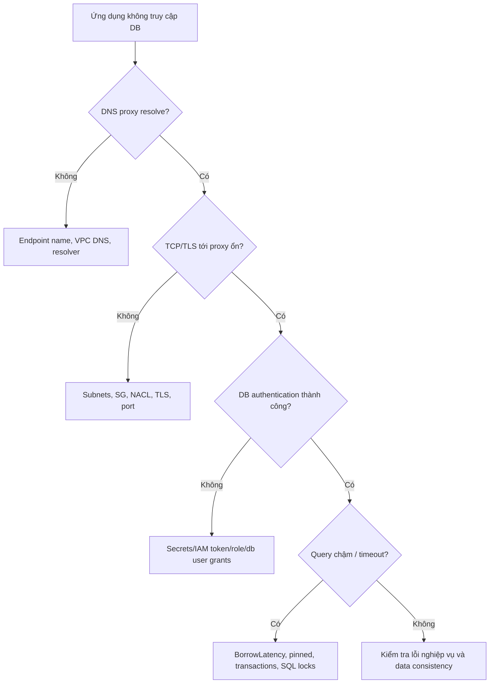

**Không nên** sửa IAM policy bằng cách cấp `AdministratorAccess` để khắc phục một `TCP timeout` do SG. Các lỗi network, authentication, pooling và SQL semantics có lớp nguyên nhân riêng.

## 21. Chi phí RDS Proxy và khi nào không cần dùng

Theo [AWS RDS Proxy pricing](https://aws.amazon.com/rds/proxy/pricing/), phí RDS Proxy dựa trên **capacity của database targets**:

- Với **provisioned instances** RDS/Aurora được hỗ trợ, RDS Proxy tính theo **vCPU-giờ** của instance.
- Với **Aurora Serverless** được hỗ trợ, tính theo **ACU-giờ** tiêu thụ của DB.
- Phần thời gian dùng lẻ được tính theo giây, với **thời lượng tính phí tối thiểu 10 phút** sau những thay đổi trạng thái tính phí theo hướng dẫn hiện hành.
- **Default proxy endpoint** không có phí endpoint bổ sung riêng; **additional proxy endpoints** có thể phát sinh phí AWS PrivateLink.
- Database, Secrets Manager, CloudWatch Logs/metrics, NAT/data transfer và các dịch vụ liên quan vẫn có phí riêng.

### 21.1. Ví dụ usage (không tự gán đơn giá USD)

Giả sử một DB provisioned có **4 vCPU** và RDS Proxy hoạt động liên tục **720 giờ/tháng**:

```text
Proxy capacity usage ≈ 4 vCPU × 720 giờ
                     = 2.880 vCPU-giờ

Proxy cost ≈ 2.880 × đơn giá vCPU-giờ (Region/engine)
```

Con số trên là **đơn vị tính usage minh họa**, không phải giá USD. Không lấy giá một Region bất kỳ áp cho `ap-southeast-1` hoặc một database class khác mà không kiểm tra Pricing Calculator.

### 21.2. So sánh tổng chi phí

| Hạng mục | Không dùng proxy | Dùng RDS Proxy |
|---|---|---|
| Phí RDS Proxy | Không | Có |
| Phí database | Có | Có |
| Connection setup trên database | Có thể cao khi burst | Có thể giảm |
| Tài nguyên DB cho sessions | Phụ thuộc app pools, max_connections | Có thể giảm khi multiplexing hiệu quả |
| Effort failover/reconnect | App tự xử lý nhiều hơn | Proxy hỗ trợ writer routing, nhưng app vẫn retry |
| Secrets/IAM/TLS | Vẫn cần | Vẫn cần, thêm auth layers |
| Additional VPC endpoints | Theo kiến trúc | Có thể tăng khi tạo proxy endpoints |
| Observability | DB metrics | Thêm proxy metrics |

RDS Proxy không nhất thiết giảm hóa đơn của mọi hệ thống. Với **một JVM nhỏ**, ít kết nối, HikariCP đã đáp ứng và yêu cầu failover bình thường, phí proxy có thể lớn hơn lợi ích. Với **Lambda burst traffic**, nhiều ECS replicas và nhu cầu failover nhanh, lợi ích thường đáng đánh giá nghiêm túc.

### 21.3. Khi nào nên cân nhắc giải pháp khác?

- **RDS Proxy:** AWS-managed pooling, giảm session overhead khi nhiều clients, hỗ trợ failover/IAM.
- **HikariCP đơn thuần:** Một hoặc vài JVMs, kết nối ổn định, không cần proxy layer.
- **PgBouncer tự quản lý:** PostgreSQL workload có nhu cầu pooling riêng và đội ngũ đủ sức vận hành HA/patching; phải kiểm tra transaction pooling/prepared statements và failover.
- **Aurora reader endpoints:** Phân tải query reads; **không thay thế** pooling/multiplexing của proxy.
- **Aurora Data API:** Tình huống phù hợp dùng API thay cho persistent client sockets, với model và giới hạn khác; cần đối chiếu engine/version và SDK.
- **Cache/SQS/batch:** Nếu vấn đề chính là SQL workload cao hoặc spikes, cần giảm số truy vấn hoặc làm phẳng tải, không chỉ thay cách mở connections.

## 22. Lab tổng hợp: Spring Boot + Aurora PostgreSQL + RDS Proxy

**Kịch bản:** Course API chạy ECS Fargate, database là Aurora PostgreSQL có writer và reader, báo cáo đọc qua read-only endpoint. Mục tiêu: giữ database connection usage trong giới hạn, giảm lỗi khi autoscaling và đánh giá RDS Proxy so với HikariCP trực tiếp.

### 22.1. Bài tập từng bước

1. Tạo một sơ đồ App/SG → Proxy/SG → Aurora/SG trong cùng VPC, ít nhất hai AZ phù hợp.
2. Ghi trần database connections theo `max_connections` và số connections dự trù cho admin/other apps.
3. Tạo database user `course_app` chỉ có quyền cần thiết (không dùng admin).
4. Chọn **Secrets Manager backend auth** hoặc **end-to-end IAM**, ghi rõ lý do và engine compatibility.
5. Tạo proxy, register cluster target và bật `RequireTLS`.
6. Xác minh target `AVAILABLE`, lấy endpoint bằng AWS CLI.
7. Cấu hình Spring Boot `spring.datasource.url` trỏ tới proxy, Hikari pool size ban đầu 8.
8. Chạy load test trong sandbox, thu `ClientConnections`/`DatabaseConnections`/`BorrowLatency`/`Pinned`.
9. Thử 5 → 20 ECS tasks (nếu được cấp quyền và có ngân sách); so với connection budget.
10. Chạy một truy vấn có `SET` session state trong sandbox, đo mức thay đổi pinning; sau đó loại câu lệnh không cần.
11. Nếu cluster có reader, tạo một **read-only proxy endpoint**, chạy workload báo cáo và quan sát replication lag.
12. Thử failover theo quy trình có phê duyệt, xác minh idle connections và transaction đang chạy có hành vi khác nhau.
13. Thử IAM token hết hạn (không phá production), kiểm tra cơ chế cấp token mới cho physical connection.
14. Ước lượng chi phí theo vCPU-hours hoặc ACU-hours, PrivateLink và logging.
15. Tạo CloudWatch alarms, documentation về rollback/cleanup và so sánh với direct JDBC.

### 22.2. Bảng ghi số liệu

| Thử nghiệm | ECS tasks | Hikari max/task | ClientConnections | DatabaseConnections | Pinned | BorrowLatency p95 | DB CPU | Kết quả |
|---|---:|---:|---:|---:|---:|---:|---:|---|
| Baseline Hikari trực tiếp | 5 | 8 | Không qua proxy | Đo thực | N/A | N/A | Đo | Pass/Fail |
| RDS Proxy ít tải | 5 | 8 | Đo | Đo | Đo | Đo | Đo | Pass/Fail |
| RDS Proxy burst | 20 | 8 | Đo | Đo | Đo | Đo | Đo | Pass/Fail |
| Cố tình SET trong session | 20 | 8 | Đo | Đo | Đo | Đo | Đo | Pass/Fail |
| Sau loại SET dư | 20 | 8 | Đo | Đo | Đo | Đo | Đo | Pass/Fail |

**Không điền giá trị benchmark bịa đặt.** Lấy metrics từ CloudWatch có dimensions chính xác và log ứng dụng tương ứng.

### 22.3. Checklist nghiệm thu

- Application kết nối tới **proxy endpoint**, không bypass tình cờ.
- Proxy target available và SG cho phép đúng hướng.
- TLS được yêu cầu và được client thực thi.
- IAM roles/secrets đúng, không lộ password/token.
- Hikari pool có giới hạn, timeout phù hợp API SLO.
- Transaction ngắn, không gọi HTTP ngoài DB trong một transaction dài.
- Pinning được quan sát và có cách giải thích.
- Failover không được giả định hoàn tất mọi transaction đang chạy.
- Reader endpoint chỉ cho read và có chiến lược consistency.
- Chi phí proxy + endpoint + database/logs đã được tính.

## 23. Câu hỏi tự kiểm tra

**1. HikariCP và RDS Proxy có thay thế nhau hoàn toàn không?**  
Không. HikariCP quản lý connections **trong JVM**, RDS Proxy quản lý backend connections **giữa nhiều client applications**.

**2. Vì sao 20 ECS tasks × HikariCP pool 10 vẫn có thể gây quá tải RDS?**  
Vì có thể tạo tới **200 database connections** nếu kết nối trực tiếp, chưa kể clients khác.

**3. Multiplexing có thể tái sử dụng connection đang ở giữa một transaction chưa commit không?**  
Không. Proxy phải giữ backend connection phục vụ transaction và session state cho tới khi an toàn.

**4. Session pinning là gì?**  
Proxy giữ một backend connection riêng cho client session vì session có state không thể chia sẻ an toàn; điều này làm giảm multiplexing.

**5. PostgreSQL `SET search_path` có thể ảnh hưởng pinning không?**  
Có. AWS nêu PostgreSQL `SET` session state là một nguyên nhân pinning phổ biến.

**6. Tăng `MaxConnectionsPercent` từ 50 lên 100 có chắc giảm latency?**  
Không. Có thể tăng khả năng borrow nhưng cũng tiêu tốn gần hết DB connection budget, gây áp lực DB và tranh chấp với clients khác.

**7. Metric nào cho biết số backend connections đang pinned?**  
`DatabaseConnectionsCurrentlySessionPinned`.

**8. `DatabaseConnectionsBorrowLatency` đo bằng milliseconds hay microseconds?**  
**Microseconds** theo CloudWatch RDS Proxy metrics.

**9. RDS Proxy có tự biến database single-AZ không standby thành multi-AZ HA không?**  
Không. Nó cải thiện connection management/failover khi DB topology hỗ trợ, không thay thế replication/standby.

**10. App đang giao dịch thì Aurora failover. Proxy có bảo đảm COMMIT hoàn tất?**  
Không. Transaction đang chạy có thể bị cắt; ứng dụng phải kiểm tra trạng thái và retry idempotent.

**11. Default proxy endpoint của Aurora có tự chia reads tới readers không?**  
Không. Default read/write endpoint dùng writer; cần read-only endpoint riêng khi cluster có reader phù hợp.

**12. RDS Proxy có bắt buộc dùng Secrets Manager password trong mọi cấu hình năm 2026 không?**  
Không. AWS hỗ trợ end-to-end IAM authentication cho engine đủ điều kiện với `DefaultAuthScheme=IAM_AUTH`.

**13. IAM token dùng để mở DB connection có hiệu lực bao lâu?**  
**15 phút để xác thực một kết nối mới**; cần tạo token mới trước khi mở physical connections sau khi token cũ hết hạn.

**14. IAM user access key có nên được hard-code trong Spring Boot `application.yml` không?**  
Không. Dùng ECS task role, EC2 instance profile hoặc Lambda execution role và AWS SDK default credentials chain.

**15. Tại sao một proxy endpoint mới có thể tăng chi phí?**  
Additional endpoints có thể tạo PrivateLink interface endpoints có phí, ngoài chi phí RDS Proxy.

**16. Một SQL query chậm do thiếu index có được RDS Proxy làm nhanh tự động không?**  
Không. Cần tối ưu SQL/index, DB capacity và query plan.

**17. Backend đã dùng HikariCP có nên tăng pool từ 10 lên 500 khi thêm RDS Proxy?**  
Không nên tự động. Pool lớn làm tăng client connections và có thể giảm hiệu quả khi session pinning; cần đo demand thật.

**18. Khi dùng IAM client auth với proxy, policy `rds-db:connect` cần nhắm tới resource nào?**  
Tài nguyên **DB user theo proxy resource ID** phù hợp, không phải chỉ tên DNS; phân biệt với DB instance/cluster resource ID cho proxy role trong end-to-end IAM.

## 24. Tổng kết và tài liệu tham khảo

**Connection pooling** trong HikariCP giảm chi phí mở/đóng connection trong mỗi ứng dụng Java. **Amazon RDS Proxy** bổ sung lớp kết nối được AWS quản lý, tái sử dụng và multiplex backend connections giữa nhiều workloads; đặc biệt hữu ích khi ECS/Lambda scale nhanh hoặc khi muốn giảm gián đoạn failover.

Tuy nhiên, **RDS Proxy không tự sửa lỗi SQL chậm, không bảo đảm zero downtime cho transaction đang chạy và không hiệu quả nếu hầu hết sessions bị pinned**. Thiết kế đúng cần đo connection budget, bảo đảm transaction ngắn, dùng TLS/IAM least privilege, cấu hình Secrets Manager hoặc end-to-end IAM phù hợp, theo dõi CloudWatch metrics và tính phí proxy/PrivateLink riêng.

### Tài liệu AWS chính thức

- [Amazon RDS — RDS Proxy overview](https://docs.aws.amazon.com/AmazonRDS/latest/UserGuide/rds-proxy.html)
- [Amazon RDS — Concepts and terminology (pooling, multiplexing, pinning)](https://docs.aws.amazon.com/AmazonRDS/latest/UserGuide/rds-proxy.howitworks.html)
- [Amazon RDS — RDS Proxy connection considerations](https://docs.aws.amazon.com/AmazonRDS/latest/UserGuide/rds-proxy-connections.html)
- [Amazon RDS — RDS Proxy configuration guidelines](https://docs.aws.amazon.com/AmazonRDS/latest/UserGuide/rds-proxy-best-practices.configuration.html)
- [Amazon RDS — Workload considerations and application pools](https://docs.aws.amazon.com/AmazonRDS/latest/UserGuide/rds-proxy-best-practices.workload-considerations.html)
- [Amazon RDS — Avoiding session pinning](https://docs.aws.amazon.com/AmazonRDS/latest/UserGuide/rds-proxy-pinning.html)
- [Amazon RDS — Creating an RDS Proxy](https://docs.aws.amazon.com/AmazonRDS/latest/UserGuide/rds-proxy-creating.html)
- [Amazon RDS — Connecting through a proxy](https://docs.aws.amazon.com/AmazonRDS/latest/UserGuide/rds-proxy-connecting.html)
- [Amazon RDS — IAM authentication for RDS Proxy](https://docs.aws.amazon.com/AmazonRDS/latest/UserGuide/rds-proxy-iam-setup.html)
- [Amazon RDS — Monitoring RDS Proxy metrics with CloudWatch](https://docs.aws.amazon.com/AmazonRDS/latest/UserGuide/rds-proxy.monitoring.html)
- [Amazon RDS — RDS Proxy endpoints](https://docs.aws.amazon.com/AmazonRDS/latest/UserGuide/rds-proxy-endpoints.html)
- [Amazon Aurora — RDS Proxy endpoints and readers](https://docs.aws.amazon.com/AmazonRDS/latest/AuroraUserGuide/rds-proxy-endpoints.html)
- [Amazon Aurora — RDS Proxy and failover](https://docs.aws.amazon.com/AmazonRDS/latest/AuroraUserGuide/rds-proxy.howitworks.html)
- [Amazon RDS — IAM authentication token and connection](https://docs.aws.amazon.com/AmazonRDS/latest/UserGuide/UsingWithRDS.IAMDBAuth.Connecting.html)
- [Amazon RDS Proxy — Pricing](https://aws.amazon.com/rds/proxy/pricing/)
- [AWS Prescriptive Guidance — RDS Proxy best practices](https://docs.aws.amazon.com/prescriptive-guidance/latest/amazon-rds-proxy/best-practices.html)

> **Lưu ý thực hành:** Các endpoint, ARNs, VPC subnet/SG IDs, users, passwords và số liệu performance/chi phí đều chỉ là ví dụ. Không chạy lệnh tạo/sửa/xóa trên database sản xuất nếu chưa được phê duyệt. Phải kiểm tra Region, engine/version, IAM permissions, VPC connectivity, pricing và phương án rollback trước khi dùng RDS Proxy trong môi trường có dữ liệu thật.
