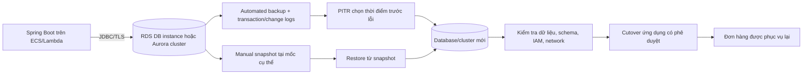
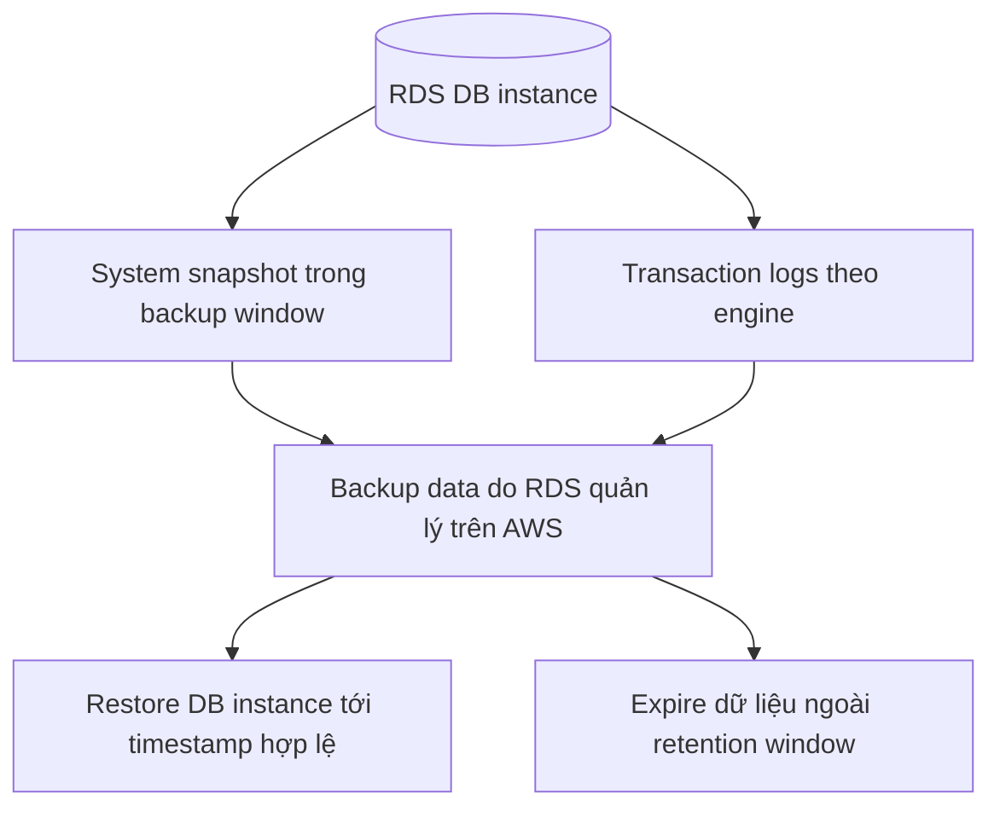
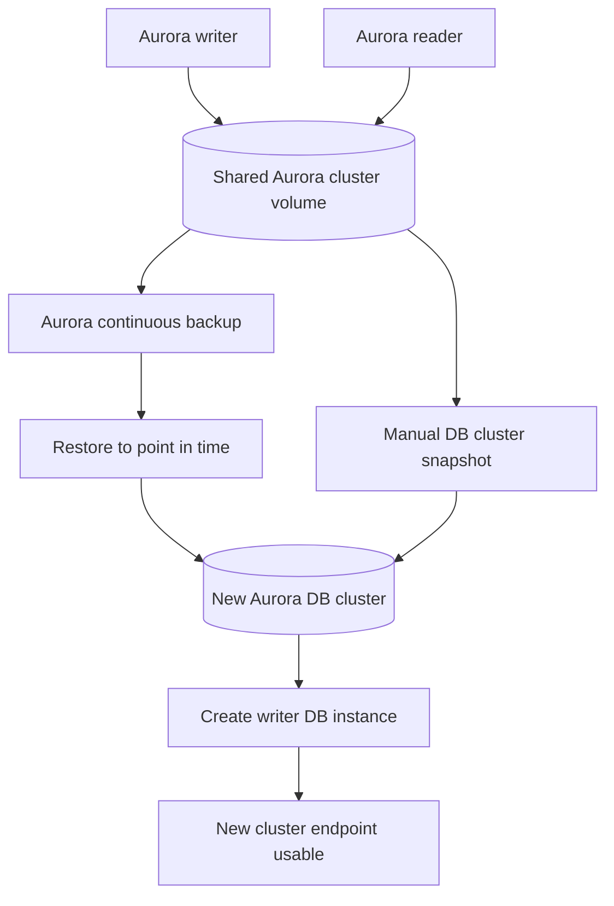
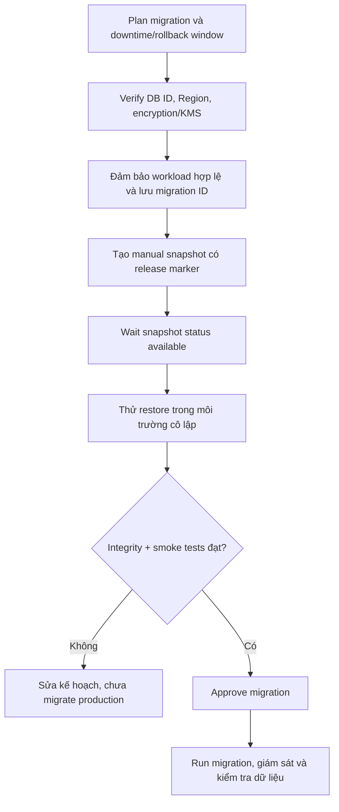
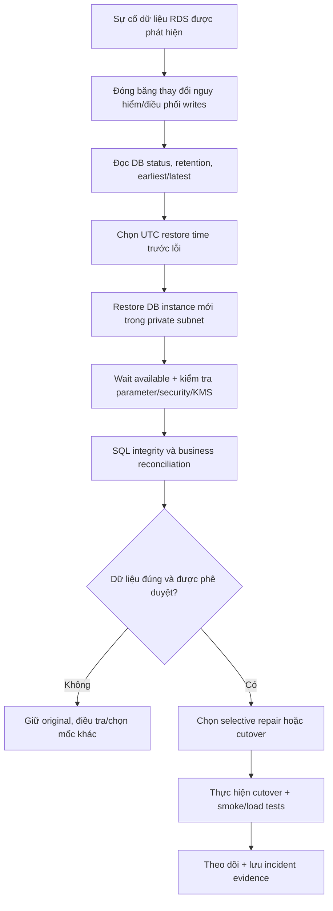
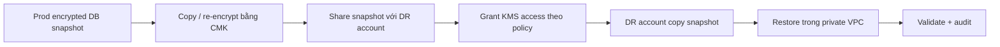
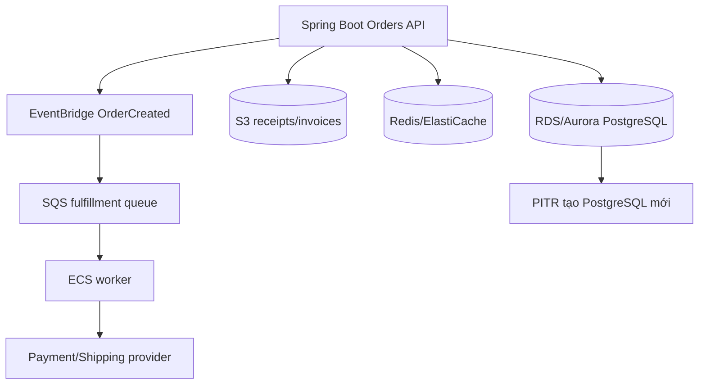

# Backup tự động, snapshot và khôi phục theo thời điểm

> **Chương:** Cơ sở dữ liệu RDS và Aurora · **Mô-đun:** `CLOUD_PROVIDERS_AWS`

## 1. Bài toán: xóa nhầm dữ liệu lúc đang chạy production

Một hệ thống đặt hàng dùng **Spring Boot** chạy trên ECS và **Amazon RDS for PostgreSQL** để lưu đơn. Lúc 09:15, một bản migration lỗi chạy lệnh cập nhật sai khiến hàng nghìn đơn hàng mất trạng thái thanh toán. Server và database vẫn `available`, Multi-AZ vẫn sẵn sàng, nhưng **dữ liệu nghiệp vụ đã sai**.

Nhóm vận hành cần trả lời ngay:

1. Lúc nào dữ liệu còn đúng? Nên chọn thời điểm phục hồi **09:14:59** hay một thời điểm khác dựa trên nhật ký?
2. Dữ liệu được **backup tới mốc thời gian nào**? Có thể chọn đúng thời điểm đó trong hệ thống không?
3. Sau khi khôi phục, một database mới sẽ được tạo ở đâu? Ứng dụng chuyển kết nối ra sao?
4. Những đơn hàng hợp lệ từ 09:15 tới lúc xử lý sự cố có bị mất nếu chuyển hẳn sang bản khôi phục không?
5. Làm thế nào kiểm tra tính toàn vẹn, thời gian ngừng dịch vụ, RPO/RTO và chi phí?

**Amazon RDS automated backups**, **manual snapshots** và **point-in-time recovery (PITR)** trả lời các nhu cầu khác nhau. **Amazon Aurora** cũng hỗ trợ PITR nhưng kiến trúc lưu trữ và thao tác restore ở **cấp cluster** khác với RDS DB instance.



**Điểm cần nhớ:** RDS/Aurora backup không tự đảo ngược dữ liệu trong database đang chạy khi một nhân viên xóa nhầm. **PITR và snapshot restore tạo tài nguyên mới**; app owner phải quyết định dữ liệu nào cần giữ, kiểm thử, rồi thực hiện cutover. **Multi-AZ không phải backup**, vì thao tác xóa nhầm có thể được nhân bản sang standby.

Trong mô-đun `CLOUD_PROVIDERS_AWS`, bài này kết nối **IAM, VPC/private subnets, Region/AZ, ECS/Lambda Java, S3, AWS Backup, CloudWatch, bảo mật, khả năng phục hồi và quản trị chi phí**.

**Mục tiêu học tập:**

- Phân biệt automated backup, manual snapshot, final snapshot, retained automated backup, PITR, Aurora clone và Backtrack.
- Chọn backup retention và giải thích **earliest/latest restorable time**; tính RPO/RTO theo mục tiêu thật.
- Kiểm tra cấu hình qua AWS CLI và khôi phục **RDS DB instance** hoặc **Aurora DB cluster** đến thời điểm được chỉ định.
- Biết vì sao restore Aurora qua CLI phải **tạo writer DB instance** và vì sao restored endpoint thay đổi.
- Thiết kế backup/copy cross-Region/cross-account và bảo vệ snapshot bằng AWS KMS/IAM.
- Xây runbook có bằng chứng, kiểm tra nghiệp vụ, cutover/rollback, giám sát và test khôi phục định kỳ.

## 2. Các đối tượng lưu trữ cần phân biệt

### 2.1. RDS DB instance, Multi-AZ và Aurora DB cluster

| Triển khai | Đơn vị quản lý backup/PITR | Đặc điểm |
| --- | --- | --- |
| **RDS Single-AZ DB instance** | DB instance. | Backup tự động gồm snapshot hệ thống và transaction logs; PITR tạo DB instance mới. |
| **RDS Multi-AZ DB instance** | DB instance gồm standby phục vụ HA. | Failover sang standby khi hạ tầng lỗi; PITR vẫn tạo **instance mới** và cần bảo vệ dữ liệu trước lỗi logic. |
| **RDS Multi-AZ DB cluster** | DB cluster gồm writer và các reader/standby theo cấu hình. | Backup retention **1–35 ngày**, sử dụng các API restore dành cho cluster; không nhầm với Multi-AZ DB instance. |
| **Aurora MySQL/PostgreSQL DB cluster** | **Cluster volume**, không phải từng writer/reader riêng lẻ. | Continuous incremental backups, PITR tạo **cluster mới**, khôi phục CLI tạo writer DB instance tiếp theo. |

**Aurora ≠ RDS Multi-AZ DB instance.** Aurora sử dụng phân tách compute và cluster storage được nhân bản trong nhiều AZ, hỗ trợ writer/reader instances và cluster endpoint. RDS Multi-AZ DB instance dùng mô hình standby riêng. Những khác biệt này quan trọng ở lúc restore, monitoring, chi phí và cutover.

### 2.2. Bốn loại “bản phục hồi”

| Loại | Ai tạo? | Thời điểm phục hồi | Tồn tại bao lâu? |
| --- | --- | --- | --- |
| **Automated backup** | RDS/Aurora theo retention. | Có thể hỗ trợ PITR trong khoảng được bảo vệ. | Hết hạn theo retention, tùy trạng thái nguồn và policies. |
| **Manual DB/cluster snapshot** | Người dùng, automation hoặc workflow được phê duyệt. | **Đúng mốc snapshot** (không phải một thời điểm tùy ý sau đó). | Không tự hết hạn theo automated backup retention; lưu đến khi bị xóa, có thể tính phí. |
| **Final snapshot** | Tùy chọn lúc xóa DB/cluster. | Mốc chụp gần thời điểm xóa. | Snapshot độc lập, cần quản lý/xóa có chủ đích. |
| **Retained automated backup** | Chọn giữ automated backups khi xóa **RDS DB instance** được hỗ trợ. | Có khả năng PITR tới khoảng hợp lệ còn lưu. | Hết hạn theo retention; không tồn tại vô thời hạn như manual snapshot. |

Một snapshot chỉ là **ảnh nhất quán của dữ liệu database/storage tại thời điểm chụp**, không tự bảo đảm business transaction đã được xử lý đầy đủ ở SQS, S3 hay dịch vụ thanh toán bên ngoài.

### 2.3. RPO và RTO

**Recovery Point Objective (RPO)**: lượng dữ liệu có thể chấp nhận mất, đo bằng thời gian hoặc nghiệp vụ. **Recovery Time Objective (RTO)**: thời gian tối đa chấp nhận để khôi phục dịch vụ sau khi xảy ra sự cố.

```text
09:00  09:05  09:10  09:14:59  09:15        09:30       10:00
 |------|------|------|-------| Lỗi DELETE |-----------| Phục vụ lại
         automated backups + logs            phát hiện     cutover

Recovery point: 09:14:59 UTC (nếu thuộc restorable window)
RPO thực tế: chênh từ mốc khôi phục đến dữ liệu hợp lệ cuối cùng cần giữ
RTO thực tế: thời gian phát hiện + quyết định + restore + validate + cutover
```

Ví dụ trên không cam kết RPO bằng **0**: dù PITR có thể khôi phục gần sát lúc lỗi, restored database vẫn có thể thiếu những giao dịch hợp lệ ngay sau mốc chọn. Ngoài ra **LatestRestorableTime** thường trễ vài phút so với thời gian hiện tại, tùy engine/trạng thái; phải đọc giá trị thật qua API.

**Backup retention** mô tả có thể quay lại bao xa; **backup frequency/log delivery** ảnh hưởng mốc mới nhất; **restore/cutover time** quyết định RTO. Đừng kết luận “retention 7 ngày” có nghĩa “chắc chắn RPO 0 và RTO 5 phút”.

### 2.4. Bảo vệ dữ liệu trước lỗi hạ tầng và lỗi logic

| Sự cố | Multi-AZ/failover | Read replica | Backup/PITR |
| --- | --- | --- | --- |
| AZ hosting writer mất | Giúp tăng HA, theo kiến trúc. | Có thể có reader nhưng cần promotion/cutover. | Phương án khôi phục nếu HA không đủ. |
| Xóa nhầm bảng/hàng | Không đảo ngược — lỗi được replicate. | Lỗi có thể lan sang replica. | Khôi phục trước thời điểm lỗi rồi đối soát. |
| Deployment migration lỗi | Không đảo ngược schema. | Replica có thể chịu thay đổi tương tự. | Snapshot trước migration + PITR. |
| Mất Region | Multi-AZ **cùng Region** không cứu được. | Cross-Region replica tùy kiến trúc, lag và quyền. | Cross-Region backups/snapshot copy, DR plan. |
| Kẻ tấn công xóa backup | Không phải biện pháp cô lập backup. | Không cô lập backup. | Cross-account backup, IAM/SCP, Vault Lock khi hỗ trợ. |

## 3. Automated backups trong Amazon RDS

### 3.1. Cơ chế hoạt động

Với **RDS DB instance** (ví dụ PostgreSQL/MySQL), automated backup dùng **system snapshots và database transaction logs** để phục hồi dữ liệu đến điểm nằm trong khoảng retention. RDS tạo bản sao lưu tự động hằng ngày trong **preferred backup window** và đưa transaction logs phục vụ PITR vào kho backup; đối với DB instances, AWS mô tả việc upload transaction logs khoảng **5 phút một lần**.



RDS backup data được lưu bằng hạ tầng lưu trữ do AWS quản lý (tài liệu mô tả Amazon S3). **Đây không phải S3 bucket do người dùng tự truy cập để tải file PostgreSQL WAL/mysql binlog bằng `aws s3 ls`.** Dùng RDS Console/API/CLI hoặc AWS Backup restore workflow.

### 3.2. Retention: khác nhau giữa Console và CLI

Với RDS DB instance phổ biến:

- **0–35 ngày**; `0` nghĩa là **tắt automated backups**. Không dùng `0` cho production cần PITR.
- Khi tạo qua **AWS CLI/API** và bỏ `BackupRetentionPeriod`, default theo tài liệu là **1 ngày**.
- Khi tạo qua **RDS Console** và giữ default, retention thường là **7 ngày**.
- Khi **restore** từ snapshot/instance, nếu không chỉ định rõ retention thì DB mới có thể **kế thừa retention** của nguồn theo quy tắc restore, khác default khi tạo DB mới.
- **RDS Multi-AZ DB cluster** có retention **1–35 ngày**, không dùng `0`.

**Đừng giả định:** mọi hạ tầng được tạo bằng Terraform/CloudFormation có “7 ngày mặc định” như Console. Hãy khai báo retention rõ trong IaC và kiểm tra sau triển khai. Các engine/chế độ đặc biệt có ràng buộc riêng.

Thay `BackupRetentionPeriod` từ `0` sang số dương hoặc ngược lại với RDS DB instance **gây outage** theo tài liệu AWS, nên cần maintenance/change review. Thay từ một số dương sang số dương khác là tình huống khác; xác minh các tác động engine/instance cụ thể.

### 3.3. Backup window và tác động I/O

**Preferred backup window** là khoảng thời gian RDS bắt đầu backup, không có nghĩa backup phải hoàn tất trong đúng cửa sổ đó. Nó không được trùng với **maintenance window**.

- RDS Single-AZ có thể có một khoảng **I/O suspension ngắn** lúc khởi tạo backup; theo dõi application latency.
- Với nhiều engines (MariaDB/MySQL/Oracle/PostgreSQL) trên RDS Multi-AZ DB instance, backup thường lấy từ **standby**, giảm tác động lên primary; **SQL Server/Db2** có lưu ý khác và có thể tạm ngưng I/O.
- Backup window đặt theo **UTC**; kiểm tra khác biệt giờ Việt Nam **UTC+7** khi chọn “giờ thấp điểm”.
- Không cấu hình lịch backup trùng đúng batch job lớn, migration hoặc load testing, nếu có khả năng tránh.

**Stopped DB instance:** RDS không tạo automated backups mới khi instance ở trạng thái `stopped`; thời gian dừng không được tính như ngày hoạt động bình thường trong retention. Đừng dùng “stop để tiết kiệm tiền” như một cách duy trì RPO mới nhất.

### 3.4. PITR được phép trong khoảng nào?

Với một RDS DB instance:

```text
Earliest restorable time                         LatestRestorableTime
        |------------------------------------------------|
        ^                                                 ^
    ngoài khoảng này không được                 thường trước "now"
    chọn để PITR bình thường                      khoảng vài phút
```

Để chọn thời gian restore:

1. Xác định **thời điểm phát sinh lỗi** bằng CloudTrail, RDS PostgreSQL logs, application audit và deployment timeline (không dựa vào ước đoán).
2. Chọn timestamp **trước sự kiện sai**; đọc **Earliest/Latest Restorable Time** thực tế.
3. Dùng UTC timestamp trong CLI/API, không chuyển giờ bằng cảm tính.
4. Nếu cần dữ liệu sau mốc restore, lên kế hoạch **data reconciliation** có kiểm toán.

Việc RDS giữ transaction logs không có nghĩa có **point-in-time query** trực tiếp trên DB đang chạy. PITR phải tạo tài nguyên phục hồi mới và chờ đủ điều kiện kết nối.

### 3.5. Xóa DB instance và retained automated backups

Khi xóa một DB instance được hỗ trợ, AWS cho phép lựa chọn:

- **Final snapshot**: bản chụp thủ công cuối cùng, không tự hết hạn theo retention.
- **Retain automated backups**: giữ system snapshots + transaction logs trong thời gian retention còn hợp lệ, có thể PITR trong khoảng đó.

**Retained automated backups chỉ áp dụng cho RDS DB instances được hỗ trợ, không phải RDS Multi-AZ DB clusters theo cùng cơ chế.** Những retained backups này **cuối cùng sẽ hết hạn**, vì sau khi xóa instance không còn logs/snapshots mới.

Nếu không chọn giữ automated backups khi xóa, RDS có thể xóa chúng (ngoại trừ các bản replicate/copy được quản lý riêng), khiến PITR không còn khả thi từ nguồn đó. **Manual/final snapshots** không tự bị xóa theo DB instance.

## 4. Amazon Aurora: continuous backup ở cấp cluster

### 4.1. Kiến trúc Aurora khác backup của DB instance

Amazon Aurora lưu dữ liệu trên **cluster volume** được nhiều DB instances trong cùng cluster sử dụng. **Automated backup của Aurora liên tục và tăng dần** (continuous incremental backup) ở cấp volume:

- Retention từ **1 đến 35 ngày**.
- **Không thể tắt automated backups** trên Aurora bằng retention `0`.
- **Default retention** của Aurora thường là **1 ngày**, bất kể cách tạo cluster.
- Backup có thể được phục hồi tới một thời điểm hợp lệ; AWS cho biết **LatestRestorableTime thường trong khoảng 5 phút so với hiện tại** ở active cluster.
- Manual **DB cluster snapshots** có thể giữ lâu hơn retention; không tự hết hạn.



**Aurora backup vẫn cần thực hành restore.** “Dữ liệu sao lưu liên tục” không chứng minh IAM/KMS, subnet group, security group, cluster instance creation và application connection đã được kiểm thử.

### 4.2. Backup retention và cluster-wide properties

Aurora quản lý `BackupRetentionPeriod` ở **DB cluster**, không phải từng reader/writer. Vì vậy:

- Đọc `aws rds describe-db-clusters` thay vì chỉ `describe-db-instances`.
- Đặt retention theo yêu cầu nghiệp vụ/sơ đồ phân loại dữ liệu, tối thiểu một ngày.
- Đặt backup window nếu cần, nhưng tránh hiểu đó là “thời điểm duy nhất Aurora chụp snapshot để PITR”.
- Manual cluster snapshots có lifecycle riêng, được tạo bằng `create-db-cluster-snapshot` và khôi phục bằng `restore-db-cluster-from-snapshot`.

**Aurora Serverless v2** vẫn là Aurora DB cluster với tính năng compute auto scaling; backup/PITR áp dụng theo cluster storage. Nhưng restore và chọn DB instance class/capacity cho Serverless v2 khác provisioned instances, phải kiểm tra engine/version và scaling configuration của cluster mới.

### 4.3. Restore Aurora tạo cluster mới, không cập nhật cluster cũ

Khi restore từ Aurora automated backup hoặc manual cluster snapshot:

1. RDS tạo **DB cluster mới** với identifier và endpoint khác.
2. Bước khôi phục qua **AWS CLI/API** thường tạo **cluster storage**, **chưa tạo DB instance writer**.
3. Cần gọi `create-db-instance` gắn `--db-cluster-identifier` để tạo writer (và readers theo HA/capacity plan).
4. Chỉ sau khi cluster/instance `available` và các cấu hình network/role/parameter phù hợp, ứng dụng mới truy cập endpoint.

**RDS Console** có thể tạo writer instance tự động trong luồng restore, vì vậy thao tác Console và CLI không giống hoàn toàn. Đừng để status cluster `available` nhưng không có writer rồi kết luận PITR đã usable.

### 4.4. Aurora Backtrack không phải PITR

Một tính năng riêng là **Aurora MySQL Backtrack** trên các phiên bản/Region hỗ trợ. Backtrack có thể **rewind cluster hiện tại** về một thời điểm trước lỗi nhanh hơn nhiều workflow restore, nhưng **làm gián đoạn kết nối**, có giới hạn về backtrack window và không thay thế backup.

| Tính năng | Aurora PITR | Aurora Backtrack |
| --- | --- | --- |
| Mục tiêu | Tạo **cluster mới** từ backup tại thời điểm được chọn. | Đưa **cluster đang có** lùi về trạng thái trước đó. |
| Dữ liệu nguồn | Continuous backups. | Change records của Backtrack khi đã bật. |
| Downtime/cutover | Cần build cluster/writer, test và đổi endpoint. | Ngắt/gián đoạn ứng dụng trong quá trình rewind; không tạo cluster mới. |
| Hỗ trợ | Aurora MySQL và PostgreSQL theo phiên bản. | **Aurora MySQL** theo phiên bản/Region hỗ trợ, không áp dụng cho Aurora PostgreSQL. |
| Tác động dữ liệu | Có bản mới để so sánh và chọn cutover. | Rewind trên nguồn, có thể mất những thay đổi sau mốc rewind. |
| Có thay backup không? | Không. | **Không**. |

Nếu nhóm muốn làm forensic hoặc copy dữ liệu trước khi cutover, PITR tạo cluster mới thường an toàn để kiểm tra hơn so với Backtrack trực tiếp trên production. Với Backtrack, đặc biệt xem tương tác binary logging, replication và các bản nâng cấp.

## 5. Manual snapshots: điểm mốc có chủ đích và lưu trữ lâu dài

### 5.1. Khi nào nên chụp snapshot thủ công?

**Manual snapshot** phù hợp khi cần một điểm bảo toàn dữ liệu do đội vận hành chủ động chọn, ví dụ:

- **Trước migration schema** có thay đổi destructive như xóa cột, chuyển kiểu dữ liệu, nâng cấp major DB engine.
- **Trước một bản phát hành lớn**, thay đổi ETL hoặc chiến dịch bulk update.
- **Kết thúc một kỳ tài chính** khi có yêu cầu lưu dữ liệu kiểm toán theo chính sách.
- **Sao chép dữ liệu cho staging/DR** sau khi masking/anonymization và kiểm soát truy cập.
- **Đảm bảo bản phục hồi còn tồn tại** sau khi xóa DB instance/cluster, ngoài thời gian automated backup retention.

Snapshot không thay thế **logical export** (ví dụ `pg_dump`) khi cần chuyển một schema/table đơn lẻ, cũng không tự cung cấp một API khôi phục **một bản ghi** đã xóa. Về cơ bản, restore snapshot tạo **DB instance/cluster mới chứa dữ liệu tại mốc snapshot**; muốn lấy một vài rows cần truy vấn DB phục hồi rồi chuyển dữ liệu theo quy trình an toàn.

### 5.2. Tính chất manual snapshot

| Thuộc tính | RDS DB snapshot | Aurora DB cluster snapshot |
| --- | --- | --- |
| Cấp độ | Toàn DB instance/storage, không chỉ một schema/table. | Toàn cluster volume; các database cùng nằm trong snapshot cluster. |
| CLI tạo | `create-db-snapshot`. | `create-db-cluster-snapshot`. |
| CLI đọc | `describe-db-snapshots`. | `describe-db-cluster-snapshots`. |
| CLI restore | `restore-db-instance-from-db-snapshot`. | `restore-db-cluster-from-snapshot` rồi **create writer DB instance**. |
| Retention | Không tự hết hạn theo automated backup retention. | Tương tự, cần xóa có kiểm soát. |
| Có thể copy/share? | Theo engine/Region/permissions/KMS restrictions. | Theo Aurora cluster snapshot capabilities và restrictions. |

**Snapshot được quản lý bằng AWS APIs**, dù dữ liệu được lưu trên hạ tầng S3 phía AWS. **Không có bucket S3 mà bạn tự truy cập để duyệt block-level snapshot**. Dịch vụ **Export snapshot data to S3** (khi được hỗ trợ) cho phép phân tích dữ liệu dưới định dạng khác, nhưng **file export này không thay thế một snapshot có thể restore qua RDS**.

**Lưu ý PostgreSQL:** dữ liệu của `UNLOGGED` tables có thể không được phục hồi từ RDS snapshots/PITR, vì PostgreSQL không ghi những thay đổi này vào WAL như bảng bình thường. Không đặt dữ liệu nghiệp vụ quan trọng không chấp nhận mất mát vào unlogged tables; kiểm tra thực tế trong restore drill.

### 5.3. Chụp snapshot trước migration — runbook



Chỉ nhận việc “snapshot request accepted” là **chưa đủ**. Snapshot có thể `creating` lâu hoặc lỗi; phải chờ `available`, ghi lại identifier/ARN/KMS key/size/time và kiểm tra một restore đã được thử trước đó. Các hệ thống đang ghi liên tục cần **consistency point** rõ ràng cho mọi dịch vụ ngoài DB (S3, SQS, API payment, Redis cache), không chỉ snapshot.

### 5.4. Snapshot khác backup theo lịch

Snapshot thủ công là một mốc rõ ràng, ví dụ 08:50 trước schema migration. Nếu lỗi xảy ra 11:00 và cần phục hồi 10:59, **một snapshot 08:50 không đủ** để tự trả lại dữ liệu đến 10:59; cần automated backup/PITR hoặc phương pháp log/archive khác. Ngược lại, nếu sự cố là mã hóa dữ liệu độc hại và automated backups có nguy cơ bị xóa cùng account, **snapshot copy ở account DR với IAM/KMS bảo vệ** có thể tăng khả năng khôi phục.

Manual snapshots có thể bị xóa nhầm hoặc bởi attacker có IAM permission; “không tự hết hạn” **không phải immutable**. AWS Backup Vault Lock, cross-account copy và deletion protection/SCP là các lớp giảm rủi ro, cần cấu hình riêng.

## 6. Chọn snapshot, PITR, Multi-AZ hay logical restore?

### 6.1. Bảng quyết định

| Yêu cầu | Phương án ưu tiên | Tại sao / giới hạn |
| --- | --- | --- |
| Instance host/AZ bị lỗi, dữ liệu vẫn đúng. | **Multi-AZ automatic failover** hoặc Aurora reader failover. | Tối ưu availability; không quay lại dữ liệu trước khi lỗi logic. |
| Xóa nhầm bảng lúc 09:15, cần 09:14:59. | **PITR** từ automated backup hợp lệ. | Tạo DB/cluster mới đúng thời điểm, đối soát writes sau đó. |
| Muốn checkpoint trước migration lớn. | **Manual snapshot** (kèm PITR liên tục). | Có mốc phục hồi rõ, giữ ngoài retention nếu cần. |
| Cần giữ dữ liệu 90 ngày/năm. | **Manual snapshot/AWS Backup policy** hoặc export/archival phù hợp. | Automated backup retention cơ bản chỉ tối đa 35 ngày. |
| Chỉ cần khôi phục một vài hàng. | Restore vào **DB cô lập** rồi truy vấn/insert chọn lọc. | PITR/snapshot không tự “undo 1 row” trên DB nguồn. |
| Cần backup độc lập vùng địa lý. | **Cross-Region snapshot copy/automated backup replication** theo dịch vụ. | Multi-AZ nằm trong Region, không thay DR Region. |
| Cần chống xóa backup do tài khoản prod bị chiếm. | **Cross-account AWS Backup + Vault Lock** hoặc backup isolation tương đương. | Phân tách quyền và chính sách bất biến, kiểm thử restore. |
| Cần quay lại Aurora MySQL nhanh trên cùng cluster. | **Aurora Backtrack** nếu version/Region hỗ trợ và chấp nhận downtime/data rewind. | Không thay backup, ảnh hưởng cluster đang chạy. |
| Cần nhân bản Aurora để thử migration/analytics. | **Aurora fast clone/copy-on-write** khi hỗ trợ, hoặc snapshot restore. | Clone không đồng nghĩa backup dài hạn hoặc DR isolation. |
| Cần bảng/schemas riêng hoặc migration logic. | **Logical backup/export** có kiểm chứng. | Khác block/volume snapshot và PITR. |

### 6.2. Một ví dụ thời gian cụ thể

Giả sử dữ liệu đúng tới 09:14:50, giao dịch xóa nhầm commit lúc 09:15:00, phát hiện lúc 09:20:00. RDS báo:

```text
EarliestRestorableTime: 2026-11-13T00:00:00Z
LatestRestorableTime:   2026-11-20T02:18:00Z
Current time:          2026-11-20T02:20:00Z (09:20 ICT)
Fault commit:          2026-11-20T02:15:00Z (09:15 ICT)
Candidate restore:     2026-11-20T02:14:50Z (09:14:50 ICT)
```

Vì candidate nằm trong earliest/latest, PITR có thể được **yêu cầu** tại thời điểm này. Nhưng nếu `LatestRestorableTime=02:13:00Z` thì mốc 02:14:50Z **chưa khả dụng**; phải đợi backup logs mới hơn hoặc chọn một mốc cũ hơn với RPO lớn hơn.

Ở Việt Nam, **ICT = UTC+7**; ví dụ trên chuyển 09:14:50 ICT thành 02:14:50Z. Đừng nhầm thời gian ứng dụng UTC, database session timezone và timezone của người vận hành. Dùng ISO-8601 timestamp với `Z` trong CLI; xác minh giá trị được AWS công bố.

### 6.3. PITR không đồng nghĩa zero data loss

Khi chọn khôi phục lúc 09:14:50:

- Những giao dịch trước mốc có thể phục hồi nếu snapshot/log chain hợp lệ.
- Giao dịch hợp lệ sau mốc (09:14:51–09:20) **không có** trong database phục hồi, dù không phải lỗi.
- Các sự kiện SQS, SNS, EventBridge, hệ thống thanh toán ngoài DB vẫn có thể chứa dữ liệu/hành động mới.
- API writes sau khi phát hiện lỗi cần được **dừng/đệm/ghi nhận** trong cutover window để không mất thêm dữ liệu.

Do đó, có lúc phương án an toàn nhất là restore **DB phụ để truy xuất dữ liệu bị xóa** rồi áp dụng sửa chữa chọn lọc trên DB hiện tại, thay vì thay toàn bộ database và mất những thay đổi hợp lệ. Quyết định dựa trên blast radius và độ tin cậy khi đối soát.

## 7. AWS CLI: kiểm tra backup trước mọi lệnh restore

Các lệnh ví dụ dùng **AWS CLI v2** với shell Bash/CloudShell. Region, DB identifier và ARNs là **giả định**; không chạy lệnh thay đổi trên production nếu chưa có phê duyệt. Các lệnh `describe/list` trong mục này **chỉ đọc**.

### 7.1. Xác minh tài khoản/Region

```bash
aws sts get-caller-identity
aws configure get region

# Nếu có nhiều account/profiles, dùng --profile/--region rõ ràng.
aws rds describe-db-instances \
  --region ap-southeast-1 \
  --query 'DBInstances[].{ID:DBInstanceIdentifier,Engine:Engine,Status:DBInstanceStatus,MultiAZ:MultiAZ,Retention:BackupRetentionPeriod}' \
  --output table
```

Tên từ ví dụ:

```text
RDS PostgreSQL instance: orders-pg-prod
Aurora PostgreSQL cluster: orders-aurora-prod
Region: ap-southeast-1
```

Nếu không thấy DB, có thể sai account, sai Region, thiếu `rds:DescribeDBInstances`, hoặc DB thực tế là **Aurora cluster** và bạn đang tìm theo instance identifier không đúng.

### 7.2. RDS instance: backup retention và latest restorable time

```bash
aws rds describe-db-instances \
  --region ap-southeast-1 \
  --db-instance-identifier orders-pg-prod \
  --query 'DBInstances[0].{ID:DBInstanceIdentifier,Engine:Engine,Status:DBInstanceStatus,Retention:BackupRetentionPeriod,Latest:LatestRestorableTime,BackupWindow:PreferredBackupWindow,MultiAZ:MultiAZ,Encrypted:StorageEncrypted,KMS:KmsKeyId,DeletionProtection:DeletionProtection,SubnetGroup:DBSubnetGroup.DBSubnetGroupName}' \
  --output json
```

`LatestRestorableTime` có thể bị thiếu/null nếu chưa có automated backups đủ điều kiện hoặc DB đang trong trạng thái đặc biệt. Không suy rằng DB không có dữ liệu; thay vào đó kiểm tra **backup status, retention, backup window và DB events**.

Để xem earliest/latest restorable time theo giao diện, vào **RDS Console → Automated backups → Current Region**; API `DescribeDBInstanceAutomatedBackups` cung cấp thông tin `RestoreWindow` cho những automated backups được liệt kê. Ví dụ:

```bash
aws rds describe-db-instance-automated-backups \
  --region ap-southeast-1 \
  --db-instance-identifier orders-pg-prod \
  --query 'DBInstanceAutomatedBackups[].{ID:DBInstanceIdentifier,Status:Status,Window:RestoreWindow,Retention:BackupRetentionPeriod}' \
  --output json
```

### 7.3. Aurora cluster: earliest/latest

```bash
aws rds describe-db-clusters \
  --region ap-southeast-1 \
  --db-cluster-identifier orders-aurora-prod \
  --query 'DBClusters[0].{ID:DBClusterIdentifier,Engine:Engine,Status:Status,Retention:BackupRetentionPeriod,Earliest:EarliestRestorableTime,Latest:LatestRestorableTime,Encrypted:StorageEncrypted,KMS:KmsKeyId,Endpoint:Endpoint,ReaderEndpoint:ReaderEndpoint}' \
  --output json
```

Nếu `LatestRestorableTime` trễ nhiều hơn thông thường, kiểm tra cluster health/events/backup processes, CloudWatch metrics và giới hạn dịch vụ thay vì tự chọn thời gian chưa có khả năng restore.

### 7.4. Danh sách manual snapshots và trạng thái

```bash
# RDS DB instance snapshots
aws rds describe-db-snapshots \
  --region ap-southeast-1 \
  --db-instance-identifier orders-pg-prod \
  --snapshot-type manual \
  --query 'DBSnapshots[].{ID:DBSnapshotIdentifier,Created:SnapshotCreateTime,Status:Status,Encrypted:Encrypted,SizeGiB:AllocatedStorage}' \
  --output table

# Aurora DB cluster snapshots
aws rds describe-db-cluster-snapshots \
  --region ap-southeast-1 \
  --db-cluster-identifier orders-aurora-prod \
  --snapshot-type manual \
  --query 'DBClusterSnapshots[].{ID:DBClusterSnapshotIdentifier,Created:SnapshotCreateTime,Status:Status,Encrypted:StorageEncrypted}' \
  --output table
```

Trạng thái `available` cho snapshot là điều kiện cần để restore, nhưng **chưa chứng minh** bạn có KMS permissions, subnet capacity, engine compatibility hoặc đã thử khởi động một database. Backup testing phải gồm thao tác restore và validation.

## 8. Thực hành RDS PostgreSQL: snapshot và PITR

### 8.1. Sơ đồ runbook



**Thao tác restore tạo DB mới và có chi phí DB instance/storage/backup**, có thể thay đổi dữ liệu hoặc lộ dữ liệu nếu chọn mạng sai. Những lệnh dưới đây chỉ dành cho **AWS lab/DR runbook có quyền và change approval**. Người học không có quyền AWS có thể lập script/tài liệu và xem xét expected outputs mà không chạy.

### 8.2. Tạo manual snapshot trước migration (thay đổi tài nguyên)

```bash
aws rds create-db-snapshot \
  --region ap-southeast-1 \
  --db-instance-identifier orders-pg-prod \
  --db-snapshot-identifier orders-pg-before-migration-20261120

aws rds wait db-snapshot-available \
  --region ap-southeast-1 \
  --db-snapshot-identifier orders-pg-before-migration-20261120

aws rds describe-db-snapshots \
  --region ap-southeast-1 \
  --db-snapshot-identifier orders-pg-before-migration-20261120 \
  --query 'DBSnapshots[0].{Status:Status,Created:SnapshotCreateTime,Arn:DBSnapshotArn,Kms:KmsKeyId}' \
  --output json
```

**Ràng buộc:** nguồn cần ở trạng thái được hỗ trợ (thông thường `available`), tên snapshot phải duy nhất. Waiter có giới hạn polling; lệnh có thể thất bại khi snapshot cần lâu hơn mặc định, vì vậy kiểm tra lại trạng thái bằng `describe-db-snapshots` trước khi chạy lại lệnh create. Không xóa snapshot nếu migration chưa được kiểm thử.

### 8.3. Restore từ manual snapshot (một mốc snapshot)

```bash
aws rds restore-db-instance-from-db-snapshot \
  --region ap-southeast-1 \
  --db-instance-identifier orders-pg-snapshot-lab \
  --db-snapshot-identifier orders-pg-before-migration-20261120 \
  --db-instance-class db.t4g.medium \
  --db-subnet-group-name orders-private-subnets \
  --vpc-security-group-ids sg-0123456789abcdef0 \
  --no-publicly-accessible \
  --backup-retention-period 7

aws rds wait db-instance-available \
  --region ap-southeast-1 \
  --db-instance-identifier orders-pg-snapshot-lab
```

`db.t4g.medium`, subnet group và SG là **placeholder**; phải chọn engine-compatible instance class và private subnet group đã tồn tại trong lab. Nếu restore một snapshot có encryption, KMS key policy và quyền account phải cho phép restore. Snapshot restore không trả database về timestamp tùy ý sau lúc snapshot được tạo.

### 8.4. PITR tới timestamp cụ thể

Giả sử lỗi được ghi nhận tại **2026-11-20 02:15:00 UTC**, chọn thời điểm **02:14:50Z** sau khi xác minh RDS `RestoreWindow` cho phép. Tạo **target DB identifier mới**:

```bash
aws rds restore-db-instance-to-point-in-time \
  --region ap-southeast-1 \
  --source-db-instance-identifier orders-pg-prod \
  --target-db-instance-identifier orders-pg-pitr-lab \
  --restore-time '2026-11-20T02:14:50Z' \
  --db-instance-class db.t4g.medium \
  --db-subnet-group-name orders-private-subnets \
  --vpc-security-group-ids sg-0123456789abcdef0 \
  --no-publicly-accessible \
  --backup-retention-period 7

aws rds wait db-instance-available \
  --region ap-southeast-1 \
  --db-instance-identifier orders-pg-pitr-lab
```

Không truyền **`--restore-time` và `--use-latest-restorable-time` cùng lúc**. Muốn khôi phục tới thời điểm mới nhất RDS hỗ trợ, dùng:

```bash
# Ví dụ độc lập: không dùng chung với --restore-time.
aws rds restore-db-instance-to-point-in-time \
  --region ap-southeast-1 \
  --source-db-instance-identifier orders-pg-prod \
  --target-db-instance-identifier orders-pg-latest-lab \
  --use-latest-restorable-time \
  --db-subnet-group-name orders-private-subnets \
  --vpc-security-group-ids sg-0123456789abcdef0 \
  --no-publicly-accessible
```

Mỗi lệnh restore sẽ tạo **DB instance mới**, không cập nhật `orders-pg-prod`. Chỉ chọn `--use-latest-restorable-time` khi mục tiêu là tối đa hóa dữ liệu gần thời điểm hiện tại; nếu cần quay lại **trước lỗi xóa bảng**, phải chọn timestamp **trước khi lỗi xảy ra**, không lấy latest.

### 8.5. Kiểm tra restored instance và quyền mạng

```bash
aws rds describe-db-instances \
  --region ap-southeast-1 \
  --db-instance-identifier orders-pg-pitr-lab \
  --query 'DBInstances[0].{ID:DBInstanceIdentifier,Status:DBInstanceStatus,Endpoint:Endpoint.Address,Port:Endpoint.Port,Engine:Engine,Version:EngineVersion,Subnets:DBSubnetGroup.DBSubnetGroupName,SGs:VpcSecurityGroups,ParamGroups:DBParameterGroups,Encrypted:StorageEncrypted,Kms:KmsKeyId}' \
  --output json
```

**Cực kỳ quan trọng:** RDS PITR instance thường dùng **default DB parameter group, option group, DB security group/subnet group** nếu không khai báo lại (theo engine/API), và thường phục hồi Single-AZ theo cấu hình mặc định. Không giả định restored DB tự có cùng VPC SGs, Multi-AZ deployment, DNS alias, CA certificate, IAM DB authentication, monitoring settings hoặc backup alarms của nguồn.

Ngay cả khi status `available`, RDS có thể **lazy-load data pages** từ backup storage trong nền; request đầu truy cập dữ liệu chưa được load có thể chậm. Đưa vào production cần test latency/throughput và cân nhắc khởi động trước những truy vấn quan trọng để warm storage, theo khuyến nghị engine/version.

### 8.6. Kiểm tra SQL trước khi cắt traffic

Kết nối từ **bastion/SSM Session Manager/VPC workload được cấp quyền**, không public DB ra Internet. Ví dụ PostgreSQL client:

```bash
export PGHOST='orders-pg-pitr-lab.example.rds.amazonaws.com'
export PGPORT=5432
export PGDATABASE='orders'
export PGUSER='readonly_recovery'
export PGSSLMODE='verify-full'
export PGSSLROOTCERT='/path/to/rds-ca-bundle.pem'

# Chứng chỉ, endpoint, credentials phải được cấu hình thật.
psql -c "SELECT current_database(), current_timestamp;"
psql -c "SELECT count(*) FROM orders WHERE status = 'PAID';"
```

Không ghi password vào shell history; có thể dùng AWS Secrets Manager/IAM DB auth theo engine và đặc tính connection. `PGHOST` ở trên là **placeholder**, không có DNS endpoint thật nào được tạo từ tài liệu này.

Các kiểm tra cần thiết:

- Migration schema version và constraints/indexes, row counts/checksum theo nghiệp vụ.
- Các bản ghi bị xóa nhầm đã trở lại? Có record nào **không nên** quay lại không?
- Foreign key consistency, order/payment event reconciliation, outbox, idempotency records.
- JDBC connection tests, Spring Boot health checks, transaction isolation và permissions.
- Query performance, disk/temp space, connection pool và network latency từ đúng ECS/Lambda subnets.
- Thông tin cá nhân/sensitive data trong DB phục hồi phải được bảo vệ như production.

### 8.7. Cutover sau khi approve

Chọn một trong hai phương án:

**A. Selective recovery:** Giữ DB production hiện tại, đọc các rows/schema từ restored DB trong môi trường cô lập và import lại phần **đã được đối soát**. Cách này có thể giảm mất giao dịch hợp lệ sau thời điểm restore, nhưng cần thiết kế SQL migration/transaction và kiểm tra conflict.

**B. Full cutover:** Đưa writes vào maintenance hoặc buffer an toàn; kiểm tra backup/readiness; thay endpoint/connection secret/application configuration sang DB phục hồi, restart/roll JDBC pools hoặc redeploy; smoke test; theo dõi; giữ DB cũ **read-only/không truy cập** theo retention/incident policy.

Một cái tên RDS DB identifier mới không làm endpoint cũ tự trỏ sang DB mới. Nếu dùng Route 53 CNAME/DB proxy/Secrets Manager để trừu tượng hóa endpoint, cần hiểu TTL, DNS caching, connection pool và khả năng rollback của ứng dụng.

**Không chạy `delete-db-instance` hoặc đổi security group sản xuất trước khi DB phục hồi đã được xác minh.** Giữ mốc dữ liệu gốc/backup cho forensic và tránh tăng rủi ro trong lúc xử lý sự cố.

## 9. Aurora PostgreSQL/MySQL: PITR và snapshot bằng CLI

### 9.1. Preflight cho cluster

Xác minh Aurora cluster, writer/reader, backup window/retention và restore time:

```bash
aws rds describe-db-clusters \
  --region ap-southeast-1 \
  --db-cluster-identifier orders-aurora-prod \
  --query 'DBClusters[0].{ID:DBClusterIdentifier,Status:Status,Engine:Engine,EngineVersion:EngineVersion,Retention:BackupRetentionPeriod,Earliest:EarliestRestorableTime,Latest:LatestRestorableTime,Members:DBClusterMembers,Endpoint:Endpoint,Reader:ReaderEndpoint}' \
  --output json
```

Nếu nguồn là Aurora MySQL, thay engine phù hợp. Đừng tự chọn một timestamp ngoài earliest/latest hoặc snapshot của **reader riêng lẻ**, vì Aurora backup hoạt động ở **cluster volume**.

### 9.2. Tạo manual **cluster snapshot**

```bash
aws rds create-db-cluster-snapshot \
  --region ap-southeast-1 \
  --db-cluster-identifier orders-aurora-prod \
  --db-cluster-snapshot-identifier orders-aurora-before-migration-20261120

aws rds wait db-cluster-snapshot-available \
  --region ap-southeast-1 \
  --db-cluster-snapshot-identifier orders-aurora-before-migration-20261120

aws rds describe-db-cluster-snapshots \
  --region ap-southeast-1 \
  --db-cluster-snapshot-identifier orders-aurora-before-migration-20261120 \
  --query 'DBClusterSnapshots[0].{Status:Status,Created:SnapshotCreateTime,Kms:KmsKeyId,Arn:DBClusterSnapshotArn}' \
  --output json
```

Phải phân biệt:

- RDS instance: `create-db-snapshot`, `--db-instance-identifier`.
- Aurora: `create-db-cluster-snapshot`, `--db-cluster-identifier`.

### 9.3. Aurora PITR tạo **cluster mới**

Giả sử lỗi xảy ra lúc 02:15:00 UTC và mốc cần phục hồi là 02:14:50Z:

```bash
aws rds restore-db-cluster-to-point-in-time \
  --region ap-southeast-1 \
  --source-db-cluster-identifier orders-aurora-prod \
  --db-cluster-identifier orders-aurora-pitr-lab \
  --restore-to-time '2026-11-20T02:14:50Z' \
  --db-subnet-group-name orders-private-subnets \
  --vpc-security-group-ids sg-0123456789abcdef0

aws rds wait db-cluster-available \
  --region ap-southeast-1 \
  --db-cluster-identifier orders-aurora-pitr-lab
```

Hoặc dùng `--use-latest-restorable-time` **thay cho `--restore-to-time`** nếu thật sự muốn mốc mới nhất; **không** dùng khi muốn tránh một lỗi đã xảy ra.

**Chưa xong:** Aurora CLI restore tạo cluster storage, **cần writer DB instance**:

```bash
aws rds create-db-instance \
  --region ap-southeast-1 \
  --db-instance-identifier orders-aurora-pitr-writer-lab \
  --db-cluster-identifier orders-aurora-pitr-lab \
  --engine aurora-postgresql \
  --db-instance-class db.r6g.large

aws rds wait db-instance-available \
  --region ap-southeast-1 \
  --db-instance-identifier orders-aurora-pitr-writer-lab

aws rds describe-db-clusters \
  --region ap-southeast-1 \
  --db-cluster-identifier orders-aurora-pitr-lab \
  --query 'DBClusters[0].{Status:Status,Endpoint:Endpoint,ReaderEndpoint:ReaderEndpoint,Members:DBClusterMembers,Retention:BackupRetentionPeriod}' \
  --output json
```

`db.r6g.large` chỉ là ví dụ cho provisioned Aurora engine/Region hỗ trợ; với Aurora Serverless v2 cần engine, **serverless instance class** và cluster scaling config tương thích. Không xem writer instance còn `creating` là cluster đã sẵn sàng cho traffic.

### 9.4. Restore từ Aurora manual cluster snapshot

Một phương án khác là khôi phục đúng **mốc snapshot**:

```bash
aws rds restore-db-cluster-from-snapshot \
  --region ap-southeast-1 \
  --db-cluster-identifier orders-aurora-snapshot-lab \
  --snapshot-identifier orders-aurora-before-migration-20261120 \
  --engine aurora-postgresql \
  --db-subnet-group-name orders-private-subnets \
  --vpc-security-group-ids sg-0123456789abcdef0

aws rds wait db-cluster-available \
  --region ap-southeast-1 \
  --db-cluster-identifier orders-aurora-snapshot-lab

# CLI/API restore từ snapshot cũng yêu cầu tạo writer DB instance.
aws rds create-db-instance \
  --region ap-southeast-1 \
  --db-instance-identifier orders-aurora-snapshot-writer-lab \
  --db-cluster-identifier orders-aurora-snapshot-lab \
  --engine aurora-postgresql \
  --db-instance-class db.r6g.large
```

Sau đó `wait db-instance-available`, kiểm tra DB cluster/instance endpoints, security group, parameter groups và restore data như mục 8.6.

**Không khôi phục Aurora snapshot lên một cluster đang tồn tại.** Restore luôn tạo cluster identifier mới; RDS Console có thể tạo writer cho bạn nhưng AWS CLI/API đòi bước `create-db-instance` riêng.

### 9.5. Phục hồi vùng ứng dụng và endpoint

Aurora có **writer cluster endpoint**, **reader endpoint** và (nếu dùng) custom endpoints. Khi restore:

1. Đọc endpoint thật của cluster mới, không dùng hostname của cluster nguồn.
2. Tạo writer/reader instances đủ nhu cầu availability và hiệu năng.
3. Rà soát cluster parameter group và DB parameter group, KMS, IAM DB authentication, secret credentials, RDS Proxy targets và SG/subnet.
4. Thử kết nối từ đúng ECS/Lambda security group qua TLS; không bật PubliclyAccessible cho database chỉ để test.
5. Kiểm tra writer/reader routing, replica lag (nếu có), connection pooling, database grants và application transaction behavior.
6. Dùng runbook cutover như mục 8.7, không đổi DNS/secret khi chưa có business validation.

### 9.6. RDS Multi-AZ DB cluster (không phải Aurora)

**RDS Multi-AZ DB cluster** có ba DB instances trong một deployment đặc thù, nhưng dùng các thao tác **cluster-level backup/restore**. Nếu bài lab gặp loại này, đọc **RDS Multi-AZ DB cluster restoring guide** và kiểm tra CLI parameters cụ thể; không dùng nguyên `restore-db-instance-to-point-in-time` của RDS Single-/Multi-AZ **DB instance**. Engine compatibility, snapshot copy/retained backup constraints và topology sau restore có thể khác Aurora.

## 10. Retained backups, snapshot copy và Aurora clone

### 10.1. Aurora retained automated backups khi xóa cluster

Aurora có khả năng **retain automated backups khi xóa DB cluster**, theo phiên bản và cấu hình được hỗ trợ. Trong khoảng retention còn hiệu lực, bạn có thể PITR từ retained backups; sau đó retained automated backups **hết hạn**, không tồn tại như manual snapshot.

Những điểm khác với RDS Multi-AZ DB cluster:

- **Aurora** hỗ trợ retained automated backups ở cấp cluster theo hướng dẫn Aurora.
- **RDS DB instance** hỗ trợ retained automated backups theo hướng dẫn RDS, với ràng buộc riêng.
- **RDS Multi-AZ DB cluster** không có cùng tùy chọn retain automated backups như DB instance theo tài liệu RDS.

Retained Aurora automated backups **không có metadata parameter/option group đầy đủ** để khôi phục mọi cài đặt tự động; kiểm tra engine version, subnet/SG, parameter groups, monitoring, writer/reader topology và KMS. **Hãy tạo final/manual snapshot trước khi xóa cluster quan trọng**, bởi retained backups cuối cùng cũng hết hạn.

Một điểm DR đáng chú ý: **Aurora không hỗ trợ cross-Region automated backup replication** theo cùng API với RDS DB instances; muốn giữ Aurora backup ở Region khác thì **copy cluster snapshot** (manual hoặc automated snapshot copy thành manual snapshot) hoặc dùng cơ chế DR/AWS Backup phù hợp.

### 10.2. Copy snapshot khác replication logs

**Copy DB snapshot** tạo một bản lưu tại một mốc thời gian. Nếu thực hiện cross-Region, bản copy có độ trễ phụ thuộc kích thước, throughput, Region và thời gian queue. Nó **không tự** có các transaction logs liên tục để PITR đến mọi thời điểm sau mốc snapshot.

**RDS cross-Region automated backup replication** (với RDS DB instance/engine/Region hỗ trợ) có thể nhân bản **automated snapshots cùng transaction logs** để phục hồi PITR ở Region đích. Tuy nhiên, khoảng restorable time của Region đích có thể trễ hơn nguồn và còn phụ thuộc cấu hình KMS/backup replication. Không ghi RPO gần zero trong DR plan nếu chưa đo được replicated `LatestRestorableTime`.

| Phương án | Cấp độ | Ở Region đích có PITR? |
| --- | --- | --- |
| RDS DB snapshot copy | Một snapshot | **Không** có chuỗi log tiếp diễn từ lần copy đơn lẻ. |
| RDS DB instance automated backup replication | Snapshots **và transaction logs** theo engine/Region hỗ trợ. | **Có thể PITR** trong restorable window của replicated automated backups. |
| Aurora DB cluster snapshot copy | Một cluster snapshot; bản copy là manual snapshot. | **Không** có PITR liên tục như tại source chỉ bằng copy này. |
| AWS Backup copy của continuous recovery point | Bản copy thường chuyển thành **snapshot/periodic** backup. | **Không giả định có PITR** trên recovery point copy. |
| Aurora Global Database | Kiến trúc replication dữ liệu giữa Regions theo tính năng. | HA/DR topology riêng, **không thay backup/PITR** cho xóa nhầm logic. |

### 10.3. Sao chép RDS manual snapshot bằng CLI

Ví dụ **copy trong cùng Region** với tên mới (thao tác thật, có phí storage):

```bash
aws rds copy-db-snapshot \
  --region ap-southeast-1 \
  --source-db-snapshot-identifier orders-pg-before-migration-20261120 \
  --target-db-snapshot-identifier orders-pg-before-migration-copy-20261120
```

**Cross-Region copy** cần gọi RDS API ở **Region đích** và khai báo source snapshot ARN ở Region nguồn (cùng các flags như `--source-region`/`--pre-signed-url` hoặc KMS theo yêu cầu). Ví dụ định dạng, **không chạy nguyên văn**:

```bash
aws rds copy-db-snapshot \
  --region ap-northeast-1 \
  --source-region ap-southeast-1 \
  --source-db-snapshot-identifier arn:aws:rds:ap-southeast-1:111122223333:snapshot:orders-pg-before-migration-20261120 \
  --target-db-snapshot-identifier orders-pg-dr-copy-20261120 \
  --kms-key-id arn:aws:kms:ap-northeast-1:111122223333:key/11111111-2222-3333-4444-555555555555
```

KMS ARN và account là **placeholder**. Với encrypted snapshot, đích cần key hợp lệ, permissions/generation grants; đối chiếu CLI và AWS documentation trước thao tác. Cross-Region copy có thể cần hàng giờ. **Không xóa snapshot nguồn chỉ vì copy request đã được AWS chấp nhận**; chờ snapshot đích `available` và thử restore trong Region đích.

Với Aurora, dùng `copy-db-cluster-snapshot` và đích là **cluster snapshot**; không dùng `copy-db-snapshot` của RDS instance. Có các giới hạn engine/Region khi chia sẻ/copy từ account khác.

### 10.4. Aurora fast cloning không phải bản sao backup bất biến

Aurora hỗ trợ **clone copy-on-write (COW)** trong một số cấu hình để tạo database cluster mới nhanh, dùng chung data pages ban đầu và copy những pages thay đổi sau. CLI dùng `restore-db-cluster-to-point-in-time` với `--restore-type copy-on-write` và `--use-latest-restorable-time` khi version/Region hỗ trợ.

```bash
# Aurora clone minh họa, không phải PITR tới arbitrary timestamp:
aws rds restore-db-cluster-to-point-in-time \
  --region ap-southeast-1 \
  --source-db-cluster-identifier orders-aurora-prod \
  --db-cluster-identifier orders-aurora-clone-lab \
  --restore-type copy-on-write \
  --use-latest-restorable-time
```

Clone vẫn cần **DB writer instance** nếu thực hiện qua CLI/API và phải được bảo vệ KMS/network. Clone có thể tối ưu thời gian/dung lượng khi thử nghiệm, nhưng **không thay manual snapshot hoặc cross-account backup cách ly**, vì phụ thuộc vào cơ chế storage/cloning của Aurora và không phải một recovery point độc lập dài hạn theo chính sách backup.

### 10.5. Đừng nhầm snapshot export to S3 với snapshot copy

**Export snapshot to S3** cho những engines được hỗ trợ thường xuất dữ liệu dưới dạng **Parquet** phục vụ query/analytics, với IAM/KMS/role và chi phí export riêng. Nó **không tạo một backup RDS có thể restore trực tiếp** bằng `restore-db-instance-from-db-snapshot`. Nếu dùng S3 export để phục hồi dữ liệu, phải có pipeline import/DB schema migrations riêng và kiểm tra fidelity.

## 11. AWS Backup: chính sách tập trung, PITR và restore testing

### 11.1. Vai trò của AWS Backup

**AWS Backup** là dịch vụ quản lý tập trung để:

- Tạo **backup plans** với schedules, retention/lifecycle, resource assignments/tag selection.
- Lưu **recovery points** trong backup vaults theo nguồn/tính năng hỗ trợ.
- Bật **continuous backup/PITR** cho RDS/Aurora theo service compatibility và cấu hình phù hợp.
- Sao chép recovery points cross-account/cross-Region khi resource type hỗ trợ.
- Dùng **Backup Audit Manager**, policies và **restore testing plans** để đo khả năng khôi phục.
- Bảo vệ backups khỏi xóa trái phép bằng **Vault Lock** và các lớp isolation, theo giới hạn nguồn/tính năng.

**Không tự coi có AWS Backup plan là đã test restore.** Một backup job `COMPLETED` và một restore job `COMPLETED` là hai việc khác nhau; phục hồi thành công ứng dụng còn cần validation của dữ liệu và network.

### 11.2. Continuous backup và periodic snapshot trong AWS Backup

Khi kế hoạch backup bật PITR và engine/Region hỗ trợ, AWS Backup duy trì **continuous recovery point** với retention theo giới hạn. Nếu tạo **copy** cross-account hoặc cross-Region từ continuous backup, AWS Backup có thể tạo **snapshot backup ở đích**, không sao chép transaction logs. Vì vậy:

> **PITR ở nguồn không tự bằng PITR ở bản copy.**

Một nhóm muốn vừa PITR tại Region chính vừa có DR 90 ngày ở Region khác có thể cần **hai lớp**: continuous recovery points tại primary cho lỗi logic gần đây, periodic snapshots được copy/khóa tại DR account/Region để chịu sự cố vùng/tài khoản. Nếu cần **PITR cross-Region**, đánh giá RDS automated backup replication theo engine/Region thay vì mặc định AWS Backup copy snapshot sẽ làm được.

Khi lần đầu AWS Backup bật PITR cho RDS DB instance có retention đang là `0`, thay đổi có thể được lên lịch ở **maintenance window** để tránh outage bất ngờ; AWS Backup duy trì snapshot coverage trong giai đoạn chuyển đổi. Kiểm tra thực tế recovery point **continuous** đã xuất hiện thay vì coi plan được tạo là PITR đã sẵn sàng.

### 11.3. Backup vault và Vault Lock

**Vault Lock** có hai dạng quản trị:

| Chế độ | Hành vi | Lưu ý |
| --- | --- | --- |
| **Governance mode** | Giới hạn việc sửa/xóa, người có đủ quyền IAM vẫn có thể gỡ lock. | Phù hợp kiểm soát vận hành có ngoại lệ theo approval. |
| **Compliance mode** | Sau **grace period ít nhất 72 giờ**, cấu hình lock trở nên không thể thay đổi/xóa theo quy tắc dịch vụ khi vault chứa recovery points. | Rất khó đảo ngược; backup retention quá dài có thể phát sinh chi phí nhiều năm. |

Vault Lock không làm backup tự có **retention vô hạn**: recovery point có lifecycle retention riêng. Chọn min/max retention đúng quy định, test trong lab và phê duyệt qua security/compliance. Tránh cấu hình `Always`/indefinite retention vào vault đã compliance locked nếu không thật sự bắt buộc, vì sau grace period không thể rút lại dễ dàng.

### 11.4. Logically air-gapped vaults

AWS Backup có **logically air-gapped vault** được bảo vệ mạnh hơn và dùng compliance-mode Vault Lock, với cơ chế chia sẻ qua AWS RAM theo hỗ trợ, phục vụ DR/isolation. Một số features/Regions/resource types có giới hạn; không coi “air-gapped” là bằng chứng dữ liệu không thể truy cập ở mọi đường hoặc không cần kiểm thử. Đặc biệt:

- Backup copies phải được **tạo và hoàn tất** trong vault được bảo vệ.
- Restore operator phải có IAM/KMS/RAM và recovery roles phù hợp.
- Kiểm tra RTO, phục hồi cross-account và yêu cầu kiểm toán.
- Theo dõi phí storage, copy và retention dài hạn.

### 11.5. Restore testing plan

AWS Backup hỗ trợ **Restore Testing** để định kỳ thử restore **RDS/Aurora** và nhiều dịch vụ khác. Một bài test chất lượng nên:

1. Chọn resource/recovery points ngẫu nhiên hoặc theo coverage cần thiết.
2. Restore vào **isolated VPC/account** với security group không cho production app truy cập.
3. Chờ RDS/Aurora phục hồi, writer sẵn sàng và chạy SQL/application validation.
4. Ghi **actual RTO**, source recovery point age, restore result, connection/parameter/KMS issues.
5. Đánh giá **PITR accuracy** bằng timestamp và test data khi có yêu cầu.
6. Báo cáo **PASS/FAIL** và cải tiến runbook/IaC; có thể tự động dọn DB test sau validation window theo cấu hình.

AWS Backup Restore Testing có thể tự tạo/dọn tài nguyên test theo cơ chế của dịch vụ, **nhưng không thay validation script**: service không tự biết một đơn hàng, báo cáo tài chính hoặc schema migration của ứng dụng có đúng hay không. Kết hợp backup/restore testing với application integrity checks.

### 11.6. AWS Backup, RDS native backups và IaC ownership

Tránh hai hệ thống cùng điều khiển retention/PITR mà không xác định owner:

- Terraform/CloudFormation thiết lập RDS `backup_retention_period`.
- AWS Backup plan thiết lập continuous backup lifecycle.
- Cross-Region backup replication có retention riêng tại đích.
- Vault lifecycle/Compliance Lock giới hạn các thao tác có thể đổi.

Ghi **nguồn sự thật** trong IaC, document ai thay retention, kiểm tra drift và policy conflicts. Nếu AWS Backup PITR bị thay từ `0` sang số dương, có thể cần maintenance window; deployment không thể giả định mọi thay đổi có hiệu lực ngay.

## 12. Bảo mật backup và quyền khôi phục

### 12.1. IAM least privilege

Phân chia các IAM roles:

| Vai trò | Quyền cần | Những quyền không nên có mặc định |
| --- | --- | --- |
| **Application ECS/Lambda role** | Truy cập DB theo cơ chế xác thực được thiết kế, Secrets Manager khi cần. | `rds:DeleteDBInstance`, `rds:DeleteDBSnapshot`, sửa backup retention. |
| **DB operator đọc-only** | `rds:DescribeDBInstances`, `DescribeDBClusters`, `DescribeDBSnapshots`, CloudWatch metrics/events. | Tạo/xóa DB/backup trên toàn account. |
| **Backup automation role** | `rds:CreateDBSnapshot`, `CreateDBClusterSnapshot`, AWS Backup permissions trong phạm vi resources. | Quyền xóa recovery points hoặc thay Vault Lock nếu không thuộc quy trình. |
| **Restore operator** | `rds:RestoreDBInstanceToPointInTime`, `RestoreDBClusterToPointInTime`, `CreateDBInstance` cho DR, network/KMS. | Bypass production deletion protection hoặc thay IAM rộng. |
| **Security/compliance** | Đọc audit, đặt policy/Vault Lock qua approval, giám sát xóa backup. | Gọi DB SQL với quyền business data không cần thiết. |
| **Break-glass role** | Khôi phục khẩn cấp theo runbook có MFA/audit. | Sử dụng cho công việc hằng ngày. |

**RDS SQL permissions và AWS IAM API permissions khác nhau.** Một role có `rds:RestoreDBInstanceToPointInTime` không tự có quyền `SELECT` trên bảng `orders` trong DB được restore; cần cơ chế DB credentials/IAM database authentication riêng. Ngược lại, user có quyền xóa bảng trong PostgreSQL có thể gây data loss mà không cần IAM quyền xóa snapshot.

### 12.2. Snapshot encryption và AWS KMS

Với một RDS DB instance/cluster **được mã hóa at rest**, automated backups, manual snapshots và logs thuộc phạm vi encryption được RDS quản lý. AWS KMS key dùng cho database ảnh hưởng cả khả năng backup/restore:

- Default AWS managed key `aws/rds` nằm trong account/Region, phù hợp bảo vệ mặc định nhưng **snapshot mã hóa bằng default key không thể chia sẻ cross-account trực tiếp**.
- Muốn share encrypted snapshot sang account khác, dùng **customer managed KMS key** và key policy/grants cho nguồn/đích, thường **copy snapshot để re-encrypt** rồi share/copy sang account DR.
- Cross-Region copy cần **KMS key hợp lệ ở Region đích**.
- Không xóa/vô hiệu hóa KMS key khi vẫn cần backups/restore; backup còn nguyên ciphertext nhưng không decrypt được thì **không hữu ích**.
- Quản lý `kms:CreateGrant`, `kms:Decrypt`, `kms:GenerateDataKey` theo service constraints và least privilege.

**Mã hóa backup không thay phân quyền truy cập:** người có quyền đọc/restore snapshot và đủ KMS permissions có thể tạo database mới chứa PII. Quản lý cả IAM, KMS, network SG và application credentials.

### 12.3. Cross-account snapshot sharing không phải public sharing

Chia sẻ manual snapshot nên cho **AWS account IDs xác định** và yêu cầu security approval. Không đặt manual snapshot không mã hóa ở chế độ public chỉ vì cần truy cập từ lab. Với encrypted snapshots, AWS không cho chia sẻ public và có giới hạn với TDE/engine. Quy trình được duyệt thường:



Việc share snapshot **không tự copy dữ liệu sang account khác** nếu bên nhận chưa tạo bản copy; và nếu khóa KMS nguồn bị mất quyền, việc restore có thể thất bại. Đối với isolation mạnh, xem AWS Backup cross-account copy/air-gapped vaults theo feature compatibility.

### 12.4. Network controls khi restore

Một database được restore với mặc định không phù hợp có thể:

- Tạo ở **default VPC/subnet** thay vì private subnets đã kiểm soát.
- Dùng **default security group** không cho ECS task kết nối hoặc quá rộng.
- Bị đặt **PubliclyAccessible** khác nguồn theo options đã chọn.
- Thiếu VPC endpoints/NAT cho Secrets Manager/KMS/CloudWatch agents từ ứng dụng.
- Không gắn lại RDS Proxy/DB parameter group hoặc IAM database authentication.

**Quy tắc:** Restore trước vào **private DB subnet group**, chỉ mở port PostgreSQL `5432` hoặc MySQL `3306` từ **security group của workload hợp lệ**, bật TLS, kiểm tra encryption, Secrets Manager và logs. Không bật `0.0.0.0/0` inbound chỉ để thử nhanh một database chứa dữ liệu khách hàng.

### 12.5. Deletion protection và giữ bằng chứng

`DeletionProtection=true` giúp ngăn xóa RDS DB/cluster ngoài ý muốn, nhưng **không ngăn user có SQL permission xóa bảng**, không ngăn mọi thao tác trên snapshot hoặc thay IaC sau approval. Cần:

1. IAM/SCP hạn chế `DeleteDBSnapshot`, `DeleteDBClusterSnapshot`, `DeleteRecoveryPoint` và thay retention.
2. CloudTrail cho RDS/AWS Backup/KMS management API changes.
3. Backup Vault Lock hoặc cross-account isolation để chống ransomware/admin compromise.
4. Final/manual snapshots trước destructive migrations và deletion.
5. Lưu incident timeline, bản ghi nguồn/restored DB và checksum sau forensic theo retention/legal hold.

## 13. Runbook DR: định lượng RPO, RTO và cắt traffic an toàn

### 13.1. Tách bốn thời gian

Một quy trình phục hồi có:

\[
\text{RTO thực tế} =
\text{Detect} + \text{Decide} + \text{Restore} +
\text{Validate} + \text{Cutover}
\]

Và:

\[
\text{RPO thực tế} = t_{\text{latest committed valid data}} -
t_{\text{recovery point}}
\]

Ví dụ:

| Bước | Thời gian ví dụ |
| --- | --- |
| Phát hiện lỗi dữ liệu và stop writes | 8 phút |
| Chọn mốc PITR/được phép restore | 12 phút |
| Tạo DB instance/cluster và preload | 35 phút |
| Data validation và business reconciliation | 25 phút |
| DNS/config cutover, smoke/monitor | 10 phút |
| **Tổng RTO thực nghiệm** | **90 phút** |

Các số trên là **mô phỏng**, không phải SLA của AWS. Một database lớn, engine upgrade/kms/region capacity hoặc staging validation có thể khiến restore lâu hơn. Mục tiêu RTO 30 phút không thể khẳng định đạt chỉ vì backup có retention 7 ngày; cần restore drill có dữ liệu thực tế và runbook rút ngắn.

### 13.2. Chọn chiến lược phục hồi theo rủi ro

**Sự cố lỗi logic, database vẫn sống:**

- Nếu chỉ một tập rows bị xóa/sai, cân nhắc **PITR sang DB cô lập → so sánh → khôi phục có chọn lọc**.
- Nếu toàn schema bị phá và rollback data phức tạp, cân nhắc **full cutover** tới DB restore, nhưng phải xử lý writes hợp lệ phát sinh sau mốc.
- Nếu lỗi vẫn đang chạy trong ứng dụng, **dừng offending deployment/job trước** khi cutover, kẻo DB mới lại bị hỏng.

**Sự cố AZ hoặc host:**

- Multi-AZ failover/Aurora writer failover thường là phương án đầu tiên nếu data consistency vẫn tốt.
- Nếu failover không khả thi, kích hoạt restore theo backup như phương án dự phòng.
- Kiểm tra RDS events, health, storage và dependency (KMS, VPC, Secrets Manager).

**Sự cố toàn Region/tài khoản:**

- Cross-Region backup data/snapshots hoặc Aurora Global Database/DR deployment đã sẵn sàng?
- Account DR có IAM/KMS/network/IaC/CI approvals không?
- Dùng DNS/app configuration để chuyển traffic, kiểm tra dữ liệu stale và RPO replication.
- Phục hồi region nguồn sau sự cố cần **failback plan** và xử lý divergent writes.

### 13.3. Một checklist xử lý sự cố dữ liệu

1. **Incident commander** xác định severity, timeline và quyền ra quyết định.
2. **Ngăn lỗi tiếp tục:** khóa write path đang hỏng, tạm dừng migration/job, dùng maintenance/read-only mode khi cần; giữ logs.
3. **Bảo toàn bằng chứng:** snapshot hiện tại trước sửa chữa (nếu an toàn) để phục vụ forensic/reconciliation, log IDs và CloudTrail.
4. **Xác định bad transaction timestamp** bằng logs/DB audit/trace, chuyển sang UTC.
5. **Đọc earliest/latest**; chọn restore target cụ thể, được peer review.
6. **Tạo DB/cluster mới** trong VPC cô lập, gắn KMS/subnet/SG/parameter settings.
7. **Validate dữ liệu**: schema, row counts, checksums, payment state, outbox, permissions, app read/write tests.
8. **Chọn selective repair/full cutover** với risk acceptance và business owner.
9. **Thực hiện cutover** bằng cơ chế đã thử; xử lý long-lived JDBC connections, cache và read replicas.
10. **Theo dõi** transaction outcomes/CloudWatch, data divergence và duplicate messages.
11. **Lập postmortem**, cập nhật runbook, regression tests, retention/DR configuration.

### 13.4. Điểm chuyển hướng traffic trong ứng dụng Java

Đối với Spring Boot:

```text
API Gateway / ALB
       |
ECS Service / Lambda container
       |
Spring DataSource + HikariCP connection pool
       |
JDBC URL trong environment/Secrets Manager/RDS Proxy
       |
RDS/Aurora endpoint
```

Khi đổi endpoint:

- **Không chỉ sửa một DNS record** rồi cho rằng tất cả connection pools tự chuyển ngay. Kết nối TCP cũ có thể còn sống, JVM có DNS cache và application instances cần restart/drain.
- Nếu dùng **Secrets Manager**, update secret/URI theo phê duyệt; verify TLS CA, credentials và rotation policy. Một restore có thể dùng credentials/cấu hình đã snapshot, không đồng bộ với những secret rotations sau mốc.
- Nếu dùng **RDS Proxy**, có thể giúp quản lý connection/target mapping trong các tình huống hỗ trợ, nhưng cần rà soát proxy target groups, TLS/IAM auth và trạng thái `AVAILABLE`. Proxy không tự “sửa” dữ liệu sai.
- Tạm giữ nguồn cũ **read-only** để đối soát/rollback nếu còn giá trị, không để hai DB cùng nhận writes mà không có conflict-resolution design.
- Với sự kiện EventBridge/SQS, xử lý duplicate/out-of-order và **outbox records** nhất quán với mốc PITR; tránh gửi lại payment/notification trùng.

### 13.5. Kiểm thử backup theo RPO/RTO thật

Một chương trình restore drill nên đo và lưu:

| Chỉ số | Cách đo | Tiêu chí đạt |
| --- | --- | --- |
| **Recovery point age** | Source/latest restorable time vs thời gian kiểm thử. | Không vượt RPO mục tiêu. |
| **Backup freshness** | Automated backup/recovery point timestamps + alerts. | Đủ mốc theo policy. |
| **Restore duration** | Từ yêu cầu restore đến DB/cluster và writer ready. | Dưới ngân sách thời gian cho restore. |
| **Application cutover duration** | Từ approve đến traffic khỏe trên endpoint mới. | Đạt RTO tổng thể. |
| **Data integrity** | SQL/business checksum/foreign keys/reconciliation. | PASS có bằng chứng. |
| **Security** | KMS/SG/private subnet/IAM/credentials/CloudTrail. | Không mở rộng quyền không cần. |
| **Cost/cleanup** | DB test hours/storage/logging/backup và xóa resources có duyệt. | Trong ngân sách và compliance. |

Chỉ đánh dấu backup strategy **READY** sau một restore drill thực tế đã vượt qua **data validation và application smoke tests**; một job snapshot `available` chưa đủ làm bằng chứng phục hồi kinh doanh.

## 14. Quan sát backup, restore và phát hiện mất khả năng PITR

### 14.1. RDS/Aurora: cấu hình cần kiểm tra mỗi ngày

| Đối tượng | Tín hiệu | Nguy cơ nếu sai |
| --- | --- | --- |
| **DB instance/cluster status** | `available`, `modifying`, `storage-full`, `incompatible-*` và RDS events. | Không tạo backup mới hoặc restore bị chặn. |
| **BackupRetentionPeriod** | Số ngày khác `0` cho RDS cần PITR, 1–35 cho Aurora/cluster. | Không có khoảng phục hồi mong muốn. |
| **Earliest/LatestRestorableTime** | Mốc sớm nhất/mới nhất thực tế có thể restore. | RPO thấp hơn kỳ vọng, thiếu logs hoặc backup đang lỗi. |
| **Snapshots `available`** | Bản manual/final/copy đã hoàn tất. | Chưa thể dùng cho restore; backup job request không chứng minh thành công. |
| **Cross-Region replicated backup** | Recovery point/restore window tại Region đích. | RPO DR có thể chậm dù primary khỏe. |
| **KMS key access/state** | Key enabled, grants và policy cho restore role/DR account. | Backup có dữ liệu nhưng không thể giải mã. |
| **Restore drills** | Thời gian restore, SQL validation, connectivity và business tests. | RTO là con số lý thuyết. |

**Đừng dùng mỗi metric CPUUtilization/FreeStorageSpace để kết luận backup khỏe.** Database có thể vận hành bình thường nhưng retention bị đặt `0`, KMS key chuẩn bị bị disable hoặc manual snapshot chưa copy sang Region dự phòng.

### 14.2. CloudWatch metrics cho Aurora backup

Aurora có các metrics hữu ích, trong namespace `AWS/RDS`:

| Metric | Ý nghĩa | Điểm lưu ý |
| --- | --- | --- |
| `BackupRetentionPeriodStorageUsed` | Bytes dùng để duy trì continuous backup trong retention. | Phụ thuộc volume và lượng thay đổi, không phải chỉ dung lượng DB hiện tại. |
| `SnapshotStorageUsed` | Dung lượng manual snapshots được tính toán ngoài khoảng automated retention theo cơ chế Aurora. | Có data points hằng ngày, cách aggregate khác metric real-time. |
| `TotalBackupStorageBilled` | Dung lượng backup storage được tính phí sau phần miễn phí theo quy tắc Aurora. | Kết hợp automated backup/snapshot usage. |
| `VolumeBytesUsed` | Volume storage size hiện tại, ảnh hưởng mức backup allowance của Aurora. | Không đồng nhất với toàn bộ backup billable usage. |
| `VolumeReadIOPs`/`VolumeWriteIOPs` | Khối lượng I/O data. | Giúp giải thích tăng thay đổi dữ liệu và một số khoản phí storage. |

**Metric semantics quan trọng:** `BackupRetentionPeriodStorageUsed` và `TotalBackupStorageBilled` không phải một metric “backup success”. Chúng giúp quản trị chi phí; còn khả năng PITR cần đọc earliest/latest restorable time và chạy restore drill.

AWS khuyến nghị lấy tổng `SnapshotStorageUsed`/`TotalBackupStorageBilled` qua data points trong ngày theo phương pháp chính thức; không lấy `Average` của một datapoint rồi nhân bừa theo số ngày.

### 14.3. AWS Backup CloudWatch metrics

Namespace **`AWS/Backup`** có các counts như:

| Metric | Ngụ ý |
| --- | --- |
| `NumberOfBackupJobsCreated` / `NumberOfBackupJobsCompleted` | Có job được tạo/hoàn tất trong cửa sổ chọn. |
| `NumberOfBackupJobsFailed` | Có job backup thất bại; cần điều tra nguồn/maintenance/permissions/quota. |
| `NumberOfBackupJobsExpired` | Job không bắt đầu trong start window. |
| `NumberOfCopyJobsCompleted` / `NumberOfCopyJobsFailed` | Cross-account/cross-Region copy có thành công không. |
| `NumberOfRestoreJobsCompleted` / `NumberOfRestoreJobsFailed` | Restore testing/on-demand job results. |
| `NumberOfRecoveryPointsCompleted` | Số recovery points hoàn tất theo metric. |
| `NumberOfRecoveryPointsExpired` | Recovery points hết retention nhưng không xóa được, vẫn có thể tính phí. |

AWS Backup dashboard/metrics theo **account/Region**, có dimensions như vault/resource type. Một “backup job completed” nghĩa là dịch vụ hoàn thành công việc backup, **không tự biết bản ghi đơn hàng có đúng hoặc app đã kết nối lại**. Cần ghép với custom restore validation signal.

### 14.4. RDS events và CloudTrail

**RDS event subscriptions** (thông qua SNS) và **EventBridge events** có thể thông báo các sự kiện DB availability/backup/maintenance theo nguồn hỗ trợ. **CloudTrail** ghi các API management như:

- `ModifyDBInstance` / `ModifyDBCluster` thay retention, subnet, KMS settings.
- `CreateDBSnapshot` / `CreateDBClusterSnapshot`, `CopyDBSnapshot` / `CopyDBClusterSnapshot`.
- `RestoreDBInstanceToPointInTime` / `RestoreDBClusterToPointInTime` và restore từ snapshot.
- `DeleteDBInstance` / `DeleteDBCluster`, `DeleteDBSnapshot` / `DeleteDBClusterSnapshot`.
- AWS Backup `StartBackupJob`, `StartRestoreJob`, `DeleteRecoveryPoint` hoặc vault policy changes.
- KMS `DisableKey` hoặc thay key policy/grants.

Gửi alert ngay khi thay backup retention về `0` ở database production, cố ý bỏ final snapshot, xóa recovery point, hoặc xóa KMS key. **CloudTrail không ghi toàn bộ SQL commands** chạy trong PostgreSQL; cần audit logs của DB/application để xác định chính xác một `DELETE FROM orders`.

### 14.5. Dashboard theo cấp độ ứng dụng

Dashboard của `orders-api` nên có:

1. **Business SLI:** tỷ lệ đặt hàng thành công, payment reconciliation, order table row deltas.
2. **RDS health:** CPU/memory/storage/IOPS/connections, DB errors, Multi-AZ/Aurora reader lag.
3. **Backup health:** retention, latest/earliest restorable time lag, manual snapshot age, cross-Region copy status.
4. **Recovery:** last restore drill, observed RTO, data validation PASS/FAIL, DR account readiness.
5. **Security:** KMS key health, IAM role changes, backup deletion attempts, public accessibility.
6. **FinOps:** backup storage usage/copy costs, retained snapshots after DB deletion, DB restore test instance hours.

Để đo latest-restorable lag, dùng phép so sánh timestamp:

\[
\text{PITR lag} = t_{\text{now UTC}} - t_{\text{LatestRestorableTime}}
\]

Không đặt alarm cứng “PITR lag phải bằng 0 giây” vì hệ thống backup/log upload có độ trễ bình thường. Chọn ngưỡng theo engine/baseline/RPO mục tiêu, dùng synthetic restore hoặc custom metrics qua automation được phân quyền.

### 14.6. Telemetry và dữ liệu nhạy cảm

RDS/Aurora logs và backup metadata có thể chứa database names, usernames, query texts, table names và PII. Không copy SQL logs/dumps vào ticket công khai. Bật retention, mã hóa, IAM CloudWatch Logs access và che payload. Khi thử restore với production snapshots, **dữ liệu test cũng là dữ liệu production**, cần private network, TTL cleanup, masking nếu đưa vào dev, và theo chính sách xử lý dữ liệu.

## 15. Chi phí backup, snapshot và restore

### 15.1. Tại sao backup retention ảnh hưởng phí?

Backup storage có thể gồm:

- Automated backup data và logs trong retention window.
- Manual/final snapshots còn lưu sau thời gian automated backups.
- Retained automated backups của DB/cluster đã xóa.
- Cross-Region/cross-account copies hoặc AWS Backup vault recovery points.
- Restore test DB instances/clusters và network/logs.

**RDS và Aurora tính phí theo quy tắc khác nhau**. Với RDS DB instances, AWS có **backup storage allowance** phụ thuộc tổng provisioned storage ở account/Region theo giá dịch vụ (thường được mô tả là 100% provisioned DB storage cho active DB instances theo điều kiện). Với **Aurora**, automated backup usage allowance có quan hệ với **latest cluster volume size** (và trường hợp retention 1 ngày có điều kiện miễn phí riêng). Đừng áp cùng một công thức từ RDS sang Aurora.

Một số trường hợp vẫn phát sinh phí dù service không chạy:

- Manual snapshots của DB đã xóa vẫn chiếm backup storage.
- Retained automated backups tồn tại sau deletion cho tới expiration.
- AWS Backup cross-account copies/vaults có lifecycle riêng.
- DB đã stop không tính instance-hour trong thời gian dừng nhưng **storage, backup và Provisioned IOPS** vẫn có thể tính phí.

### 15.2. Ví dụ tính toán khái niệm

Giả sử một Aurora cluster hiện có volume size **200 GiB**, dữ liệu liên tục thay đổi trong bảy ngày và backup lưu nhiều incremental changes. Hai clusters có cùng 200 GiB dung lượng đang dùng nhưng:

- **Cluster A:** chủ yếu đọc, ít thay đổi dữ liệu.
- **Cluster B:** chạy ETL update/delete hàng triệu rows mỗi ngày.

Cluster B có thể cần **nhiều backup storage** hơn Cluster A vì PITR phải giữ các change records trong retention window. Khi tăng retention từ 7 lên 35 ngày, lượng data changes cần lưu có thể tăng đáng kể dù `VolumeBytesUsed` hiện tại không đổi. Khi phân tích chi phí, dùng **`BackupRetentionPeriodStorageUsed`, `SnapshotStorageUsed`, `TotalBackupStorageBilled`**, AWS Cost Explorer và dữ liệu billing thật.

Không tự lấy số full snapshots × database allocated GB làm chi phí chính xác cho mọi RDS/Aurora: có cơ chế **incremental/deduplicated storage**, chênh lệch engine, logs và retention. Xem [RDS Pricing](https://aws.amazon.com/rds/pricing/), [Aurora Pricing](https://aws.amazon.com/rds/aurora/pricing/) và [AWS Backup Pricing](https://aws.amazon.com/backup/pricing/) ở Region cụ thể.

### 15.3. Những khoản phí khác trong một restore drill

| Chi phí | Khi nào xuất hiện | Cách tối ưu |
| --- | --- | --- |
| **DB instance hours/ACU** | DB/cluster phục hồi chạy để test, có thể có writer/reader. | Chọn class vừa đủ, chạy trong cửa sổ lab, dọn có phê duyệt. |
| **RDS/Aurora storage & I/O** | Restored volume, lazy loading, queries, temp writes và copy. | Không load test vô hạn, theo dõi IOPS và volume size. |
| **Cross-Region transfer/copy** | Copy snapshot hoặc backup giữa Regions. | Tách DR retention và replication cadence theo RPO. |
| **KMS requests/keys** | Customer-managed key usage, encryption/copy/restore operations. | Chỉ tạo keys và cross-account grants cần thiết. |
| **AWS Backup vault storage** | Recovery points, immutable copies, retention; có thể tính phí riêng. | Governance đúng lifecycle, tránh “Always” vô tình. |
| **CloudWatch logs/alarms** | Backup/DB events, audit, query logs, dashboards. | Retention phù hợp, không log PII rộng. |
| **NAT/VPC endpoints** | Restore test app/agents truy cập AWS services từ private subnets. | Chọn private endpoints phù hợp, tính phí theo AZ/traffic. |
| **Cleanup thất bại** | Quên xóa writer/restored DB, snapshot copy, test SG/resources. | Tags `Owner`/`ExpiresAt`, inventory và review định kỳ. |

**Giảm retention chỉ để tiết kiệm phí có thể phá RPO/compliance.** Tối ưu bằng phân loại dữ liệu, manual snapshot policies, cross-account retention tiers, xóa snapshots không còn legal hold sau approval, giảm churn và kiểm soát restore test resources. Đánh đổi phải được business/security/FinOps review.

### 15.4. Chính sách giữ bản sao được đề xuất (minh họa)

| Lớp | Retention ví dụ | Mục tiêu |
| --- | --- | --- |
| **Production RDS/Aurora automated/PITR** | 7–35 ngày tùy RPO/rủi ro. | Quay lại trước lỗi logic/ứng dụng gần đây. |
| **Manual pre-migration snapshot** | Tới sau thời gian rollback + sign-off. | Có mốc rollback cho thay đổi destructive. |
| **Weekly/monthly DR snapshot copy** | 90–365 ngày hoặc theo compliance. | Chịu sự cố Region/account và đáp ứng lưu trữ lâu hơn. |
| **Immutable backup vault copy** | Theo pháp lý/contract, không tùy tiện thay. | Chống ransomware/deletion. |
| **Non-production lab** | Ít ngày, tags và cleanup. | Giảm chi phí, tránh lưu PII không cần. |

Đây là **số ngày minh họa để thảo luận**, không phải policy bắt buộc của AWS. Thời gian và dữ liệu thật cần được phê duyệt theo ngành, hợp đồng, retention laws và ngân sách.

## 16. Spring Boot, database migrations và nhất quán dữ liệu khi PITR

### 16.1. Backup chỉ bảo vệ trạng thái bên trong database

Một hệ thống Java thường gồm nhiều state stores:



PITR của PostgreSQL **không khôi phục chung** trạng thái S3 files, SQS/Redis cache hoặc các API của đơn vị thanh toán theo cùng timestamp. Nếu restore mốc 09:14 nhưng payment gateway đã ghi thành công lúc 09:17, hệ thống có thể **mất order record nhưng payment vẫn bị thu**.

Điểm cần thiết kế:

1. **Giao dịch DB đúng scope:** Lưu order và outbox event trong **cùng SQL transaction**.
2. **Business idempotency:** Order/payment/external call có stable identifiers và unique constraints.
3. **Reconciliation:** So sánh payment gateway/SQS/outbox/object store với DB restored, xử lý divergent data.
4. **Replay safety:** Khi đọc lại outbox/events, không phát lệnh thanh toán/giữ hàng hai lần.
5. **Migration compatibility:** Binary mới và DB schema cũ có thể không tương thích; đóng băng writes và rollback code cùng kế hoạch data restore.

### 16.2. Transactional outbox trong Java

Ví dụ logic:

```java
@Service
public class OrderApplicationService {
    private final OrderRepository orders;
    private final OutboxRepository outbox;

    public OrderApplicationService(OrderRepository orders,
                                   OutboxRepository outbox) {
        this.orders = orders;
        this.outbox = outbox;
    }

    @Transactional
    public void createOrder(CreateOrderCommand command) {
        // orderId/eventId được tạo bền vững và duy nhất theo nghiệp vụ.
        Order order = orders.save(Order.from(command));
        outbox.save(OutboxEvent.orderCreated(
                order.getId(), command.requestId()));
        // Sau commit, relay riêng publish EventBridge event.
        // Không gọi PutEvents ở đây rồi giả định là chung DB transaction.
    }
}
```

Đây là **mã minh họa khái niệm**, các classes và repositories cần được hiện thực. `@Transactional` chỉ tạo transaction trong DB/resource manager được Spring quản lý, không tự bao trùm AWS EventBridge/SQS. Relay có thể publish trùng do retry; consumers phải idempotent.

**Khi PITR về thời điểm cũ:** có thể mất một phần outbox records sau mốc nhưng EventBridge đã nhận events đó. Đừng giả định replay toàn bộ event bus sẽ khôi phục chính xác các giao dịch DB đã bị mất; cần reconciliation theo `orderId`/`eventId`/business state.

### 16.3. Flyway/Liquibase và snapshot trước schema migration

Một migration như:

```sql
ALTER TABLE orders DROP COLUMN legacy_payment_status;
```

có thể khiến bản ứng dụng cũ không chạy được nữa. Nếu phải rollback app và schema:

- **Migrate theo mô hình expand → migrate → contract**: thêm trường mới, hỗ trợ đồng thời code cũ/mới, chuyển dữ liệu, chỉ xóa khi không còn phụ thuộc.
- Chụp **manual snapshot** trước destructive change và kiểm tra nó `available`.
- Nếu migration thất bại, xem liệu có thể **forward-fix** an toàn bằng SQL hay phải restore/PITR; không tự chạy `flyway undo` nếu chưa biết dữ liệu đã bị thay thế.
- Không thực hiện một migration lỗi nhiều lần chỉ vì restart Pods/Lambda; phân tách migration job khỏi application boot khi phù hợp.
- Backup schema của database không sao lưu **IaC/CI artifact/app image/secrets**; cần version control những cấu hình liên quan đến sự kiện restore.

### 16.4. Spring Boot Datasource và kết nối sau restore

Ví dụ `application.yaml` cho PostgreSQL (không chứa credential thật):

```yaml
spring:
  datasource:
    url: jdbc:postgresql://orders-pg-pitr-lab.example.rds.amazonaws.com:5432/orders?sslmode=verify-full
    username: ${DB_USERNAME}
    password: ${DB_PASSWORD}
    hikari:
      maximum-pool-size: 20
      connection-timeout: 10000
      max-lifetime: 1800000
  jpa:
    open-in-view: false
```

Trong thực tế:

- Database endpoint là **giá trị runtime**, lấy từ IaC/Secrets Manager/SSM Parameter Store; đây chỉ là ví dụ.
- `verify-full` yêu cầu **CA trust store đúng** và certificate hostname hợp lệ; phải test với RDS CA bundle/trust config của JDBC.
- Username/password nên lấy từ **secrets store** hoặc dùng IAM DB authentication theo mô hình hỗ trợ; không commit credential vào Git/JAR.
- Không chuyển `spring.jpa.hibernate.ddl-auto=update` vào production vì công cụ có thể làm schema thay đổi ngoài kiểm soát.
- Khi cutover, drain/terminate JDBC connections cũ và kiểm tra connection pool được làm mới trên **toàn bộ ECS tasks/Lambda environments**, không chỉ một container.

**Thực hành an toàn:** Dùng một Spring Boot smoke endpoint/job chỉ đọc database restored, kiểm tra expected schema version, query một tập dữ liệu kiểm thử, latency và read-only permissions. Khi được phê duyệt mới cho phép writes tại endpoint mới.

### 16.5. Cần test cả dữ liệu lẫn ứng dụng

Một khôi phục dữ liệu đạt yêu cầu kỹ thuật khi:

1. DB/cluster status `available` và endpoint truy cập được từ workload SG.
2. TLS/JDBC xác minh certificate, credentials/KMS/Secrets Manager hợp lệ.
3. Schema migrations tương thích version app đang chạy.
4. Các bảng/foreign keys/unique constraints và các kiểm tra nghiệp vụ đều đúng.
5. API đặt hàng/đọc đơn chạy được, không tạo duplicate payment/notifications.
6. Kafka/SQS/EventBridge/outbox replay/reconciliation không phá dữ liệu.
7. Monitoring, backup retention, IAM/deletion protection và cost tags được tái thiết lập.

Không công bố phục hồi hoàn tất chỉ dựa vào `SELECT 1` thành công — câu lệnh này chưa kiểm tra người dùng có thể đặt hàng hay không.

## 17. Sự cố thường gặp khi backup hoặc restore

### 17.1. Bảng lỗi và cách điều tra

| Triệu chứng | Nguyên nhân cần xem | Hướng xử lý |
| --- | --- | --- |
| `LatestRestorableTime` trống/null. | Backup retention `0`, DB chưa có backup, DB không `available`, đang initial setup. | Kiểm tra `describe-db-instances`/backups; không khẳng định PITR sẵn sàng. |
| Không chọn được thời điểm PITR mong muốn. | Mốc ngoài earliest/latest, múi giờ sai, logs chưa cập nhật, retention quá ngắn. | Dùng UTC ISO-8601, đọc recovery window thật, chọn mốc hợp lệ. |
| Thay retention từ `0` sang 7 ngày gây gián đoạn. | RDS DB instance đổi backup enablement. | Lên kế hoạch maintenance/backup strategy, không sửa production tùy tiện. |
| Snapshot mãi `creating`. | DB size, I/O throughput, Region capacity, pending storage operations. | Đọc `describe-db-snapshots` và RDS events; không gọi tạo lại mù quáng. |
| `DBSnapshotNotFound`. | Sai Region/account/snapshot type hoặc snapshot bị xóa. | Liệt kê snapshot theo account/Region; kiểm tra copy/DR vault. |
| `InvalidDBSnapshotState`. | Snapshot chưa `available` hoặc không hợp lệ cho engine/version. | Chờ trạng thái, đọc engine support/lifecycle; chọn bản phù hợp. |
| `KMSKeyNotAccessibleFault` hoặc lỗi decrypt. | Key disabled, policy/grant thiếu, snapshot encrypted bằng key không share được. | Kiểm tra KMS state/policy, copy/re-encrypt bằng CMK; không tắt encryption. |
| Restore instance tạo xong nhưng app timeout. | DB SG/subnet khác nguồn, route/DNS/TLS/credentials/port sai. | `describe-db-instances`, VPC SGs, private connectivity; không public DB. |
| Aurora cluster `available` nhưng không kết nối được. | Restore CLI chưa tạo writer instance, endpoints đang `creating`. | `create-db-instance --db-cluster-identifier`, wait instance available. |
| Restored DB đọc rất chậm ban đầu. | Lazy loading dữ liệu từ backup, cold cache, instance/storage nhỏ. | Warm reads có chọn lọc, đo latency/IOPS, chọn class phù hợp. |
| SQL schema mismatch sau restore. | App binary/migrations mới hơn recovery point, parameter groups khác. | Chọn compatible app version, forward migrations có kiểm soát. |
| User/password sau restore không như hiện tại. | Secret rotation/IAM DB auth/DB roles ngoài snapshot khác thời điểm. | Đối soát Secrets Manager, key policies và database users; không paste password vào logs. |
| Automatic backups không chạy khi DB `stopped`. | RDS không tạo backup mới cho stopped instance. | Start/test DB, hiểu retention/staleness; không nhầm với đủ backup. |
| `AWS Backup NumberOfBackupJobsFailed` tăng. | IAM, scheduling conflict, quota, resource state, backup window. | Đọc job error, resource health, vault/KMS permissions. |
| Cross-Region copy không thấy tại DR. | Copy đang queue/running, sai Region hoặc KMS key đích. | Theo dõi copy job/snapshot status và account/Region đích. |
| Aurora cannot restore to engine version. | Engine version đã hết hỗ trợ hoặc không tương thích snapshot. | Đọc engine lifecycle, upgrade/restore path, RDS Extended Support khi áp dụng. |
| Không phục hồi được từ retained automated backups. | Retention đã hết, nguồn không hỗ trợ hoặc không giữ lúc delete. | Dùng final/manual snapshot/DR copy; kiểm tra deletion policy. |
| DB restore được nhưng orders thiếu dữ liệu mới. | Recovery point trước những transactions hợp lệ, outbox external events không đồng bộ. | Business reconciliation và selective recovery; không “chạy lại payment” đại trà. |
| DB restore được nhưng backup tiếp theo không có. | Restored DB retention/backup window/IAM/policy chưa được chuẩn hóa. | Audit DB config, bật đúng retention qua change process. |
| Chi phí snapshot tăng sau xóa instance. | Manual/final snapshots và retained backup vẫn tồn tại. | Inventory, retention/legal hold và cleanup approval. |

### 17.2. Case: xóa nhầm bảng nhưng ứng dụng vẫn ghi liên tục

**Tình huống:** Lúc 09:15 ICT, một admin chạy `DELETE FROM orders` ngoài ý muốn. Tới 09:20 mới phát hiện, vẫn có 500 orders hợp lệ được tạo và thanh toán trong 5 phút đó.

**Sai lầm:** PITR về 09:14:59, đổi toàn bộ app sang DB mới và bỏ DB cũ. Kết quả: bảng orders cũ trở lại nhưng có thể mất toàn bộ 500 đơn hợp lệ sau 09:15, trong khi payment gateway vẫn đã thu tiền.

**Phương án cần đánh giá:**

1. Đóng băng offending job, giảm write activity, bảo toàn database trạng thái hiện tại.
2. Restore PITR vào **DB cô lập** trước lỗi.
3. So sánh khóa `orderId` và timestamps với audit/payment ledger.
4. Lấy các rows bị xóa thực sự từ DB restored, đối chiếu với 500 records hợp lệ đang có.
5. Sửa dữ liệu trên DB hiện tại bằng transaction được review **hoặc** full cutover kèm merge/replay được xác minh.
6. Kiểm thử query, unique constraints, outbox/payment idempotency và business SLI.

PITR là **nguồn dữ liệu để phục hồi**, không phải quyết định tự động rằng mọi rows sau mốc là vô giá trị.

### 17.3. Case: Aurora snapshot restore báo thành công nhưng không có writer

**Tình huống:** CloudFormation/AWS CLI gọi `restore-db-cluster-from-snapshot` và `describe-db-clusters` báo cluster đã có, nhưng Spring app không kết nối.

**Điều tra:**

```bash
aws rds describe-db-clusters \
  --region ap-southeast-1 \
  --db-cluster-identifier orders-aurora-snapshot-lab \
  --query 'DBClusters[0].{Status:Status,Members:DBClusterMembers,Endpoint:Endpoint}' \
  --output json

aws rds describe-db-instances \
  --region ap-southeast-1 \
  --query 'DBInstances[].{ID:DBInstanceIdentifier,Cluster:DBClusterIdentifier,Status:DBInstanceStatus,Engine:Engine}' \
  --output json
```

Nếu `Members` rỗng, restore mới tạo cluster storage; cần **create writer DB instance** sau khi cluster sẵn sàng, theo vùng/engine/class phù hợp. Nếu có writer nhưng kết nối vẫn fail, kiểm tra SG, DNS, port, TLS và credentials. **Không lặp lại restore tạo thêm cluster thứ ba** khi chưa xác định nguyên nhân.

### 17.4. Case: snapshot được mã hóa bằng AWS managed key, DR account không restore

**Tình huống:** Account prod chia sẻ RDS snapshot encrypted với `aws/rds`, account DR không thấy hoặc không dùng được.

**Nguyên nhân:** Snapshot encrypted bằng **AWS managed KMS key mặc định** không thể chia sẻ cross-account trực tiếp.

**Khắc phục:** Với phê duyệt security, tạo **customer managed key**, copy snapshot tại account nguồn để re-encrypt, thiết lập snapshot permissions và KMS key access, rồi account DR copy snapshot về account mình và restore bằng KMS key hợp lệ tại đích. Thử restore trước khi tuyên bố DR sẵn sàng.

### 17.5. Case: CloudWatch backup metrics xanh nhưng dữ liệu chưa phục hồi

**Tình huống:** AWS Backup `NumberOfBackupJobsCompleted` có dữ liệu, không có failures, nhưng trong drill application API 500.

Các nguyên nhân:

- Backups lưu đúng nhưng DB restored trong wrong VPC/SG.
- Aurora chưa tạo writer.
- JDBC credentials/Secrets Manager không tương thích thời điểm snapshot.
- App schema version cao hơn snapshot.
- RDS TLS certificate hoặc IAM DB authentication chưa thiết lập.
- SQS/EventBridge/outbox data không khớp recovery point.

**Giải pháp:** Tạo checklist **SQL + application smoke + business reconciliation**, theo dõi restore test failures cùng RTO thực tế. Đừng thay backup policy trước khi xác định restore đã thành công tới mức nào.

## 18. Bài tập thực hành và tình huống đánh giá

> **An toàn lab:** Chỉ thao tác trong AWS account/Region được phép. Các lệnh restore, snapshot, copy, xóa DB và thay backup retention đều có thể tạo chi phí hoặc tác động hạ tầng. Nếu không có lab, hãy nộp **script đề xuất, expected output và runbook**; không cần tạo tài nguyên production thật.

### Bài tập 1 — Đọc chính xác retention và restorable window

Giả sử có:

| DB | Loại | Retention | Latest restorable |
| --- | --- | --- | --- |
| `orders-pg-prod` | RDS PostgreSQL Single-AZ | 7 ngày | `2026-11-20T02:17:30Z` |
| `orders-aurora-prod` | Aurora PostgreSQL cluster | 1 ngày | `2026-11-20T02:18:00Z` |

Thời điểm hiện tại **09:20 ICT ngày 20/11/2026**; một lỗi destructive commit lúc **09:15 ICT**. Yêu cầu:

1. Chuyển mốc lỗi từ ICT sang UTC.
2. Đề xuất thời điểm PITR **trước lỗi** cho mỗi DB và lý do.
3. Chỉ ra API/CLI đọc `BackupRetentionPeriod` và `LatestRestorableTime` ở RDS instance/Aurora cluster.
4. Nếu Aurora retention=1 ngày, có thể khôi phục tại 12:00 ICT ngày 17/11 không? Vì sao?
5. Giải thích vì sao mốc `LatestRestorableTime` không luôn bằng thời gian hiện tại.
6. Tính RPO thực tế nếu phục hồi về một mốc sớm hơn lỗi 15 giây nhưng sau đó còn giao dịch hợp lệ cần giữ.

**Tiêu chí đạt:** chỉ chọn timestamp trong earliest/latest thực tế và hiểu mốc lỗi khác mốc phục hồi đã được phê duyệt.

### Bài tập 2 — Khôi phục RDS PostgreSQL từ snapshot

Trên một RDS lab instance có dữ liệu thử nghiệm:

1. Kiểm tra `sts get-caller-identity`, Region, engine, retention, subnet group, KMS.
2. Tạo một bảng `training_orders` và hai records giả, ghi checksum/row count.
3. Tạo manual snapshot `lab-before-update`, đợi `available`.
4. Thay đổi/xóa một record trong lab để mô phỏng lỗi.
5. Dùng `restore-db-instance-from-db-snapshot` tạo instance **mới**.
6. Xác minh mạng private, security group, TLS, DB credentials.
7. Query bảng trong instance restored, so sánh với expected rows.
8. Ghi thời gian restore, kích thước/chi phí và cách cleanup có approval.

**Không nộp password, endpoint thật hoặc dữ liệu cá nhân** trong báo cáo. Không xóa DB nguồn.

### Bài tập 3 — PITR RDS tới một điểm thời gian

Giả sử application migration chạy sai và đã được xác định bắt đầu tại `2026-11-20T02:15:00Z`.

1. Đọc restore window; chứng minh `2026-11-20T02:14:50Z` nằm trong khoảng.
2. Viết CLI `restore-db-instance-to-point-in-time` với target identifier **mới** và private subnet group.
3. Giải thích vì sao không đặt cùng lúc `--restore-time` và `--use-latest-restorable-time`.
4. Liệt kê các cấu hình restored DB cần so lại với nguồn: SG, subnet, parameter/option groups, Multi-AZ, IAM DB auth, KMS, backup retention.
5. Nếu có 200 orders hợp lệ sau mốc PITR nhưng trước lúc phát hiện lỗi, cần reconcile thế nào?
6. Nêu cách chuyển connection pool ở Spring Boot/ECS sang DB mới.

**Đầu ra:** runbook có bước duyệt, validate, cutover, theo dõi và rollback app, không chỉ mỗi AWS CLI.

### Bài tập 4 — Aurora PostgreSQL snapshot/PITR

Một Aurora cluster `orders-aurora-prod` có một writer và hai readers. Hãy:

1. Viết lệnh `describe-db-clusters` để xem backup retention/earliest/latest.
2. Viết lệnh `create-db-cluster-snapshot` và waiter phù hợp.
3. Viết `restore-db-cluster-to-point-in-time` tới target cluster khác.
4. Giải thích vì sao **cluster restore bằng CLI chưa đủ** và cần gọi `create-db-instance` để có writer.
5. Thử phân biệt `restore-db-cluster-from-snapshot` với PITR ở một timestamp cụ thể.
6. Nếu yêu cầu multi-AZ readers, những bước sau restore cần thiết lập thêm gì?
7. Nếu đây là Aurora Serverless v2, cần kiểm tra class/scaling/engine version thế nào?

**Tiêu chí đạt:** không dùng `restore-db-instance-to-point-in-time` của RDS Single-AZ instance cho Aurora cluster; không khôi phục đè cluster cũ.

### Bài tập 5 — Lỗi dữ liệu logic: selective repair hay full cutover?

Một database có:

```text
09:00  Có 10.000 orders hợp lệ.
09:15  Lệnh DELETE sai xóa 5.000 rows.
09:16–09:20  Có thêm 300 orders mới và 150 payments thành công.
09:20  Nhóm phát hiện lỗi, bắt đầu incident.
```

Trả lời:

1. Nếu PITR về 09:14:59 rồi full cutover, 300 orders/150 payments sau mốc có còn không?
2. Vậy khi nào phục hồi **một DB phụ** để lấy 5.000 rows là tốt hơn full cutover?
3. Những dữ liệu ngoài DB (SQS/EventBridge/S3/payment gateway) cần đối soát gì?
4. Thiết kế SQL merge có unique constraint/idempotency và audit như thế nào?
5. Khi nào nên đóng băng writes và khi nào cho phép chỉ đọc?
6. Nếu migration còn tiếp tục phá dữ liệu, hành động đầu tiên cần là gì?

**Không cần viết câu lệnh sửa thật trên production.** Mục tiêu là đánh giá tác động nghiệp vụ, bằng chứng và phương án có thể đảo ngược.

### Bài tập 6 — Cross-Region DR và KMS

Account prod ở `ap-southeast-1` cần snapshot ở `ap-northeast-1`, account DR riêng:

1. So sánh **RDS automated backup replication** với **snapshot copy**, nêu khả năng PITR của mỗi bản đích.
2. Vì sao Aurora không tự sử dụng RDS DB instance cross-Region automated backup replication?
3. Viết sơ đồ snapshot **copy→re-encrypt CMK→share→copy ở DR account→restore**.
4. Tại sao snapshot encrypted bằng `aws/rds` không thể share trực tiếp?
5. IAM/KMS/SCP, subnet/SG, DB parameter group và credentials ở DR cần chuẩn bị trước những gì?
6. Nếu snapshot đích vừa bắt đầu copy và Region chính mất ngay, RPO/RTO sẽ phụ thuộc những yếu tố nào?
7. Thiết kế một restore drill tại account DR có SQL validation.

### Bài tập 7 — AWS Backup Vault Lock và restore testing

Một đội phải giữ backup 365 ngày và chống xóa trái phép:

1. Thiết kế AWS Backup plan với snapshot/continuous recovery point theo feature support.
2. Phân biệt **Governance** và **Compliance** Vault Lock; ai có thể gỡ lock?
3. Vì sao phải review chi phí/retention trước khi compliance grace period kết thúc?
4. Continuous recovery point copy sang Region khác có tự còn PITR không?
5. Đề xuất cadence restore testing và test SQL/app smoke.
6. Dùng `NumberOfBackupJobsFailed`, `NumberOfCopyJobsFailed` và `NumberOfRestoreJobsFailed` ra sao?
7. Nếu vault được khoá nhưng KMS key bị vô hiệu hóa, recovery còn khả thi không?

### Bài tập 8 — Theo dõi chi phí backup storage của Aurora

Hai Aurora clusters đều có 200 GiB volume:

- A: phục vụ chỉ-đọc, mỗi ngày ít thay đổi.
- B: ETL job cập nhật/xóa nhiều triệu rows mỗi ngày.

Hãy:

1. Dự đoán cluster nào có thể tăng `BackupRetentionPeriodStorageUsed` nhanh hơn, vì sao?
2. Liệt kê ba metric `BackupRetentionPeriodStorageUsed`, `SnapshotStorageUsed`, `TotalBackupStorageBilled`.
3. Giải thích vì sao retention 35 ngày có thể tốn hơn 7 ngày dù volume size không đổi.
4. Phân biệt automated backup storage với manual snapshots còn tồn tại sau deletion.
5. Đề xuất retention policy và budget alerts không phá RPO/compliance.
6. Liệt kê chi phí restore drill (instance hours, network, KMS, logs, backup copies).

### Bài tập 9 — Spring Boot và RDS PITR

Spring Boot API dùng HikariCP, Flyway, EventBridge outbox và RDS PostgreSQL:

1. Vẽ dependency giữa REST API, RDS, outbox relay, EventBridge, SQS và payment gateway.
2. Khi PITR đưa RDS về quá khứ, những side effects bên ngoài RDS có tự rollback không?
3. Trong code `@Transactional` có thể commit đồng thời RDS row và EventBridge event không? Vì sao?
4. Cần kiểm tra gì khi restored DB dùng password trước một lần Secrets Manager rotation?
5. Khi đổi JDBC URL, JVM connection pooling/DNS cần xử lý thế nào?
6. Flyway schema version ở restored DB có thể khác app binary hiện tại như thế nào?
7. Viết 5 assertions đủ mạnh hơn `SELECT 1` để xác nhận recovered service.

### Bài tập 10 — Incident tabletop 60 phút

Mô phỏng cuộc họp khẩn cấp với vai trò **Incident Commander, DBA, SRE, Application Owner, Security, Finance**. Một RDS DB instance bị xóa nhầm table lúc 14:30; automated backup retention 7 ngày, mốc latest còn chậm 4 phút; manual snapshot mới nhất từ nửa đêm.

Nhóm cần thực hiện:

1. Ghi timeline và phân loại sự cố logic với hạ tầng.
2. Ngăn lỗi tiếp tục, bảo toàn source DB và logs.
3. Đọc restore window/retention, chọn timestamp an toàn.
4. Quyết định snapshot hay PITR, selective repair hay full cutover.
5. Kiểm tra quyền IAM/KMS, DB subnet group, security group, parameter group.
6. Test database restore, kiểm tra schema/row counts/payment consistency.
7. Chuẩn bị cutover, rollback, metrics và chiến lược giữ source read-only.
8. Tính RPO/RTO thực tế và tài liệu postmortem.

**Tiêu chí đánh giá:** Đội không được kết luận “đã phục hồi” chỉ khi DB status `available`. Mọi quyết định phải gắn business outcome, data integrity và security controls.

### Câu hỏi tự kiểm tra

1. Automated backups khác manual snapshots thế nào?
2. RPO và RTO khác nhau ở điểm nào?
3. RDS DB instance có thể đặt retention `0` không? Hậu quả?
4. Default backup retention của RDS DB instance tạo qua CLI khác Console ra sao?
5. Retention của Aurora nằm ở cấp DB instance hay DB cluster?
6. Có thể tắt automated backup trên Aurora không?
7. Khi nào `LatestRestorableTime` có thể chậm hơn thời gian hiện tại?
8. Vì sao phải dùng UTC khi `restore-db-instance-to-point-in-time`?
9. Một RDS DB instance đang `stopped` có tạo backup tự động mới không?
10. Multi-AZ failover có khôi phục được bảng bị xóa nhầm không?
11. Manual snapshot có tự hết hạn theo automated backup retention không?
12. Vì sao final snapshot khác retained automated backup?
13. RDS Multi-AZ DB instance và RDS Multi-AZ DB cluster có dùng cùng restore API không?
14. Aurora PITR via CLI còn cần thao tác gì sau restore cluster?
15. Snapshot restore có tạo lại endpoint cũ hay resource mới?
16. Vì sao phải kiểm tra SG/subnet/parameter group sau restore?
17. PITR về 09:14 có thể mất giao dịch hợp lệ lúc 09:16 không?
18. Selective repair khác full database cutover ra sao?
19. Aurora Backtrack có thay backup/PITR không?
20. Aurora clone copy-on-write có tương đương backup bất biến không?
21. RDS automated backup replication cross-Region khác snapshot copy thế nào?
22. AWS Backup copy continuous recovery point sang Region khác có tự giữ PITR không?
23. Snapshot encrypted bằng `aws/rds` có share trực tiếp cross-account được không?
24. Compliance Vault Lock có thể bị gỡ sau grace period không?
25. KMS key bị disable có thể gây hậu quả gì cho restore?
26. CloudWatch `TotalBackupStorageBilled` nói gì về Aurora backup costs?
27. `NumberOfBackupJobsCompleted` có chứng minh ứng dụng phục hồi dữ liệu đúng không?
28. Restore drill cần kiểm tra gì ngoài SQL `SELECT 1`?
29. Vì sao EventBridge/SQS outbox và payment gateway cần reconciliation sau PITR?
30. Spring Boot JDBC connection pools cần xử lý gì sau khi đổi RDS endpoint?

## 19. Tài liệu AWS chính thức và checklist cuối bài

Tính năng backup/restore khác nhau theo **engine (PostgreSQL, MySQL, SQL Server, Oracle, Db2), version, DB instance hoặc cluster, Region, mã hóa KMS và loại triển khai (Single-AZ/Multi-AZ/Aurora/Serverless)**. Các link sau là nguồn ưu tiên để kiểm tra cú pháp và giới hạn khi làm trên hệ thống thật.

### 19.1. RDS automated backup và manual snapshot

- [Amazon RDS — Introduction to automated backups](https://docs.aws.amazon.com/AmazonRDS/latest/UserGuide/USER_WorkingWithAutomatedBackups.html)
- [Amazon RDS — Managing automated backups](https://docs.aws.amazon.com/AmazonRDS/latest/UserGuide/USER_ManagingAutomatedBackups.html)
- [Amazon RDS — Backup retention period](https://docs.aws.amazon.com/AmazonRDS/latest/UserGuide/USER_WorkingWithAutomatedBackups.BackupRetention.html)
- [Amazon RDS — Retaining automated backups after deletion](https://docs.aws.amazon.com/AmazonRDS/latest/UserGuide/USER_WorkingWithAutomatedBackups.Retaining.html)
- [Amazon RDS — Create a manual DB snapshot](https://docs.aws.amazon.com/AmazonRDS/latest/UserGuide/USER_CreateSnapshot.html)
- [Amazon RDS — Restore a DB instance from snapshot](https://docs.aws.amazon.com/AmazonRDS/latest/UserGuide/USER_RestoreFromSnapshot.html)
- [Amazon RDS — Restore DB instance to a specified point in time](https://docs.aws.amazon.com/AmazonRDS/latest/UserGuide/USER_PIT.html)
- [Amazon RDS — Delete DB instance and final snapshot considerations](https://docs.aws.amazon.com/AmazonRDS/latest/UserGuide/USER_DeleteInstance.html)
- [Amazon RDS — Stop a DB instance (backup implications)](https://docs.aws.amazon.com/AmazonRDS/latest/UserGuide/USER_StopInstance.html)

### 19.2. Aurora backup, PITR, snapshot và Backtrack

- [Amazon Aurora — Overview of backing up and restoring a DB cluster](https://docs.aws.amazon.com/AmazonRDS/latest/AuroraUserGuide/Aurora.Managing.Backups.html)
- [Amazon Aurora — Restore to a point in time](https://docs.aws.amazon.com/AmazonRDS/latest/AuroraUserGuide/aurora-pitr.html)
- [Amazon Aurora — Restore DB cluster from snapshot](https://docs.aws.amazon.com/AmazonRDS/latest/AuroraUserGuide/aurora-restore-snapshot.html)
- [Amazon Aurora — CLI tutorial for restoring a DB cluster](https://docs.aws.amazon.com/AmazonRDS/latest/AuroraUserGuide/tut-restore-cluster.CLI.html)
- [Amazon Aurora — Retain automated cluster backups](https://docs.aws.amazon.com/AmazonRDS/latest/AuroraUserGuide/Aurora.Managing.Backups.Retaining.html)
- [Amazon Aurora — Understanding backup storage and CloudWatch metrics](https://docs.aws.amazon.com/AmazonRDS/latest/AuroraUserGuide/aurora-storage-backup.html)
- [Amazon Aurora — Clone a DB cluster volume](https://docs.aws.amazon.com/AmazonRDS/latest/AuroraUserGuide/Aurora.Managing.Clone.html)
- [Amazon Aurora MySQL — Backtracking](https://docs.aws.amazon.com/AmazonRDS/latest/AuroraUserGuide/AuroraMySQL.Managing.Backtrack.html)
- [Amazon Aurora — Copy DB cluster snapshots](https://docs.aws.amazon.com/AmazonRDS/latest/AuroraUserGuide/aurora-copy-snapshot.html)

### 19.3. DR, cross-Region, KMS và AWS Backup

- [Amazon RDS — Copy a DB snapshot](https://docs.aws.amazon.com/AmazonRDS/latest/UserGuide/USER_CopySnapshot.html)
- [Amazon RDS — Share a DB snapshot](https://docs.aws.amazon.com/AmazonRDS/latest/UserGuide/USER_ShareSnapshot.html)
- [Amazon RDS — Share encrypted snapshots and KMS restrictions](https://docs.aws.amazon.com/AmazonRDS/latest/UserGuide/share-encrypted-snapshot.html)
- [Amazon RDS — Encrypting RDS resources](https://docs.aws.amazon.com/AmazonRDS/latest/UserGuide/Overview.Encryption.html)
- [Amazon RDS — Replicate automated backups cross-Region](https://docs.aws.amazon.com/AmazonRDS/latest/UserGuide/USER_ReplicateBackups.html)
- [Amazon RDS — Restore from replicated automated backups](https://docs.aws.amazon.com/AmazonRDS/latest/UserGuide/AutomatedBackups.PiTR.html)
- [AWS Backup — Continuous backup and PITR](https://docs.aws.amazon.com/aws-backup/latest/devguide/point-in-time-recovery.html)
- [AWS Backup — Feature availability and cross-account/Region copies](https://docs.aws.amazon.com/aws-backup/latest/devguide/backup-feature-availability.html)
- [AWS Backup — Backup Vault Lock](https://docs.aws.amazon.com/aws-backup/latest/devguide/vault-lock.html)
- [AWS Backup — Logically air-gapped vault](https://docs.aws.amazon.com/aws-backup/latest/devguide/logicallyairgappedvault.html)
- [AWS Backup — Restore testing](https://docs.aws.amazon.com/aws-backup/latest/devguide/restore-testing.html)
- [AWS Backup — Monitoring with CloudWatch](https://docs.aws.amazon.com/aws-backup/latest/devguide/cloudwatch.html)

### 19.4. AWS CLI và chi phí

- [AWS CLI — restore-db-instance-to-point-in-time](https://docs.aws.amazon.com/cli/latest/reference/rds/restore-db-instance-to-point-in-time.html)
- [AWS CLI — restore-db-instance-from-db-snapshot](https://docs.aws.amazon.com/cli/latest/reference/rds/restore-db-instance-from-db-snapshot.html)
- [AWS CLI — restore-db-cluster-to-point-in-time](https://docs.aws.amazon.com/cli/latest/reference/rds/restore-db-cluster-to-point-in-time.html)
- [AWS CLI — restore-db-cluster-from-snapshot](https://docs.aws.amazon.com/cli/latest/reference/rds/restore-db-cluster-from-snapshot.html)
- [AWS CLI — describe-db-instance-automated-backups](https://docs.aws.amazon.com/cli/latest/reference/rds/describe-db-instance-automated-backups.html)
- [Amazon RDS Pricing](https://aws.amazon.com/rds/pricing/)
- [Amazon Aurora Pricing](https://aws.amazon.com/rds/aurora/pricing/)
- [AWS Backup Pricing](https://aws.amazon.com/backup/pricing/)
- [AWS Well-Architected Reliability Pillar](https://docs.aws.amazon.com/wellarchitected/latest/reliability-pillar/welcome.html)

### 19.5. Checklist ghi nhớ khi bàn giao vận hành

| Câu hỏi | Yêu cầu để coi đã sẵn sàng |
| --- | --- |
| **Có backup không?** | Retention > 0 ở nơi cần, backup/recovery points hợp lệ. |
| **Mốc nào phục hồi được?** | Đọc `EarliestRestorableTime`/`LatestRestorableTime` đúng instance/cluster. |
| **Có bản dài hạn không?** | Manual/final snapshots hoặc AWS Backup lifecycle được duyệt. |
| **Có chống mất Region/account không?** | Cross-Region/cross-account copies hoàn tất, KMS/restore role sẵn sàng. |
| **Đã kiểm thử restore?** | Restore job thực chạy, DB/cluster + writer ready và SQL/app/business checks PASS. |
| **Ứng dụng cắt traffic được không?** | JDBC endpoint/secrets/SG/IaC cutover đã thử, rollback có chủ sở hữu. |
| **Dữ liệu ngoài DB có nhất quán?** | SQS/EventBridge/S3/payment reconciliation và idempotency có runbook. |
| **Đo được RPO/RTO không?** | Đã có số liệu restore drill, timestamp UTC, người chịu trách nhiệm và alerts. |
| **Backup có được bảo vệ?** | IAM least privilege, KMS, Vault Lock/deletion protection khi cần. |
| **Chi phí có được kiểm soát?** | Retention tiers, snapshot inventory, backup storage dashboard và cleanup approvals. |

**Ghi nhớ:** **Automated backup + transaction/continuous logs** cho phép **PITR trong một khoảng thời gian**, **manual snapshot** là **mốc lâu dài không tự hết hạn**, còn **Multi-AZ/replica** chủ yếu giải quyết tính sẵn sàng — không sửa lỗi dữ liệu do ứng dụng/người dùng. Cả RDS instance và Aurora cluster PITR đều tạo **tài nguyên phục hồi mới**, và Aurora CLI còn phải tạo **writer DB instance**. Quy trình chỉ hoàn thành khi đã **xác minh dữ liệu, bảo mật, kết nối, business consistency, RPO/RTO và cutover**; không có bản backup nào là an toàn chỉ vì nó hiển thị `available`.
