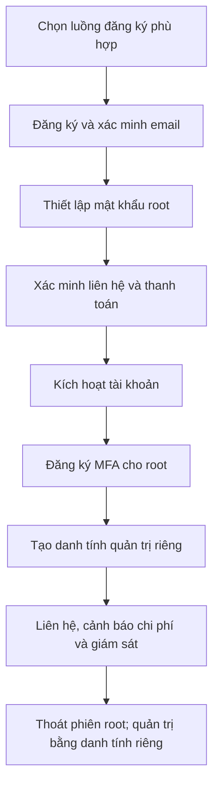

# Khởi tạo tài khoản AWS và bảo vệ root user

Tài khoản AWS (*AWS account*) là ranh giới cơ bản để quản lý danh tính, tài nguyên, thanh toán và trách nhiệm vận hành trên đám mây. Khi bắt đầu học AWS, việc tạo được tài khoản mới chỉ là bước đầu: người quản trị còn phải bảo vệ danh tính có đặc quyền cao nhất, thiết lập người dùng quản trị thường ngày, chuẩn bị cơ chế khôi phục và kiểm soát chi phí.

Nội dung này thuộc chương **Tài khoản và Organizations** của học phần **CLOUD_PROVIDERS_AWS**. Đây là nền tảng để tiếp tục triển khai IAM, VPC, EC2, lưu trữ, cơ sở dữ liệu và ứng dụng serverless một cách an toàn.

## 1. Mục tiêu học tập

Sau bài học, bạn có thể:

1. Phân biệt tài khoản AWS, root user, danh tính quản trị và AWS Organizations.
2. Chọn đúng cách khởi tạo môi trường AWS và hoàn tất quy trình đăng ký tài khoản truyền thống.
3. Bảo vệ root user bằng mật khẩu mạnh, MFA, quy trình quản lý email và thông tin khôi phục.
4. Giải thích vì sao không dùng root user cho công việc thường ngày và không tạo access key dài hạn cho root.
5. Thiết lập các bước bảo vệ ban đầu: quyền truy cập quản trị, người liên hệ, giám sát hoạt động root và cảnh báo chi phí.
6. Nhận biết sự khác biệt khi quản lý root user trong môi trường nhiều tài khoản với AWS Organizations.

## 2. Hiểu đúng tài khoản AWS và root user

**AWS account** là đơn vị sở hữu tài nguyên và nhận hóa đơn. Một công ty có thể dùng nhiều tài khoản, ví dụ `company-dev`, `company-prod` và `company-security`, để tách môi trường phát triển, sản xuất và bảo mật. Mỗi tài khoản có một **Account ID** gồm 12 chữ số; Account ID không phải là mật khẩu hay mã truy cập bí mật.

Với tài khoản tạo theo luồng đăng ký truyền thống **Sign up for AWS (advanced)**, khi đăng ký bằng email và mật khẩu, AWS tạo danh tính **AWS account root user**. Root user có quyền rất rộng trong tài khoản, bao gồm quyền với tài nguyên và thông tin thanh toán. Đây không phải là một IAM user thông thường; gắn IAM policy vào một IAM user không làm giảm quyền của root user. Trong môi trường AWS Organizations, *service control policy* (SCP) có thể giới hạn một số hành động của cả root user thuộc tổ chức.

Ví dụ về các việc có thể cần root user trên một tài khoản độc lập: đổi email hoặc mật khẩu root, đóng tài khoản, khôi phục quyền khi người quản trị IAM cuối cùng tự khóa quyền truy cập, hoặc thực hiện một số thao tác đặc biệt liên quan đến Billing và S3. Danh sách chính xác thay đổi theo loại tài khoản và tính năng AWS, vì vậy hãy kiểm tra [danh sách tác vụ yêu cầu root](https://docs.aws.amazon.com/IAM/latest/UserGuide/id_root-user.html) trước khi sử dụng.

### Ba bối cảnh khởi tạo cần phân biệt

| Bối cảnh | Danh tính truy cập ban đầu | Cách xử lý root phù hợp |
| --- | --- | --- |
| **Sign up for AWS (advanced)**, tài khoản độc lập | Email + mật khẩu của root user | Bảo vệ root bằng MFA, giữ an toàn thông tin khôi phục, tạo danh tính quản trị riêng |
| **Sign up for AWS (new)**, môi trường project | AWS Builder ID và mô hình project do AWS cấu hình sẵn | Project account **không có root user để đăng nhập**; bảo vệ Builder ID và quyền cộng tác theo hướng dẫn của luồng này |
| Tài khoản thành viên (*member account*) tạo trong **AWS Organizations** | Quản trị qua vai trò/quyền được tổ chức cấp | Member account mới mặc định **không có thông tin đăng nhập root**; quản lý các thao tác đặc quyền thông qua tổ chức |

AWS hiện cung cấp nhiều luồng đăng ký. Để thực hành trực tiếp chủ đề **bảo vệ root user** và quản lý tài khoản đầy đủ, phần hướng dẫn bên dưới chọn **Sign up for AWS (advanced)**. Nếu giao diện đăng ký của bạn dẫn tới AWS Builder ID và project, hãy xem tài liệu [So sánh các cách đăng ký AWS](https://docs.aws.amazon.com/accounts/latest/reference/sign-up-for-aws.html), thay vì cố tìm tài khoản root không tồn tại trong project.

## 3. Chuẩn bị trước khi đăng ký

Một tài khoản dùng trong phòng lab vẫn có thể phát sinh phí. Đặc biệt, tài khoản dành cho công ty cần có người chịu trách nhiệm và kế hoạch bàn giao rõ ràng.

| Cần chuẩn bị | Lý do và cách làm |
| --- | --- |
| **Email sở hữu tài khoản** | Dùng địa chỉ email có thể truy cập lâu dài, được bảo vệ bằng MFA. Với doanh nghiệp, ưu tiên hộp thư/nhóm thư do tổ chức kiểm soát; tránh phụ thuộc duy nhất vào email cá nhân. |
| **Tên tài khoản** | Chọn tên dễ nhận biết mục đích, ví dụ `acme-training-sandbox` hoặc `acme-prod`. Tên hiển thị không thay thế Account ID. |
| **Mật khẩu root** | Tạo mật khẩu mạnh, duy nhất bằng trình quản lý mật khẩu; không dùng lại mật khẩu email hoặc tài khoản khác. |
| **Phương tiện MFA** | Chuẩn bị passkey hoặc khóa bảo mật FIDO và, khi thích hợp, phương tiện MFA dự phòng được lưu giữ riêng. |
| **Thông tin liên hệ** | Có số điện thoại nhận SMS/cuộc gọi, địa chỉ và người phụ trách hợp lệ. Với doanh nghiệp, ưu tiên số của tổ chức. |
| **Thanh toán và ngân sách** | Chuẩn bị phương thức thanh toán hợp lệ; xác định giới hạn chi tiêu mong muốn, người nhận cảnh báo và trách nhiệm dọn dẹp tài nguyên. |

Lưu ý: email root cũng là một đường khôi phục quyền truy cập. Kẻ tấn công chiếm được hộp thư này có thể tìm cách đặt lại mật khẩu root. Vì vậy, bảo mật hộp thư và kiểm soát ai có quyền đọc thư quan trọng không kém bảo mật AWS Console.

## 4. Các bước khởi tạo tài khoản với luồng Advanced

Quy trình thực tế có thể thay đổi đôi chút theo quốc gia và giao diện AWS. Hãy làm theo hướng dẫn hiển thị trên trang chính thức và không nhập dữ liệu thanh toán vào liên kết từ email hoặc trang web không rõ nguồn gốc.

1. Mở trang [đăng ký AWS](https://signin.aws.amazon.com/signup) và chọn **Sign up for AWS (advanced)** nếu giao diện yêu cầu chọn luồng.
2. Nhập **root user email address** và **AWS account name**; nhận mã xác minh qua email và hoàn tất bước xác minh.
3. Đặt mật khẩu root đủ mạnh và duy nhất. Tiêu chuẩn tối thiểu của AWS không thay thế cho khuyến nghị sử dụng mật khẩu dài, khó đoán.
4. Chọn gói/tùy chọn tài khoản được cung cấp, khai báo thông tin liên hệ và chấp nhận điều khoản sử dụng sau khi đọc.
5. Cung cấp phương thức thanh toán hợp lệ; thực hiện bước xác minh số điện thoại hoặc xác minh bổ sung nếu AWS yêu cầu.
6. Chọn gói AWS Support phù hợp với mục đích học tập hoặc vận hành, sau đó hoàn tất đăng ký.
7. Chờ thông báo kích hoạt tài khoản qua email; truy cập [AWS Management Console](https://console.aws.amazon.com/) và chọn **Root user** ở trang đăng nhập của tài khoản Advanced.
8. **Ngay trong phiên đăng nhập đầu tiên**, thiết lập MFA cho root user trước khi bắt đầu tạo tài nguyên.



> **Không chia sẻ** mật khẩu, mã OTP, mã QR đăng ký MFA, recovery code hoặc mã khóa truy cập với giảng viên, đồng đội hay tài liệu lab. Việc chứng minh hoàn thành nên dùng thông tin trạng thái đã che dữ liệu nhạy cảm.

## 5. Bảo vệ root user ngay sau khi khởi tạo

### 5.1. Bật và dự phòng MFA

MFA (*multi-factor authentication*) yêu cầu thêm một yếu tố xác thực bên cạnh mật khẩu, giúp giảm rủi ro khi mật khẩu bị lộ. AWS yêu cầu cấu hình MFA cho root user của các loại tài khoản có root đăng nhập; nếu chưa cấu hình, người dùng được yêu cầu đăng ký trong thời hạn AWS quy định khi đăng nhập. **Không coi thời gian gia hạn là lý do để trì hoãn thiết lập MFA**.

Trên tài khoản Advanced, đăng nhập bằng root và vào phần **Security credentials** của root user, tìm khu vực **Multi-factor authentication (MFA)**, sau đó làm theo hướng dẫn thêm thiết bị. AWS hỗ trợ các hình thức như:

- **Passkey hoặc FIDO security key:** ưu tiên khi có thể vì chống lừa đảo lấy mã đăng nhập (*phishing*) tốt hơn mã OTP phải nhập thủ công.
- **Ứng dụng tạo mã TOTP:** tạo mã ngắn thay đổi theo thời gian; bảo vệ thiết bị và bản sao lưu theo chính sách của bạn.
- **Thiết bị TOTP phần cứng:** một lựa chọn khi tổ chức cần thiết bị độc lập.

AWS hỗ trợ đăng ký nhiều thiết bị MFA cho cùng một root user (hiện tối đa **8** thiết bị). Với môi trường phù hợp, thiết lập tối thiểu hai phương án độc lập để giảm nguy cơ bị khóa khi mất một thiết bị. Phương tiện dự phòng phải được bảo vệ, lưu giữ và kiểm tra theo quy trình của tổ chức; tránh để mật khẩu và thiết bị MFA chung tại một nơi dễ bị chiếm đoạt.

**Cách xác minh:** xem trạng thái MFA đã đăng ký trên trang Security credentials, đăng xuất, rồi xác nhận có thể đăng nhập lại theo phương thức MFA hợp lệ. Không chụp mã QR, chuỗi khóa bí mật hoặc màn hình nhập OTP để làm bằng chứng.

### 5.2. Bảo vệ mật khẩu và đường khôi phục tài khoản

- Giữ mật khẩu root trong kho bí mật hoặc trình quản lý mật khẩu đáng tin cậy, có phân quyền rõ ràng. Không lưu trong repository, ghi chú công khai, file `.env` hoặc mã nguồn.
- Bảo vệ email root bằng MFA, theo dõi hoạt động đăng nhập và giới hạn người có thể mở thư hay đặt lại mật khẩu.
- Duy trì số điện thoại chính xác để AWS có thể xác minh chủ tài khoản khi cần hỗ trợ. Với tài khoản công ty, ghi rõ người sở hữu và người dự phòng.
- Định kỳ kiểm tra khả năng truy cập hộp thư, thiết bị MFA dự phòng và quy trình yêu cầu quyền truy cập khẩn cấp. Không thử nghiệm khôi phục bằng cách cố tình xóa hoặc vô hiệu hóa toàn bộ MFA đang hoạt động.
- Đăng xuất khỏi phiên root khi đã hoàn thành việc yêu cầu đặc quyền root.

### 5.3. Không tạo access key dài hạn cho root

**Access key** gồm Access Key ID và Secret Access Key, dùng để ký lệnh AWS CLI hoặc yêu cầu API. Nếu một access key của root bị lộ, kẻ tấn công có thể thực hiện các thao tác đặc quyền cao trong tài khoản mà không cần dùng giao diện đăng nhập thường ngày.

Vì vậy:

1. **Không tạo access key cho root user** để chạy script, CI/CD hoặc ví dụ học tập.
2. Kiểm tra phần **Access keys** của root trong Security credentials; trạng thái mong muốn là không có khóa root đang hoạt động.
3. Nếu phát hiện khóa root cũ, xác minh các hệ thống phụ thuộc và ưu tiên chuyển chúng sang IAM role/danh tính phù hợp; sau đó vô hiệu hóa, xóa khóa theo quy trình ứng cứu và luân chuyển bí mật của tổ chức.
4. Cho tác vụ tự động hóa, dùng **IAM role** và thông tin xác thực tạm thời; cho người dùng, ưu tiên **IAM Identity Center** hoặc phương thức đăng nhập liên kết danh tính.

Đừng nhầm **không tạo access key root** với **không thể dùng AWS CLI**: CLI hoàn toàn có thể chạy bằng danh tính quản trị phù hợp và thông tin xác thực tạm thời.

### 5.4. Tạo danh tính quản trị dùng hằng ngày

Root user chỉ nên xuất hiện khi phải thực hiện tác vụ dành riêng cho root. Với tài khoản và tổ chức phù hợp, AWS khuyến nghị sử dụng **AWS IAM Identity Center** để cấp quyền cho người dùng quản trị thông qua người dùng/nhóm, *permission set* và phiên đăng nhập tạm thời.

Luồng mẫu đối với tổ chức AWS:

1. Từ tài khoản quản lý tổ chức (*management account*), bật **IAM Identity Center organization instance** nếu chưa có.
2. Kết nối nguồn danh tính hoặc tạo người dùng/nhóm phù hợp; yêu cầu MFA cho người dùng quản trị.
3. Tạo/cấu hình permission set quản trị và gán cho đúng người dùng/nhóm trên đúng AWS account.
4. Mở **AWS access portal** để đăng nhập bằng danh tính được cấp và xác nhận truy cập đúng tài khoản.
5. Sau khi kiểm tra xong, thoát root và sử dụng tài khoản quản trị mới cho các thao tác tiếp theo. Với công việc cụ thể, giảm quyền xuống mức tối thiểu cần thiết (*least privilege*).

**Phân biệt quan trọng:** IAM Identity Center có **organization instance** và **account instance**. Account instance phục vụ ứng dụng được hỗ trợ trong phạm vi một tài khoản, không cung cấp đầy đủ khả năng phân quyền truy cập AWS account như organization instance. Một tài khoản độc lập có thể được hướng dẫn tạo AWS Organizations để dùng organization instance; hãy đánh giá tác động quản trị trước khi xác nhận thao tác đó.

Ví dụ kiểm tra danh tính của phiên AWS CLI đã được cấu hình bằng quyền quản trị hợp lệ:

```bash
aws sts get-caller-identity
```

Kết quả cho biết `Account`, `Arn` và `UserId`. Nếu `Arn` chứa `assumed-role/...`, bạn đang làm việc qua một vai trò được giả định; không có lý do để cấp root access key cho phiên này. Đây là lệnh đọc thông tin danh tính, không tạo tài nguyên và không xác minh toàn bộ quyền mà vai trò đang có.

## 6. Bảo vệ tài khoản sau lần đăng nhập đầu tiên

### 6.1. Cập nhật liên hệ khẩn cấp

Trong trang **Account**, kiểm tra địa chỉ email, số điện thoại và các **alternate contacts**:

| Loại liên hệ | Vai trò |
| --- | --- |
| **Billing** | Tiếp nhận thông tin hóa đơn và vấn đề thanh toán |
| **Operations** | Tiếp nhận thông tin vận hành hoặc gián đoạn dịch vụ |
| **Security** | Tiếp nhận thông tin liên quan đến bảo mật và sự cố |

Đối với nhóm, có thể dùng nhóm thư do tổ chức kiểm soát thay cho email cá nhân; chỉ định chủ sở hữu và người thay thế. Alternate contacts bổ sung đường liên hệ, **không thay thế** việc bảo vệ email root.

### 6.2. Bật cảnh báo chi phí sớm

Từ **Billing and Cost Management → Budgets**, tạo **Cost budget** hàng tháng theo ngân sách lab hoặc dự án (ví dụ mục tiêu minh họa `10 USD/tháng`), cấu hình email nhận cảnh báo khi chi phí thực tế tiến gần ngưỡng và, nếu phù hợp, khi dự báo vượt ngưỡng. Xác nhận địa chỉ người nhận theo yêu cầu AWS.

**Budget là cơ chế theo dõi/cảnh báo, không phải cam kết AWS sẽ ngừng mọi tài nguyên khi chạm ngưỡng.** Dữ liệu chi phí có thể cập nhật trễ. Muốn giảm rủi ro phát sinh tiền, vẫn phải chủ động kiểm tra Region, loại tài nguyên, điều kiện gói Free Tier/credit, giá dịch vụ, rồi xóa tài nguyên không cần thiết sau khi thực hành.

### 6.3. Theo dõi hoạt động của root

AWS CloudTrail ghi nhận các sự kiện quản trị, bao gồm những lần đăng nhập AWS Console. Đối với root user, sự kiện `ConsoleLogin` có thể được nhận diện bằng `userIdentity.type = Root`; có thể kết hợp CloudTrail với EventBridge, Amazon SNS và cơ chế cảnh báo của tổ chức.

Ví dụ *event pattern* dùng làm điểm khởi đầu cho quy tắc Amazon EventBridge theo dõi đăng nhập root qua AWS Sign-In/CloudTrail:

```json
{
  "source": ["aws.signin"],
  "detail-type": ["AWS API Call via CloudTrail"],
  "detail": {
    "eventSource": ["signin.amazonaws.com"],
    "eventName": ["ConsoleLogin"],
    "userIdentity": {
      "type": ["Root"]
    }
  }
}
```

Đây là **mẫu minh họa**, chưa phải hệ thống cảnh báo hoàn chỉnh. Khi triển khai thật, cần kiểm tra EventBridge event bus, nơi phát sinh sự kiện đăng nhập toàn cục, Region ghi sự kiện, chính sách gửi thông báo và thử nghiệm thực tế. CloudTrail có thể ghi sự kiện đăng nhập root tại `us-east-1`, `us-east-2` hoặc `us-west-2`; chỉ tạo quy tắc tại một Region khác có thể bỏ sót sự kiện. Thay vì thường xuyên đăng nhập root để thử cảnh báo, hãy xác thực bằng sự kiện mẫu hoặc quy trình kiểm thử được phê duyệt.

### 6.4. Bảng đối chiếu rủi ro

| Rủi ro | Hậu quả có thể xảy ra | Biện pháp ưu tiên |
| --- | --- | --- |
| Mật khẩu root bị lộ | Tài khoản bị chiếm quyền | Mật khẩu duy nhất, MFA chống phishing, bảo vệ email |
| Mất thiết bị MFA duy nhất | Không thể đăng nhập khi cần | Phương án MFA dự phòng và quy trình khôi phục |
| Dùng root cho tác vụ hằng ngày | Tăng cơ hội lỗi hoặc lộ quyền cao | IAM Identity Center, IAM role và quyền tối thiểu |
| Access key root lọt vào mã nguồn | Truy cập API với đặc quyền lớn | Không tạo khóa root, dùng thông tin xác thực tạm thời |
| Tài nguyên lab bị bỏ quên | Phát sinh chi phí | Budget, giám sát hóa đơn, lịch dọn dẹp tài nguyên |
| Không theo dõi root login | Khó phát hiện hoạt động bất thường | CloudTrail, cảnh báo đăng nhập root và người trực nhận thông tin |

## 7. Root user trong AWS Organizations

**AWS Organizations** giúp quản lý nhiều tài khoản dưới một tổ chức, có thể nhóm tài khoản theo *organizational unit* (OU) và áp dụng chính sách quản trị. Tài khoản quản lý tổ chức (*management account*) khác với các tài khoản thành viên (*member accounts*).

Trong mô hình hiện hành:

- **Member account mới được tạo từ AWS Organizations mặc định không có thông tin đăng nhập root**, dù khái niệm root user vẫn gắn với tài khoản đó. Không cần và không thể đăng nhập bằng root như với tài khoản Advanced độc lập khi chưa cho phép khôi phục.
- Với thành viên cũ còn thông tin đăng nhập root, quản trị viên có thể bật tính năng **centralized root access** để xóa thông tin đăng nhập root khỏi member account, giảm nguy cơ sử dụng trái phép.
- Management account hoặc tài khoản được ủy quyền có thể thực hiện **một số** tác vụ đặc quyền trên member account bằng phiên tạm thời `sts:AssumeRoot` khi đã được cấp quyền và bật tính năng tương ứng. Không phải mọi tác vụ dành cho root đều được hỗ trợ qua cơ chế này.
- Các thao tác trên member account bị kiểm soát bởi cơ chế quản trị của tổ chức; không tự tìm cách bật khôi phục root hoặc tạo khóa truy cập để vượt qua quy trình được ủy quyền.

**Tình huống:** một nhóm có tài khoản `acme-prod` và `acme-dev` thuộc AWS Organizations. Khi thành viên mới cần triển khai EC2 tại `acme-dev`, quản trị viên nên cấp quyền thông qua IAM Identity Center và role phù hợp. Việc chia sẻ mật khẩu root của `acme-dev` là thừa và đi ngược mục tiêu kiểm soát quyền. Nếu một bucket S3 bị cấu hình policy từ chối mọi principal, tổ chức có thể xem xét phiên đặc quyền được AWS hỗ trợ để khôi phục policy, theo đúng quy trình phê duyệt nội bộ.

## 8. Thực hành có hướng dẫn

**Bối cảnh:** bạn phụ trách một tài khoản AWS dùng học tập, cần bàn giao trạng thái an toàn trước khi bắt đầu tạo VPC và máy ảo. Nếu chưa có tài khoản, thực hiện các bước đăng ký trên theo đúng lựa chọn Advanced. Nếu dùng tài khoản của tổ chức hoặc project account không có root user, chỉ kiểm tra những phần được phép; không thay đổi quyền hoặc yêu cầu thông tin root khi chưa được giao.

### Nhiệm vụ

1. Ghi lại **tên tài khoản**, mục đích sử dụng và Account ID ở nơi được phép, nhưng không đưa thông tin đăng nhập hay mã xác thực vào báo cáo.
2. Xác nhận tài khoản có luồng đăng nhập root hay thuộc mô hình project/member account không có root credentials.
3. Với tài khoản có root đăng nhập: kiểm tra root MFA đã được cấu hình và có phương án dự phòng phù hợp; không công bố thông tin thiết bị/khóa MFA.
4. Kiểm tra root **không có access key đang hoạt động**. Nếu phát hiện khóa, báo người phụ trách và lập kế hoạch xử lý; không xóa ngay khi chưa xác định hệ thống phụ thuộc.
5. Đảm bảo có danh tính quản trị riêng được cấp quyền phù hợp, thử đăng nhập không dùng root và xác minh danh tính qua Console hoặc `aws sts get-caller-identity`.
6. Kiểm tra Billing/Security/Operations alternate contacts và tạo ít nhất một cảnh báo ngân sách khi có quyền quản lý chi phí.
7. Kiểm tra CloudTrail và mô tả cách cảnh báo khi có lần đăng nhập root bất thường.
8. Đăng xuất khỏi phiên root, ghi lại các mục đã kiểm tra và ai sẽ chịu trách nhiệm theo dõi.

### Mẫu biên bản kiểm tra (không chứa bí mật)

```text
Account purpose: training-sandbox
Account type: Advanced standalone / Organizations member / Project
Root sign-in applicable: Yes / No
Root MFA configured: Yes / No / N/A
Root active access keys: 0 / Needs review / N/A
Non-root admin access verified: Yes / No
Billing budget alert configured: Yes / No
Security contact verified: Yes / No
Root activity monitoring: Enabled / Planned
Owner / Review date: <nguoi-phu-trach> / <ngay-kiem-tra>
```

**Tiêu chí hoàn thành:** báo cáo cho thấy người quản trị đã phân biệt đúng loại tài khoản, bảo vệ đường truy cập có đặc quyền cao, có khả năng vận hành bằng danh tính riêng và có người nhận tín hiệu rủi ro bảo mật/chi phí. Bài thực hành không yêu cầu triển khai tài nguyên trả phí.

## 9. Câu hỏi tự kiểm tra

1. Vì sao phải bảo vệ cả email root thay vì chỉ bật MFA cho AWS Console?
2. Vì sao không nên tạo access key cho root user để chạy AWS CLI từ máy cá nhân?
3. Một thành viên mới của AWS Organizations không có mật khẩu root. Đây có phải lỗi tạo tài khoản không? Tại sao?
4. IAM Identity Center giúp ích gì cho việc quản trị hằng ngày? Organization instance khác account instance ở đâu?
5. Nếu chi phí đã chạm 100% ngân sách, AWS Budgets có tự động bảo đảm ngừng tính phí cho mọi tài nguyên không?
6. Nếu đã bật cảnh báo CloudTrail cho `ConsoleLogin` root, cần xem xét điều gì về Region để tránh bỏ sót sự kiện?

## 10. Tài liệu chính thức để tra cứu

- [AWS Account Management — So sánh các cách đăng ký](https://docs.aws.amazon.com/accounts/latest/reference/sign-up-for-aws.html).
- [AWS Account Management — Sign up for AWS (advanced)](https://docs.aws.amazon.com/accounts/latest/reference/getting-started.html).
- [IAM — Root user và các tác vụ yêu cầu root](https://docs.aws.amazon.com/IAM/latest/UserGuide/id_root-user.html).
- [IAM — Root user best practices](https://docs.aws.amazon.com/IAM/latest/UserGuide/root-user-best-practices.html).
- [IAM — Multi-factor authentication for root user](https://docs.aws.amazon.com/IAM/latest/UserGuide/enable-mfa-for-root.html).
- [IAM — Centralize root access for member accounts](https://docs.aws.amazon.com/IAM/latest/UserGuide/id_root-enable-root-access.html).
- [IAM Identity Center — Các loại instance](https://docs.aws.amazon.com/singlesignon/latest/userguide/identity-center-instances.html).
- [AWS Account Management — Alternate contacts](https://docs.aws.amazon.com/accounts/latest/reference/manage-acct-update-contact-alternate.html).
- [AWS Cost Management — Creating a cost budget](https://docs.aws.amazon.com/cost-management/latest/userguide/create-cost-budget.html).
- [AWS CloudTrail — AWS Management Console sign-in events](https://docs.aws.amazon.com/awscloudtrail/latest/userguide/cloudtrail-event-reference-aws-console-sign-in-events.html).

> Nguyên tắc thực hành xuyên suốt: **root là danh tính đặc quyền dành cho tình huống đặc biệt; người dùng và ứng dụng thường ngày phải có quyền riêng, ngắn hạn khi có thể, và được giám sát.**
