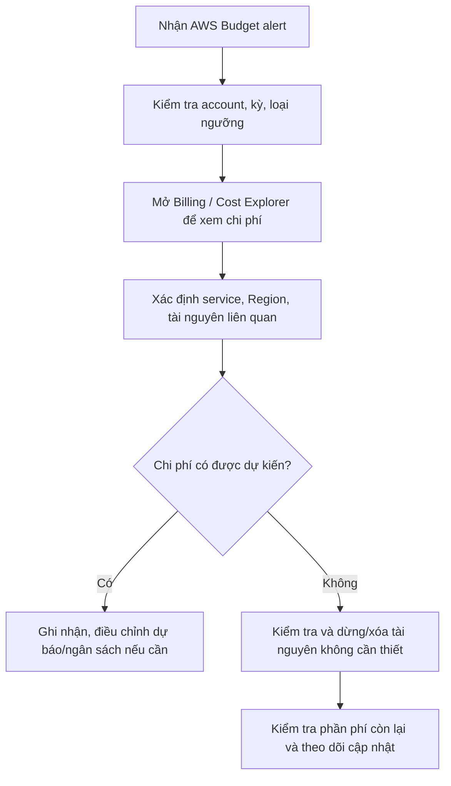

# Thiết lập thông tin liên hệ và cảnh báo chi phí ban đầu

> **Học phần:** CLOUD_PROVIDERS_AWS · **Chương:** Tài khoản và Organizations  
> **Mục tiêu:** Chuẩn bị một tài khoản AWS có đầu mối liên lạc đáng tin cậy và cơ chế nhận biết chi phí phát sinh trước khi triển khai tài nguyên.

## 1. Vì sao cần thiết lập ngay khi tạo tài khoản?

Trong quá trình học AWS, bạn sẽ làm việc với Region/Availability Zone, IAM, VPC, máy chủ tính toán, lưu trữ, cơ sở dữ liệu và các dịch vụ serverless. Một tài nguyên chạy thử hoặc bị bỏ quên có thể tiếp tục phát sinh phí, kể cả khi ứng dụng đã ngừng hoạt động. Tương tự, nếu AWS gửi cảnh báo bảo mật hoặc thanh toán đến địa chỉ không còn ai theo dõi, sự cố có thể không được xử lý kịp thời.

Cấu hình ban đầu cần giải quyết **hai câu hỏi độc lập**:

1. **Khi AWS cần liên hệ, ai thực sự nhận được thông báo?** Đây là trách nhiệm của email đăng nhập root, thông tin liên hệ chính (*primary contact*) và các liên hệ thay thế (*alternate contacts*).
2. **Khi chi phí tăng, ai biết đủ sớm để kiểm tra?** Đây là trách nhiệm của cảnh báo AWS Free Tier, AWS Budgets và, nếu cần, cơ chế giám sát chi phí bổ sung.

Bài học tập trung vào một tài khoản AWS mới, đồng thời chỉ ra khác biệt khi tài khoản thuộc **AWS Organizations**. Hoàn thành bài, bạn cần có thể:

- Phân biệt email root, primary contact, alternate contacts và email nhận cảnh báo ngân sách.
- Cập nhật thông tin liên hệ theo nguyên tắc không phụ thuộc vào một cá nhân.
- Bật cảnh báo phù hợp với AWS Free Tier và tạo ngân sách chi phí tháng.
- Chọn ngưỡng cảnh báo, người nhận và cách xử lý khi ngưỡng bị vượt.
- Kiểm tra kết quả cấu hình và nhận diện những giới hạn của dữ liệu chi phí AWS.

## 2. Hiểu đúng các loại thông tin liên hệ

AWS sử dụng nhiều loại địa chỉ liên hệ cho các mục đích khác nhau. Chúng không thay thế nhau.

| Thành phần | Vai trò chính | Gợi ý cấu hình cho nhóm hoặc doanh nghiệp |
|---|---|---|
| **Email của root user** | Định danh đăng nhập root; nhận liên hệ quan trọng về quyền sở hữu/tài khoản và hỗ trợ khôi phục tài khoản. | Hộp thư do tổ chức sở hữu, được bảo vệ tốt và có quy trình bàn giao. |
| **Primary contact** | Tên người/tổ chức, công ty, địa chỉ, số điện thoại và các thông tin liên lạc chính của tài khoản. | Thông tin pháp lý/đơn vị vận hành chính xác; điện thoại có thể nhận mã xác minh khi cần. |
| **Alternate contact — Billing** | Đầu mối bổ sung cho các vấn đề thanh toán. | Nhóm tài chính hoặc người quản lý chi phí. |
| **Alternate contact — Operations** | Đầu mối vận hành dịch vụ và hạ tầng. | Nhóm vận hành nền tảng hoặc trực hệ thống. |
| **Alternate contact — Security** | Đầu mối cho vấn đề bảo mật. | Nhóm bảo mật hoặc đầu mối xử lý sự cố. |
| **Email thông báo AWS Budgets** | Nhận thông báo của **ngân sách cụ thể** do bạn cấu hình. | Hộp thư/nhóm cần hành động khi chi phí vượt ngưỡng. |

**Điểm dễ nhầm:** Thêm alternate contact loại Billing **không tự tạo AWS Budget**, và việc tạo AWS Budget **không tự cập nhật alternate contact**. Email nhận hóa đơn trong *Payment preferences* cũng là một cấu hình riêng.

Ví dụ minh họa, sử dụng địa chỉ giả:

| Vai trò | Địa chỉ mẫu |
|---|---|
| Email root | `aws-owner@example.com` |
| Billing alternate contact | `finance@example.com` |
| Operations alternate contact | `cloud-ops@example.com` |
| Security alternate contact | `security@example.com` |
| Người nhận AWS Budgets | `cloud-cost-alerts@example.com` |

Các địa chỉ trên chỉ là mẫu, không phải email để sử dụng trong tài khoản thật. Với tài khoản học tập cá nhân, một người có thể đảm nhiệm nhiều vai trò; vẫn nên bảo đảm các hộp thư hoạt động và có thể truy cập khi gặp sự cố.

### 2.1. Bảo vệ danh tính root trước khi tiếp tục

- Dùng email root lâu dài và bảo vệ khả năng khôi phục email; tránh phụ thuộc vào email của một nhân viên sắp hết quyền truy cập.
- Cấu hình **MFA** cho root và bảo vệ thiết bị/phương thức khôi phục MFA.
- Hạn chế đăng nhập bằng root cho công việc thường ngày; sử dụng IAM Identity Center hoặc một IAM role/user có quyền phù hợp để quản trị.
- Không tạo access key dài hạn cho root để chạy CLI.

Các thực hành này giảm nguy cơ mất quyền truy cập vào tài khoản, đặc biệt với **management account** của AWS Organizations. Thay đổi email root là một quy trình riêng, không phải trường email trong mục *Primary contact*.

## 3. Cập nhật thông tin liên hệ trong AWS Console

### 3.1. Chuẩn bị quyền và dữ liệu

Đăng nhập [AWS Management Console](https://console.aws.amazon.com/) bằng danh tính có quyền quản lý thông tin tài khoản. Đối với tài khoản độc lập hoặc management account, các quyền IAM liên quan gồm:

| Thao tác | Quyền IAM thường cần |
|---|---|
| Xem/cập nhật primary contact | `account:GetContactInformation`, `account:PutContactInformation` |
| Xem/cập nhật alternate contacts | `account:GetAlternateContact`, `account:PutAlternateContact` |
| Xóa alternate contact nếu cần | `account:DeleteAlternateContact` |

Không nên cấp quyền quản trị rộng cho mọi người chỉ để thay đổi thông tin liên hệ. Nếu không thấy nút chỉnh sửa, hãy kiểm tra danh tính hiện tại và chính sách quyền truy cập.

Chuẩn bị sẵn tên/địa chỉ công ty hoặc cá nhân, số điện thoại đúng định dạng quốc tế và địa chỉ email hoạt động cho từng vai trò. Với primary contact, AWS có thể yêu cầu xác minh số điện thoại; số này cần nhận được SMS khi áp dụng.

### 3.2. Thiết lập primary contact

1. Trong AWS Console, chọn **tên tài khoản ở góc trên bên phải → Account**.
2. Tìm **Contact information** và chọn **Edit**.
3. Kiểm tra/cập nhật **Full name, Company name, Address, Phone number** và các trường được hiển thị.
4. Chọn **Update** rồi tải lại trang để xác minh thông tin mới đã được lưu.
5. Nếu hệ thống yêu cầu xác minh số điện thoại, hoàn tất bước xác minh và kiểm tra trạng thái.

Thông tin primary contact được sử dụng trong các tình huống liên hệ, xác minh và khôi phục tài khoản. Dữ liệu cần phản ánh đúng chủ sở hữu tài khoản, không điền đại chỉ để hoàn thành biểu mẫu.

### 3.3. Thiết lập ba alternate contacts

1. Vẫn ở trang **Account**, tìm phần **Alternate contacts** và chọn **Edit**.
2. Khai báo loại **Billing**, **Operations** và **Security**; mỗi loại có một bộ thông tin liên hệ.
3. Điền **Name**, **Email address**, **Phone number**, **Title** phù hợp với vai trò.
4. Chọn **Update** và kiểm tra lại từng loại liên hệ đã được lưu.

AWS cho phép một liên hệ thay thế cho mỗi loại. Có thể dùng *distribution list* hoặc hộp thư nhóm để thông báo vẫn đến đúng người khi thành viên thay đổi.

### 3.4. Khi tài khoản thuộc AWS Organizations

Nếu đang sử dụng tài khoản thành viên (*member account*), người quản trị có thể cập nhật liên hệ từ **AWS Organizations → AWS accounts → chọn tài khoản → Contact info** trong management account. Việc quản lý liên hệ tập trung yêu cầu tổ chức bật **all features** và **trusted access** cho AWS Account Management; có thể sử dụng delegated administrator với quyền phù hợp.

Ví dụ:

```text
AWS Organizations
└── Management account (quản trị thông tin liên hệ và thanh toán tập trung)
    ├── Development account  → Billing / Operations / Security contacts
    └── Production account   → Billing / Operations / Security contacts
```

Không nhầm quyền cập nhật liên hệ từ Organizations với quyền đăng nhập root của member account. Cũng không giả định liên hệ ở management account tự trở thành liên hệ cho mọi member account; cần kiểm tra từng tài khoản.

## 4. Bật cảnh báo sử dụng AWS Free Tier

**AWS Free Tier** phụ thuộc loại gói tài khoản, thời điểm tạo tài khoản, tín dụng hiện có và ưu đãi từng dịch vụ. Không nên hiểu cụm từ *Free Tier* là mọi tài nguyên AWS đều miễn phí.

Để kiểm tra:

1. Mở [AWS Billing and Cost Management Console](https://console.aws.amazon.com/costmanagement/).
2. Chọn **Billing preferences** trong phần **Preferences**.
3. Ở **Alert preferences**, chọn **Edit**.
4. Kiểm tra/bật **Receive AWS Free Tier usage alerts** nếu có tùy chọn này.
5. Điền địa chỉ bổ sung tại **Additional email address to receive alerts** nếu cần, rồi chọn **Update**.
6. Mở trang **Free Tier** hoặc thông tin gói tài khoản hiện có để xem mức sử dụng và tín dụng tương ứng.

AWS có thể gửi cảnh báo khi mức sử dụng một dịch vụ vượt **85% hạn mức Free Tier** tương ứng. Cấu hình/đối tượng nhận cảnh báo có thể khác nhau theo loại tài khoản; với **AWS Organizations management account**, cần kiểm tra và chủ động bật tùy chọn nếu muốn nhận loại cảnh báo này.

**Không nên chỉ dựa vào Free Tier alerts** vì chúng bám theo hạn mức miễn phí của dịch vụ đủ điều kiện; những chi phí khác vẫn có thể phát sinh. Tạo AWS Budget riêng cho tổng chi phí là bước tiếp theo.

## 5. Tạo cảnh báo chi phí bằng AWS Budgets

**AWS Budgets** cho phép thiết lập ngân sách theo kỳ, theo dõi chi phí thực tế (*Actual*) và chi phí dự báo (*Forecasted*), rồi gửi thông báo khi chạm ngưỡng. Một *cost budget* tiêu chuẩn là cơ chế **theo dõi/cảnh báo**; nó **không mặc định dừng EC2, RDS hoặc các dịch vụ khác**, cũng không bảo đảm số tiền thanh toán không vượt ngân sách.

### 5.1. Hai cách khởi đầu

| Cách tạo | Khi nào nên chọn | Ý nghĩa |
|---|---|---|
| **Use a template (simplified) → Zero spend budget** | Thực hành không muốn phát sinh phí ngoài phạm vi miễn phí. | Dùng mẫu thiết lập sẵn để cảnh báo khi bắt đầu có mức chi tiêu theo tiêu chí mẫu. |
| **Use a template (simplified) → Monthly cost budget** | Muốn giới hạn ngân sách tham chiếu cho mỗi tháng. | Dùng mẫu ngân sách tháng, thường gồm cảnh báo theo mức thực tế và/hoặc dự báo. |
| **Customize (advanced) → Cost budget** | Cần chọn nhiều ngưỡng, người nhận, bộ lọc tài khoản/dịch vụ. | Kiểm soát chi tiết cách tính chi phí và điều kiện gửi cảnh báo. |

Học viên có thể tạo **Zero spend budget** để phát hiện sớm khoản chi phí không mong đợi và tạo thêm **Monthly cost budget** để theo dõi mức chi tiêu dự kiến. Mẫu *zero spend* cũng là cảnh báo, **không phải khóa tài nguyên hoặc cam kết hóa đơn bằng 0**.

### 5.2. Thực hành: tạo ngân sách tháng 10 USD

Giả sử bạn triển khai một ứng dụng Java/Spring Boot thử nghiệm trên AWS và tự đặt ngân sách theo dõi **10 USD/tháng**. Con số 10 USD là **giả định thực hành**, không phải ước tính giá của bất kỳ kiến trúc nào.

1. Vào **Billing and Cost Management → Budgets → Create budget**.
2. Chọn **Customize (advanced) → Cost budget → Next**.
3. Đặt tên, ví dụ `learning-monthly-cost-10usd`.
4. Chọn **Period = Monthly**, kiểu ngân sách **Fixed** nếu muốn cùng một mức qua các tháng; nhập số tiền **10 USD** và kiểm tra đơn vị tiền tệ tài khoản.
5. Kiểm tra **Budget scope**. Nếu muốn bao quát toàn bộ chi phí trong một tài khoản, đừng vô tình áp bộ lọc chỉ một dịch vụ; nếu làm theo Organizations, xác định rõ **Linked account** cần theo dõi.
6. Ở phần **Alert thresholds**, tạo các thông báo như bảng dưới.
7. Điền **Email recipients** là hộp thư người thực sự xử lý chi phí; hoàn tất bước xác nhận email nếu AWS yêu cầu.
8. Xem lại **Cost types** và các tùy chọn về thuế, tín dụng, hoàn tiền, hỗ trợ kỹ thuật nếu chúng ảnh hưởng mục tiêu giám sát.
9. Chọn **Create budget**, sau đó mở lại chi tiết budget để kiểm tra ngưỡng, thời kỳ, phạm vi và người nhận.

Ví dụ bộ ngưỡng cho ngân sách **10 USD/tháng**:

| Ngưỡng | Loại | Khi nào thông báo | Hành động được khuyến nghị |
|---|---|---|---|
| 50% = 5 USD | **Actual** | Chi phí đã ghi nhận đạt ngưỡng 5 USD. | Kiểm tra dịch vụ và tài nguyên tạo phí. |
| 80% = 8 USD | **Actual** | Chi phí đã ghi nhận đạt ngưỡng 8 USD. | Rà soát tài nguyên thử nghiệm, loại bỏ phần không dùng. |
| 100% = 10 USD | **Forecasted** | Dự báo chi phí cả kỳ chạm hoặc vượt 10 USD. | Điều chỉnh kế hoạch dùng dịch vụ nếu dữ liệu dự báo đã sẵn sàng. |

**Actual** căn cứ vào chi phí đã ghi nhận; **Forecasted** sử dụng ước tính tới cuối kỳ. Theo tài liệu AWS, dự báo trong AWS Budgets có thể cần khoảng **năm tuần dữ liệu sử dụng**, vì vậy đừng trông chờ cảnh báo dự báo hoạt động ngay trên tài khoản mới. Đối với bài lab mới mở tài khoản, ưu tiên ngưỡng **Actual**.

Nếu chưa cần các tùy chọn nâng cao, bạn cũng có thể chọn **Use a template (simplified) → Monthly cost budget**, chỉnh mức ngân sách và email nhận cảnh báo, rồi xác minh các thông số mà mẫu tạo ra.

### 5.3. Cách đọc cảnh báo đúng

Xét trường hợp chi phí được ghi nhận như sau:

```text
Ngân sách tháng: 10 USD
Ngày 05: AWS ghi nhận 3 USD     → Chưa tới ngưỡng Actual 5 USD
Ngày 08: AWS ghi nhận 5,5 USD   → Có thể phát cảnh báo Actual 50%
Ngày 10: AWS ghi nhận 8,2 USD   → Có thể phát cảnh báo Actual 80%
Cuối tháng: hóa đơn có thể cao hơn 10 USD nếu vẫn tiếp tục sử dụng tài nguyên
```

Từ **có thể** rất quan trọng: dữ liệu billing và thông báo có độ trễ. AWS Budgets thường cập nhật **tối đa ba lần mỗi ngày**, nên chi phí phát sinh có thể được phản ánh muộn hơn thời điểm tài nguyên được sử dụng. Ngưỡng cảnh báo là tín hiệu điều tra, **không phải giới hạn cứng**. Thông báo *Actual* thường gửi khi lần đầu vượt ngưỡng trong kỳ; không có nghĩa mỗi lần tăng thêm đều tạo một email mới.

### 5.4. Quy trình xử lý khi nhận email



Ví dụ một instance EC2 có thể đã dừng nhưng vẫn còn **EBS volume** hoặc **snapshot** tính phí; ứng dụng serverless có thể tạo chi phí từ các dịch vụ liên quan như logging, truyền dữ liệu hoặc cơ sở dữ liệu. Cần nhìn **toàn bộ hệ thống**, không chỉ dịch vụ chạy mã ứng dụng.

## 6. Ngân sách trong AWS Organizations: theo dõi đúng tài khoản

Với **consolidated billing**, management account thường có trách nhiệm chi trả chi phí của các member account. Để thiết lập cảnh báo phù hợp, cần quyết định phạm vi theo dõi:

| Mục tiêu | Cấu hình gợi ý |
|---|---|
| Bảo vệ ngân sách tổng của cả tổ chức | Tạo budget ở **management account** theo dõi chi phí tổng hợp và email cho nhóm quản trị chi phí. |
| Kiểm soát riêng môi trường Development | Tạo budget ở management account, áp bộ lọc **Linked account = Development**, gửi thông báo cho người phụ trách Development. |
| Kiểm soát riêng Production | Tạo budget theo **Linked account = Production** với ngưỡng và người nhận phù hợp. |
| Tài khoản thành viên tự theo dõi | Tạo budget ngay trong member account nếu quyền truy cập và chính sách tổ chức cho phép. |

**Hai lưu ý thực tế:**

- Một budget được tạo ở management account **không tự hiển thị** trong member account. Khả năng xem budget phụ thuộc vào **tài khoản đã tạo budget** và quyền của người dùng.
- Tạo budget lọc một member account **không đồng nghĩa** đã tạo budget cho toàn bộ các tài khoản còn lại. Cần xác định rõ phạm vi, nhất là khi thêm account mới vào tổ chức.

Chính sách thông báo cũng cần có người chịu trách nhiệm: email được gửi đến nhóm tài chính để biết nhưng chỉ nhóm vận hành có quyền kiểm tra hoặc dừng tài nguyên thì sự cố vẫn có thể kéo dài. Nên gắn mỗi cảnh báo với **người nhận, người xử lý và ngưỡng phản ứng**.

## 7. Có cần CloudWatch billing alarm hoặc Cost Anomaly Detection?

AWS cung cấp nhiều cách theo dõi chi phí; đối với tài khoản mới, **AWS Budgets + Free Tier alerts** là nền tảng dễ bắt đầu.

| Công cụ | Mục đích | Ghi nhớ |
|---|---|---|
| **AWS Free Tier usage alerts** | Nhắc khi mức sử dụng tiến gần giới hạn Free Tier của dịch vụ đủ điều kiện. | Không đại diện cho mọi khoản phí. |
| **AWS Budgets** | So sánh chi phí/usage với ngân sách và ngưỡng định trước. | Dữ liệu cập nhật theo chu kỳ; cảnh báo không mặc định ngăn phát sinh phí. |
| **CloudWatch billing alarm** | Theo dõi metric **EstimatedCharges** và thông báo qua CloudWatch/SNS. | Metric chi phí toàn cục được lưu tại **US East (N. Virginia), `us-east-1`**. |
| **AWS Cost Anomaly Detection** | Phát hiện mẫu tăng chi phí bất thường và gửi thông báo theo subscription. | Bổ sung cho budget khi muốn nhận diện biến động khó dự đoán. |

Nếu cần CloudWatch billing alarm, vào **Billing preferences → Alert preferences**, bật **Receive CloudWatch billing alerts** rồi lưu; sau đó chuyển đến CloudWatch ở Region **us-east-1** để tạo alarm trên metric billing và thiết lập thông báo. Cần xác nhận đăng ký email của Amazon SNS nếu sử dụng kênh này. Theo hướng dẫn AWS, sau khi bật tùy chọn nhận CloudWatch billing alerts, bạn **không thể tắt lại tùy chọn đó**; hãy cân nhắc trước khi cấu hình.

Không cần lập CloudWatch alarm chỉ để hoàn thành bài lab nếu AWS Budgets đã đáp ứng mục tiêu cảnh báo ban đầu.

## 8. Kiểm tra bằng AWS CLI (tùy chọn)

Nếu đang dùng AWS CLI với một IAM role hoặc danh tính có quyền phù hợp, có thể đối chiếu các thiết lập liên hệ bằng lệnh **chỉ đọc**:

```bash
# Xác nhận danh tính đang dùng; không chạy bằng root access key.
aws sts get-caller-identity

# Xem primary contact của tài khoản hiện tại.
aws account get-contact-information

# Xem alternate Billing contact của tài khoản hiện tại.
aws account get-alternate-contact --alternate-contact-type BILLING
```

Đối với quản trị tập trung, quản trị viên ở management account hoặc delegated administrator có thể sử dụng tham số `--account-id 123456789012` để đọc thông tin liên hệ của member account nếu tổ chức đã cấp quyền và bật tích hợp cần thiết.

Ví dụ lệnh đặt **Billing alternate contact** cho tài khoản hiện tại:

```bash
aws account put-alternate-contact --alternate-contact-type BILLING --email-address finance@example.com --name "Finance Team" --phone-number "+12025550123" --title "Billing Owner"
```

Đây là giá trị minh họa; cần thay bằng đầu mối thật và xem lại account đích trước khi thực thi. Lệnh cập nhật dữ liệu nên do người được phân quyền chạy; không nhúng thông tin đăng nhập hoặc access key vào ví dụ/nguồn mã.

Cấu hình budget cũng có API/CLI, nhưng thao tác đầu tiên qua Console giúp nhìn rõ phạm vi chi phí, kiểu ngưỡng và người nhận thông báo.

## 9. Xác minh cấu hình đã sẵn sàng

Một bài thực hành chỉ hoàn tất khi các giá trị được lưu và có thể kiểm tra lại. Dùng bảng nghiệm thu sau:

| Hạng mục | Cách xác minh | Kết quả mong đợi |
|---|---|---|
| Email root và khả năng khôi phục | Kiểm tra thông tin tài khoản, quyền truy cập hộp thư và MFA. | Hộp thư do người chịu trách nhiệm kiểm soát, MFA được bảo vệ. |
| Primary contact | Mở lại **Account → Contact information**. | Tên, địa chỉ và số điện thoại chính xác. |
| Ba alternate contacts | Mở lại **Account → Alternate contacts**. | Billing, Operations, Security có đầu mối thích hợp. |
| Free Tier alerts | Kiểm tra **Billing preferences → Alert preferences**. | Tùy chọn/địa chỉ nhận cảnh báo phù hợp loại tài khoản. |
| AWS Budget | Mở **Budgets → tên budget → Details/Alerts**. | Đúng kỳ tháng, ngân sách, phạm vi account, ngưỡng và email. |
| Quy trình nhận email | Kiểm tra email xác nhận, bộ lọc thư và người trực theo dõi. | Người nhận có thể nhận thông báo và biết ai xử lý. |
| Quy trình ứng phó | Mô tả bước mở Cost Explorer/Billing và kiểm tra tài nguyên. | Có hành động cụ thể khi phí tăng. |

Không nên **cố ý tạo tài nguyên tốn phí** chỉ để kích hoạt cảnh báo. Nếu đã có mức chi phí thực tế được ghi nhận, có thể kiểm tra cấu hình thông báo trên budget và theo dõi chu kỳ cập nhật; hãy nhớ việc gửi email không diễn ra tức thời và có thể cần xác minh địa chỉ.

### 9.1. Những lỗi thường gặp

**Không thấy nút Edit ở trang Account.**  
Kiểm tra đang ở đúng tài khoản hay không, IAM role/user có các quyền Account Management tương ứng hay không. Với member account, kiểm tra đường quản trị tập trung qua Organizations và trusted access.

**Đã thêm Billing alternate contact nhưng không nhận email budget.**  
Thêm email trực tiếp vào **notification** của budget và hoàn tất quy trình xác nhận nhận thông báo; hai thiết lập là riêng biệt.

**Budget mới tạo nhưng không có cảnh báo Forecasted.**  
Kiểm tra đã tạo ngưỡng Forecasted chưa và tài khoản có đủ dữ liệu lịch sử để dự báo chưa. Dùng Actual threshold cho giai đoạn khởi đầu.

**Thấy chi phí tăng nhưng email đến chậm.**  
AWS có độ trễ tổng hợp dữ liệu và gửi cảnh báo; mở Cost Explorer/Billing để xem dữ liệu hiện có. Không dùng email cảnh báo như cơ chế ngắt phí tức thời.

**Management account thấy tổng chi phí, member account không thấy cùng budget.**  
Budget thuộc tài khoản tạo budget và tuân theo quyền truy cập. Đăng nhập đúng tài khoản để kiểm tra; nếu cần, triển khai quyền xem hoặc báo cáo theo quy trình của tổ chức.

**Chi phí không bằng dự tính dù chỉ dùng dịch vụ “miễn phí”.**  
Xem hạn mức thực tế theo gói, Region, loại tài nguyên và dịch vụ phụ trợ; kiểm tra thuế, support, storage, network, snapshot và các khoản nằm ngoài Free Tier.

## 10. Bài tập tình huống

Một nhóm gồm ba người triển khai ứng dụng quản lý khóa học Java/Spring Boot để học hạ tầng AWS. Nhóm có một **management account** và hai **member accounts**: `dev` dùng thử nghiệm, `prod` dùng demo cho giảng viên. Nhóm muốn biết khi chi phí vượt kỳ vọng và tránh bỏ lỡ cảnh báo bảo mật.

**Yêu cầu thực hành:**

1. Lập bảng các địa chỉ email cần có cho root, Billing, Operations, Security và ngân sách; ghi rõ người chịu trách nhiệm với từng hộp thư.
2. Mô tả cách cập nhật primary/alternate contacts trong AWS Organizations cho `dev` và `prod`.
3. Đề xuất ngân sách tháng riêng cho hai tài khoản, chẳng hạn `dev = 10 USD` và `prod = 20 USD`; chọn ít nhất hai ngưỡng **Actual**, người nhận và hành động sau khi nhận thông báo.
4. Giải thích vì sao chỉ cấu hình 20 USD cho `prod` **không ngăn được** phí thực tế vượt 20 USD.
5. Liệt kê ít nhất ba nguồn phí cần kiểm tra sau khi xóa ứng dụng, ví dụ EBS volume, snapshot hoặc tài nguyên mạng.
6. Xác định chủ thể quản lý ngân sách tổng, ngân sách theo linked account và quyền xem từng ngân sách.

**Gợi ý đánh giá:** Một lời giải tốt tách rõ vai trò nhận thông báo và vai trò xử lý, có ngân sách bao phủ đúng account, ưu tiên Actual alerts ở tài khoản mới, và thừa nhận độ trễ billing. Không cần tạo tài nguyên có phí để chứng minh lời giải.

## 11. Tóm tắt kiến thức và tài liệu tham khảo

Một tài khoản AWS được chuẩn bị tốt cần cả **đầu mối liên hệ chính xác** lẫn **ngân sách theo dõi chi phí**. Thông tin liên hệ hỗ trợ bảo mật, vận hành và khôi phục tài khoản; ngân sách tạo tín hiệu để người có trách nhiệm kiểm tra và phản ứng. Trong AWS Organizations, management account có thể quản lý liên hệ và theo dõi chi phí của các member accounts, nhưng phải cấu hình đúng quyền và phạm vi.

Tài liệu chính thức của AWS để đối chiếu khi giao diện hoặc tính năng thay đổi:

- [AWS Account Management — Update the primary contact](https://docs.aws.amazon.com/accounts/latest/reference/manage-acct-update-contact-primary.html)
- [AWS Account Management — Update alternate contacts](https://docs.aws.amazon.com/accounts/latest/reference/manage-acct-update-contact-alternate.html)
- [AWS IAM — Root user best practices](https://docs.aws.amazon.com/IAM/latest/UserGuide/root-user-best-practices.html)
- [AWS Billing — Customizing billing preferences](https://docs.aws.amazon.com/awsaccountbilling/latest/aboutv2/billing-pref.html)
- [AWS Billing — Tracking Free Tier usage](https://docs.aws.amazon.com/awsaccountbilling/latest/aboutv2/tracking-free-tier-usage.html)
- [AWS Cost Management — Budget templates](https://docs.aws.amazon.com/cost-management/latest/userguide/budget-templates.html)
- [AWS Cost Management — Creating a cost budget](https://docs.aws.amazon.com/cost-management/latest/userguide/create-cost-budget.html)
- [AWS Cost Management — Managing costs with AWS Budgets](https://docs.aws.amazon.com/cost-management/latest/userguide/budgets-managing-costs.html)
- [AWS Billing — Consolidated billing with Organizations](https://docs.aws.amazon.com/awsaccountbilling/latest/aboutv2/consolidated-billing.html)
- [Amazon CloudWatch — Billing alarm for estimated charges](https://docs.aws.amazon.com/AmazonCloudWatch/latest/monitoring/monitor_estimated_charges_with_cloudwatch.html)

> **Lưu ý vận hành:** Giao diện Console, gói Free Tier và chính sách tính phí có thể thay đổi. Khi triển khai thật, xác nhận cài đặt và điều kiện hiện hành trực tiếp trong tài khoản AWS của bạn.
