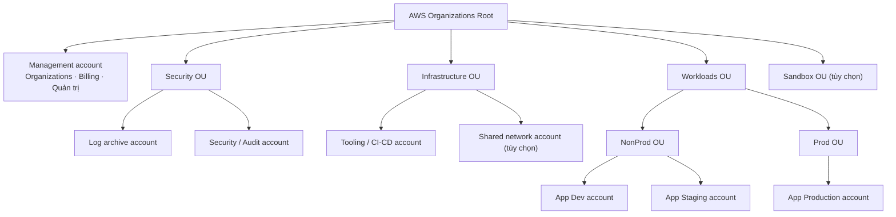

# Thiết kế chiến lược nhiều tài khoản cho dev, staging và production trên AWS

Trong hệ sinh thái **Amazon Web Services (AWS)**, một tài khoản (AWS account) là ranh giới quan trọng để quản lý danh tính, tài nguyên, chi phí và phạm vi ảnh hưởng của sự cố. Khi ứng dụng đi từ phát triển đến vận hành thực tế, việc đặt tất cả máy chủ, cơ sở dữ liệu và người dùng vào một tài khoản thường tạo ra rủi ro: một cấu hình IAM sai có thể ảnh hưởng production; một thao tác xóa nhầm có thể làm mất dữ liệu; chi phí thử nghiệm có thể trộn lẫn với chi phí phục vụ khách hàng.

Bài học thuộc chương **Tài khoản và Organizations** của module `CLOUD_PROVIDERS_AWS`. Mục tiêu là vận dụng AWS Organizations, IAM, VPC, dịch vụ tính toán, lưu trữ, cơ sở dữ liệu, serverless, giám sát và sao lưu để xây dựng chiến lược **nhiều tài khoản** cho ba môi trường **development (dev)**, **staging** và **production (prod)**. Chiến lược tốt giúp nhóm triển khai an toàn, kiểm soát chi phí, giới hạn phạm vi ảnh hưởng khi có lỗi, đồng thời có đường phục hồi rõ ràng.

## 1. Vấn đề cần giải quyết

Giả sử nhóm vận hành một ứng dụng bán hàng gồm frontend, API, hàng đợi xử lý đơn, database và kho ảnh. Trong tài khoản AWS duy nhất, nhóm tạo tài nguyên theo tiền tố `dev-`, `staging-` và `prod-`. Mô hình này nhanh lúc đầu nhưng chỉ dựa vào quy ước đặt tên để phân biệt môi trường. Cùng một tài khoản vẫn có thể dùng chung hạn mức dịch vụ, quyền IAM, cấu hình kiểm toán và một số tài nguyên nền tảng.

Khi tách môi trường thành nhiều AWS account, ta có thêm các ranh giới kỹ thuật:

| Tiêu chí | Một tài khoản cho mọi môi trường | Tách tài khoản dev / staging / prod |
|---|---|---|
| Phân quyền IAM | Khó bảo đảm mọi policy đều lọc đúng môi trường | Cấp quyền theo tài khoản, kết hợp policy tài khoản đích |
| Ảnh hưởng khi cấu hình sai | Dễ lan sang tài nguyên production | Giới hạn đáng kể trong tài khoản bị ảnh hưởng |
| Theo dõi chi phí | Phải dựa nhiều vào tag, tên và báo cáo chi tiết | Có số liệu theo account trong AWS Organizations |
| Hạn mức dịch vụ | Nhiều quota dùng chung phạm vi tài khoản/Region | Nhiều quota được tách theo account/Region |
| Bảo mật dữ liệu | Dễ cấp nhầm quyền từ dev sang production | Tách quyền, khóa mã hóa, database và vùng mạng |
| Kiểm toán và kiểm soát thay đổi | Khó phân biệt truy cập thử nghiệm với thay đổi thật | Chính sách và bằng chứng vận hành rõ theo môi trường |
| Chi phí vận hành | Ít cấu hình nền tảng ban đầu | Cần tự động hóa tạo và quản trị tài khoản |

**Điểm mấu chốt:** nhiều account tạo ra ranh giới bảo vệ mạnh hơn, nhưng không tự động bảo đảm an toàn. IAM policy, Service Control Policy (SCP), kết nối mạng, quyền truy cập dữ liệu và quy trình triển khai vẫn phải được thiết kế nhất quán.

### Mục tiêu của từng môi trường

| Môi trường | Mục tiêu chính | Mức quyền thường dùng | Dữ liệu | Yêu cầu vận hành |
|---|---|---|---|---|
| **Dev** | Phát triển tính năng, thử nghiệm nhanh, phát hiện lỗi sớm | Developer có quyền tạo/sửa nhiều loại tài nguyên trong giới hạn cho phép | Dữ liệu giả lập hoặc đã khử nhận dạng | Tối ưu tốc độ, có lịch dọn tài nguyên, ngân sách thấp |
| **Staging** | Kiểm thử tích hợp, hồi quy, hiệu năng cơ bản và quy trình release | Chủ yếu triển khai qua pipeline; người dùng truy cập có kiểm soát | Dữ liệu đại diện nhưng không để lộ dữ liệu nhạy cảm production | Cấu trúc gần production, giám sát và kiểm thử release |
| **Production** | Phục vụ người dùng thật, bảo vệ dữ liệu và tính sẵn sàng | Ít người có quyền ghi; triển khai qua vai trò tự động hóa được phê duyệt | Dữ liệu thật được phân loại và mã hóa | Kiểm soát thay đổi, cảnh báo, backup, kế hoạch khôi phục |

`Staging giống production` về kiến trúc, phiên bản hạ tầng, cơ chế xác thực và đường triển khai; không nhất thiết phải có cùng quy mô máy chủ hoặc khối lượng dữ liệu. Khác biệt về kích thước và lưu lượng cần được ghi nhận để tránh kết luận sai từ kiểm thử hiệu năng.

## 2. Khung kiến trúc: AWS Organizations và Organizational Units

**AWS Organizations** cho phép quản lý tập trung nhiều AWS account trong cùng một tổ chức, tổ chức account theo **Organizational Unit (OU)**, áp dụng chính sách quản trị và sử dụng consolidated billing. **Management account** điều hành tổ chức, trong khi **member accounts** chứa phần lớn workload. Nên tránh triển khai ứng dụng nghiệp vụ trong management account vì đây là tài khoản có đặc quyền tổ chức và là điểm nhạy cảm về an ninh.

Một sơ đồ khởi đầu phù hợp cho doanh nghiệp nhỏ đến trung bình:



Trong sơ đồ, security và tooling được đặt ngoài các account chạy ứng dụng để đội vận hành vẫn có khả năng quan sát, điều tra và triển khai khi một account workload bị lỗi. Nếu tổ chức mới chỉ có một ứng dụng và nguồn lực ít, có thể khởi đầu với ba account môi trường cộng các account nền tảng thiết yếu, rồi tách thêm khi nhu cầu tăng.

### Vai trò của các tài khoản

| Account / nhóm | Trách nhiệm | Điều nên tránh |
|---|---|---|
| **Management** | Quản lý Organizations, thanh toán tổng hợp, quản trị OU/SCP, thiết lập quản trị cấp tổ chức | Đặt web server, database, workload thử nghiệm |
| **Log archive** | Nhận và lưu nhật ký kiểm toán tập trung với chính sách lưu giữ và quyền ghi/đọc chặt chẽ | Cho developer tự xóa hoặc sửa log |
| **Security / Audit** | Quản lý cảnh báo và công cụ an ninh tập trung, điều tra sự kiện | Dùng chung vai trò quản trị với workload |
| **Tooling / CI-CD** | Chứa công cụ build, quản lý artifact, tự động triển khai xuyên account | Dùng access key dài hạn hoặc role toàn quyền mặc định |
| **Shared network** | Quản trị kết nối tập trung, DNS, đường kết nối on-premises nếu cần | Cho mọi môi trường kết nối ngang hàng không kiểm soát |
| **Dev, staging, prod** | Chạy tài nguyên ứng dụng của từng môi trường | Chia sẻ database, secret hoặc tài khoản quản trị |
| **Sandbox** | Thử nghiệm ngắn hạn, giới hạn dịch vụ và chi phí | Dùng dữ liệu khách hàng thật hoặc giữ tài nguyên vô thời hạn |

**Nguyên tắc mở rộng:** một app có thể bắt đầu với bộ ba `dev/staging/prod`. Khi có nhiều đội sản phẩm, nên cân nhắc **mỗi workload hoặc nhóm workload theo từng môi trường một account**, chẳng hạn `payments-prod` và `catalog-prod`. Quyết định phụ thuộc mức độc lập phát hành, độ nhạy dữ liệu, yêu cầu tuân thủ, chi phí và khả năng vận hành.

### Account, OU và Region không phải cùng một khái niệm

- **Account**: ranh giới danh tính, chính sách truy cập, tài nguyên và thông tin chi phí.
- **OU**: nhóm account nhận chính sách quản trị chung; OU không phải mạng riêng, vùng dữ liệu hay nơi chạy ứng dụng.
- **Region**: vị trí địa lý triển khai dịch vụ AWS; lựa chọn theo độ trễ, quy định dữ liệu, dịch vụ sẵn có và yêu cầu phục hồi.
- **Availability Zone (AZ)**: một vùng hạ tầng độc lập trong Region; production quan trọng thường phân bố trên ít nhất hai AZ để giảm rủi ro một AZ gặp sự cố.

Tách account **không thay thế** thiết kế đa AZ hoặc chiến lược khôi phục sau sự cố Region. Ngược lại, chạy nhiều Region cũng **không thay thế** tách account.

## 3. Quy tắc quản trị tài khoản ngay từ đầu

Việc tạo account nên là quy trình chuẩn hóa thay vì thao tác thủ công tùy hứng. AWS Control Tower có thể hỗ trợ thiết lập landing zone, guardrail/control và cấp tài khoản theo quy trình; tổ chức cũng có thể quản lý AWS Organizations và baseline bằng Infrastructure as Code (IaC) nếu đã có năng lực vận hành tương ứng.

Với mỗi account mới, cần xác định:

1. **Chủ sở hữu**: đội chịu trách nhiệm nghiệp vụ, vận hành, bảo mật và ngân sách.
2. **Định danh**: tên account, email root riêng biệt, alias nếu sử dụng, mã ứng dụng và môi trường; Account ID là số định danh chính thức.
3. **Liên hệ**: thông tin liên hệ kỹ thuật, bảo mật và thanh toán phù hợp.
4. **Bootstrap bảo mật**: bảo vệ root user, MFA, truy cập nhân viên qua IAM Identity Center, CloudTrail, AWS Config/GuardDuty/Security Hub tùy baseline.
5. **Hạ tầng nền**: Region được phép, VPC, DNS, encryption, secret management, tag, quota và backup.
6. **Công cụ vận hành**: monitoring, cảnh báo, ngân sách, pipeline, runbook và quy trình xóa tài nguyên.

Ví dụ quy ước tên:

| Thuộc tính | Dev | Staging | Production |
|---|---|---|---|
| Tên account | `shop-dev` | `shop-staging` | `shop-prod` |
| OU | `Workloads/NonProd` | `Workloads/NonProd` | `Workloads/Prod` |
| Tag môi trường | `Environment=dev` | `Environment=staging` | `Environment=prod` |
| Chủ sở hữu | `Owner=shop-platform` | `Owner=shop-platform` | `Owner=shop-platform` |
| Mức độ dữ liệu | Test/synthetic | Synthetic hoặc masked | Dữ liệu thật |
| Phê duyệt deploy | Tự động theo nhánh phát triển | Qua pipeline sau kiểm thử | Theo kiểm soát thay đổi |

Không nên dựa vào **tag** để tạo ranh giới bảo mật duy nhất: tag có thể bị quên, thay đổi hoặc bị sử dụng sai trong IAM policy. Dùng account, OU, IAM và policy có kiểm tra chéo làm lớp bảo vệ chính; tag phục vụ quản trị tài nguyên, phân bổ chi phí và hỗ trợ tự động hóa.

## 4. Phân quyền: IAM Identity Center, IAM role và SCP

Một mô hình nhiều account hiệu quả phân biệt ba lớp quyết định:

1. **Ai được đăng nhập?** Danh tính nhân viên và nhóm được quản lý qua AWS IAM Identity Center hoặc hệ thống danh tính liên kết phù hợp.
2. **Sau khi đăng nhập, được làm gì?** Permission set và IAM role/policy cấp quyền cụ thể trong từng member account.
3. **Tổ chức cấm điều gì ngay cả khi account tự cấp quyền?** SCP trong AWS Organizations đặt **giới hạn quyền tối đa** cho principal ở member account.

SCP **không tự cấp quyền**. Một hành động chỉ khả dụng khi IAM cho phép và không bị các lớp policy có hiệu lực chặn lại. SCP có thể áp dụng với root user của member account nhưng không giới hạn principal trong management account; ngoài ra, các **service-linked role** không bị SCP hạn chế theo cơ chế thông thường. Vì vậy, quản trị management account và quyền dùng service-linked role cần có biện pháp riêng.

### Ma trận truy cập mẫu

| Nhóm | Dev | Staging | Production |
|---|---|---|---|
| Developer | Quyền phát triển có giới hạn, có thể tạo tài nguyên phổ biến | Đọc log/metrics; thay đổi qua pipeline | Chỉ đọc có kiểm soát, không sửa dữ liệu |
| QA | Quyền chạy kiểm thử và xem log cần thiết | Chạy test, đọc báo cáo và metrics | Không truy cập dữ liệu thật trừ trường hợp được phê duyệt |
| SRE/Platform | Quản lý nền tảng | Quản lý nền tảng | Vận hành qua role đặc quyền có kiểm toán; ưu tiên quyền tạm thời |
| Security | Kiểm tra cấu hình, xem bằng chứng | Kiểm tra cấu hình, xem bằng chứng | Điều tra, giám sát; quyền ứng cứu theo quy trình |
| CI/CD role | Deploy trong account dev | Deploy trong account staging | Chỉ deploy artifact được phê duyệt vào phạm vi được chỉ định |

Các permission set như `DeveloperDev`, `ReadOnlyStaging`, `ReadOnlyProd` và `ProductionOperator` thể hiện quyền theo vai trò và môi trường. Người dùng được gán permission set vào **từng account cụ thể**, tránh tự động nhân quyền quản trị dev sang prod.

**Các kiểm soát nền tảng cần có:**

- Bảo vệ root user và các tài khoản quản trị quan trọng bằng MFA; hạn chế sử dụng root cho công việc thường ngày và xác lập quy trình truy cập khẩn cấp (break-glass) có kiểm toán.
- Áp dụng **least privilege**, tách người phê duyệt khỏi danh tính pipeline khi yêu cầu kiểm soát thay đổi.
- Ưu tiên **temporary credentials** qua STS/role federation; hạn chế IAM user access key dài hạn.
- Giới hạn người được cập nhật SCP, IAM role nhạy cảm, KMS key policy, CloudTrail và cấu hình log.
- Định kỳ rà soát cấp quyền, phát hiện role không dùng, và dùng IAM Access Analyzer hỗ trợ kiểm tra truy cập ngoài ý muốn.

### Ví dụ một SCP bảo vệ khả năng ghi nhật ký

Policy sau minh họa **explicit deny** đối với hành động dừng hoặc xóa CloudTrail trail, có thể dùng như một phần guardrail trên OU chứa workload:

```json
{
  "Version": "2012-10-17",
  "Statement": [
    {
      "Sid": "DenyDisablingCloudTrail",
      "Effect": "Deny",
      "Action": [
        "cloudtrail:StopLogging",
        "cloudtrail:DeleteTrail"
      ],
      "Resource": "*"
    }
  ]
}
```

Đây là ví dụ tối giản, **không phải baseline bảo mật đầy đủ**. Trong thực tế, cần bảo vệ thêm quyền sửa bucket log, key mã hóa, cấu hình phát hiện an ninh và quyền cập nhật SCP; phải thử nghiệm trên OU thử nghiệm trước khi áp dụng production. Việc chặn API trong member account cũng không thay thế bảo vệ **organization trail**, log archive và management account.

**Lưu ý về Region restriction:** SCP dựa vào `aws:RequestedRegion` có các ngoại lệ đối với dịch vụ global và thao tác liên Region; không nên chép một policy deny tất cả Region khác mà chưa kiểm tra tác động lên IAM, DNS, CloudFront, STS và dịch vụ sử dụng thực tế.

## 5. Cách ly mạng và dữ liệu

### 5.1. VPC cho từng môi trường

Mỗi account workload thường sở hữu VPC riêng, gồm nhiều subnet ở các AZ nếu yêu cầu độ sẵn sàng. Địa chỉ mạng phải được quy hoạch để không chồng lấn nếu tương lai cần kết nối.

| Thành phần | Dev | Staging | Production |
|---|---|---|---|
| Account | `shop-dev` | `shop-staging` | `shop-prod` |
| VPC CIDR minh họa | `10.10.0.0/16` | `10.20.0.0/16` | `10.30.0.0/16` |
| Subnet | Public nếu cần, private cho ứng dụng/data | Private cho ứng dụng/data, ingress có kiểm soát | Private cho ứng dụng/data, multi-AZ |
| Thành phần ứng dụng | ECS/EC2/Lambda phục vụ thử nghiệm | Cùng kiểu dịch vụ như prod | ECS/EC2/Lambda theo SLO, autoscaling |
| Database | RDS/Aurora hoặc database test | Engine và schema tương thích prod | Database được mã hóa, backup, HA theo yêu cầu |
| Truy cập mạng | Giới hạn vào tài nguyên dev | Chỉ đường kiểm thử cần thiết | Chỉ các luồng nghiệp vụ được phép |

Không thiết lập mặc định kết nối VPC peering toàn mạng từ dev sang prod. Nếu có yêu cầu hợp lệ như hệ thống giám sát hoặc dịch vụ chia sẻ, chọn kiến trúc kết nối phù hợp:

- **AWS Transit Gateway** để quản trị kết nối giữa nhiều VPC/account với route table phân đoạn.
- **AWS PrivateLink** để chỉ công bố một dịch vụ cụ thể qua mạng riêng, giảm mức mở rộng phạm vi mạng.
- **AWS RAM** cho các trường hợp chia sẻ tài nguyên AWS được hỗ trợ và có kiểm soát.
- **Site-to-Site VPN / Direct Connect** nếu cần kết nối datacenter; kiểm soát tuyến và danh tính truy cập tới từng môi trường.

Một kết nối mạng chỉ giải quyết khả năng gửi lưu lượng; **security group, route, IAM, resource policy và xác thực ứng dụng** vẫn quyết định quyền truy cập thực tế. Cần giới hạn egress, theo dõi VPC Flow Logs khi phù hợp và ưu tiên private endpoint cho dịch vụ AWS trong các môi trường nhạy cảm.

### 5.2. Dữ liệu và khóa mã hóa

Tách account nhưng sao chép database production nguyên trạng sang dev sẽ làm mất phần lớn lợi ích bảo vệ dữ liệu. Chiến lược dữ liệu nên quy định:

| Loại tài nguyên | Quy tắc khuyến nghị |
|---|---|
| Database RDS/Aurora/DynamoDB | Mỗi môi trường có database/table riêng; quyền ứng dụng chỉ truy cập dữ liệu của môi trường đó |
| S3 bucket | Tách bucket hoặc cấu hình truy cập rõ theo account; chặn public access theo nhu cầu bảo mật và dùng bucket policy chặt chẽ |
| Secrets Manager / SSM Parameter Store | Secret, API token, endpoint và quyền đọc tách theo account/môi trường |
| KMS | Quản lý key và key policy theo mức nhạy cảm; chỉ cho phép chia sẻ/cross-account decrypt khi có chủ đích |
| Snapshot / backup | Không chuyển dữ liệu thật sang môi trường thấp hơn khi chưa được khử nhận dạng hoặc có cơ sở phê duyệt phù hợp |
| EventBus / Queue | EventBridge, SQS, SNS theo môi trường; resource policy giới hạn nguồn và đích |

Để dựng staging gần production, dùng **dữ liệu tổng hợp (synthetic data)** hoặc bản sao đã **mask/tokenize/anonymize** theo yêu cầu bảo mật. Cần kiểm chứng dữ liệu giả vẫn đại diện cho trường hợp nghiệp vụ quan trọng: phân bố kích thước đơn hàng, trường hợp null, ký tự Unicode, số lượng bản ghi, mức độ phân tán khóa và tần suất giao dịch.

Đối với chia sẻ hoặc sao chép mã hóa **giữa account**, quyền IAM, resource policy và **KMS key policy/grant** phải cùng phù hợp; cho phép truy cập snapshot không đồng nghĩa đương nhiên giải mã được dữ liệu. Nên thiết kế và kiểm tra luồng sao lưu/khôi phục trước khi coi một bản backup là dùng được.

## 6. CI/CD xuyên tài khoản: build một lần, promote có kiểm soát

Chiến lược deploy nên bảo đảm artifact được kiểm thử là chính artifact được đưa lên production. Có thể sử dụng AWS CodePipeline/CodeBuild/CodeDeploy hoặc một nền tảng CI/CD khác kết hợp AWS STS.

```mermaid
flowchart LR
    SRC["Git / Pull request"] --> CI["Build + Unit test + Security scan"]
    CI --> ART["Immutable artifact<br/>image digest / version"]
    ART --> D["Deploy Dev account"]
    D --> DT["Integration tests"]
    DT --> S["Deploy Staging account"]
    S --> ST["E2E + smoke + migration test"]
    ST --> AP["Approval / change control"]
    AP --> P["Deploy Production account"]
    P --> MON["Post-deploy health checks<br/>+ rollback criteria"]
```



**Các đặc tính quan trọng của pipeline:**

1. **Tách quyền theo môi trường**: pipeline sử dụng role chỉ có quyền triển khai những tài nguyên cần thiết trong account đích; vai trò dev không có quyền deploy prod.
2. **Identity federation**: hệ thống CI/CD bên ngoài AWS nên dùng OIDC hoặc cơ chế federation phù hợp thay cho access key lưu lâu dài; ứng dụng trong AWS dùng IAM role và STS.
3. **Build một lần**: lưu artifact/image theo mã định danh bất biến, kiểm tra checksum/digest và promote cùng phiên bản qua môi trường; tách biến cấu hình, secret và endpoint theo account.
4. **IaC versioned**: VPC, IAM, ECS/EKS, Lambda, RDS, security group và cảnh báo được quản lý bằng CloudFormation/CDK/Terraform hoặc công cụ tương đương; lưu state trong vị trí được bảo vệ và có khóa khi thực thi.
5. **Cổng kiểm thử**: unit test → integration test → staging smoke/E2E → kiểm tra migration → phê duyệt production theo mức độ rủi ro.
6. **Khôi phục**: có rollback ứng dụng, phương án tương thích schema và cách kiểm tra sức khỏe sau phát hành. Rollback mã nguồn không đương nhiên đảo ngược được migration dữ liệu.

### Ví dụ quyền liên kết OIDC cho pipeline deploy production

Sau khi account production đã cấu hình IAM OIDC identity provider tin cậy, trust policy của role có thể giới hạn nguồn là một **GitHub Actions environment** cụ thể. Thay `<PROD_ACCOUNT_ID>`, repository và environment bằng giá trị của tổ chức:

```json
{
  "Version": "2012-10-17",
  "Statement": [
    {
      "Effect": "Allow",
      "Principal": {
        "Federated": "arn:aws:iam::<PROD_ACCOUNT_ID>:oidc-provider/token.actions.githubusercontent.com"
      },
      "Action": "sts:AssumeRoleWithWebIdentity",
      "Condition": {
        "StringEquals": {
          "token.actions.githubusercontent.com:aud": "sts.amazonaws.com",
          "token.actions.githubusercontent.com:sub": "repo:example-org/shop-app:environment:production"
        }
      }
    }
  ]
}
```

Policy này chỉ nói **ai có thể assume role**; vẫn phải gắn permission policy giới hạn hành động và tài nguyên mà role được phép triển khai. GitHub environment `production` cần có quy tắc bảo vệ/duyệt và hạn chế nhánh phù hợp; ngoài ra phải bảo vệ workflow, repository và runner vì chúng là một phần chuỗi tin cậy. Với CI/CD sử dụng AWS CodePipeline hoặc nền tảng khác, trust policy tương ứng sẽ khác.

### Dòng thay đổi cơ sở dữ liệu

Giả sử release bổ sung trường `delivery_note` vào đơn hàng. Pipeline nên chạy migration ở staging trước và kiểm thử ứng dụng cũ/mới theo chiến lược tương thích ngược (ví dụ **expand → migrate → contract**). Production cần phê duyệt migration có nguy cơ khóa bảng hoặc phá tương thích. Sao lưu trước thay đổi lớn và diễn tập phục hồi làm giảm thiểu rủi ro, nhưng không thay thế review tác động dữ liệu.

## 7. Nhật ký, phát hiện an ninh và giám sát tập trung

Một tổ chức có nhiều account cần quan sát xuyên tài khoản mà vẫn phân quyền rõ ràng. Phải phân biệt **audit log** (ai đã gọi API), **application log** (ứng dụng làm gì), **metrics** (hệ thống vận hành ra sao) và **security finding** (phát hiện điều đáng nghi).

| Nhu cầu | Công cụ AWS có thể dùng | Bố trí khuyến nghị |
|---|---|---|
| Ghi lịch sử AWS API | AWS CloudTrail organization trail, có thể cấu hình nhiều Region | Đưa log về log archive account với quyền chống sửa/xóa |
| Theo dõi cấu hình và thay đổi tài nguyên | AWS Config và aggregator | Bật recorder tại các account/Region cần giám sát, tổng hợp về account kiểm toán |
| Phát hiện hành vi bất thường | Amazon GuardDuty | Quản lý tổ chức bằng delegated administrator khi phù hợp |
| Tổng hợp phát hiện bảo mật | AWS Security Hub | Tập trung tìm kiếm, ưu tiên và phân công xử lý |
| Log/metrics/traces ứng dụng | Amazon CloudWatch, X-Ray/OTel và dashboard cross-account | Workload phát số liệu; đội vận hành có quyền xem và cảnh báo theo môi trường |
| Lưu trữ log dài hạn | Amazon S3, lifecycle, mã hóa, chính sách retention | Tách bucket log, phân cấp truy cập; cân nhắc Object Lock theo yêu cầu bất biến |

**Lưu ý triển khai:** tạo AWS Config aggregator chỉ giúp tổng hợp dữ liệu đã được ghi; nó không tự bật configuration recorder trong mọi member account. Organization trail cũng cần thiết kế nơi lưu, mã hóa, quyền truy cập và kiểm tra tình trạng thu thập. CloudTrail data events, log lưu lâu ngày và một số tính năng quan sát có chi phí riêng, cần chọn phạm vi có chủ đích.

Luồng xử lý sự cố ví dụ:

1. GuardDuty phát hiện hành vi bất thường trong `shop-prod` và gửi finding tới nơi tổng hợp bảo mật.
2. Đội security tra cứu CloudTrail để biết role nào đã gọi API, thời điểm và đối tượng bị tác động.
3. SRE kiểm tra metric, trace, log ứng dụng và ảnh hưởng đơn hàng.
4. Nếu cần, tạm khóa đường truy cập hoặc triển khai biện pháp khắc phục qua role được kiểm soát, đồng thời bảo toàn bằng chứng.
5. Sau sự cố, cập nhật guardrail, quyền IAM, runbook và kiểm thử hồi quy.

## 8. Chi phí, quota và quản lý tài nguyên theo môi trường

AWS Organizations hỗ trợ **consolidated billing**: quản lý thanh toán tập trung trong khi vẫn có khả năng phân tích chi phí theo từng account. Cần kết hợp account boundary, cost allocation tag, AWS Cost Explorer/Cost and Usage Report, AWS Budgets và Cost Anomaly Detection phù hợp với quy mô tổ chức.

| Môi trường | Chính sách chi phí điển hình | Ví dụ hành động |
|---|---|---|
| Dev | Ưu tiên rẻ và dễ dọn dẹp | Tắt tài nguyên ngoài giờ khi phù hợp, TTL cho tài nguyên thử nghiệm, ngân sách cảnh báo |
| Staging | Cân bằng độ tương đồng với prod và giá vận hành | Bật theo lịch nếu không có kiểm thử liên tục, đúng loại dịch vụ nhưng có thể giảm số node |
| Production | Tối ưu theo SLO, tải thực tế và khả năng phục hồi | Autoscaling, chọn kế hoạch mua năng lực phù hợp, theo dõi cost-to-serve |

Các nguyên tắc thực hành:

- Dùng tag như `Environment`, `Application`, `Owner` và `CostCenter`; quản lý tag bắt buộc trong IaC/pipeline.
- Thiết lập cảnh báo ngân sách riêng cho từng account/môi trường và theo dõi biến động bất thường.
- Thiết lập cơ chế dọn rác có bảo vệ: lịch dừng tài nguyên dev không áp dụng bừa bãi cho tài nguyên stateful hoặc production.
- Xem quota khi thiết kế: nhiều **service quota** có phạm vi **account + Region**, nhưng không phải tất cả; cần kiểm tra quota cụ thể của dịch vụ, yêu cầu tăng quota trước release.
- Nhớ rằng **AWS Budgets không mặc định chặn phát sinh chi phí**. Cảnh báo, kiểm soát quyền tạo tài nguyên và tự động hóa xử lý là các công cụ bổ sung, mỗi công cụ có giới hạn riêng.

Ví dụ đội vận hành nhận thấy bill dev tăng gấp ba vì một kỹ sư chạy kiểm thử tải trên EC2 GPU. Tài khoản dev tách biệt giúp nhanh chóng định vị nguyên nhân và xử lý mà không cần thay đổi cấu hình sản xuất. Tuy vậy, nếu đã dùng Savings Plans hoặc các cơ chế phân bổ chi phí tập trung, báo cáo vẫn cần xem cả góc độ account lẫn toàn tổ chức.

## 9. Khả năng sẵn sàng, backup và phục hồi

**Account isolation** giảm rủi ro truy cập hoặc thao tác nhầm giữa môi trường. **High Availability (HA)** và **Disaster Recovery (DR)** xử lý rủi ro hạ tầng và gián đoạn dịch vụ. Ba yêu cầu này có liên quan nhưng không đồng nhất.

### Thiết kế production theo mục tiêu phục hồi

| Khái niệm | Câu hỏi cần trả lời | Hướng thiết kế |
|---|---|---|
| **SLO** | Dịch vụ cần ổn định ở mức nào? | Đặt chỉ số khả dụng, độ trễ và error budget |
| **RPO** | Có thể mất tối đa bao nhiêu dữ liệu khi sự cố? | Tần suất backup/replication và tính nhất quán dữ liệu |
| **RTO** | Cần phục hồi trong bao lâu? | Runbook, hạ tầng sẵn sàng, thời gian DNS và database recovery |
| **Multi-AZ** | Một AZ lỗi thì ứng dụng còn chạy không? | Triển khai trên nhiều AZ, load balancing, cấu hình DB HA |
| **Cross-Region DR** | Một Region gián đoạn thì có thể khôi phục không? | Backup hoặc replica ở Region khác theo nhu cầu, thử nghiệm failover |
| **Cross-account backup** | Nếu account prod bị chiếm quyền, backup còn được bảo vệ không? | Backup vault/account tách quyền, chính sách lưu giữ và kiểm thử restore |

AWS Backup có thể giúp chuẩn hóa backup plan và sao chép backup sang account/Region phù hợp. Việc copy phụ thuộc khả năng hỗ trợ của từng loại tài nguyên, thiết lập AWS Organizations/AWS Backup và quyền KMS; không nên giả định mọi loại backup đều sao chép được bằng cùng một thao tác.

Kịch bản thực hành: production chạy API trên ECS/Lambda, lưu ảnh trên S3 và đơn hàng trong RDS/Aurora. Nhóm cần bảo đảm ứng dụng vẫn phục vụ khi một AZ lỗi, có backup dữ liệu và tài liệu khôi phục cho sự cố xóa bảng hoặc mất quyền quản trị account. Quy trình diễn tập tối thiểu gồm chọn bản backup, tạo môi trường phục hồi, kiểm tra tính toàn vẹn dữ liệu, cập nhật endpoint tạm thời, đo RTO/RPO thực tế và lưu kết quả.

## 10. Tình huống thiết kế đầy đủ: ứng dụng bán hàng

Giả sử hệ thống bán hàng có một SPA frontend, API, PostgreSQL, S3 lưu ảnh và SQS xử lý tác vụ nền. Nhóm có sáu developer, hai QA và một đội platform kiêm SRE.

**Thiết kế đề xuất:**

| Tầng | Dev account | Staging account | Prod account |
|---|---|---|---|
| Frontend | Hosting/test domain riêng | Hosting và domain kiểm thử riêng | Domain khách hàng với CDN và TLS |
| API | ECS Fargate hoặc Lambda, cấu hình chi phí thấp | Cùng runtime và cách deploy prod | Multi-AZ, autoscaling, giám sát SLO |
| Database | PostgreSQL test, tự tạo dữ liệu | Cùng engine/schema, dữ liệu masked hoặc synthetic | RDS/Aurora bảo vệ bằng IAM/KMS/backup, HA theo yêu cầu |
| Object storage | Bucket riêng | Bucket riêng | Bucket production riêng, kiểm soát public access |
| Hàng đợi | SQS dev | SQS staging | SQS prod, DLQ và cảnh báo backlog |
| Secrets | Secrets Manager dev | Secrets Manager staging | Secrets Manager prod, phân quyền chặt |
| Quan sát | Log và metrics phục vụ debug | Kiểm tra tracing, alert, deploy health | Alert theo SLO và quy trình trực sự cố |

**Một vòng đời phát hành điển hình:**

1. Developer tạo pull request. CI chạy unit test, lint, kiểm tra IaC và tạo artifact bất biến.
2. Pipeline assume role của dev để triển khai, chạy integration test với SQS và PostgreSQL dev.
3. Khi kiểm thử tự động đạt, pipeline triển khai chính artifact đó vào staging và chạy E2E, smoke test, thử migration.
4. Người có thẩm quyền phê duyệt bước production theo quy tắc của tổ chức; pipeline assume role production với quyền deploy giới hạn.
5. Sau deploy, hệ thống đo lỗi API, thời gian phản hồi, độ sâu SQS, tình trạng database và các business metric như tỷ lệ tạo đơn thành công.
6. Nếu health check vi phạm ngưỡng, runbook hướng dẫn rollback ứng dụng hoặc chuyển hướng lưu lượng; phần dữ liệu tuân theo chiến lược migration đã chuẩn bị.

**Xử lý trường hợp khẩn cấp:** nếu developer cần truy cập production để điều tra lỗi, không nên chia sẻ access key của admin. Người được ủy quyền sử dụng role đọc log theo quyền hạn hoặc quy trình break-glass có lý do, thời hạn và kiểm toán. Thao tác sửa dữ liệu thật phải có quy trình riêng.

### Khi nào cần nhiều hơn ba account ứng dụng?

- **Nhiều ứng dụng có owner khác nhau**: tách account theo workload để giảm phạm vi tác động và dễ lập ngân sách.
- **Dữ liệu khác độ nhạy**: hệ thống thanh toán hoặc thông tin định danh có thể cần account và guardrail riêng.
- **Sandbox/quá trình thử nghiệm ngắn hạn**: tách để tránh ảnh hưởng quota hoặc chi phí dev chính.
- **Shared services**: có thể dùng account tooling, network, security, backup, DNS theo vai trò rõ ràng.
- **DR quy mô lớn**: thêm account khôi phục hoặc Region phụ nếu đáp ứng yêu cầu rủi ro và vận hành.

Tránh nhân bản account không có chủ đích: mỗi account mang theo chi phí thiết lập, chính sách, giám sát, lifecycle và quyền truy cập. Mức phân tách hợp lý là mức mà nhóm **vận hành nhất quán bằng tự động hóa**.

## 11. Lộ trình triển khai theo giai đoạn

### Giai đoạn 1 — Thiết lập landing zone

1. Tạo/cấu hình AWS Organizations và cơ chế consolidated billing; quản lý chặt management account.
2. Thiết kế OU và quyết định account bảo mật, logging, tooling, workload.
3. Tạo ba account `dev`, `staging`, `prod` với thông tin sở hữu và naming thống nhất.
4. Thiết lập IAM Identity Center/role federation, MFA và quyền theo ma trận truy cập.
5. Cấu hình baseline log, kiểm toán, mã hóa, ngân sách và guardrail; thử policy trên OU thử nghiệm trước.

### Giai đoạn 2 — Chuẩn hóa hạ tầng và triển khai

6. Quy hoạch CIDR, Region và AZ; tạo VPC, subnet, route, security group theo IaC.
7. Tạo data store, KMS key, secret, artifact registry và hệ thống giám sát riêng từng môi trường.
8. Tạo CI/CD roles trong account đích và pipeline build/promote/deploy, sử dụng temporary credentials.
9. Chạy tự động các bước kiểm thử ở dev/staging và xác lập cơ chế phê duyệt production.

### Giai đoạn 3 — Vận hành và kiểm chứng

10. Kiểm thử deny của SCP, phân quyền read-only/production, các đường kết nối mạng và việc ngăn truy cập dữ liệu giữa môi trường.
11. Kiểm tra alert, log, ngân sách, quota, backup restore và rollback trong một diễn tập có ghi nhận thời gian.
12. Định kỳ đánh giá quyền truy cập, cấu hình trôi khỏi IaC, tag thiếu, cost anomaly, account không còn owner và nhu cầu tách thêm workload.

Nếu di chuyển từ một account hiện hữu, nên **lập bản đồ phụ thuộc** trước: VPC, route, IAM, bucket policy, ARNs cố định trong cấu hình, KMS key, DNS, certificate, quota, backup, CI/CD và quyền bên thứ ba. Di chuyển theo từng workload, có kế hoạch cutover và phương án quay lại, thay vì giả định chỉ cần đổi Account ID.

## 12. Những sai lầm thường gặp và cách khắc phục

| Sai lầm | Hệ quả | Cách khắc phục |
|---|---|---|
| Dùng tài khoản management để chạy ứng dụng | Tăng bề mặt tấn công vào quản trị Organizations | Đặt workload trong member accounts |
| Dev có role admin production để tiện xử lý | Dễ deploy/sửa/xóa nhầm hệ thống thật | Phân quyền theo account, SSO/permission set, role có kiểm toán |
| Dùng chung database hoặc secret giữa các môi trường | Rò rỉ dữ liệu và phụ thuộc vận hành chéo | Mỗi môi trường có data store và secret riêng |
| SCP được coi là policy cấp quyền | Người dùng vẫn không có quyền; hoặc hiểu sai tác dụng bảo mật | Phối hợp SCP với IAM/resource policy và thử hiệu lực thực tế |
| Chỉ tạo ba account rồi bỏ qua log, guardrail | Khó phát hiện và điều tra sai phạm | Thiết lập baseline quản trị và log từ đầu |
| Staging khác prod về runtime hoặc cấu hình chính | Kiểm thử không phản ánh môi trường thật | Dùng chung mô-đun IaC, khác biến cấu hình có kiểm soát |
| Build lại artifact khi lên prod | Có thể triển khai mã khác với bản đã kiểm thử | Promote cùng image digest/artifact |
| Chỉ có backup mà chưa thử restore | Không biết backup có hoạt động trong sự cố | Diễn tập restore và đo RTO/RPO |
| Chỉ gắn budget alert và nghĩ chi phí đã bị khóa | Tài nguyên vẫn có thể tiếp tục phát sinh phí | Kết hợp cảnh báo, quyền hạn, quota, TTL, giám sát |
| Cho phép kết nối VPC dev → prod toàn mạng | Mở rộng đường di chuyển ngang khi bị xâm nhập | Tách tuyến, giới hạn service endpoint và tài nguyên |

## 13. Checklist tự đánh giá kiến trúc

Một thiết kế nhiều tài khoản đã sẵn sàng đi vào vận hành khi trả lời được các câu hỏi:

- [ ] Ba môi trường dev, staging, prod có account riêng và owner rõ ràng?
- [ ] Management account không vận hành workload ứng dụng thông thường?
- [ ] Đã có OU, SCP/guardrail phù hợp và đã kiểm chứng chúng trên tài khoản thử nghiệm?
- [ ] Developer có quyền dev hợp lý nhưng không có đường ghi production ngoài quy trình?
- [ ] Pipeline dùng role/temporary credentials, scope rõ và có phê duyệt release production?
- [ ] Artifact đã được kiểm thử có định danh bất biến và được promote sang production?
- [ ] Data, secret, KMS key và backup tách đúng mức, không đưa dữ liệu nhạy cảm vào dev?
- [ ] VPC, CIDR, security group, route và quyền kết nối liên account được rà soát?
- [ ] Có CloudTrail, log tập trung, monitoring, alert và quy trình điều tra?
- [ ] Mỗi account có ngân sách, tag, theo dõi cost anomaly và quản trị quota?
- [ ] Production có mục tiêu SLO/RPO/RTO, multi-AZ phù hợp và restore được diễn tập?
- [ ] Tài nguyên được quản lý bằng IaC, có review thay đổi và phát hiện drift?

## 14. Nguyên tắc thiết kế cần ghi nhớ

**AWS account là ranh giới đầu tiên; OU và SCP là lớp quản trị; IAM xác định quyền; VPC và resource policy kiểm soát đường truy cập; pipeline và quy trình vận hành giữ các môi trường nhất quán.** Khi các lớp này kết hợp tốt, developer vẫn có tốc độ thử nghiệm ở dev, QA có staging đại diện cho production, còn production giữ được mức bảo vệ và khả năng phục hồi cần thiết.

Đối với module `CLOUD_PROVIDERS_AWS`, chiến lược nhiều tài khoản tạo nền móng để lựa chọn dịch vụ tính toán (EC2/ECS/Lambda), lưu trữ (S3), database (RDS/Aurora/DynamoDB), tích hợp (SQS/EventBridge), mạng (VPC), bảo mật (IAM/KMS), quan sát (CloudWatch/CloudTrail) và bảo vệ chi phí theo **đúng môi trường, đúng quyền và đúng mục tiêu vận hành**. Đó là cách biến một bản thiết kế AWS có thể chạy thành một hệ thống có thể **quản trị, kiểm toán và phục hồi** khi mở rộng.

### Tài liệu AWS tham khảo

- [AWS Organizations — User Guide](https://docs.aws.amazon.com/organizations/latest/userguide/orgs_introduction.html)
- [Service Control Policies (SCPs)](https://docs.aws.amazon.com/organizations/latest/userguide/orgs_manage_policies_scps.html)
- [AWS Control Tower — User Guide](https://docs.aws.amazon.com/controltower/latest/userguide/what-is-control-tower.html)
- [AWS IAM Identity Center — User Guide](https://docs.aws.amazon.com/singlesignon/latest/userguide/what-is.html)
- [AWS Well-Architected — Security Pillar](https://docs.aws.amazon.com/wellarchitected/latest/security-pillar/welcome.html)
- [Creating an organization trail — AWS CloudTrail](https://docs.aws.amazon.com/awscloudtrail/latest/userguide/creating-trail-organization.html)
