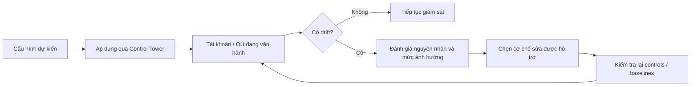

# AWS Control Tower và xây dựng landing zone

Trong một dự án nhỏ, một tài khoản AWS có thể đủ để thử nghiệm. Nhưng khi doanh nghiệp có nhiều đội phát triển, nhiều môi trường (dev, staging, production), yêu cầu bảo mật khác nhau và hàng chục tài khoản, việc tạo tài khoản thủ công dễ dẫn đến cấu hình không nhất quán: log thiếu, quyền quản trị quá rộng, tài nguyên đặt sai Region hoặc khó kiểm soát chi phí.

**AWS Control Tower** giúp thiết lập và quản trị môi trường AWS nhiều tài khoản theo một bộ cấu hình nền tảng có kiểm soát. Bộ nền tảng đó gọi là **landing zone**. Trong chương **Tài khoản và Organizations** của module **CLOUD_PROVIDERS_AWS**, người học sẽ kết nối AWS Organizations, IAM, mạng VPC, Region/AZ, dịch vụ tính toán, lưu trữ, cơ sở dữ liệu, serverless và giám sát thành một mô hình quản trị đủ an toàn để các đội triển khai ứng dụng độc lập.

> **Lưu ý theo phiên bản:** AWS Control Tower landing zone **4.0** (phát hành ngày 17/11/2025) có thay đổi đáng kể so với các hướng dẫn sử dụng phiên bản 3.3 trở xuống: các tích hợp dịch vụ có thể chọn bật/tắt, cấu trúc OU linh hoạt hơn và có thể triển khai landing zone tập trung vào controls. Vì vậy, không mặc định rằng mọi landing zone mới đều tự tạo cùng một tập OU, tài khoản dùng chung hoặc bật sẵn mọi control. Khi thực hành, luôn kiểm tra phiên bản đang dùng và các tùy chọn đã bật trong Console. [Nguồn: hướng dẫn chuyển đổi landing zone 4.0](https://docs.aws.amazon.com/controltower/latest/userguide/landing-zone-v4-migration-guide.html).

## 1. Mục tiêu học tập

Sau bài học, bạn có thể:

1. Giải thích **landing zone** là gì và phân biệt vai trò của **AWS Control Tower**, **AWS Organizations** và các dịch vụ bảo mật/giám sát.
2. Thiết kế sơ đồ **OU và tài khoản** để tách môi trường, chi phí, quyền và phạm vi chịu lỗi.
3. Phân biệt **preventive**, **detective**, **proactive controls**, cùng khái niệm baseline và các mức hướng dẫn control.
4. Lập kế hoạch khởi tạo, mở rộng và vận hành một landing zone, kể cả với AWS Organization đã tồn tại.
5. Phân tích những vấn đề thường gặp: drift, quyền quản trị, log tập trung, chi phí, việc nâng cấp landing zone và tuyển chọn dịch vụ cho workload.

## 2. Landing zone là gì?

**Landing zone** là môi trường AWS ban đầu đã được thiết kế và cấu hình theo tiêu chuẩn tổ chức để các workload có “nơi hạ cánh” nhất quán. Nó thường bao gồm:

- **Cấu trúc quản trị:** AWS Organization, organizational units (OU), các tài khoản tách biệt theo trách nhiệm.
- **Danh tính và quyền truy cập:** cách đăng nhập, phân quyền nhóm, quản trị quyền truy cập liên tài khoản.
- **Chính sách và controls:** quy định hành động được phép, cảnh báo vi phạm và kiểm tra cấu hình tài nguyên.
- **Logging và quan sát:** thu thập hoạt động API, trạng thái cấu hình, cảnh báo, điều tra sự cố.
- **Mạng và kết nối:** quy chuẩn IP, VPC, kết nối on-premises, phân đoạn mạng và truy cập Internet theo nhu cầu.
- **Chi phí, vận hành và phục hồi:** thông tin chủ sở hữu, tagging, ngân sách, sao lưu, RTO/RPO, quy trình cấp phát và hủy tài khoản.

Landing zone là **nền tảng tổ chức**, không đồng nghĩa với toàn bộ hạ tầng ứng dụng. Một tài khoản mới có landing zone tốt vẫn cần tự thiết kế ALB, EC2, ECS, EKS, Lambda, S3, RDS, DynamoDB, VPC, subnet và khả năng phục hồi phù hợp với workload cụ thể.

### 2.1. AWS Control Tower khác AWS Organizations ra sao?

| Thành phần | Chức năng chính | Ví dụ |
|---|---|---|
| **AWS Organizations** | Tạo/quản lý tổ chức AWS, tập hợp tài khoản thành OU, áp dụng chính sách cấp tổ chức và hỗ trợ thanh toán hợp nhất | Tạo `OU-Production` và áp dụng SCP giới hạn hành động |
| **AWS Control Tower** | Điều phối cấu hình landing zone, quản trị OU/tài khoản, bật controls và baselines, hỗ trợ cấp phát tài khoản chuẩn hóa | Bật control cho OU, theo dõi drift, tạo tài khoản qua Account Factory |
| **IAM / IAM Identity Center** | Xác định danh tính và quyền sử dụng dịch vụ, cấu hình truy cập người dùng/nhóm/role | Nhóm Developer truy cập tài khoản dev với quyền được cấp |
| **AWS Config / CloudTrail** | Theo dõi cấu hình tài nguyên hoặc ghi nhận hoạt động API theo cấu hình | Phát hiện S3 bucket cấu hình không đúng, truy vết người thay đổi chính sách |
| **AWS Service Catalog / Account Factory** | Hỗ trợ cung cấp các tài khoản chuẩn hóa và mở rộng quy trình cấp tài khoản | Tạo tài khoản `app-a-dev` theo mẫu đã phê duyệt |

**Tư duy quan trọng:** Organizations cung cấp khung tổ chức; Control Tower giúp thiết lập và duy trì governance trên khung đó. Control Tower không thay IAM, không tự triển khai toàn bộ mạng doanh nghiệp và không biến workload thành ứng dụng có tính sẵn sàng cao chỉ bằng một nút bấm.

### 2.2. Vì sao phân tách thành nhiều AWS account?

Một AWS account tạo ra ranh giới hữu ích cho quyền truy cập, quản lý tài nguyên, billing và hạn mức. Ví dụ:

- Workload production không chịu ảnh hưởng trực tiếp khi đội dev thử tài nguyên.
- Tài khoản chứa log tập trung hạn chế quyền xóa/sửa log của đội ứng dụng.
- Mỗi sản phẩm hoặc môi trường có thể theo dõi chi phí rõ hơn bằng tài khoản, tag và báo cáo.
- Có thể triển khai chính sách cấp OU cho toàn bộ nhóm tài khoản cùng yêu cầu quản trị.

Tuy vậy, nhiều account **không tự bảo đảm** tách biệt dữ liệu hoặc tuân thủ nếu quyền liên tài khoản, IAM role, KMS key, chính sách mạng và cơ chế chia sẻ tài nguyên cấu hình thiếu chặt chẽ.

## 3. Kiến trúc landing zone nhiều tài khoản

Sơ đồ dưới đây là **một kiến trúc tham khảo** cho công ty có nhiều đội sản phẩm. Đây là thiết kế đề xuất, không phải cấu trúc mà Control Tower bắt buộc phải tạo.

```text
AWS Organization
├── Management account (quản trị tổ chức, billing và Control Tower)
├── OU: Security-Integrations
│   ├── CloudTrail administration / centralized logging (nếu bật)
│   ├── Config aggregation / security audit (nếu bật)
│   └── Các tài khoản tích hợp bảo mật/backup khác (nếu bật)
├── OU: Infrastructure
│   ├── network-shared
│   └── shared-services
├── OU: Workloads
│   ├── OU: NonProduction
│   │   ├── app-a-dev
│   │   └── app-a-staging
│   └── OU: Production
│       ├── app-a-prod
│       └── app-b-prod
├── OU: Sandbox
│   └── sandbox-team-x
└── OU: Suspended (nếu tổ chức cần)
    └── account-to-review
```

### 3.1. Vai trò của từng lớp

| Tầng | Vai trò | Quy tắc thiết kế |
|---|---|---|
| **Management account** | Quản lý Organization, billing hợp nhất, thiết lập và điều phối Control Tower | Hạn chế tối đa workload nghiệp vụ và người dùng có đặc quyền cấp tổ chức |
| **Security / integration accounts** | Làm nơi quản trị log, Config aggregator, chức năng bảo mật hoặc sao lưu tập trung nếu được bật | Tách người quản trị bảo mật khỏi người phát triển ứng dụng; kiểm soát quyền sửa/xóa dữ liệu kiểm toán |
| **Infrastructure accounts** | Tổ chức tài nguyên mạng dùng chung, DNS, kết nối on-premises, công cụ nội bộ | Kiểm soát thay đổi qua IaC, phân tách quyền quản trị mạng |
| **Workload accounts** | Chạy ứng dụng và dữ liệu theo sản phẩm/môi trường | Production có quyền, ngân sách và quy trình thay đổi riêng |
| **Sandbox accounts** | Thử nghiệm được cấp hạn mức và kiểm soát phù hợp | Cảnh báo chi phí, giới hạn Region/dịch vụ nếu cần; dọn tài nguyên định kỳ |

Trong landing zone **4.0**, bạn **không bắt buộc** phải dùng OU tên `Security` hay `Sandbox`. Tuy nhiên, các tài khoản được chỉ định cho **service integrations** cần được bố trí theo yêu cầu cùng OU cha của phiên bản tương ứng. Chọn cấu trúc dựa trên quyền, trách nhiệm và tính chất môi trường; tránh tạo OU chỉ vì tên sản phẩm AWS. Xem [Key changes — Landing Zone 4.0](https://docs.aws.amazon.com/controltower/latest/userguide/key-changes-lz-v4.html).

### 3.2. Ranh giới account, OU, Region và VPC

Đây là bốn lớp khác nhau, không thể thay thế cho nhau:

- **Account:** ranh giới sở hữu tài nguyên, truy cập và theo dõi chi phí.
- **OU:** nhóm account để quản lý và áp dụng các chính sách/controls theo phạm vi.
- **Region:** vị trí địa lý triển khai dịch vụ; liên quan đến độ trễ, dữ liệu và thiết kế DR.
- **VPC:** ranh giới mạng logic trong một Region; subnet nằm trong Availability Zone.

Ví dụ, `app-a-prod` có thể triển khai hai AZ trong Region Singapore để chống lỗi AZ. Việc đó **không phải** là tạo hai AWS accounts, và cũng **không đồng nghĩa** với chiến lược khôi phục khi toàn Region gặp sự cố.

## 4. Những thành phần chính của AWS Control Tower

### 4.1. Landing zone và home Region

Khi khởi tạo, quản trị viên chọn **home Region** cho landing zone; đây là nơi quản lý cấu hình Control Tower. AWS nêu rõ **không thể đổi home Region sau khi thiết lập landing zone**, vì vậy phải lựa chọn theo yêu cầu quản trị và vị trí vận hành. Ngoài ra có thể xác định các **governed Regions** để mở rộng phạm vi quản trị; tập Region hỗ trợ và hành vi của control tùy dịch vụ, loại control và phiên bản.

Chọn Region không chỉ từ vị trí người dùng. Cần cân nhắc dữ liệu được phép lưu ở đâu, tính sẵn có của dịch vụ, độ trễ, chi phí truyền dữ liệu và yêu cầu vận hành. **Region Deny control** có thể hỗ trợ hạn chế truy cập ở Region không thuộc phạm vi mong muốn, song phải đánh giá ngoại lệ, dịch vụ toàn cục và ảnh hưởng đến workload trước khi bật.

### 4.2. Baselines: cấu hình nền cho OU/account

**Baseline** là tập tài nguyên và cấu hình tạo ra nền quản trị cho tài khoản hoặc OU. Một số baseline tiêu biểu:

- `AWSControlTowerBaseline`: cấu hình nền truyền thống phục vụ quản trị theo Control Tower, có thể được áp dụng ở OU.
- `ConfigBaseline`: hỗ trợ ghi nhận cấu hình để dùng **detective controls** theo mô hình landing zone 4.0 mà không cần toàn bộ `AWSControlTowerBaseline`.
- Các baseline phục vụ những tích hợp dịch vụ riêng được AWS quản lý theo cấu hình landing zone.

**Lưu ý 4.0:** bật AWS Config integration **ở landing zone** chưa đồng nghĩa mọi member account đã bật Config recorder; để triển khai ghi nhận cho tài khoản thành viên, cần bật baseline thích hợp trên OU. Việc lựa chọn baseline quyết định tính năng nào khả dụng, đặc biệt khi bật detective controls hoặc Account Factory.

[Tham khảo: tính tương thích của baselines và landing zone](https://docs.aws.amazon.com/controltower/latest/userguide/table-of-baselines.html).

### 4.3. Controls: phòng ngừa, phát hiện và chủ động chặn

**Control** (trước đây thường gọi là *guardrail*) là một quy tắc quản trị được kích hoạt trên phạm vi phù hợp, thường là một OU.

| Loại control | Cơ chế điển hình | Phản ứng | Ví dụ |
|---|---|---|---|
| **Preventive** | Chính sách AWS Organizations như SCP, RCP hoặc declarative policies (tùy control) | **Ngăn** hành động không phù hợp tại thời điểm yêu cầu | Hạn chế thay đổi cấu hình logging hoặc dùng Region không được phép |
| **Detective** | AWS Config rules và các tích hợp kiểm tra hỗ trợ | **Phát hiện và báo cáo** trạng thái không tuân thủ; không tự động ngăn mọi thao tác | Phát hiện tài nguyên lưu trữ cấu hình public access không đúng |
| **Proactive** | CloudFormation hooks trong luồng cấp phát được hỗ trợ | **Kiểm tra trước khi tạo**; từ chối cấu hình không đáp ứng quy tắc | Ngăn triển khai một mẫu CloudFormation tạo tài nguyên sai chuẩn |

Ví dụ thực tế: nếu một OU chứa production accounts, bạn có thể áp dụng preventive control chặn các thay đổi nguy hiểm; detective control báo tài nguyên không tuân thủ; proactive control kiểm tra mẫu triển khai trước khi tài nguyên được tạo. Ba lớp bổ sung cho nhau vì mỗi lớp có phạm vi bao phủ và thời điểm tác động khác nhau.

**Control guidance** còn có ba mức: **mandatory**, **strongly recommended** và **elective**. Đây là **mức hướng dẫn quản trị**, khác với ba **cơ chế hoạt động** ở bảng trên.

- **Mandatory:** các quy tắc bảo vệ thành phần Control Tower theo cách của từng phiên bản/cấu hình. **Từ landing zone 4.0, mandatory controls không còn mặc định được bật**, nên quản trị viên phải xem trạng thái thực tế thay vì chỉ dựa vào tên mức hướng dẫn.
- **Strongly recommended:** control được AWS khuyến nghị cho các mô hình quản trị phổ biến, nhưng vẫn cần chọn triển khai tùy phiên bản và yêu cầu.
- **Elective:** control tùy chọn, thường nhằm đáp ứng chính sách cụ thể của doanh nghiệp.

**Hai giới hạn cần nhớ:**

1. **SCP không cấp quyền IAM.** Một hành động chỉ được phép khi các lớp quyền liên quan cho phép và không bị các lớp policy chặn. SCP chủ yếu xác định phạm vi quyền tối đa đối với thực thể chịu tác động; nó không thay thế least privilege.
2. Không coi tất cả controls là biện pháp chặn tuyệt đối. Detective control phát hiện sau khi cấu hình thay đổi; proactive control chỉ bao phủ các con đường/tài nguyên triển khai mà nó hỗ trợ. Các ngoại lệ và phạm vi chính sách phải được kiểm tra riêng.

[Nguồn: How controls work](https://docs.aws.amazon.com/controltower/latest/userguide/how-controls-work.html) và [Controls Reference — Control behavior](https://docs.aws.amazon.com/controltower/latest/controlreference/control-behavior.html).

### 4.4. Account Factory và enrollment

**Account Factory** hỗ trợ tạo tài khoản thành viên theo cấu hình được phê duyệt: OU đích, thông tin tài khoản, danh tính được cấp quyền và cấu hình mẫu liên quan. Nó giúp giảm lỗi khi nhiều đội liên tục cần tài khoản mới.

Quy trình tham khảo:

1. Đội ứng dụng gửi yêu cầu tài khoản mới: mục đích, môi trường, chủ sở hữu, email, OU và trung tâm chi phí.
2. Đội nền tảng xem xét và chọn OU/baseline phù hợp.
3. Quản trị viên dùng Account Factory để tạo tài khoản, hoặc dùng quy trình tự động hóa được doanh nghiệp cho phép.
4. Đội nền tảng kiểm tra trạng thái provision, quyền truy cập, logging, controls, tag, ngân sách và cảnh báo trước khi bàn giao.
5. Đội ứng dụng triển khai workload qua công cụ được cấp quyền, ví dụ CloudFormation hoặc Terraform.

**Điều kiện liên quan tới 4.0:** cấp phát, cập nhật hay tùy biến **một account bằng Account Factory** yêu cầu OU mục tiêu có `AWSControlTowerBaseline`. Landing zone ở chế độ chỉ bật controls không tự động có đầy đủ tính năng Account Factory. Với tài khoản/OU đã tồn tại, quá trình *register OU*, *enroll account* và *enable baseline* phải được đánh giá theo trạng thái môi trường và phiên bản hiện hành. Tài khoản được enroll truyền thống cần quyền/role phù hợp, trong đó có `AWSControlTowerExecution` theo hướng dẫn.

[Tham khảo: Provision and manage accounts with Account Factory](https://docs.aws.amazon.com/controltower/latest/userguide/account-factory.html).

## 5. Lập kế hoạch trước khi tạo landing zone

Thao tác thiết lập Control Tower có thể tạo tài khoản và các tài nguyên tính phí. Trước khi thực hiện trong tài khoản thật, hãy hoàn thành bảng quyết định sau.

| Câu hỏi | Quyết định cần chốt | Rủi ro nếu bỏ qua |
|---|---|---|
| Dùng Organization mới hay hiện có? | Xác định **management account** và quyền quản trị | Trùng tài nguyên, sai quyền hoặc ảnh hưởng chính sách cũ |
| Home Region là đâu? | Kiểm tra hỗ trợ dịch vụ, vị trí vận hành và yêu cầu dữ liệu | Chọn sai home Region, vốn không thể thay đổi sau thiết lập |
| Những Region nào được quản trị? | Chọn governed Regions và chính sách Region phù hợp | Tài nguyên tạo ở Region ngoài phạm vi dự kiến |
| Các OU sẽ phân cấp ra sao? | Tách security integrations, production, non-production, sandbox, infrastructure | Gộp workload nhạy cảm với môi trường thử nghiệm |
| Ai quản trị danh tính? | IAM Identity Center hay tích hợp nhà cung cấp danh tính hiện có; quyền theo nhóm | Tài khoản đặc quyền dùng chung, quyền quá rộng |
| Bật tích hợp nào? | Config, CloudTrail, security roles, backup, các cơ chế cần cho controls | Phát sinh chi phí không cần thiết hoặc thiếu cơ chế kiểm toán |
| Tài khoản dùng chung nằm ở đâu? | Xác định vị trí và email riêng của các integration accounts theo phiên bản | Trùng cấu hình/không đáp ứng điều kiện thiết lập |
| Account vending áp dụng thế nào? | Có dùng Account Factory? Baseline nào cần thiết? | Không thể cấp tài khoản theo quy trình dự kiến |
| Ai chịu trách nhiệm vận hành? | Người xử lý drift, nâng cấp, sự cố, log, review quyền và chi phí | Không có người phản ứng khi control thất bại |

### 5.1. Trường hợp Organization đã có sẵn

AWS Control Tower có thể thiết lập landing zone trên **AWS Organization hiện hữu** và sử dụng management account cũ. Những OU không được Control Tower quản trị không nhất thiết tự động bị thay đổi chỉ vì bạn kích hoạt dịch vụ.

Tuy nhiên, trước khi mở rộng governance cho OU/account hiện hữu, cần kiểm tra:

- Tài nguyên AWS Config, CloudTrail, IAM role, S3 bucket và chính sách Organizations đang dùng có xung đột với cấu hình Control Tower không.
- Quyền/role cần cho quá trình enrollment và quản trị account đã đầy đủ chưa.
- OU có đang chứa tài khoản quan trọng mà control mới có thể làm gián đoạn thao tác vận hành không.
- Có cần kế hoạch chuyển đổi log, IAM Identity Center, baseline và thông báo thay đổi cho các đội hay không.

**Không chuyển hàng loạt production account sang OU mới hoặc bật hàng loạt preventive controls khi chưa thử trong tài khoản kiểm chứng.** Từ landing zone 4.0, định nghĩa tài nguyên được Control Tower quản trị cũng linh hoạt hơn: OU/account có tài nguyên Control Tower được bật (như control/baseline) có thể được xem là governed, không chỉ dựa trên việc có `AWSControlTowerBaseline`.

[Tham khảo: Plan your landing zone](https://docs.aws.amazon.com/controltower/latest/userguide/planning-your-deployment.html) và [Key changes 4.0](https://docs.aws.amazon.com/controltower/latest/userguide/key-changes-lz-v4.html).

## 6. Quy trình thiết lập landing zone theo từng giai đoạn

Đây là **quy trình học tập và thiết kế**, không phải cam kết rằng các nút trong Console luôn giữ nguyên tên giữa các phiên bản.

### Giai đoạn 1 — Thiết kế mô hình tổ chức

Chốt ranh giới account/OU và chủ sở hữu, ví dụ:

- `Security-Integrations`: nơi chứa các tài khoản tích hợp được chọn, theo yêu cầu Control Tower 4.0.
- `Production`: tài khoản ứng dụng thật; quyền thay đổi chặt chẽ.
- `NonProduction`: môi trường dev/staging; cho phép thử nghiệm có kiểm soát.
- `Infrastructure`: network, DNS hoặc công cụ dùng chung nếu thật sự có nhu cầu.
- `Sandbox`: tài khoản thử nghiệm, có ngân sách và chu kỳ dọn tài nguyên.

Lập bảng cho từng OU: **mục tiêu**, **đội sở hữu**, **controls**, **baseline**, **Region**, **cơ chế truy cập**, **yêu cầu logging**, **ngân sách**.

### Giai đoạn 2 — Chọn cấu hình landing zone

Trong AWS Control Tower Console, từ management account có quyền phù hợp:

1. Chọn home Region và đọc điều kiện tiên quyết của phiên bản landing zone.
2. Xác định cấu hình Organization, dịch vụ tích hợp cần sử dụng và tài khoản dùng chung; với landing zone 4.0, lựa chọn tích hợp là một quyết định rõ ràng.
3. Chọn cách quản lý danh tính, logging, retention và các Region phục vụ governance.
4. Xem lại các tài nguyên được tạo, tác động tới Organization hiện có, điều kiện chi phí và quyền trước khi xác nhận.
5. Thực hiện thiết lập trong môi trường được phê duyệt; theo dõi trạng thái cho tới khi hoàn tất hoặc có lỗi cụ thể.

**Không coi việc triển khai thành công landing zone là dấu hiệu mọi account đã có logging, mọi OU đã có baseline và mọi control đã bật.** Hãy kiểm tra từng tích hợp và từng OU.

### Giai đoạn 3 — Áp dụng baseline và controls theo OU

Ví dụ ma trận chính sách **đề xuất**, không phải bộ control mặc định của AWS:

| OU | Mục tiêu | Biện pháp cân nhắc |
|---|---|---|
| Production | Ngăn rủi ro thay đổi và truy cập trái phép | Least privilege, giới hạn Region phù hợp, logging, giám sát cấu hình, đánh giá control trước khi bật |
| NonProduction | Cho phép phát triển nhưng phát hiện sai lệch | Baseline logging cần thiết, kiểm tra cấu hình, giới hạn chi phí |
| Sandbox | Khuyến khích thử nghiệm có trách nhiệm | Thời hạn sử dụng, giới hạn tài nguyên/Region khi phù hợp, ngân sách và quy trình dọn |
| Security-Integrations | Bảo vệ hạ tầng kiểm toán/quản trị | Quyền quản trị độc lập, hạn chế sửa/xóa log; tuân theo cơ chế quản lý của Control Tower |

Với **detective controls**, kiểm tra rằng AWS Config recording và baseline cần thiết đã hoạt động ở OU đích. Với **preventive controls**, đánh giá trước các thao tác quản trị hợp pháp có thể bị chặn. Với **proactive controls**, xác định pipeline và loại tài nguyên thực sự được kiểm tra.

### Giai đoạn 4 — Cấp tài khoản thử nghiệm và kiểm chứng

Tạo **một tài khoản mẫu** theo quy trình được phê duyệt (ví dụ `app-a-dev`), sau đó kiểm tra:

- Tài khoản xuất hiện đúng OU, có trạng thái governance/baseline như mong đợi.
- Người dùng đăng nhập được bằng cơ chế được phép; đặc quyền cấp đúng phạm vi.
- Control dự kiến hiển thị và cho kết quả mong đợi khi thử nghiệm an toàn.
- Các cơ chế logging, giám sát và cảnh báo được bật theo chính sách tổ chức.
- Có thể truy vấn chi phí theo account/tag; đội vận hành biết người chịu trách nhiệm.

Khi tài khoản mẫu đạt yêu cầu, mới mở rộng cấp phát cho các đội còn lại.

### Giai đoạn 5 — Thiết lập vận hành dài hạn

Một landing zone tốt cần có quy trình định kỳ:

- Kiểm tra **governance drift** và lỗi áp dụng baseline/control.
- Theo dõi các phiên bản landing zone mới và lên kế hoạch cập nhật OU/account bị ảnh hưởng.
- Đánh giá quyền quản trị, kết nối liên tài khoản, điều kiện sao lưu và khả năng khôi phục.
- Theo dõi hóa đơn Config, CloudTrail, CloudWatch, S3, dữ liệu truyền và workload.
- Quản lý vòng đời account: yêu cầu, cấp phát, bàn giao, chuyển OU, tạm dừng, đóng theo quy trình được duyệt.

## 7. Logging, bảo mật và trách nhiệm chia sẻ

### 7.1. Những lớp quan sát thường được kết hợp

| Thành phần | Câu hỏi trả lời | Lưu ý |
|---|---|---|
| **CloudTrail** | Ai gọi API nào, khi nào, ở tài khoản nào? | Kiểm tra tổ chức có organization trail được bật hay đang dùng chiến lược CloudTrail khác |
| **AWS Config** | Tài nguyên có cấu hình thế nào, thay đổi ra sao, có tuân thủ rule nào không? | Ghi nhận Config có thể phát sinh chi phí, nhất là account tạo/hủy tài nguyên thường xuyên |
| **CloudWatch** | Workload có metric, log, alarm gì? | Log ứng dụng và alarm cần được cấu hình riêng; retention có ảnh hưởng chi phí |
| **EventBridge** | Sự kiện quản trị nào cần tự động kích hoạt thông báo/khắc phục? | Cần định nghĩa rule và target cụ thể |
| **Security Hub / GuardDuty** | Có phát hiện hoặc tổng hợp vấn đề bảo mật nào? | Đòi hỏi bật và cấu hình đúng phạm vi; không mặc nhiên bao gồm trong mọi landing zone |

**Chú ý phiên bản 4.0:** thông báo **governance drift** từ Control Tower được chuyển sang **EventBridge trong management account** thay vì tiếp tục gửi SNS theo mô hình cũ. Nếu muốn nhận email hoặc chuyển tới hệ thống ticket, quản trị viên cần cấu hình EventBridge rule và target phù hợp.

### 7.2. Mô hình trách nhiệm chia sẻ vẫn áp dụng

AWS vận hành hạ tầng vật lý và các thành phần nền theo loại dịch vụ. Khách hàng vẫn chịu trách nhiệm về dữ liệu, phân quyền, cấu hình service, ứng dụng, quản lý secret, quy trình phản ứng sự cố và các yêu cầu tuân thủ của mình.

Ví dụ, Control Tower giúp tiêu chuẩn hóa governance nhưng **không tự động**:

- Quyết định IAM role của ứng dụng Lambda nên có quyền S3 nào.
- Thiết kế subnet và security group cho database RDS.
- Bảo đảm sao lưu có thể phục hồi theo RPO/RTO của nghiệp vụ.
- Phát hiện và giải quyết mọi lỗ hổng do code hoặc cấu hình ứng dụng.

Thiết kế landing zone cần liên kết các lớp quản trị với nguyên tắc **least privilege**, **defense in depth**, **observability** và **recovery testing**.

## 8. Các tình huống hay sai khi triển khai

### 8.1. Nhầm preventive control với detective control

Giả sử công ty yêu cầu S3 bucket chứa dữ liệu nghiệp vụ không được public. Một detective control có thể báo tài nguyên không tuân thủ **sau khi** phát hiện cấu hình; nó không bảo đảm ngăn mọi cách tạo public bucket. Cần kết hợp IAM/bucket policy, S3 Block Public Access, các control phù hợp và kiểm tra quy trình triển khai theo yêu cầu.

### 8.2. Bật SCP nhưng vẫn cấp IAM quyền rộng

SCP chỉ đặt ra giới hạn quyền tối đa đối với thực thể trong phạm vi chịu tác động. **SCP không cấp quyền** và không thay IAM role/policy. Cách đúng là: IAM xác định quyền cần thiết; SCP bổ sung ranh giới tổ chức; logging và Config giúp kiểm chứng hành vi/trạng thái.

### 8.3. Đặt mọi ứng dụng vào management account

Management account có quyền nhạy cảm cấp tổ chức, không nên dùng làm môi trường chạy workload thông thường. Hãy dùng member accounts để giảm phạm vi ảnh hưởng và làm rõ trách nhiệm vận hành.

### 8.4. Thấy Control Tower “Enabled” và cho rằng toàn bộ đã tuân thủ

Ở phiên bản 4.0, có thể bật Control Tower với tích hợp rất tối giản. Cần kiểm tra **từng OU**: baseline đã bật chưa, Config có được triển khai tới member account chưa, controls có hoạt động không, trail và cảnh báo đã cấu hình đúng chưa.

### 8.5. Tự sửa tài nguyên do Control Tower quản lý

Xóa hoặc sửa role, policy, StackSets, Config resources hay cấu hình được Control Tower tạo ngoài luồng hỗ trợ có thể gây **drift** hoặc lỗi quản trị. Cần điều tra trước và dùng quy trình update/reset/re-register hoặc API được AWS hỗ trợ thay vì sửa thủ công tùy ý.

### 8.6. Không dự tính chi phí tích hợp

Không có phụ phí riêng cho Control Tower, nhưng các dịch vụ được kích hoạt bởi Control Tower **vẫn có chi phí**: ví dụ Config, CloudTrail, Service Catalog, S3 lưu log hoặc các thành phần khác. Không có nghĩa landing zone miễn phí hoàn toàn. Đặc biệt cần kiểm tra duplicate CloudTrail trails, retention log và số tài nguyên được Config ghi nhận.

[Tham khảo: Pricing — AWS Control Tower](https://docs.aws.amazon.com/controltower/latest/userguide/pricing.html).

## 9. Bảo trì, drift và nâng cấp landing zone

**Drift** là trạng thái cấu hình thực tế khác khỏi trạng thái quản trị Control Tower kỳ vọng, ví dụ một SCP do Control Tower quản lý bị sửa trái quy trình hoặc một role bắt buộc bị xóa.



Tùy loại drift và phiên bản, AWS có các cơ chế như **Reset**, **Re-register OU**, **Update landing zone**, cập nhật account hoặc gọi API cụ thể để áp dụng lại cấu hình. Không phải mọi drift đều nên xử lý bằng cùng một nút bấm.

**Nâng cấp có hai lớp cần theo dõi:**

1. **Landing zone version:** cập nhật cấu hình và khả năng quản trị ở cấp landing zone.
2. **OU/account baseline và các tài khoản đã enroll:** đôi khi cần cập nhật/re-register riêng sau khi nâng cấp landing zone.

Ví dụ, nâng cấp từ 3.3 lên 4.0 có sự thay đổi về tích hợp Config/CloudTrail và cách quản trị service integration accounts. Hãy đọc migration guide, ghi nhận các tích hợp đang bật, đánh giá ảnh hưởng rồi thử với OU ít rủi ro trước khi thực hiện diện rộng. **Không giả định có thể rollback về phiên bản landing zone trước đó**.

[Tham khảo: About landing zone updates](https://docs.aws.amazon.com/controltower/latest/userguide/about-updates.html), [Resolve drift](https://docs.aws.amazon.com/controltower/latest/userguide/resolve-drift.html).

## 10. Ví dụ thiết kế: công ty có ứng dụng thương mại điện tử

**Bối cảnh:** một công ty có hai sản phẩm, đội web và dữ liệu, môi trường dev/staging/prod; người dùng chủ yếu ở Đông Nam Á. Doanh nghiệp muốn quản trị truy cập tập trung, hạn chế thử nghiệm ảnh hưởng production, có lịch sử thay đổi tài nguyên và kiểm soát chi phí.

### 10.1. Thiết kế đề xuất

| Thành phần | Đề xuất | Giải thích |
|---|---|---|
| Management | 1 management account dùng cho Organizations và Control Tower | Không triển khai ứng dụng thương mại điện tử trong tài khoản này |
| Security integrations | OU riêng cho tài khoản integrations được chọn | Kiểm soát log, cấu hình bảo mật và quản trị tích hợp tập trung |
| Production | `store-prod`, `analytics-prod` | Tách quyền, rủi ro triển khai và chi phí sản phẩm |
| NonProduction | `store-dev`, `store-staging`, `analytics-dev` | Cho phép nhóm phát triển kiểm thử có kiểm soát |
| Sandbox | `innovation-sandbox` | Đặt ngân sách và vòng đời dọn tài nguyên |
| Region | Đánh giá `ap-southeast-1` và Region khác phù hợp về pháp lý/độ trễ | Chọn home Region cẩn thận; governed Regions theo chiến lược riêng |
| Identity | IAM Identity Center/IdP liên kết, nhóm theo vai trò | Developer có quyền dev; vận hành production theo cơ chế phê duyệt |
| Logging | CloudTrail/Config và nơi thu thập phù hợp với tùy chọn tích hợp | Đảm bảo khả năng điều tra và kiểm chứng cấu hình |
| Controls | Xác định preventive/detective/proactive cho Production OU | Kiểm chứng phạm vi thực thi và ngoại lệ trước khi áp dụng |
| Cost | Theo account + tag `product`, `owner`, `environment` | Hỗ trợ phân bổ và cảnh báo chi phí |

### 10.2. Ứng dụng chạy ở đâu?

Trong `store-prod`, đội ứng dụng có thể dùng:

- **VPC** với subnet riêng cho lớp ứng dụng/cơ sở dữ liệu và subnet public nếu thực sự cần.
- **ALB + ECS hoặc EC2**, hoặc **API Gateway + Lambda** tùy mô hình tải và yêu cầu vận hành.
- **RDS** hoặc **DynamoDB** theo mô hình dữ liệu và truy vấn.
- **S3/CloudFront** cho ảnh và nội dung tĩnh; **SQS/EventBridge** cho công việc bất đồng bộ.
- **CloudWatch**, cơ chế sao lưu/phục hồi và cảnh báo riêng cho workload.

Landing zone **quản trị môi trường chứa ứng dụng**; kiến trúc bên trong workload vẫn do đội phát triển và nền tảng phối hợp quyết định.

### 10.3. Thử một thay đổi có kiểm soát

Giả sử đội dev yêu cầu quyền triển khai dịch vụ ở Region chưa được phê duyệt:

1. Quản trị viên xác định yêu cầu nghiệp vụ và chính sách Region.
2. Nếu Region bị preventive control hoặc SCP chặn, yêu cầu bị từ chối trong phạm vi chính sách áp dụng.
3. Đội dev chuyển sang Region được phê duyệt hoặc yêu cầu thay đổi theo quy trình.
4. Nhóm quản trị xem log và trạng thái governance để kiểm chứng; nếu chính sách thay đổi, phải đánh giá trước tác động tới account khác trong OU.

Điều này thể hiện lợi ích của việc đặt chính sách ở **OU/account boundary** và có đường xử lý ngoại lệ rõ ràng.

## 11. Thực hành an toàn

### Bài thực hành A — Phác thảo landing zone trên giấy

Bạn đang làm cloud platform engineer cho công ty có 4 đội (web, mobile, data, security). Công ty cần:

- Tách dev và production.
- Tập trung kiểm tra cấu hình và truy vết thao tác.
- Cho phép sandbox nhưng phải quản lý chi phí.
- Cấp tài khoản theo mẫu.
- Bảo đảm mỗi đội chỉ có quyền cần thiết.

**Yêu cầu:** vẽ cây OU/account; điền các cột owner, baseline, controls, Region, IAM, chi phí; nêu vì sao tài khoản production không nên dùng chung với sandbox. Chọn một preventive control, một detective control và một proactive control phù hợp. Trình bày giới hạn của từng loại control và điều kiện cần để dùng Account Factory.

**Gợi ý đánh giá:** thiết kế tốt xác định ranh giới quyền và vận hành, không bắt buộc phải giống mọi sơ đồ mẫu. Account Factory cần baseline tương thích; detective control cần cơ chế ghi nhận cấu hình và điều kiện dịch vụ thích hợp.

### Bài thực hành B — Kiểm tra read-only nếu có quyền

Chỉ thực hiện nếu bạn **đã có tài khoản được cấp quyền xem thông tin**, AWS CLI đã được cấu hình, và có sự chấp thuận từ quản trị viên. Không cần tạo landing zone thật để hoàn thành bài học.

```bash
# Xem danh tính đang sử dụng, không tạo tài nguyên
aws sts get-caller-identity --profile learning

# Trong tài khoản có quyền Organizations: xem tổ chức
aws organizations describe-organization --profile learning
aws organizations list-roots --profile learning

# Xem landing zone hiện có ở home Region được quản trị viên cung cấp
aws controltower list-landing-zones \
  --region ap-southeast-1 \
  --profile learning
```

Lệnh Control Tower cuối chỉ mang tính **ví dụ Region**; hãy thay bằng home Region thực tế của tổ chức. Người dùng không đủ quyền sẽ nhận thông báo `AccessDenied` hoặc lỗi tương tự, không phải dấu hiệu môi trường hỏng. Các lệnh trên chỉ truy vấn thông tin; không gọi API tạo/sửa tài nguyên.

Nếu tổ chức chưa bật Control Tower, danh sách có thể trống. Đừng tự động bật dịch vụ trong tài khoản sản xuất để “thử cho biết”.

### Bài thực hành C — Phân tích tình huống

**Tình huống 1.** Một OU production có detective control kiểm tra mã hóa EBS. Nhân viên tạo ổ đĩa không mã hóa thành công, sau đó control báo non-compliant. Control có bị “hỏng” không?

> Không nhất thiết. Detective control chủ yếu **phát hiện** sau khi tài nguyên ở trạng thái không phù hợp. Muốn ngăn từ đầu cần lớp phòng ngừa hoặc kiểm tra triển khai phù hợp; đồng thời xác minh control hoạt động đúng phạm vi.

**Tình huống 2.** Công ty bật Control Tower 4.0 với cấu hình controls-only rồi muốn dùng Account Factory tạo account mới trong OU chưa có baseline. Vì sao có thể không thực hiện được?

> Quy trình cấp một account qua Account Factory cần OU có `AWSControlTowerBaseline`. Khả năng bật controls ở OU không đồng nghĩa đã đủ điều kiện cho Account Factory.

**Tình huống 3.** Sau khi nâng cấp landing zone, OU hiển thị cần cập nhật. Vì sao việc chỉ cập nhật landing zone chưa chắc là đủ?

> Baseline và tài nguyên được quản trị trong từng OU/account có thể cần được cập nhật hoặc re-register riêng để phản ánh cấu hình mới.

**Tình huống 4.** Đội phát triển dùng management account để chạy web API vì thấy tiện. Nguy cơ là gì?

> Tài khoản quản trị chứa quyền tác động tới toàn Organization và có mức nhạy cảm cao; workload ứng dụng nên ở member account để giới hạn rủi ro truy cập, thay đổi và chi phí.

**Tình huống 5.** Công ty bật Control Tower và cho rằng hóa đơn AWS sẽ không tăng vì Control Tower miễn phí. Có đúng không?

> Không. Không có phụ phí trực tiếp cho Control Tower, nhưng AWS Config, CloudTrail, S3, Service Catalog, lưu lượng và tài nguyên tích hợp/workload vẫn có thể tính phí.

## 12. Checklist đánh giá thiết kế

- [ ] Mục tiêu business, mức dữ liệu nhạy cảm, Region và yêu cầu RTO/RPO đã rõ.
- [ ] Có sơ đồ Organization, OU, management account và member accounts.
- [ ] Phân tách security integrations, production, non-production và sandbox theo nhu cầu.
- [ ] Đã chọn home Region có chủ đích và xác định governed Regions.
- [ ] Biết landing zone version, các service integrations và baselines đang bật.
- [ ] IAM Identity Center/IdP, role và cơ chế cấp đặc quyền có người chịu trách nhiệm.
- [ ] Mọi preventive/detective/proactive control có lý do, phạm vi và cách kiểm chứng rõ ràng.
- [ ] Logging/Config hoạt động đúng tài khoản/Region cần theo dõi.
- [ ] Có quy trình cấp tài khoản, thay đổi OU, phát hiện drift và cập nhật landing zone.
- [ ] Có ngân sách, chủ sở hữu tài khoản và chế độ kiểm tra chi phí.
- [ ] Workload vẫn có thiết kế mạng, IAM, bảo mật dữ liệu, sao lưu, giám sát và phục hồi riêng.

## 13. Tổng kết

**AWS Control Tower** giúp xây dựng và duy trì **landing zone nhiều tài khoản** trên nền AWS Organizations. Giá trị chính là chuẩn hóa việc cấp phát tài khoản, bảo mật và governance, cho phép nhiều đội triển khai workload mà vẫn có ranh giới trách nhiệm rõ ràng.

Người thiết kế cần phân biệt **OU, account, Region, VPC**, nhận biết **controls** và **baselines**, hiểu các tích hợp logging/identity là những lựa chọn vận hành có điều kiện và chi phí. Đặc biệt, với landing zone 4.0, không thể suy ra bộ tính năng hiện có chỉ từ việc “đã bật Control Tower”: phải kiểm tra cấu hình thực tế. Trên nền quản trị đó, các bài tiếp theo về IAM, VPC, compute, storage, database, integration và serverless mới có đủ ngữ cảnh để xây dựng ứng dụng an toàn, giám sát được, có khả năng phục hồi và tối ưu chi phí.

### Tài liệu chính thức để đọc tiếp

1. [AWS Control Tower — What is AWS Control Tower?](https://docs.aws.amazon.com/controltower/latest/userguide/what-is-control-tower.html)
2. [Landing Zone v4.0 migration guide](https://docs.aws.amazon.com/controltower/latest/userguide/landing-zone-v4-migration-guide.html)
3. [Key changes — Landing Zone v4.0](https://docs.aws.amazon.com/controltower/latest/userguide/key-changes-lz-v4.html)
4. [Plan your AWS Control Tower landing zone](https://docs.aws.amazon.com/controltower/latest/userguide/planning-your-deployment.html)
5. [How controls work](https://docs.aws.amazon.com/controltower/latest/userguide/how-controls-work.html)
6. [Baselines and landing zone version compatibility](https://docs.aws.amazon.com/controltower/latest/userguide/table-of-baselines.html)
7. [Provision and manage accounts with Account Factory](https://docs.aws.amazon.com/controltower/latest/userguide/account-factory.html)
8. [Update your landing zone](https://docs.aws.amazon.com/controltower/latest/userguide/update-controltower.html)
9. [AWS Control Tower pricing](https://docs.aws.amazon.com/controltower/latest/userguide/pricing.html)
