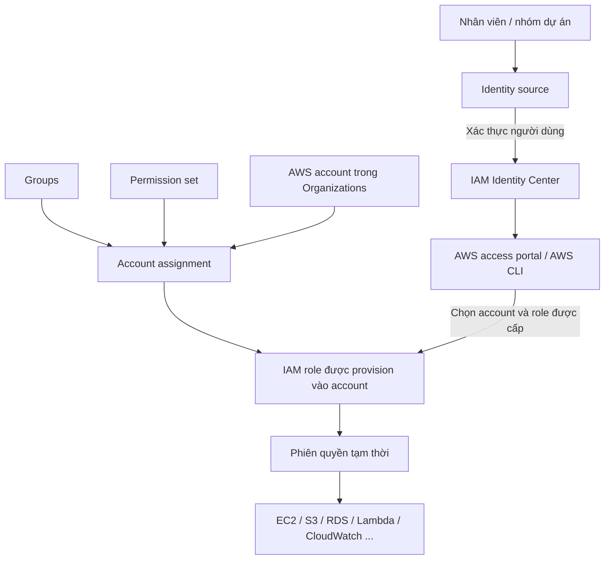
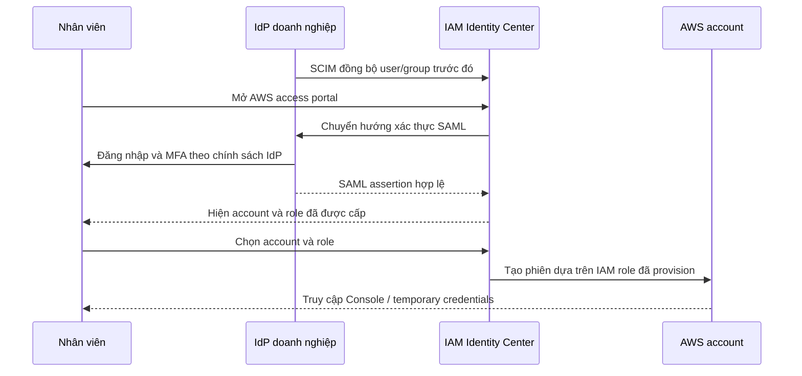

# IAM Identity Center và đăng nhập tập trung

> **Chương:** Tài khoản và Organizations · **Mô-đun:** `CLOUD_PROVIDERS_AWS`

## 1. Bài toán: quản lý quyền truy cập con người vào nhiều tài khoản AWS

Hãy hình dung doanh nghiệp sử dụng AWS để vận hành một ứng dụng Java: tài khoản `dev` cho phát triển, `staging` để thử nghiệm và `production` để chạy thật. Ứng dụng dùng Amazon EC2 hoặc AWS Lambda, Amazon RDS, Amazon S3 và các thành phần IAM/VPC. Nhân viên phát triển cần xem logs; người vận hành cần cập nhật hạ tầng; nhóm bảo mật cần kiểm tra CloudTrail; bộ phận tài chính cần xem chi phí. Nếu tạo một IAM user riêng cho mỗi nhân viên trong từng tài khoản, tổ chức sẽ nhanh chóng gặp khó khăn khi cấp quyền, thu hồi quyền, yêu cầu MFA và truy vết hoạt động.

**AWS IAM Identity Center** là dịch vụ AWS dùng để quản lý **quyền truy cập của lực lượng lao động (workforce)** vào các tài khoản AWS và ứng dụng được tích hợp. Người dùng đăng nhập bằng một danh tính tập trung, chọn tài khoản và vai trò được cấp trong **AWS access portal**, rồi truy cập AWS Management Console hoặc AWS CLI bằng **thông tin xác thực tạm thời**.

Đăng nhập tập trung là một phần quan trọng của việc vận hành đa tài khoản qua **AWS Organizations**. Nó giúp quản lý quyền truy cập liên quan tới Region/AZ, IAM, VPC, dịch vụ tính toán, lưu trữ, cơ sở dữ liệu, tích hợp và serverless một cách nhất quán; đồng thời phục vụ mục tiêu bảo mật, giám sát, phục hồi và kiểm soát chi phí.

**Sau bài học, người học có thể:**

1. Phân biệt xác thực (authentication), phân quyền (authorization), SSO và federation.
2. Giải thích mối liên hệ giữa IAM Identity Center, AWS Organizations, identity source, group, permission set, AWS account assignment và IAM role.
3. Chọn mô hình identity source và loại IAM Identity Center instance phù hợp.
4. Thiết kế quyền theo nhóm, môi trường, chức năng công việc; hạn chế quyền quản trị production.
5. Thực hiện quy trình cấu hình trên console, đăng nhập bằng AWS CLI và xác minh danh tính thực tế.
6. Nhận biết lỗi thường gặp, đánh giá log truy cập và xử lý quy trình nhân sự vào/ra tổ chức.

## 2. Các khái niệm cần phân biệt

| Khái niệm | Trả lời câu hỏi gì? | Vai trò trong hệ thống |
| --- | --- | --- |
| **Authentication (xác thực)** | *Bạn là ai?* | Kiểm tra danh tính bằng mật khẩu, MFA, khóa bảo mật hoặc quy trình tại nhà cung cấp danh tính. |
| **Authorization (phân quyền)** | *Bạn được phép làm gì?* | Quyết định action, resource và condition được chấp nhận khi gọi AWS API. |
| **SSO (Single Sign-On)** | *Một lần đăng nhập, vào được những đâu?* | Người dùng có thể truy cập nhiều ứng dụng/tài khoản đã được cấp mà không quản lý thông tin đăng nhập riêng cho từng nơi. |
| **Identity federation** | *AWS tin danh tính do ai xác thực?* | Dùng một identity provider (IdP) để xác thực người dùng và truyền kết quả tới dịch vụ khác. |
| **Identity source** | *Người dùng và nhóm được quản lý ở đâu?* | IAM Identity Center directory, Microsoft Active Directory hoặc IdP bên ngoài. |
| **Permission set** | *Một vai trò truy cập AWS account có tập quyền nào?* | Mẫu quyền được quản lý ở IAM Identity Center, dùng để provision IAM role vào các tài khoản đích. |
| **Account assignment** | *Ai có quyền gì trong tài khoản nào?* | Liên kết user/group + AWS account + permission set. |
| **AWS access portal** | *Người dùng chọn tài khoản và vai trò ở đâu?* | Cổng truy cập hiển thị AWS accounts và ứng dụng đã được cấp. |

Điểm cần nhớ: **đăng nhập thành công chưa đồng nghĩa có quyền truy cập một AWS account**, và **được cấp account chưa đồng nghĩa có quyền quản trị mọi tài nguyên trong account đó**.

### 2.1. Quan hệ giữa IAM, IAM Identity Center và Organizations

- **AWS Organizations** quản lý tập hợp AWS accounts, OU (Organizational Unit), chính sách ở cấp tổ chức và một số cơ chế quản trị tập trung. Organizations cho biết các account thuộc tổ chức nào và các ràng buộc áp dụng cho chúng.
- **IAM Identity Center** quản lý danh tính workforce, quyền vào account/ứng dụng và luồng đăng nhập tập trung. Đây là nơi tạo permission set và account assignment đối với **organization instance**.
- **AWS IAM** trong từng account đánh giá chính sách truy cập tài nguyên. Khi được gán permission set, IAM Identity Center provision một **IAM role tương ứng trong account đích**. Người dùng nhận phiên truy cập dựa trên role đó; quyền hiệu lực vẫn chịu sự chi phối của các lớp chính sách AWS khác.

Sơ đồ khái niệm:



Sơ đồ mô tả các quan hệ **logic**. IAM Identity Center tạo và duy trì role khi có assignment; người dùng không cần tự tạo IAM user trong từng account. `AWSReservedSSO_*` là họ tên role AWS quản lý thường gặp cho permission set, **không nên sửa hoặc xóa trực tiếp** trong IAM. Muốn đổi quyền, hãy sửa permission set và cập nhật/provision lại các tài khoản được gán.

### 2.2. Ví dụ phân tách danh tính người và workload

Kỹ sư mở AWS Console hoặc dùng laptop chạy AWS CLI là **workforce identity**, phù hợp với IAM Identity Center. Ngược lại, AWS Lambda đọc S3 hoặc ứng dụng trên Amazon ECS ghi vào RDS là **workload identity**: nên dùng Lambda execution role, ECS task role, IAM role cho EC2, EKS Pod Identity hoặc cơ chế phù hợp; không nhúng mật khẩu nhân viên hay access key dài hạn vào mã nguồn. Amazon Cognito hướng tới danh tính người dùng cuối của ứng dụng; nó giải quyết bài toán khác với đăng nhập workforce vào AWS accounts.

## 3. Chọn nguồn danh tính: nội bộ, Active Directory hay IdP bên ngoài?

IAM Identity Center có thể dùng một trong các nguồn danh tính sau:

| Identity source | Khi phù hợp | Điều cần quản lý |
| --- | --- | --- |
| **Identity Center directory** | Nhóm nhỏ hoặc tổ chức chưa có hệ thống danh tính doanh nghiệp. | Tạo user, group, chính sách xác thực/MFA và vòng đời nhân sự trong IAM Identity Center. |
| **Microsoft Active Directory** | Đã có hạ tầng AD; muốn dùng danh tính doanh nghiệp thông qua AWS Directory Service. | Kết nối directory, đồng bộ/ánh xạ thuộc tính, MFA theo kiến trúc và khả năng sẵn sàng của AD. |
| **External identity provider (IdP)** như Microsoft Entra ID, Okta | Đã có hệ thống nhân sự, nhóm và chính sách đăng nhập doanh nghiệp. | Federation qua SAML, provisioning qua SCIM hoặc thủ công, MFA tại IdP, kiểm soát thuộc tính và chứng chỉ federation. |

**Phân biệt SAML và SCIM** khi dùng IdP bên ngoài:

- **SAML 2.0** chuyển kết quả xác thực từ IdP tới IAM Identity Center. Đây là phần liên kết đăng nhập; nó **không tự đồng bộ danh sách user/group**.
- **SCIM 2.0** giúp tạo, cập nhật, đồng bộ hoặc thu hồi user và group từ IdP vào IAM Identity Center. Đây là phần *provisioning*, không thay SAML trong quá trình đăng nhập.
- Nếu không dùng SCIM, có thể phải provision user/group **thủ công** theo khả năng tích hợp của IdP. Tài khoản tồn tại ở IdP nhưng chưa được provision trong IAM Identity Center có thể chưa đăng nhập được hoặc không có assignment.
- IAM Identity Center cần khớp danh tính SAML với user được provision. Với external IdP, cần kiểm tra giá trị `NameID` so với `Username` trong Identity Center; sai định dạng hoặc khác chữ hoa/chữ thường/giá trị có thể gây lỗi.

Một luồng federation và provisioning:



**MFA:** Với external IdP, cấu hình MFA ở **IdP** vì chính sách MFA nội tại của IAM Identity Center không áp dụng cho người đăng nhập qua external IdP. Với Identity Center directory hoặc cấu hình Active Directory phù hợp, cấu hình MFA ở IAM Identity Center theo tài liệu hiện hành. Luôn kiểm tra trải nghiệm người dùng, thiết bị dự phòng và quy trình khôi phục khi mất phương thức MFA.

**Đổi identity source là thay đổi kiến trúc, không phải đổi một tùy chọn giao diện.** Một số chuyển đổi có thể làm mất assignment hoặc cần map lại danh tính. Trước khi đổi trên production, đọc tài liệu chuyển đổi nguồn, kiểm kê user/group và assignment, chuẩn bị phương án khôi phục và thực hành trên môi trường phù hợp.

## 4. Chọn loại IAM Identity Center instance và Region

IAM Identity Center có **organization instance** và **account instance**; cách chọn ảnh hưởng trực tiếp tới khả năng phân quyền đa tài khoản.

| Tiêu chí | Organization instance | Account instance |
| --- | --- | --- |
| Tạo ở đâu? | AWS Organizations **management account**. | Một member account hoặc tài khoản AWS độc lập. |
| Truy cập AWS accounts trong Organizations qua permission sets | **Có**; đây là lựa chọn thông dụng cho workforce đa tài khoản. | **Không** hỗ trợ chức năng multi-account permissions. |
| AWS access portal cho account assignments | Có. | Không có chức năng AWS account access theo permission sets như organization instance. |
| Ứng dụng | Hỗ trợ use case ứng dụng và tính năng đầy đủ theo cấu hình. | Phù hợp một số use case ứng dụng đơn giản hơn; tính năng bị giới hạn. |
| Delegated administration | Có thể ủy quyền phần lớn công việc cho member account. | Không áp dụng như organization instance. |
| Khi nên chọn? | Doanh nghiệp có các account `dev`, `test`, `prod`, nhóm security/operations. | Use case ứng dụng riêng trong một account, không có nhu cầu multi-account permission sets. |

**Lưu ý:** Một organization instance được khởi tạo qua management account, nhưng để giảm số người cần vào account quan trọng này, nên cấu hình **delegated administrator** ở một member account có kiểm soát. Một số thao tác vẫn phải thực hiện tại management account; không coi ủy quyền là trao toàn quyền trên Organizations.

### 4.1. Chọn Region và tính sẵn sàng

- Khi tạo organization instance, chọn **primary Region** phù hợp về yêu cầu vận hành, ứng dụng, tính khả dụng và tuân thủ. Primary Region **không thể thay đổi trực tiếp** sau khi tạo instance.
- Việc đặt Identity Center ở một Region **không giới hạn quyền truy cập** AWS services ở Region khác; Region của Identity Center và Region chứa EC2, RDS, Lambda là hai quyết định riêng.
- IAM Identity Center hiện hỗ trợ **replicate organization instance sang các Region bổ sung** trong một số Region và cấu hình đáp ứng điều kiện. Đây là cơ chế tăng khả năng truy cập tài khoản khi primary Region gặp sự cố; không có nghĩa mọi Region, mọi identity source hoặc mọi loại instance đều được hỗ trợ.
- Replication của Identity Center **không di chuyển workload hoặc dữ liệu ứng dụng** sang Region khác. Với ứng dụng cần độ tin cậy cao, vẫn phải thiết kế Multi-AZ, backup và DR riêng cho tài nguyên EC2/VPC/RDS/S3/ứng dụng.
- Lập phương án **emergency/break-glass access** được bảo vệ và kiểm thử định kỳ, vì sự cố IdP bên ngoài có thể ảnh hưởng tới đăng nhập SSO ngay cả khi AWS services vẫn khỏe mạnh.

Trước triển khai, kiểm tra [Organization and account instances](https://docs.aws.amazon.com/singlesignon/latest/userguide/identity-center-instances.html) và [Using IAM Identity Center across multiple AWS Regions](https://docs.aws.amazon.com/singlesignon/latest/userguide/multi-region-iam-identity-center.html) do tính năng và điều kiện phụ thuộc thời điểm, Region và loại instance.

## 5. Thiết kế quyền: group + permission set + account assignment

Một **permission set** mô tả tập quyền sẽ được đưa vào IAM role tại AWS account đích. Nhưng permission set **chưa cấp quyền cho một người** nếu chưa gán nó cho user/group và account. Công thức tư duy:

```text
Quyền truy cập workforce tới một AWS account
    = Identity (user hoặc group)
    + AWS account
    + Permission set
    + Các điều kiện kiểm soát có hiệu lực trong AWS
```

Ví dụ doanh nghiệp giả lập có các account:

| Tài khoản | Nhóm | Permission set minh họa | Phạm vi công việc |
| --- | --- | --- | --- |
| `app-dev` | `developers` | `DeveloperDev` | Phát triển và vận hành tài nguyên trong môi trường dev, giới hạn theo dự án. |
| `app-staging` | `developers` | `StagingReadOnly` | Xem log, cấu hình và metrics để hỗ trợ thử nghiệm. |
| `app-prod` | `developers` | `ProductionReadOnly` | Điều tra lỗi production, không sửa hạ tầng. |
| `app-prod` | `platform-operators` | `ProductionOperator` | Vận hành được giới hạn theo runbook và phê duyệt. |
| `audit` / các account được quản trị | `security-auditors` | `SecurityAudit` | Kiểm tra cấu hình và bằng chứng bảo mật. |
| `billing` / account phù hợp | `finops` | `BillingView` | Phân tích chi phí và báo cáo ngân sách theo quyền được cấp. |

Tên permission set trong bảng **chỉ là ví dụ thiết kế**; tổ chức tự đặt tên và cấu hình policy. Đừng giả định các tên trên là AWS managed permission sets hoặc toàn bộ hành động trong các vai trò đều được AWS cấp sẵn.

### 5.1. Permission set gồm những gì?

Tùy thiết kế, permission set có thể chứa:

1. **AWS managed policies** như `ReadOnlyAccess` hoặc policy theo chức năng; phạm vi thật phải được kiểm tra trước khi dùng.
2. **Customer managed policies** tồn tại trong các AWS accounts đích với tên/đường dẫn đúng theo yêu cầu của permission set; điều phối version và triển khai nhất quán.
3. **Inline policy** do tổ chức tự viết để giới hạn action, resource và condition.
4. **Permissions boundary**, khi cần giới hạn mức quyền tối đa của IAM role.
5. **Session duration** cho phiên truy cập AWS account và các tùy chọn khác mà IAM Identity Center hỗ trợ.

Ví dụ một inline policy **chỉ đọc object của một S3 bucket**, dùng để minh họa khác biệt giữa quyền trên bucket và trên object:

```json
{
  "Version": "2012-10-17",
  "Statement": [
    {
      "Sid": "ListProjectBucket",
      "Effect": "Allow",
      "Action": "s3:ListBucket",
      "Resource": "arn:aws:s3:::example-team-artifacts"
    },
    {
      "Sid": "ReadProjectObjects",
      "Effect": "Allow",
      "Action": "s3:GetObject",
      "Resource": "arn:aws:s3:::example-team-artifacts/*"
    }
  ]
}
```

Đây là **policy minh họa**, chưa xét mã hóa KMS, bucket policy, Object Ownership, SCP, các quyền cần cho Console hoặc điều kiện riêng của dữ liệu. Không áp dụng nguyên trạng cho production. Quyền hiệu lực cuối cùng chịu các quy tắc đánh giá IAM, explicit deny, SCP/RCP nếu áp dụng, permission boundary, session policies và resource-based policies. Permission set `AdministratorAccess` không tự động vượt qua một SCP đang giới hạn hành động trong member account.

### 5.2. RBAC và ABAC

- **RBAC (role-based access control):** Nhóm `developers` được gán `ProductionReadOnly`; nhóm `platform-operators` được gán `ProductionOperator`. Người chuyển đội được thêm/xóa group phù hợp.
- **ABAC (attribute-based access control):** IAM Identity Center có thể chuyển thuộc tính nhân viên như `Project` hoặc `Department` thành **session tags**; IAM policy sử dụng `aws:PrincipalTag/Project` để so với resource tag. Phù hợp khi nhiều dự án dùng cùng một permission set nhưng cần giới hạn tài nguyên theo dự án.

Ví dụ khái niệm: người dùng mang `Project=alpha` và IAM policy chỉ cho phép thao tác trên những loại tài nguyên hỗ trợ điều kiện tag có `Project=alpha`. Muốn làm được điều đó, phải **bật attributes for access control**, ánh xạ thuộc tính đáng tin cậy, gắn tag lên tài nguyên, viết policy tương ứng và kiểm thử. Không được tin một thuộc tính mà người dùng có thể tự đổi thành giá trị của dự án khác.

### 5.3. Thời hạn phiên truy cập và quyền đang hiệu lực

Phân biệt ít nhất ba lớp phiên:

- **Phiên IdP/đăng nhập workforce** do hệ thống danh tính và IAM Identity Center quản lý.
- **Phiên AWS access portal** để chọn account, role và ứng dụng.
- **Phiên IAM role** dùng trong AWS Console hoặc AWS CLI, theo `Session duration` của permission set: giá trị mặc định thường là **1 giờ**, tối đa **12 giờ**.

Hết phiên portal chưa chắc kết thúc ngay phiên IAM role đã cấp. Khi user bị xóa khỏi group hoặc bị vô hiệu hóa, họ có thể mất quyền tạo phiên mới nhưng **các phiên IAM role hiện có vẫn còn hiệu lực cho tới khi hết hạn**. Vì vậy, thu hồi quyền cho trường hợp rủi ro cao cần thêm quy trình ứng phó và đánh giá các phiên đang hoạt động. Đặt phiên production ngắn hơn khi hợp lý, tránh để quyền admin mở lâu không cần thiết.

## 6. Quy trình thiết lập IAM Identity Center cho tổ chức đa tài khoản

Đây là quy trình định hướng thao tác trên AWS Console, **không thực hiện thay đổi trực tiếp vào tài khoản người học**. Hãy xác định quyền quản trị và tài khoản đích trước khi thao tác thật.

### Bước 1 — Chuẩn bị cấu trúc AWS Organizations

Tạo hoặc sử dụng tổ chức đã có, phân biệt management account và member accounts. Xác định OU/dev/staging/prod, yêu cầu compliance, nguyên tắc least privilege và owner của từng môi trường. Bảo vệ root user của các account, bật MFA và hạn chế dùng management account cho công việc hằng ngày.

### Bước 2 — Chọn organization instance và primary Region

Từ management account, vào **IAM Identity Center** và kích hoạt organization instance theo hướng dẫn hiện hành. Chọn Region có kế hoạch dài hạn vì không thể tùy ý đổi primary Region. Xem có cần multi-Region replication và dự phòng đăng nhập hay không; xác định ảnh hưởng tới chi phí AWS KMS nếu dùng customer-managed multi-Region key.

### Bước 3 — Chọn identity source

- Với lab nhỏ: dùng **Identity Center directory**, tạo user thử nghiệm và group `developers`.
- Với doanh nghiệp: liên kết external IdP qua SAML, cấu hình SCIM hoặc provisioning theo tài liệu của nhà cung cấp; đảm bảo thuộc tính `Username` khớp.

Nếu dùng external IdP, thực hiện kiểm tra đăng nhập và MFA trước khi cấp quyền production. Tránh chuyển đổi identity source hiện có khi chưa kiểm kê và có phương án khôi phục assignment.

### Bước 4 — Tạo group và người dùng thử nghiệm

Thiết kế group dựa trên **chức năng và môi trường**, chẳng hạn `developers`, `platform-operators`, `security-auditors`. Ưu tiên cấp quyền cho group để việc onboarding/offboarding dễ kiểm soát; dùng assignment trực tiếp cho user khi có lý do cụ thể và được theo dõi. Đảm bảo việc thay đổi thành viên group được kiểm duyệt tại nguồn danh tính.

### Bước 5 — Tạo permission sets

Vào **Multi-account permissions → Permission sets**. Tạo bộ quyền tối thiểu cho một nhu cầu rõ ràng: ví dụ `ProductionReadOnly` bằng các policy được xem xét phù hợp. Kiểm tra session duration, các policy bổ sung và các yêu cầu permissions boundary. Chỉ tạo các role nâng quyền có quy trình xét duyệt hoặc giới hạn theo thời gian.

### Bước 6 — Gán group cho account và permission set

Vào **Multi-account permissions → AWS accounts**, chọn account đích, chọn `Assign users or groups`, chọn group và permission set. Ví dụ:

```text
Account: app-prod
Group: developers
Permission set: ProductionReadOnly
```

IAM Identity Center tạo/cập nhật role AWS tương ứng trong account đích. Nếu thay đổi nội dung permission set, cần **kiểm tra trạng thái provision/reprovision** để bảo đảm tài khoản đang dùng policy mới. Đừng sửa `AWSReservedSSO_*` trực tiếp trong IAM vì việc provision sau đó có thể ghi đè cấu hình.

### Bước 7 — Kiểm thử đăng nhập bằng người dùng thực tế

Yêu cầu một tài khoản thử nghiệm trong group đăng nhập vào **AWS access portal**. Người dùng phải nhìn thấy đúng account và permission set được gán, truy cập được các API cần thiết và **bị từ chối** khi thử thao tác ngoài quyền. Kiểm tra cả môi trường production để không vô tình cấp quyền ghi rộng.

### Bước 8 — Hoàn thiện vận hành và kiểm toán

Thiết lập delegated administration khi phù hợp, cấu hình CloudTrail để lưu vết thay đổi permission sets, assignments và hoạt động đăng nhập. Tạo quy trình rà soát quyền định kỳ, offboarding, session duration, cảnh báo thay đổi quyền nhạy cảm và phương án emergency access được bảo vệ. Ghi rõ người sở hữu từng group và từng permission set.

## 7. Đăng nhập IAM Identity Center bằng AWS CLI

Đối với người phát triển, AWS CLI v2 hỗ trợ phiên đăng nhập thông qua IAM Identity Center, giảm nhu cầu tạo và lưu **access key dài hạn** trên laptop. Người dùng phải được gán một AWS account và permission set trước khi cấu hình profile cho account đó.

### 7.1. Cấu hình profile tương tác

```bash
# Cấu hình profile cho IAM Identity Center
aws configure sso --profile app-dev-readonly

# Đăng nhập qua browser hoặc luồng xác thực được CLI hiển thị
aws sso login --profile app-dev-readonly

# Xác minh AWS account và role của phiên hiện tại
aws sts get-caller-identity --profile app-dev-readonly

# Ví dụ gọi API chỉ đọc bằng profile đã đăng nhập
aws s3api list-buckets --profile app-dev-readonly

# Khi kết thúc, xóa token SSO đã cache trên máy
aws sso logout
```

`list-buckets` cần quyền `s3:ListAllMyBuckets`, vì vậy một permission set chỉ đọc riêng một bucket (như policy ví dụ ở mục 5) có thể trả `AccessDenied`; đó có thể là hành vi đúng theo thiết kế. Dùng lệnh phù hợp với quyền được giao để kiểm thử thay vì nới quyền chỉ để lệnh mẫu chạy được. `aws sso logout` xóa token/cache SSO cục bộ nhưng không bảo đảm vô hiệu hóa mọi phiên IAM role đã phát ra hoặc mọi phiên trên thiết bị khác.

Lệnh `aws configure sso` có thể hỏi:

- **SSO session name:** tên định danh phiên SSO ở máy cục bộ.
- **SSO start URL / Issuer URL:** địa chỉ tổ chức cung cấp để đăng nhập.
- **SSO Region:** Region của IAM Identity Center instance/endpoint phục vụ đăng nhập.
- **Account / role:** AWS account và permission set mà user được gán.
- **Default client Region:** Region mặc định để CLI gọi API tài nguyên, có thể khác SSO Region.
- **Profile name:** tên dễ nhớ trên máy, ví dụ `app-dev-readonly`.

### 7.2. Hiểu cấu hình `~/.aws/config`

Ví dụ cấu hình **minh họa**, không chứa bí mật:

```ini
[profile app-dev-readonly]
sso_session = company-sso
sso_account_id = 111122223333
sso_role_name = ProductionReadOnly
region = ap-southeast-1
output = json

[sso-session company-sso]
sso_start_url = https://example.awsapps.com/start
sso_region = ap-southeast-1
sso_registration_scopes = sso:account:access
```

`111122223333`, URL, tên role và Region đều là giá trị giả định; sử dụng dữ liệu do tổ chức cấp. Tên `sso_role_name` cần khớp với permission set/role AWS trình bày cho người dùng. Ví dụ profile có tên `app-dev-readonly` nhưng `sso_role_name` là `ProductionReadOnly` để minh họa hai tên là độc lập; **trong môi trường thực nên đặt tên nhất quán** để tránh thao tác nhầm account. AWS CLI hiện hỗ trợ token-provider configuration với `[sso-session]`, thường thuận tiện hơn cấu hình legacy.

### 7.3. Vì sao phải xác minh `get-caller-identity`?

Trong máy có nhiều profile hoặc có biến môi trường `AWS_ACCESS_KEY_ID`/`AWS_SECRET_ACCESS_KEY`, CLI/SDK có thứ tự ưu tiên credential. Có thể lệnh chạy dưới danh tính **khác** dự định dù người dùng đã đăng nhập SSO. Vì vậy, trước các thao tác hạ tầng, đặc biệt với CloudFormation, Terraform, EKS hoặc RDS, chạy:

```bash
aws sts get-caller-identity --profile app-dev-readonly
```

Đọc trường `Account` và `Arn` để chắc chắn đã vào đúng account/role. Nếu dùng `AWS_PROFILE`, xác minh biến đang trỏ đúng profile; không lưu khóa truy cập tĩnh trong repository, CI logs hoặc shell history. Trong CI/CD, ưu tiên **IAM roles và cơ chế federation phù hợp với workload** (ví dụ OIDC của CI provider) thay vì dùng phiên SSO của nhân viên.

## 8. Quản trị, bảo mật và giám sát sau khi triển khai

### 8.1. Kiểm soát truy cập theo vòng đời nhân sự

| Sự kiện | Việc cần làm | Cách xác minh |
| --- | --- | --- |
| **Onboarding** | Tạo/provision user, thêm đúng group, gán quyền tối thiểu. | Người dùng thấy đúng account/permission set; lệnh được phép chạy, lệnh bị cấm bị từ chối. |
| **Chuyển nhóm/dự án** | Cập nhật group hoặc attributes; loại bỏ quyền cũ. | Rà soát assignments và session hiện có; đánh giá ảnh hưởng ABAC. |
| **Nâng quyền tạm thời** | Phê duyệt mục đích, giới hạn thời hạn và ghi log. | Có ticket, owner, thời điểm bắt đầu/kết thúc và chứng cứ thu hồi. |
| **Offboarding** | Vô hiệu hóa tại IdP/Identity Center, thu hồi group/assignment, xử lý ứng dụng liên quan. | Không tạo được phiên mới; theo dõi phiên IAM role còn hiệu lực cho tới hết hạn hoặc xử lý bằng quy trình phản ứng. |
| **Rà soát định kỳ** | So sánh nhóm, permissions và người sở hữu với nhu cầu công việc hiện tại. | Có biên bản quyền thừa đã được gỡ và permission sets được cập nhật. |

### 8.2. Nhật ký và phát hiện bất thường

**AWS CloudTrail** ghi nhận nhiều hoạt động quản lý IAM Identity Center, Identity Store, đăng nhập và các API AWS sau khi người dùng đảm nhận role. Tùy mục tiêu kiểm toán, tra cứu:

- Hoạt động tạo/sửa/xóa permission set, thêm/xóa assignments và thay đổi group.
- Các sự kiện xác thực, ví dụ `UserAuthentication` cho phiên đăng nhập thành công hoặc các credential challenge liên quan.
- Hoạt động tài nguyên trong account đích với danh tính tạm thời gắn IAM role do Identity Center cung cấp.

Thiết lập CloudTrail trail hoặc CloudTrail Lake theo nhu cầu lưu trữ và bảo mật, chuyển log tới vị trí tập trung có chính sách truy cập chặt chẽ. Đối chiếu `eventTime`, `userIdentity`, account/Region, `eventName`, source IP và request parameters; lưu ý dữ liệu sự kiện đăng nhập và API quản trị có cấu trúc khác nhau. Có thể dùng Amazon EventBridge, Amazon CloudWatch và hệ thống SIEM để cảnh báo các hành động nhạy cảm. Tổ chức đa account cần thiết kế log tập trung để người kiểm toán có thể điều tra xuyên các môi trường.

### 8.3. Mức quyền hiệu lực không chỉ phụ thuộc permission set

Một `Allow` trong inline policy chưa chắc có tác dụng nếu:

- **Service Control Policy (SCP)** tại AWS Organizations không cho phép action trong member account.
- Có **explicit Deny** trong IAM identity policy, resource-based policy hoặc lớp kiểm soát liên quan.
- **Permissions boundary** hạn chế quyền của IAM role.
- Resource policy hoặc điều kiện như Region, VPC endpoint, IP hoặc tags không thỏa mãn.
- Tài nguyên sử dụng mã hóa bằng AWS KMS và phiên chưa có quyền với key tương ứng.

Ngược lại, một assignment quá rộng cũng không được coi là an toàn chỉ vì AWS account nằm trong OU `dev`. Hãy xây chính sách least privilege, phân tách duties, giữ vai trò quản trị production khan hiếm và áp dụng IaC/review với những permission sets có phạm vi lớn.

### 8.4. Hiệu năng, khả năng phục hồi và chi phí

IAM Identity Center là dịch vụ danh tính quản lý; thiết kế đúng giúp giảm chi phí quản trị truy cập và rủi ro phát sinh do credentials lâu dài. Tuy nhiên không coi cấu hình SSO là thay thế cho chiến lược khôi phục ứng dụng. Tổ chức cần:

- Thử nghiệm quy trình **emergency access** khi IdP hoặc luồng federation không dùng được.
- Kiểm tra điều kiện và chi phí của multi-Region replication/KMS nếu chọn khả năng dự phòng ở cấp Identity Center.
- Thiết kế logging retention, cảnh báo và kiểm toán hợp lý để chi phí CloudTrail, CloudWatch, lưu trữ S3 hoặc hệ thống SIEM tương xứng với nhu cầu.
- Giới hạn quyền của developer/devops theo account để tránh xóa nhầm RDS/S3 hoặc mở rộng EC2 quá mức ở production.
- Gắn tag owner, environment, project và áp dụng AWS Budgets/Cost Explorer để truy vết chi phí tài nguyên; SSO chỉ xác thực và cấp quyền, **không tự đặt ngân sách chi tiêu**.

## 9. Các lỗi thường gặp và cách chẩn đoán

| Hiện tượng | Nguyên nhân có thể | Cách kiểm tra có thứ tự |
| --- | --- | --- |
| Đăng nhập ở IdP thành công nhưng AWS portal không nhận user. | `NameID` không khớp `Username`; user chưa được provision; lỗi kết nối SAML/certificate. | Xác minh IdP logs, SAML metadata, user trong Identity Center và SCIM provisioning. |
| Người dùng đăng nhập được nhưng không thấy account `app-prod`. | Thiếu group membership, account assignment, hoặc provisioning chưa hoàn thành. | Kiểm tra group tại identity source, IAM Identity Center AWS accounts và permission set assignment. |
| Nhìn thấy account nhưng AWS Console báo `AccessDenied`. | Policy thiếu quyền, SCP/permissions boundary/resource policy/condition từ chối. | Kiểm tra action + ARN + policy evaluation; đối chiếu CloudTrail và kết quả kiểm tra quyền. |
| `aws sso login` báo cấu hình/profile không hợp lệ. | Sai start/issuer URL, sai SSO Region, profile chưa cấu hình, CLI quá cũ hoặc phiên đã hết. | Chạy lại `aws configure sso`, kiểm tra profile và AWS CLI version; đăng nhập đúng endpoint. |
| CLI chạy vào sai account. | Chọn nhầm profile; có credential khác ưu tiên cao hơn; cấu hình `sso_account_id` sai. | Chạy `aws sts get-caller-identity --profile <ten-profile>`; kiểm tra biến môi trường và file config. |
| Đã xóa user khỏi group nhưng phiên hiện tại vẫn truy cập được. | IAM role session đã được cấp vẫn còn thời hạn. | Kiểm tra session duration, CloudTrail và quy trình thu hồi/ứng phó; đừng giả định quyền được kết thúc tức thì. |
| Sửa permission set nhưng account chưa nhận quyền mới. | Thao tác provision/reprovision chưa hoàn thành hoặc gặp lỗi. | Xác minh trạng thái permission set provisioning và role tương ứng trong account đích. |
| Access portal không sẵn sàng trong sự cố IdP/Region. | Hạ tầng xác thực bên ngoài lỗi hoặc gián đoạn IAM Identity Center ở Region liên quan. | Theo dõi AWS Health, kiểm tra cấu hình multi-Region nếu có và sử dụng runbook emergency access đã thử nghiệm. |

**Thực hành điều tra lỗi:** Tách ba lớp theo thứ tự: (1) *Identity* — user đã được nhận dạng/provision chưa? (2) *Assignment* — đã được cấp account và role chưa? (3) *Authorization* — IAM và các chính sách giới hạn khác có cho phép API cụ thể không? Cách này giúp tránh cấp `AdministratorAccess` chỉ để “thử cho chạy”.

## 10. Tình huống thực hành và câu hỏi tự kiểm tra

### Tình huống A — Thiết kế quyền cho doanh nghiệp ba môi trường

Một đội có 12 developers, 3 platform engineers và 2 security auditors; ứng dụng Java chạy trên AWS Lambda, RDS và S3, trải trên `dev`, `staging`, `production`. Yêu cầu:

1. Chọn **organization instance** hay **account instance**, nêu lý do.
2. Đề xuất ít nhất ba group và ba permission set, trình bày bảng assignment cho từng account.
3. Bảo đảm developers đọc được CloudWatch logs production nhưng không sửa RDS hoặc IAM ở production.
4. Thiết kế cách nâng quyền có thời hạn cho platform engineers và quy trình rà soát định kỳ.
5. Nêu tối thiểu năm tín hiệu CloudTrail/CloudWatch để phát hiện truy cập hoặc thay đổi quyền đáng ngờ.

**Gợi ý đánh giá:** Phương án đạt yêu cầu khi một developer mới chỉ cần được provision và thêm đúng group để có quyền cần thiết; developer rời nhóm phải bị thu hồi assignment; quyền nhạy cảm có phê duyệt và bằng chứng kiểm toán.

### Tình huống B — Liên kết Entra ID/Okta

Doanh nghiệp đã có IdP với MFA bắt buộc. Hãy mô tả:

- Kết nối **SAML** dùng cho khâu nào và **SCIM** dùng cho khâu nào.
- Nếu SAML đăng nhập thành công nhưng user không thấy account, những thành phần nào cần kiểm tra?
- Nếu một nhân viên nghỉ việc, vì sao việc xóa user tại IdP chưa đủ để kết luận mọi phiên IAM role đã dừng ngay?
- Kế hoạch đảm bảo người có trách nhiệm vẫn truy cập được AWS khi hệ thống IdP bên ngoài gặp sự cố.

### Tình huống C — CLI và chính sách tối thiểu

Tạo một profile SSO trong môi trường thực hành được cấp sẵn, đăng nhập và chạy `aws sts get-caller-identity`. Ghi lại **account ID, dạng ARN, Region mặc định và tên profile**. Thử một lệnh chỉ đọc được phép và một hành động bị từ chối; giải thích tại sao chúng khác nhau. Không tạo access key dài hạn hoặc thay đổi cấu hình production trong bài tập.

### Câu hỏi tự kiểm tra

1. AWS Organizations và IAM Identity Center giải quyết hai vấn đề khác nhau như thế nào?
2. Tại sao permission set tồn tại nhưng người dùng vẫn chưa vào được AWS account?
3. Trong liên kết IdP bên ngoài, sự khác nhau giữa SAML và SCIM là gì?
4. Vì sao một tài khoản có `AdministratorAccess` trong permission set vẫn có thể bị `AccessDenied`?
5. `sso_region` và `region` trong AWS CLI profile có nhất thiết giống nhau không?
6. Điều gì có thể xảy ra với phiên IAM role khi user bị gỡ khỏi group?
7. Khi nào cần thiết kế break-glass access thay vì chỉ dựa vào đăng nhập liên kết?
8. Tại sao SSO cho nhân viên không phải phương pháp phù hợp để cấp danh tính cho Lambda function hoặc ECS task?

## 11. Tài liệu chính thức để tiếp tục học

- [AWS IAM Identity Center — User Guide](https://docs.aws.amazon.com/singlesignon/latest/userguide/what-is.html)
- [IAM Identity Center and AWS Organizations](https://docs.aws.amazon.com/singlesignon/latest/userguide/identity-center-and-orgs.html)
- [Organization and account instances](https://docs.aws.amazon.com/singlesignon/latest/userguide/identity-center-instances.html)
- [Identity source — External IdPs, SAML and SCIM](https://docs.aws.amazon.com/singlesignon/latest/userguide/manage-your-identity-source-idp.html)
- [Configure multi-account access](https://docs.aws.amazon.com/singlesignon/latest/userguide/manage-your-accounts.html)
- [Create and manage permission sets](https://docs.aws.amazon.com/singlesignon/latest/userguide/permissionsets.html)
- [Assign user or group access to AWS accounts](https://docs.aws.amazon.com/singlesignon/latest/userguide/assignusers.html)
- [Attributes for access control (ABAC)](https://docs.aws.amazon.com/singlesignon/latest/userguide/attributesforaccesscontrol.html)
- [Set permission set session duration](https://docs.aws.amazon.com/singlesignon/latest/userguide/howtosessionduration.html)
- [Understanding authentication sessions](https://docs.aws.amazon.com/singlesignon/latest/userguide/authconcept.html)
- [Delegated administration](https://docs.aws.amazon.com/singlesignon/latest/userguide/delegated-admin.html)
- [IAM Identity Center multi-Region](https://docs.aws.amazon.com/singlesignon/latest/userguide/multi-region-iam-identity-center.html)
- [AWS CLI — Configure IAM Identity Center authentication](https://docs.aws.amazon.com/cli/latest/userguide/cli-configure-sso.html)
- [IAM Identity Center — Logging using CloudTrail](https://docs.aws.amazon.com/singlesignon/latest/userguide/logging-using-cloudtrail.html)
- [IAM Identity Center — Sign-in events](https://docs.aws.amazon.com/singlesignon/latest/userguide/understanding-sign-in-events.html)

**Ghi nhớ:** IAM Identity Center giúp con người đăng nhập tập trung; Organizations xác định phạm vi các account; group, permission set và account assignment chuyển nhu cầu công việc thành quyền truy cập AWS. Một triển khai tốt phải **cấp quyền tối thiểu, kiểm tra quyền hiệu lực, theo dõi phiên truy cập, lưu vết thay đổi và có phương án khôi phục đăng nhập**.
