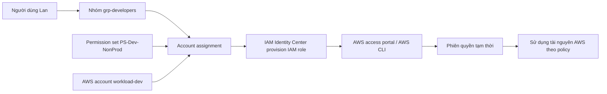
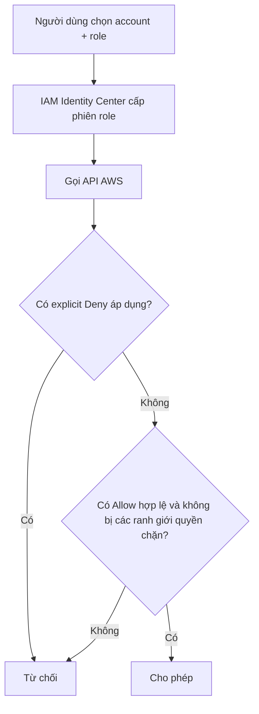

# Permission set và phân quyền theo nhóm công việc

Khi một tổ chức sử dụng nhiều tài khoản AWS cho **development**, **testing** và **production**, việc cấp quyền thủ công cho từng nhân viên trên từng tài khoản dễ tạo ra quyền thừa, cấu hình không đồng nhất và khó thu hồi khi nhân sự thay đổi. **AWS IAM Identity Center** cung cấp cách quản trị tập trung dựa trên nhóm công việc: mỗi nhóm được gán **permission set** phù hợp tại những tài khoản AWS cụ thể.

Bài học thuộc chương **Tài khoản và Organizations** của mô-đun **CLOUD_PROVIDERS_AWS**. Sau khi đã hiểu cấu trúc tài khoản, Region/AZ và mô hình danh tính, ta dùng permission set để chuẩn bị phân quyền an toàn cho người triển khai VPC, EC2, S3, RDS, Lambda, hệ thống tích hợp, giám sát, khôi phục và kiểm soát chi phí.

## 1. Mục tiêu học tập

Hoàn thành bài này, bạn có thể:

1. Giải thích vai trò của **user**, **group**, **permission set**, **AWS account assignment** và **IAM role** do IAM Identity Center tạo.
2. Phân biệt permission set với IAM policy, IAM role, nhóm IAM và các chính sách kiểm soát cấp tổ chức.
3. Thiết kế ma trận quyền theo vai trò công việc và theo môi trường, tuân thủ nguyên tắc **least privilege**.
4. Tạo permission set, gán quyền cho nhóm trên tài khoản AWS đích và xác minh truy cập qua AWS access portal/AWS CLI.
5. Viết policy IAM đơn giản giới hạn hành động và tài nguyên, đồng thời nhận diện điểm cần bổ sung như SCP và resource policy.
6. Cập nhật, thu hồi và kiểm tra quyền khi người dùng chuyển nhóm, đổi trách nhiệm hoặc nghỉ việc.
7. Nhận biết các lỗi thường gặp: chưa gán account, policy thiếu ở tài khoản đích, quyền bị chặn hoặc phiên truy cập chưa hết hạn.

## 2. Từ người dùng đến quyền truy cập AWS

### 2.1. Các thành phần cơ bản

| Thành phần | Ý nghĩa | Ví dụ |
| --- | --- | --- |
| **User** | Danh tính của một người trong nguồn danh tính được kết nối với IAM Identity Center | `lan.nguyen` |
| **Group** | Tập hợp người có cùng vai trò, trách nhiệm hoặc nhu cầu truy cập | `grp-developers` |
| **Permission set** | Mẫu quyền gồm các IAM policy và thiết lập phiên, được quản lý tại IAM Identity Center | `PS-Dev-NonProd` |
| **AWS account** | Phạm vi tài khoản nơi quyền được cấp | `workload-dev` |
| **Account assignment** | Quan hệ gán **user/group + permission set + AWS account** | `grp-developers` dùng `PS-Dev-NonProd` trên `workload-dev` |
| **IAM role được provision** | Role do IAM Identity Center tạo/quản lý trong tài khoản được gán để người dùng nhận phiên quyền tạm thời | `AWSReservedSSO_PS-Dev-NonProd_...` |

**Permission set không phải là tài khoản người dùng và cũng không tự cấp quyền ngay khi được tạo.** Nó là mẫu mô tả các quyền dự kiến. Khi quản trị viên tạo *account assignment*, IAM Identity Center sẽ cung cấp (*provision*) IAM role tương ứng trong tài khoản đích và gắn các IAM policy đã khai báo. Người được gán có thể đăng nhập qua **AWS access portal** hoặc AWS CLI để sử dụng role đó với thông tin xác thực tạm thời.

Nếu một người được gán nhiều permission set trên cùng tài khoản, họ thường thấy **nhiều lựa chọn role** và chọn một role cho phiên làm việc. Không nên suy luận rằng tất cả permission set được tự động cộng vào một phiên.

### 2.2. Luồng cấp quyền theo nhóm



Trong thực tế, một **nhóm** có thể được gán nhiều permission set trên nhiều tài khoản. Cùng một permission set cũng có thể được dùng lại cho nhiều nhóm và tài khoản nếu nhu cầu quyền giống nhau. Vì vậy, hãy xem mô hình phân quyền như ma trận ba chiều:

**Ai (user/group) → được dùng quyền gì (permission set) → ở tài khoản nào (AWS account).**

Cách tổ chức này thuận tiện hơn việc tạo IAM user và access key riêng cho từng nhân viên trên mỗi account.

### 2.3. Phân biệt các khái niệm dễ nhầm

| Khái niệm | Nơi quản lý | Vai trò chính |
| --- | --- | --- |
| **IAM Identity Center group** | IAM Identity Center hoặc nguồn danh tính bên ngoài | Quản lý thành viên và gán quyền tập trung |
| **IAM user group** | AWS IAM trong một tài khoản | Gom các IAM user của chính tài khoản đó |
| **IAM policy** | IAM / policy được khai báo trong permission set | Mô tả hành động, tài nguyên và điều kiện được cho phép/từ chối |
| **Permission set** | IAM Identity Center | Đóng gói policy và thuộc tính phiên để gán vào tài khoản |
| **IAM role** | AWS IAM trong tài khoản đích | Danh tính được sử dụng trong phiên để gọi dịch vụ AWS |
| **Service control policy (SCP)** | AWS Organizations | Giới hạn quyền tối đa trong phạm vi tổ chức; không tự cấp quyền |
| **Permissions boundary** | IAM, có thể gắn qua permission set | Giới hạn quyền tối đa mà identity-based policy của role có thể cấp; không tự cấp quyền |

Ví dụ: một người có permission set chứa `s3:GetObject` vẫn có thể bị từ chối truy cập một bucket do **explicit deny** trong SCP hoặc bucket policy, hay vì thiếu quyền giải mã khóa KMS. Ngược lại, gán SCP cho OU không làm các thành viên của OU tự có quyền truy cập S3.

## 3. Điều kiện trước khi cấu hình

Để sử dụng permission set nhằm cấp quyền truy cập **AWS accounts**, cần có:

1. **AWS Organizations** với một **IAM Identity Center organization instance**. Kiểm tra mục **Multi-account permissions** đã bật. Một **account instance** chỉ phục vụ các tình huống ứng dụng được hỗ trợ trong một account và **không hỗ trợ permission set cho AWS account access**.
2. Người quản trị có quyền quản lý IAM Identity Center và quyền thích hợp trên các tài khoản thuộc Organizations. Không thực hành bằng root user cho tác vụ thường ngày.
3. **Nguồn danh tính** (identity source) được thiết lập: Identity Center directory, Active Directory hoặc nhà cung cấp danh tính bên ngoài (*external IdP*).
4. Các **nhóm công việc** và thành viên đã được tạo/đồng bộ. Nếu dùng external IdP, việc tạo nhóm, đổi thành viên và MFA thường do hệ thống danh tính bên ngoài quản lý; cần chờ đồng bộ trước khi kiểm tra.
5. Danh sách tài khoản và chính sách quản trị hiện có (SCP, policy của IAM, resource policy) để tránh cấp quyền vượt phạm vi đã được chấp thuận.

> **Lưu ý về MFA:** nếu nguồn danh tính là external IdP, chính sách MFA cho xác thực người dùng thường được cấu hình tại IdP. Đừng giả định bật MFA trong IAM Identity Center sẽ thay thế quy định MFA của hệ thống đó.

## 4. Thiết kế phân quyền theo nhóm công việc

### 4.1. Phân chia trách nhiệm và môi trường

Giả sử hệ thống thương mại điện tử chạy trên AWS và sử dụng:

- `workload-dev`: môi trường phát triển, thử nghiệm Lambda, S3, DynamoDB và các dịch vụ tích hợp.
- `workload-test`: môi trường kiểm thử tích hợp/khả năng phục hồi.
- `workload-prod`: môi trường sản xuất có dữ liệu quan trọng.
- `security-tools`: tập trung công cụ giám sát và an ninh.

Đặt nhóm theo **trách nhiệm công việc**, không đặt theo tên từng cá nhân. Ví dụ:

| Nhóm | Permission set dự kiến | Tài khoản được gán | Phạm vi nhiệm vụ |
| --- | --- | --- | --- |
| `grp-developers` | `PS-Developer-NonProd` | `workload-dev`, `workload-test` | Phát triển/kiểm thử các tài nguyên ứng dụng được giao; không quản lý IAM/Organizations |
| `grp-release-operators` | `PS-Prod-Deploy` | `workload-prod` | Triển khai phiên bản đã phê duyệt và xem trạng thái dịch vụ; không có quyền quản trị toàn tài khoản |
| `grp-platform-operators` | `PS-Platform-Operations` | `workload-dev`, `workload-test`, `workload-prod` | Vận hành phần hạ tầng và theo dõi CloudWatch trong phạm vi được ủy quyền |
| `grp-security-auditors` | `PS-Security-Audit` | Tất cả tài khoản liên quan | Đọc thông tin cần thiết để kiểm toán IAM, cấu hình và nhật ký; không được sửa tài nguyên |
| `grp-finops` | `PS-Cost-View` | Tài khoản quản lý/được ủy quyền phù hợp | Theo dõi ngân sách, phân tích chi phí theo quyền Billing cho phép |

**Các tên trên chỉ là minh họa.** Trong triển khai thực tế, mỗi permission set phải có IAM policy được thiết kế theo tác vụ cụ thể; tên như `PS-Prod-Deploy` không tự giới hạn hành động deploy. Các quyền Billing/Cost Explorer cũng tùy thuộc tài khoản sở hữu hóa đơn, cấu hình Billing và cơ chế ủy quyền hiện có.

### 4.2. Nguyên tắc chọn permission set

- **Least privilege:** chỉ cấp hành động và tài nguyên cần thiết. Chẳng hạn người xem báo cáo không cần quyền `s3:PutObject` hoặc `ec2:TerminateInstances`.
- **Tách non-production và production:** cùng một nhân viên có thể có quyền chỉnh sửa ở dev nhưng chỉ được đọc production; nếu cần triển khai production thì dùng role riêng và quy trình phê duyệt.
- **Phân tách nhiệm vụ:** người phát triển không mặc định là người duyệt thay đổi chính sách bảo mật hoặc hóa đơn.
- **Dễ thu hồi theo nhóm:** khi nhân sự rời nhóm `grp-release-operators`, cập nhật thành viên ở nguồn danh tính thay vì tìm từng IAM user trên mọi tài khoản.
- **Tránh dùng AdministratorAccess phổ biến:** chỉ cấp cho nhóm quản trị thực sự cần thiết, có MFA và cơ chế giám sát; ưu tiên vai trò thường ngày hạn chế hơn.
- **Cẩn trọng với quyền leo thang:** các quyền như `iam:PassRole`, quản lý IAM policy/role, một số khả năng triển khai mã hoặc sửa pipeline có thể cho phép mở rộng quyền gián tiếp nếu cấu hình thiếu kiểm soát.

### 4.3. Phân quyền vai trò và phân quyền thuộc tính

**Role-based access control (RBAC)** phù hợp khi các nhóm có nhiệm vụ ổn định. Ví dụ: người thuộc `grp-security-auditors` nhận một permission set kiểm toán trên nhiều tài khoản.

**Attribute-based access control (ABAC)** phù hợp khi cần kiểm soát theo thuộc tính như team/project. IAM Identity Center có thể chuyển thuộc tính danh tính sang **session tags** để IAM policy dùng điều kiện như `aws:PrincipalTag/team` kết hợp tag của tài nguyên. Ví dụ một nhà phát triển chỉ được sửa tài nguyên có tag `team=payments`.

ABAC giúp giảm số lượng nhóm/permission set khi số dự án tăng, nhưng đòi hỏi nguồn thuộc tính và quy trình gắn tag tài nguyên đáng tin cậy. Bài thực hành bên dưới ưu tiên **RBAC theo nhóm** để quan sát cơ chế permission set rõ ràng trước.

## 5. Cấu tạo của một permission set

Một permission set có thể sử dụng các thành phần sau:

| Thành phần | Mục đích | Điểm cần lưu ý |
| --- | --- | --- |
| **Predefined permission set** | Bắt đầu nhanh với một AWS managed policy cho chức năng phổ biến | Đọc chi tiết policy trước khi dùng vì phạm vi có thể rộng |
| **AWS managed policies** | Tái sử dụng policy AWS duy trì, ví dụ `ReadOnlyAccess`, `SecurityAudit` | AWS có thể cập nhật policy; theo dõi thay đổi ảnh hưởng tới quyền |
| **Customer managed policies** | Dùng IAM policy do tổ chức quản lý | Phải có policy đúng **tên và path** trong **từng tài khoản đích** trước khi gán; IAM Identity Center không tạo hộ |
| **Inline policy** | Định nghĩa IAM policy JSON trực tiếp trong permission set | Thuận tiện cho quyền nhỏ, riêng biệt; vẫn cần review thay đổi |
| **Permissions boundary** | Đặt trần quyền tối đa cho role do Identity Center tạo | Boundary không tạo quyền Allow mới |
| **Session duration** | Giới hạn thời lượng phiên AWS account | Mặc định **1 giờ**, có thể cấu hình **1–12 giờ**; nên chọn đủ cho công việc |

Các **organization-instance multi-account permissions** áp dụng cho người dùng truy cập AWS account. Permission set được tạo xong nhưng **chưa có account assignment** thì chưa được provision vào tài khoản đích.

### 5.1. Ví dụ inline IAM policy chỉ đọc một bucket S3

Một nhóm kiểm toán dự án chỉ cần liệt kê và đọc đối tượng trong bucket tài liệu mẫu `example-training-artifacts`. Inline policy có thể là:

```json
{
  "Version": "2012-10-17",
  "Statement": [
    {
      "Sid": "ListOneTrainingBucket",
      "Effect": "Allow",
      "Action": [
        "s3:ListBucket"
      ],
      "Resource": "arn:aws:s3:::example-training-artifacts"
    },
    {
      "Sid": "ReadObjectsInOneTrainingBucket",
      "Effect": "Allow",
      "Action": [
        "s3:GetObject"
      ],
      "Resource": "arn:aws:s3:::example-training-artifacts/*"
    }
  ]
}
```

Giải thích:

- `s3:ListBucket` dùng ARN của **bucket**, không phải ARN từng đối tượng.
- `s3:GetObject` dùng ARN của **object** dưới bucket.
- Policy không cấp `s3:PutObject`, `s3:DeleteObject` hay `s3:PutBucketPolicy`.
- Tên bucket là ví dụ: thay bằng tên thực tế trong account được phép trước khi dùng.
- Nếu bucket ở account khác, bucket policy và các điều kiện truy cập chéo tài khoản phải cho phép. Nếu đối tượng mã hóa SSE-KMS, còn có thể cần `kms:Decrypt` trên khóa phù hợp.

Đây là **quyền được policy đề xuất**; quyền hiệu lực vẫn tùy các policy và điều kiện liên quan. Ví dụ nếu SCP hoặc bucket policy có một `Deny` tương ứng thì kết quả vẫn là `AccessDenied`.

### 5.2. Cách AWS đánh giá quyền



Trong triển khai thật, AWS tổng hợp nhiều lớp như identity-based policy, resource-based policy, SCP, permissions boundary và chính sách phiên tùy tình huống. Một quyền xuất hiện trong permission set **không bảo đảm API sẽ thành công**; ngược lại, cần xem xét cả resource policy và các cơ chế cấp quyền khác để đánh giá quyền thực tế. **Explicit deny luôn cần được ưu tiên điều tra** khi xử lý sự cố truy cập.

## 6. Thao tác tạo permission set và gán cho nhóm

Ví dụ thực hành với `grp-security-auditors` và một môi trường kiểm thử; các bước Console có thể thay đổi nhẹ theo phiên bản giao diện.

### Bước 1. Kiểm tra identity source và nhóm

1. Mở **AWS IAM Identity Center** trong Region đã triển khai organization instance.
2. Xác nhận **Settings / Identity source** và **Multi-account permissions** đã được thiết lập.
3. Trong phần **Groups**, kiểm tra nhóm `grp-security-auditors` tồn tại, có đúng thành viên và người sở hữu nhóm.
4. Nếu nhóm được quản lý bởi external IdP, thực hiện thay đổi thành viên tại IdP và xác nhận đã đồng bộ sang Identity Center.

**Không tạo bản sao nhóm trùng chức năng** trong Identity Center khi hệ thống nguồn danh tính bên ngoài là nơi quản lý chính.

### Bước 2. Tạo permission set

1. Trong **Multi-account permissions → Permission sets**, chọn **Create permission set**.
2. Để kiểm tra cơ chế an toàn ban đầu, chọn loại **Predefined permission set** với policy phù hợp như `SecurityAudit` hoặc `ReadOnlyAccess`; nếu cần thu hẹp, dùng **Custom permission set** với policy tự thiết kế.
3. Đặt tên có nghĩa, ví dụ `PS-Security-Audit`, thêm mô tả mục đích và chủ sở hữu.
4. Chọn **Session duration** phù hợp công việc (thường bắt đầu bằng mức mặc định 1 giờ).
5. Với custom permission set, cấu hình AWS managed policy, customer managed policy, inline policy và permissions boundary **chỉ khi cần**. Nếu dùng customer managed policy, bảo đảm chúng đã tồn tại trong các account đích với đúng tên/path.
6. Xem lại danh sách quyền; chọn **Create**.

Ở bước này, permission set mới được định nghĩa tại IAM Identity Center. **Chưa thể truy cập tài khoản AWS chỉ vì permission set đã tồn tại.**

### Bước 3. Gán nhóm vào tài khoản

1. Vào **Multi-account permissions → AWS accounts**.
2. Chọn **tài khoản thử nghiệm** `workload-test`; chọn **Assign users or groups**.
3. Ở bước chọn danh tính, tìm và chọn **nhóm** `grp-security-auditors` thay vì gán trực tiếp từng cá nhân.
4. Ở bước chọn permission set, chọn `PS-Security-Audit`.
5. Tại bước **Review and submit**, kiểm tra ba thông tin: **account**, **group**, **permission set**. Chọn **Submit**.
6. Theo dõi trạng thái tạo assignment/provisioning cho đến khi thành công.

Sau thao tác, IAM Identity Center tạo và quản lý IAM role tương ứng trong account `workload-test`. Tại IAM Console, role dạng `AWSReservedSSO_...` có thể xuất hiện. **Không chỉnh policy/trust trực tiếp trên role này**: nguồn quản lý là permission set và Identity Center; việc provision lại có thể làm mất các chỉnh sửa ngoài luồng.

### Bước 4. Kiểm tra trải nghiệm của người được cấp

Một người thuộc `grp-security-auditors` đăng nhập vào **AWS access portal** bằng đúng nguồn danh tính và MFA. Sau khi chọn `workload-test`, họ nhìn thấy role `PS-Security-Audit` được cấp; chọn role để vào AWS Console.

Người học cần xác minh:

- **Đúng account:** không nhầm tài khoản kiểm thử với production.
- **Đúng role:** chọn permission set dùng cho nhiệm vụ kiểm toán.
- **Đúng quyền:** xem được thông tin được chính sách cho phép; các quyền sửa đổi nằm ngoài phạm vi không được cấp.
- **Không phát sinh access key IAM user:** đăng nhập qua portal/role và nhận thông tin xác thực tạm thời.

Khi nhiều permission set được gán, hãy chọn role **ít đặc quyền nhất đủ thực hiện công việc**, thay vì luôn chọn role quản trị cao nhất.

## 7. Xác minh quyền truy cập bằng AWS CLI

AWS CLI v2 có thể đăng nhập qua IAM Identity Center mà không lưu access key dài hạn của IAM user. Ví dụ trên **máy đã cài AWS CLI v2**, người có quyền truy cập thực hiện:

```bash
# Tạo cấu hình profile dùng IAM Identity Center (hướng dẫn tương tác).
aws configure sso --profile training-audit

# Đăng nhập qua trình duyệt và MFA theo hệ thống danh tính.
aws sso login --profile training-audit

# Xác nhận account ID và IAM role mà phiên đang sử dụng.
aws sts get-caller-identity --profile training-audit

# Ví dụ lệnh đọc dữ liệu: chỉ chạy nếu được cấp quyền và bucket tồn tại.
aws s3 ls s3://example-training-artifacts --profile training-audit

# Kết thúc phiên SSO khi không còn làm việc.
aws sso logout
```

Khi chạy `aws configure sso`, CLI yêu cầu URL khởi đầu của AWS access portal hoặc issuer URL, Region của IAM Identity Center và lựa chọn tài khoản/role. Giá trị do quản trị viên cung cấp, không tự đoán Region hoặc account. Tên profile `training-audit` là tên máy cục bộ, không phải tên tài khoản AWS.

Kết quả `aws sts get-caller-identity` cho biết **Account**, **Arn** và **UserId**. ARN thường có `assumed-role/...` cho phiên role. Lệnh không chứng minh toàn bộ policy hiệu lực; nó chỉ xác nhận phiên đang dùng danh tính nào.

Nếu lệnh S3 báo `AccessDenied`, cần xem lại policy của permission set, assignment, bucket policy, SCP và quyền KMS nếu liên quan. Nếu báo bucket không tồn tại, đó **không phải** bằng chứng permission set đã chặn hành động.

> **An toàn khi thực hành:** không dùng lệnh xóa tài nguyên, thay IAM policy hoặc giả lập phá hoại để kiểm tra quyền bị từ chối. Có thể đối chiếu policy và log/Access Analyzer trong phạm vi được cấp, hoặc kiểm thử với tài nguyên được tạo riêng cho mục đích lab.

## 8. Cập nhật, kiểm soát thay đổi và thu hồi quyền

### 8.1. Sửa permission set có thể ảnh hưởng nhiều account

Một permission set có thể được gán cho nhiều account. Khi thay đổi policy, session duration hoặc settings của permission set, cần xác định **tất cả assignment đang sử dụng nó**; một thay đổi quá rộng có thể ảnh hưởng cả dev lẫn production.

Quy trình kiểm soát phù hợp:

1. Ghi rõ yêu cầu công việc và phạm vi quyền cần thay đổi.
2. Xem các nhóm/account đang sử dụng permission set.
3. Kiểm tra policy mới bằng review, IAM Access Analyzer và môi trường thử nghiệm phù hợp.
4. Cập nhật permission set trong IAM Identity Center.
5. Kiểm tra trạng thái **provision/reprovision** của những account đang gán permission set. Với thao tác cập nhật ở Console, IAM Identity Center hỗ trợ cập nhật role/policy tương ứng; với automation/API, cần tuân thủ yêu cầu provisioning của API/workflow đang dùng.
6. Yêu cầu người dùng tạo phiên mới khi cần xác minh quyền mới, vì phiên cũ có thể còn hiệu lực.
7. Ghi nhận người duyệt, lý do, thời điểm và kết quả xác minh.

Nếu hai nhóm cùng tên chức năng nhưng cần giới hạn tài nguyên khác nhau, nên cân nhắc **tạo hai permission set** hoặc policy theo điều kiện thay vì mở rộng quyền chung cho tất cả account.

### 8.2. Điều gì xảy ra khi chuyển nhóm hoặc nghỉ việc?

Giả sử Lan chuyển từ đội phát triển sang vận hành:

1. Bộ phận phụ trách danh tính gỡ Lan khỏi `grp-developers` và thêm vào nhóm vận hành **sau khi phê duyệt**.
2. IAM Identity Center cập nhật quyền truy cập khả dụng cho các phiên đăng nhập mới sau khi trạng thái nhóm được đồng bộ.
3. Lan đăng nhập lại portal và chỉ chọn account/role dành cho nhóm hiện tại.

**Thu hồi nhóm không có nghĩa mọi phiên AWS role đang hoạt động sẽ kết thúc ngay.** Thông tin xác thực tạm thời đã phát hành thường tồn tại đến hết thời lượng phiên (permission set có thể đặt tối đa 12 giờ). Khi phải khóa quyền khẩn cấp, người phụ trách bảo mật cần thêm biện pháp chặn quyền phù hợp như explicit deny/SCP và xử lý phiên đang hoạt động theo quy trình ứng cứu.

### 8.3. Tình huống phát hiện quyền thừa

Một kỹ sư thuộc `grp-developers` nhìn thấy `PS-Prod-Deploy` ở `workload-prod`. Các bước xử lý:

1. Xác minh account ID, role đang xuất hiện và thành viên nhóm của người đó.
2. Truy ngược **account assignment** nào đang cấp permission set này (có thể do nhóm thứ hai).
3. Đối chiếu với ma trận phân quyền đã phê duyệt.
4. Gỡ/sửa **assignment hoặc nhóm nguồn**, kiểm tra ảnh hưởng đến thành viên khác.
5. Xem log truy cập và áp dụng chặn khẩn cấp nếu có dấu hiệu lạm dụng; đánh giá thời gian hết hạn của các phiên hiện tại.

Không nên tự sửa role `AWSReservedSSO_...` trong target account để xử lý quyền thừa: những thay đổi ngoài IAM Identity Center có thể bị ghi đè khi reprovision.

## 9. Các lỗi thường gặp và cách chẩn đoán

| Triệu chứng | Nguyên nhân có thể | Cách kiểm tra |
| --- | --- | --- |
| Tạo permission set rồi nhưng không thấy quyền ở portal | Chưa có **account assignment** | Kiểm tra account, group, permission set và trạng thái provision |
| Người vừa được thêm nhóm chưa thấy account | Nhóm chưa đồng bộ từ IdP, người dùng đang ở phiên portal cũ hoặc gán sai group | Kiểm tra nguồn danh tính, membership, trạng thái assignment; đăng nhập lại |
| Gán permission set thất bại | Customer managed policy chưa tồn tại hoặc sai **tên/path** ở account đích | Tạo/đồng bộ policy trước khi gán, xác nhận quyền cho provisioning |
| Truy cập account đúng nhưng thao tác AWS bị từ chối | Thiếu Allow, resource policy/SCP/permissions boundary có giới hạn, hoặc thiếu KMS | Xem request thực tế, policy liên quan và CloudTrail/Access Analyzer |
| Sửa permission set nhưng quyền chưa như mong đợi | Provision chưa hoàn tất hoặc đang dùng phiên role cũ | Kiểm tra reprovision, sau đó xác minh bằng phiên mới |
| Một người nhìn thấy nhiều permission set | Người dùng có nhiều account assignment trực tiếp hoặc qua các nhóm | Kiểm tra từng assignment; mỗi role là lựa chọn phiên riêng |
| Tài khoản chỉ có IAM Identity Center account instance | Không hỗ trợ AWS account permission sets | Cần organization instance với multi-account permissions |

Lưu ý thêm: IAM Identity Center **không hỗ trợ nested groups** (nhóm lồng bên trong nhóm) cho việc quản lý membership theo mô hình của dịch vụ. Khi kết nối IdP ngoài, cần kiểm tra cách đồng bộ nhóm thực tế; không dựa vào nhóm lồng để giả định quyền sẽ kế thừa.

## 10. Bài thực hành: thiết kế ma trận quyền không tạo tài nguyên trả phí

**Bối cảnh:** Công ty có hai tài khoản `training-dev` và `training-prod`. Ba nhóm `grp-app-dev`, `grp-ops` và `grp-audit` cần truy cập đúng trách nhiệm. Bài thực hành có thể làm dưới dạng thiết kế/kiểm tra trên Console; việc tạo assignment thật chỉ dành cho người có quyền được ủy nhiệm.

### Yêu cầu

1. Đặt tên ba permission set: `PS-App-Dev`, `PS-Operations` và `PS-Audit`.
2. Xác định quyền công việc tối thiểu:
   - `PS-App-Dev`: xem CloudWatch logs và chỉnh sửa tài nguyên ứng dụng **chỉ trên dev**.
   - `PS-Operations`: theo dõi/khắc phục hệ thống được ủy quyền trên cả dev và prod; không tự sửa IAM/Organizations.
   - `PS-Audit`: đọc thông tin cấu hình/bảo mật trên cả hai account; không sửa tài nguyên.
3. Tạo bảng **group–permission set–account**; xác định rõ nhóm nào **không được** truy cập production.
4. Chọn một permission set và mô tả policy IAM định sử dụng, tránh quyền `*` trên `*` nếu không có lý do đã phê duyệt.
5. Nếu có quyền phù hợp, thử gán trên **training-dev**, đăng nhập portal và chạy `aws sts get-caller-identity` để kiểm tra; không tạo EC2/RDS hay tài nguyên có phí.
6. Mô tả cách cập nhật quyền khi một người chuyển khỏi nhóm và cách ứng phó nếu phải chặn quyền ngay.

### Ma trận tham khảo

| Group | training-dev | training-prod |
| --- | --- | --- |
| `grp-app-dev` | `PS-App-Dev` | **Không gán** |
| `grp-ops` | `PS-Operations` | `PS-Operations` |
| `grp-audit` | `PS-Audit` | `PS-Audit` |

**Đầu ra mong đợi:** bảng ma trận có chủ sở hữu nhóm; danh sách quyền dự kiến; ảnh chụp phần **tên account/role** đã che dữ liệu nhạy cảm nếu thực hành thật; kết quả kiểm tra danh tính; và một đoạn mô tả thu hồi quyền. Không đính kèm token, access key, mật khẩu, mã MFA hoặc dữ liệu khách hàng.

### Câu hỏi phân tích

- Nếu kỹ sư phát triển cần xem log production để điều tra lỗi nhưng không được sửa tài nguyên, bạn sẽ gán thêm role nào và trên account nào?
- Nếu `grp-audit` được gán `ReadOnlyAccess`, liệu có thể khẳng định họ xem được mọi đối tượng mã hóa KMS không? Vì sao?
- Nếu thay đổi `PS-Operations` để thêm quyền quản lý IAM, những tài khoản và nhóm nào có thể bị ảnh hưởng?
- Sau khi xóa một người khỏi nhóm, tại sao cần quan tâm tới thời hạn phiên AWS đã cấp?

## 11. Kiến thức cần ghi nhớ

- **Permission set** là mẫu quyền; **account assignment** liên kết nhóm/người dùng, permission set và account để tạo quyền truy cập thực tế.
- Quản lý quyền theo **group** giúp onboarding, chuyển nhóm và offboarding nhất quán; người dùng không cần access key dài hạn để thao tác AWS CLI.
- Một permission set có thể được dùng lại trên nhiều account; thay đổi nó phải xét toàn bộ nơi đã gán.
- **IAM policy cấp quyền**, còn SCP và permissions boundary giới hạn phạm vi; resource policy và điều kiện bảo mật cũng tham gia đánh giá truy cập.
- Người dùng được cấp nhiều role nên chọn **role ít đặc quyền nhất** cho từng công việc.
- Thu hồi group/assignment không nhất thiết làm hết hiệu lực ngay lập tức các **phiên tạm thời đã phát hành**.

## 12. Tài liệu AWS chính thức

1. [Manage AWS accounts with permission sets — IAM Identity Center](https://docs.aws.amazon.com/singlesignon/latest/userguide/permissionsetsconcept.html).
2. [Create a permission set — IAM Identity Center](https://docs.aws.amazon.com/singlesignon/latest/userguide/howtocreatepermissionset.html).
3. [Assign user or group access to AWS accounts](https://docs.aws.amazon.com/singlesignon/latest/userguide/assignusers.html).
4. [IAM roles created by IAM Identity Center](https://docs.aws.amazon.com/singlesignon/latest/userguide/identity-center-and-iam-roles.html).
5. [Custom permissions and customer managed policies](https://docs.aws.amazon.com/singlesignon/latest/userguide/permissionsetcustom.html).
6. [Use IAM policies in permission sets](https://docs.aws.amazon.com/singlesignon/latest/userguide/howtocmp.html).
7. [Organization and account instances of IAM Identity Center](https://docs.aws.amazon.com/singlesignon/latest/userguide/identity-center-instances.html).
8. [Set session duration for AWS accounts](https://docs.aws.amazon.com/singlesignon/latest/userguide/howtosessionduration.html).
9. [Users, groups and provisioning in IAM Identity Center](https://docs.aws.amazon.com/singlesignon/latest/userguide/users-groups-provisioning.html).
10. [Configure AWS CLI to use IAM Identity Center](https://docs.aws.amazon.com/cli/latest/userguide/cli-configure-sso.html).
11. [IAM policy evaluation logic](https://docs.aws.amazon.com/IAM/latest/UserGuide/reference_policies_evaluation-logic.html).

> **Nguyên tắc vận hành:** Khi cấp quyền AWS, hãy luôn xác định chính xác **người/nhóm nào**, **quyền công việc gì**, **trên tài khoản nào**, **trong bao lâu** và **ai chịu trách nhiệm kiểm tra, thu hồi quyền**.
