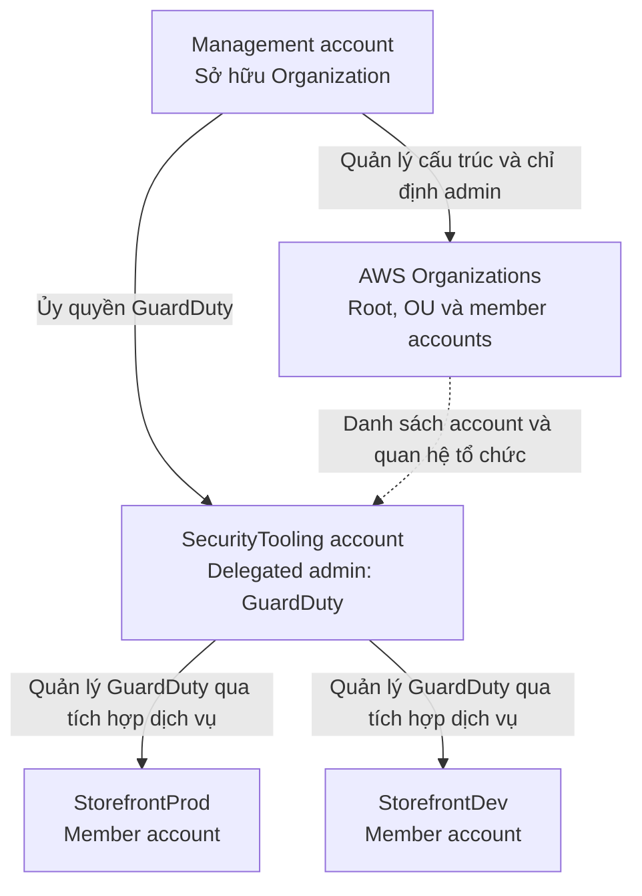

# Delegated administrator và quản trị dịch vụ tập trung

## Mục tiêu học tập

Sau bài học, bạn có thể:

1. Giải thích vì sao **AWS Organizations** cho phép giao quyền quản trị một dịch vụ cho **member account** thay vì vận hành mọi tác vụ trong **management account**.
2. Phân biệt **delegated administrator cho AWS service**, **delegated administrator cho AWS Organizations**, **trusted access**, IAM role xuyên account và IAM Identity Center.
3. Mô tả điều kiện, các bước cấp quyền, giới hạn và cách xác minh ủy quyền quản trị dịch vụ.
4. Xây dựng mô hình quản trị tập trung cho GuardDuty và liên hệ với giám sát, quản lý cấu hình, phục hồi, chi phí trong môi trường AWS nhiều tài khoản.
5. Phát hiện những cấu hình dễ làm mất quyền quản trị hoặc tạo khoảng trống giám sát.

## 1. Bài toán: nhiều account nhưng cần quản trị thống nhất

Một công ty triển khai hệ thống bán hàng với các AWS account riêng cho `Production`, `Development`, `Security` và `SharedServices`. Các account độc lập giúp cô lập workload, chính sách IAM, VPC, dữ liệu và nhiều giới hạn dịch vụ. Tuy nhiên, nhóm bảo mật vẫn cần:

- Theo dõi phát hiện nguy cơ trên toàn bộ account.
- Duy trì cấu hình của các dịch vụ bảo mật khi có account mới.
- Nhìn thấy trạng thái tuân thủ và cảnh báo từ một nơi.
- Hạn chế số người phải truy cập management account.
- Có quy trình kiểm tra, khôi phục và chuyển giao trách nhiệm quản trị.

Nếu đăng nhập từng account để bật dịch vụ và xem kết quả thì chi phí vận hành tăng, dễ bỏ sót account mới. Nếu dùng management account cho mọi tác vụ, phạm vi ảnh hưởng của tài khoản quản trị cao nhất lại trở nên không cần thiết.

**Delegated administrator** là một cách tổ chức quyền quản trị theo dịch vụ: management account chỉ định một **member account** làm đầu mối quản lý chức năng được dịch vụ hỗ trợ ở cấp tổ chức. Account được ủy quyền có thể quản trị tập trung trong **phạm vi của dịch vụ đó**, theo quyền IAM và giới hạn mà AWS quy định. Việc chỉ định không biến account ấy thành management account thứ hai.

> Nguyên tắc thiết kế: giữ management account chủ yếu cho tác vụ bắt buộc thuộc cấp tổ chức; đặt công việc vận hành bảo mật và hệ thống dùng chung tại member account phù hợp.

## 2. Vai trò trong mô hình quản trị

| Thành phần | Trách nhiệm | Điều không tự động có |
| --- | --- | --- |
| **Management account** | Sở hữu Organization, quản lý quan hệ thành viên, cấu trúc OU, thanh toán và những thao tác quản trị bắt buộc tại management account. | Không cần lưu trữ mọi workload hoặc dashboard vận hành. |
| **Member account** | Chạy ứng dụng hoặc đảm nhiệm tác vụ riêng như bảo mật, log, mạng. | Không mặc nhiên có quyền đọc/điều khiển các account khác. |
| **Service delegated administrator** | Member account được đăng ký quản trị **một AWS service hỗ trợ tích hợp với Organizations**. | Không được toàn quyền với Organizations, không đương nhiên là admin của các dịch vụ khác. |
| **Organizations delegated administrator** | Member account được quản lý **những thao tác đối với Organizations policy** mà management account cho phép qua resource-based delegation policy. | Không tự thành delegated administrator của GuardDuty hay các dịch vụ khác. |
| **IAM principal** | User/role thực thi API thực tế. | Không được cấp quyền chỉ vì account mang danh delegated administrator; cần IAM và các điều kiện quyền liên quan. |

### Hai kiểu delegated administrator cần phân biệt

**Kiểu A — Delegated administrator của một AWS service.** Ví dụ: account `SecurityTooling` quản trị Amazon GuardDuty cho các member account. Việc đăng ký sử dụng cơ chế tích hợp giữa **dịch vụ cụ thể** và Organizations; quyền vận hành cụ thể do dịch vụ quy định. Account được ủy quyền nhận khả năng đọc một số thông tin cấu trúc Organization và cần quyền IAM để gọi API của dịch vụ.

**Kiểu B — Delegated administrator cho AWS Organizations.** Management account có thể tạo **resource-based delegation policy** xác định member account nào được tạo, cập nhật, gắn hoặc quản lý các loại organization policy trong phạm vi được cho phép. Chẳng hạn, nhóm nền tảng được giao quản lý **backup policy** ở một số OU. Đây là cơ chế tách biệt với việc đăng ký service delegated administrator.

Một account có thể nhận nhiều vai trò nếu thật sự cần, nhưng nên cân nhắc phân tách chức năng giữa `SecurityTooling` và `PlatformOperations` để giảm quyền không liên quan.

## 3. Hình dung luồng ủy quyền



Trong sơ đồ, `SecurityTooling` có thể tổng hợp và quản lý **GuardDuty** của `StorefrontProd` và `StorefrontDev` sau khi tích hợp và cấu hình. Sơ đồ **không** có nghĩa account bảo mật được quyền đăng nhập EC2, đọc S3 bucket hay chỉnh IAM của hai account ứng dụng.

Một thiết kế nhiều tài khoản phổ biến:

```text
Organization (Management account: 111122223333)
└── Root
    ├── OU: Security
    │   ├── SecurityTooling (222233334444)  -> GuardDuty delegated admin
    │   └── LogArchive (333344445555)       -> Tập trung log
    ├── OU: Workloads
    │   ├── Production
    │   │   └── StorefrontProd (444455556666)
    │   └── NonProduction
    │       └── StorefrontDev (555566667777)
    └── OU: Sandbox
        └── Experiment (666677778888)
```

Các ID và tên account trên chỉ là ví dụ. **OU** là nhóm quản trị logic; **account** là đơn vị được chỉ định làm delegated administrator. Đặt account trong Security OU không tự tạo ra chức năng ủy quyền.

## 4. Trusted access là gì và khác delegated administrator ra sao?

**Trusted access** cho phép một AWS service được hỗ trợ thực hiện các hoạt động cần thiết trong Organization và member accounts thay mặt tổ chức. Dịch vụ có thể tạo **service-linked role** tại những account cần thiết để thực hiện tác vụ quản lý của chính dịch vụ đó. Đây là cơ chế cấp quyền cho **dịch vụ được tin cậy**, không phải cấp quyền administrator cho mọi user/role của account.

**Delegated administrator** chỉ định **member account** được thao tác quản trị dịch vụ trên phạm vi tổ chức. Một dịch vụ có thể hỗ trợ trusted access nhưng **không** hỗ trợ delegated administrator; cần kiểm tra danh sách tích hợp chính thức trước khi thiết kế.

| Câu hỏi | Trusted access | Service delegated administrator |
| --- | --- | --- |
| Đối tượng được tin cậy/ủy quyền | AWS service tích hợp với Organizations. | Member account được chỉ định cho service đó. |
| Mục đích | Cho dịch vụ thực hiện tác vụ trong các account thuộc Organization. | Cho nhân sự/role được cấp quyền ở member account quản trị dịch vụ tập trung. |
| Điều kiện | Dịch vụ phải hỗ trợ tích hợp trusted access. | Dịch vụ phải hỗ trợ delegated admin và các điều kiện đăng ký tương ứng. |
| Tự cấp IAM quyền cho user? | Không. | Không; cần IAM permissions thích hợp. |
| Tự triển khai cấu hình vào mọi Region/account? | Không nhất thiết. | Không; tùy cấu hình, trạng thái thành viên và đặc điểm dịch vụ. |

AWS khuyến nghị khi có thể, **bật hoặc tắt trusted access qua console/API/CLI của chính dịch vụ tích hợp**. Cách đó cho phép dịch vụ thực hiện các bước khởi tạo hoặc dọn dẹp cần thiết. Dùng lệnh Organizations trực tiếp có thể bỏ qua một số bước phụ thuộc của dịch vụ.

**Không nhầm với cross-account role.** Một IAM role trong account ứng dụng có thể cho phép account bảo mật gọi `sts:AssumeRole`, nhưng trust policy và IAM permissions phải được cấu hình cụ thể. Delegated administrator sử dụng những khả năng tích hợp ở cấp Organizations mà **dịch vụ đó** hỗ trợ, không phải một cơ chế tự động nhận mọi role xuyên account.

**Không nhầm với IAM Identity Center.** IAM Identity Center phân bổ quyền đăng nhập và permission set cho nhân sự trên nhiều account; delegated administrator xác định account vận hành một chức năng dịch vụ cấp tổ chức. Hai cơ chế có thể bổ trợ nhau.

## 5. Điều kiện và quy trình chỉ định service delegated administrator

Trước khi thay đổi cấu hình thực tế, cần xác nhận:

1. Organization sử dụng **all features**, không chỉ consolidated billing, và dịch vụ hỗ trợ delegated administrator.
2. Account dự kiến được ủy quyền **đang là member account** hợp lệ; kiểm tra hạn mức/số delegated administrator được dịch vụ cho phép.
3. Trusted access của dịch vụ đã được bật theo quy trình được dịch vụ hỗ trợ.
4. User/role tại management account có quyền để chỉ định; user/role tại delegated administrator có **IAM permissions** quản trị dịch vụ phù hợp.
5. Đã xác định rõ các **Region**, các account sẽ tham gia, chế độ tự động bật cho account mới, chi phí và quy trình khôi phục.

### Luồng thao tác chuẩn

**Bước 1 — Chọn member account và dịch vụ.** Ví dụ dùng `SecurityTooling` để quản trị GuardDuty thay vì triển khai dashboard bảo mật vào management account.

**Bước 2 — Bật tích hợp Organizations/trusted access.** Làm theo hướng dẫn của GuardDuty hoặc dịch vụ tương ứng; không suy đoán service principal.

**Bước 3 — Chỉ định delegated administrator từ management account.** Tùy dịch vụ, dùng thao tác **service-specific** hoặc Organizations API `RegisterDelegatedAdministrator`. Nên ưu tiên quy trình dịch vụ công bố để các bước khởi tạo được thực hiện đúng.

**Bước 4 — Cấp quyền IAM cho role vận hành.** Role cần quyền sử dụng chức năng delegated administration của dịch vụ; tổ chức cũng cần kiểm tra SCP và các giới hạn khác.

**Bước 5 — Cấu hình hoạt động trong delegated account.** Ví dụ: bật GuardDuty trong Region, chọn account thành viên, đặt chế độ auto-enable, xuất findings đến nơi giám sát phù hợp.

**Bước 6 — Xác minh theo account và Region.** Kiểm tra account đang được quản lý, trạng thái dịch vụ, phạm vi dữ liệu và khả năng phát hiện trên một account thử nghiệm.

**Bước 7 — Đưa vào vận hành.** Theo dõi account mới, thay đổi cấu hình, chi phí, kết quả giám sát và ghi nhận trách nhiệm của nhóm quản trị.

## 6. Ví dụ thực hành: quản trị Amazon GuardDuty tập trung

**Tình huống:** Công ty có 30 account ứng dụng trên nhiều môi trường. Đội bảo mật muốn theo dõi phát hiện đe dọa bằng Amazon GuardDuty từ `SecurityTooling`, trong khi management account vẫn quản lý Organization và thanh toán.

GuardDuty cho phép một member account làm delegated administrator. Thiết lập này được thực hiện theo **Region**; account được chọn làm GuardDuty delegated administrator phải được sử dụng nhất quán giữa các Region nơi tổ chức triển khai GuardDuty.

### 6.1. Xác định danh tính thực thi lệnh

Trong ví dụ:

| Profile minh họa | AWS account | Vai trò |
| --- | --- | --- |
| `org-management` | `111122223333` | Thực hiện thao tác chỉ định GuardDuty delegated administrator. |
| `security-admin` | `222233334444` | Cấu hình GuardDuty cho các member account. |
| `application` | `444455556666` | Workload cần được giám sát. |

Các profile này phải được người học **cấu hình riêng bằng IAM Identity Center hoặc một cơ chế xác thực hợp lệ**; chúng không được tự tạo bởi AWS Organizations. Lệnh dưới đây chỉ để minh họa, không có kết nối đến AWS thật.

Kiểm tra account đang sử dụng trước mỗi thao tác:

```bash
aws sts get-caller-identity --profile org-management
aws sts get-caller-identity --profile security-admin
```

### 6.2. Chỉ định GuardDuty delegated administrator (management account)

Sử dụng API của GuardDuty để chỉ định account cho Region `ap-southeast-1`:

```bash
aws guardduty enable-organization-admin-account \
  --admin-account-id 222233334444 \
  --region ap-southeast-1 \
  --profile org-management
```

Kiểm tra lại:

```bash
aws guardduty list-organization-admin-accounts \
  --region ap-southeast-1 \
  --profile org-management
```

Kết quả cần cho thấy account `222233334444` là GuardDuty administrator ở Region đã chọn. Với môi trường chạy GuardDuty nhiều Region, lặp lại theo tài liệu GuardDuty; không mặc định chỉ định ở một Region là đã phủ toàn cầu.

### 6.3. Cấu hình GuardDuty trong delegated account

Trước tiên, đảm bảo GuardDuty đã được bật trong delegated account cho Region tương ứng. Tìm detector ID:

```bash
aws guardduty list-detectors \
  --region ap-southeast-1 \
  --profile security-admin
```

Giả sử đầu ra chứa detector ID `0123456789abcdef0123456789abcdef`. Có thể chọn cấu hình tự động bật GuardDuty cho member account:

```bash
aws guardduty update-organization-configuration \
  --detector-id 0123456789abcdef0123456789abcdef \
  --auto-enable-organization-members NEW \
  --region ap-southeast-1 \
  --profile security-admin
```

Xác minh:

```bash
aws guardduty describe-organization-configuration \
  --detector-id 0123456789abcdef0123456789abcdef \
  --region ap-southeast-1 \
  --profile security-admin
```

Tùy nhu cầu, GuardDuty hỗ trợ các lựa chọn:

| Giá trị | Ý nghĩa |
| --- | --- |
| `NEW` | Tự động bật cho **account mới** gia nhập tổ chức. Không tự phủ toàn bộ account cũ. |
| `ALL` | Bật cho cả account hiện có và mới trong phạm vi hỗ trợ; có thể cần thời gian để hoàn tất cấu hình. |
| `NONE` | Không tự động bật cho account mới; nhóm quản trị phải xử lý thành viên theo nhu cầu. Không tự tắt những account đã bật trước đó. |

Các protection plan bổ sung của GuardDuty có thể có cấu hình riêng, điều kiện hỗ trợ theo Region và những ngoại lệ riêng. Việc bật GuardDuty chính không đồng nghĩa mọi protection plan đều đã được bật.

**Kiểm tra tối thiểu:** delegated account có detector hoạt động, member accounts cần giám sát đã được liên kết và bật, các Region sử dụng đều có cấu hình phù hợp, findings được xử lý qua quy trình cảnh báo của đội bảo mật. Kiểm tra lại sau khi tạo một account mới hoặc khi mở Region mới.

### 6.4. Vì sao cần theo dõi Region?

Nếu chỉ bật GuardDuty tại `ap-southeast-1` mà ứng dụng vận hành cả `ap-northeast-1`, cấu hình ở Region thứ hai không tự nhiên xuất hiện. Với account tham gia **opt-in Region**, thứ tự bật Region và gia nhập Organization cũng có thể ảnh hưởng chế độ `NEW`. Đây là lý do phải dùng danh sách Region thực tế làm một phần của checklist vận hành.

## 7. Kiểm tra đăng ký delegated administrator bằng Organizations CLI

Các lệnh dưới đây chủ yếu **đọc cấu hình**, phù hợp cho audit. Chạy bằng role có quyền tương ứng.

Kiểm tra chế độ Organization và tích hợp trusted access:

```bash
aws organizations describe-organization --profile org-management
aws organizations list-aws-service-access-for-organization \
  --profile org-management
```

Liệt kê tài khoản được ủy quyền cho GuardDuty:

```bash
aws organizations list-delegated-administrators \
  --service-principal guardduty.amazonaws.com \
  --profile org-management
```

Kiểm tra `SecurityTooling` là delegated administrator của những dịch vụ nào:

```bash
aws organizations list-delegated-services-for-account \
  --account-id 222233334444 \
  --profile org-management
```

**Lưu ý:** các lệnh liệt kê ở Organizations cho biết quan hệ ủy quyền cấp tổ chức, nhưng **không chứng minh** cấu hình hoạt động đã hoàn chỉnh trong từng dịch vụ, từng account và từng Region. Vì vậy phải đối chiếu thêm API/dashboard của dịch vụ, như `guardduty list-organization-admin-accounts` và `describe-organization-configuration`.

### Khi nào dùng `register-delegated-administrator`?

Một số dịch vụ hỗ trợ đăng ký qua AWS Organizations. Ví dụ **AWS Account Management** cho phép một member account quản trị một số thông tin account ở chế độ Organizations, sau khi thỏa mãn all features, trusted access và quyền cần thiết:

```bash
# Chạy từ management account sau khi hoàn tất điều kiện tích hợp.
aws organizations register-delegated-administrator \
  --account-id 222233334444 \
  --service-principal account.amazonaws.com \
  --profile org-management
```

Ví dụ này **chỉ đăng ký account làm delegated administrator của Account Management**. Nó không trao quyền GuardDuty, EC2 hoặc IAM tùy ý. Các API Account Management mà delegated administrator được dùng còn phải hỗ trợ chế độ Organizations và IAM principal phải có quyền tương ứng.

Không áp dụng máy móc lệnh trên cho tất cả dịch vụ: **service principal**, số admin tối đa, điều kiện/luồng đăng ký, phạm vi Region và quá trình gỡ đăng ký có thể khác nhau. Luôn kiểm tra tài liệu tích hợp của dịch vụ.

## 8. Delegated administrator cho AWS Organizations policy

AWS Organizations còn cho phép management account **ủy quyền quản lý chính sách tổ chức** qua một **resource-based delegation policy**. Khả năng này phù hợp khi cần giao đội nền tảng quản lý `BACKUP_POLICY` hoặc một phạm vi policy được chọn mà không yêu cầu người vận hành thường xuyên sử dụng management account.

Giả sử:

- `Management account` sở hữu cấu trúc Organization.
- `PlatformOperations` là member account phụ trách backup policy.
- Đội bảo mật vẫn quản lý GuardDuty bằng cơ chế **service delegated administrator** riêng.

Management account có thể đặt một delegation policy giới hạn **Principal** là account `PlatformOperations`, **Action** là thao tác Organizations được cho phép như `CreatePolicy`, `UpdatePolicy`, `AttachPolicy`, và **Resource/Condition** ràng buộc phạm vi tài nguyên, loại policy phù hợp. Những IAM role trong account được ủy quyền **vẫn phải có IAM permissions tương ứng**.

Quy trình tổng quát:

1. Management account xác định chính xác loại policy, OU/account đích và các thao tác có thể ủy quyền.
2. Tạo hoặc cập nhật resource-based delegation policy trong **AWS Organizations → Settings → Delegated administrator for AWS Organizations**, hoặc API `PutResourcePolicy`.
3. Cấp IAM policy đủ hẹp cho role của nhân sự tại member account được chỉ định.
4. Kiểm tra quyền bằng thao tác được phép, rồi thử một thao tác **ngoài phạm vi** để chắc chắn quyền không bị cấp quá rộng.
5. Giám sát lịch sử thay đổi policy và định kỳ rà soát quyền được ủy quyền.

Có thể đọc lại delegation policy:

```bash
aws organizations describe-resource-policy \
  --profile org-management
```

**Lưu ý về cú pháp kể từ 30/06/2026:** AWS Organizations không chấp nhận `NotAction` và `NotResource` trong **delegation policy được tạo hoặc cập nhật** từ ngày này. Hãy dùng danh sách `Action` và `Resource` rõ ràng để giới hạn quyền. Với policy đang tồn tại, cần kiểm tra và thay thế mẫu cũ trước lần cập nhật.

Ủy quyền Organizations policy **không** trao quyền tạo thành viên, mời account hoặc thay đổi account thành management account. Những công việc cấu trúc và vận hành được phép thực hiện phải tuân theo các hành động Organizations mà AWS hỗ trợ ủy quyền, cùng quyền IAM và resource policy.

## 9. Phạm vi quyền và các lớp kiểm soát an toàn

### 9.1. Có delegated admin chưa đủ để API thành công

Ví dụ, `SecurityTooling` được giao quản trị GuardDuty nhưng role `SecurityAnalyst` thiếu quyền `guardduty:UpdateOrganizationConfiguration`. Role này sẽ không thể gọi API cấu hình chỉ vì đang ở delegated account.

Ngược lại, role có IAM `AdministratorAccess` trong `SecurityTooling` vẫn phải tuân thủ **SCP áp dụng cho member account**, trừ các ngoại lệ theo cơ chế AWS. Delegated administrator vẫn là member account: SCP không tự biến mất. Các **service-linked roles** có cơ chế riêng và không bị SCP giới hạn theo cách principal thông thường bị giới hạn.

| Lớp | Kiểm soát điều gì? |
| --- | --- |
| Organizations membership | Account nào thuộc Organization. |
| Trusted access | Dịch vụ nào được phép thực hiện các tác vụ tích hợp trên phạm vi tổ chức. |
| Service delegated admin | Member account nào quản trị dịch vụ được hỗ trợ. |
| Resource-based delegation policy cho Organizations | Account được phép quản lý loại policy/tài nguyên Organizations nào. |
| IAM, SCP và các kiểm soát có liên quan | Principal nào được gọi API nào và những giới hạn quyền áp dụng. |
| Cấu hình từng dịch vụ/Region | Những account, Region, loại dữ liệu và chức năng thực tế được bật. |

Không có một lớp đơn lẻ nào thay thế tất cả các lớp còn lại.

### 9.2. Nguyên tắc triển khai

- **Least privilege:** tách role đọc dashboard, role cấu hình tích hợp và role quản trị khẩn cấp; tránh cấp toàn quyền cho mọi người trong delegated account.
- **Separation of duties:** người sửa policy Organizations, người phân tích findings và người duyệt thay đổi production nên có phạm vi trách nhiệm rõ ràng.
- **MFA và truy cập ngắn hạn:** dùng IAM Identity Center hoặc role phiên ngắn; hạn chế sử dụng thông tin xác thực dài hạn.
- **Audit trail:** theo dõi thao tác chỉ định/hủy ủy quyền, thay đổi policy và cấu hình dịch vụ qua AWS CloudTrail và hệ thống giám sát phù hợp.
- **Bảo vệ logging:** tập trung log về account chuyên trách; không giả định delegated account tự có mọi bản ghi từ các dịch vụ khác.
- **Kiểm soát chi phí:** bật dịch vụ và protection plan ở nhiều account/Region có thể phát sinh chi phí; theo dõi trong Cost Explorer/Budgets và thử nghiệm trước.
- **Thử trên phạm vi hẹp:** đặc biệt với dịch vụ có auto-enable cho account cũ hoặc policy có thể làm gián đoạn workload.

## 10. Quản trị tập trung với những dịch vụ khác

| Nhu cầu | Dịch vụ/cơ chế liên quan | Vai trò của quản trị tập trung |
| --- | --- | --- |
| Phát hiện hành vi đáng ngờ | **Amazon GuardDuty** | Quản lý thành viên, cấu hình detector và tổng hợp findings trong phạm vi Region được hỗ trợ. |
| Tư thế bảo mật và findings | **AWS Security Hub** | Tập trung phát hiện/kiểm soát bảo mật và áp cấu hình theo tính năng tích hợp được hỗ trợ. |
| Theo dõi drift/cấu hình tài nguyên | **AWS Config** | Thu thập, tổng hợp cấu hình và đánh giá tuân thủ trên nhiều account/Region bằng cơ chế tích hợp phù hợp. |
| Kiểm tra điểm yếu | **Amazon Inspector** | Quản lý hoạt động kiểm tra và tổng hợp phát hiện trên các account được liên kết, theo tính năng được hỗ trợ. |
| Sao lưu và khôi phục | **AWS Backup + Organizations policies** | Chuẩn hóa backup policy trên các account/OU; kiểm tra thực tế job, retention và thử phục hồi. |
| Triển khai hạ tầng đồng nhất | **AWS CloudFormation StackSets** | Triển khai và cập nhật stack trên nhiều account/Region theo cơ chế quyền và tích hợp hỗ trợ. |
| Tổng hợp log/API hoạt động | **AWS CloudTrail** | Tổ chức trail hoặc dữ liệu log tập trung theo cấu hình; kiểm tra Region, quyền truy cập và lưu trữ. |

Các dịch vụ trong bảng **không bắt buộc có cùng cách đăng ký delegated administrator**. Một số chức năng quản trị tập trung sử dụng trusted access, organization-level setting hoặc IAM cross-account role. Trước khi triển khai, tra cứu khả năng `Supports delegated administrator` và `Supports trusted access` của dịch vụ trong danh mục tích hợp AWS Organizations.

### Liên hệ đến các mảng kiến trúc AWS khác

- **IAM:** phân quyền con người/ứng dụng, kiểm soát SCP và role xuyên account.
- **VPC:** mỗi member account có mạng riêng; nếu cần kết nối mạng tập trung phải thiết kế qua dịch vụ mạng phù hợp, không dựa riêng vào delegated admin.
- **Compute, S3, RDS:** workload vẫn tồn tại trong account sở hữu; quản trị tập trung không làm tài nguyên tự động chuyển account.
- **Serverless và tích hợp:** EventBridge, Lambda hoặc hệ thống xử lý findings có thể tự động hóa phản ứng, nhưng cần thiết kế quyền và giới hạn rõ ràng.
- **Observability:** kết hợp cảnh báo, log, metrics và theo dõi account/Region để nhận biết khi một nguồn dữ liệu chưa được thu thập.
- **Disaster recovery:** chính sách sao lưu trung tâm chỉ là một phần; cần thử phục hồi và kiểm soát tài khoản đích, mã hóa, retention.

## 11. Vận hành vòng đời và xử lý sự cố

### 11.1. Tạo account mới

Khi account `NewShopProd` được tạo:

1. Kiểm tra account đã vào OU thích hợp và nhận chính sách bảo vệ tương ứng.
2. Xác nhận account xuất hiện trong danh sách Organizations và phạm vi managed accounts của từng dịch vụ.
3. Kiểm tra cấu hình auto-enable: `NEW` sẽ khác `ALL`; các cấu hình chỉ theo Region phải được lặp lại nơi cần.
4. Xác minh dịch vụ thực sự được bật và có dữ liệu/telemetry hợp lệ.
5. Kiểm tra chi phí, tag, cảnh báo và chủ sở hữu vận hành.

### 11.2. Chuyển delegated administrator sang account khác

Ví dụ muốn thay `SecurityTooling` bằng `SecurityOperations`. Không nên chỉ gỡ delegated administrator cũ ngay lập tức. Cần:

- Ghi lại cấu hình, các Region, danh sách member và luồng findings đang sử dụng.
- Đọc **quy trình chuyển đổi riêng của dịch vụ**; một số dịch vụ yêu cầu disassociate thành viên hoặc thao tác dọn dẹp trước khi chuyển.
- Chỉ định account mới, bật dịch vụ, cấu hình auto-enable và kiểm tra nguồn dữ liệu.
- Cập nhật đường đi cảnh báo, quyền IAM và tài liệu vận hành rồi xác minh khả năng phát hiện thực tế.
- Gỡ ủy quyền cũ theo thứ tự mà dịch vụ hỗ trợ, theo dõi các khoảng trống giám sát.

Riêng GuardDuty, cấu hình tự động bật có thể gắn với delegated administrator mới và **Region**, vì vậy phải kiểm tra lại trước khi đưa member accounts vào quản lý.

### 11.3. Sự cố thường gặp

| Triệu chứng | Nguyên nhân khả dĩ | Kiểm tra đầu tiên |
| --- | --- | --- |
| Không thể đăng ký delegated admin | Service không hỗ trợ, trusted access chưa sẵn sàng, account không hợp lệ hoặc vượt hạn mức. | Feature set, trạng thái member, danh mục service integrations và thông báo API. |
| `AccessDenied` khi role ở delegated account gọi API | IAM thiếu quyền, SCP/permission boundary/condition giới hạn hoặc thao tác không được dịch vụ ủy quyền. | Danh tính `sts get-caller-identity`, IAM policy, SCP và service docs. |
| Không thấy account cũ trong GuardDuty | Cấu hình `NEW` chỉ áp dụng account mới; account cũ chưa tham gia/bật. | Danh sách thành viên, detector và auto-enable của Region. |
| Một Region không hiển thị findings | Chưa chỉ định admin hoặc chưa bật dịch vụ/member ở Region đó. | Region, GuardDuty admin và detector hiện hành. |
| Đổi delegated admin làm gián đoạn luồng cảnh báo | Chưa chuyển cấu hình, danh sách thành viên hoặc đích xử lý findings. | Quy trình chuyển giao theo tài liệu dịch vụ, cấu hình từng Region. |
| Đã đăng ký delegated admin nhưng không thao tác Organizations policy được | Nhầm hai kiểu ủy quyền hoặc thiếu resource-based delegation policy/IAM. | Loại delegated admin, `describe-resource-policy` và IAM role. |

## 12. Bài tập tình huống

**Bối cảnh:** Một tổ chức có management account `111122223333`, 12 account production, 8 account development và 1 account bảo mật `222233334444`. Hệ thống hoạt động tại Singapore và Tokyo. Đội bảo mật muốn quản trị GuardDuty tập trung; đội platform chỉ được quản lý backup policy của Production OU.

**Yêu cầu 1 — Thiết kế quyền.** Chỉ định `222233334444` làm GuardDuty delegated administrator trong các Region cần bảo vệ, cấp IAM theo vai trò và bảo vệ management account. Đội platform có thể được ủy quyền quản lý một phạm vi Organizations backup policy qua resource-based delegation policy riêng, với IAM và phạm vi tài nguyên phù hợp.

**Yêu cầu 2 — Cấu hình account mới.** Nếu muốn account production và development mới tự được GuardDuty bảo vệ, chọn auto-enable phù hợp trong từng Region. Nếu muốn bật cả account hiện hữu, cần xem xét lựa chọn `ALL`, protection plans và chi phí.

**Yêu cầu 3 — Kiểm thử.** Kiểm tra trạng thái GuardDuty tại Singapore và Tokyo; kiểm chứng account mới đã được bật; mô phỏng luồng xử lý một finding kiểm thử theo hướng dẫn dịch vụ; thử rằng role platform không được thay đổi policy ngoài OU/loại policy được giao.

**Yêu cầu 4 — Đánh giá.** Nêu các rủi ro còn lại: sai Region, member chưa tham gia, thiếu IAM, lạm quyền trong delegated account, trạng thái tự động bật chưa áp cho account cũ và chi phí bảo vệ đa Region.

## 13. Tự kiểm tra kiến thức

**Câu 1.** Service delegated administrator có được tự động tạo AWS account mới và sửa mọi OU?

**Đáp án:** Không. Đây là quyền quản trị cho dịch vụ được hỗ trợ; quản trị tư cách thành viên/cấu trúc Organization có các giới hạn và quyền riêng.

**Câu 2.** Trusted access có giống cấp `AdministratorAccess` cho một IAM role trong Security account?

**Đáp án:** Không. Trusted access cấp khả năng tích hợp cho **AWS service**; IAM permissions cho người dùng/role là cơ chế riêng.

**Câu 3.** Delegated admin của GuardDuty có cần chú ý Region không?

**Đáp án:** Có. GuardDuty áp cấu hình theo Region; cần đảm bảo cùng delegated administrator trong các Region sử dụng và kiểm tra trạng thái detector/member.

**Câu 4.** Account đã được giao quản trị GuardDuty có tự động được quản lý Organizations `BACKUP_POLICY`?

**Đáp án:** Không. Đó là dạng ủy quyền khác, thông qua resource-based delegation policy của Organizations và IAM permissions.

**Câu 5.** Nếu đã chọn `NEW` trong GuardDuty nhưng một account đã tồn tại chưa được bật, có phải AWS bị lỗi?

**Đáp án:** Chưa chắc. `NEW` tập trung cho account mới tham gia sau khi cấu hình; account hiện hữu cần xử lý theo cấu hình/tiến trình phù hợp.

**Câu 6.** Có thể bỏ SCP ở delegated administrator vì account này phụ trách bảo mật?

**Đáp án:** Không. Delegated administrator vẫn là member account và chịu các SCP áp dụng cho IAM principal trong member account theo quy tắc của AWS.

## Tài liệu tham khảo AWS chính thức

- [AWS Organizations — Delegated administrator for AWS services](https://docs.aws.amazon.com/organizations/latest/userguide/orgs_integrate_delegated_admin.html)
- [AWS Organizations — Trusted access và tích hợp dịch vụ](https://docs.aws.amazon.com/organizations/latest/userguide/orgs_integrate_services.html)
- [Danh sách AWS services tích hợp Organizations](https://docs.aws.amazon.com/organizations/latest/userguide/orgs_integrate_services_list.html)
- [AWS Organizations — Delegated administrator cho Organizations](https://docs.aws.amazon.com/organizations/latest/userguide/orgs_delegate_policies.html)
- [Tạo resource-based delegation policy](https://docs.aws.amazon.com/organizations/latest/userguide/orgs-policy-delegate.html)
- [GuardDuty — Chỉ định delegated administrator](https://docs.aws.amazon.com/guardduty/latest/ug/delegated-admin-designate.html)
- [GuardDuty — Auto-enable cho Organizations](https://docs.aws.amazon.com/guardduty/latest/ug/set-guardduty-auto-enable-preferences.html)
- [AWS Account Management — Delegated administrator](https://docs.aws.amazon.com/accounts/latest/reference/using-orgs-delegated-admin.html)

**Ghi nhớ:** AWS Organizations xác lập cấu trúc tài khoản; **trusted access** cho phép dịch vụ tích hợp hoạt động trên phạm vi tổ chức; **service delegated administrator** giao vận hành dịch vụ cho member account; **Organizations resource-based delegation policy** giao một phần quyền quản lý chính sách; **IAM, SCP và cấu hình từng Region** vẫn quyết định khả năng thao tác thực tế.
