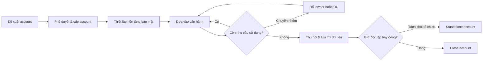

# Chính sách tag, quản lý quota và vòng đời tài khoản

## 1. Bối cảnh và mục tiêu học tập

Trong một doanh nghiệp sử dụng AWS, hạ tầng thường trải rộng trên nhiều tài khoản: phát triển, kiểm thử, sản xuất, dữ liệu và bảo mật. Sau khi tạo tài khoản, nhóm nền tảng phải giải quyết ba câu hỏi thường xuyên lặp lại:

1. **Ai sở hữu tài nguyên và chi phí?** Cần có quy ước tag nhất quán để phân loại môi trường, chủ sở hữu và trung tâm chi phí.
2. **Tài khoản hoặc dịch vụ có đủ hạn mức để triển khai?** Cần hiểu quota mặc định, quota được áp dụng, cách theo dõi mức sử dụng và yêu cầu tăng quota.
3. **Tài khoản được quản lý từ lúc tạo đến lúc ngừng sử dụng như thế nào?** Cần quy trình cấp phát, đưa vào OU, đặt kiểm soát, vận hành, chuyển giao và đóng tài khoản.

Đây là phần **Tài khoản và Organizations** trong lộ trình **CLOUD_PROVIDERS_AWS**. Ba nhóm kiến thức hỗ trợ trực tiếp việc lựa chọn và triển khai dịch vụ AWS ở các Region/AZ, IAM, VPC, compute, storage, database, tích hợp và serverless; đồng thời duy trì tính an toàn, khả năng giám sát, khôi phục và kiểm soát chi phí.

Sau bài học, bạn có thể giải thích Tag Policies trong AWS Organizations; thiết kế quy ước tag; phân biệt quota dịch vụ, quota Organizations và ngân sách; đọc và yêu cầu tăng quota; xây dựng quy trình quản trị vòng đời AWS account và đánh giá rủi ro khi chuyển hoặc đóng tài khoản.

## 2. Ba khái niệm và phạm vi trách nhiệm

| Thành phần | Chức năng chính | Không nên nhầm với |
| --- | --- | --- |
| **Tag** | Nhãn `key=value` gắn vào tài nguyên hoặc một số đối tượng AWS để phân loại và vận hành | Quyền IAM hay chứng nhận tài nguyên an toàn |
| **Tag policy** trong **AWS Organizations** | Chuẩn hóa cách viết khóa/giá trị tag, báo cáo tuân thủ và thực thi những kiểm tra được dịch vụ hỗ trợ | Chính sách IAM/SCP; không tự cấp quyền và không tự gắn tag |
| **Service Quotas** | Xem giá trị quota, theo dõi mức sử dụng và gửi yêu cầu tăng quota được phép điều chỉnh | Giới hạn ngân sách hoặc bảo đảm năng lực thực tế luôn sẵn có |
| **Vòng đời tài khoản** | Quy trình tạo, cấu hình nền, vận hành, chuyển OU, ngừng dùng, tách hoặc đóng tài khoản AWS | Vòng đời một EC2 instance hay một ứng dụng riêng lẻ |

Ví dụ: tổ chức có OU `Production`, trong đó chứa tài khoản `payments-prod`. Tag `CostCenter=FIN-01` giúp phân bổ chi phí; tag policy kiểm soát cách ghi `CostCenter`; Service Quotas xác định số VPC có thể tạo ở một Region; quy trình vòng đời tài khoản đảm bảo `payments-prod` có người chịu trách nhiệm, có CloudTrail và được rà soát trước khi đóng.

## 3. Thiết kế hệ thống tag cho tổ chức

Một **tag** gồm hai thành phần: `key` và `value`, ví dụ `Environment=Production`. Khóa và giá trị có phân biệt chữ hoa/chữ thường: `Environment`, `environment` và `ENVIRONMENT` có thể được xử lý như các khóa khác nhau. Quy ước thiếu thống nhất khiến báo cáo chi phí, tìm kiếm tài nguyên và quy tắc truy cập dựa trên tag bị sai lệch.

### 3.1. Bộ tag khuyến nghị

| Tag key | Ví dụ giá trị | Câu hỏi được trả lời |
| --- | --- | --- |
| `Environment` | `Development`, `Staging`, `Production` | Tài nguyên thuộc môi trường nào? |
| `CostCenter` | `FIN-01`, `OPS-02` | Chi phí được ghi nhận cho bộ phận nào? |
| `Application` | `checkout`, `customer-portal` | Tài nguyên phục vụ ứng dụng nào? |
| `OwnerTeam` | `platform`, `payments` | Đội nào nhận cảnh báo và xử lý sự cố? |
| `ManagedBy` | `Terraform`, `CloudFormation`, `Manual` | Tài nguyên được quản lý bằng cách nào? |
| `DataClassification` | `Public`, `Internal`, `Confidential` | Dữ liệu yêu cầu mức bảo vệ nào? |

Các giá trị trên chỉ là **ví dụ thiết kế**, không phải danh sách tag bắt buộc của AWS. Một tổ chức nên công bố danh mục khóa được duyệt, giá trị hợp lệ, ai được thay đổi quy ước, cách gán giá trị cho tài nguyên dùng chung và cách xử lý ngoại lệ.

Nên ưu tiên tên khóa dễ đọc, ít thay đổi và không chứa bí mật. **Không ghi mật khẩu, access key, token hoặc dữ liệu nhạy cảm vào tag.** Tag thường hiện diện trong bảng điều khiển, API, báo cáo hoặc nhật ký tùy dịch vụ. Quyền xem tài nguyên có thể cho phép xem tag tương ứng.

### 3.2. Tag trên tài khoản khác tag trên tài nguyên

AWS Organizations cho phép gắn tag lên một số đối tượng Organizations, trong đó có **AWS account**, để phục vụ quản trị tài khoản. Ví dụ có thể gắn `OwnerTeam=payments` cho tài khoản `payments-prod`.

Tuy nhiên, tag gắn lên **account** không có nghĩa mọi EC2, S3 bucket hay RDS database trong tài khoản sẽ tự nhận tag đó. Muốn phân bổ chi phí và truy vết tài nguyên, cần gắn tag thích hợp lên từng loại tài nguyên được hỗ trợ, thường qua IaC hoặc quy trình tạo tài nguyên. Đối với báo cáo chi phí, các **user-defined cost allocation tags** liên quan còn cần được kích hoạt theo quy trình của AWS Billing/Cost Management. Không nên suy rằng chỉ gắn tag lên account là có ngay phân bổ chi phí đến từng workload.

## 4. AWS Organizations Tag Policies hoạt động thế nào?

**Tag policy** là một loại chính sách quản trị tổ chức. Khi sử dụng AWS Organizations ở chế độ **All features**, tổ chức có thể bật loại chính sách Tag Policies, tạo chính sách và gắn vào **Organizations Root**, **Organizational Unit (OU)** hoặc **account**. Các chính sách được kết hợp theo cấu trúc tổ chức để hình thành *effective tag policy* áp dụng cho account.

```text
Organizations Root  [quy ước tên tag]
├── OU: Sandbox    [quy tắc cho môi trường thử nghiệm]
│   └── Account: app-dev
└── OU: Production [giá trị tag được phê duyệt]
    ├── Account: payments-prod
    └── Account: analytics-prod
```

Thông thường tổ chức đặt tên khóa thống nhất ở Root, sau đó điều chỉnh tập giá trị chấp nhận được hoặc phạm vi thực thi theo từng OU. Chuyển một account sang OU khác có thể thay đổi **effective tag policy** của account đó. Khi nhiều chính sách kế thừa được kết hợp, các toán tử trong cú pháp tag policy như `@@assign` và các quy tắc dành cho chính sách con quyết định kết quả; không nên mặc định rằng các chính sách đơn giản được nối hoặc ghi đè như văn bản.

### 4.1. Basic compliance rules

Loại kiểm tra cơ bản hỗ trợ kiểm tra **cách viết tên khóa** và **giá trị tag được phép** cho các tài nguyên thuộc phạm vi hỗ trợ. Có thể dùng ở chế độ **reporting** để phát hiện sai lệch; với loại tài nguyên hỗ trợ **enforcement**, có thể chặn thao tác gắn hoặc tạo tag không tuân thủ.

Ví dụ tag policy cho `Environment`:

```json
{
  "tags": {
    "Environment": {
      "tag_key": {
        "@@assign": "Environment"
      },
      "tag_value": {
        "@@assign": ["Development", "Staging", "Production"]
      },
      "enforced_for": {
        "@@assign": ["ec2:ALL_SUPPORTED"]
      }
    }
  }
}
```

Ý nghĩa:

- `tag_key` chỉ định khóa chuẩn `Environment` với cách viết hoa/chữ thường nhất quán.
- `tag_value` khai báo ba giá trị được phép.
- `enforced_for` yêu cầu thực thi trên **những loại tài nguyên EC2 có hỗ trợ** enforcement của tag policy. `ec2:ALL_SUPPORTED` không có nghĩa mọi loại tài nguyên của mọi dịch vụ đều được hỗ trợ.
- Toán tử `@@assign` gán giá trị cho phần tử chính sách theo cú pháp riêng của AWS Organizations Tag Policies, khác cú pháp IAM policy.

**Giới hạn quan trọng:** Với *basic compliance rules*, nếu tài nguyên được tạo **không có tag** `Environment`, kiểm tra này không tự buộc người tạo thêm khóa đó. Nó chủ yếu kiểm tra các tag có mặt; chức năng enforcement còn tùy loại tài nguyên được AWS hỗ trợ. Không thể dùng cấu hình trên để khẳng định toàn bộ tài nguyên trong tài khoản đều có tag bắt buộc.

### 4.2. Required tag key: phát hiện và kiểm tra tag bắt buộc

AWS Tag Policies còn hỗ trợ cơ chế **Required tag key** để khai báo các khóa cần hiện diện trên những loại tài nguyên được hỗ trợ. Ví dụ sau đưa `CostCenter` vào danh sách tag cần có khi báo cáo cho EC2 instance:

```json
{
  "tags": {
    "CostCenter": {
      "tag_key": {
        "@@assign": "CostCenter"
      },
      "report_required_tag_for": {
        "@@assign": ["ec2:instance"]
      }
    }
  }
}
```

Khả năng này cần được hiểu theo hai lớp:

1. **Reporting:** có thể dùng báo cáo tuân thủ toàn tổ chức để tìm tài nguyên được hỗ trợ thiếu tag bắt buộc. Tuy nhiên, báo cáo không bao quát vô điều kiện mọi tài nguyên chưa từng được gắn tag; cần kết hợp các công cụ kiểm kê tài nguyên và quy trình khác để tìm tài nguyên hoàn toàn không có tag.
2. **IaC enforcement:** có thể tích hợp với **CloudFormation, Terraform hoặc Pulumi** theo cơ chế AWS hỗ trợ để cảnh báo hoặc chặn triển khai khi thiếu tag, tùy cấu hình và phiên bản công cụ. Riêng basic compliance rules không cung cấp bảo đảm này. Phải bật tích hợp, chọn chế độ phù hợp và kiểm tra danh sách resource type thực sự được hỗ trợ.

Đối với các thao tác tạo tài nguyên từ console hoặc API trực tiếp, tổ chức có thể cân nhắc **SCP/IAM policy với điều kiện dựa trên tag yêu cầu**, ví dụ các condition key `aws:RequestTag/<TagKey>` hoặc `aws:TagKeys` khi API hỗ trợ. Cần kiểm thử kỹ với từng hành động và dịch vụ vì chúng không cung cấp hỗ trợ đồng nhất, nhất là khi một API tạo nhiều loại tài nguyên cùng lúc.

### 4.3. Theo dõi tuân thủ và xử lý sai lệch

AWS Resource Groups/Tagging API và báo cáo tuân thủ trong AWS Organizations giúp xem các tài nguyên không phù hợp với effective tag policy. Có thể truy vấn danh sách khóa bắt buộc trong chính sách có hiệu lực bằng lệnh:

```bash
aws resourcegroupstaggingapi list-required-tags --region ap-southeast-1
```

Lệnh chỉ phản ánh các khóa tag bắt buộc được định nghĩa theo cơ chế và phạm vi hỗ trợ; **nó không tự chứng minh mọi tài nguyên đã được gắn tag**. Khi kiểm kê, nên bổ sung truy vấn tài nguyên không có tag, ví dụ AWS Resource Explorer với `tag:none` nếu đã được cấu hình, và kiểm tra những dịch vụ không nằm trong phạm vi report/enforcement.

Quy trình vận hành hợp lý là: kiểm tra số lượng tài nguyên sai lệch theo account/OU → xác định chủ sở hữu → sửa IaC hoặc thông số tạo tài nguyên → gắn/sửa tag cho tài nguyên cũ → kiểm tra lại báo cáo → chỉ sau đó mở rộng phạm vi enforcement. Việc bật enforcement ngay trên Root có thể làm hỏng luồng tự động tạo tài nguyên nếu chưa thử trên môi trường nhỏ.

## 5. Service Quotas: hiểu đúng hạn mức AWS

**Quota** (trước đây thường gọi là *limit*) là giới hạn do một dịch vụ AWS đặt lên số lượng tài nguyên hoặc hoạt động. Quota có thể áp dụng cho một **account**, một **Region** hoặc trong một số trường hợp một **resource** cụ thể; tùy dịch vụ, có quota toàn cục và quota theo Region.

Ví dụ:

- Một quota giới hạn số lượng VPC trong một Region của một tài khoản.
- Một quota giới hạn số IAM role của một tài khoản.
- Một quota khác giới hạn số lượng hoặc tổng năng lực tài nguyên của một dịch vụ theo cách tính riêng của dịch vụ đó.

Không nên ghi nhớ một con số quota làm chân lý chung cho mọi account. **Giá trị mặc định và giá trị thực tế có thể khác nhau giữa tài khoản, Region, thời điểm và mức sử dụng.** Tài khoản mới có thể nhận hạn mức thực tế thấp hơn mức mặc định công bố. Cần tra cứu ở đúng tài khoản và Region trước khi thiết kế workload lớn.

### 5.1. Phân biệt các loại quota và giới hạn

| Khái niệm | Ý nghĩa | Cách xử lý |
| --- | --- | --- |
| **Default quota** | Mức AWS công bố ban đầu cho một quota | Tra tài liệu dịch vụ và Service Quotas |
| **Applied quota** | Mức quota thực sự áp dụng cho account hoặc resource đang xét | Tra Service Quotas ở đúng phạm vi; tăng nếu có hỗ trợ |
| **Adjustable quota** | Quota có thể gửi yêu cầu tăng | Yêu cầu tăng; AWS có thể phê duyệt, từ chối hoặc duyệt một phần |
| **Non-adjustable quota** | Quota không có đường tăng theo cơ chế chuẩn | Đổi kiến trúc, phân bổ tài nguyên hoặc xem hướng dẫn dịch vụ |
| **API throttling / rate limit** | Giới hạn tần suất gọi API | Retry với exponential backoff, giảm concurrency, áp dụng hướng dẫn API |
| **Budget/chi phí** | Theo dõi hoặc kiểm soát chi tiêu theo ngưỡng kinh doanh | AWS Budgets, cảnh báo và quản lý vòng đời tài nguyên |

Giải quyết lỗi `ThrottlingException` khác với giải quyết thông báo *quota exceeded*. Tăng số VPC không xử lý được giới hạn tốc độ gọi API; tăng quota EC2 cũng không bảo đảm có đủ capacity ở mọi Availability Zone trong mọi thời điểm.

### 5.2. Quy trình xem và yêu cầu tăng Service Quotas

Trong AWS Management Console, mở **Service Quotas → AWS services**, chọn dịch vụ, Region và quota cần quan sát. Đọc **AWS default**, **applied value**, **adjustability** và mức sử dụng nếu có. Đối với quota được phép điều chỉnh, gửi **Request quota increase** và theo dõi trạng thái yêu cầu.

Ví dụ tìm các quota của Amazon VPC ở Singapore:

```bash
aws service-quotas list-service-quotas \
  --service-code vpc \
  --region ap-southeast-1
```

Một thao tác yêu cầu tăng quota có dạng:

```bash
# Thay mã quota và giá trị theo kết quả đã tra cứu
aws service-quotas request-service-quota-increase \
  --service-code vpc \
  --quota-code L-REPLACE_WITH_REAL_QUOTA_CODE \
  --desired-value 10 \
  --region ap-southeast-1
```

`L-REPLACE_WITH_REAL_QUOTA_CODE` chỉ là ví dụ chỗ giữ chỗ; phải thay bằng `QuotaCode` thực lấy từ Service Quotas. Giá trị `10` chỉ minh họa cú pháp, không phải khuyến nghị hạn mức hay khẳng định yêu cầu sẽ được duyệt. Nếu thao tác thực tế là quota cấp resource, cần xác định `ContextId`/ARN và quy trình tương ứng theo hướng dẫn của dịch vụ.

Gửi yêu cầu thành công **không đồng nghĩa quota đã tăng ngay**. Một số yêu cầu được xử lý tự động, một số cần AWS Support xét duyệt. Sau khi yêu cầu được phê duyệt, kiểm tra applied quota mới trước khi mở rộng deployment. Với quota không thể tăng, phải xem xét thay đổi thiết kế hoặc phân chia workload hợp lý.

### 5.3. Quản lý quota chủ động

Đừng đợi đến ngày triển khai mới kiểm tra quota. Với workload có tăng trưởng, có thể lập bảng theo dõi:

| Account | Region | Dịch vụ/quota | Applied quota | Mức dùng | Ngưỡng cảnh báo nội bộ |
| --- | --- | --- | ---: | ---: | ---: |
| `app-dev` | `ap-southeast-1` | Quota A (giả định) | 20 | 8 | 80% |
| `payments-prod` | `ap-southeast-1` | Quota B (giả định) | 100 | 78 | 80% |
| `analytics-prod` | `ap-southeast-2` | Quota C (giả định) | 50 | 47 | 90% |

Các số trong bảng hoàn toàn giả định. Mục đích là kết hợp **dự báo tải, quota, nhu cầu phục hồi, kế hoạch phát hành** và thời gian phê duyệt tăng hạn mức. Không phải mọi quota đều có số liệu sử dụng tự động.

AWS Service Quotas có **Automatic Management** cho những quota được hỗ trợ: khi bật, dịch vụ có thể gửi thông báo sử dụng ở các ngưỡng như 80%/95%; ở chế độ phù hợp, có thể tự gửi yêu cầu tăng cho một số quota điều chỉnh được. **Không phải mọi quota đều hỗ trợ theo dõi hoặc auto-adjust, và yêu cầu tự động vẫn có thể bị từ chối.** Cần kiểm tra chính xác quota nào được hỗ trợ trong account/Region của mình.

### 5.4. Quota request template cho tài khoản mới

Khi doanh nghiệp tạo nhiều tài khoản, việc lần lượt yêu cầu tăng quota cho từng tài khoản rất tốn công. **Service Quotas request template** có thể tự gửi các yêu cầu tăng quota đã định nghĩa khi **tài khoản mới được tạo trong Organizations**, nếu tổ chức đáp ứng điều kiện và đã liên kết template.

Hạn chế cần nhớ:

- Cần Organizations ở chế độ **All features** và template association đã bật.
- Template áp dụng cho **tài khoản mới**, không tự điều chỉnh quota của những tài khoản đã tồn tại trước khi sửa template.
- Hỗ trợ theo Region/phạm vi được AWS quy định; quota increase vẫn là **yêu cầu**, chưa phải bảo đảm được phê duyệt.

Thiết kế account vending nên có bước kiểm tra **applied quota sau khi cấp account**, ngay cả khi tổ chức đã cấu hình template.

## 6. Quota riêng của AWS Organizations

Ngoài quota của EC2, VPC, Lambda hoặc RDS, **AWS Organizations cũng có quota riêng**: số lượng account được phép có trong organization, số OU, số policy hoặc số policy được gắn tại một target, tần suất/khả năng tạo tài khoản và các giới hạn API khác.

Ví dụ, một tổ chức muốn thêm hàng trăm account cho các dự án mới phải kiểm tra quota **maximum number of accounts**. Chỉ kiểm tra Service Quotas cho EC2/VPC là chưa đủ. Một số quota Organizations có thể yêu cầu tăng từ **management account**; tài khoản bị đóng có thể vẫn tính vào quota số account trong giai đoạn hậu đóng theo quy định AWS. Không nên cố gắng tạo lại account liên tục khi gặp lỗi quota.

**Ba lớp cần phân biệt khi mở rộng quy mô:**

```text
Organizations quota    → Có thể tạo/tham gia thêm bao nhiêu account?
Service quota           → Mỗi account/Region/resource dùng được bao nhiêu tài nguyên?
Budget & cost controls  → Hoạt động đó có phù hợp ngân sách và cảnh báo chi phí?
```

Một thiết kế nhiều tài khoản chỉ bền vững nếu quản lý đồng thời cả ba lớp, kèm chính sách bảo mật IAM/SCP và theo dõi vận hành.

## 7. Vòng đời tài khoản AWS trong Organizations

Có thể mô hình hóa vòng đời thành các trạng thái vận hành như sau. Đây là **mô hình quản trị do doanh nghiệp đề xuất**, không phải toàn bộ tên trạng thái API mà AWS trả về:



### 7.1. Giai đoạn đề xuất và phê duyệt

Trước khi tạo, cần xác định mục đích tài khoản, **owner** chịu trách nhiệm, môi trường, cost center, vùng triển khai dự kiến, phân loại dữ liệu và yêu cầu tuân thủ. Một bộ dữ liệu bàn giao tối thiểu có thể gồm:

| Trường | Ví dụ |
| --- | --- |
| Account name | `payments-prod` |
| Root email được quản lý | `aws-payments-prod@example.com` |
| OU dự kiến | `Production/Payments` |
| OwnerTeam | `payments` |
| CostCenter | `FIN-01` |
| Region được phê duyệt | `ap-southeast-1` |
| Phương thức truy cập quản trị | IAM Identity Center / vai trò được phê duyệt |
| Baseline | Logging, threat detection, backup, budget, tagging |

Email trong bảng chỉ là ví dụ; mỗi AWS account mới cần địa chỉ email phù hợp và chưa được sử dụng cho account khác. Không dùng email cá nhân làm địa chỉ quản trị dài hạn nếu doanh nghiệp có chính sách dùng địa chỉ chung được kiểm soát.

### 7.2. Tạo mới hoặc mời tài khoản hiện có

Có hai đường phổ biến:

- **Create account:** management account tạo account mới bằng AWS Organizations Console/API/CLI. Theo mặc định, Organizations tạo vai trò quản trị `OrganizationAccountAccessRole` trong account mới để management account có thể truy cập theo quyền cho phép. Việc tạo là **bất đồng bộ**, phải kiểm tra trạng thái hoàn tất trước các bước tiếp theo.
- **Invite account:** mời một AWS account đang tồn tại tham gia organization và chủ tài khoản chấp nhận lời mời. Organizations **không tự tạo** `OrganizationAccountAccessRole` trong account được mời; nếu cần quyền quản trị xuyên tài khoản, phải cấu hình rõ ràng.

Ví dụ cú pháp tạo tài khoản mới bằng AWS CLI, chỉ chạy bởi principal có đủ quyền ở **management account**:

```bash
aws organizations create-account \
  --email aws-payments-prod@example.com \
  --account-name "payments-prod"
```

Phản hồi có thể chứa `CreateAccountStatus.Id` và `State: IN_PROGRESS`. Sau đó tra trạng thái theo ID thực nhận được:

```bash
aws organizations describe-create-account-status \
  --create-account-request-id car-REPLACE_WITH_REQUEST_ID
```

Chỉ khi `State` thành `SUCCEEDED` mới tiếp tục cấu hình các bước phụ thuộc vào account. Nếu `FAILED`, đọc `FailureReason` để xác định lỗi quota, email trùng, thông tin thanh toán hoặc nguyên nhân khác. Không coi phản hồi HTTP thành công ban đầu là tài khoản đã sẵn sàng.

### 7.3. Đưa account vào OU và cấu hình baseline

Account vừa được cấp cần được đưa vào OU hợp lý và áp dụng các kiểm soát tổ chức. **Chuyển account sang OU có thể thay đổi SCP, tag policy và các organization policies khác có hiệu lực.** Ví dụ, chuyển từ Sandbox sang Production có thể áp dụng các quy định Region và tag chặt hơn.

Những việc khởi tạo thường cần có:

1. **Danh tính và quyền:** bảo vệ root user; thiết lập quy trình truy cập thông qua IAM Identity Center hoặc vai trò IAM phù hợp; phân tách quyền quản trị và ứng dụng.
2. **Logging và giám sát:** xác minh cấu hình CloudTrail, các cảnh báo trọng yếu, tích hợp dịch vụ bảo mật và nơi lưu log theo kiến trúc tổ chức.
3. **Mạng và dữ liệu:** Region/VPC được duyệt, mã hóa, quy định lưu trữ và phục hồi phù hợp với RTO/RPO của ứng dụng.
4. **Chi phí:** CostCenter/OwnerTeam, tag tài nguyên, budget, cost allocation và phát hiện tài nguyên bỏ quên.
5. **Quota:** xem applied quota cho những dịch vụ cần dùng; gửi yêu cầu tăng trước khi triển khai tải lớn.
6. **Kiểm tra:** thử luồng triển khai mẫu, quyền truy cập, tạo tag hợp lệ và các trường hợp bị từ chối bởi policy.

AWS Control Tower hoặc hệ thống **account vending** dựa trên Infrastructure as Code có thể giúp chuẩn hóa các bước trên. Dù dùng công cụ gì, vẫn cần xác nhận bằng kiểm tra thực tế vì việc account xuất hiện trong Organizations chưa đủ để kết luận baseline đã đầy đủ.

### 7.4. Vận hành và thay đổi account

Trong suốt thời gian sử dụng, owner cần định kỳ đối chiếu:

- **Tag compliance:** tỷ lệ tài nguyên có tag chuẩn và các ngoại lệ chưa xử lý.
- **Quota headroom:** mức dư quota, dự báo tăng trưởng và quota request còn chờ.
- **Security posture:** quyền IAM, policy gắn theo OU, trạng thái logging, lỗ hổng hoặc phát hiện bảo mật.
- **Chi phí:** chi phí theo account/ứng dụng, tài nguyên nhàn rỗi, ngân sách và trách nhiệm giải trình.
- **Khả năng phục hồi:** backup, yêu cầu retention, kiểm thử khôi phục và phụ thuộc xuyên tài khoản.

Khi **move account**, nên đánh giá hiệu lực policy tại OU đích **trước** thay đổi, sau đó xác nhận logging, kết nối mạng, quyền CI/CD, báo cáo tag và các điều kiện điều hành. CLI hỗ trợ thao tác `aws organizations move-account` với `--account-id`, `--source-parent-id` và `--destination-parent-id`; các ID phải lấy từ Organizations, không suy đoán từ tên OU.

## 8. Ngừng sử dụng: tách account khác hoàn toàn đóng account

### 8.1. Remove / leave organization

**Remove account from organization** chuyển một tài khoản thành **standalone AWS account**; tài khoản **không bị đóng**. Sau đó account tự chịu trách nhiệm thanh toán và không còn chịu những organization policies của tổ chức cũ. Vì SCP không còn hiệu lực, quyền thực tế của một số principal **có thể rộng hơn** trước đây nếu chỉ dựa vào SCP để giới hạn.

Trước khi tách, cần xác minh thông tin liên hệ, phương thức thanh toán, gói hỗ trợ và các yêu cầu để account hoạt động độc lập. Cũng cần xử lý delegated administrator, tích hợp dịch vụ, quyền truy cập xuyên tài khoản và các IAM role được tạo để management account quản trị. **Vai trò quản trị xuyên tài khoản không tự biến mất khi account rời organization**; phải rà soát và thu hồi nếu không còn cần thiết. AWS cũng có điều kiện thời gian chờ đối với account mới tạo trong organization và các ngoại lệ cho một số loại account.

Đây là thao tác có thể tác động đến billing và an ninh. Ví dụ, nếu chuyển account cho một công ty con, đội nền tảng cần bàn giao chủ sở hữu, thanh toán, bảo mật, key/secret và quy trình vận hành trước khi thực hiện.

### 8.2. Close account

**Đóng account** là quyết định ngừng sử dụng account. Trước khi đóng, nên tiến hành checklist:

1. Xác nhận owner và người có quyền quyết định, đồng thời ghi nhận yêu cầu lưu trữ dữ liệu theo chính sách doanh nghiệp.
2. Kiểm tra dependency: DNS, IAM trust, backup, shared VPC, luồng dữ liệu, khóa mã hóa, pipeline CI/CD, tài khoản khác đang gọi API hoặc truy cập tài nguyên của account này.
3. Sao lưu, xuất dữ liệu và xác minh phương án truy xuất/khôi phục bên ngoài account sắp đóng.
4. Kiểm tra chi phí, hợp đồng/cam kết dịch vụ, đăng ký dịch vụ, tài nguyên, hóa đơn và quyền truy cập thanh toán.
5. Ghi lại Account ID, bằng chứng phê duyệt, thời điểm đóng và cách liên hệ AWS Support nếu cần mở lại trong giai đoạn cho phép.

AWS quy định **giai đoạn hậu đóng 90 ngày**: trong khoảng thời gian này, có thể liên hệ AWS Support để yêu cầu mở lại theo điều kiện của AWS. Sau giai đoạn đó account bị đóng vĩnh viễn và **không thể mở lại**. Việc đóng account có thể chưa được phản ánh ngay trên mọi dịch vụ/Region, và người dùng vẫn có thể nhận hóa đơn phát sinh sau khi yêu cầu đóng. Không coi thao tác đóng account là giải pháp thay thế cho quy trình bảo toàn dữ liệu hoặc kết thúc nghĩa vụ tài chính.

Trong quản lý Organizations, trạng thái account ở API có thể gồm các giá trị như `ACTIVE`, `SUSPENDED`, `PENDING_CLOSURE`, `CLOSED`, tùy tình huống. **`SUSPENDED` do AWS áp dụng** và quy trình **chủ động `CLOSE` account** không phải thao tác nghiệp vụ đồng nghĩa. Khi cần rà soát, lấy trạng thái thực tế từ API/console; không suy luận chỉ từ tên account hoặc việc account không còn có traffic.

### 8.3. So sánh quyết định cuối vòng đời

| Quyết định | Account tiếp tục tồn tại? | Tác động chính | Lưu ý vận hành |
| --- | --- | --- | --- |
| Chuyển OU | Có, vẫn trong organization | Thay đổi policy kế thừa | Kiểm tra SCP, Tag Policies, baseline và quyền triển khai |
| Remove / leave organization | Có, trở thành standalone | Mất chính sách và thanh toán tập trung của tổ chức cũ | Bổ sung phương thức thanh toán, thu hồi role quản trị, kiểm tra security |
| Close account | Bắt đầu quy trình đóng | Ngừng sử dụng dịch vụ; bước sang giai đoạn hậu đóng | Backup trước, theo dõi 90 ngày và nghĩa vụ thanh toán |

## 9. Tình huống tổng hợp: cấp phát account sản xuất mới

Nhóm phát triển cần môi trường `orders-prod` chạy API trên ECS/Lambda, dữ liệu trong RDS và tải dự kiến tăng mạnh sau khi ra mắt. Tổ chức yêu cầu báo cáo chi phí theo ứng dụng và không cho hạ tầng sản xuất sử dụng tag tùy ý.

**Thiết kế đề xuất:**

1. **Phê duyệt:** ghi `OwnerTeam=orders`, `CostCenter=SALES-01`, `Environment=Production`, Region chính và mục tiêu phục hồi.
2. **Tạo account:** cấp account mới trong Organizations, kiểm tra tạo thành công và đưa vào OU Production.
3. **Chuẩn hóa tag:** áp dụng tag policy cho khóa/giá trị được duyệt; kiểm tra hỗ trợ thực thi trên từng loại tài nguyên; khai báo Required tag key với tích hợp IaC nếu muốn chặn triển khai thiếu tag.
4. **Kiểm tra quota:** xem quota và mức dùng tại Region của VPC, dịch vụ compute, database và những dịch vụ liên quan; xin tăng hạn mức trước ngày phát hành nếu dự báo vượt ngưỡng.
5. **Bảo mật và vận hành:** hoàn tất role truy cập, CloudTrail, cảnh báo, backup, budget và chạy deployment thử có đủ tag.
6. **Theo dõi sau phát hành:** phát hiện tag sai, quota gần giới hạn và chi phí bất thường; điều chỉnh IaC thay vì sửa thủ công hàng loạt.
7. **Khi kết thúc dự án:** kiểm kê phụ thuộc và dữ liệu trước khi quyết định giữ, chuyển owner/OU, tách hay đóng account.

Nếu sau triển khai xuất hiện lỗi **thiếu quyền**, cần phân biệt IAM/SCP với lỗi tag policy. Nếu gặp **quota exceeded**, phải tra quota dịch vụ ở đúng account/Region; nếu do tag không đúng quy ước, kiểm tra policy hiệu lực và điều kiện `enforced_for`. Ba vấn đề có biểu hiện gần nhau nhưng có cơ chế khắc phục khác nhau.

## 10. Bài tập tự kiểm tra

**Câu 1.** Đội vận hành tạo EC2 instance không có tag `Environment` nhưng vẫn thành công, dù tổ chức đã bật *basic compliance* với `enforced_for: ec2:ALL_SUPPORTED`. Có chắc tag policy bị lỗi không?

**Gợi ý:** Không. Basic compliance rules kiểm tra tag xuất hiện nhưng không tự bắt buộc phải có khóa đó. Muốn kiểm tra khóa bắt buộc, dùng Required tag key trong phạm vi hỗ trợ và cơ chế IaC phù hợp; với các lệnh API được hỗ trợ có thể cân nhắc thêm IAM/SCP tag conditions.

**Câu 2.** Công ty tạo một account mới và muốn triển khai hệ thống tại Singapore. Trong AWS Service Quotas nhìn thấy giá trị AWS default cao hơn giá trị applied. Nên dùng giá trị nào để lên kế hoạch?

**Gợi ý:** Lấy **applied quota thực tế** tại account/Region, kiểm tra khả năng điều chỉnh và gửi yêu cầu tăng nếu cần. Đừng suy từ quota mặc định hoặc quota của account khác.

**Câu 3.** Sau khi account chuyển từ OU `Sandbox` sang OU `Production`, pipeline không tạo được tài nguyên với tag `Environment=Dev`. Tại sao?

**Gợi ý:** Chuyển OU làm thay đổi tag policy hiệu lực; có thể OU Production yêu cầu giá trị `Production` trong phạm vi enforcement hỗ trợ. Ngoài ra cần kiểm tra SCP và IAM nếu lỗi không đến từ tag policy.

**Câu 4.** Một account được xóa khỏi Organizations nhưng administrator cũ vẫn assume được IAM role quản trị được tạo trước đó. Có mâu thuẫn không?

**Gợi ý:** Không. Remove account không tự xóa IAM role do tổ chức cũ tạo. Cần chủ động thu hồi trust/role và đánh giá lại giới hạn quyền vì organization policies không còn áp dụng.

**Câu 5.** Nhóm muốn đóng một account ngay khi dự án kết thúc, nhưng một tài khoản khác vẫn đọc dữ liệu ở S3 bucket thuộc account đó. Cần quyết định gì trước?

**Gợi ý:** Xác định phụ thuộc, owner dữ liệu, retention, phương án di chuyển/backup và kiểm thử khả năng truy cập sau di chuyển. Chỉ đóng khi có phương án dữ liệu, bảo mật, chi phí và phê duyệt rõ ràng.

## 11. Ghi nhớ

**Tag policy** giúp duy trì chuẩn phân loại tài nguyên và hỗ trợ báo cáo/thực thi trong giới hạn dịch vụ; nó không tự tạo tag và basic compliance không tự bảo đảm mọi tài nguyên đều mang đủ tag. **Service Quotas** cho biết giới hạn sử dụng của từng dịch vụ tại phạm vi thích hợp; quota của Organizations và ngân sách là những mối quan tâm khác. **Vòng đời tài khoản** cần được quản lý từ khâu cấp phát đến chuyển giao, tách và đóng, với kiểm soát IAM, giám sát, phục hồi, dữ liệu và chi phí xuyên suốt.

### Tài liệu AWS tham khảo

- [AWS Organizations — Tag policies](https://docs.aws.amazon.com/organizations/latest/userguide/orgs_manage_policies_tag-policies.html)
- [Tag policy syntax and examples](https://docs.aws.amazon.com/organizations/latest/userguide/orgs_manage_policies_example-tag-policies.html)
- [Enforce tagging consistency](https://docs.aws.amazon.com/organizations/latest/userguide/orgs_manage_policies_tag-policies-enforcement.html)
- [Report tagging compliance](https://docs.aws.amazon.com/organizations/latest/userguide/orgs_manage_policies_tag-policies-report-tagging-compliance.html)
- [Enforce Required tag key with IaC](https://docs.aws.amazon.com/organizations/latest/userguide/enforce-required-tag-keys-iac.html)
- [AWS Service Quotas — User Guide](https://docs.aws.amazon.com/servicequotas/latest/userguide/intro.html)
- [Service Quotas request templates](https://docs.aws.amazon.com/servicequotas/latest/userguide/organization-templates.html)
- [AWS Organizations quotas](https://docs.aws.amazon.com/organizations/latest/userguide/orgs_reference_limits.html)
- [Create member accounts in Organizations](https://docs.aws.amazon.com/organizations/latest/userguide/orgs_manage_accounts_create.html)
- [Move accounts between OUs](https://docs.aws.amazon.com/organizations/latest/userguide/move_account_to_ou.html)
- [Remove member account from Organizations](https://docs.aws.amazon.com/organizations/latest/userguide/orgs_manage_accounts_remove.html)
- [Close an AWS account](https://docs.aws.amazon.com/accounts/latest/reference/manage-acct-closing.html)
