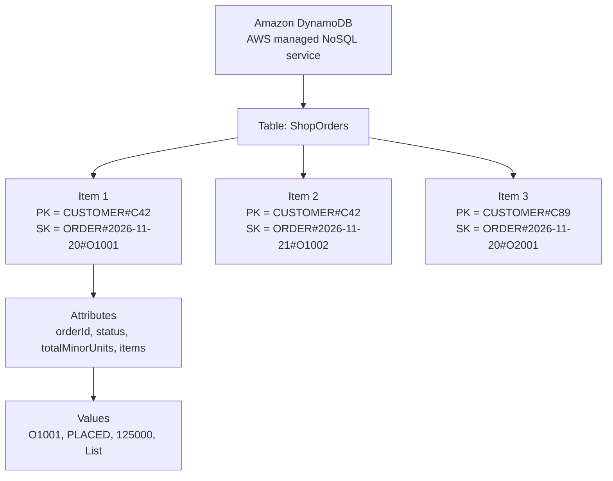
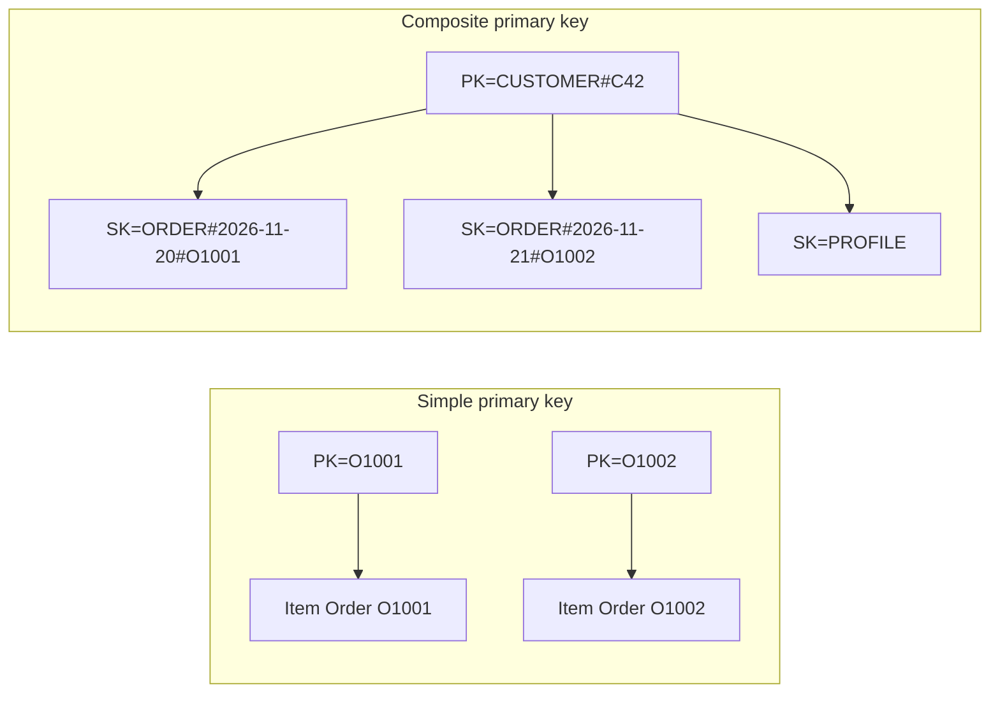
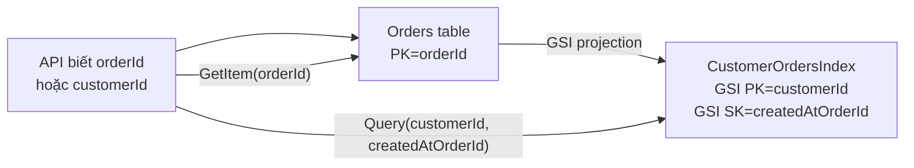
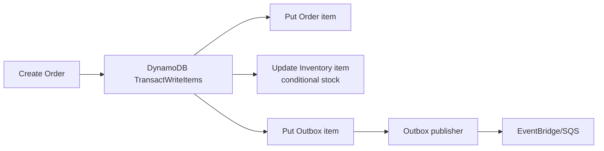
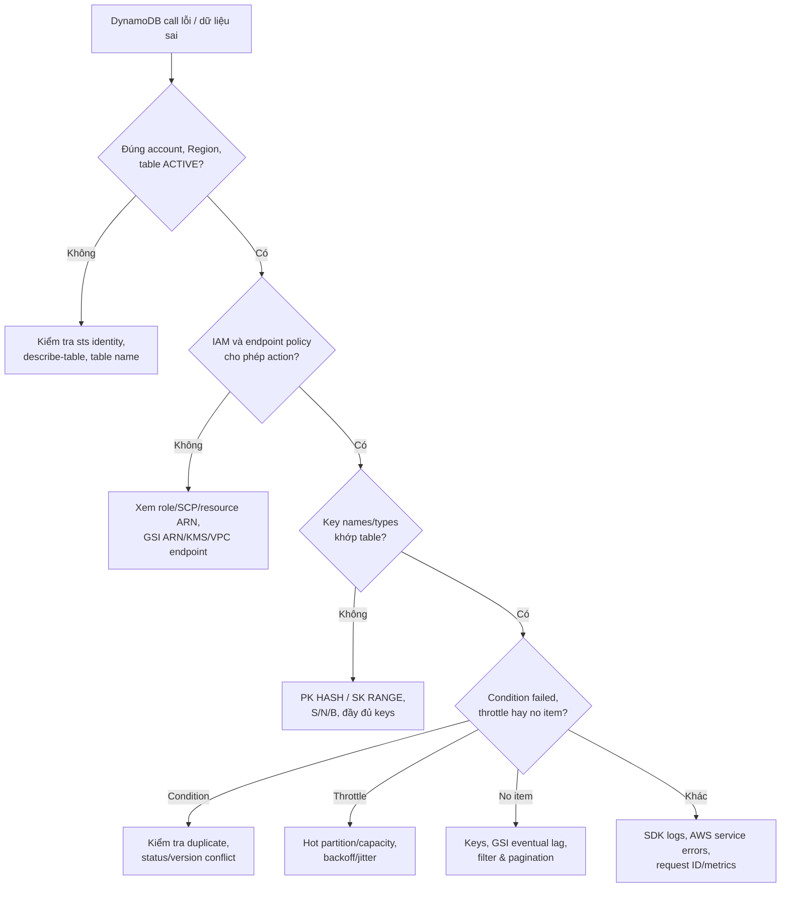
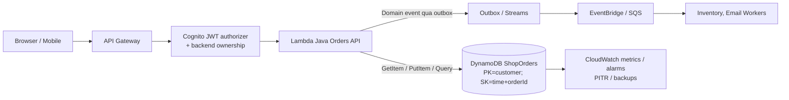

# Table, item, attribute và khóa chính DynamoDB

**Amazon DynamoDB** là cơ sở dữ liệu NoSQL dạng **key-value và document** do AWS quản lý, được thiết kế để phục vụ những ứng dụng cần độ trễ thấp, khả năng mở rộng theo lượng truy cập và ít công việc vận hành máy chủ. Trong DynamoDB, dữ liệu được lưu trong **table**, mỗi bản ghi là một **item**, mỗi thuộc tính của item là một **attribute**. DynamoDB tìm và phân phối items dựa trên **primary key**, chứ không dựa vào việc quét tất cả rows giống một truy vấn SQL thiếu index.

Bài học thuộc chương **DynamoDB** của module **CLOUD_PROVIDERS_AWS**. Trong hành trình khám phá hệ sinh thái AWS qua Region/AZ, IAM, VPC, EC2/ECS/Lambda, lưu trữ, cơ sở dữ liệu, dịch vụ tích hợp và serverless, người học cần chọn cách lưu dữ liệu để ứng dụng **an toàn, dễ giám sát, phục hồi được và kiểm soát chi phí**. Trọng tâm ở đây là những khái niệm nền tảng nhất: **table, item, attribute và khóa chính DynamoDB**, đặc biệt cách **partition key** và **sort key** quyết định khả năng truy xuất dữ liệu.

Ví dụ xuyên suốt là hệ thống **Shop** với khách hàng, đơn hàng và các dòng sản phẩm. Backend có thể chạy bằng Java trên EC2/ECS hoặc Lambda, còn DynamoDB lưu các bản ghi đơn hàng. Mọi tên table, mã khách hàng, ARN và dữ liệu trong bài đều là **minh họa**; không sử dụng thông tin khách hàng thật.

## 1. Mục tiêu sau bài học

Sau khi học, bạn có thể:

1. Giải thích mối quan hệ **table → item → attribute → value** và điểm khác biệt với bảng quan hệ.
2. Nhận diện kiểu **String (S), Number (N), Binary (B), Boolean, Null, List, Map và Set**.
3. Phân biệt **simple primary key (partition key)** và **composite primary key (partition key + sort key)**.
4. Giải thích **tính duy nhất của item**, cách DynamoDB băm partition key và sắp thứ tự items trong cùng partition-key value.
5. Thiết kế khóa dựa trên **access patterns** như tra đơn theo ID, liệt kê đơn theo khách hàng và lọc theo thời gian.
6. Tạo table, ghi item, đọc item, truy vấn theo khóa và cập nhật có điều kiện bằng **AWS CLI**.
7. Đọc/ghi dữ liệu cơ bản bằng **AWS SDK for Java v2** với kiểu `AttributeValue`.
8. Nhận diện các rủi ro **hot partition**, `Scan` tốn kém, thiếu idempotency, ghi đè item và giới hạn kích thước.
9. Chọn nguyên tắc IAM, capacity, backup, monitoring và kiểm soát chi phí cho thiết kế table.

## 2. Mô hình dữ liệu DynamoDB trong một hình



Có thể ghi nhớ bằng bảng:

| Khái niệm | Ý nghĩa | Ví dụ trong Shop |
|---|---|---|
| **Table** | Tập hợp các items với một primary-key schema chung | `ShopOrders` |
| **Item** | Một bản ghi có bộ khóa chính duy nhất trong table | Đơn hàng `O1001` của `C42` |
| **Attribute** | Một trường có tên và value của item | `status`, `totalMinorUnits` |
| **Attribute value** | Dữ liệu kèm kiểu DynamoDB | `"PLACED"`, số `125000` |
| **Partition key** | Thành phần khóa dùng xác định phân phối và lookup | `PK = CUSTOMER#C42` |
| **Sort key** | Thành phần tùy chọn, phân biệt/sắp xếp items cùng partition-key value | `SK = ORDER#2026-11-20#O1001` |
| **Primary key** | Toàn bộ khóa định danh item | `(PK, SK)` với composite key |

**Không nhầm:** DynamoDB **không buộc mọi item trong table có cùng một tập thuộc tính**. Nhưng **mọi item đều phải có thuộc tính khóa chính phù hợp schema của table**. Nếu chọn composite key, cả partition key và sort key đều bắt buộc cho từng item trong base table.

## 3. Table là gì?

Trong DynamoDB, **table** là đơn vị logic lưu trữ items cùng cấu hình vận hành. Table có một tên duy nhất trong phạm vi account/Region, một **primary-key schema**, chế độ capacity và các thiết lập như indexes, encryption, backup, TTL và DynamoDB Streams khi được bật.

Khác hệ quản trị quan hệ, khi tạo DynamoDB table bạn **không khai báo đầy đủ tất cả cột/attribute** như `orderId`, `customerName` hoặc `status`. Bạn chỉ cần khai báo **các key attributes** cho primary key và cho những indexes cần định nghĩa, cùng các cấu hình table khác.

### 3.1. Một table chứa những gì?

| Thành phần | Đặc điểm |
|---|---|
| **Tên table** | Ví dụ `ShopOrders`; dùng nhất quán trong cấu hình app và IAM |
| **Primary key schema** | Partition key bắt buộc, sort key tùy chọn |
| **Items** | Các bản ghi có thể khác nhau về thuộc tính không phải khóa |
| **Secondary indexes** | Phục vụ các cách truy cập khác nếu được thiết kế |
| **Capacity mode** | On-demand hoặc provisioned theo mô hình sử dụng |
| **Encryption** | DynamoDB mã hóa dữ liệu at rest, có lựa chọn key management |
| **Backup/PITR** | Khôi phục table theo khả năng/tính năng đã bật |
| **TTL** | Tùy chọn tự loại bỏ items hết hạn theo timestamp |
| **Streams** | Phát records về thay đổi item nếu được bật |

**Table thuộc một AWS Region** và DynamoDB tự quản lý việc lưu trữ/phân phối dữ liệu trên hạ tầng của dịch vụ trong Region đó. Nếu cần sao chép **đa Region**, phải thiết kế/triển khai **global tables** hoặc cơ chế DR khác; không tự có chỉ vì table được tạo trong một Region.

### 3.2. DynamoDB table có schema không?

Câu trả lời chính xác là:

- **Có schema cho primary key**: tên và kiểu dữ liệu của partition key/sort key được định nghĩa khi tạo table.
- **Có schema cho secondary index keys** khi index được tạo.
- **Không ép schema cột cố định** cho các non-key attributes ở mức table.
- **Ứng dụng vẫn cần business schema và validation** để các items không trở thành dữ liệu lộn xộn.

Ví dụ hai items sau cùng nằm trong `ShopOrders`:

```json
{
  "PK": "CUSTOMER#C42",
  "SK": "ORDER#2026-11-20T08:00:00Z#O1001",
  "orderId": "O1001",
  "status": "PLACED",
  "totalMinorUnits": 125000
}
```

```json
{
  "PK": "CUSTOMER#C42",
  "SK": "ORDER#2026-11-21T09:30:00Z#O1002",
  "orderId": "O1002",
  "status": "SHIPPED",
  "totalMinorUnits": 250000,
  "trackingCode": "TRACK-7788",
  "delivery": {
    "carrier": "EXAMPLE",
    "express": true
  }
}
```

Item thứ hai có `trackingCode` và `delivery`, item thứ nhất không có. Điều đó hợp lệ nếu application contract cho phép. **DynamoDB không tự biết** đơn đang `PLACED` có được phép có tracking code hay không; nghiệp vụ phải tự kiểm tra.

### 3.3. Table khác relational table thế nào?

| Góc nhìn | DynamoDB table | Relational table |
|---|---|---|
| Cấu trúc | Key schema cố định, non-key fields linh hoạt | Columns/types/constraints thường định nghĩa rõ |
| Đọc hiệu quả | Thiết kế quanh key và indexes | SQL planner, indexes, joins và điều kiện truy vấn đa dạng |
| Quan hệ dữ liệu | Thường denormalization, aggregate và access patterns | Foreign keys, normalization, joins |
| Thay đổi schema | Key schema của table khó thay đổi; non-key attributes linh hoạt | ALTER TABLE, migrations |
| Tối ưu | Phân bố partition keys, capacity, Query đúng key | Query plan, index, statistics, joins |
| Consistency | Eventually hoặc strongly consistent reads tùy API/index; có transactions | Tùy database/isolation và transaction |

Không nên chọn DynamoDB chỉ vì “NoSQL nhanh hơn SQL”. Nó phù hợp khi access patterns tương đối rõ và nhu cầu mở rộng/độ trễ nhất quán là ưu tiên; nếu app cần ad-hoc joins, nhiều báo cáo phức tạp hoặc giao dịch quan hệ đa bảng, RDS/Aurora có thể hợp lý hơn.

## 4. Item là gì?

Một **item** là tập hợp các **attributes** được DynamoDB lưu cùng nhau và định danh bằng primary key. Một item có thể chứa scalar values, map/list lồng nhau hoặc sets.

### 4.1. Item minh họa đầy đủ hơn

```json
{
  "PK": "CUSTOMER#C42",
  "SK": "ORDER#2026-11-20T08:00:00Z#O1001",
  "orderId": "O1001",
  "customerId": "C42",
  "createdAt": "2026-11-20T08:00:00Z",
  "status": "PLACED",
  "currency": "VND",
  "totalMinorUnits": 125000,
  "items": [
    {
      "sku": "SKU-100",
      "quantity": 2,
      "unitPriceMinorUnits": 62500
    }
  ],
  "paid": false,
  "delivery": null,
  "tags": ["first-order", "mobile"]
}
```

Đây là **JSON nhìn từ logic ứng dụng**. Khi gọi DynamoDB **low-level API** (CLI hoặc SDK v2 với `AttributeValue`), mỗi attribute sẽ được **đánh dấu kiểu** như `S`, `N`, `BOOL`, `L` hay `M`. Hai cách biểu diễn khác nhau nhưng mô tả cùng dữ liệu.

### 4.2. Điểm mạnh của item

- Các attributes trong item có thể được đọc bằng một `GetItem` theo khóa chính.
- Có thể cập nhật từng attribute bằng `UpdateItem`, kể cả nested map/list ở các mức phù hợp.
- Conditional writes có thể kiểm tra trạng thái trước khi cập nhật để bảo vệ concurrent modifications.
- Một số use cases có thể giữ **aggregate nhỏ** trong một item để giảm số lượt đọc.

### 4.3. Điểm giới hạn của item

- **Kích thước item tối đa 400 KB** theo giới hạn DynamoDB thông thường, tính cả attribute names và values theo quy tắc dịch vụ.
- Item lớn làm tăng RCU/WCU, network transfer và nguy cơ vượt giới hạn.
- Không thể dùng item tùy ý làm kho lưu video, tài liệu PDF hoặc hàng nghìn order lines vô hạn.
- Mọi attribute không có schema cột cố định nhưng **trường khóa phải đúng kiểu và không rỗng**.

Với tài liệu/ảnh lớn, dùng **Amazon S3** và lưu `bucket/key/version/checksum` trong item. Với một order có rất nhiều lines, cân nhắc tách thành các items riêng và Query theo partition/sort key thay vì nhét tất cả vào một List vượt 400 KB.

## 5. Attribute và các kiểu dữ liệu DynamoDB

Attribute là một **cặp tên → giá trị có kiểu** trong item. DynamoDB hỗ trợ scalar, document và set types. Chọn kiểu đúng để so sánh, sắp xếp và cập nhật không sai ngữ nghĩa.

### 5.1. Các kiểu thường dùng

| Loại | Ký hiệu low-level | Ví dụ | Lưu ý |
|---|---|---|---|
| **String** | `S` | `"ORD-1001"` | UTF-8; thích hợp ID, enum, ISO timestamp |
| **Number** | `N` | `"125000"` ở wire format | SDK/CLI serialize dạng string số; DynamoDB lưu/so sánh như number |
| **Binary** | `B` | Base64-encoded bytes ở JSON protocol | Dành cho bytes nhỏ, không dùng cho file lớn |
| **Boolean** | `BOOL` | `true` | Hai trạng thái true/false |
| **Null** | `NULL` | `true` nghĩa là attribute có giá trị null | Khác với thiếu attribute |
| **Map** | `M` | `{"carrier":...}` | Object các thuộc tính con có tên |
| **List** | `L` | `[item1,item2]` | Danh sách có thứ tự; phần tử có thể khác kiểu |
| **String Set** | `SS` | `["vip","loyal"]` | Các string duy nhất, không thứ tự |
| **Number Set** | `NS` | `["1","2","3"]` | Các number duy nhất |
| **Binary Set** | `BS` | Danh sách các binary values | Các bytes duy nhất |

**DynamoDB không có kiểu JSON object/array “tự động” trong low-level API**: ứng dụng cần map sang `M`/`L`. High-level mappers như DynamoDB Enhanced Client hoặc thư viện serialization có thể che bớt sự khác biệt này.

### 5.2. DynamoDB number và độ chính xác

Ở wire-format API:

```json
{
  "totalMinorUnits": {
    "N": "125000"
  },
  "discountRate": {
    "N": "0.15"
  }
}
```

Giá trị `"125000"` nằm trong chuỗi của type tag `N`, nhưng **DynamoDB lưu đó là số**, không phải chuỗi văn bản. DynamoDB hỗ trợ number với **độ chính xác tối đa 38 chữ số**. Đối với ứng dụng tài chính:

- Ưu tiên **integer minor units** với currency rõ ràng, hoặc decimal với quy tắc rounding có kiểm soát.
- Trong Java dùng `BigDecimal`/`BigInteger` khi phù hợp, tránh mặc định lưu mọi giá trị qua `double`.
- Không cố dùng Number làm partition key chỉ vì key “toàn số” nếu cần giữ số 0 đầu hoặc chuỗi ghép prefix.

### 5.3. String, timestamp và sort semantics

Timestamp như `"2026-11-20T08:00:00Z"` được lưu dưới dạng **String**, DynamoDB không tự hiểu nó là kiểu datetime. Dùng **UTC và định dạng nhất quán với độ dài cố định** để thứ tự từ điển trùng với thứ tự thời gian.

**Ví dụ dễ sai:**

```text
"2026-1-9"   và   "2026-11-02"
```

Nếu tháng/ngày không zero-pad, thứ tự string không phản ánh chắc chắn trình tự thời gian. Nên dùng `YYYY-MM-DDTHH:mm:ss.SSSZ` hoặc ISO 8601 UTC cố định; nếu cần range số học, có thể dùng epoch milliseconds/seconds theo convention ghi rõ.

### 5.4. Map và List

```json
{
  "delivery": {
    "M": {
      "carrier": {
        "S": "EXAMPLE"
      },
      "express": {
        "BOOL": true
      }
    }
  },
  "items": {
    "L": [
      {
        "M": {
          "sku": {
            "S": "SKU-100"
          },
          "quantity": {
            "N": "2"
          }
        }
      }
    ]
  }
}
```

Map/List hữu ích cho dữ liệu nhỏ thuộc một aggregate, nhưng không biến DynamoDB thành document database không giới hạn. Giới hạn **400 KB mỗi item** vẫn áp dụng cho toàn bộ cây nested.

### 5.5. Set khác List

| Tiêu chí | List | Set |
|---|---|---|
| Thứ tự phần tử | Có | Không bảo đảm thứ tự |
| Cho phép trùng | Có | Không |
| Cho phép phần tử nhiều kiểu | Có thể, tùy cấu trúc | Một set chỉ thuộc loại SS/NS/BS |
| Cho phép set rỗng | Không áp dụng | **Empty Set không hợp lệ** |
| Ví dụ | Danh sách order lines | Tags duy nhất của item |

**Không nhầm:** Set không phải danh sách có thứ tự, và `NS` là number set chứ không phải list các numeric strings nghiệp vụ. Nếu cần lưu danh sách theo thứ tự tạo, dùng `L` hoặc tạo items riêng với sort keys.

### 5.6. Thiếu attribute, NULL và chuỗi rỗng

Ba trạng thái này khác nhau:

```text
1. Không có attribute "delivery"
2. "delivery": {"NULL": true}
3. "delivery": {"S": ""}
```

Với **non-key String/Binary attributes**, DynamoDB cho phép giá trị rỗng trong các điều kiện được hỗ trợ. Nhưng **primary key attributes** và **index key attributes** không được là String/Binary rỗng; key attributes cần scalar type hợp lệ. **Empty Set không được hỗ trợ**. Vì vậy, contract phải thống nhất khi nào bỏ field và khi nào dùng `NULL`, thay vì để mỗi service suy đoán.

## 6. Primary key: định danh item, không chỉ “một cột”

Mỗi DynamoDB table có **đúng một primary-key schema**. Có hai dạng:

1. **Simple primary key:** chỉ có **partition key**.
2. **Composite primary key:** có **partition key + sort key**.

Các key attributes phải là **top-level scalar** loại `S`, `N` hoặc `B`, không phải `M`/`L`/`BOOL`/`NULL`/`Set`. Tên và kiểu key được định nghĩa tại thời điểm tạo table.

### 6.1. Simple primary key

Ví dụ table `ShopOrdersById`:

```text
Table: ShopOrdersById
Primary key: orderId (String)

orderId = O1001   -> một item duy nhất
orderId = O1002   -> một item duy nhất
orderId = O2001   -> một item duy nhất
```

Trong table này, **không thể có hai items cùng `orderId`**. Nếu `PutItem` với cùng partition key mà không có condition, nó có thể **thay thế toàn bộ item hiện có**.

Ưu điểm: biết `orderId` là có thể `GetItem` trực tiếp. Nhược điểm: liệt kê orders của một customer theo thời gian không được giải quyết hiệu quả bằng primary key này; cần GSI hoặc thiết kế khác.

### 6.2. Composite primary key

Ví dụ table `ShopOrders`:

```text
Partition key (PK): CUSTOMER#C42
Sort key      (SK): ORDER#2026-11-20T08:00:00Z#O1001

PK                         SK
CUSTOMER#C42               ORDER#2026-11-20T08:00:00Z#O1001
CUSTOMER#C42               ORDER#2026-11-21T09:30:00Z#O1002
CUSTOMER#C89               ORDER#2026-11-20T10:30:00Z#O2001
```

Ở đây:

- `PK` **có thể lặp lại** trên nhiều items.
- `SK` **có thể trùng** nếu `PK` khác.
- **Cặp `(PK, SK)` phải duy nhất trong cùng table.**

Nếu ghi item cùng cặp `PK,SK` hiện tại mà không có điều kiện, item cũ có thể bị ghi đè. Nếu cùng `PK` nhưng khác `SK`, đó là **item mới**, không phải update item cũ.

### 6.3. Sơ đồ phân biệt hai dạng khóa



`SK=PROFILE` cho thấy composite key có thể hỗ trợ nhiều **loại item** trong một logical partition khi app chọn mô hình single-table design; đó là một kỹ thuật nâng cao, không phải yêu cầu cho mọi ứng dụng mới.

### 6.4. Key schema không phải giá trị business attribute

Bạn có thể đặt tên khóa là `PK` và `SK`, hoặc `customerId` và `orderCreatedAt`. AWS không yêu cầu tiền tố `PK/SK`. Nhưng convention generic `PK/SK` thường hữu ích với single-table design:

```text
PK = CUSTOMER#C42
SK = ORDER#2026-11-20T08:00:00Z#O1001
```

Các tiền tố `CUSTOMER#` và `ORDER#` là **quy ước của ứng dụng**, không phải keyword của DynamoDB. Chúng giúp biểu đạt entity type và query patterns, nhưng phải được document và validate nhất quán.

## 7. Partition key quyết định khả năng phân phối và truy xuất

DynamoDB áp dụng cơ chế **hashing trên giá trị partition key** để xác định cách phân phối items lên các physical partitions theo quản lý nội bộ của dịch vụ. Bạn không trực tiếp chỉ định physical partition hoặc Availability Zone cho từng item.

### 7.1. “Cùng partition key” nghĩa là gì?

Với composite key:

```text
PK = CUSTOMER#C42
  SK=ORDER#2026-11-20#O1001
  SK=ORDER#2026-11-21#O1002
  SK=ORDER#2026-11-23#O1003

PK = CUSTOMER#C89
  SK=ORDER#2026-11-20#O2001
```

Những items cùng partition key tạo thành một **logical item collection** để DynamoDB có thể `Query` với điều kiện `PK = :value`. Chúng không bắt buộc mãi mãi nằm chung một physical partition duy nhất; DynamoDB có thể phân chia, thích nghi và quản lý capacity theo nội bộ.

### 7.2. Partition key tốt có đặc điểm gì?

- Phục vụ truy vấn chính mà application thực hiện.
- Có **nhiều giá trị khác nhau (high cardinality)** và lưu lượng phân phối tương đối đều, khi workload đòi scale lớn.
- Không dồn toàn bộ traffic nóng vào một giá trị `PK`.
- Ổn định, không chứa dữ liệu nhạy cảm không cần thiết.
- Có thể được tạo/biết bởi caller cần đọc item.

Ví dụ:

| Partition key | Phù hợp? | Lý do |
|---|---|---|
| `orderId` duy nhất | Thường tốt cho lookup theo order ID | Nhiều giá trị, truy cập điểm |
| `customerId` | Tốt cho liệt kê đơn theo khách | Nhưng khách “siêu lớn” có thể thành hot key |
| `status="OPEN"` | **Rất rủi ro** khi làm PK chính | Phần lớn orders dồn vào vài giá trị |
| `date="2026-11-20"` | Rủi ro cho hệ thống ghi lớn | Mọi event/ngày cùng một key |
| `random UUID` | Phân bố write tốt | Không hỗ trợ tìm theo business key nếu không có mapping/index |

### 7.3. Hot partition là gì?

**Hot partition** xuất hiện khi một nhóm key values/physical partitions bị truy cập quá tập trung, dẫn đến throttling hoặc latency tăng dù table còn capacity ở nơi khác. Ví dụ một customer enterprise có hàng triệu đơn, tất cả requests đều Query/Update quanh `PK=CUSTOMER#ENTERPRISE`.

Giải pháp phụ thuộc access pattern:

- Chọn partition key có độ phân tán tốt ngay từ đầu.
- Dùng composite sharding suffix có kế hoạch (ví dụ `CUSTOMER#C42#SHARD#03`) nếu write throughput quá cao — đánh đổi cần Query nhiều shards để tổng hợp.
- Sử dụng cache/aggregation phù hợp cho read hot keys.
- Dùng item granularity và conditional updates tránh write contention vào một item.
- Đo **throttling/hot keys** bằng CloudWatch và DynamoDB Contributor Insights khi được bật, không tối ưu theo cảm tính.

DynamoDB có các cơ chế thích ứng capacity/split nội bộ; chúng **không xóa nghĩa vụ thiết kế access patterns và key distribution**. Không giả định chỉ tăng WCU/RCU là giải quyết được mọi hot-key bottleneck.

## 8. Sort key: nhiều items cùng PK và thứ tự truy vấn

**Sort key** là thành phần **tùy chọn ở cấp table schema**, nhưng trở thành **bắt buộc trong mọi item** nếu table có composite primary key. Trong một item collection có cùng partition-key value, DynamoDB lưu items theo thứ tự sort key để `Query` hiệu quả.

### 8.1. String và Number sort key khác nhau

Với String sort key, DynamoDB sắp theo thứ tự byte UTF-8:

```text
"ORDER#1"
"ORDER#10"
"ORDER#2"
```

Đây là thứ tự từ điển, **không phải số học**. Nếu cần thứ tự theo số, có thể dùng:

- Numeric sort key (kiểu Number) khi không cần tiền tố type.
- Fixed-width string như `ORDER#000001`, `ORDER#000002`, `ORDER#000010`.
- Timestamp ISO 8601 UTC với fixed-width format.

Với Number sort key, `1 < 2 < 10` theo giá trị số. Không trộn loại `S` và `N` cho cùng key schema — DynamoDB sẽ từ chối sai kiểu.

### 8.2. Điều kiện hỗ trợ trong Query

Với `PK = :customer`, có thể thêm điều kiện sort key:

| Điều kiện | Ý nghĩa | Ví dụ |
|---|---|---|
| `SK = :value` | Tìm đúng một sort-key value | `PROFILE` |
| `SK < :value`, `<=`, `>`, `>=` | So sánh giá trị khóa | Orders trước một timestamp |
| `SK BETWEEN :a AND :b` | Lọc theo khoảng khóa | Orders trong khoảng thời gian |
| `begins_with(SK, :prefix)` | Lọc prefix String/Binary sort key | `ORDER#` |

**KeyConditionExpression** đòi hỏi điều kiện **partition key bằng một giá trị cụ thể**; bạn không thể Query base table chỉ bằng `SK begins_with "ORDER#"` nếu chưa xác định PK. Nếu cần truy vấn theo các trường khác, hãy thiết kế index hoặc cách lưu dữ liệu tương ứng.

### 8.3. Sắp xếp tăng hoặc giảm

`Query` theo sort key trả kết quả mặc định **tăng dần**. Đặt `ScanIndexForward=false` để lấy thứ tự **giảm dần** trong cùng PK. Điều này đặc biệt hữu ích khi cần **10 đơn hàng gần nhất** của một khách, miễn là sort key được thiết kế sao cho thứ tự string tương ứng thời gian.

### 8.4. Sort key ghép nhiều thành phần

`SK = ORDER#2026-11-20T08:00:00Z#O1001` gồm:

1. `ORDER#`: loại entity.
2. `2026-11-20T08:00:00Z`: thời gian, thuận tiện Query theo range.
3. `O1001`: order ID, giúp key duy nhất khi hai đơn trùng timestamp.

**Không có cú pháp “composite sort key” do DynamoDB tự parse**; đó là **một chuỗi String** do ứng dụng tạo. Dấu `#` là delimiter theo convention. Nếu các thành phần có thể chứa delimiter, phải encode/escape đúng để tránh collision/parse lỗi.

### 8.5. Không nên tùy tiện sửa sort key

Primary key xác định identity của item, vì vậy **UpdateItem không được thay trực tiếp thuộc tính khóa chính**. Nếu bạn muốn chuyển từ `SK=ORDER#2026-11-20#O1001` sang key khác, đó về mặt dữ liệu là **xóa item cũ và tạo item mới**, cần xử lý transaction/đọc tham chiếu/index và sự kiện phát sinh thích hợp. Đừng chọn field hay thay đổi (ví dụ shipping status) làm key nếu cần update trạng thái thường xuyên.

## 9. Thiết kế khóa bắt đầu từ access patterns

Sai lầm thường gặp là vẽ table/schema như SQL trước, rồi đến cuối mới hỏi **app sẽ truy vấn dữ liệu bằng cách nào**. Với DynamoDB, primary key và secondary indexes phải được chọn theo **access patterns**, tức các câu hỏi mà application cần trả lời hiệu quả.

### 9.1. Lập danh sách truy vấn trước khi tạo table

Giả sử Shop cần:

| ID | Câu hỏi nghiệp vụ | Tham số caller biết | Mức thường xuyên |
|---|---|---|---|
| AP-1 | Lấy một đơn hàng theo `orderId` | `orderId` | Rất cao |
| AP-2 | Liệt kê 20 đơn mới nhất của khách hàng | `customerId` | Cao |
| AP-3 | Liệt kê đơn theo khách trong một khoảng ngày | `customerId`, từ/đến | Trung bình |
| AP-4 | Tìm đơn cần xử lý theo `status` và warehouse | `status`, warehouse | Trung bình/cao |
| AP-5 | Cập nhật status của đơn, tránh ghi đè ngoài ý muốn | `orderId` + expected state | Cao |
| AP-6 | Thống kê doanh thu tháng toàn công ty | Khoảng ngày, mọi khách | Báo cáo định kỳ |

**Không có một key schema đơn giản tối ưu cho tất cả AP-1 đến AP-6**. AP-6 thường phù hợp analytics pipeline/S3/Athena/warehouse hơn là DynamoDB `Scan` toàn table mỗi lần mở dashboard. AP-4 có thể cần GSI hoặc queue/event-driven worker; AP-1/AP-2 dẫn đến quyết định key/index quan trọng.

### 9.2. Thiết kế A: partition key là orderId

```text
Table: OrdersById
PK: orderId (String)

O1001 -> {customerId:C42, createdAt:2026-11-20, ...}
O1002 -> {customerId:C42, createdAt:2026-11-21, ...}
O2001 -> {customerId:C89, createdAt:2026-11-20, ...}
```

**Ưu điểm:** AP-1 và AP-5 dùng `GetItem`/`UpdateItem` trực tiếp theo `orderId`; phân bố write thường tốt nếu IDs phân tán.

**Nhược điểm:** AP-2/AP-3 không thể Query theo `customerId` trên base table vì partition key là `orderId`. Có thể thêm **GSI** có partition key `customerId` và sort key `createdAt` hoặc key ghép phù hợp.

### 9.3. Thiết kế B: partition key theo customer, sort key theo thời gian

```text
Table: ShopOrders
PK (S): CUSTOMER#<customerId>
SK (S): ORDER#<UTC_CREATED_AT>#<orderId>

CUSTOMER#C42 | ORDER#2026-11-20T08:00:00Z#O1001
CUSTOMER#C42 | ORDER#2026-11-21T09:30:00Z#O1002
CUSTOMER#C89 | ORDER#2026-11-20T10:30:00Z#O2001
```

**Ưu điểm:** AP-2 và AP-3 có thể dùng `Query PK = CUSTOMER#C42`, `begins_with`/`BETWEEN` và sắp theo SK.

**Nhược điểm:** muốn AP-1 chỉ từ `orderId` thì **không đủ khóa**; phải biết cả customerId và timestamp, hoặc có index/mapping item. Thêm GSI có key `orderId` hỗ trợ tra cứu, nhưng cần hiểu GSI là một cấu trúc index khác với consistency và chi phí riêng.

### 9.4. Thiết kế C: base table theo orderId + GSI theo customer



Thiết kế này thường dễ hiểu cho một ứng dụng mới có nhu cầu chủ đạo **tra order theo ID** và **liệt kê order theo khách**.

Tuy nhiên:

- GSI có **chi phí ghi, đọc và lưu trữ** riêng theo mode/cấu hình.
- GSI chỉ cung cấp **eventually consistent reads**, không có Strongly Consistent Read.
- Một order vừa ghi vào base table **có thể chưa xuất hiện ngay** trên GSI.
- Projection của GSI cần chứa các attributes mà Query cần hiển thị, hoặc application lấy khóa kết quả rồi đọc từ base table.

### 9.5. Thiết kế một table cho nhiều entity có luôn tốt?

**Single-table design** là kỹ thuật để lưu các entity types liên quan trong cùng một table, phối hợp `PK/SK` và GSIs nhằm thỏa mãn access patterns. Nó có thể tiết kiệm round trips, nhưng tăng độ khó về key encoding, permissions, schema evolution và kiểm thử.

Người mới nên bắt đầu bằng câu hỏi: **“Mỗi endpoint biết những key nào và cần trả về dữ liệu gì?”** rồi chọn table/index đơn giản nhất đáp ứng yêu cầu. Không ép mọi bảng quan hệ thành một DynamoDB table chỉ vì một bài viết nói single-table là best practice.

## 10. Minh họa chi tiết một item collection theo customer

Ta dùng **thiết kế B** cho các ví dụ CLI trong bài:

```text
Table: ShopOrders
Primary key:
  PK (String) = CUSTOMER#<customerId>
  SK (String) = ORDER#<timestamp>#<orderId>

Items:
  PK=CUSTOMER#C42
    SK=ORDER#2026-11-18T09:00:00Z#O0999
    SK=ORDER#2026-11-20T08:00:00Z#O1001
    SK=ORDER#2026-11-21T09:30:00Z#O1002

  PK=CUSTOMER#C89
    SK=ORDER#2026-11-20T10:30:00Z#O2001
```

### 10.1. Tại sao đưa timestamp vào SK?

Nếu SK chỉ là `ORDER#O1001`, việc liệt kê theo thời gian phụ thuộc thứ tự ID (không chắc cùng thời gian). Khi chèn timestamp theo định dạng chuẩn, `Query` có thể lấy **mới nhất trước** và lọc một khoảng thời gian bằng điều kiện key.

### 10.2. Tại sao thêm orderId sau timestamp?

Hai đơn hàng có thể được tạo trong cùng giây hoặc cùng millisecond. Nếu SK chỉ là timestamp, hai đơn cùng PK có thể có **cùng bộ khóa** và ghi đè nhau. Hậu tố `orderId` giúp phân biệt.

### 10.3. Đổi status không cần đổi khóa

Một order chuyển `PLACED → PAID → SHIPPED` sẽ giữ nguyên:

```text
PK=CUSTOMER#C42
SK=ORDER#2026-11-20T08:00:00Z#O1001
```

Chỉ `status` và các thuộc tính nghiệp vụ thay đổi. Đây là lựa chọn tốt: **key là identity ổn định**, còn trạng thái có thể thay đổi mà không di chuyển item.

### 10.4. Vấn đề tra cứu chỉ biết orderId

Một API `GET /orders/O1001` có thể chỉ nhận `orderId` mà không biết customerId/timestamp. Với thiết kế B, backend **không thể gọi `GetItem` đúng key** nếu không biết cả `PK` và `SK`. Các lựa chọn:

1. Chọn lại thiết kế A/C để PK là `orderId`, phù hợp access pattern chính.
2. Thêm một **GSI** có partition key `orderId`.
3. Lưu một **lookup item** `ORDER_LOOKUP#O1001` ánh xạ sang (PK, SK), quản lý cập nhật nguyên tử/nhất quán khi cần.
4. Nếu request luôn có `customerId` và `createdAt` từ nguồn tin cậy, có thể dựng lại key; nhưng không được tin `customerId` do attacker cung cấp khi chưa kiểm tra quyền.

Không giải quyết bằng cách `Scan FilterExpression orderId=:id` trên toàn table cho mỗi request; đó là anti-pattern làm tăng chi phí và latency khi table lớn.

## 11. Tạo DynamoDB table bằng AWS CLI

Thực hành trong **AWS account sandbox** với role đã được cấp quyền. Tạo tài nguyên thật có thể phát sinh phí, nên xác nhận account/Region và cleanup sau lab. Mọi ví dụ dùng Region `ap-southeast-1` và table `ShopOrders`.

### 11.1. Kiểm tra caller trước khi thay đổi tài nguyên

```bash
aws sts get-caller-identity
aws dynamodb list-tables --region ap-southeast-1
```

Chỉ tiếp tục khi account đúng môi trường lab, không phải production. DynamoDB API có IAM permissions riêng; được gọi `aws sts get-caller-identity` thành công **không chứng minh** role có `dynamodb:CreateTable`.

### 11.2. CreateTable với composite key

```bash
aws dynamodb create-table \
  --table-name ShopOrders \
  --attribute-definitions \
    AttributeName=PK,AttributeType=S \
    AttributeName=SK,AttributeType=S \
  --key-schema \
    AttributeName=PK,KeyType=HASH \
    AttributeName=SK,KeyType=RANGE \
  --billing-mode PAY_PER_REQUEST \
  --region ap-southeast-1

aws dynamodb wait table-exists \
  --table-name ShopOrders \
  --region ap-southeast-1
```

Giải thích:

| Tham số | Vai trò |
|---|---|
| `--table-name ShopOrders` | Tên table |
| `AttributeName=PK,AttributeType=S` | Khai báo PK là String |
| `AttributeName=SK,AttributeType=S` | Khai báo SK là String |
| `KeyType=HASH` | Partition key, tên thuật ngữ ở API cũ |
| `KeyType=RANGE` | Sort key, tên thuật ngữ ở API cũ |
| `PAY_PER_REQUEST` | On-demand capacity billing, không cần đặt RCU/WCU ban đầu |
| `wait table-exists` | Chờ trạng thái table sẵn sàng trước Put/Get |

**Không khai báo các attributes như `status`, `orderId` hoặc `totalMinorUnits` trong `--attribute-definitions`** nếu chúng không phải key của table/index. CreateTable chỉ yêu cầu definitions cho các key attributes; đưa thêm attribute definition không dùng trong key schema/index có thể bị validation error.

### 11.3. Xem key schema sau khi tạo

```bash
aws dynamodb describe-table \
  --table-name ShopOrders \
  --region ap-southeast-1 \
  --query "Table.{Status:TableStatus,KeySchema:KeySchema,Attributes:AttributeDefinitions,Billing:BillingModeSummary}"
```

Kết quả cần thể hiện `PK HASH`, `SK RANGE`, cả hai kiểu `S` và table ở trạng thái `ACTIVE`. Với mode PAY_PER_REQUEST, cấu hình billing summary có thể khác tùy API response; đừng suy table đã tạo sai chỉ vì một field summary không được trả về trong một hoàn cảnh.

### 11.4. Khóa có đổi được sau khi tạo table không?

**Không thể trực tiếp ALTER primary-key schema của một DynamoDB table đang tồn tại.** Muốn đổi từ `PK=customerId` sang `PK=orderId`, cần thiết kế một table mới và **migration/backfill** dữ liệu, đồng bộ writes trong thời gian chuyển, đổi traffic có kiểm soát và kế hoạch rollback.

GSI có thể được tạo/xóa sau khi table đã tồn tại theo giới hạn dịch vụ; nhưng **LSI phải được định nghĩa lúc tạo table**, không thể bổ sung vào table hiện hữu. Đó là lý do phân tích access patterns trước khi tạo table quan trọng.

## 12. Ghi một item: PutItem và kiểm soát ghi đè

Giả sử cần lưu đơn `O1001` của khách `C42`. Với DynamoDB low-level API, item phải dùng **AttributeValue wrappers** như `{"S":"..."}` và `{"N":"..."}`:

```bash
aws dynamodb put-item \
  --table-name ShopOrders \
  --item '{
    "PK": {"S": "CUSTOMER#C42"},
    "SK": {"S": "ORDER#2026-11-20T08:00:00Z#O1001"},
    "orderId": {"S": "O1001"},
    "customerId": {"S": "C42"},
    "status": {"S": "PLACED"},
    "currency": {"S": "VND"},
    "totalMinorUnits": {"N": "125000"},
    "paid": {"BOOL": false},
    "createdAt": {"S": "2026-11-20T08:00:00Z"}
  }' \
  --condition-expression "attribute_not_exists(PK)" \
  --region ap-southeast-1
```

Đây là cú pháp shell **Bash/Unix**. Trên Windows PowerShell, cách escape/quote JSON nội tuyến khác; thuận tiện hơn là lưu payload vào tệp lab rồi dùng `--item file://put-item.json`.

### 12.1. Điều gì xảy ra nếu PutItem trùng khóa?

Khi **không** có `ConditionExpression`, `PutItem` với cùng bộ khóa có thể **thay toàn bộ item cũ**. Một field cũ không xuất hiện trong item mới có thể biến mất, dù programmer chỉ định “cập nhật status”.

Ví dụ:

```text
Item ban đầu:
  PK=CUSTOMER#C42
  SK=ORDER#2026-11-20T08:00:00Z#O1001
  status=PLACED, totalMinorUnits=125000, trackingCode=TRACK-01

PutItem với cùng PK/SK nhưng chỉ gửi status=SHIPPED:
  => Có thể mất totalMinorUnits và trackingCode.
```

Để **tạo mới nhưng không ghi đè**, dùng:

```text
ConditionExpression: attribute_not_exists(PK)
```

Với composite primary key, DynamoDB kiểm tra điều kiện trên **item ứng với chính bộ khóa PK/SK được ghi**, vì vậy một order khác có cùng `PK` nhưng khác `SK` vẫn được thêm. `attribute_not_exists(PK)` không có nghĩa “không item nào cùng partition key”.

### 12.2. Lỗi ConditionalCheckFailedException có ý nghĩa gì?

Nếu chạy lại cùng `PutItem` ở ví dụ trên, lệnh có thể trả `ConditionalCheckFailedException`. Đây thường là **kết quả đúng của cơ chế chống tạo trùng**, không nhất thiết là lỗi hệ thống. Application nên phân biệt duplicate request hợp lệ với conflict:

- Nếu event/request có cùng business ID và payload tương đương, có thể trả kết quả idempotent.
- Nếu key đã tồn tại nhưng dữ liệu xung đột, trả `409 Conflict` hoặc xử lý theo business policy.
- Không xóa condition để “cho ghi được” trong production.

### 12.3. Kiểu Number trong CLI

`"totalMinorUnits":{"N":"125000"}` là đúng low-level DynamoDB JSON. Nếu gửi `{"N":125000}` thay cho string theo shape API hoặc gửi `{"S":"125000"}`, bạn có thể gặp validation error hoặc dữ liệu bị lưu sai kiểu so với contract.

Để dễ kiểm tra, dùng file JSON đã được review thay vì xây JSON bằng nối chuỗi từ input người dùng. Không bao giờ để user tự cung cấp các DynamoDB type tags nhằm vượt qua validation nghiệp vụ.

## 13. Đọc item theo khóa: GetItem

**GetItem** đọc một item khi bạn có **toàn bộ primary key**. Với composite key, cả PK và SK đều bắt buộc:

```bash
aws dynamodb get-item \
  --table-name ShopOrders \
  --key '{
    "PK": {"S": "CUSTOMER#C42"},
    "SK": {"S": "ORDER#2026-11-20T08:00:00Z#O1001"}
  }' \
  --region ap-southeast-1
```

Nếu cần strong consistency và table/base-item use case hỗ trợ:

```bash
aws dynamodb get-item \
  --table-name ShopOrders \
  --key '{
    "PK": {"S": "CUSTOMER#C42"},
    "SK": {"S": "ORDER#2026-11-20T08:00:00Z#O1001"}
  }' \
  --consistent-read \
  --region ap-southeast-1
```

**Mặc định các reads của DynamoDB thường là eventually consistent** (nếu API không được chỉ định consistent read). Strongly consistent reads được hỗ trợ ở base table và LSI theo cấu hình tương ứng, nhưng **không hỗ trợ trên GSI**. Strong consistency có chi phí capacity đọc cao hơn so với eventual consistency và không phải mọi API/đường truy cập đều hỗ trợ.

### 13.1. GetItem không tồn tại có phải lỗi?

Nếu không có item trùng khóa, `GetItem` có thể trả một response không có `Item`. Đó là **not found** ở nghiệp vụ, không phải lỗi 500. Trong code cần kiểm tra response có item hay không, không giả định mọi request đều đọc được dữ liệu.

### 13.2. Có thể đọc vài attribute không?

Bạn có thể dùng `ProjectionExpression` để chỉ nhận những attributes cần thiết:

```bash
aws dynamodb get-item \
  --table-name ShopOrders \
  --key '{
    "PK": {"S": "CUSTOMER#C42"},
    "SK": {"S": "ORDER#2026-11-20T08:00:00Z#O1001"}
  }' \
  --projection-expression "orderId, #st, totalMinorUnits" \
  --expression-attribute-names '{"#st":"status"}' \
  --region ap-southeast-1
```

**ProjectionExpression giảm dữ liệu trả về** và đôi khi network/memory, nhưng với DynamoDB base table read, **không mặc nhiên giảm RCU theo số thuộc tính được trả**: dung lượng item được đọc là cơ sở tính năng lực đọc. Muốn tối ưu chi phí cần thiết kế item/index và access pattern phù hợp.

### 13.3. IAM không tự phân quyền theo customerId

Backend có IAM permission đọc table **chưa có nghĩa mọi user ứng dụng được xem mọi item**. API phải lấy user identity từ nguồn đã xác thực (Cognito/session), kiểm tra owner/tenant và chỉ trả fields đúng scope. Không gắn DynamoDB table public cho browser rồi tin một `customerId` trong query string.

## 14. Query theo PK và điều kiện SK

`Query` thường là thao tác trọng tâm của DynamoDB key-value/document modeling. Nó hiệu quả khi đã biết **partition key value** và có thể giới hạn các items theo sort key.

### 14.1. Liệt kê tất cả đơn của một khách

```bash
aws dynamodb query \
  --table-name ShopOrders \
  --key-condition-expression "PK = :pk" \
  --expression-attribute-values '{
    ":pk": {"S": "CUSTOMER#C42"}
  }' \
  --region ap-southeast-1
```

Query chỉ cần **một PK value cụ thể** trong điều kiện khóa. Không thể Query “mọi customers có đơn hôm nay” trên schema này mà không có một index/aggregation strategy riêng.

### 14.2. Lấy 10 đơn gần nhất

```bash
aws dynamodb query \
  --table-name ShopOrders \
  --key-condition-expression "PK = :pk AND begins_with(SK, :prefix)" \
  --expression-attribute-values '{
    ":pk": {"S": "CUSTOMER#C42"},
    ":prefix": {"S": "ORDER#"}
  }' \
  --no-scan-index-forward \
  --limit 10 \
  --region ap-southeast-1
```

Giải thích:

- `PK = :pk` chọn item collection của customer.
- `begins_with(SK, :prefix)` chọn các items loại ORDER.
- `--no-scan-index-forward` trả theo SK **giảm dần**.
- `--limit 10` giới hạn số items **được đánh giá trong một page** theo Query API, không phải lời hứa “trả đúng 10 items phù hợp sau FilterExpression”.

Nếu không có `FilterExpression` và dữ liệu đáp ứng pattern, kết quả thường gồm tối đa 10 items đầu tiên của page, nhưng cần xem `LastEvaluatedKey` và pagination.

### 14.3. Query đơn hàng trong ngày theo prefix

```bash
aws dynamodb query \
  --table-name ShopOrders \
  --key-condition-expression "PK = :pk AND begins_with(SK, :dayPrefix)" \
  --expression-attribute-values '{
    ":pk": {"S": "CUSTOMER#C42"},
    ":dayPrefix": {"S": "ORDER#2026-11-20"}
  }' \
  --region ap-southeast-1
```

Prefix hoạt động vì SK được thiết kế với timestamp đứng sau `ORDER#`. Nếu SK chỉ là `ORDER#O1001`, không thể truy vấn theo ngày bằng prefix tương tự.

### 14.4. Query khoảng thời gian

```bash
aws dynamodb query \
  --table-name ShopOrders \
  --key-condition-expression "PK = :pk AND SK BETWEEN :from AND :to" \
  --expression-attribute-values '{
    ":pk": {"S": "CUSTOMER#C42"},
    ":from": {"S": "ORDER#2026-11-01T00:00:00Z"},
    ":to": {"S": "ORDER#2026-11-30T23:59:59Z#ZZZ"}
  }' \
  --region ap-southeast-1
```

Đây là **ví dụ giới hạn theo thứ tự từ điển**; cách đặt giới hạn `#ZZZ` cần phù hợp chính xác với format/key alphabet trong ứng dụng. Khi precision timestamp không cố định, không dùng một literal “cuối ngày 23:59:59” và mặc định nó bao phủ mọi millisecond. Trong trường hợp muốn chọn **trọn tháng 11** theo convention SK đã định nghĩa, cách đơn giản hơn là:

```text
PK = :customer AND begins_with(SK, "ORDER#2026-11")
```

Để lọc một **khoảng thời gian bất kỳ**, dùng `BETWEEN` với hai biên **bao gồm cả điểm cuối**, do ứng dụng tính theo precision và key encoding đã chuẩn hóa. **KeyConditionExpression chỉ cho một điều kiện SK** bên cạnh `PK = :customer`; không thể giả định dùng cú pháp SQL `SK >= :start AND SK < :end` trực tiếp trong cùng key condition để tạo khoảng half-open. Nếu nghiệp vụ cần half-open range, hãy biểu diễn lại thành một điều kiện `BETWEEN` có upper bound inclusive hợp lệ hoặc thiết kế sort key khác phù hợp.

### 14.5. Query phân trang, không giả định trả mọi item

Một Query có thể trả **tối đa 1 MB dữ liệu được xử lý trong một page** trước khi cần phân trang, dù số items nhiều hơn hoặc `Limit` lớn. Kiểm tra `LastEvaluatedKey`:

1. Nếu không có `LastEvaluatedKey`, có thể coi iteration này đã đến cuối theo API.
2. Nếu có, gọi tiếp với `ExclusiveStartKey` tương ứng.
3. Nếu dùng AWS SDK v2 Paginator, thư viện giúp iterate pages nhưng **vẫn phát sinh requests và RCU**.
4. Với HTTP API, mã hóa pagination cursor ở server; không cho client chỉnh arbitrary DynamoDB keys để đọc ngoài tenant.

### 14.6. Query và Scan khác nhau

| Tiêu chí | `Query` | `Scan` |
|---|---|---|
| Điều kiện chính | PK bằng một giá trị, SK condition tùy chọn | Đọc/đánh giá nhiều hoặc toàn bộ items trong table/index |
| Hiệu quả thường thấy | Tốt khi PK chọn đúng tập nhỏ | Tốn kém khi table lớn |
| Sắp theo SK | Có trong cùng PK | Không bảo đảm thứ tự business mong muốn |
| Ứng dụng | Customer orders, latest orders, Get by index | Maintenance/admin backfill có kiểm soát |
| Rủi ro | Hot key, pagination, result set lớn | Full-table capacity consumption, latency lớn |

**FilterExpression không biến Scan thành Query.** Filter thường được áp dụng **sau khi DynamoDB đọc/đánh giá items**, vì vậy Scan với `FilterExpression status=:open` vẫn có thể tiêu thụ read capacity trên nhiều items bị loại. Thay bằng key/index dựa trên access pattern.

## 15. Cập nhật từng attribute bằng UpdateItem

Khi order chuyển từ `PLACED` sang `PAID`, không nên gửi lại toàn bộ item bằng `PutItem` nếu chỉ muốn thay vài fields. Dùng **UpdateItem** với **UpdateExpression** và **ConditionExpression** để sửa có kiểm soát.

### 15.1. Cập nhật status có kiểm tra trạng thái trước

```bash
aws dynamodb update-item \
  --table-name ShopOrders \
  --key '{
    "PK": {"S": "CUSTOMER#C42"},
    "SK": {"S": "ORDER#2026-11-20T08:00:00Z#O1001"}
  }' \
  --update-expression "SET #st = :paid" \
  --condition-expression "attribute_exists(PK) AND #st = :placed" \
  --expression-attribute-names '{
    "#st": "status"
  }' \
  --expression-attribute-values '{
    ":paid": {"S": "PAID"},
    ":placed": {"S": "PLACED"}
  }' \
  --return-values ALL_NEW \
  --region ap-southeast-1
```

Ý nghĩa:

- `SET #st = :paid`: cập nhật đúng attribute `status`.
- `attribute_exists(PK)`: **đảm bảo item đã tồn tại** trước khi cập nhật.
- `#st = :placed`: chỉ chuyển trạng thái nếu hiện tại là `PLACED`.
- `ExpressionAttributeNames`: alias attribute name để tránh reserved words và dễ diễn đạt document paths.
- `ALL_NEW`: trả item sau cập nhật thành công.

**UpdateItem có thể tạo item mới nếu key chưa có và điều kiện cho phép.** Vì vậy với nghiệp vụ “chỉ cập nhật đơn hàng đã có”, condition tồn tại là quan trọng. Nếu trạng thái thực tế đã là `PAID` hoặc `CANCELLED`, lệnh sẽ trả `ConditionalCheckFailedException`; application phải giải quyết conflict theo domain policy.

### 15.2. Atomic counter và ADD

Khi đếm số đơn đã xử lý, DynamoDB hỗ trợ atomic updates. Ví dụ trên một **counter item riêng**:

```text
PK=COUNTER#ORDERS#2026-11-20
SK=COUNTER
count=1234
```

Có thể tăng `count` bằng update expression, nhưng **một counter item tập trung dễ thành hot key** khi lượng cập nhật lớn. Với workload quy mô cao, dùng sharded counters hoặc stream/analytics aggregation thay vì ghi toàn bộ sự kiện lên một item duy nhất.

**Lưu ý idempotency:** atomic ADD không có nghĩa **chỉ cộng một lần trên mỗi event**. Nếu worker xử lý trùng, counter vẫn tăng hai lần trừ khi bạn dùng business event ID và transaction/conditional dedupe.

### 15.3. UpdateMap và nested attributes

Ví dụ cập nhật `delivery.carrier` khi `delivery` là Map đã tồn tại:

```text
SET delivery.carrier = :newCarrier
```

Khi Map/attribute cha không tồn tại, biểu thức cập nhật nested path có thể lỗi; cần khởi tạo parent Map hoặc xử lý phù hợp. Không chuyển `delivery` từ String sang Map tùy tiện chỉ vì DynamoDB cho phép schema linh hoạt — đó là breaking change ở application schema.

## 16. DeleteItem và điều kiện xóa an toàn

Xóa item theo toàn bộ PK/SK:

```bash
aws dynamodb delete-item \
  --table-name ShopOrders \
  --key '{
    "PK": {"S": "CUSTOMER#C42"},
    "SK": {"S": "ORDER#2026-11-20T08:00:00Z#O1001"}
  }' \
  --condition-expression "attribute_exists(PK) AND #st = :cancelled" \
  --expression-attribute-names '{"#st":"status"}' \
  --expression-attribute-values '{
    ":cancelled": {"S": "CANCELLED"}
  }' \
  --region ap-southeast-1
```

Ví dụ chỉ cho xóa order đã `CANCELLED`. Điều kiện xóa là chính sách minh họa; **sản phẩm thực tế thường cần lưu hồ sơ giao dịch** theo retention/compliance thay vì xóa ngay. Nên cân nhắc soft delete, trạng thái nghiệp vụ, TTL cho dữ liệu tạm và hệ thống lưu vết phù hợp.

### 16.1. Vì sao xóa trùng khóa không mặc định báo lỗi?

Không có condition, `DeleteItem` với key không tồn tại có thể được coi là thao tác thành công theo API semantics. Nếu cần xác nhận item đã tồn tại, dùng `attribute_exists(PK)`. Khi hệ thống cần audit có thể lấy `ReturnValues=ALL_OLD` và xử lý response theo quy trình, nhưng không xem việc trả old item là giải pháp duy nhất cho compliance.

### 16.2. Không xóa cả “customer partition” bằng một DeleteItem

Với composite key, `DeleteItem` luôn cần **một PK/SK cụ thể**. Không có lệnh `DeleteItem(PK=CUSTOMER#C42)` để xóa mọi orders cùng PK một cách tự động. Muốn xóa một tập items, cần Query keys, batch write/delete hoặc workflow có pagination/retry/permissions được kiểm soát.

## 17. Java AWS SDK v2: đọc/ghi items và xử lý khóa chính

Khi ứng dụng Java chạy trên **ECS, EC2 hoặc Lambda**, có thể dùng `software.amazon.awssdk: dynamodb` module của **AWS SDK for Java v2**. Nên lấy credentials từ **IAM role/STS**, không hardcode access key trong code.

### 17.1. Low-level SDK và DynamoDbClient

Ví dụ Java dưới đây thao tác trực tiếp với `AttributeValue` của DynamoDB:

```java
package example.shop.dynamodb;

import java.util.Map;

import software.amazon.awssdk.regions.Region;
import software.amazon.awssdk.services.dynamodb.DynamoDbClient;
import software.amazon.awssdk.services.dynamodb.model.AttributeValue;
import software.amazon.awssdk.services.dynamodb.model.ConditionalCheckFailedException;
import software.amazon.awssdk.services.dynamodb.model.GetItemRequest;
import software.amazon.awssdk.services.dynamodb.model.GetItemResponse;
import software.amazon.awssdk.services.dynamodb.model.PutItemRequest;
import software.amazon.awssdk.services.dynamodb.model.QueryRequest;
import software.amazon.awssdk.services.dynamodb.model.QueryResponse;

public final class ShopOrdersExample {
    private static final String TABLE = "ShopOrders";
    private static final String PK = "CUSTOMER#C42";
    private static final String SK =
            "ORDER#2026-11-20T08:00:00Z#O1001";

    static AttributeValue s(String value) {
        return AttributeValue.builder().s(value).build();
    }

    static AttributeValue n(long value) {
        return AttributeValue.builder().n(Long.toString(value)).build();
    }

    static Map<String, AttributeValue> key() {
        return Map.of("PK", s(PK), "SK", s(SK));
    }

    static void createOrder(DynamoDbClient db) {
        Map<String, AttributeValue> item = Map.of(
                "PK", s(PK),
                "SK", s(SK),
                "orderId", s("O1001"),
                "customerId", s("C42"),
                "status", s("PLACED"),
                "currency", s("VND"),
                "totalMinorUnits", n(125000L),
                "createdAt", s("2026-11-20T08:00:00Z")
        );

        try {
            db.putItem(PutItemRequest.builder()
                    .tableName(TABLE)
                    .item(item)
                    .conditionExpression("attribute_not_exists(PK)")
                    .build());
        } catch (ConditionalCheckFailedException duplicate) {
            System.out.println("Order key already exists");
        }
    }

    static void readOneOrder(DynamoDbClient db) {
        GetItemResponse response = db.getItem(GetItemRequest.builder()
                .tableName(TABLE)
                .key(key())
                .consistentRead(true)
                .build());

        if (response.item().isEmpty()) {
            System.out.println("Order not found");
            return;
        }
        System.out.println("Order status: "
                + response.item().get("status").s());
    }

    static void listRecentOrders(DynamoDbClient db) {
        QueryResponse response = db.query(QueryRequest.builder()
                .tableName(TABLE)
                .keyConditionExpression(
                        "PK = :pk AND begins_with(SK, :prefix)")
                .expressionAttributeValues(Map.of(
                        ":pk", s(PK),
                        ":prefix", s("ORDER#")))
                .scanIndexForward(false)
                .limit(10)
                .build());

        response.items().forEach(item ->
                System.out.println(item.get("orderId").s()));

        // Production: handle LastEvaluatedKey/pages if more results are needed.
    }

    public static void main(String[] args) {
        try (DynamoDbClient db = DynamoDbClient.builder()
                .region(Region.AP_SOUTHEAST_1)
                .build()) {
            createOrder(db);
            readOneOrder(db);
            listRecentOrders(db);
        }
    }
}
```

**Mẫu giảng dạy này** cần project Java với AWS SDK v2 dependencies/credentials và table tồn tại. Ưu điểm là người học thấy chính xác `AttributeValue.builder().s(...)` và `n(...)`. Nhược điểm: code dài và dễ bỏ qua việc serialize/deserialze đúng kiểu, nhất là với maps/lists lồng nhau.

### 17.2. Không tạo DynamoDbClient trên mỗi request

Trong ECS/EC2/Lambda, nên tái sử dụng `DynamoDbClient` được cấu hình đúng Region/connection pooling trong vòng đời ứng dụng. Khởi tạo client cho mỗi item có thể tạo overhead và tăng độ trễ. Với Lambda, tạo client **ngoài handler** khi môi trường execution được tái sử dụng.

### 17.3. QueryPaginator trong Java SDK v2

Với một customer có hàng nghìn orders, response Query đầu tiên không đủ. AWS SDK v2 có `queryPaginator`:

```java
for (var page : db.queryPaginator(QueryRequest.builder()
        .tableName("ShopOrders")
        .keyConditionExpression("PK = :pk")
        .expressionAttributeValues(Map.of(
                ":pk", AttributeValue.builder()
                        .s("CUSTOMER#C42")
                        .build()))
        .build())) {
    for (var item : page.items()) {
        System.out.println(item.get("SK").s());
    }
}
```

Đây là **đoạn mã đặt trong scope có `DynamoDbClient db`**. Cần xử lý timeout, retry và **giới hạn số pages** theo API contract; không cho endpoint HTTP vô tình tải mọi order của khách rất lớn vào memory một lần.

### 17.4. DynamoDb Enhanced Client

**DynamoDbEnhancedClient** hỗ trợ ánh xạ POJO/records theo schema, mapper annotation và CRUD API thuận tiện hơn. Ví dụ một POJO có `@DynamoDbPartitionKey` trên getter PK và `@DynamoDbSortKey` trên getter SK.

Enhanced Client giúp giảm code xử lý `AttributeValue` nhưng **không thay đổi semantics DynamoDB**: primary-key schema vẫn cố định, Query vẫn cần PK và index vẫn có consistency/capacity riêng. Không vì ORM/mapper mà quên các access patterns.

### 17.5. Khóa và quyền IAM trong backend Java

Client Java được phép truy cập DynamoDB theo **IAM role** chạy ứng dụng. Nhưng quyền truy cập item của **end user** còn phải kiểm tra ở tầng ứng dụng. Nếu User A có request `/customers/C89/orders` trong khi chỉ sở hữu `C42`, backend không được dựng `PK=CUSTOMER#C89` và trả dữ liệu chỉ vì task role có quyền Query cả table.

## 18. Những giới hạn dữ liệu/key cần nhớ

| Giới hạn hoặc quy tắc | Giá trị/ngữ nghĩa thông thường | Hệ quả thiết kế |
|---|---|---|
| **Item size** | Tối đa **400 KB** | Không gom history/file lớn trong một item |
| **Partition key String length** | 1 đến **2048 bytes** UTF-8 | Không dùng value rỗng/quá dài |
| **Sort key String length** | 1 đến **1024 bytes** UTF-8 | Chuỗi ghép key phải có giới hạn |
| **Key attribute type** | Chỉ **String, Number, Binary** | Không dùng Map/BOOL/Set làm key |
| **Number precision** | Tối đa **38 chữ số** | Dùng decimal/integer đúng; tránh overflow |
| **Document nesting depth** | Tối đa **32 levels** | Không nhét JSON tree quá sâu |
| **Empty sets** | Không được phép | Dùng attribute vắng mặt/List rỗng theo contract |
| **Empty key String/Binary** | Không được phép | Validate trước PutItem |
| **Primary key schema** | Được chọn khi tạo table, không ALTER trực tiếp | Migration khi muốn đổi key |
| **Secondary index keys** | Scalar S/N/B với quy tắc index riêng | Không viết index key sai kiểu |

Các giới hạn này nên được **đối chiếu tài liệu AWS** trước các thay đổi phụ thuộc quota, vì service features và quota có thể được cập nhật. Những con số byte ở key là **UTF-8 bytes**, không phải số ký tự Unicode đơn giản; một tên tiếng Việt có dấu có thể dùng nhiều bytes hơn một ký tự ASCII.

### 18.1. Item size tính cả attribute names

Nếu mỗi item chứa 100 fields đặt tên rất dài, tên attribute cũng đóng góp vào kích thước lưu trữ/item. Không phải lý do để dùng tên khó hiểu như `x1`, nhưng cần tránh copy các object JSON khổng lồ vào item khi app chỉ đọc vài trường.

### 18.2. Giới hạn có thể bị chạm khi Map/List mở rộng

Một map `history` chứa vô số trạng thái có thể làm item gần 400 KB và gây xung đột cập nhật cùng một item. Thay vì append lịch sử không giới hạn vào `history`, dùng:

```text
PK=CUSTOMER#C42
SK=ORDER#2026-11-20T08:00:00Z#O1001

PK=ORDER#O1001
SK=EVENT#2026-11-20T08:01:00Z#E01

PK=ORDER#O1001
SK=EVENT#2026-11-20T08:10:00Z#E02
```

**Lưu ý:** ví dụ sau là một thiết kế single-table khác, nơi event items được nhóm theo `PK=ORDER#O1001`. Nếu dùng, phải lập danh sách access patterns và đảm bảo ứng dụng/permissions không nhầm item types. Không thể “truy vấn mọi sự kiện” theo PK của customer từ nhóm PK Order trừ khi có thêm mapping/index.

### 18.3. Partition key nhạy cảm

Tránh đưa email, số điện thoại, token hoặc dữ liệu định danh cá nhân nhạy cảm thẳng vào PK/SK nếu không có lý do. Keys có thể xuất hiện trong logs, traces, exports và indexes; thường nên dùng **opaque IDs** rồi lưu dữ liệu nhạy cảm ở attributes được kiểm soát quyền/mã hóa phù hợp.

## 19. Index là cách thay đổi đường đọc, không phải thay khóa của base table

Khi nhu cầu truy vấn không khớp primary key, DynamoDB có thể dùng **secondary indexes**. Đây không phải phần thay thế cho việc hiểu PK/SK: mỗi index cũng có **key schema** của riêng nó.

### 19.1. GSI — Global Secondary Index

Ví dụ với table `OrdersById` có primary key `orderId`:

```text
Base table:
  PK = orderId

GSI CustomerOrdersIndex:
  Partition key = customerId
  Sort key      = createdAtOrderId

Base GetItem:
  orderId=O1001

GSI Query:
  customerId=C42
  starts_with(createdAtOrderId, "2026-11")
```

GSI có **partition/sort key khác** base table. Index được duy trì từ writes vào table, có thể phục vụ truy vấn theo customer và thời gian nhưng:

- **Chỉ eventually consistent reads**.
- Có **chi phí capacity/storage** riêng.
- Query trả các attributes đã được project vào index, không tự đọc mọi non-projected field từ base table.
- GSI key values **không bắt buộc unique**; hai items có thể có cùng GSI key.
- Một item không có đủ GSI key attributes có thể không xuất hiện trong index đó (**sparse index**).

### 19.2. LSI — Local Secondary Index

LSI có **cùng partition key với base table** nhưng **sort key khác**. Nó có thể hỗ trợ strong reads theo cấu hình được hỗ trợ, nhưng:

- **Chỉ tạo được lúc tạo table**, không thể thêm LSI sau.
- Có ràng buộc lưu trữ/item collection và capacity riêng; table có LSI chịu giới hạn **10 GB item collection theo partition key value** trong phạm vi quy định.
- Không phải lựa chọn mặc định chỉ vì cần thêm một filter.

### 19.3. Bảng so sánh nhanh

| Tiêu chí | Primary key | GSI | LSI |
|---|---|---|---|
| Chọn tại tạo table | **Có** | Có thể thêm sau theo giới hạn | **Phải tạo cùng table** |
| Partition key | Key chính table | Có thể khác | **Giống base table** |
| Sort key | Tùy chọn | Tùy chọn, có thể khác | Khác base table |
| Consistency | Eventual/strong reads theo API | **Eventual only** | Có thể eventual/strong |
| Ghi dữ liệu | Ghi base item | Index cập nhật từ base writes | Index cập nhật từ base writes |
| Chi phí | Table capacity/storage | Index capacity/storage | Liên quan base table và index storage |

**Một GSI không tạo ràng buộc unique** cho `orderId` trên base table nếu `orderId` chỉ là GSI key. Nếu nghiệp vụ bắt buộc duy nhất `orderId`, thiết kế key chính, lookup item với conditional write/transaction hoặc ràng buộc domain khác phải đảm bảo.

## 20. Consistency và tính đúng của thao tác item

DynamoDB được tối ưu cho độ trễ thấp và phân phối dữ liệu, nên cần phân biệt **một item ghi thành công** với **một reader trên mọi đường truy cập nhìn thấy cập nhật ngay**.

### 20.1. Eventually consistent và strongly consistent reads

| Read source | Eventual consistency | Strong consistency | Lưu ý |
|---|---|---|---|
| **Base table** | Có | Có (khi API hỗ trợ) | GetItem/Query/Scan có tùy chọn ConsistentRead |
| **Local Secondary Index (LSI)** | Có | Có | Gắn với partition key của table |
| **Global Secondary Index (GSI)** | **Có** | **Không** | Item vừa ghi có thể chưa thấy trên GSI |
| **DynamoDB Streams** | Xử lý thay đổi bất đồng bộ | Không phải API strong read thay thế table | Thường dùng consumers/event processing |
| **Global tables replica ở Region khác** | Semantics sao chép theo global-table model/phiên bản | Không mặc định strong cross-Region | Thiết kế conflict/DR theo tài liệu hiện hành |

**Ví dụ:** ngay sau khi `PutItem` ghi Order O1001 vào base table, một request `GetItem ConsistentRead=true` trên base table có thể thấy item; nhưng một `Query` trên GSI `CustomerOrdersIndex` có thể tạm chưa thấy vì index cập nhật bất đồng bộ. Không được biến độ trễ GSI thành “order không tồn tại, hãy tạo mới” mà không kiểm tra logic nghiệp vụ.

### 20.2. Atomicity của một item

Một `PutItem` hoặc `UpdateItem` thành công áp dụng thay đổi lên item như một đơn vị atomic theo hành vi API. **Conditional expressions** rất hữu ích để tránh race:

```text
Worker A: muốn PLACED -> PAID
Worker B: muốn PLACED -> CANCELLED

Điều kiện cho cả hai:
  status phải đang = PLACED

Chỉ một update có thể thành công trên cùng state,
request còn lại nhận conditional check failure.
```

Application phải xử lý business conflict, không retry condition failed vô hạn. Nếu nhiều writers cùng cập nhật một item, dùng optimistic locking (field `version` hoặc expected state) để nhận biết trạng thái đã thay đổi.

### 20.3. Optimistic locking bằng version

Giả sử item có `version: 3`. Client đọc version 3, rồi muốn cập nhật status:

```text
ConditionExpression: version = :expected
UpdateExpression: SET #status = :newStatus, version = :next

:expected = 3
:next = 4
```

Đây là **pseudocode expression**, values dùng đúng DynamoDB `N` type trong API. Nếu một worker khác cập nhật version thành 4 trước, condition thất bại và caller phải đọc lại hoặc trả conflict. Không cho client tự đặt version tùy ý bỏ qua kiểm tra.

### 20.4. Transaction khi cần nhiều items

Nếu một nghiệp vụ cần cập nhật Order item, Inventory item và Outbox item **cùng một đơn vị giao dịch**, có thể xem xét **TransactWriteItems** trong giới hạn dịch vụ. Transaction giúp atomicity cho nhóm items trong DynamoDB theo điều kiện và quota của API; nó không biến việc gọi SQS, EventBridge hoặc payment gateway thành transaction với DynamoDB.

Ví dụ:



Khi event publisher có thể retry sau ACK bị mất, **business event ID và idempotent consumer** vẫn cần thiết. Không gọi trực tiếp EventBridge rồi cho rằng `TransactWriteItems` bảo đảm nó chỉ được publish đúng một lần.

### 20.5. Batch APIs không đồng nghĩa transactions

`BatchWriteItem` giúp gộp `PutRequest`/`DeleteRequest`, nhưng **không hỗ trợ per-item condition expressions hay transactional all-or-nothing** như `TransactWriteItems`. Nó còn có thể trả `UnprocessedItems` khi cần retry. `BatchGetItem` cũng có thể trả `UnprocessedKeys`.

Vì vậy các luồng import/backfill phải:

- Retry unprocessed items/keys với exponential backoff và jitter.
- Kiểm tra duplicate/overwrite semantics.
- Giới hạn concurrency để tránh nóng partition.
- Không dùng BatchWrite cho nghiệp vụ cần uniqueness condition trên từng order.

## 21. Capacity mode, RCU/WCU và chi phí theo item

Tạo table với `PAY_PER_REQUEST` (on-demand) giúp ứng dụng không phải dự báo trước một giá trị RCU/WCU cố định cho table. Chế độ khác là **provisioned capacity**, trong đó bạn cấu hình/read-write capacity (có thể kèm Application Auto Scaling). Cả hai vẫn chịu những giới hạn throughput/thiết kế và có biểu giá riêng.

### 21.1. Hai capacity modes

| Tiêu chí | On-demand | Provisioned |
|---|---|---|
| Phù hợp | Lưu lượng khó dự đoán, biến động, giai đoạn phát triển | Lưu lượng tương đối dự báo được, có kế hoạch capacity |
| Cách tính phí | Theo read/write request units và cấu hình/tính năng | Theo capacity được provisioned và tài nguyên liên quan |
| Thay đổi tải | DynamoDB tự quản capacity theo hành vi mode/quota | Cần provision/auto scale phù hợp |
| Vẫn có thể throttle? | **Có**, nếu vượt giới hạn/quota hoặc hot keys | **Có**, nếu thiếu capacity/hot keys |
| Tối ưu | Thiết kế key/item nhỏ, tránh scans và retries | Tương tự + sizing/autoscaling |

**On-demand không có nghĩa không giới hạn hay miễn phí.** Một API bị loop hoặc scan table quá nhiều vẫn có thể tạo hóa đơn bất thường và throttling theo quota.

### 21.2. Tác động của kích thước item

Trong mô hình capacity chuẩn của DynamoDB:

- **1 WCU** thường đủ cho **1 write/giây của item tối đa 1 KB** trong provisioned capacity; writes lớn hơn tiêu thụ thêm đơn vị theo khối 1 KB.
- **1 RCU** thường đủ cho **1 strongly consistent read/giây của item tối đa 4 KB**, hoặc **2 eventually consistent reads/giây** của item tối đa 4 KB; read consumption làm tròn theo khối 4 KB.
- GSI writes, transactions và những chế độ/tính năng khác có hệ số tính capacity/chi phí riêng.

Các con số trên dùng để hiểu **đơn vị capacity**, không phải bảng giá. Trong on-demand, AWS quy đổi request units theo loại thao tác và kích thước. Giá USD, free tier, quota và chính sách scaling có thể thay đổi; kiểm tra AWS Pricing/Service Quotas hiện hành.

### 21.3. Bảng ước lượng một số thao tác

| Item/operation | Tác động tương đối | Lưu ý |
|---|---|---|
| Put item 0,5 KB | Khoảng một write unit chuẩn | GSI writes có thể làm chi phí tăng |
| Put item 3 KB | Nhiều write units hơn 0,5 KB | Làm tròn theo khối 1 KB |
| Strong read item 3 KB | Khoảng một RCU/operation | Strong reads có chi phí cao hơn eventual |
| Eventual read item 3 KB | Khoảng nửa RCU/operation | Đừng nhầm đơn vị provisioned với request count |
| Strong read item 8 KB | Nhiều RCU hơn item 3 KB | Làm tròn theo khối 4 KB |
| Scan hàng triệu items | Rất tốn tài nguyên | FilterExpression không tiết kiệm capacity đã đọc |

### 21.4. Lấy ít attributes hơn có tiết kiệm RCU không?

Với base table:

```text
GetItem trả 3 attributes từ item 20 KB
GetItem trả 10 attributes từ cùng item 20 KB
```

Trong nhiều trường hợp, **RCU dựa trên kích thước item được đọc, không phải response projection**. `ProjectionExpression` vẫn hữu ích để giảm data transfer/parse ở client, nhưng không phải giải pháp tự động giảm số RCU của base item.

### 21.5. Chi phí phụ từ mô hình dữ liệu

- **GSI**: storage và read/write capacity trên index.
- **Streams**: các reads/consumers, Lambda invocations và xử lý bất đồng bộ.
- **PITR/Backups**: chi phí backup storage/restore.
- **Global tables**: replicate writes, cross-Region và các hoạt động theo model.
- **CloudWatch**: logs, Contributor Insights và metrics bổ sung.
- **DynamoDB Export to S3**: chi phí export/S3/Athena khi analytics.
- **KMS**: theo key management và usage.

Tối ưu chi phí nên bắt đầu từ **access patterns/PK/SK/item size** và truy vấn thực tế, không chỉ chuyển billing mode.

## 22. IAM và bảo vệ dữ liệu DynamoDB

Để backend Java trên ECS/Lambda đọc/ghi DynamoDB, ứng dụng nên có một **IAM task/execution role** với đúng actions và table ARN, không dùng root credentials hoặc hardcoded access keys.

### 22.1. IAM policy minh họa

```json
{
  "Version": "2012-10-17",
  "Statement": [
    {
      "Sid": "ReadWriteShopOrders",
      "Effect": "Allow",
      "Action": [
        "dynamodb:GetItem",
        "dynamodb:PutItem",
        "dynamodb:UpdateItem",
        "dynamodb:Query"
      ],
      "Resource": [
        "arn:aws:dynamodb:ap-southeast-1:111122223333:table/ShopOrders"
      ]
    }
  ]
}
```

Policy này cho phép thao tác trên **base table**; nếu app cần Query một GSI, thường cần thêm **index ARN** tương ứng (ví dụ `...:table/ShopOrders/index/CustomerOrdersIndex`) theo yêu cầu IAM của DynamoDB. Nếu role cần `DeleteItem`, phải cấp có chủ đích; không tự đưa `dynamodb:*` vào backend.

### 22.2. User API authorization không phải DynamoDB IAM

Ví dụ user đã login qua Cognito với `sub=user-C42`, gửi `GET /orders/O2001` của customer C89. **IAM role của ECS task** có thể đọc cả table, nhưng **business authorization** vẫn phải kiểm tra order thuộc đúng user/tenant. Không lấy `PK=CUSTOMER#C89` từ URL rồi tin đó là quyền của caller.

Một số IAM condition keys như `dynamodb:LeadingKeys` có thể giúp kiểm soát truy cập theo partition key trong mô hình ứng dụng phù hợp, nhưng cần thiết kế và thử kỹ với STS/session principals, GSIs và access patterns. **Không thay thế toàn bộ kiểm tra tenant ở backend** bằng một policy chưa được review.

### 22.3. Encryption, secrets và VPC

- DynamoDB hỗ trợ **encryption at rest**; đánh giá lựa chọn AWS-owned/AWS-managed/customer-managed KMS key theo policy.
- Giao tiếp DynamoDB API qua HTTPS/TLS; không gửi access key/secret vào payload item.
- EC2/ECS/EKS/Lambda chạy private subnets có thể dùng **DynamoDB VPC gateway endpoint** trong những VPC/Region hỗ trợ để truy cập dịch vụ từ VPC theo route/endpoint policy, không cần cho mọi kết nối đi qua NAT.
- IAM permissions và endpoint policy là **hai lớp độc lập**; một lớp Allow không vượt Deny của lớp kia.
- Không để lộ dữ liệu khách hàng trong DynamoDB keys, logs, Streams, backup/export hoặc test fixtures không được bảo vệ.

### 22.4. Thực hành least privilege theo môi trường

| Role | Dev | Staging | Production |
|---|---|---|---|
| Developer lab | CRUD test tables được duyệt | Read-only khi cần | Không ghi trực tiếp |
| Shop API task role | Đọc/ghi đúng app tables | Đọc/ghi staging tables | Đọc/ghi đúng production tables/indexes |
| Analytics/reporting | Dữ liệu tổng hợp/sandbox | Theo quyền truy cập dữ liệu | Export/read chỉ theo quy trình |
| Platform DBA/SRE | Backup/restore/thay capacity theo change | Tương tự | Privileged changes có phê duyệt |
| Audit/Security | Xem cấu hình/log | Xem cấu hình/log | Quyền đọc phù hợp, không sửa dữ liệu mặc định |

Tách AWS accounts theo môi trường sẽ giúp giảm blast radius. IAM là boundary truy cập AWS resources; quyền nghiệp vụ người dùng vẫn cần guardrails ở ứng dụng.

## 23. Monitoring, backup và phục hồi

Một table có khóa được thiết kế tốt vẫn có thể gặp lỗi quota, throttling, dữ liệu bị xóa nhầm hoặc consumer đếm trùng. Cần quan sát cả **hạ tầng DynamoDB** và **kết quả nghiệp vụ**.

### 23.1. Metrics cần theo dõi

| Chỉ số | Ý nghĩa | Cách hành động |
|---|---|---|
| **ConsumedReadCapacityUnits** | Read capacity thực dùng | Kiểm tra Query/Scan, item size, capacity mode |
| **ConsumedWriteCapacityUnits** | Write capacity | Kiểm tra write bursts, GSI, retries |
| **ReadThrottleEvents / WriteThrottleEvents** | Throttling events | Đánh giá hot keys, quota, capacity, retry backoff |
| **ThrottledRequests** | API requests bị throttle | Theo dõi spikes và customer impact |
| **SuccessfulRequestLatency** | Độ trễ DynamoDB API | Kiểm tra network, hot keys, SDK timeout |
| **SystemErrors/UserErrors** | Phân biệt lỗi hệ thống và request sai | Chẩn đoán AWS/service vs app data/permissions |
| **Contributor Insights** nếu bật | Nhận diện keys nóng | Xem phân phối PK và write contention |
| **Business metrics** | Orders created/updated/conflict/duplicate | Kiểm tra hiệu quả nghiệp vụ, không chỉ API 200 |

Không phải CloudWatch metrics nào cũng xuất hiện với cùng dimension ở mọi capacity mode/tính năng. Hãy đối chiếu metric names/dimensions với tài liệu DynamoDB và CloudWatch trước khi tạo alerts.

### 23.2. Backup và PITR

DynamoDB có **on-demand backup** và **Point-in-Time Recovery (PITR)** để phục hồi từ sai sót theo khả năng dịch vụ. Tuy nhiên:

- Phải bật/chọn backup/PITR theo yêu cầu trước khi trông cậy vào nó.
- **Restore** thường tạo **table mới**, cần kế hoạch chuyển traffic/index/config và kiểm tra quyền.
- Backup không phải cách ngăn code ghi đè item sai; conditional writes và IAM vẫn cần thiết.
- Định nghĩa **RPO/RTO** và diễn tập restore vào sandbox.
- Nếu có Global Tables hoặc Streams/TTL, cần kiểm tra hành vi restore/tái cấu hình tương ứng.

### 23.3. DynamoDB TTL không xóa tức thì

TTL cho phép đánh dấu một item hết hạn bằng **attribute dạng Number chứa Unix epoch seconds** (không phải milliseconds). DynamoDB tự loại bỏ các items hết hạn **bất đồng bộ**, thường sau một thời gian — không phải đúng giây TTL đã qua.

Ví dụ dưới đây thuộc **một table `Sessions` riêng dùng simple primary key `PK`**, không phải table `ShopOrders` có composite key; nếu đưa vào `ShopOrders` sẽ phải có cả `SK`:

```json
{
  "PK": "SESSION#S1001",
  "expiresAt": 1795131600
}
```

JSON trên là góc nhìn logic, không phải low-level `AttributeValue` shape. Khi triển khai, `expiresAt` là DynamoDB Number. Nếu ứng dụng yêu cầu không truy cập session sau expiry, **phải tự kiểm tra `expiresAt` ở read path** trước khi trả dữ liệu; không dựa duy nhất vào TTL deletion.

TTL cũng không thay cho chính sách bảo vệ PII hoặc giữ hồ sơ giao dịch; đừng gắn TTL cho order financial records chỉ để giảm chi phí mà bỏ qua compliance.

### 23.4. DynamoDB Streams

Khi bật DynamoDB Streams, thay đổi item có thể phát records cho Lambda event source mapping. Streams hữu ích để:

- Đồng bộ projection/search index.
- Xây audit hoặc outbox publisher khi thiết kế đủ tin cậy.
- Đẩy domain changes sang EventBridge/SQS với retry/idempotency.

Streams không tự biến mỗi update thành business event đúng ngữ nghĩa. Ví dụ update `status` từ `PLACED` sang `PAID` cần phân biệt `PaymentCaptured` với một thao tác sửa dữ liệu; thiết kế event contracts ở domain layer.

### 23.5. Multi-Region/global tables

**DynamoDB global tables** là tính năng sao chép đa Region. Nó phù hợp ứng dụng yêu cầu truy cập dữ liệu toàn cầu hoặc DR, nhưng có:

- Chi phí replicated writes và hạ tầng ở nhiều Region.
- Độ trễ replication và conflict resolution semantics tùy phiên bản/global table mode.
- Quy định data residency/PII và IAM/KMS riêng mỗi Region.
- Phức tạp khi multi-writer cùng cập nhật một item.

Đối với module cơ bản, chỉ cần nhớ **tạo table ở Singapore không tự tạo bản sao ở Tokyo hoặc Sydney**. Phải thiết kế sự nhất quán/DR riêng khi yêu cầu vượt một Region.

## 24. Chẩn đoán các lỗi phổ biến liên quan table/item/primary key

Khi DynamoDB trả lỗi, trước tiên hãy xác định **lỗi schema/điều kiện nghiệp vụ, lỗi quyền hay lỗi capacity/network**. Đừng chữa mọi lỗi bằng cách tăng retry hoặc mở IAM `Action:*`.

### 24.1. Bảng triệu chứng

| Triệu chứng | Nguyên nhân phổ biến | Kiểm tra |
|---|---|---|
| `ValidationException: The provided key element does not match the schema` | Thiếu SK, sai tên PK/SK hoặc sai kiểu | `describe-table`, `Key` và AttributeValue type |
| `ValidationException` khi `PutItem` | Attribute type không hợp lệ, empty set, key rỗng hoặc item vượt giới hạn | Low-level item shape/schema |
| `ResourceNotFoundException` | Sai table/Region/account hoặc table chưa ACTIVE | STS caller, Region, `describe-table` |
| `ConditionalCheckFailedException` | Key đã tồn tại, status/version không khớp condition | Business conflict/duplicate semantics |
| `AccessDeniedException` | IAM policy/SCP/permissions boundary/VPC endpoint policy/KMS | Principal ARN, table/index ARN và các denies |
| `ProvisionedThroughputExceededException` / throttling | Thiếu capacity, hot key hoặc quota | CloudWatch throttles, PK distribution, mode/quota |
| `Query` trả 0 nhưng item vừa ghi | Sai PK/SK prefix, GSI chưa cập nhật, filter loại hết | Exact keys, GSI lag, LastEvaluatedKey |
| `GetItem` trả không có Item | Sai khóa hoặc item không tồn tại | Key chính xác, ConsistentRead khi cần |
| `Query` bị `ValidationException` vì dùng SK mà không có PK | KeyConditionExpression thiếu partition equality | Thêm `PK = :value` hoặc đổi index |
| `Scan` rất chậm và tốn RCU | Truy vấn thiếu key/index | Thiết kế access pattern và GSI |
| `Query Limit=10` trả dưới 10 items | FilterExpression áp sau đọc; page không đầy | Count, ScannedCount, LastEvaluatedKey |
| Java number đọc thành String bất ngờ | Dùng `S` thay vì `N` hoặc sai mapper | DynamoDB AttributeValue type |
| String sort key `ORDER#10` trước `ORDER#2` | Thứ tự từ điển, chưa zero-pad | Đổi key format/metadata và migration |
| GSI Query không thấy item mới | Eventual consistency/propagation hoặc item thiếu GSI key | GSI key, index status, replication lag |
| UpdateItem tạo item thiếu dữ liệu | Không kiểm tra tồn tại trước update | `attribute_exists(PK)` |
| Dữ liệu bị mất sau PutItem | Ghi đè toàn bộ item cùng key | Conditional Put, UpdateExpression |
| Items hết hạn TTL vẫn hiển thị | TTL xóa bất đồng bộ | Check expiry ở read path, TTL settings |
| Backend user A đọc dữ liệu user B | Thiếu object/tenant authorization | Principal verified, business resource ownership |

### 24.2. Cây chẩn đoán



### 24.3. CLI chỉ đọc để điều tra

```bash
aws sts get-caller-identity

aws dynamodb describe-table \
  --table-name ShopOrders \
  --region ap-southeast-1 \
  --query "Table.{Name:TableName,Status:TableStatus,Keys:KeySchema,Attributes:AttributeDefinitions,Indexes:GlobalSecondaryIndexes}"

aws dynamodb describe-continuous-backups \
  --table-name ShopOrders \
  --region ap-southeast-1
```

Nếu table chưa tồn tại, lệnh describe có thể lỗi — đó là thông tin chẩn đoán hữu ích, không có lý do để tự động tạo table production với cùng tên.

### 24.4. Nhìn Count và ScannedCount

Với `Query/Scan`, response có thể có:

```json
{
  "Count": 3,
  "ScannedCount": 120,
  "LastEvaluatedKey": {
    "PK": {
      "S": "CUSTOMER#C42"
    },
    "SK": {
      "S": "ORDER#2026-11-20T08:00:00Z#O1001"
    }
  }
}
```

Đây là **ví dụ minh họa, không phải kết quả truy vấn thực**. `Count` là số items được trả ở page sau filter, `ScannedCount` là số items đã được đánh giá trước filter. Chênh lệch lớn gợi ý filter không hiệu quả; hãy xem lại key/index. `LastEvaluatedKey` báo có thể còn page tiếp theo, không phải token đảm bảo snapshot toàn bộ table tại một thời điểm.

### 24.5. Khi tăng retry có thể làm lỗi nặng hơn

- Throttling do hot PK không được khắc phục chỉ bằng retry đồng loạt.
- Dùng exponential backoff với **jitter**, giới hạn attempts và quan sát SLA.
- Tránh retry `ConditionalCheckFailedException` như lỗi transient nếu condition thể hiện business conflict.
- Không retry `ValidationException` vì sai schema hàng nghìn lần.
- Nếu database bị quá tải, điều chỉnh concurrency từ Lambda/SQS ESM hoặc rate limiting tại API.

## 25. Tình huống tổng hợp: Shop Orders trên Lambda/Java và DynamoDB

Một kiến trúc ứng dụng đặt hàng đơn giản:



### 25.1. Tạo order: khóa phải lấy từ dữ liệu đã xác thực

1. Client gửi nội dung checkout và idempotency key.
2. Backend xác thực user, xác định `customerId`/tenant từ **nguồn tin cậy**, không tin arbitrary input.
3. Backend tạo `orderId` duy nhất và timestamp UTC, dựng:

   ```text
   PK = CUSTOMER#C42
   SK = ORDER#2026-11-20T08:00:00Z#O1001
   ```

4. Validate items, amount, currency, required attributes.
5. Conditional `PutItem` hoặc transaction ghi order + outbox, tránh ghi đè.
6. Trả kết quả nghiệp vụ và ghi structured log không có PII/secret.

**Idempotency ở API** không đồng nghĩa DynamoDB tự chống duplicate nếu backend tạo `orderId` mới mỗi khi client retry. Cần map idempotency key đến order đã tạo hoặc một transaction/conditional write phù hợp.

### 25.2. Lấy order theo khách

Khi route là `GET /customers/C42/orders`:

- Verify caller có quyền với customer C42.
- Dựng `PK=CUSTOMER#C42`.
- `Query` prefix `ORDER#`, sort descending, phân trang.
- Chỉ trả fields được phép.
- Không dùng Scan toàn table, không tin client gửi `ExclusiveStartKey` của customer khác.

### 25.3. Lấy order chỉ bằng ID

Nếu route là `GET /orders/O1001`, kiến trúc phải có cách tìm khóa:

- **Thay đổi thiết kế table/index** để PK là orderId, hoặc GSI/lookup cho orderId.
- Không phân phối `GetItem` trên mỗi customer và đoán PK.
- Không dùng `Scan` cho mọi request chỉ vì ban đầu table nhỏ.

**Đây là minh chứng lớn nhất của bài học:** primary key phải được quyết định theo **request thực tế có sẵn trường nào**, không chỉ dựa trên hình thức entity.

### 25.4. Cập nhật trạng thái đơn

Inventory worker nhận `OrderPlaced`, thực hiện reservation. Nó muốn đổi order từ `PLACED` sang `RESERVED`:

- Nếu đã biết đầy đủ PK/SK từ event contract/lookup, gọi `UpdateItem`.
- Condition `#status = :placed` hoặc optimistic version.
- Nếu condition fail, đọc lại trạng thái thật, không overwrite `CANCELLED`.
- Dedupe eventId nếu message được giao lại.
- Nếu transaction giữa domain items và outbox cần atomicity, cân nhắc TransactWriteItems trong giới hạn được hỗ trợ.

### 25.5. Những sai lầm khiến hệ thống chậm hoặc không an toàn

| Sai lầm | Hệ quả | Sửa bằng |
|---|---|---|
| PK là `status` | Hot partition khi nhiều orders cùng status | PK có độ phân tán tốt |
| SK là `status` cần đổi liên tục | Phải di chuyển item khi trạng thái đổi | Dùng key ổn định, status là attribute thường |
| Dùng `Scan` tìm orderId | Chi phí/latency tăng khi table lớn | PK=orderId hoặc GSI/lookup |
| PutItem lại toàn item để đổi status | Có thể xóa fields chưa gửi lại | UpdateItem + condition |
| Tin `customerId` từ URL | BOLA/IDOR | Verify user/tenant và resource owner |
| GSI Query ngay sau Put rồi thấy 0, tạo trùng | GSI eventual consistency | Base table check/idempotency |
| TTL làm policy khóa session | Item expired còn tồn tại tạm | Check expiry ở read path |
| Dồn toàn bộ counter lên một item | Hot key/write contention | Sharded counter/event analytics |
| Bỏ `LastEvaluatedKey` | Chỉ lấy page đầu, mất dữ liệu | Pagination với cursor an toàn |
| Dùng floating point cho tiền | Sai số rounding | Integer minor units/BigDecimal |

## 26. Lab: tạo, đọc, truy vấn và cập nhật bảng ShopOrders

Lab này là **hướng dẫn để người học tự chạy trong AWS account sandbox**. Worker STEP_4 chỉ ghi bài Markdown, không thực thi các thao tác AWS hay tạo file lab. Hãy dùng dữ liệu giả, đặt AWS Budget/alert và **không thử trên production table**.

### 26.1. Chuẩn bị

| Thành phần | Giá trị lab |
|---|---|
| AWS Region | `ap-southeast-1` |
| Table | `ShopOrders` |
| PK | `PK` (String) |
| SK | `SK` (String) |
| Capacity | `PAY_PER_REQUEST` |
| Customer A | `C42` |
| Customer B | `C89` |
| Orders | `O1001`, `O1002`, `O2001` |
| Principal | IAM role sandbox có đúng quyền DynamoDB cần dùng |

### 26.2. Bước 1 — Xác nhận môi trường

```bash
aws sts get-caller-identity
aws dynamodb list-tables --region ap-southeast-1
```

Xem account ID và chắc chắn đó là tài khoản được phép thực hành. Nếu table `ShopOrders` đã tồn tại, **không tự xóa/ghi đè** mà cần xem key schema để biết có phải table lab đúng thiết kế hay không.

### 26.3. Bước 2 — Tạo table

Chạy lệnh `create-table` và `wait table-exists` ở phần 11.2. Sau đó:

```bash
aws dynamodb describe-table \
  --table-name ShopOrders \
  --region ap-southeast-1 \
  --query "Table.{Status:TableStatus,KeySchema:KeySchema,AttributeDefinitions:AttributeDefinitions}"
```

Kỳ vọng `PK HASH` và `SK RANGE` cùng kiểu String, table `ACTIVE`.

### 26.4. Bước 3 — Tạo ba items bằng PutItem có điều kiện

Tạo item 1:

```bash
aws dynamodb put-item \
  --table-name ShopOrders \
  --item '{
    "PK": {"S": "CUSTOMER#C42"},
    "SK": {"S": "ORDER#2026-11-20T08:00:00Z#O1001"},
    "orderId": {"S": "O1001"},
    "customerId": {"S": "C42"},
    "createdAt": {"S": "2026-11-20T08:00:00Z"},
    "totalMinorUnits": {"N": "125000"},
    "status": {"S": "PLACED"}
  }' \
  --condition-expression "attribute_not_exists(PK)" \
  --region ap-southeast-1
```

Tạo item 2 cùng customer nhưng SK khác:

```bash
aws dynamodb put-item \
  --table-name ShopOrders \
  --item '{
    "PK": {"S": "CUSTOMER#C42"},
    "SK": {"S": "ORDER#2026-11-21T09:30:00Z#O1002"},
    "orderId": {"S": "O1002"},
    "customerId": {"S": "C42"},
    "createdAt": {"S": "2026-11-21T09:30:00Z"},
    "totalMinorUnits": {"N": "250000"},
    "status": {"S": "PLACED"}
  }' \
  --condition-expression "attribute_not_exists(PK)" \
  --region ap-southeast-1
```

Tạo item 3 thuộc customer khác:

```bash
aws dynamodb put-item \
  --table-name ShopOrders \
  --item '{
    "PK": {"S": "CUSTOMER#C89"},
    "SK": {"S": "ORDER#2026-11-20T10:30:00Z#O2001"},
    "orderId": {"S": "O2001"},
    "customerId": {"S": "C89"},
    "createdAt": {"S": "2026-11-20T10:30:00Z"},
    "totalMinorUnits": {"N": "45000"},
    "status": {"S": "PLACED"}
  }' \
  --condition-expression "attribute_not_exists(PK)" \
  --region ap-southeast-1
```

Lưu ý:

- Cùng `PK=CUSTOMER#C42` nhưng khác SK là **hai items hợp lệ**.
- Nếu chạy lại item 1 với condition, bạn sẽ nhận lỗi duplicate/conflict dự kiến.
- Những `--item` JSON quotes trong ví dụ dành cho Bash; nếu thực hành trên Windows PowerShell, hãy lưu JSON vào tệp lab và dùng `--item file://...` để tránh lỗi shell escape.

### 26.5. Bước 4 — Đọc đúng một item bằng GetItem

```bash
aws dynamodb get-item \
  --table-name ShopOrders \
  --key '{
    "PK": {"S": "CUSTOMER#C42"},
    "SK": {"S": "ORDER#2026-11-20T08:00:00Z#O1001"}
  }' \
  --consistent-read \
  --region ap-southeast-1
```

**Câu hỏi thực hành:** nếu chỉ truyền `PK` mà không có `SK` cho GetItem, điều gì xảy ra? Kỳ vọng: **lỗi key schema** vì table yêu cầu composite key, chứ không phải DynamoDB tự trả tất cả đơn của C42.

### 26.6. Bước 5 — Query hai orders của C42

```bash
aws dynamodb query \
  --table-name ShopOrders \
  --key-condition-expression "PK = :pk AND begins_with(SK, :p)" \
  --expression-attribute-values '{
    ":pk": {"S": "CUSTOMER#C42"},
    ":p": {"S": "ORDER#"}
  }' \
  --no-scan-index-forward \
  --region ap-southeast-1
```

Kỳ vọng nhận `O1002` trước `O1001` vì SK chứa timestamp sắp theo từ điển cố định. Không có order `O2001` vì thuộc PK của C89.

### 26.7. Bước 6 — Cập nhật status có điều kiện

Thực hiện `UpdateItem` ở phần 15.1 để chuyển `O1001: PLACED → PAID`. Kiểm tra kết quả:

```bash
aws dynamodb get-item \
  --table-name ShopOrders \
  --key '{
    "PK": {"S": "CUSTOMER#C42"},
    "SK": {"S": "ORDER#2026-11-20T08:00:00Z#O1001"}
  }' \
  --region ap-southeast-1
```

Nếu muốn chắc chắn ngay sau write trong lab, thêm `--consistent-read` cho base table. Thử chạy lại condition `#st=:placed`; lúc này condition không còn đúng và update bị từ chối, giúp minh họa optimistic state transition.

### 26.8. Bước 7 — So sánh Query với Scan trong lab nhỏ

Trong sandbox table chỉ có ba items:

```bash
aws dynamodb scan \
  --table-name ShopOrders \
  --return-consumed-capacity TOTAL \
  --region ap-southeast-1

aws dynamodb query \
  --table-name ShopOrders \
  --key-condition-expression "PK = :pk" \
  --expression-attribute-values '{
    ":pk": {"S": "CUSTOMER#C42"}
  }' \
  --return-consumed-capacity TOTAL \
  --region ap-southeast-1
```

Quan sát `Count`, `ScannedCount`, `ConsumedCapacity` và kết quả trả. **Trong table chỉ có ba items, sự khác biệt có thể không nổi bật**; bài học chính là Scan đọc phạm vi rộng hơn khi table rất lớn, trong khi Query giới hạn theo partition key.

### 26.9. Bước 8 — Thử “sai key” để hiểu validation

Thử trên sandbox một bản sao của GetItem thiếu SK hoặc `PK` kiểu `N` khi table key type là `S`. Kết quả mong đợi là **validation error**, không phải trả tất cả items.

Không cần cố tạo item 401 KB trong lab vì không đem lại nhiều giá trị, lại có thể tốn băng thông và thời gian; chỉ cần biết giới hạn và validate item size ở ứng dụng.

### 26.10. Bước 9 — Dọn tài nguyên lab khi được phép

Chỉ xóa table **do chính bạn tạo cho bài lab**, sau khi xác nhận đúng Region/account và không còn dữ liệu cần giữ:

```bash
aws dynamodb delete-table \
  --table-name ShopOrders \
  --region ap-southeast-1
```

**Không chạy lệnh này** nếu `ShopOrders` là table được chia sẻ bởi đội/ứng dụng khác hoặc có dữ liệu quan trọng. Trong môi trường tổ chức, cleanup thường do IaC hoặc owner xử lý; không tự xóa table production chỉ vì học xong.

### 26.11. Bằng chứng thực hành nên có

| Bằng chứng | Điều học viên chứng minh |
|---|---|
| KeySchema sau CreateTable | Phân biệt PK HASH và SK RANGE |
| PutItem ba orders | Cùng PK + khác SK được phép |
| Re-run PutItem với condition | Chống ghi đè item trùng khóa |
| GetItem đủ PK/SK | Đọc chính xác một item |
| GetItem thiếu SK | Hiểu composite key validation |
| Query PK=C42 | Chỉ lấy items thuộc một item collection |
| Query descending | Sort key quyết định thứ tự |
| Conditional UpdateItem | Tránh state transition sai |
| Query vs Scan consumed capacity | Nhận diện cách truy cập hiệu quả |

## 27. Bài tập tự kiểm tra và đáp án gợi ý

### Bài tập A — Phân biệt table, item, attribute

Cho dữ liệu:

```json
{
  "PK": "CUSTOMER#C42",
  "SK": "ORDER#2026-11-20T08:00:00Z#O1001",
  "orderId": "O1001",
  "status": "PAID",
  "totalMinorUnits": 125000
}
```

**Câu hỏi:** xác định table, item, attributes và primary key.

**Đáp án:** `ShopOrders` là table, toàn bộ object JSON là một item; `PK`, `SK`, `orderId`, `status`, `totalMinorUnits` là attributes. Primary key là **cặp (PK, SK)**, không phải riêng `orderId`.

### Bài tập B — Có được trùng partition key?

Hai items:

```text
PK=CUSTOMER#C42, SK=ORDER#2026-11-20#O1001
PK=CUSTOMER#C42, SK=ORDER#2026-11-21#O1002
```

**Đáp án:** **Có**, vì composite primary key chỉ yêu cầu **cặp (PK,SK)** duy nhất. Nếu table chỉ có simple primary key PK, hai items có cùng PK sẽ không thể cùng tồn tại độc lập.

### Bài tập C — Có được trùng sort key?

```text
PK=CUSTOMER#C42, SK=ORDER#O1001
PK=CUSTOMER#C89, SK=ORDER#O1001
```

**Đáp án:** về mặt key schema, **có thể** vì PK khác nhau. Nhưng nếu business orderId `O1001` phải duy nhất toàn hệ thống, application cần đảm bảo uniqueness riêng; composite key trên **không tự đảm bảo orderId global unique**.

### Bài tập D — Chọn kiểu attribute

Thiết kế các fields:

| Field | Kiểu nên cân nhắc | Vì sao |
|---|---|---|
| `orderId` | S | ID, có thể chứa ký tự/zero |
| `totalMinorUnits` | N | Số tiền nguyên nhỏ nhất |
| `paid` | BOOL | Trạng thái boolean |
| `delivery` | M | Thuộc tính carrier/address cấu trúc |
| `orderItems` | L hoặc items riêng | List có thứ tự, item size hạn chế |
| `labels` không cần thứ tự, tránh trùng | SS | Set string |
| `createdAt` | S ISO UTC hoặc N epoch | Phụ thuộc Query/sort/access patterns |

**Bẫy:** set rỗng không hợp lệ; String/Binary key rỗng không hợp lệ.

### Bài tập E — Tại sao PK=status là lựa chọn kém?

Một table có 10 triệu orders, chỉ có ba status `PLACED`, `PAID`, `SHIPPED`. Developer đề xuất `PK=status` để xem danh sách.

**Đáp án:** cardinality quá thấp, phần lớn traffic tập trung vào vài key values, dễ hot partition và khó tra chính xác order. Status thường phù hợp làm attribute, GSI/sparse index/queue khi có access pattern xử lý theo status, hoặc analytics pipeline cho báo cáo.

### Bài tập F — GetItem có cần SK?

Table dùng `PK=customerId`, `SK=createdAtOrderId`. Caller chỉ có `customerId`.

**Đáp án:** `GetItem` bắt buộc cần **toàn bộ key**. Nếu muốn tất cả orders của customer, dùng `Query` theo `PK=customerId`. Nếu muốn một order cụ thể, cần SK hoặc index/mapping từ orderId.

### Bài tập G — Tại sao sort order sai?

Một developer lưu SK dưới dạng:

```text
ORDER#1
ORDER#2
ORDER#10
```

Sau Query ascending, `ORDER#10` xuất hiện trước `ORDER#2`.

**Đáp án:** String sort key theo thứ tự từ điển/UTF-8, không phải numeric. Có thể zero-pad fixed-width: `ORDER#000001`, `ORDER#000002`, `ORDER#000010` hoặc dùng numeric sort key nếu không cần prefix.

### Bài tập H — PutItem làm mất field

Item ban đầu có `status`, `totalMinorUnits` và `trackingCode`. Developer gọi PutItem cùng PK/SK chỉ gửi `status="SHIPPED"`, sau đó field cũ biến mất.

**Đáp án:** PutItem **thay toàn bộ item** khi cùng key và không có condition. Dùng `UpdateItem SET #status=:shipped` với condition nghiệp vụ, hoặc PutItem có đầy đủ dữ liệu mới nếu thực sự cần replace.

### Bài tập I — Có nên retry condition failed?

Hai workers đồng thời muốn đổi `PLACED → PAID` và `PLACED → CANCELLED`, cả hai có condition status là PLACED. Một bên nhận `ConditionalCheckFailedException`.

**Đáp án:** không retry mù. Đây là **business conflict/race được phát hiện**. Worker thua phải đọc trạng thái mới, quyết định nghiệp vụ có còn hợp lệ và phản hồi/compensate tương ứng.

### Bài tập J — GSI Query không thấy order mới

Backend vừa PutItem vào OrdersById, ngay sau đó Query GSI CustomerOrdersIndex chưa thấy order và trả “không có đơn”.

**Đáp án:** GSI là **eventually consistent**. Nếu cần đọc ngay đúng trạng thái, GetItem trên base table với key đầy đủ/strong read khi cần, hoặc thiết kế response dựa trên write result. Không tự tạo lại order vì một index read tạm rỗng.

### Bài tập K — Query khác Scan thế nào?

Ứng dụng cần 20 orders của `C42`, DynamoDB table có một triệu orders của mọi khách.

**Đáp án:** nếu `PK=CUSTOMER#C42`, dùng Query theo PK và SK/pagination; Scan + FilterExpression `customerId=C42` vẫn phải đánh giá lượng dữ liệu lớn, có thể tốn RCU và latency.

### Bài tập L — Dùng ProjectionExpression giảm RCU?

Một item 20 KB chứa 50 fields. Backend chỉ cần `status`, nên thêm `ProjectionExpression=status`.

**Đáp án:** giúp giảm payload trả và parsing, nhưng **không mặc nhiên giảm RCU của GetItem base table** vì tính capacity dựa trên item size được đọc. Cần cân nhắc item design/index projection nếu muốn giảm footprint thực sự.

### Bài tập M — Tại sao TTL không phù hợp làm chặn session duy nhất?

Session item có `expiresAt` đã qua 10 phút nhưng DynamoDB vẫn trả item.

**Đáp án:** TTL deletion là **bất đồng bộ**. Backend phải kiểm tra `expiresAt <= now()` ở read path để từ chối session đã hết hạn. TTL chỉ hỗ trợ cleanup, không phải synchronous authorization check.

### Bài tập N — Chọn key cho hai access patterns

Ứng dụng có hai yêu cầu:

1. `GET /orders/{orderId}` rất thường xuyên.
2. `GET /customers/{customerId}/orders?sort=recent` cũng thường xuyên.

**Gợi ý:** base table `OrdersById` với PK=orderId giúp GetItem; thêm GSI `CustomerOrdersIndex` có PK=customerId, SK=createdAtOrderId để Query theo thời gian. Hoặc composite base key theo customer và GSI/lookup theo orderId nếu đó là thiết kế được ưu tiên. Nêu rõ **eventual consistency và GSI cost** trong lựa chọn.

### Bài tập O — Nhiều items và transaction

Checkout cần tạo Order, trừ tồn kho và ghi outbox. Developer thực hiện ba Put/Update requests liên tiếp rồi cho rằng tất cả thành công/rollback cùng nhau.

**Đáp án:** các requests độc lập không phải một giao dịch. Nếu các items nằm trong DynamoDB và đáp ứng giới hạn, cân nhắc `TransactWriteItems`; outbox publisher phát event sau commit. **EventBridge/SQS send không nằm trong DynamoDB transaction**, nên vẫn cần outbox/retry/idempotency.

### Bài tập P — Thiết kế cho dữ liệu khổng lồ

Một order chứa 50.000 order lines và tổng JSON lớn hơn 400 KB.

**Đáp án:** không thể lưu toàn bộ thành một DynamoDB item. Chia order lines thành items có cùng partition key và sort key riêng phù hợp Query/pagination; nếu là tài liệu/blob, lưu S3 rồi để metadata/reference trong DynamoDB. Cân nhắc hot keys, size và access pattern.

### Bài tập Q — Tại sao table dev không nên dùng chung production?

Ứng dụng thử nghiệm có quyền `dynamodb:*` trên production table vì developer cho rằng “chỉ đọc dữ liệu test”.

**Đáp án:** quyền quá rộng có thể làm hỏng/đọc dữ liệu production. Dùng AWS account/table riêng cho dev/staging, IAM least privilege đúng ARN và phân quyền business theo tenant. Đặt CloudWatch alarms, backups và review IAM changes.

## 28. Checklist triển khai DynamoDB table và primary key

### Mô hình dữ liệu

- [ ] Có danh sách **access patterns** trước khi chọn PK/SK.
- [ ] Hiểu table không khai báo cố định mọi non-key attributes, nhưng có **primary-key schema** rõ ràng.
- [ ] Mọi item có đúng partition key, và sort key nếu table yêu cầu.
- [ ] Key attributes là top-level scalar S/N/B, không rỗng và có độ dài hợp lệ.
- [ ] Simple primary key đảm bảo PK unique; composite key đảm bảo **cặp PK/SK unique**.
- [ ] PK có đủ cardinality/phân bố để tránh hot partition.
- [ ] SK encoding cho phép Query theo range/prefix/ordering mong muốn.
- [ ] Timestamp trong SK dùng UTC và format/precision thống nhất.
- [ ] Key values ổn định khi update business attributes.
- [ ] Không chọn một attribute thay đổi thường xuyên như status làm identity key.
- [ ] Các IDs có convention thống nhất giữa producer/API/consumer và được validate.

### Attributes và item contract

- [ ] Kiểu `S/N/B/BOOL/NULL/M/L/SS/NS/BS` được chọn đúng.
- [ ] Non-key attributes có business validation/schema ở application.
- [ ] Required/optional/null/empty string được định nghĩa rõ.
- [ ] Number tiền tệ dùng minor units hoặc decimal an toàn; không phụ thuộc double rounding.
- [ ] Map/List không lớn vô hạn, toàn item nhỏ hơn 400 KB.
- [ ] Empty Set không được tạo; key String/Binary không rỗng.
- [ ] Item chứa dữ liệu nhạy cảm được hạn chế và bảo vệ quyền.
- [ ] Dữ liệu lớn/file được đặt trên S3 thay vì nhét vào item.
- [ ] Các thay đổi schema nghiệp vụ được version/kiểm thử, dù DynamoDB không enforce cột.

### CRUD và Query

- [ ] Create/PutItem quan trọng có condition chống overwrite/duplicate.
- [ ] UpdateItem có condition tồn tại và expected state/version khi cần.
- [ ] DeleteItem có kiểm tra trạng thái/bảo lưu record theo chính sách.
- [ ] API GetItem dùng **đủ key**, và xử lý item không tồn tại.
- [ ] Query có PK equality; SK condition phù hợp với key format.
- [ ] Không dùng Scan + FilterExpression cho truy vấn online tần suất cao.
- [ ] Có pagination theo LastEvaluatedKey, không tải toàn bộ tập kết quả vào memory.
- [ ] Có kiểm tra Query/Scan Count vs ScannedCount để phát hiện filter lãng phí.
- [ ] ProjectionExpression dùng đúng kỳ vọng về payload/RCU.
- [ ] ConditionalCheckFailed được xử lý như business conflict khi phù hợp.
- [ ] SDK retry có backoff/jitter và giới hạn, không retry vô hạn validation errors.

### Index và consistency

- [ ] Nếu cần truy vấn bằng key khác PK, đã thiết kế GSI/LSI với access pattern rõ.
- [ ] Hiểu GSI eventual consistency, không tự dùng để xác nhận ngay sau write.
- [ ] GSI projection và chi phí index storage/write/read đã được ước lượng.
- [ ] Không dựa vào GSI để enforce uniqueness khi key chính không hỗ trợ.
- [ ] LSI được cân nhắc từ thời điểm create table, hiểu item-collection limit.
- [ ] Khi cần atomic nhiều items, dùng transaction phù hợp thay cho chuỗi writes độc lập.
- [ ] Batch operations có xử lý UnprocessedItems/UnprocessedKeys.

### Bảo mật, vận hành và chi phí

- [ ] Table ở đúng AWS account/Region, dev/staging/prod tách theo chính sách.
- [ ] Backend dùng IAM roles/temporary credentials, không hardcode access keys.
- [ ] IAM chính xác table/index ARNs và actions cần dùng; kiểm tra KMS/VPC endpoint policies.
- [ ] End-user object/tenant authorization được thực thi ở backend.
- [ ] Đã chọn on-demand hoặc provisioned dựa trên workload, không mặc định miễn phí/vô hạn.
- [ ] Có metric consumed capacity, throttling, request latency và hot key detection.
- [ ] Có AWS Budget/Cost Explorer/CloudWatch alarms.
- [ ] Bật PITR/backup phù hợp và đã diễn tập restore vào table mới.
- [ ] TTL dùng epoch seconds và backend không tin TTL deletion xảy ra đúng thời điểm.
- [ ] Nếu bật Streams/Global Tables, đã xét latency/consistency/replication/DR.
- [ ] Không chạy scan, delete-table, restore hay replay trên production khi thiếu phê duyệt.

## 29. Tổng kết

**DynamoDB hoạt động hiệu quả khi bạn thiết kế khóa dựa trên cách ứng dụng truy cập dữ liệu.** Hãy nhớ mô hình:

```text
Table: ShopOrders
   └─ Item: một đơn hàng
        ├─ PK: CUSTOMER#C42         (partition key)
        ├─ SK: ORDER#...#O1001     (sort key)
        ├─ orderId: O1001          (non-key attribute)
        ├─ status: PLACED          (non-key attribute)
        └─ totalMinorUnits: 125000 (Number)

Primary key:
  Simple    -> PK duy nhất
  Composite -> cặp (PK, SK) duy nhất

GetItem -> cần toàn bộ primary key
Query   -> cần PK equality, tùy chọn SK condition
Scan    -> đọc phạm vi rộng, thường không hợp lý cho hot API
GSI     -> đường truy cập khác, eventual consistency
```

**Năm nguyên tắc quan trọng nhất:**

1. **Table không phải một SQL table có cột cố định.** Mọi item có key schema chung nhưng các non-key attributes có thể khác nhau.
2. **Khóa chính xác định item.** Với composite key, `PK` có thể trùng và chính **cặp PK/SK** mới unique.
3. **Partition key và sort key phải phục vụ access patterns.** Thiết kế sai khiến Query không khả thi, dẫn tới Scan, hot keys hoặc nhu cầu migration phức tạp.
4. **Ghi dữ liệu phải có điều kiện khi nghiệp vụ yêu cầu.** PutItem trùng khóa có thể overwrite; UpdateItem/ConditionExpression giúp tránh lost updates và state conflicts.
5. **Chi phí và độ tin cậy bắt đầu từ dữ liệu.** Item size, key distribution, GSI, consistency, IAM, capacity, backup và monitoring đều có liên quan.

Trong module **CLOUD_PROVIDERS_AWS**, hiểu vững **table, item, attribute và primary key DynamoDB** giúp người học xây ứng dụng Java/serverless với DynamoDB một cách có chủ đích: tra cứu nhanh, phân quyền đúng, chịu tải ổn định, phục hồi được dữ liệu và kiểm soát chi phí AWS.

### Tài liệu AWS tham khảo

- [Amazon DynamoDB — Core components: tables, items, and attributes](https://docs.aws.amazon.com/amazondynamodb/latest/developerguide/HowItWorks.CoreComponents.html)
- [Amazon DynamoDB — Partitions and data distribution](https://docs.aws.amazon.com/amazondynamodb/latest/developerguide/HowItWorks.Partitions.html)
- [Amazon DynamoDB — Data types](https://docs.aws.amazon.com/amazondynamodb/latest/developerguide/HowItWorks.CoreComponents.html#HowItWorks.CoreComponents.PrimaryKey)
- [Amazon DynamoDB — Naming rules and data type limits](https://docs.aws.amazon.com/amazondynamodb/latest/developerguide/Constraints.html)
- [Amazon DynamoDB — Working with items](https://docs.aws.amazon.com/amazondynamodb/latest/developerguide/WorkingWithItems.html)
- [Amazon DynamoDB — Key condition expressions](https://docs.aws.amazon.com/amazondynamodb/latest/developerguide/Query.KeyConditionExpressions.html)
- [Amazon DynamoDB — Query filter expressions](https://docs.aws.amazon.com/amazondynamodb/latest/developerguide/Query.FilterExpression.html)
- [Amazon DynamoDB — Best practices for partition-key design](https://docs.aws.amazon.com/amazondynamodb/latest/developerguide/bp-partition-key-design.html)
- [Amazon DynamoDB — Global secondary indexes](https://docs.aws.amazon.com/amazondynamodb/latest/developerguide/GSI.html)
- [Amazon DynamoDB — Local secondary indexes](https://docs.aws.amazon.com/amazondynamodb/latest/developerguide/LSI.html)
- [Amazon DynamoDB — Read consistency](https://docs.aws.amazon.com/amazondynamodb/latest/developerguide/HowItWorks.ReadConsistency.html)
- [Amazon DynamoDB — Condition expressions](https://docs.aws.amazon.com/amazondynamodb/latest/developerguide/Expressions.ConditionExpressions.html)
- [Amazon DynamoDB — Error handling](https://docs.aws.amazon.com/amazondynamodb/latest/developerguide/Programming.Errors.html)
- [Amazon DynamoDB — On-demand capacity mode](https://docs.aws.amazon.com/amazondynamodb/latest/developerguide/on-demand-capacity-mode.html)
- [Amazon DynamoDB — Provisioned capacity mode](https://docs.aws.amazon.com/amazondynamodb/latest/developerguide/provisioned-capacity-mode.html)
- [Amazon DynamoDB — Time to Live](https://docs.aws.amazon.com/amazondynamodb/latest/developerguide/TTL.html)
- [Amazon DynamoDB — Point-in-Time Recovery](https://docs.aws.amazon.com/amazondynamodb/latest/developerguide/PointInTimeRecovery.html)
- [Amazon DynamoDB — DynamoDB Streams](https://docs.aws.amazon.com/amazondynamodb/latest/developerguide/Streams.html)
- [AWS SDK for Java v2 — DynamoDB code examples](https://docs.aws.amazon.com/sdk-for-java/latest/developer-guide/java_dynamodb_code_examples.html)
- [AWS Well-Architected — NoSQL database design](https://docs.aws.amazon.com/wellarchitected/latest/framework/welcome.html)
- [Amazon DynamoDB pricing](https://aws.amazon.com/dynamodb/pricing/)
