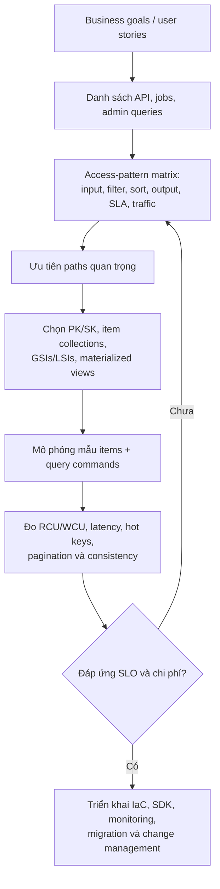
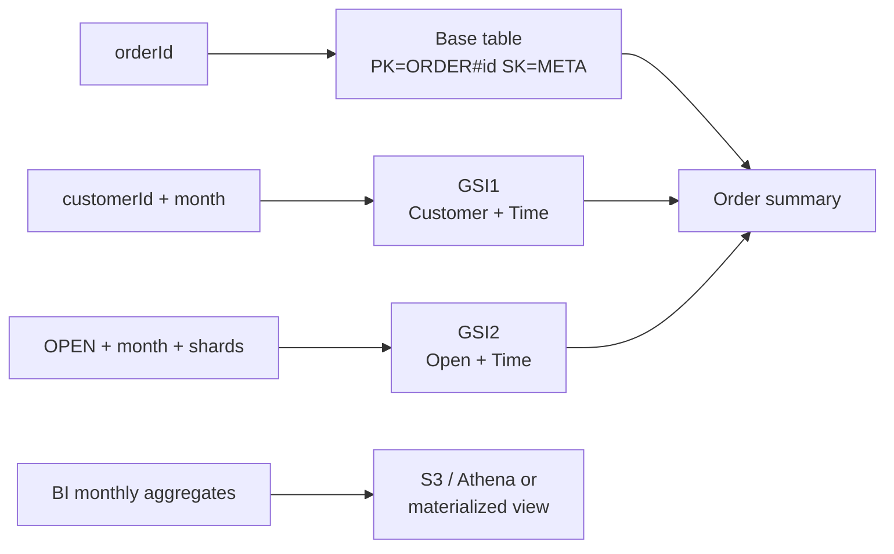
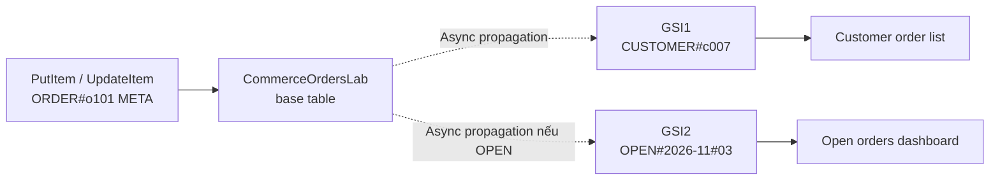
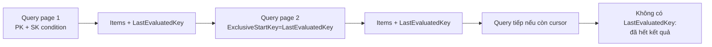
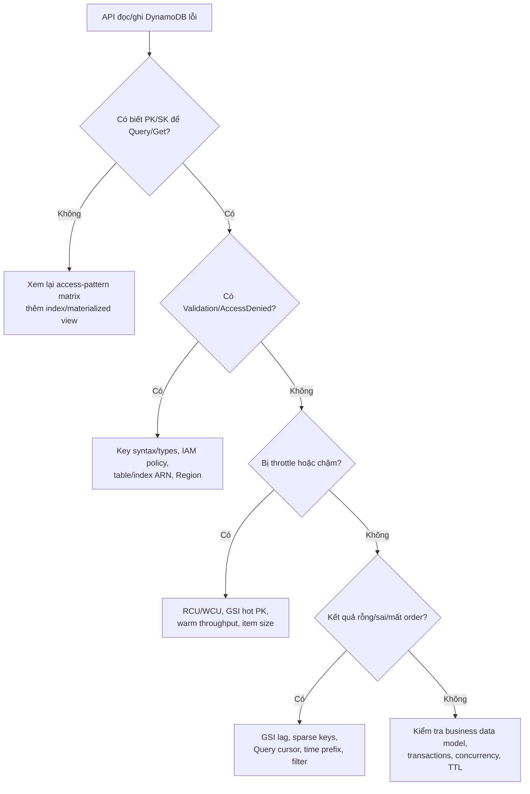
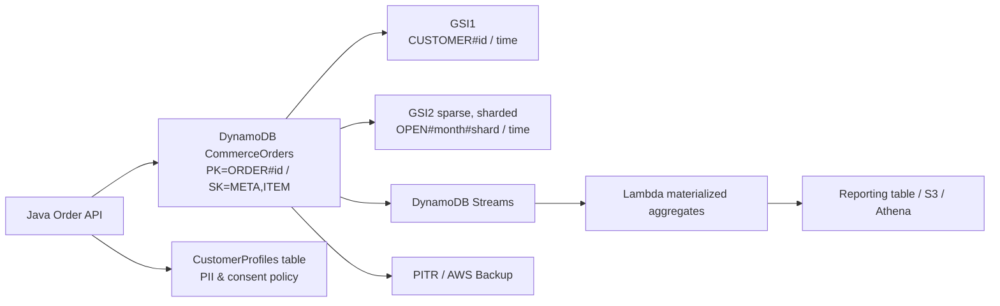

# Thiết kế access pattern trước khi thiết kế bảng

## Mục tiêu học tập

Sau bài học, bạn có thể:

1. Giải thích vì sao **mô hình dữ liệu DynamoDB bắt đầu bằng access patterns** (các cách ứng dụng đọc/ghi dữ liệu), thay vì sao chép sơ đồ bảng quan hệ.
2. Chuyển **user stories, API contracts, luồng nghiệp vụ và SLO** thành ma trận truy cập có **đầu vào, điều kiện lọc/sắp xếp, tần suất, dữ liệu cần trả về và mức nhất quán**.
3. Chọn **partition key (PK)**, **sort key (SK)**, **composite key**, **item collection** và **sort-key prefix** để thực hiện `GetItem`/`Query` hiệu quả, không dựa vào `Scan` trong đường nóng.
4. Phân biệt **GSI** và **LSI**, thiết kế **sparse GSI** và projection hợp lý, đồng thời hiểu những giới hạn về **eventual consistency, chi phí ghi và hot partition**.
5. Lựa chọn **single-table, multi-table hoặc aggregate-oriented design** dựa trên quan hệ truy cập và ranh giới vận hành; không coi single-table là quy tắc bắt buộc.
6. Lập mô hình truy cập cho hệ thống **Java/Spring Boot thương mại điện tử**, gồm chi tiết đơn hàng, dòng hàng, danh sách đơn theo khách hàng và danh sách đơn chưa xử lý.
7. Triển khai thử bằng **AWS CLI và AWS SDK for Java v2**, thực hành query có pagination, conditional update và kiểm chứng **ConsumedCapacity**.
8. Phân tích tác động tới **IAM, bảo mật dữ liệu, đồng bộ GSI, backup, khả năng phục hồi, quan sát chi phí và thay đổi access pattern trong tương lai**.

## 1. Bài toán xuất phát: người dùng hỏi gì, không phải “có bảng gì?”

Giả sử một ứng dụng bán hàng gồm **Order API** viết bằng Java/Spring Boot, trang quản trị cửa hàng và dịch vụ gửi email. Các màn hình cần:

- Khách hàng mở `GET /orders/{orderId}` để xem **một đơn**.
- Khách hàng mở `GET /customers/{customerId}/orders?month=2026-11` để xem **đơn của mình theo thời gian mới nhất**.
- Hệ thống hóa đơn lấy **đơn và các dòng hàng** để tạo PDF.
- Nhân viên vận hành tìm **đơn chưa hoàn tất** của một khoảng ngày, theo thời gian tạo.
- Dịch vụ fulfillment cập nhật `status=PAID` và phải ngăn một thao tác cũ ghi đè phiên bản mới.
- Kho dữ liệu cuối ngày cần tổng doanh thu, top sản phẩm và phân tích lịch sử.

Trong RDBMS, ta thường bắt đầu:

```text
Customer(id, ...)
Order(id, customer_id, created_at, status, ...)
OrderItem(id, order_id, product_id, qty, price, ...)
```

Sau đó viết `JOIN`, `WHERE`, `ORDER BY` và tạo indexes khi phát sinh truy vấn.

Với **Amazon DynamoDB**, các câu hỏi trên phải được biết **trước khi chọn PK/SK/index** vì DynamoDB tối ưu truy cập theo key. Nếu thiết kế `PK=orderId` nhưng một API quan trọng lại muốn “**tất cả đơn chưa xử lý tuần này trên toàn hệ thống**”, việc có nhiều thuộc tính `status` và `createdAt` trên mỗi item **không tự khiến truy vấn đó hiệu quả**. Bạn cần một **access path** thích hợp, ví dụ sparse GSI.

> **Tư duy trọng tâm:** thiết kế dữ liệu sao cho thao tác phổ biến có thể xác định được **partition key** và trả về tập item cần thiết qua `GetItem` hoặc `Query`. Chỉ sau khi biết các đường truy cập đó mới quyết định có bao nhiêu bảng và GSIs.

Theo AWS, cách bắt đầu đúng là xem **user stories và use cases** (hệ thống mới), hoặc đọc **query logs/metrics** (hệ thống hiện có), rồi lập danh sách access patterns cần phục vụ. Đó là cơ sở của data model, không phải bước kiểm tra cuối. Xem [AWS — First steps for modeling relational data](https://docs.aws.amazon.com/amazondynamodb/latest/developerguide/bp-modeling-nosql.html).

## 2. DynamoDB và mô hình quan hệ: khác nhau ở kiểu tối ưu

| Tiêu chí | Cơ sở dữ liệu quan hệ | DynamoDB |
| --- | --- | --- |
| Thiết kế ban đầu | Entities, normalization, quan hệ, constraints. | **Đường truy cập cần phục vụ**, cardinality, tốc độ đọc/ghi và payload. |
| Truy vấn | SQL có `JOIN`, `GROUP BY`, `ORDER BY`, indexes tùy nhu cầu. | `GetItem`/`Query` theo **PK/SK** hoặc GSI/LSI; không có SQL JOIN phía server theo nghĩa RDBMS. |
| Khóa | Primary/foreign keys; indexes đa dạng. | Primary key gồm **partition key** hoặc **partition + sort key**. |
| Phân trang | OFFSET/keyset theo SQL engine. | `LastEvaluatedKey` → `ExclusiveStartKey`. |
| Sắp xếp | `ORDER BY` trên cột/index phù hợp. | `Query` được sắp theo **sort key trong một partition key**, không có global order tùy ý. |
| Biểu diễn quan hệ | JOIN nhiều tables. | **Item collection, composite sort key, GSI, denormalization** hoặc truy xuất nhiều items trong ứng dụng. |
| Nhất quán | Tùy isolation/transaction. | Base table và LSI có thể đọc strong; **GSI chỉ eventual**. |
| Khả năng hỏi tùy ý | Tương đối linh hoạt nếu có indexes và tính chi phí. | Khó nếu truy vấn không được thiết kế trước; cần bổ sung GSI/read model hoặc dịch vụ phân tích. |

Điều này **không có nghĩa DynamoDB tốt hơn cho mọi hệ thống**. Nếu workload cần SQL JOIN động, nhiều truy vấn ad hoc, reporting/OLAP đa chiều hoặc ràng buộc quan hệ phức tạp, **Amazon RDS/Aurora**, **OpenSearch** hoặc **S3/Athena** có thể phù hợp hơn cho phần đó.

### Các loại thao tác cơ bản

| API DynamoDB | Cần gì? | Phù hợp |
| --- | --- | --- |
| `GetItem` | **Đầy đủ PK**; với bảng composite cần cả PK và SK. | Chi tiết một item có key đã biết. |
| `BatchGetItem` | Danh sách keys đã biết, có giới hạn batch và `UnprocessedKeys`. | Đọc nhiều items đã biết khóa; **không tự join/sắp xếp**. |
| `Query` | Giá trị **partition key bằng chính xác** và điều kiện SK tùy chọn. | Liệt kê items của một khách hàng/đơn, lọc theo prefix/range. |
| `Scan` | Không cần PK; đọc qua nhiều partitions/table/index. | Backfill, export, vận hành hiếm khi phù hợp; **tránh trong request path thường xuyên**. |
| `PutItem`/`UpdateItem`/`DeleteItem` | Key chính xác và điều kiện nếu cần. | Ghi một item có thể bảo vệ concurrency. |
| `TransactWriteItems` | Tập operations với điều kiện atomic. | Cần invariant xuyên nhiều items, trong quota giao dịch. |

**Có `FilterExpression` không biến `Scan` thành `Query`:** nó áp dụng **sau khi đọc items**, không giảm lượng đọc tính phí của các items bị lọc.

## 3. Quy trình “access-pattern first” có thể lặp lại



### Bước 1 — Thu thập câu hỏi nghiệp vụ

Đừng ghi một yêu cầu mơ hồ như “cần tìm kiếm đơn hàng”. Hãy cụ thể:

- Người dùng **biết giá trị gì khi gọi API**? `customerId`, `orderId`, `status` hay không biết gì?
- Kết quả là **1 item**, 20 items, 10.000 items hay toàn lịch sử?
- Muốn sắp xếp theo `createdAt DESC` hay theo số tiền?
- Phải đọc ngay dữ liệu vừa viết (**read-after-write strong**) hay chấp nhận GSI lag trong giây/phút?
- Có filter bắt buộc theo ngày, trạng thái, tenant, region, tag?
- Có cần paginate theo cursor, và page tối đa bao nhiêu items?
- Màn hình được gọi bao nhiêu lần/giây? Đỉnh khuyến mãi khác tải thường bao nhiêu?
- Dữ liệu có tăng không giới hạn theo cùng một customer/tenant/status?

### Bước 2 — Phân biệt primary và secondary patterns

**Primary access patterns** là đường đi quyết định p95 latency hoặc tạo tải lớn nhất, ví dụ tra đơn theo ID, lấy danh sách của khách hàng.

**Secondary access patterns** là đường ít thường xuyên nhưng cần đúng, ví dụ dashboard nhân viên xem đơn chưa xử lý, nghiệp vụ batch cuối ngày.

Không bắt buộc mọi câu hỏi được phục vụ bằng **cùng một index**. Một số đường hiếm có thể đi qua **materialized view** cập nhật bởi DynamoDB Streams, một search index, hoặc kho phân tích thay vì thêm GSI cho mọi trường.

### Bước 3 — Phân loại dữ liệu theo *size, shape, velocity*

AWS khuyến nghị đánh giá:

| Chiều | Câu hỏi | Ảnh hưởng đến khóa/index |
| --- | --- | --- |
| **Data size** | Số orders, lines/order, kích thước từng item, năm retention. | Item 400 KB; query page 1 MB; item collection có thể tăng lớn. |
| **Data shape** | Các field nào luôn được đọc cùng nhau? Quan hệ một-nhiều hay nhiều-nhiều? | Embedded map/list, vertical partition, sort key prefix, adjacency list. |
| **Data velocity** | Reads/writes mỗi giây, seasonal peaks, một tenant có vượt trội không? | High-cardinality PK, tránh hot keys, sharding/GSIs. |

Ví dụ với Order API, một đơn có 1–50 line items. **Order summary** luôn được hiển thị độc lập, trong khi invoice worker cần lấy mọi line. Việc tách **META item** và **ITEM#... items** dưới cùng PK vừa hỗ trợ GetItem nhanh, vừa hỗ trợ Query cả item collection.

### Bước 4 — Viết ma trận có thể dùng làm “hợp đồng thiết kế”

Mỗi dòng cần có ít nhất:

1. **Pattern ID, actor/API/job**.
2. **Input keys đã biết** và điều kiện thời gian/trạng thái.
3. **Return shape, sort order, page size**.
4. **Read/write frequency, peak traffic, cardinality**.
5. **Consistency/SLO** và bảo mật theo tenant.
6. **Dự kiến PK/SK/GSI**, số requests/cost và các trade-offs.

Không điền cột PK/SK vội; trước tiên xác định **những điều ứng dụng thực sự cần hỏi**.

## 4. Ma trận access pattern cho hệ thống đơn hàng

Giả định trong ví dụ:

- Mỗi ngày có **120.000 đơn**; lúc khuyến mãi có **2.000 đơn/phút**.
- Một khách hàng bình thường có 1–500 đơn/năm; một số doanh nghiệp/tenant có nhiều hơn đáng kể.
- API hiển thị **20 đơn gần nhất mỗi trang**.
- Trang chi tiết phải lấy dữ liệu đơn mới cập nhật ngay khi người dùng vừa xác nhận.
- Trang vận hành xem **OPEN orders** theo một khoảng ngày/tháng.
- Hệ thống báo cáo doanh thu toàn sàn xử lý **theo batch**, không phải đường GET API tương tác.

| ID | Actor / câu hỏi | Input đã biết | Trả về / thứ tự | Mức tải và consistency | Ý định access path |
| --- | --- | --- | --- | --- | --- |
| **AP01** | Khách xem **chi tiết đơn** | `orderId` | Một META item, mới nhất | Rất cao; có thể cần strong | **GetItem** trên base key |
| **AP02** | Invoice lấy **đơn + tất cả lines** | `orderId` | META + ITEMs của một đơn | Cao; strong nếu cần | **Query** cùng PK; có phân trang |
| **AP03** | Khách xem **20 đơn trong tháng** | `customerId` + `YYYY-MM` | Summary, `createdAt DESC` | Cao; chấp nhận eventual với refresh | **GSI theo customer/time** |
| **AP04** | Ops xem **OPEN orders trong khoảng ngày** | tháng + khoảng timestamp | Danh sách order summaries theo thời gian | Trung bình, có đỉnh; eventual | **Sparse/sharded GSI** |
| **AP05** | Fulfillment đổi trạng thái | `orderId` + `expectedVersion` | Update atomic hoặc conflict | Cao; strong condition | **UpdateItem** + version check |
| **AP06** | Tạo đơn và lines một cách nhất quán | `orderId`, line list | Đơn + lines atomic | Cao; yêu cầu unique order | **TransactWriteItems** |
| **AP07** | Customer service lấy **sự kiện của một đơn** | `orderId` | Events theo timestamp | Trung bình | **Query** prefix `EVENT#` |
| **AP08** | BI tính **tổng doanh thu toàn tháng** | Khoảng ngày, sản phẩm | Aggregate toàn hệ thống | Batch, dữ liệu lớn | **S3/Athena/materialized aggregation**, không Scan mỗi request |

**Chỉ số trên là giả định để thiết kế**, không phải benchmark của AWS hoặc dự báo workload người học. Trong dự án thật, lấy số từ product metrics, API logs và kết quả load test.

### AP03 và AP04 không tự có từ AP01

Biết `orderId` giúp truy cập **một order**, không giúp liệt kê đơn theo customer hoặc trạng thái. Muốn truy cập qua customer, cần đường khóa **Customer → Orders**. Muốn tìm OPEN orders toàn hệ thống, cần một đường **Status/Time → Orders** có phân phối tải.



Đây là cách “để **câu hỏi** quyết định **chỉ mục**”. Chỉ sau khi đủ các dòng AP01–AP08, ta mới lập bảng vật lý.

## 5. Partition key, sort key và item collection

### 5.1. Primary key có hai kiểu

1. **Simple primary key:** chỉ `PK`; mỗi giá trị PK chỉ có một item.
2. **Composite primary key:** `PK + SK`; nhiều items có cùng PK, nhưng **cặp PK/SK phải duy nhất**.

Trong ví dụ, bảng `CommerceOrdersLab` dùng:

```text
PK (String) — partition key
SK (String) — sort key
```

Một item collection theo đơn hàng:

| PK | SK | itemType | Dữ liệu chính |
| --- | --- | --- | --- |
| `ORDER#o101` | `META` | ORDER | customerId, createdAt, status, totalMinor, version |
| `ORDER#o101` | `ITEM#0001` | ORDER_ITEM | sku, quantity, unitPriceMinor |
| `ORDER#o101` | `ITEM#0002` | ORDER_ITEM | sku, quantity, unitPriceMinor |
| `ORDER#o101` | `EVENT#2026-11-20T08:45:00.000Z#e01` | ORDER_EVENT | PaymentAuthorized |
| `ORDER#o101` | `EVENT#2026-11-20T09:00:00.000Z#e02` | ORDER_EVENT | Shipped |

**Item collection** là tập items có **cùng partition-key value**; `Query(PK=ORDER#o101)` có thể lấy tất cả trong thứ tự SK. **Không cần một table riêng cho OrderItems** nếu cách đọc chủ yếu là “mọi items thuộc một order”.

### 5.2. Sort key prefix là phần thiết kế có chủ đích

`META`, `ITEM#...`, `EVENT#...` là **chuỗi quy ước của ứng dụng**, không phải cú pháp đặc biệt DynamoDB. Prefix cho phép:

- `GetItem(PK=ORDER#o101, SK=META)` → order summary.
- `Query(PK=ORDER#o101, begins_with(SK, "ITEM#"))` → order lines.
- `Query(PK=ORDER#o101, begins_with(SK, "EVENT#"))` → audit timeline.
- `Query(PK=ORDER#o101)` → toàn item collection (cần paginate).

Sắp xếp theo SK **trong cùng PK**, với giá trị chuỗi dùng **thứ tự byte UTF-8**. Timestamp ISO-8601 **UTC cố định độ dài** như `2026-11-20T09:00:00.000Z` giúp sắp xếp thời gian đúng khi so sánh lexicographic. Đừng trộn múi giờ/timestamp format kiểu `20/11/2026` và `2026-1-2` rồi mong sorting theo thời gian.

### 5.3. Tách document hay nhúng list?

| Cách lưu | Ưu điểm | Rủi ro |
| --- | --- | --- |
| **Một order item nhúng `items: [...]`** | Một `GetItem` lấy đủ đơn và lines, dễ atomic update một item. | Giới hạn **400 KB/item**; đọc summary cũng kéo theo lines; sửa từng line có thể làm item lớn. |
| **META + ITEM#... riêng dưới PK** | GetItem summary gọn; Query lấy lines; dễ mở rộng số lines và event timeline. | Nhiều items/ghi; nếu cần ghi atomic phải dùng transactions, pagination. |
| **Orders và OrderLines ở hai tables** | Ranh giới throughput/retention/ownership rõ hơn. | Đọc liên kết có thể cần nhiều requests; phức tạp nếu truy cập cùng nhau thường xuyên. |

Mẫu minh họa chọn **META + ITEM#...** vì AP01 và AP02 có đặc điểm truy cập khác nhau, và **Order events** có thể tăng theo thời gian. Đây là **lựa chọn cho access patterns đã giả định**, không phải một schema áp cho mọi business.

## 6. Thiết kế access paths từ AP01–AP08

### 6.1. Base table cho AP01, AP02, AP05, AP06 và AP07

```text
Table: CommerceOrdersLab
  PK = ORDER#<orderId>
  SK = META | ITEM#<lineId> | EVENT#<utcTimestamp>#<eventId>
```

Khi `orderId=o101`:

- AP01 → `GetItem(ORDER#o101, META)`.
- AP02 → `Query(PK=ORDER#o101)`, hoặc hai queries theo prefix nếu chỉ cần META/ITEMs.
- AP05 → `UpdateItem(ORDER#o101, META)` kèm version condition.
- AP06 → transaction ghi META + các ITEM items.
- AP07 → `Query(PK=ORDER#o101, begins_with(SK, "EVENT#"))`.

Không viết `FilterExpression attribute_exists(orderId)` để tìm ORDER, vì như thế vẫn phải đọc nhiều data không liên quan.

### 6.2. GSI1 cho AP03: đơn theo khách hàng và thời gian

Trên **chỉ ORDER META item**, thêm hai thuộc tính:

```text
GSI1PK = CUSTOMER#<customerId>
GSI1SK = <createdAtUTC>#ORDER#<orderId>
```

Ví dụ:

```text
GSI1PK = CUSTOMER#c007
GSI1SK = 2026-11-20T08:45:00.000Z#ORDER#o101
```

Tạo GSI tên `GSI1` dùng `GSI1PK` làm partition key và `GSI1SK` làm sort key, với projection chỉ các trường cần hiển thị trong danh sách. Sau đó:

```text
Query GSI1
  GSI1PK = CUSTOMER#c007
  begins_with(GSI1SK, "2026-11")
  ScanIndexForward = false
  Limit = 20
```

Sắp xếp giảm dần trong **một customer partition** là yêu cầu chính của AP03. Đặt `orderId` sau timestamp để đảm bảo mỗi GSI key phân biệt các đơn tạo cùng mili-giây.

**Không copy GSI1PK/GSI1SK vào từng ITEM#...**: line items không nằm trong danh sách order summaries. Khi chỉ một số items có đầy đủ index keys, GSI được **sparse tự nhiên**.

### 6.3. GSI2 cho AP04: “open orders” và nguy cơ hot key

Một thiết kế ngây thơ:

```text
GSI2PK = STATUS#OPEN
GSI2SK = <createdAt>
```

Sẽ tập trung **mọi đơn OPEN** vào một logical partition key. Khi có 2.000 đơn/phút và nhiều ops workers đọc cùng key, lưu lượng có thể trở thành **hot key**. Adaptive capacity giúp tự phân phối tải nhưng **không thay thế thiết kế key hợp lý**.

Thiết kế ví dụ dùng **tháng + shard**:

```text
GSI2PK = OPEN#2026-11#03
GSI2SK = 2026-11-20T08:45:00.000Z#ORDER#o101

shard = deterministicHash(orderId) mod 4  (00, 01, 02, 03)
```

**Chỉ các ORDER META có status=OPEN** mang hai thuộc tính GSI2. Khi đơn chuyển `PAID`/`CANCELLED`, **remove GSI2PK và GSI2SK** khỏi META → entry tự bị loại khỏi GSI2 sau độ trễ đồng bộ. Đây là một **sparse GSI** thể hiện read model “đơn còn mở”.

Một màn hình hỏi OPEN orders tháng 11 sẽ:

1. Query các shards `OPEN#2026-11#00` đến `...#03`.
2. Mỗi shard dùng `GSI2SK BETWEEN start AND end`.
3. Merge kết quả theo timestamp giảm dần, paginate per-shard cursor.

Đây là **read fanout có kiểm soát**: đổi một hot key thành bốn key và tối đa bốn requests/parallels mỗi page. Nếu số shards tăng, tổng requests/merge complexity cũng tăng, nên phải chọn theo tải thực tế.

**Không sử dụng random shard mới ở mỗi lần cập nhật status**; phải suy ra shard từ `orderId` bằng thuật toán cố định, để write/update/delete dùng key GSI có nhất quán.

### 6.4. AP08: tổng hợp đa chiều không ép vào Query nóng

Yêu cầu “top 100 sản phẩm bán chạy toàn sàn trong năm, filter theo vùng/campaign/category” là **analytics**. Nếu viết `Scan` toàn bảng `CommerceOrdersLab` mỗi request, chi phí và latency tăng theo dữ liệu.

Lựa chọn:

- **DynamoDB Streams → Lambda → materialized aggregate table**, ví dụ `SALE#2026-11#PRODUCT#sku` với update idempotent.
- **DynamoDB export to S3 → Athena/Glue** cho phân tích lịch sử lớn.
- **OpenSearch** cho tìm kiếm nhiều điều kiện/text relevance khi phù hợp.
- **RDS/Aurora** nếu bản chất ứng dụng cần relational reporting/joins thường xuyên.

Không phải mọi access pattern đều thuộc cùng một bảng DynamoDB; **đầu ra của phân tích access pattern có thể là quyết định dùng thêm dịch vụ khác**.

## 7. GSI, LSI và sparse indexes: chọn đường đọc thứ hai

### 7.1. So sánh GSI và LSI

| Đặc điểm | Global Secondary Index (GSI) | Local Secondary Index (LSI) |
| --- | --- | --- |
| Partition key | Có thể **khác** base table. | **Phải giống** base table. |
| Sort key | Có thể khác, hoặc không có. | **Khác** sort key base table. |
| Thời điểm tạo | Khi tạo bảng **hoặc bổ sung sau**. | **Chỉ khi tạo bảng**, không thêm vào bảng đã tồn tại. |
| ConsistentRead | **Eventual only**. | **Eventual hoặc strong**. |
| Giới hạn item collection 10 GB | Không phải giới hạn theo PK cho GSI kiểu LSI. | Với bảng có LSI, **mỗi item collection cùng base PK ≤10 GB**. |
| Công suất/chi phí | Index có storage và write/read capacity riêng; writes base đồng bộ **bất đồng bộ** sang GSI. | Dùng throughput của bảng, gây chi phí đọc/ghi/index storage. |
| Quota thường gặp | **20 GSIs/table** mặc định; xem quota hiện hành. | **5 LSIs/table**. |
| Tình huống | Cần truy vấn theo **customerId**, **status**, **region** thay vì base orderId. | Cần sort order thay thế **trong cùng PK** và strong consistency. |

Thiết kế minh họa dùng **hai GSI**, không LSI. Vì các truy vấn theo `customerId` và `OPEN/month/shard` dùng **partition key khác `ORDER#orderId`**, LSI không giải quyết được AP03/AP04.

### 7.2. GSI hoạt động như một read model

Khi thêm/sửa một ORDER META:



**GSI propagation là asynchronous**, thường nhanh nhưng không có read-after-write strong guarantee. Vì vậy:

- Khi trả response cho `POST /orders`, dùng **orderId/base-table GetItem strong** để kiểm chứng trạng thái mới nếu cần, thay vì lập tức Query GSI1 và kết luận đơn “bị mất”.
- Khi status từ OPEN → PAID, một GSI2 Query có thể **tạm thời trả bản ghi cũ**. Nếu dashboard thực hiện hành động nhạy cảm, xác nhận lại `GetItem` trên base table hoặc dùng điều kiện ghi/transaction.
- Không được truyền `ConsistentRead=true` trong Query GSI: API không hỗ trợ.

### 7.3. Sparse GSI giảm index size và chi phí ghi

Một GSI chỉ có entry cho item **có đủ các index-key attributes**. Với GSI2 gồm `GSI2PK` và `GSI2SK`:

| Item | GSI2PK | GSI2SK | Có trong GSI2? |
| --- | --- | --- | --- |
| Order o101, status OPEN | `OPEN#2026-11#03` | timestamp + orderId | **Có** |
| Order o102, status PAID | *Không có* | *Không có* | **Không** |
| Order o103, status CANCELLED | *Không có* | *Không có* | **Không** |
| Order line `ITEM#0001` | *Không có* | *Không có* | **Không** |
| Order event `EVENT#...` | *Không có* | *Không có* | **Không** |

**Không đặt `GSI2PK=""` hoặc `null` như dấu hiệu “không open”**: key attribute rỗng hoặc sai kiểu có thể gây validation error; **bỏ hẳn attribute** để item không tham gia GSI. Khi status thay đổi, xoá cả hai index key attributes để biểu đạt read model.

### 7.4. Projection: trả đúng dữ liệu cần

Các lựa chọn:

- `KEYS_ONLY`: chỉ index keys và base primary keys.
- `INCLUDE`: keys + các non-key attributes cụ thể, ví dụ `status`, `totalMinor`, `customerId`.
- `ALL`: sao chép mọi attributes vào index.

Với AP03, list 20 orders chỉ cần `orderId`, `createdAt`, `status`, `totalMinor`. Dùng `INCLUDE` giúp index gọn hơn so với `ALL`, giảm storage/write amplification khi items có metadata lớn.

**Lưu ý:** Query trên GSI **không tự fetch non-projected attributes từ base table**. Nếu frontend cần thêm chi tiết không nằm trong projection, có thể dùng key của base item trả về rồi `BatchGetItem` (và xử lý `UnprocessedKeys`), hoặc điều chỉnh projection khi tính toán tổng chi phí/độ trễ. Với LSI, truy vấn có thể kéo dữ liệu không được project từ base table, dẫn đến thêm I/O.

### 7.5. Thêm GSI sau khi đã có bảng

DynamoDB cho phép thêm **GSI mới** vào bảng hiện có. Nhưng không được xem việc này như thay một index SQL tức thì:

1. Tạo GSI qua IaC/`UpdateTable`.
2. DynamoDB thực hiện backfill index entries từ base table.
3. Theo dõi `IndexStatus=CREATING` và metrics liên quan.
4. Khi `ACTIVE` và dữ liệu/chi phí đã kiểm chứng, mới chuyển read traffic.
5. Giữ compatibility với code cũ và xác định phương án bỏ index không dùng.

GSI backfill/throughput có thể tạo thêm tải và một GSI thiếu write capacity có thể dẫn đến **write throttling** cho base table. Quản lý migration qua staged rollout, không bổ sung index mới trước giờ mở bán lớn khi chưa đánh giá tải.

## 8. Single-table, multi-table hay aggregate design?

Không phải câu trả lời lúc nào cũng là “**một bảng DynamoDB cho cả hệ thống**”.

### 8.1. Single-table design

Một table dùng PK/SK có prefix chứa nhiều entity types:

```text
PK=ORDER#o101, SK=META
PK=ORDER#o101, SK=ITEM#0001
PK=ORDER#o101, SK=EVENT#...
PK=CUSTOMER#c007, SK=PROFILE
PK=PRODUCT#sku55, SK=META
```

Ưu điểm:

- **Access-correlated entities** được query cùng nhau.
- Giảm số bảng, có thể làm nhiều access patterns qua composite keys và overloaded GSIs.
- Một số nghiệp vụ đọc cả aggregate chỉ với một Query.

Nhược điểm:

- Key conventions và index overloading phức tạp; thay đổi một entity có thể ảnh hưởng index shared.
- IAM permissions theo entity/tenant không tự dễ hơn chỉ vì cùng table.
- Retention/backup/PITR, table class và billing mode là quyết định ở mức bảng, các entity có nhu cầu rất khác nhau có thể bị kéo chung.
- Đòi hỏi team thống nhất serialization, ownership và migration.

### 8.2. Multi-table design

Ví dụ:

```text
CommerceOrders: Order META + ITEM + EVENT
CustomerProfiles: Customer profile, PII, consent
ProductCatalog: Product searchable metadata
Inventory: SKU/Warehouse stock and reservations
```

Phù hợp khi các entities:

- Có **operational ownership khác nhau** (team Inventory độc lập team Orders).
- Có **access patterns độc lập**, ít khi cần cùng một Query.
- Có **compliance, retention, encryption/backup, throughput hoặc tenant boundaries khác**.
- Cần triển khai/scale/migrate tách rời.

Nhược điểm là nếu ứng dụng cần trả tổng hợp qua nhiều bảng, phải gọi thêm APIs hoặc tạo read models/materialized views; không có JOIN tự động từ DynamoDB.

### 8.3. Aggregate-oriented design: lựa chọn trung gian

Tổ chức items theo **aggregate business thường đọc/ghi cùng nhau**, ví dụ:

- Order META + lines + order events nằm chung PK.
- Customer profiles riêng vì PII/lifecycle khác.
- Product catalog riêng vì cập nhật/search khác.
- Inventory reservations theo `SKU#warehouse` hoặc `reservationId` phù hợp concurrency.

Thiết kế mẫu của bài chọn **một bảng Orders** (không buộc toàn bộ hệ thống chung bảng). Đây là lựa chọn thực tế vì AP01/AP02/AP07 liên quan order collection, còn inventory/customer lifecycle có thể tách.

### 8.4. Tiêu chí ra quyết định

| Câu hỏi | Nếu “có” | Gợi ý |
| --- | --- | --- |
| Các entities thường được đọc **cùng một request**? | Order + OrderItems. | Cùng item collection hoặc embedded aggregate. |
| Có ranh giới IAM/PII/retention khác nhau? | Customer PII khác Order audit. | Multi-table hoặc account boundary. |
| Các access patterns đều đã xác định và ổn định? | API nghiệp vụ tương đối ổn định. | Single-table có thể hiệu quả. |
| Nhu cầu query ad hoc thay đổi hằng tuần? | Analytics/search exploratory. | RDS/OpenSearch/Athena hoặc separate read model. |
| Nhóm sở hữu triển khai khác nhau? | Inventory, payments, catalog. | Tách bảng theo bounded context có lợi. |
| Một partition key có nguy cơ tăng không giới hạn? | Tenant lớn và nhiều events trong cùng PK. | Split aggregate, time buckets, archive, tránh LSI. |

**Quy tắc ứng dụng:** chọn số bảng **sau** khi hiểu luồng đọc/ghi, không bắt đầu bằng khẩu hiệu “DynamoDB luôn cần single-table”.

## 9. Tránh hot partition và thiết kế phân phối tải

### 9.1. Partition key nên có cardinality phù hợp

DynamoDB hash giá trị partition key để phân phối lưu trữ/traffic lên physical partitions. Nhiều giá trị PK phân phối hoạt động thường tốt hơn một giá trị có lưu lượng quá lớn.

| PK đề xuất | Rủi ro | Cải tiến |
| --- | --- | --- |
| `PK=STATUS#OPEN` | Mọi đơn mới tập trung về một PK nóng. | `OPEN#YYYY-MM#shard`; hoặc read model riêng. |
| `PK=DATE#2026-11-20` | Toàn bộ uploads/orders hôm nay cùng PK. | Hash sharding, per-tenant/per-order PK. |
| `PK=TENANT#mega-tenant` | Một tenant lớn có thể vượt tải/size distribution. | Partition theo tenant + entity/shard, cân nhắc tenant isolation. |
| `PK=ORDER#orderId` | Thường phân phối tốt nếu orderId đa dạng. | Giữ nguyên cho Order aggregate, test order có cực nhiều events. |

AWS nêu **khả năng thông lượng tối đa thiết kế mỗi physical partition** khoảng **3.000 read units/giây** và **1.000 write units/giây**, tùy kích thước và consistency. Đây **không phải số requests/giây không đổi** và không có nghĩa mọi partition key luôn bị khóa ở các con số đó: adaptive capacity/splitting, capacity mode, index và request-size đều ảnh hưởng.

### 9.2. Adaptive capacity không thay thế thiết kế

Adaptive capacity có thể tự tái phân bổ throughput cho hot partitions, nhưng:

- Một **item duy nhất được ghi rất nhiều** vẫn có giới hạn vật lý/hot key.
- **GSI** có thể nóng dù base table phân phối tốt.
- Bảng có **LSI** chịu ràng buộc item collection/physical partition và giới hạn **10 GB cùng PK**.
- Nếu lưu lượng mới vượt **warm throughput / on-demand maximum / provisioned capacity**, request vẫn có thể throttle.

Kiểm tra phân phối **cả base table lẫn GSIs**. Một table không báo hot key không có nghĩa GSI2 không bị nóng khi cập nhật toàn bộ status OPEN.

### 9.3. Write sharding cho OPEN orders

Ví dụ bốn shards:

```text
hash(o101) mod 4 = 3 → OPEN#2026-11#03
hash(o102) mod 4 = 1 → OPEN#2026-11#01
hash(o103) mod 4 = 0 → OPEN#2026-11#00
hash(o104) mod 4 = 2 → OPEN#2026-11#02
```

**Hash kết quả ở đây chỉ minh họa**, không phải output bắt buộc của thuật toán `String.hashCode()`. Đội ngũ phải thống nhất một thuật toán cụ thể (ví dụ SHA-256 modulo số shards hoặc `Math.floorMod(orderId.hashCode(), N)` nếu tất cả producers cùng Java), chuẩn hóa text và giữ ổn định qua các phiên bản.

**Đánh đổi quan trọng:** query OPEN orders theo tháng **không thể gọi một Query rồi nhận global sorted list**. Phải query từng shard, merge các danh sách đã sort và quản lý cursor của từng shard. Nếu đổi số shards từ 4 → 16, cần giữ logic đọc tương thích với dữ liệu cũ hoặc migration.

### 9.4. Time bucketing và giới hạn tăng trưởng

Nếu `ORDER#o101` có hàng triệu events trong nhiều năm, việc query tất cả events thành một item collection lớn có thể tốn nhiều pages. Giải pháp:

- Chỉ giữ **events gần đây** dưới ORDER PK, archive lâu dài sang S3.
- Tách event timeline theo `ORDER#o101#EVENTS#2026-11` (đổi pattern AP07 và API fanout theo tháng).
- Dùng `DynamoDB Streams → S3` hoặc event store riêng.
- Chọn retention và TTL theo chính sách, lưu ý TTL delete là **asynchronous**, không phải cron chính xác vào giây thứ N.

Thiết kế mở rộng này cần được quyết định qua **cardinality và retention** trong matrix, không chỉ sau khi bảng đã quá lớn.

## 10. Query hiệu quả: KeyConditionExpression khác FilterExpression

### 10.1. Query luôn cần partition-key equality

Với base table có `PK`/`SK`:

```text
Đúng:
  PK = "ORDER#o101"
  SK begins_with "ITEM#"

Đúng:
  PK = "ORDER#o101"
  SK BETWEEN "EVENT#2026-11-01" AND "EVENT#2026-11-30~"

Sai về tư duy:
  status = "OPEN" AND createdAt > "2026-11-01"
  (không chỉ ra partition key của table hoặc index)
```

Với `Query`, `KeyConditionExpression` yêu cầu **equality trên partition key**, còn sort key có thể dùng `=`, so sánh, `BETWEEN` và `begins_with` theo điều kiện key schema. Các non-key attributes dùng `FilterExpression` sau khi đọc, hoặc phải được chuyển thành index keys khi pattern thường xuyên.

### 10.2. FilterExpression không tiết kiệm read capacity

Giả sử một customer có 5.000 orders, trong đó 100 orders đang OPEN. Cách đọc:

```text
Query GSI1PK = CUSTOMER#c007
FilterExpression = status = "OPEN"
```

DynamoDB vẫn **đọc các index entries theo key/page trước**, rồi **loại** những items không khớp filter. Nó không giảm read capacity tính theo lượng dữ liệu đã đọc. Nếu lọc OPEN là đường nóng, một **sparse index hoặc materialized access path** đáng cân nhắc hơn.

**`ProjectionExpression` cũng không làm giảm số read units của dữ liệu được đọc trên base table**, vì capacity đọc được tính trên kích thước item đã đọc, không phải chỉ những fields được trả về. Dù vậy projection giúp giảm **response bytes/network payload**; trong GSI, chọn projection khi **tạo index** làm entry thực sự nhỏ hơn.

### 10.3. Query page 1 MB và LastEvaluatedKey

Mỗi `Query` đọc tối đa **1 MB dữ liệu cho một service response** (hoặc dừng sớm theo `Limit`), rồi mới áp dụng filter. Khi còn items, response có `LastEvaluatedKey`.

Luồng phân trang:



**Trường hợp rất dễ nhầm:** có `FilterExpression`, một page có thể trả **0 items** nhưng **vẫn có LastEvaluatedKey**. Không kết luận “hết dữ liệu” chỉ vì `Items` rỗng. Chỉ khi không còn `LastEvaluatedKey` thì hết dữ liệu của truy vấn.

Với API paginated 20 results/page, nên trả **opaque continuation token** chứa cursor DynamoDB (có integrity protection hoặc encode theo chính sách), không dùng `OFFSET=10000` như SQL. Khi có multi-shard GSI2, token phải giữ **cursor của từng shard** và trạng thái merge, không chỉ một `LastEvaluatedKey`.

### 10.4. Sort order trong Query

`ScanIndexForward=true` là tăng dần, `false` là giảm dần **theo sort key**. Ví dụ `GSI1SK=timestamp#ORDER#id` thì `false` cho đơn mới trước, miễn timestamp được chuẩn hóa đúng.

**Không có global ORDER BY cross-partition trong một Query**. Với GSI2 bốn shards, muốn “10 OPEN orders mới nhất toàn sàn” phải lấy ứng viên từ **mỗi shard**, merge và xử lý paging/concurrency hợp lý ở ứng dụng.

### 10.5. Strong và eventual consistency

| Nơi đọc | `ConsistentRead=true` được hỗ trợ? | Ví dụ |
| --- | --- | --- |
| Base table `GetItem`/`Query` | **Có**. | Kiểm tra ngay trạng thái Order META vừa ghi. |
| LSI `Query` | **Có**. | Đọc biến thể sorting của cùng partition. |
| GSI `Query` | **Không**. | Danh sách đơn theo customer hoặc OPEN index có thể lag. |
| Global table replica | Xem consistency/replication model cụ thể. | Không suy ra bản sao Region khác luôn đọc strong tức thì. |

Với **critical path** như xác minh đơn đã trả tiền, dùng **conditional writes và base-table strong read** khi cần, không dựa vào GSI ngay sau cập nhật. Các màn hình history có thể chấp nhận eventual và refresh/retry thông minh.

## 11. Từ access matrix đến Capacity và chi phí

### 11.1. Hiểu đơn vị đọc/ghi

DynamoDB có **On-demand** và **Provisioned** modes. Khi dự báo, có thể bắt đầu từ đơn vị dung lượng:

- **1 WCU** cho một thao tác ghi chuẩn **tối đa 1 KB**, làm tròn lên theo KB. Transactional write thường dùng **gấp đôi** capacity.
- **1 RCU** cho một strongly consistent read **tối đa 4 KB**; eventual consistent read dùng khoảng **0,5 RCU** cho cùng payload; transactional read thường dùng gấp đôi mức strong.
- Với On-demand, AWS tính tương ứng theo **read/write request units**; GSI writes/reads và storage được tính riêng theo biểu giá.

| Tác vụ minh họa | Dung lượng giả định | Chi phí capacity sơ bộ |
| --- | --- | --- |
| Put order META | 1,5 KB | Khoảng **2 write units** trên base table. |
| GetItem META strong | 3 KB | Khoảng **1 read unit**. |
| GetItem META eventual | 3 KB | Khoảng **0,5 read unit**. |
| GetItem 10 KB strong | 10 KB | Khoảng **3 read units** do làm tròn mỗi 4 KB. |
| Put item thay đổi GSI1 + GSI2 | Meta + index entries | **Base write + mỗi GSI entry write/storage** theo kích thước projected data. |
| Query lọc 100 items còn 5 items | Đọc 100 items | Dùng capacity theo **100 items đã đọc**, không chỉ 5 trả về. |

Đây là ví dụ tính **đơn vị**, không phải báo giá USD. Trong code thực tế, bật `ReturnConsumedCapacity=TOTAL` hoặc `INDEXES` để đo lượng dùng thực tế. Với transactions, conditional failures, GSI updates, global tables và streams cần áp dụng bảng tính phí riêng theo AWS.

### 11.2. Chọn On-demand hay Provisioned

| Mode | Phù hợp | Điều vẫn phải kiểm soát |
| --- | --- | --- |
| **On-demand (PAY_PER_REQUEST)** | Workload mới, biến động, khó dự báo; AWS mặc định khuyến nghị cho nhiều ứng dụng. | Hot keys, account/table quotas, **warm throughput**, optional max throughput caps, chi phí spikes. |
| **Provisioned (RCU/WCU)** | Workload ổn định, có thể dự báo; muốn kiểm soát capacity/budget. | Auto Scaling policies, burst, throttles, capacity của GSIs. |

On-demand **không có nghĩa throughput vô hạn**. AWS đã có các khái niệm **warm throughput** (mức read/write mà table/GSI có thể hỗ trợ tức thời) và cấu hình **maximum on-demand throughput** để giới hạn chi phí/tải ở cấp table/GSI, có thể gây throttling khi vượt. Pre-warm chủ động có thể phát sinh phí; cần kiểm tra quota và bảng giá hiện hành trước giờ cao điểm.

### 11.3. Chi phí index và denormalization

Giả sử mỗi order META được ghi một lần, cập nhật trạng thái ba lần:

- Base table có write requests cho mỗi update.
- GSI1 lưu summary để query theo customer, cập nhật entry khi fields projected thay đổi.
- GSI2 chỉ giữ OPEN orders; tạo entry khi OPEN, xóa entry sau khi PAID/CANCELLED.
- Nếu denormalize cùng status vào nhiều items, mỗi lần cập nhật có thể cần sửa nhiều items hoặc dùng stream materialization.

**Một GSI không miễn phí**: cân nhắc chi phí writes, storage, propagation và consistency. Nhưng một index được dùng thường xuyên có thể rẻ hơn hàng triệu `Scan` hoặc nhiều round trips.

### 11.4. Ước lượng tải theo access patterns, không theo bảng

Ví dụ AP03 gọi **100 requests/giây**, mỗi request trả **20 order summaries 0,5 KB**:

```text
Ước lượng logical payload: 20 × 0,5 KB = 10 KB / Query.
Tải index đọc: khoảng 100 × 10 KB = 1 MB dữ liệu/giây
              trước overhead/page/consistency/rounding.
```

Đây chỉ là **ước lượng sơ bộ**, không suy ra chính xác RCUs vì kích thước index entry, size rounding, pagination và consistency ảnh hưởng. Hãy đo `ConsumedCapacity` trong thử tải và kiểm tra GSI throttling. Với AP04, còn phải tính **fanout 4 shards** và merge.

### 11.5. Trade-offs: latency, consistency, cost

| Mục tiêu | Cách tốt thường gặp | Đánh đổi |
| --- | --- | --- |
| Latency thấp khi đọc order detail | GetItem trực tiếp theo PK/SK. | Cần biết orderId, không tìm tùy ý. |
| Latency thấp khi liệt kê orders/customer | GSI1 có projection đủ fields. | Storage/write cost, eventual consistency. |
| Index OPEN nhỏ | Sparse GSI2. | Cần set/remove index keys khi đổi trạng thái; lag. |
| Giảm hot GSI2 | Shard theo month/hash. | Fanout/multi-cursor pagination phức tạp hơn. |
| Strong sau payment | Base table GetItem strong + conditional write. | Read units cao hơn eventual, tách read model khỏi GSI. |
| Query analytics linh hoạt | S3/Athena/OpenSearch/materialized views. | Độ trễ đồng bộ ETL/Streams, thêm hệ thống vận hành. |

## 12. Lab AWS CLI: tạo bảng theo access patterns đã chốt

**Phạm vi lab:** AWS account thử nghiệm, Region `ap-southeast-1`, bảng `CommerceOrdersLab` **chưa tồn tại**. Các lệnh có thể tạo tài nguyên tính phí. Không chạy trên production hoặc sửa bảng đang được ứng dụng khác dùng. AWS CLI và quyền IAM `dynamodb:CreateTable`/`PutItem`/`Query`/`UpdateItem`/`DeleteTable` cần được cấp phù hợp.

### 12.1. Xác minh môi trường

```bash
aws sts get-caller-identity
aws configure get region
```

Đừng tin vào tên profile/shell prompt; xác minh **Account** và Region trước khi tạo/xóa DynamoDB table.

### 12.2. Tạo file cấu hình bảng

Lưu vào `create-commerce-orders.json`:

```json
{
  "TableName": "CommerceOrdersLab",
  "BillingMode": "PAY_PER_REQUEST",
  "AttributeDefinitions": [
    { "AttributeName": "PK", "AttributeType": "S" },
    { "AttributeName": "SK", "AttributeType": "S" },
    { "AttributeName": "GSI1PK", "AttributeType": "S" },
    { "AttributeName": "GSI1SK", "AttributeType": "S" },
    { "AttributeName": "GSI2PK", "AttributeType": "S" },
    { "AttributeName": "GSI2SK", "AttributeType": "S" }
  ],
  "KeySchema": [
    { "AttributeName": "PK", "KeyType": "HASH" },
    { "AttributeName": "SK", "KeyType": "RANGE" }
  ],
  "GlobalSecondaryIndexes": [
    {
      "IndexName": "GSI1",
      "KeySchema": [
        { "AttributeName": "GSI1PK", "KeyType": "HASH" },
        { "AttributeName": "GSI1SK", "KeyType": "RANGE" }
      ],
      "Projection": {
        "ProjectionType": "INCLUDE",
        "NonKeyAttributes": [
          "orderId",
          "customerId",
          "createdAt",
          "status",
          "totalMinor"
        ]
      }
    },
    {
      "IndexName": "GSI2",
      "KeySchema": [
        { "AttributeName": "GSI2PK", "KeyType": "HASH" },
        { "AttributeName": "GSI2SK", "KeyType": "RANGE" }
      ],
      "Projection": {
        "ProjectionType": "INCLUDE",
        "NonKeyAttributes": [
          "orderId",
          "customerId",
          "status",
          "totalMinor"
        ]
      }
    }
  ]
}
```

**Vì sao `AttributeDefinitions` không liệt kê `status`/`totalMinor`?** Chỉ cần định nghĩa thuộc tính được dùng làm **table/index key** khi tạo bảng, không cần khai báo schema cứng cho mọi trường non-key. Item attributes khác có thể có kiểu String/Number/Map/List theo từng item, với các giới hạn DynamoDB.

Tạo bảng:

```bash
aws dynamodb create-table \
  --cli-input-json file://create-commerce-orders.json \
  --region ap-southeast-1

aws dynamodb wait table-exists \
  --table-name CommerceOrdersLab \
  --region ap-southeast-1

aws dynamodb describe-table \
  --table-name CommerceOrdersLab \
  --region ap-southeast-1 \
  --query 'Table.{Status:TableStatus,Billing:BillingModeSummary,Keys:KeySchema,GSIs:GlobalSecondaryIndexes[].{Name:IndexName,Status:IndexStatus}}'
```

**Đợi cả GSI1 và GSI2 ở trạng thái `ACTIVE`** trước khi query. Table `ACTIVE` không luôn đồng nghĩa mọi GSI đang sẵn sàng sau thay đổi index.

### 12.3. Ghi ORDER META item mẫu

Lưu `order-meta.json`:

```json
{
  "PK": { "S": "ORDER#o101" },
  "SK": { "S": "META" },
  "itemType": { "S": "ORDER" },
  "orderId": { "S": "o101" },
  "customerId": { "S": "c007" },
  "createdAt": { "S": "2026-11-20T08:45:00.000Z" },
  "status": { "S": "OPEN" },
  "totalMinor": { "N": "125000" },
  "currency": { "S": "VND" },
  "version": { "N": "1" },
  "GSI1PK": { "S": "CUSTOMER#c007" },
  "GSI1SK": { "S": "2026-11-20T08:45:00.000Z#ORDER#o101" },
  "GSI2PK": { "S": "OPEN#2026-11#03" },
  "GSI2SK": { "S": "2026-11-20T08:45:00.000Z#ORDER#o101" }
}
```

Giá trị `03` ở GSI2 dùng cho lab như shard đã được một hàm định tuyến ổn định chọn; với ứng dụng thật, cần sử dụng thuật toán thống nhất, **không gán ngẫu nhiên tùy ý** theo từng thao tác.

```bash
aws dynamodb put-item \
  --table-name CommerceOrdersLab \
  --item file://order-meta.json \
  --condition-expression "attribute_not_exists(PK) AND attribute_not_exists(SK)" \
  --return-consumed-capacity TOTAL \
  --region ap-southeast-1
```

`ConditionExpression` giúp **không overwrite** META hiện có khi chạy lại lab. Nếu item đã tồn tại, DynamoDB có thể trả `ConditionalCheckFailedException` — đây là hành vi mong đợi, không phải lý do bỏ điều kiện trên production.

### 12.4. Ghi hai ORDER ITEM items

Lưu `order-item-1.json`:

```json
{
  "PK": { "S": "ORDER#o101" },
  "SK": { "S": "ITEM#0001" },
  "itemType": { "S": "ORDER_ITEM" },
  "sku": { "S": "SKU-AX11" },
  "quantity": { "N": "2" },
  "unitPriceMinor": { "N": "50000" }
}
```

Lưu `order-item-2.json`:

```json
{
  "PK": { "S": "ORDER#o101" },
  "SK": { "S": "ITEM#0002" },
  "itemType": { "S": "ORDER_ITEM" },
  "sku": { "S": "SKU-BB20" },
  "quantity": { "N": "1" },
  "unitPriceMinor": { "N": "25000" }
}
```

```bash
aws dynamodb put-item \
  --table-name CommerceOrdersLab \
  --item file://order-item-1.json \
  --condition-expression "attribute_not_exists(PK)" \
  --region ap-southeast-1

aws dynamodb put-item \
  --table-name CommerceOrdersLab \
  --item file://order-item-2.json \
  --condition-expression "attribute_not_exists(PK)" \
  --region ap-southeast-1
```

**Lab ghi ba items bằng lệnh riêng để dễ hiểu key layout, không bảo đảm atomic “create order + lines”**. Trong production với AP06, dùng `TransactWriteItems` khi cần đảm bảo toàn bộ đơn và dòng hàng được ghi cùng nhau, cùng với idempotency.

### 12.5. AP01: GetItem order summary

```bash
aws dynamodb get-item \
  --table-name CommerceOrdersLab \
  --key '{"PK":{"S":"ORDER#o101"},"SK":{"S":"META"}}' \
  --consistent-read \
  --return-consumed-capacity TOTAL \
  --region ap-southeast-1
```

Kết quả trả một `Item` có status, customer, total và version. `--consistent-read` yêu cầu **strong consistency** trên base table; hãy chỉ dùng khi nghiệp vụ cần.

### 12.6. AP02: Query các dòng hàng của một đơn

```bash
aws dynamodb query \
  --table-name CommerceOrdersLab \
  --key-condition-expression "PK = :pk AND begins_with(SK, :prefix)" \
  --expression-attribute-values '{":pk":{"S":"ORDER#o101"},":prefix":{"S":"ITEM#"}}' \
  --consistent-read \
  --return-consumed-capacity TOTAL \
  --region ap-southeast-1
```

Vì các ITEM items không chứa `GSI1PK/GSI2PK`, chúng **không xuất hiện trong GSIs**, nhưng vẫn nằm trong item collection của base table.

### 12.7. AP03: Query GSI1 theo customer và month

```bash
aws dynamodb query \
  --table-name CommerceOrdersLab \
  --index-name GSI1 \
  --key-condition-expression "GSI1PK = :pk AND begins_with(GSI1SK, :month)" \
  --expression-attribute-values '{":pk":{"S":"CUSTOMER#c007"},":month":{"S":"2026-11"}}' \
  --scan-index-forward false \
  --limit 20 \
  --return-consumed-capacity INDEXES \
  --no-paginate \
  --region ap-southeast-1
```

Ở đây **không có `--consistent-read`** vì GSI chỉ hỗ trợ eventual consistency. `--no-paginate` giúp ví dụ thấy rõ **một trang response** có thể kèm `LastEvaluatedKey` để ứng dụng dùng làm cursor.

### 12.8. AP04: Query GSI2 một shard OPEN

```bash
aws dynamodb query \
  --table-name CommerceOrdersLab \
  --index-name GSI2 \
  --key-condition-expression "GSI2PK = :pk AND GSI2SK BETWEEN :from AND :to" \
  --expression-attribute-values '{":pk":{"S":"OPEN#2026-11#03"},":from":{"S":"2026-11-20T00:00:00.000Z"},":to":{"S":"2026-11-20T23:59:59.999Z#~"}}' \
  --scan-index-forward false \
  --return-consumed-capacity INDEXES \
  --region ap-southeast-1
```

Lệnh này chỉ đọc **shard 03**. Để hiển thị **tất cả OPEN orders** trong tháng/ngày, ứng dụng cần query các shards `00`–`03`, merge các trang theo `GSI2SK` và tiếp tục cursors đúng.

### 12.9. AP05: Update trạng thái có optimistic concurrency

Khi payment worker cập nhật OPEN → PAID:

```bash
aws dynamodb update-item \
  --table-name CommerceOrdersLab \
  --key '{"PK":{"S":"ORDER#o101"},"SK":{"S":"META"}}' \
  --update-expression "SET #st = :paid, #ver = :next REMOVE GSI2PK, GSI2SK" \
  --condition-expression "#st = :open AND #ver = :expected" \
  --expression-attribute-names '{"#st":"status","#ver":"version"}' \
  --expression-attribute-values '{":paid":{"S":"PAID"},":open":{"S":"OPEN"},":expected":{"N":"1"},":next":{"N":"2"}}' \
  --return-values ALL_NEW \
  --return-consumed-capacity INDEXES \
  --region ap-southeast-1
```

Lợi ích:

1. **Condition** ngăn worker phiên bản cũ ghi đè trạng thái đã thay.
2. `status` và `version` đổi **atomic trong một item**.
3. **Remove `GSI2PK/GSI2SK`** khiến đơn không còn trong sparse OPEN index sau khi GSI propagation.
4. GSI1 projection có `status` nên được cập nhật **asynchronously**.

Nếu `ConditionalCheckFailedException` xảy ra, worker phải **đọc trạng thái mới** và quyết định idempotency/concurrency; không bỏ condition để ép ghi. Không suy ra UpdateItem thất bại chỉ vì đọc GSI2 thấy entry cũ ngay sau cập nhật.

### 12.10. Chỉ thực hiện cleanup trên tài nguyên lab

```bash
aws dynamodb delete-table \
  --table-name CommerceOrdersLab \
  --region ap-southeast-1

aws dynamodb wait table-not-exists \
  --table-name CommerceOrdersLab \
  --region ap-southeast-1
```

**Cảnh báo:** xóa bảng sẽ xóa tất cả items và các GSIs liên quan. Chỉ làm khi chắc chắn `CommerceOrdersLab` thuộc lab, không có dữ liệu/worker khác, và đã xác minh account/Region. Với production, cần backup/PITR, change approval và migration plan trước mọi thao tác phá hủy.

## 13. Java SDK for DynamoDB: một access pattern là một repository method

Trong dự án Java/Spring Boot, nên biểu diễn access patterns thành **API methods rõ nghĩa**, thay vì cho mọi controller tự tạo tùy ý `ScanRequest`:

```text
OrderRepository
  getOrderSummary(orderId)                 # AP01
  getOrderLines(orderId)                   # AP02
  listOrdersByCustomer(customerId, month)  # AP03
  listOpenOrdersByDate(month, dayRange)    # AP04
  updateOrderStatus(orderId, version, ...) # AP05
  createOrderAtomically(order, lines)      # AP06
  listOrderEvents(orderId)                 # AP07
```

Mỗi method nên khai báo: **bảng/GSI, expected key, consistency, pagination, IAM resource, DTO shape và quota**. Điều này làm lộ rõ phần nào của thiết kế bị tác động khi sản phẩm yêu cầu cách đọc mới.

### 13.1. Dependencies và credentials

AWS SDK for Java v2 có module:

```text
software.amazon.awssdk:dynamodb
```

Dùng version AWS SDK v2/BOM theo dependency management của dự án, Java runtime được hỗ trợ và **default credentials provider chain** (IAM role trên EC2/ECS/EKS/Lambda hoặc AWS profile dev). Không hardcode access key ID/secret access key, cũng không trộn account dev/prod.

Ví dụ Java sử dụng low-level `DynamoDbClient` để thấy rõ PK/SK và Query APIs. Nếu dùng `DynamoDbEnhancedClient`, bạn có thể map item types sang POJO/bean, nhưng vẫn phải giữ **cùng key design và access-pattern constraints**.

### 13.2. GetItem (AP01) và Query GSI1 (AP03)

```java
import java.util.Map;
import software.amazon.awssdk.regions.Region;
import software.amazon.awssdk.services.dynamodb.DynamoDbClient;
import software.amazon.awssdk.services.dynamodb.model.AttributeValue;
import software.amazon.awssdk.services.dynamodb.model.GetItemRequest;
import software.amazon.awssdk.services.dynamodb.model.QueryRequest;
import software.amazon.awssdk.services.dynamodb.model.QueryResponse;
import software.amazon.awssdk.services.dynamodb.model.ReturnConsumedCapacity;

public final class OrderAccessRepository implements AutoCloseable {
    private final DynamoDbClient dynamoDb;
    private final String tableName;

    public OrderAccessRepository(String tableName) {
        this.dynamoDb = DynamoDbClient.builder()
                .region(Region.AP_SOUTHEAST_1)
                .build();
        this.tableName = tableName;
    }

    private static AttributeValue s(String value) {
        return AttributeValue.builder().s(value).build();
    }

    // AP01: exact key, strong read for read-after-write path.
    public Map<String, AttributeValue> getOrderSummary(String orderId) {
        return dynamoDb.getItem(GetItemRequest.builder()
                .tableName(tableName)
                .key(Map.of(
                        "PK", s("ORDER#" + orderId),
                        "SK", s("META")
                ))
                .consistentRead(true)
                .returnConsumedCapacity(ReturnConsumedCapacity.TOTAL)
                .build()).item();
    }

    // AP03: one service page; client must preserve LastEvaluatedKey.
    public QueryResponse listCustomerOrdersPage(
            String customerId,
            String yearMonth,
            Map<String, AttributeValue> cursor) {
        if (!yearMonth.matches("[0-9]{4}-[0-9]{2}")) {
            throw new IllegalArgumentException("yearMonth must be YYYY-MM");
        }

        QueryRequest.Builder request = QueryRequest.builder()
                .tableName(tableName)
                .indexName("GSI1")
                .keyConditionExpression(
                        "GSI1PK = :customer AND begins_with(GSI1SK, :month)")
                .expressionAttributeValues(Map.of(
                        ":customer", s("CUSTOMER#" + customerId),
                        ":month", s(yearMonth)
                ))
                .scanIndexForward(false)
                .limit(20)
                .returnConsumedCapacity(ReturnConsumedCapacity.INDEXES);
        if (cursor != null && !cursor.isEmpty()) {
            request.exclusiveStartKey(cursor);
        }
        return dynamoDb.query(request.build());
    }

    @Override
    public void close() {
        dynamoDb.close();
    }
}
```

Trong controller/service:

```java
try (OrderAccessRepository repository =
             new OrderAccessRepository("CommerceOrdersLab")) {
    var oneOrder = repository.getOrderSummary("o101");
    var firstPage = repository.listCustomerOrdersPage("c007", "2026-11", null);

    firstPage.items().forEach(item -> {
        // Parse projected fields into a safe API DTO; avoid logging PII.
        System.out.println(item.get("orderId").s());
    });

    Map<String, AttributeValue> nextPageCursor = firstPage.lastEvaluatedKey();
    if (nextPageCursor != null && !nextPageCursor.isEmpty()) {
        var secondPage = repository.listCustomerOrdersPage(
                "c007", "2026-11", nextPageCursor);
        System.out.println("Second page count = " + secondPage.count());
    }
}
```

**Production considerations:**

- Với Spring Boot, dùng một singleton/reused DynamoDbClient thay vì tạo/đóng client **mỗi HTTP request**; đoạn `try-with-resources` chỉ để minh họa.
- Xác minh `orderId/customerId` thuộc đúng **tenant và authenticated caller**; API không được trả đơn chỉ vì một người dùng đoán ID khác.
- Trả `LastEvaluatedKey` dưới dạng **opaque cursor** có scope/validation, không cho client tùy ý sửa cursor để truy cập tenant khác.
- Khi dữ liệu thay đổi giữa các trang, `Query` pagination **không tạo snapshot nhất quán toàn bộ**. Đừng dùng nó làm chứng từ kế toán không thể thay đổi.
- Với GSI1, không bật strong read và không mặc định order mới xuất hiện tức thời; UI có thể hiển thị kết quả từ response của create-order trước khi list GSI bắt kịp.

### 13.3. Tránh một repository method `findAllByStatus` không có index

Code dưới đây là **anti-pattern cho API nóng**:

```java
// Không nên dùng cho dashboard giao dịch realtime:
// ScanRequest.builder().tableName(tableName)
//   .filterExpression("#st = :open")
//   .build();
```

Giải pháp AP04 là **query GSI2 từng shard**. Nếu N shards và cần newest 20 orders toàn hệ thống, cần:

1. Query mỗi shard với same time range, `ScanIndexForward=false`.
2. Merge candidates bằng priority queue theo timestamp/orderId.
3. Giữ state gồm cursor và các candidates chưa tiêu thụ của từng shard.
4. Giới hạn fanout/concurrency, tránh N queries lớn hơn mức cần thiết.
5. Chấp nhận GSI eventual consistency; xác minh lại trạng thái base table trước action nhạy cảm.

Không thể gọi DynamoDB một lần với `IN (shard00, shard01, ...)` trong partition-key Query để có global sorted result. Đây là **chi phí complexity của write sharding** mà matrix phải ghi nhận trước.

## 14. Write patterns: điều kiện, transaction và idempotency

### 14.1. Ghi đơn hàng đồng bộ nhiều items

Nếu tạo đơn có một META và hai ITEM rows mà ghi lần lượt không transaction, lỗi mạng có thể để lại dữ liệu “META tồn tại nhưng thiếu một line”.

**`TransactWriteItems`** ghi nhiều items theo cơ chế **all-or-nothing**. Giới hạn hiện hành:

- Tối đa **100 actions** tới **100 items khác nhau**.
- Tổng kích thước các items trong giao dịch không vượt **4 MB**.
- Các bảng trong transaction phải cùng **AWS account và Region**.
- Không được target **cùng một item** bằng hai actions trong cùng transaction.
- Dùng `ClientRequestToken` để **idempotent transaction request trong cửa sổ 10 phút**; không coi đó là khóa chống duplicate business lâu dài.

Đây là ví dụ rút gọn file `create-order-transaction.json` (khi chưa tồn tại `ORDER#o202`):

```json
{
  "ClientRequestToken": "addd517e-d762-4b0a-b95c-0a42b40a78e1",
  "ReturnConsumedCapacity": "TOTAL",
  "TransactItems": [
    {
      "Put": {
        "TableName": "CommerceOrdersLab",
        "Item": {
          "PK": { "S": "ORDER#o202" },
          "SK": { "S": "META" },
          "itemType": { "S": "ORDER" },
          "orderId": { "S": "o202" },
          "customerId": { "S": "c007" },
          "status": { "S": "OPEN" },
          "version": { "N": "1" },
          "createdAt": { "S": "2026-11-20T09:00:00.000Z" },
          "totalMinor": { "N": "90000" },
          "GSI1PK": { "S": "CUSTOMER#c007" },
          "GSI1SK": { "S": "2026-11-20T09:00:00.000Z#ORDER#o202" },
          "GSI2PK": { "S": "OPEN#2026-11#01" },
          "GSI2SK": { "S": "2026-11-20T09:00:00.000Z#ORDER#o202" }
        },
        "ConditionExpression": "attribute_not_exists(PK)"
      }
    },
    {
      "Put": {
        "TableName": "CommerceOrdersLab",
        "Item": {
          "PK": { "S": "ORDER#o202" },
          "SK": { "S": "ITEM#0001" },
          "itemType": { "S": "ORDER_ITEM" },
          "sku": { "S": "SKU-CC55" },
          "quantity": { "N": "1" },
          "unitPriceMinor": { "N": "90000" }
        },
        "ConditionExpression": "attribute_not_exists(PK)"
      }
    }
  ]
}
```

Gửi transaction:

```bash
aws dynamodb transact-write-items \
  --cli-input-json file://create-order-transaction.json \
  --region ap-southeast-1
```

**Chú ý:** file này ghi **một META + một ITEM**, vì đó là dữ liệu o202 minh họa; với đơn có nhiều lines, thêm một Put cho từng line và tuân giới hạn transaction. `GSI2PK=...#01` là shard lab giả định, không phải hash bắt buộc của orderId.

Nếu retry cùng `ClientRequestToken`/parameters trong 10 phút, DynamoDB có cơ chế idempotent transaction request; sau đó application vẫn cần **business uniqueness key** như orderId/checkoutRequestId và conditional writes. Các lỗi `TransactionCanceledException` có thể do conflict, condition, capacity hoặc validation; phân biệt nguyên nhân, không retry vô hạn.

### 14.2. Optimistic locking khi cập nhật order

Khi hai workers cùng đọc `version=1`:

```text
Worker A: chuyển OPEN → PAID với expectedVersion=1 → SUCCESS, version=2
Worker B: chuyển OPEN → CANCELLED với expectedVersion=1 → CONDITIONAL FAILURE
```

Điều kiện `version=:expected AND status=:expectedStatus` buộc B đọc lại trạng thái thay vì ghi đè payment. Đây là thiết kế **concurrency trên một business aggregate**, không phải chỉ một chi tiết của API.

### 14.3. Idempotency khác optimistic concurrency

- **Optimistic concurrency** bảo vệ không ghi đè dữ liệu mới bằng bản cũ.
- **Idempotency** bảo vệ một business operation được chạy lại không tạo side effect thứ hai.

Nếu payment gateway đã capture nhưng mạng timeout trước UpdateItem, request có thể được xử lý lại. Hãy dùng `paymentOperationId` ổn định, một item idempotency với conditional write hoặc provider idempotency key; không tạo transaction ID mới mỗi lần retry.

### 14.4. BatchWriteItem và BatchGetItem không phải transactions

| API | Giới hạn/đặc tính chính | Không bảo đảm |
| --- | --- | --- |
| `BatchGetItem` | Tối đa 100 keys, 16 MB response và có thể trả `UnprocessedKeys`. | Kết quả không nhất thiết theo thứ tự request; phải map theo key. |
| `BatchWriteItem` | Tối đa 25 put/delete requests, 16 MB request, có `UnprocessedItems`. | **Không atomic toàn batch**, không có điều kiện riêng từng item như `PutItem`. |
| `TransactWriteItems` | Tối đa 100 actions, 4 MB tổng, cùng account/Region. | Không biến external side effects (email/payment) thành transaction. |

Khi cần atomic invariant cho order + lines, dùng **transaction**. Khi backfill khối lượng lớn và chấp nhận từng item thành công/thất bại riêng, batch APIs có thể phù hợp nhưng phải retry unprocessed items với exponential backoff.

## 15. Khi access pattern thay đổi: thêm index hay đổi read model?

Giả sử sau sáu tháng product manager bổ sung:

> “Cho phép nhân viên xem **tất cả orders chứa một SKU trong 30 ngày**, sắp xếp từ mới đến cũ.”

Ma trận cũ AP01–AP08 không chứa truy vấn **SKU → Orders**. Table hiện có ITEM rows mang `sku` nhưng **PK là `ORDER#orderId`**, nên không thể Query nhanh theo SKU.

### Ba lựa chọn

| Lựa chọn | Thiết kế | Ưu và nhược |
| --- | --- | --- |
| **GSI3 trên ITEM rows** | `GSI3PK=SKU#sku`, `GSI3SK=createdAt#ORDER#orderId#ITEM#lineId`. | Có read path trực tiếp; tăng write/index storage, cần timestamps trên line items. |
| **Materialized lookup table** | `OrdersBySku` PK=`SKU#sku` SK=timestamp/orderId, cập nhật bởi app/Streams. | Ranh giới riêng, có eventual consistency/dual-write complexity. |
| **Search/analytics store** | Stream/export sang OpenSearch/S3/Athena. | Phù hợp truy vấn linh hoạt, nhưng thêm latency vận hành và hạ tầng. |

Nếu tính năng này là **API giao dịch thường xuyên**, có thể ưu tiên GSI3 (nếu quota/chi phí/consistency phù hợp). Nếu chỉ báo cáo tháng, chọn Athena thường hợp lý hơn việc thêm GSI tốn writes cho toàn bộ thời gian.

### Quy trình thay đổi an toàn

1. Ghi một dòng **AP09** trong matrix: input, filter, sort, số results, traffic, consistency và SLO.
2. Đo cardinality/size theo SKU; **hot SKU** có nguy cơ hot partition, cân nhắc sharding/bucketing.
3. Thiết kế projection và index schema; nếu thêm GSI, update ứng dụng để set key attrs cho **items mới**.
4. Tạo GSI/backfill; index chỉ chứa items có đầy đủ key attrs, nên **items cũ thiếu thuộc tính** phải được xử lý/backfill riêng.
5. Theo dõi `IndexStatus`, throttling, GSI storage/write capacity và correctness sample queries.
6. Chuyển consumer sang đường Query mới bằng feature flag; giữ đường cũ/rollback plan.
7. Theo dõi chi phí/truy cập sau phát hành, xóa index không cần khi đã xác minh.

**Không thể sửa primary key schema của table đang tồn tại bằng `UpdateTable`**. Nếu cần đổi `PK/SK` của base table, thường phải tạo table mới, backfill/migrate, chuyển traffic và reconcile dữ liệu; với LSI cũng không thể thêm sau khi tạo table.

### Thay đổi shards không chỉ là một biến cấu hình

Ví dụ tăng từ 4 → 16 shards cho GSI2:

- Dữ liệu đã ghi dưới `OPEN#2026-11#00..03` vẫn ở đó.
- Data mới có thể dùng 16 shards; nếu reader chỉ query 16 keys theo cách mới mà không phân biệt routing version, có thể bỏ sót/đọc trùng.
- Phải lưu **shardSchemeVersion** hoặc versioned partition-key prefix, migration/dual-read kế hoạch rõ ràng.
- Cursor pagination xuyên shards thay đổi cấu trúc, nên không dùng cursor cũ vô thời hạn.

Schema evolution ở DynamoDB là **thay đổi đường đọc/ghi và hợp đồng dữ liệu**, không chỉ ALTER TABLE.

## 16. Bảo mật và phân tách tenant ngay từ access-pattern design

### 16.1. Khóa dữ liệu cũng là ranh giới truy cập

Một SaaS có nhiều cửa hàng/tenants cần bảo đảm rằng tenant A **không bao giờ đọc được order tenant B**, kể cả khi biết `orderId`.

Thiết kế ban đầu:

```text
PK = ORDER#o101
```

Có thể phù hợp nếu mỗi table/account chỉ chứa dữ liệu một tenant, hoặc application authorization luôn chặt chẽ. Nhưng nếu bảng dùng chung nhiều tenants, nên đưa **tenant context** vào khóa và mọi access path:

```text
Base PK   = TENANT#t55#ORDER#o101
GSI1PK    = TENANT#t55#CUSTOMER#c007
GSI2PK    = TENANT#t55#OPEN#2026-11#03
```

Những key này giúp repository luôn truy vấn theo tenant do authentication layer cung cấp, thay vì nhận tenant ID tùy ý từ query string của client.

**Đây là phương án mở rộng để áp cho multi-tenant production, khác với lab single-tenant ở các mục trước.** Nếu sửa convention PK/GSI như trên, phải chuyển toàn bộ queries, IAM policies, dữ liệu và cursors tương ứng; không chỉ sửa code một chỗ.

### 16.2. IAM least privilege cho table và index

Một IAM role chỉ được truy vấn Orders base table và hai GSIs có thể dùng tài nguyên:

```json
{
  "Version": "2012-10-17",
  "Statement": [
    {
      "Sid": "ReadOrdersOnly",
      "Effect": "Allow",
      "Action": [
        "dynamodb:GetItem",
        "dynamodb:BatchGetItem",
        "dynamodb:Query"
      ],
      "Resource": [
        "arn:aws:dynamodb:ap-southeast-1:111122223333:table/CommerceOrdersLab",
        "arn:aws:dynamodb:ap-southeast-1:111122223333:table/CommerceOrdersLab/index/GSI1",
        "arn:aws:dynamodb:ap-southeast-1:111122223333:table/CommerceOrdersLab/index/GSI2"
      ]
    }
  ]
}
```

Đây là policy **ví dụ read-only** và **không cấp Scan/Update**. Để viết, cần role riêng hoặc thêm actions theo nghiệp vụ/CI. Nếu ứng dụng cần hard tenant isolation theo IAM, có thể nghiên cứu condition key `dynamodb:LeadingKeys` kết hợp key prefix và principal tags, nhưng chính sách đó cần kiểm thử với **base table và từng GSI**.

**IAM không tự thay business authorization**: DynamoDB role thường là role của backend Lambda/ECS, không phải user đăng nhập qua Cognito. Backend phải xác minh JWT/identity và quyền `customerId/orderId/tenantId` trước khi tạo truy vấn.

### 16.3. Dữ liệu nhạy cảm và mô hình index

- Tránh để **email, số điện thoại, số thẻ, access token** trong PK/GSI keys vì keys có thể xuất hiện trong logs, metrics, error messages và API inputs.
- Dùng **opaque IDs** và các thuộc tính có quyền truy cập thích hợp, đặt dữ liệu PII vào bảng bounded context riêng nếu retention/consent khác.
- DynamoDB hỗ trợ mã hóa at rest; customer managed KMS keys theo yêu cầu compliance và policy, nhưng không thay access control/field-level protection.
- Với dữ liệu nhạy cảm trong map/list, cân nhắc **application-level/attribute-level encryption**. Nếu mã hóa field cần tìm kiếm, hãy thiết kế trước cách lưu **blind index/deterministic lookup token** phù hợp và đánh giá rủi ro cryptography, không mong DynamoDB Query tìm được ciphertext tùy ý.
- Bật **PITR**/AWS Backup theo RPO/RTO và phân quyền restoration, test restore thay vì coi TTL/Streams là backup.

### 16.4. Table/index resource policies, VPC endpoints và audit

Trong kiến trúc private workloads:

- EC2/ECS/EKS/Lambda gọi DynamoDB qua AWS API, có thể dùng **Gateway VPC Endpoint cho DynamoDB** trong VPC/Region được hỗ trợ, đi kèm route table và endpoint policy phù hợp.
- IAM permissions, SCP, permissions boundary và VPC endpoint policy đều có thể chặn request.
- DynamoDB có **CloudTrail** cho các API theo loại management/data events và cấu hình audit; không mặc định mọi GetItem/Query đều được log mà không bật/cân nhắc phí data events.
- Với cross-account access, cần thiết kế IAM identity/resource permissions và mã hóa theo các khả năng DynamoDB/Region hiện có.

Đừng mở toàn bộ IAM resource `"*"` hay đổi bảng production sang public access chỉ để giải lỗi `AccessDeniedException`.

## 17. Quan sát chất lượng access patterns trong production

### 17.1. Dashboard nên trả lời câu hỏi gì?

Không đủ nếu chỉ thấy “table status ACTIVE”. Quan sát cần xác định:

1. **AP01–AP07** thực sự dùng `GetItem/Query` theo key đã thiết kế hay có route dùng `Scan`?
2. Độ trễ **p95/p99 theo API** có đạt SLO khi peak traffic?
3. `ConsumedReadCapacityUnits`/`ConsumedWriteCapacityUnits` tăng ở base table hay **GSI nào**?
4. `ReadThrottleEvents`/`WriteThrottleEvents`, `ThrottledRequests` hoặc throttling reason có liên quan **hot key/index** không?
5. GSI1/GSI2 có **IndexStatus ACTIVE** và độ trễ propagation có chấp nhận được?
6. Truy vấn có nhiều **ScannedCount** nhưng rất ít **Count** vì filter quá nhiều không?
7. Có pages `LastEvaluatedKey` tồn tại nhưng ứng dụng chỉ đọc trang đầu, làm mất kết quả không?
8. Lượng dữ liệu trên order/item collection, số GSIs và tổng chi phí có tăng ngoài dự báo?

### 17.2. CloudWatch và Contributor Insights

| Nguồn | Metric/tín hiệu | Ý nghĩa vận hành |
| --- | --- | --- |
| DynamoDB CloudWatch | `ConsumedReadCapacityUnits` | Read capacity bị sử dụng ở bảng/GSI. |
| DynamoDB CloudWatch | `ConsumedWriteCapacityUnits` | Write capacity, có thể do base/GSIs cập nhật. |
| DynamoDB CloudWatch | `SuccessfulRequestLatency` | Latency phía DynamoDB API, không bao gồm toàn bộ client/network. |
| DynamoDB CloudWatch | `ReadThrottleEvents` / `WriteThrottleEvents` | Throttling theo read/write; cần xem table/index dimensions. |
| DynamoDB CloudWatch | `ThrottledRequests` | Requests bị throttle; kiểm tra error details/retry. |
| DynamoDB CloudWatch | `OnlineIndexPercentageProgress`/index status (khi tạo GSI) | Theo dõi backfill/index creation. |
| DynamoDB CloudWatch | `OnDemandMaxReadRequestUnits`/`OnDemandMaxWriteRequestUnits` | Giới hạn on-demand đã cấu hình nếu có. |
| **CloudWatch Contributor Insights for DynamoDB** | Hot keys/throttled keys, request patterns khi bật. | Xác định partition keys gây skew. |
| AWS Cost Explorer | Chi phí DynamoDB read/write/storage, GSIs, backups. | Đo cost per business request. |
| Application traces/logs | `patternId`, `table/index`, latency, request units, pages. | Biết route nào có access pattern xấu. |

Tên/availability của từng metric có thể khác theo mode/Region/tính năng AWS; xem DynamoDB metrics reference khi triển khai. Contributor Insights có thể phát sinh **chi phí riêng**, nên bật theo nhu cầu và kiểm soát dữ liệu nhạy cảm trong keys.

### 17.3. Đo với ReturnConsumedCapacity

Trong CLI:

```bash
aws dynamodb query \
  --table-name CommerceOrdersLab \
  --index-name GSI1 \
  --key-condition-expression "GSI1PK = :pk" \
  --expression-attribute-values '{":pk":{"S":"CUSTOMER#c007"}}' \
  --return-consumed-capacity INDEXES \
  --no-paginate \
  --region ap-southeast-1
```

Xem `ConsumedCapacity.TableName`, `CapacityUnits` và `GlobalSecondaryIndexes` (tùy operation), cùng `Count`, `ScannedCount` và `LastEvaluatedKey`.

**Một tiêu chí review access pattern:** cùng một API trả 20 items nhưng đọc tới hàng nghìn items qua `FilterExpression` là tín hiệu phải xem lại key/index. Ngược lại, `ScannedCount ≈ Count` thường tốt hơn nhưng **không đủ** để kết luận hết nguy cơ hot key, GSI lag hoặc excessive response pages.

### 17.4. Truy vấn hiếm nhưng đắt có thể gây spike

Dashboard admin chỉ mở **một lần mỗi giờ** nhưng chạy `Scan` toàn 100 triệu items vẫn có thể tiêu tốn nhiều read units, làm tăng bills và cạnh tranh capacity với API traffic.

Giải pháp thường tốt hơn:

- Tạo materialized summary cho dashboard.
- Dùng export to S3/Athena cho phân tích lớn.
- Chạy backfill/export theo lịch và tài nguyên có giới hạn.
- Nếu bắt buộc Scan, cân nhắc parallel scan, page cap, rate limit và **throttle budget** riêng ngoài giờ cao điểm.

Thiết kế access patterns phải tính **cost × frequency × data volume**; truy vấn hiếm không có nghĩa tự động rẻ.

## 18. Kế hoạch kiểm thử access-pattern matrix

### 18.1. Kiểm thử tính đúng đắn

| Pattern | Test case | Pass khi |
| --- | --- | --- |
| AP01 | Sau update OPEN→PAID, GetItem strong. | Trả PAID và version mới. |
| AP02 | Order có 50 lines, Query prefix `ITEM#`. | Không thiếu/nhân đôi items, xử lý pagination. |
| AP03 | Một customer có nhiều orders trong hai tháng. | `begins_with(YYYY-MM)` chỉ trả tháng cần, sort DESC đúng. |
| AP04 | OPEN orders ở bốn shards trong ngày. | Fanout/merge trả đủ, đúng thứ tự, cursor tiếp theo ổn định trong điều kiện test. |
| AP05 | Hai workers cập nhật cùng expectedVersion. | Chỉ một update thành công, worker khác nhận conditional failure. |
| AP06 | Transaction tạo META + 2 lines, một condition fail. | Không có partial items còn lại. |
| AP07 | Ghi nhiều EVENT items cùng đơn. | Query prefix EVENT trả đúng timeline và không lấy ITEMs. |
| AP08 | Báo cáo doanh thu toàn tháng. | Chạy qua analytics/materialized path, không scan toàn table trong API request. |

### 18.2. Kiểm thử consistency

- Sau PutItem, **GetItem strong** trên base table phải thấy order mới.
- Query GSI1 ngay sau PutItem có thể chưa thấy order, nhưng sau propagation phải thấy.
- Khi status OPEN→PAID, GSI2 có thể còn item tạm thời; API thao tác nhạy cảm phải xác nhận lại base.
- Nếu hệ thống frontend yêu cầu “tạo đơn xong danh sách hiện ngay”, có thể **optimistic UI update** bằng response create-order hoặc direct GetItem; đừng xây correctness trên GSI read-after-write strong không tồn tại.

### 18.3. Kiểm thử tải

Mô phỏng:

1. **Normal**: 100 đơn/phút, đa customer.
2. **Peak**: 2.000 đơn/phút, tỷ lệ khách mới cao.
3. **Skew**: một customer/tenant “siêu lớn” tạo nhiều orders liên tục.
4. **Hot status**: 90% orders đang OPEN, GSI2 nhận nhiều updates.
5. **Pagination**: customer có 10.000 orders, nhiều pages, frontend liên tục load more.
6. **Read-after-write**: payment update và UI load lại tức thì.

Đo **latency, throttles, consumed RCU/WCU, GSI cost, per-shard skew, DB client retries** và sự chính xác của returned items. Mục tiêu là xác minh **ma trận**, không phải chỉ đạt requests/giây tổng cộng.

### 18.4. Kiểm thử failure/recovery

- GSI2 bị lag hoặc throughput throttling; API cần fallback hoặc hiển thị trạng thái chưa đồng bộ.
- App retry `PutItem` sau timeout; conditional expression ngăn overwrite hoặc business idempotency key bảo vệ.
- GSI backfill trong lúc API traffic tăng; đo write throttling và rollback feature flag.
- Temporary IAM deny tới index ARN; xác minh error được quan sát và không tự Scan làm fallback phá chi phí.
- Restore table từ PITR sang table mới, cập nhật stream/index/permissions theo quy trình.
- Hết retention/TTL; xác minh ứng dụng **không dùng TTL làm hạn khóa business** vì delete chạy bất đồng bộ.

### 18.5. Checklist review trước khi tạo bảng thật

- [ ] Mỗi API/job có **pattern ID** và **input keys** rõ ràng.
- [ ] Phần lớn request path quan trọng dùng `GetItem`/`Query`, không cần Scan.
- [ ] Base PK/SK hỗ trợ aggregate reads; GSIs hỗ trợ những lookup keys thực sự khác.
- [ ] GSI projections chỉ gồm fields cần cho màn hình/list.
- [ ] Strong vs eventual consistency được ghi theo pattern.
- [ ] Hot key/tenant skew/partition distribution đã được đánh giá.
- [ ] Cursor/pagination và format thời gian đã được test.
- [ ] Transactional writes và concurrency protection phù hợp.
- [ ] PII/IAM/KMS/tenant boundary và audit được duyệt.
- [ ] Cost/quotas, alarms, backup/PITR và migration plan đã có.

## 19. Troubleshooting: lỗi truy vấn hay lỗi thiết kế?

| Triệu chứng | Nguyên nhân khả dĩ | Hướng xử lý |
| --- | --- | --- |
| `Query` bị `ValidationException` vì thiếu PK condition | Chỉ lọc `status` hoặc `createdAt` nhưng không biết partition key. | Thiết kế GSI/materialized path hoặc đưa PK equality vào `KeyConditionExpression`. |
| Query trả rỗng dù item tồn tại | Sai prefix PK/SK, timestamp không chuẩn UTC, đang query nhầm index/Region. | `GetItem` base, kiểm tra exact keys, validate types/case và IndexStatus. |
| GSI query không thấy order vừa tạo | **GSI eventual consistency** và replication lag. | Read-after-write base table strong hoặc retry refresh theo SLO. |
| `ConsistentRead=true` trên GSI lỗi | GSI không hỗ trợ strong read. | Bỏ strong với GSI; dùng base table cho critical validation. |
| Kết quả Query không đúng thứ tự ngày | SK dùng ngày dạng khác chuẩn, trộn timezone hoặc padding không đồng nhất. | Chuẩn hóa `YYYY-MM-DDTHH:mm:ss.SSSZ` và sort key convention. |
| Filter trả 0 items nhưng còn `LastEvaluatedKey` | 1 MB/page hoặc `Limit` áp trước filter. | Tiếp tục với `ExclusiveStartKey` đến khi không còn cursor. |
| Query 20 results nhưng tốn nhiều RCU | `FilterExpression` loại phần lớn items hoặc index projection quá rộng. | Chuyển tiêu chí phổ biến sang key/GSI; kiểm tra `ScannedCount`/`Count`. |
| Dashboard OPEN quá chậm | Tất cả OPEN thuộc `STATUS#OPEN` hot PK, hoặc fanout shards chưa tối ưu. | Time buckets, shard theo key ổn định, rate limit, caching/read model riêng. |
| `ProvisionedThroughputExceededException`/`ThrottlingException` | GSI/base hot partition, provisioned/on-demand max, traffic spike. | CloudWatch throttling reasons, consumed capacity, warm throughput, re-shard và retry jitter. |
| `GetItem` bị AccessDenied nhưng Query GSI lại được | IAM role có index ARN mà thiếu base table permission, hoặc tenant policy hạn chế. | IAM/resource/endpoint policy theo table/index, không cấp wildcard bừa bãi. |
| `ConditionalCheckFailedException` sau update | Worker đang dùng version/status cũ hoặc item đã tồn tại. | Đọc lại bản hiện tại, kiểm tra idempotency/concurrency và retry hợp lý. |
| `TransactionCanceledException` khi tạo order | Trùng META key, capacity, constraint hoặc transaction conflict. | Xem cancellation reasons, business request ID và trạng thái items; không bỏ điều kiện để ghi đè. |
| GSI2 vẫn chứa đơn PAID | GSI lag hoặc UpdateItem không remove index-key attributes. | Kiểm tra META gốc, GSI2PK/SK, propagation, update expression. |
| GSI2 thiếu một số orders OPEN | Item cũ không có đủ GSI2PK/GSI2SK, backfill chưa hoàn tất, lỗi type. | Kiểm tra base data/schema migration và GSI IndexStatus. |
| Không thể thêm LSI sau khi đã tạo bảng | LSI chỉ được tạo ở `CreateTable`. | Lập table migration hoặc dùng GSI khác phù hợp. |
| Item collection có LSI tiến tới 10 GB | Cùng PK có quá nhiều items. | Archive/repartition, tránh LSI cho collection không giới hạn. |
| Item > 400 KB không ghi được | Nhúng document/lines/logs quá lớn. | Tách items, dùng S3 reference, giảm attributes. |
| Dữ liệu quá hạn vẫn xuất hiện sau TTL | DynamoDB TTL **xóa bất đồng bộ**, có thể mất vài ngày. | Filter/check expiry trong app, không dùng TTL làm khóa business chính xác. |
| Cursor từ tenant khác trả kết quả sai | API không ràng buộc cursor với query/tenant/authentication. | Opaque signed cursor, encode pattern/query scope, validate caller và expiration. |

### Cách chẩn đoán theo lớp



**Không xử lý một lỗi Query bằng cách đổi sang Scan mặc định** nếu API nóng và bảng lớn. Phải xác định thiếu access path, lỗi IAM/index, item chưa propagate hay query key sai trước.

## 20. Tình huống thiết kế: chiến dịch flash sale

### Bối cảnh

Một ứng dụng thương mại điện tử dùng DynamoDB cho Order API:

- **1 triệu khách hàng**, 20.000 đơn/ngày bình thường và 400.000 đơn/ngày flash sale.
- Ở giờ cao điểm, một merchant/tenant có thể chiếm 30% traffic.
- Khách hàng xem 20 đơn gần nhất; invoice worker cần order + tất cả lines.
- Ops cần liệt kê OPEN orders trong 48 giờ gần nhất.
- Payment worker ghi PAID/CANCELLED và phải tránh race.
- Product team muốn tìm theo SKU, nhưng chỉ sau lần triển khai đầu.
- Compliance yêu cầu customer PII có retention và quyền truy cập chặt hơn order metadata.

### 20.1. Bắt đầu bằng các câu hỏi, không bằng số bảng

Trước khi quyết định một hay nhiều tables:

1. API nào có p95 yêu cầu thấp và QPS lớn nhất?
2. Luồng nào có **key đã biết**: orderId, customerId, sku hay ngày/trạng thái?
3. Order/line items tăng đến bao nhiêu, có vượt 400 KB nếu embedded?
4. Thời gian cần hiển thị OPEN mới nhất có bắt buộc strong không?
5. Một tenant lớn có làm hot GSI status hoặc customer không?
6. Bao nhiêu dữ liệu thật sự cần trong list view, có thể dùng projections?
7. Ranh giới PII/backup/retention có khiến Customer table nên tách?

### 20.2. Phương án đề xuất



Lý do:

- **Order summary và lines** liên quan chặt → cùng order item collection.
- **Customer order history** là reverse access path → GSI1.
- **OPEN dashboard** chỉ cần subset → sparse GSI2 có shard; ops check base trước khi action.
- **Customer PII** có security/retention khác → table riêng.
- **Reporting** không làm Scan hàng triệu items mỗi lần → Streams/analytics view.

### 20.3. Đánh đổi và lựa chọn thay thế

| Quyết định | Lợi ích | Chi phí/rủi ro |
| --- | --- | --- |
| Một bảng Order + Lines | Ít round trips; query collection. | Transactional writes khi tạo order, pagination khi nhiều lines. |
| GSI1 by customer | Fast customer history sort. | GSI storage/write cost, eventual consistency. |
| Sharded sparse GSI2 | Tránh OPEN hot key. | N-way fanout và cursor merge phức tạp. |
| CustomerProfiles riêng | PII/ownership rõ. | Order API có thể cần request riêng khi đọc customer. |
| Aggregates qua Streams | Giảm full scans cho reports. | Eventual view, duplicate processing cần idempotency. |
| On-demand lúc flash sale | Scale động dễ hơn provisioned thủ công. | Warm throughput/cost spikes/quotas vẫn phải kiểm tra. |

### 20.4. Nếu team đề xuất “chỉ dùng PK=customerId”?

Phương án:

```text
PK=CUSTOMER#c007
SK=ORDER#date#orderId
```

Truy vấn theo customer có thể tốt, nhưng:

- AP01 truy cập **orderId đơn lẻ** lại không biết `customerId` → phải có reverse index/lookup.
- AP02 Order + Lines có thể khó nhóm nếu SK theo date/orderId và không có aggregate prefix hợp lý.
- AP04 tất cả OPEN orders toàn sàn vẫn không có partition key dùng được.
- Một customer cực lớn có thể tạo hot partition; multi-tenant IAM cần điều chỉnh.

Không phải sai trong mọi trường hợp, nhưng **bạn phải trả lời toàn bộ matrix**, không chỉ tối ưu AP03 rồi làm AP01/AP02 khó hơn.

### 20.5. Điều kiện chấp nhận

Thiết kế được chấp nhận khi:

- AP01/02/03/04/05/06/07 có giải pháp rõ ràng, không dựa Scan trên hot path.
- API latency/cost và GSI throughput đạt thử tải với 400.000 orders/ngày.
- Có idempotent create-order và concurrency-safe status update.
- Có business plan cho GSI eventual consistency và status view lag.
- Có quyền tenant/PII isolation, PITR/backup, error metrics và rollback migration.
- Có phương án thêm AP09 by SKU mà không phá dữ liệu đã phục vụ.

## 21. Những ngộ nhận thường gặp

**Ngộ nhận 1: “DynamoDB table tương ứng một bảng SQL.”**

Không. DynamoDB tối ưu theo access patterns; một item collection có thể chứa Order + Lines, và một nghiệp vụ có thể tách nhiều tables khi cần.

**Ngộ nhận 2: “Thiết kế mọi entity trước, query nào thiếu cứ thêm Scan.”**

Không phù hợp đường nóng. `Scan` đọc nhiều dữ liệu không liên quan; nên làm access matrix rồi chọn key/index từ đầu.

**Ngộ nhận 3: “Có thuộc tính `customerId` trong item thì Query theo customerId được.”**

Không. `Query` cần partition key **của base table hoặc index**; muốn reverse lookup thường cần GSI.

**Ngộ nhận 4: “FilterExpression giảm read capacity vì chỉ trả ít rows.”**

Sai. Filtering xảy ra **sau khi đọc**, `ScannedCount`/RCU có thể lớn dù `Count` nhỏ.

**Ngộ nhận 5: “Dùng `ProjectionExpression` để trả 2 field là rẻ như đọc 2 field.”**

Không. ProjectionExpression làm response nhỏ hơn, nhưng read capacity tính theo item/index-entry size đã đọc, không phải chỉ output.

**Ngộ nhận 6: “GSI có thể đọc strong khi cần.”**

Không. GSI chỉ hỗ trợ **eventually consistent reads**; base table và LSI có thể strong.

**Ngộ nhận 7: “Thêm GSI vào bảng là không tốn phí ghi.”**

Không. GSI có storage và cập nhật write costs, có thể gây write throttling khi không đủ capacity.

**Ngộ nhận 8: “LSI tạo thêm bất kỳ lúc nào.”**

Không. LSI phải tạo cùng table và có giới hạn item collection **10 GB theo PK**.

**Ngộ nhận 9: “Một GSI STATUS#OPEN luôn đủ tốt.”**

Không chắc. Tải cao tập trung một PK có thể gây hot key; time bucketing/sharding cần đánh đổi fanout/cursors.

**Ngộ nhận 10: “DynamoDB on-demand có throughput vô hạn.”**

Không. Vẫn có hot partitions, quotas, warm throughput và optional max throughput caps.

**Ngộ nhận 11: “Single-table design luôn tốt hơn multi-table.”**

Không. AWS hướng dẫn chọn theo access correlation, ownership và vận hành; multi-table thường hợp lý với ranh giới PII/inventory khác nhau.

**Ngộ nhận 12: “Query 20 items luôn là một service response.”**

Không. Query có giới hạn **1 MB trước filter**, `LastEvaluatedKey` yêu cầu paginate; số items còn phụ thuộc kích thước.

**Ngộ nhận 13: “GSI2 vẫn có PAID nghĩa UpdateItem thất bại.”**

Không nhất thiết. GSI propagation là asynchronous; kiểm tra META trên base table trước.

**Ngộ nhận 14: “DynamoDB transactions giải quyết mọi external side effect.”**

Không. Transaction DynamoDB không bao gồm payment gateway, SNS/email hoặc DB ở hệ khác; cần outbox/idempotency.

**Ngộ nhận 15: “TTL sẽ xóa item đúng thời điểm hết hạn.”**

Không. TTL delete là **asynchronous**, thường trong vài ngày; ứng dụng cần kiểm tra expiry khi nghiệp vụ nhạy cảm với thời điểm.

**Ngộ nhận 16: “Chỉ cần đổi số shards từ 4 sang 16.”**

Không. Reader/cursor/backfill và routing version phải đồng bộ; dữ liệu theo shard scheme cũ không tự di chuyển.

**Ngộ nhận 17: “Có nhiều index thì có thể làm mọi SQL query như RDS.”**

Không. GSI chỉ hỗ trợ patterns có key thích hợp, không thay SQL JOIN/aggregation/search engine cho câu hỏi tùy ý.

**Ngộ nhận 18: “Khóa `tenantId` trong PK tự làm API an toàn.”**

Không. Cần xác thực và authorization theo caller, IAM least privilege và kiểm soát cross-tenant access; key convention chỉ hỗ trợ kiểm soát.

## 22. Câu hỏi tự kiểm tra

**Câu 1.** Khi thiết kế DynamoDB cho hệ thống đặt hàng, nên bắt đầu từ `Customer`/`Order` entities hay từ những câu hỏi ứng dụng cần trả lời?

**Đáp án:** Bắt đầu từ **access patterns**: input keys, điều kiện lọc/sort, return shape, tần suất, consistency và SLO. Entities chỉ là một phần dữ liệu đầu vào cho thiết kế.

**Câu 2.** API `GET /orders/{orderId}` nên dùng thao tác nào nếu có `PK=ORDER#orderId`, `SK=META`?

**Đáp án:** **`GetItem`** với đầy đủ `PK` và `SK`, có thể dùng `ConsistentRead=true` khi cần read-after-write.

**Câu 3.** Làm sao lấy mọi dòng hàng của Order o101 khi SK của chúng bắt đầu `ITEM#`?

**Đáp án:** `Query` trên base table với `PK="ORDER#o101"` và `begins_with(SK,"ITEM#")`, paginate khi cần.

**Câu 4.** Có thể Query danh sách theo `customerId` khi base key là `PK=ORDER#orderId` không?

**Đáp án:** Không trực tiếp. Cần **GSI** có `GSI1PK=CUSTOMER#customerId` hoặc read model khác.

**Câu 5.** Vì sao `GSI1SK=timestamp#ORDER#orderId` phù hợp API liệt kê đơn mới nhất?

**Đáp án:** Timestamp UTC chuẩn sắp xếp lexicographic theo thời gian; `ScanIndexForward=false` cho mới trước, hậu tố orderId phân biệt đơn cùng timestamp.

**Câu 6.** Điều gì xảy ra nếu Query dùng `FilterExpression status=OPEN` nhưng đọc 5.000 items, chỉ trả 100?

**Đáp án:** DynamoDB vẫn tiêu tốn read capacity theo **dữ liệu đã đọc**, filtering không làm việc đọc 5.000 items rẻ tương đương chỉ đọc 100.

**Câu 7.** GSI và LSI khác nhau về partition key?

**Đáp án:** GSI có thể có **partition key khác base table**, còn LSI **dùng cùng partition key**, chỉ đổi sort key.

**Câu 8.** Index nào có thể thêm vào bảng đã tồn tại?

**Đáp án:** **GSI** có thể thêm sau; **LSI không thể thêm** sau khi table đã tạo.

**Câu 9.** Có thể bật `ConsistentRead=true` trên Query GSI1 không?

**Đáp án:** Không. GSI chỉ eventual; nếu yêu cầu strong thì đọc base table hoặc thiết kế lại read path.

**Câu 10.** Tại sao xóa `GSI2PK/GSI2SK` khi order không còn OPEN?

**Đáp án:** Vì GSI chỉ index items có đủ key attributes. Remove keys làm item **rời khỏi sparse index**, giúp Query OPEN không phải lọc các PAID orders.

**Câu 11.** Tại sao một `GSI2PK=STATUS#OPEN` có thể gây throttling?

**Đáp án:** Vì mọi OPEN orders tập trung vào một logical partition key, tạo hot key; dùng time bucket/shard hoặc read model khác sau khi đo tải.

**Câu 12.** Chuyển sang 4 shards có miễn phí về mặt độ phức tạp đọc không?

**Đáp án:** Không. Một query toàn OPEN phải đọc **cả bốn shards**, merge sort và giữ cursors riêng, tăng calls/latency logic.

**Câu 13.** Vì sao `LastEvaluatedKey` không rỗng nhưng `Items` có thể rỗng?

**Đáp án:** Filter được áp sau giới hạn 1 MB/Limit; trang đã đọc có thể không có item khớp dù vẫn còn các trang sau.

**Câu 14.** DynamoDB item tối đa bao nhiêu và ảnh hưởng gì tới Order có nhiều lines?

**Đáp án:** **400 KB/item**. Nếu embedded lines khiến document vượt giới hạn, nên tách nhiều items theo PK/SK hoặc lưu payload lớn ở S3.

**Câu 15.** Nếu hai workers cùng cập nhật `version=1`, làm sao tránh overwrite?

**Đáp án:** Dùng **`UpdateItem` với `ConditionExpression`** kiểm tra version/status hiện có và tăng version atomic; worker thứ hai phải đọc lại khi condition fail.

**Câu 16.** `TransactWriteItems` hỗ trợ bao nhiêu actions và dung lượng tối đa?

**Đáp án:** **100 actions trên 100 items khác nhau**, tổng **4 MB**, trong cùng account/Region; tất cả thành công hoặc tất cả fail.

**Câu 17.** Dùng `ClientRequestToken` có đảm bảo một checkout request không bao giờ tạo order trùng không?

**Đáp án:** Không. Transaction token có **cửa sổ 10 phút**; vẫn cần business uniqueness/idempotency dựa trên checkoutRequestId/orderId và điều kiện ghi.

**Câu 18.** Khi nào nên chọn multi-table thay single-table?

**Đáp án:** Khi entity có access patterns, ownership, retention, PII/IAM, throughput hoặc lifecycle độc lập; single-table phù hợp hơn với aggregates thường đọc cùng nhau.

**Câu 19.** Một batch report cần tổng doanh thu một năm theo sản phẩm. Có nên Scan toàn Order table mỗi request không?

**Đáp án:** Không cho hot request path. Cân nhắc DynamoDB Streams materialized aggregation hoặc export S3/Athena/OpenSearch/RDS phù hợp tính năng.

**Câu 20.** Tại sao không thể coi On-demand là throughput vô hạn?

**Đáp án:** Còn **hot partitions, table/GSI quotas, warm throughput, optional maximum throughput caps** và giới hạn dịch vụ; vẫn cần monitoring/load test.

**Câu 21.** Dữ liệu trong GSI1 chưa thấy ngay sau PutItem, có nên retry PutItem để “chắc chắn ghi được”?

**Đáp án:** Không mặc định. Kiểm tra response PutItem, đọc base table strong và cho GSI propagation; retry writes mù quáng có thể gây duplicate/conditional errors.

**Câu 22.** Tại sao đặt customer email vào partition key có thể là lựa chọn bảo mật tồi?

**Đáp án:** Vì email là PII, có thể xuất hiện trong logs/tracing/metrics/keys; dùng opaque customer ID và kiểm soát IAM, data access.

**Câu 23.** Nếu sản phẩm yêu cầu truy vấn mới theo SKU, bước đầu tiên nên làm gì?

**Đáp án:** Thêm **AP09** vào access-pattern matrix với frequency, cardinality, sort, consistency, SLO; sau đó mới chọn GSI3, materialized view hoặc search/analytics store.

**Câu 24.** Một item hết TTL từ một phút trước vẫn được GetItem trả về. Đây có phải lỗi DynamoDB không?

**Đáp án:** Không nhất thiết. TTL xóa **bất đồng bộ**, có thể mất vài ngày; nghiệp vụ phải tự kiểm tra expiration timestamp khi cần.

## 23. Bảng tóm tắt thiết kế có thể tái sử dụng

| Quyết định | Câu hỏi cần trả lời | Dấu hiệu đúng |
| --- | --- | --- |
| **Access matrix** | API nào biết key gì, cần danh sách nào, bao nhiêu QPS? | Mỗi hot path có key/index cụ thể. |
| **Base PK** | Aggregate nào đọc cùng nhau, key có phân phối tốt không? | GetItem/Query dùng partition key equality. |
| **SK convention** | Cần lấy prefix, range, timeline/sorted results gì? | Prefix rõ ràng, UTC sortable timestamps. |
| **GSI/LSI** | Cần lookup theo key khác hay chỉ sort khác trong cùng PK? | Index phục vụ pattern thực, projection đúng. |
| **Sparse index** | Chỉ subset items cần xuất hiện? | GSI attributes chỉ có trên subset, tự remove khi không phù hợp. |
| **Sharding** | Có hot status/tenant/day? | Throughput phân phối, fanout/cursor cost được chấp nhận. |
| **Consistency** | Có phải đọc ngay giá trị vừa ghi? | Strong base path hoặc eventual UI design được kiểm thử. |
| **Transactions** | Ghi nhiều items cần atomic? | Condition/write atomic, business idempotency. |
| **Security** | Ai có quyền đọc tenant/order nào? | IAM least privilege + authorization ở application. |
| **Operations** | Index lag, throttling, data growth, cost? | Alarms, PITR, recovery/migration plan có thật. |

## Tài liệu tham khảo AWS chính thức

- [DynamoDB — First steps for modeling relational data](https://docs.aws.amazon.com/amazondynamodb/latest/developerguide/bp-modeling-nosql.html)
- [DynamoDB — NoSQL design for DynamoDB](https://docs.aws.amazon.com/amazondynamodb/latest/developerguide/bp-general-nosql-design.html)
- [DynamoDB — Best practices for table design](https://docs.aws.amazon.com/amazondynamodb/latest/developerguide/bp-table-design.html)
- [DynamoDB — Data modeling building blocks](https://docs.aws.amazon.com/amazondynamodb/latest/developerguide/data-modeling-blocks.html)
- [DynamoDB — Best practices for designing and using partition keys](https://docs.aws.amazon.com/amazondynamodb/latest/developerguide/bp-partition-key-design.html)
- [DynamoDB — Sort key design](https://docs.aws.amazon.com/amazondynamodb/latest/developerguide/bp-sort-keys.html)
- [DynamoDB — Best practices for modeling relational data](https://docs.aws.amazon.com/amazondynamodb/latest/developerguide/bp-relational-modeling.html)
- [DynamoDB — Example relational data modeling](https://docs.aws.amazon.com/amazondynamodb/latest/developerguide/bp-modeling-nosql-B.html)
- [DynamoDB — Secondary indexes](https://docs.aws.amazon.com/amazondynamodb/latest/developerguide/SecondaryIndexes.html)
- [DynamoDB — Global secondary indexes](https://docs.aws.amazon.com/amazondynamodb/latest/developerguide/GSI.html)
- [DynamoDB — Local secondary indexes](https://docs.aws.amazon.com/amazondynamodb/latest/developerguide/LSI.html)
- [DynamoDB — General index guidelines](https://docs.aws.amazon.com/amazondynamodb/latest/developerguide/bp-indexes-general.html)
- [DynamoDB — Sparse indexes](https://docs.aws.amazon.com/amazondynamodb/latest/developerguide/bp-indexes-general-sparse-indexes.html)
- [DynamoDB — Using write sharding](https://docs.aws.amazon.com/amazondynamodb/latest/developerguide/bp-partition-key-sharding.html)
- [DynamoDB — Burst and adaptive capacity](https://docs.aws.amazon.com/amazondynamodb/latest/developerguide/burst-adaptive-capacity.html)
- [DynamoDB — Query API reference](https://docs.aws.amazon.com/amazondynamodb/latest/APIReference/API_Query.html)
- [DynamoDB — Filter expressions for Query](https://docs.aws.amazon.com/amazondynamodb/latest/developerguide/Query.FilterExpression.html)
- [DynamoDB — Query pagination](https://docs.aws.amazon.com/amazondynamodb/latest/developerguide/Query.Pagination.html)
- [DynamoDB — Transaction APIs](https://docs.aws.amazon.com/amazondynamodb/latest/developerguide/transaction-apis.html)
- [DynamoDB — Constraints and item size](https://docs.aws.amazon.com/amazondynamodb/latest/developerguide/Constraints.html)
- [DynamoDB — Throughput capacity modes](https://docs.aws.amazon.com/amazondynamodb/latest/developerguide/capacity-mode.html)
- [DynamoDB — Warm throughput](https://docs.aws.amazon.com/amazondynamodb/latest/developerguide/warm-throughput.html)
- [DynamoDB — Maximum on-demand throughput](https://docs.aws.amazon.com/amazondynamodb/latest/developerguide/on-demand-capacity-mode-max-throughput.html)
- [DynamoDB — IAM access to table and indexes](https://docs.aws.amazon.com/amazondynamodb/latest/developerguide/iam-policy-specific-table-indexes.html)
- [DynamoDB — Time to live](https://docs.aws.amazon.com/amazondynamodb/latest/developerguide/TTL.html)
- [DynamoDB — Pricing](https://aws.amazon.com/dynamodb/pricing/)

**Ghi nhớ:** Hãy viết **access-pattern matrix trước khi viết schema**. Từ những câu hỏi “biết khóa gì, cần kết quả theo thứ tự nào, tần suất bao nhiêu, consistency ra sao”, chọn **base PK/SK**, bổ sung **GSI/LSI** cho đường đọc có key khác, và chỉ dùng **sparse/sharded indexes** khi lợi ích lớn hơn chi phí write/fanout. Một thiết kế DynamoDB tốt làm cho **đa số API quan trọng truy cập trực tiếp bằng GetItem/Query**, có giao dịch/nhất quán phù hợp, phân phối tải đều, bảo mật theo tenant và có kế hoạch đổi access patterns khi nghiệp vụ phát triển.
