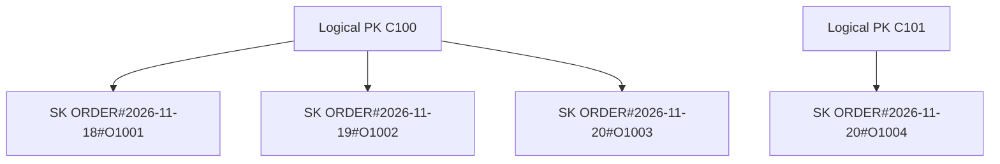
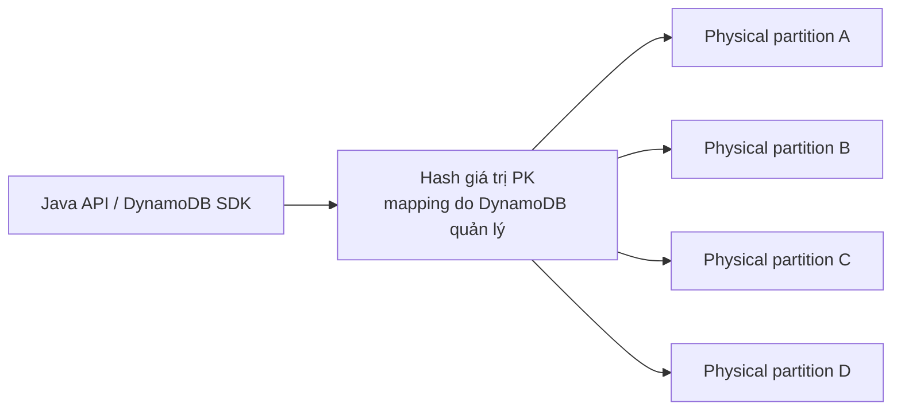
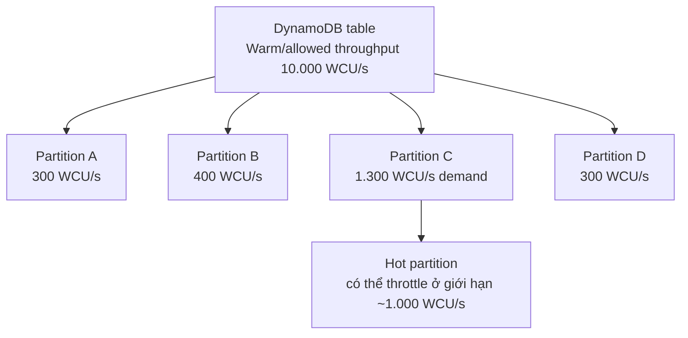
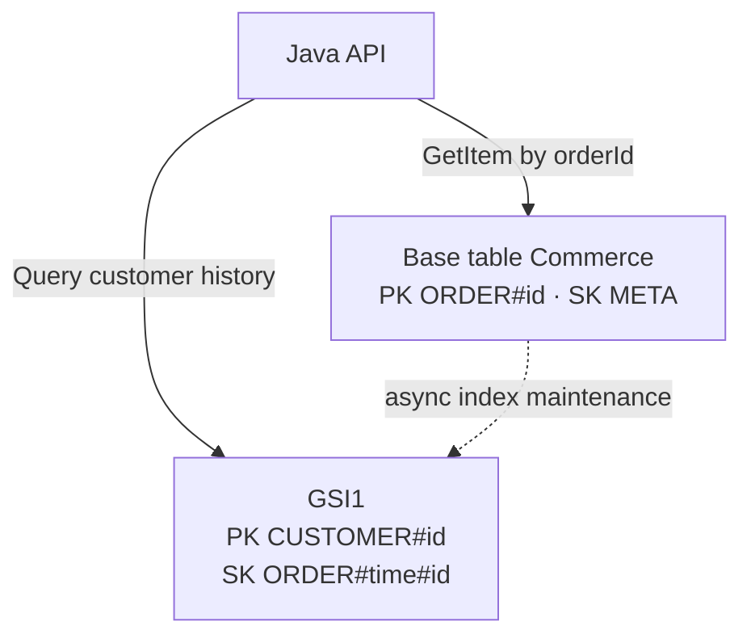
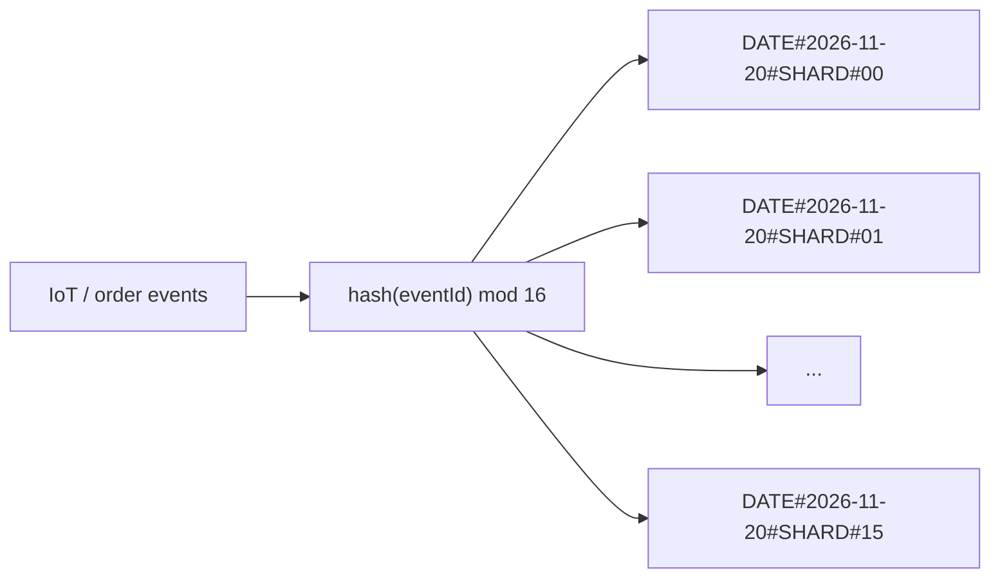
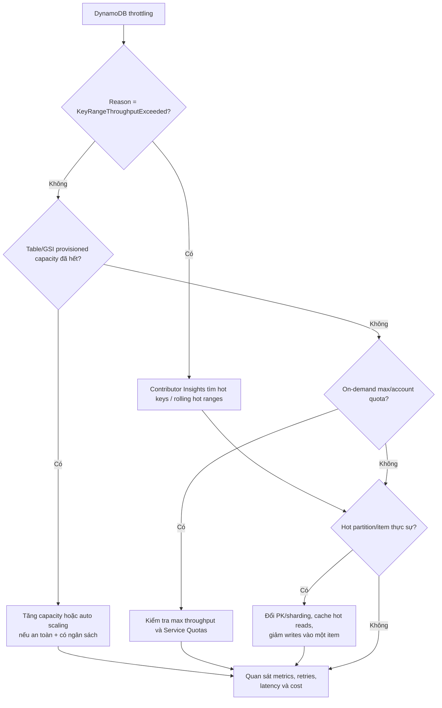

# Partition key, sort key và phân bố dữ liệu trong Amazon DynamoDB

> **Chương:** DynamoDB  
> **Module:** CLOUD_PROVIDERS_AWS  
> **Mục tiêu:** hiểu cơ chế định danh và phân bố dữ liệu của DynamoDB, chọn partition key và sort key dựa trên access patterns, tránh hot partitions, vận dụng Query/secondary indexes/write sharding đúng cách, đồng thời giám sát độ trễ, khả năng mở rộng, bảo mật và chi phí.
>
> **Phạm vi:** Amazon DynamoDB tables, item collections, physical partitions, global/local secondary indexes (GSI/LSI), read/write capacity và ví dụ Java/AWS CLI. Một số quota, warm throughput và đặc tính adaptive capacity thay đổi theo Region/phiên bản dịch vụ; hãy kiểm tra tài liệu AWS hiện hành trước khi triển khai production.

## 1. Bài toán: lưu đơn hàng để đọc nhanh và không nghẽn khi khuyến mại

Một ứng dụng bán hàng dùng Java/Spring Boot trên Amazon ECS hoặc AWS Lambda. Dữ liệu có hàng triệu đơn hàng, nhiều người dùng, nhiều cửa hàng và các sự kiện cập nhật trạng thái.

Ứng dụng cần:

- Lấy **một đơn hàng** theo mã đơn.
- Liệt kê **các đơn hàng của một khách**, mới nhất trước, trong khoảng thời gian.
- Lấy **các đơn đang chờ xử lý** ở một cửa hàng.
- Truy xuất **lịch sử sự kiện** của một đơn.
- Chịu lưu lượng tăng đột biến trong một đợt flash sale.
- Tách dữ liệu tenant và kiểm soát số request/tài nguyên tiêu thụ.

Một phương án sơ sài là tạo bảng có cột `status` làm partition key vì dashboard hay lọc theo trạng thái. Nhưng chỉ có vài giá trị `PENDING`, `PAID`, `CANCELLED`; hàng chục nghìn lệnh ghi cùng `PENDING` có thể tập trung lên một key range, tạo **hot partition**.

Một phương án khác đặt ngày hiện tại làm partition key:

```text
PK = DATE#2026-11-20
SK = ORDER#<orderId>
```

Hầu hết các đơn trong ngày đều ghi vào cùng một logical partition key. Table-level throughput có thể còn dư nhưng request đến cùng vùng dữ liệu bị throttle.

**Giải pháp không phải chỉ tăng capacity:** phải thiết kế key schema từ **cách truy cập**, **phân phối tải** và **giới hạn của từng physical partition**.

## 2. Từ SQL primary key đến DynamoDB primary key

### 2.1. Item, table và attribute

DynamoDB là **NoSQL key-value/document database**:

- **Table:** tập hợp các items.
- **Item:** bản ghi gồm key attributes và các attributes khác.
- **Attribute:** giá trị scalar, document (map/list), set hoặc những kiểu được DynamoDB hỗ trợ.
- **Primary key:** xác định duy nhất một item trong bảng.

DynamoDB không có khái niệm mỗi item phải có cùng các cột như bảng quan hệ; nhưng **mọi item bắt buộc có đầy đủ thuộc tính primary key với đúng kiểu dữ liệu**.

Ví dụ một item:

```json
{
  "PK": "CUSTOMER#C100",
  "SK": "ORDER#2026-11-20T03:30:00Z#O9001",
  "orderId": "O9001",
  "status": "PAID",
  "total": 150000,
  "currency": "VND"
}
```

`PK` và `SK` là những **tên thuộc tính do nhóm phát triển đặt**. AWS không yêu cầu đặt tên đúng `PK`/`SK`; có thể là `CustomerId`/`OrderTime` hoặc tên khác. Việc dùng `PK`/`SK` phổ biến trong thiết kế single-table vì dễ đưa nhiều entity types vào chung một schema.

### 2.2. Simple primary key: chỉ có partition key

Một bảng `CustomerProfiles`:

| Partition key `CustomerId` | Name | Tier |
|---|---|---|
| `C100` | Lan | Gold |
| `C101` | Minh | Silver |
| `C102` | An | Bronze |

- Mỗi giá trị `CustomerId` xác định **tối đa một item** trong bảng.
- `GetItem(CustomerId=C100)` lấy đúng item.
- Không thể lưu **hai items có cùng `CustomerId`** trong bảng chỉ có partition key.

```text
TABLE CustomerProfiles
  Primary key: CustomerId (String)
  ├── CustomerId=C100 -> item duy nhất
  ├── CustomerId=C101 -> item duy nhất
  └── CustomerId=C102 -> item duy nhất
```

Chọn simple key khi access pattern chủ yếu là lấy/cập nhật một object qua ID duy nhất và không cần gom nhiều items cùng logical key.

### 2.3. Composite primary key: partition key + sort key

Một bảng `CustomerOrders`:

| Partition key `CustomerId` | Sort key `OrderKey` | Status |
|---|---|---|
| `C100` | `ORDER#2026-11-18#O1001` | PAID |
| `C100` | `ORDER#2026-11-19#O1002` | PAID |
| `C100` | `ORDER#2026-11-20#O1003` | PENDING |
| `C101` | `ORDER#2026-11-20#O1004` | PAID |

Tính duy nhất là **cặp (`CustomerId`, `OrderKey`)**.

- Có thể lưu nhiều items với cùng partition key `C100`.
- Nhưng không được có hai items với **cùng cả partition key và sort key**.
- Có thể `Query` tất cả orders của `C100` hoặc một đoạn sort-key range.
- Các items cùng partition key tạo thành **item collection**.



**Sort key không biến thành một partition key thứ hai.** DynamoDB vẫn hash **giá trị partition key** để định tuyến dữ liệu; sort key tổ chức thứ tự và truy vấn trong logical item collection.

### 2.4. Key types, kích thước và tính bất biến

| Thuộc tính key | Ràng buộc DynamoDB |
|---|---|
| Partition key type | Scalar `String`, `Number` hoặc `Binary` |
| Sort key type | Scalar `String`, `Number` hoặc `Binary` |
| Partition key length | 1–2.048 bytes |
| Sort key length | 1–1.024 bytes |
| Item size | Tối đa **400 KB** |
| Key uniqueness | PK duy nhất (simple), hoặc cặp PK+SK duy nhất (composite) |
| Key updates | Không sửa primary key in-place như một field thường |

Nếu đổi mã `CustomerId=C100` thành `C200`, về mặt data modeling thường là **tạo item mới với key mới rồi xóa item cũ**, có kiểm soát bằng transaction/conditional logic nếu cần. Không thiết kế application phụ thuộc khả năng UPDATE partition key “trực tiếp”.

## 3. Logical partition key khác physical partition

### 3.1. Hash partition key để xác định vùng lưu trữ

Khi bạn `PutItem`, DynamoDB dùng **hash của partition key value** để quyết định dữ liệu đi vào vùng partition nào theo cấu trúc phân phối nội bộ.



- **Logical partition key:** giá trị như `CUSTOMER#C100` mà bạn chọn trong schema.
- **Physical partition:** đơn vị lưu trữ/throughput nội bộ được DynamoDB quản lý.
- **Hash space:** cách các PK values được ánh xạ đến physical partitions.
- **Sort key:** sắp xếp items có cùng logical PK; không quyết định hash ban đầu.

**Không có API DynamoDB để bạn yêu cầu “PK=C100 luôn nằm trên server/AZ số 3”.** Physical partitions có thể được tách và tái tổ chức tự động.

### 3.2. Một physical partition có thể giữ nhiều logical PK

Nếu table còn nhỏ, nhiều partition-key values có thể cùng nằm trong một physical partition. Vì vậy **có 10.000 PK khác nhau không đồng nghĩa có 10.000 physical partitions**.

Ngược lại, một logical item collection có thể được DynamoDB chia ra nhiều physical partitions theo sort-key ranges khi điều kiện cho phép, để tăng sức chứa/throughput. Không thiết kế kiến trúc dựa trên giả định “mọi item cùng PK mãi mãi ở một physical partition”.

### 3.3. “Những item cùng partition key ở gần nhau” nghĩa gì?

AWS tối ưu việc lấy **một dải sort key** cho cùng PK. Ý nghĩa thực tế là `Query(PK=..., SK BETWEEN ...)` được hỗ trợ hiệu quả về access path.

Nhưng không được suy:

- Một query của một logical PK **luôn chỉ đọc đúng một physical partition**.
- Một logical PK lớn **không bao giờ bị chia**.
- Co-location đồng nghĩa transaction/isolation vô hạn hoặc join tự động.
- Sort key có thể thay thế partition key equality trong `Query`.

**Lợi ích của cùng PK là tối ưu read pattern trên nhóm item liên quan**, không phải lời hứa về vị trí máy chủ cố định.

## 4. DynamoDB physical partitions và throughput giới hạn

Theo tài liệu AWS, một physical partition được thiết kế chịu tối đa khoảng:

| Đơn vị | Giới hạn tham khảo |
|---|---|
| **Write** | **1.000 WCU/giây** |
| **Read** | **3.000 RCU/giây**, với strongly consistent read units |
| **Eventually consistent reads** | Có thể tương ứng khoảng **6.000 reads/giây cho item ≤4 KB**, do dùng 0,5 RCU/read |
| **Storage** | Physical partition có mức giới hạn lưu trữ khoảng **10 GB** trước khi cần split/tổ chức lại |

Những con số trên là **capacity units**, không phải “số request bất kể kích thước”.

Ví dụ nếu ghi mỗi item **2 KB**, một write bình thường tiêu thụ **2 WCU**; mức 1.000 WCU/giây chỉ tương đương khoảng **500 writes/giây**, không phải 1.000.

**Tổng table capacity lớn không xóa giới hạn physical partition.** Một bảng on-demand có thể xử lý hàng chục nghìn WCU/giây khi tải phân phối tốt, nhưng một key/hot partition vẫn có thể bị throttle nếu tập trung quá nhiều.

### 4.1. RCU, WCU và kích thước item

| Operation (mẫu minh họa) | Capacity unit điển hình |
|---|---|
| Write item ≤1 KB | 1 WCU |
| Write item 1,2 KB | 2 WCU |
| Strongly consistent read ≤4 KB | 1 RCU |
| Eventually consistent read ≤4 KB | 0,5 RCU |
| Transactional write ≤1 KB | 2 WCUs |
| Transactional strongly consistent read ≤4 KB | 2 RCUs |

Quy tắc làm tròn theo từng item/operation và có sự khác biệt giữa API/capacity modes, indexes, streams, transactions; đây là **ước tính nền tảng** cho bài học. DynamoDB on-demand tính phí theo **read/write request units**, nhưng concept sizing theo units tương đương vẫn hữu ích.

### 4.2. Table-level throughput và partition-level throughput



Bảng có khả năng tổng tới 10.000 WCU/giây **không** đồng nghĩa một physical partition có thể nhận 10.000 WCU/giây. Với key distribution kém, capacity không được tận dụng đều.

## 5. Partition key tốt cần đặc điểm gì?

### 5.1. Cardinality cao và phân phối hoạt động đủ đều

**Cardinality** là số lượng **giá trị phân biệt** của một thuộc tính.

| Candidate partition key | Cardinality | Nguy cơ |
|---|---|---|
| `OrderId` ngẫu nhiên/UUID | Rất cao | Thường tốt cho phân phối lookup-by-ID |
| `CustomerId` với hàng triệu customers | Cao | Thường tốt nếu traffic không tập trung vào vài customers |
| `DeviceId` từ hàng triệu thiết bị | Cao | Tốt khi lưu lượng phân tán, vẫn phải xét một device rất nóng |
| `TenantId` với 5 tenants | Thấp | Tenant lớn có thể làm nóng một logical PK |
| `status` có 4 values | Rất thấp | Dễ hot khi đa số writes là `PENDING` |
| `country` có vài chục values | Thấp/trung bình | Quốc gia đông người có thể hot |
| `date=2026-11-20` | Số values lịch sử tăng nhưng **current date cực nóng** | Rolling hot partition theo thời gian |

**Cardinality cao là điều kiện hữu ích nhưng không đủ**: nếu có một celebrity account thu hút 80% requests, `UserId` vẫn có một hot key dù bảng chứa hàng triệu users.

### 5.2. Tập trung vào *active* cardinality

Giả sử bảng có một triệu `OrderId`, nhưng mỗi giây cập nhật 95% requests vào **một bản ghi** `CAMPAIGN#BLACKFRIDAY`. Cardinality toàn bảng không giúp giảm hotspot của item đó.

Khi chọn partition key, hỏi:

- Trong **một giây cao điểm**, bao nhiêu PK values thực sự nhận requests?
- Mỗi PK nhận bao nhiêu **RCU/WCU**, không chỉ request count?
- Tải phân tán **đều hay lệch theo Zipf/Pareto**?
- Có key nào bị cập nhật cực nhiều lần trên **cùng một item**?
- Vài ngày tới khi một event thành hot có thay đổi phân phối không?

### 5.3. Những khóa hay gây vấn đề

```text
BAD: PK = "ALL_ORDERS"
BAD: PK = "PENDING"
BAD: PK = "2026-11-20"
BAD: PK = "REGION#VN"    (khi 95% traffic từ VN)

BETTER (tùy access patterns):
PK = "ORDER#<orderId>"
PK = "CUSTOMER#<customerId>"
PK = "TENANT#<tenantId>#MONTH#2026-11"
PK = "EVENT#2026-11-20#BUCKET#07"
```

**Không có một key tốt cho mọi query.** Khóa `ORDER#<id>` giúp get-by-ID và phân phối writes, nhưng không tự hỗ trợ liệt kê tất cả orders của một customer nếu không tạo index hoặc item structure phù hợp.

## 6. Sort key: thứ tự và truy vấn theo nhóm

Sort key giúp DynamoDB:

1. Lưu nhiều items dưới cùng logical partition key.
2. Tạo **một chiều thứ tự** để Query theo range.
3. Biểu diễn thứ bậc, version hoặc time series.
4. Sử dụng `begins_with` và các so sánh trên sort key.
5. Tránh Scan khi đọc một nhóm dữ liệu đã biết PK.

### 6.1. Ví dụ lịch sử đơn hàng của một customer

Thiết kế:

```text
PK = CUSTOMER#C100
SK = ORDER#2026-11-20T03:30:00Z#O9001
```

| PK | SK | Total |
|---|---|---:|
| `CUSTOMER#C100` | `ORDER#2026-11-18T08:00:00Z#O9000` | 80.000 |
| `CUSTOMER#C100` | `ORDER#2026-11-20T03:30:00Z#O9001` | 150.000 |
| `CUSTOMER#C100` | `ORDER#2026-11-20T04:10:00Z#O9002` | 200.000 |

Truy vấn:

```text
PK = CUSTOMER#C100
begins_with(SK, "ORDER#2026-11")
ScanIndexForward = false
```

Kết quả có thể trả **đơn mới trước**, dựa trên thứ tự sort key.

### 6.2. Quy tắc sắp xếp String, Number, Binary

| Kiểu sort key | Cách sắp |
|---|---|
| `Number` | Thứ tự số |
| `String` | Thứ tự **UTF-8 bytes**, không phải quy tắc sắp từ điển theo ngôn ngữ |
| `Binary` | Thứ tự bytes |

Nếu String sort key là:

```text
"2"
"10"
"100"
```

Thứ tự lexicographic không giống thứ tự số. Muốn dùng chuỗi cho số và cần thứ tự số, cân nhắc **zero padding**:

```text
"000002"
"000010"
"000100"
```

Không dùng locale-specific ordering hoặc case-insensitive comparison mặc định trên String sort keys.

### 6.3. Timestamp trong sort key

Dùng timestamp UTC được chuẩn hóa:

```text
ORDER#2026-11-20T03:30:00.000Z#O9001
ORDER#2026-11-20T03:31:00.000Z#O9002
```

Lợi thế: nếu timestamp có cùng định dạng ISO 8601 và cùng timezone/precision, thứ tự chuỗi phù hợp chronological order.

Cẩn thận:

- Không trộn `2026-11-20T10:00:00+07:00` với `2026-11-20T03:00:00Z` nếu cần thứ tự tuyệt đối.
- Không dùng timestamps không fixed-width hoặc không có timezone.
- Hai event cùng timestamp cần thêm unique suffix `#<eventId>` để tránh overwrite.
- DynamoDB không cung cấp server-side auto-increment key; nếu cần ID tuần tự, phải thiết kế concurrency/sequence riêng.

### 6.4. Hierarchical composite sort keys

Ví dụ lưu quan hệ tổ chức:

```text
PK = ORG#ORG01
SK = DEPT#SALES
SK = DEPT#SALES#TEAM#EAST
SK = DEPT#SALES#TEAM#EAST#USER#U100
SK = DEPT#SALES#TEAM#WEST#USER#U101
```

Bạn có thể Query `begins_with(SK, "DEPT#SALES#TEAM#EAST")` để lấy nhóm theo một cấp hierarchy.

**Thiết kế delimiter và escape:** nếu ID có chứa `#`, phải chuẩn hóa/encode trước; không tách chuỗi tùy tiện rồi gây ambiguity.

### 6.5. Lưu item version và history

Một pattern:

```text
PK = DOCUMENT#D100
SK = VERSION#000001
SK = VERSION#000002
SK = VERSION#000003
SK = META#LATEST
```

- `VERSION#...` giữ historical immutable versions.
- `META#LATEST` có thể tham chiếu version gần nhất.
- Khi ghi version mới, dùng **TransactWriteItems** hoặc conditional writes để cập nhật metadata nhất quán khi cần.
- `Query` theo `VERSION#` và `ScanIndexForward=false` lấy bản mới nhất nếu version được zero pad hợp lý.

**Không update item history in-place** nếu mục tiêu là audit bất biến.

## 7. Các thao tác đọc và mối quan hệ với key

### 7.1. GetItem

`GetItem` thích hợp khi biết **đầy đủ primary key**:

```text
GetItem(
  TableName="Orders",
  Key={"PK":"CUSTOMER#C100","SK":"ORDER#2026-11-20#O9001"}
)
```

- Với composite key, phải biết **cả PK và SK**.
- Có thể dùng strongly consistent reads trên table/LSI khi cần.
- Không lấy danh sách mọi item của customer bằng `GetItem(PK only)` trên composite key.

### 7.2. Query

`Query` phù hợp khi biết một giá trị **partition key cụ thể** và tùy chọn điều kiện sort key.

Cú pháp logic:

```text
PK = :customer
AND begins_with(SK, :orderPrefix)
```

Các điều kiện sort key hợp lệ gồm:

- `=`, `<`, `<=`, `>`, `>=`.
- `BETWEEN`.
- `begins_with` cho String/Binary sort keys.

**Partition key trong `KeyConditionExpression` bắt buộc là equality.** Không có `Query(PK BETWEEN A AND Z)` hoặc `Query(begins_with(PK,...))` như cách viết trên SQL indexes.

### 7.3. Query trả theo sort key và có pagination

- Default sort order **ascending**.
- `ScanIndexForward=false` để **descending**.
- Mỗi Query page đọc tối đa khoảng **1 MB dữ liệu trước FilterExpression** hoặc giới hạn số items theo `Limit`.
- Response có `LastEvaluatedKey` thì client tiếp tục `ExclusiveStartKey`.
- `Limit` là giới hạn **items được đánh giá** của page, không bảo đảm đúng N matching results khi filter nhiều.

**Query kết quả rỗng không đồng nghĩa đã hết trang** nếu response còn `LastEvaluatedKey`. Đặc biệt khi FilterExpression loại nhiều item, một page có thể trả zero Items nhưng vẫn cần paginate.

### 7.4. FilterExpression không thay partition key design

Ví dụ sai hướng:

```text
PK = ALL_ORDERS
FilterExpression = customerId = "C100"
```

DynamoDB vẫn phải đọc các items trong key range để đánh giá filter. **FilterExpression áp dụng sau khi data đã được đọc**, nên thường **không giảm read capacity units** tiêu thụ.

Phân biệt:

| Điều kiện | Chạy ở đâu? | Ảnh hưởng |
|---|---|---|
| `KeyConditionExpression` PK + SK | Chọn key range cần đọc | Giảm data phải đọc theo key |
| `FilterExpression` non-key attributes | Sau khi đọc page | Giảm items trả về qua mạng, không giảm RCU của data đã đọc |
| `ProjectionExpression` | Chọn attributes trả về | Giảm response size, **không giảm RCU** do RCU tính theo item size được đọc |

Nếu thường xuyên lọc `status` trong hàng triệu items, dùng **GSI hoặc key schema hỗ trợ access pattern**, không biến FilterExpression thành full-table query.

### 7.5. Scan

`Scan` duyệt toàn table/index hoặc một phần được chia; không yêu cầu PK, nhưng:

- Tốn read capacity theo lượng data được scan.
- Có thể ảnh hưởng production latency/hot key range.
- Với dataset lớn, cần pagination/segmented parallel Scan khi phù hợp.
- Dùng cho migration, reindex, batch analytics nhỏ/có giới hạn, không mặc định dùng cho API request path.
- Strongly consistent Scan không cung cấp **snapshot isolation toàn table** trong toàn thời gian scan.

**Nguyên tắc:** xác định access patterns trước, vì DynamoDB thường tối ưu nhất khi ứng dụng biết primary/index key.

## 8. Thiết kế theo access patterns thay vì theo bảng quan hệ

Một bảng DynamoDB không tự có tùy ý `WHERE ... ORDER BY ... JOIN ...` như relational database. Hãy viết bảng yêu cầu:

| Access pattern | Input | Kết quả mong muốn | Key/index cần hỗ trợ |
|---|---|---|---|
| Lấy order theo ID | orderId | Một order | PK=ORDER#id hoặc GSI theo orderId |
| Liệt kê orders của customer | customerId, from/to | Page orders theo time | PK=CUSTOMER#id, SK=ORDER#timestamp#id |
| Lấy pending orders của merchant | merchantId, status | Orders chờ xử lý | GSI keyed merchant+status/time bucket |
| Lấy history của order | orderId | Events theo thời gian | PK=ORDER#id, SK=EVENT#timestamp#eventId |
| Tìm events của một ngày | eventDate | Phần dữ liệu của ngày | Bucket + shard khi writes nóng |
| Xem orders của tenant | tenantId, page | Phân trang có tenant isolation | PK kết hợp tenant/customer hoặc GSI theo tenant |
| Lấy một customer profile | customerId | Profile item | PK=CUSTOMER#id, SK=PROFILE |

Từ bảng này mới quyết định:

- Một hay nhiều DynamoDB tables.
- Simple/composite primary key.
- GSI/LSI cần thiết.
- Có cần **duplicate/denormalize** item để đáp ứng đường đọc.
- Có cần bucket/shard cho high-volume access pattern.
- Transaction và consistency semantics.

### 8.1. Đặt PK theo tenant hay customer?

**Phương án 1:**

```text
PK = TENANT#T001
SK = ORDER#<timestamp>#<orderId>
```

Dễ query toàn bộ tenant, nhưng nếu T001 có lượng write rất lớn, một logical PK có thể nóng; item collection rất lớn nếu có LSI.

**Phương án 2:**

```text
PK = TENANT#T001#CUSTOMER#C100
SK = ORDER#<timestamp>#<orderId>
```

Phân phối tải tốt hơn theo customers, dễ truy vấn đơn của một customer. Nhưng query **tất cả orders của tenant** cần GSI hoặc batch/aggregation strategy, không chỉ gọi một Query.

**Phương án 3:**

```text
PK = ORDER#<orderId>
SK = META
```

Get-by-order-ID và write distribution tốt nếu IDs ngẫu nhiên, nhưng query customer orders cần GSI hoặc materialized access view.

**Chọn dựa trên access path quan trọng, không dựa trên cảm giác tên key “đẹp”.**

## 9. Single-table design: PK/SK kết hợp nhiều entity types

Một pattern phổ biến dùng table `Commerce`:

| PK | SK | Item type |
|---|---|---|
| `CUSTOMER#C100` | `PROFILE` | Customer profile |
| `CUSTOMER#C100` | `ORDER#2026-11-20T03:30:00Z#O9001` | Order summary |
| `CUSTOMER#C100` | `ORDER#2026-11-20T04:00:00Z#O9002` | Order summary |
| `ORDER#O9001` | `META` | Order aggregate metadata |
| `ORDER#O9001` | `ITEM#SKU-01` | Order line |
| `ORDER#O9001` | `ITEM#SKU-02` | Order line |
| `ORDER#O9001` | `EVENT#2026-11-20T03:31:00Z#E001` | Event history |

Hai queries:

- `PK=CUSTOMER#C100 AND begins_with(SK,"ORDER#")`: order summaries.
- `PK=ORDER#O9001`: aggregate metadata, line items và events.

**Lợi ích:** ít round trips cho nhóm items được đọc cùng nhau; có thể transact trên các items liên quan khi cần.

**Đánh đổi:** complexity schema, duplicate records, migrations, transaction cost, IAM tenant boundaries và các access patterns không đi theo PK hiện có. Không bắt buộc mọi workload DynamoDB phải single-table; **multi-table design** có thể dễ vận hành hơn nếu bounded contexts khác nhau.

### 9.1. Item collection không phải JSON document nested lớn

Nếu một order có 10.000 dòng hàng, đừng cố nhét toàn bộ vào một item >400 KB. Có thể chia:

```text
PK ORDER#O9001 | SK META
PK ORDER#O9001 | SK ITEM#000001
...
PK ORDER#O9001 | SK ITEM#010000
```

Nhưng cần xem số items/size của collection, hot writes, pagination, LSI limit, Query cost. **Chia item không tự làm một hot PK biến mất.**

### 9.2. Transaction và uniqueness

DynamoDB không có SQL foreign key. Nếu cần đảm bảo:

- Order ID là duy nhất.
- Order summary được ghi cùng detail.
- Inventory counter không bị trừ quá số lượng.

Sử dụng **conditional writes** (`attribute_not_exists`, version check) hoặc **TransactWriteItems** đúng chỗ. Key design hỗ trợ routing; **consistency và invariants vẫn là quyết định riêng**.

## 10. Global secondary index (GSI): thêm access path có key khác

### 10.1. GSI có PK/SK độc lập

Ví dụ bảng gốc có:

```text
Table Commerce:
  PK = ORDER#O9001
  SK = META
  CustomerId = C100
  OrderTime = 2026-11-20T03:30:00Z
```

Nếu cần query orders theo customer:

```text
GSI1PK = CUSTOMER#C100
GSI1SK = ORDER#2026-11-20T03:30:00Z#O9001
```



GSI là **index được duy trì tự động**, không phải một SQL join. Nó có **phân bố partitions và capacity riêng** với table gốc.

### 10.2. GSI có thể trở thành hot bottleneck mới

Bảng gốc phân bố tốt:

```text
PK=ORDER#O0001
PK=ORDER#O0002
PK=ORDER#O0003
...
```

Nhưng GSI:

```text
GSI1PK=PENDING
GSI1PK=PENDING
GSI1PK=PENDING
...
```

Kết quả: **GSI hot partition** dù table gốc rất phân tán.

Hơn nữa, **GSI write throttling có thể gây backpressure lên writes của base table** do DynamoDB cần duy trì index. Khi điều tra throttling, đừng chỉ xem primary table metrics; xem từng GSI resource.

### 10.3. GSI consistency và projection

- **GSI reads luôn eventually consistent**; không yêu cầu strongly consistent trên GSI.
- GSI có capacity/warm throughput và constraints riêng tùy billing mode.
- GSI chỉ chứa các attributes được **project** cùng key fields theo quy tắc DynamoDB.
- `KEYS_ONLY` ít storage/write overhead, `INCLUDE` chọn một số attributes, `ALL` sao nhiều data hơn.
- **Không thể trực tiếp fetch non-projected attributes từ base table khi Query GSI**; nếu cần, ứng dụng phải GetItem base table riêng.
- GSI được tạo/sửa sau khi bảng tồn tại theo tính năng; backfill của GSI mới cần thời gian và có thể tác động tải.

Đánh đổi đúng là **thêm index để giảm Scan/Query cost ở access pattern quan trọng** nhưng tăng storage/write amplification.

### 10.4. Sparse GSI

Nếu chỉ các order chưa hoàn thành cần xuất hiện trong index xử lý:

```text
Order PENDING:
  GSIStatusPK = MERCHANT#M100#OPEN#2026-11
  GSIStatusSK = 2026-11-20T03:30:00Z#O9001

Order PAID:
  GSIStatusPK = (không có)
  GSIStatusSK = (không có)
```

GSI chỉ index item có **đầy đủ GSI key attributes** tương ứng. Vì thế đây là **sparse index**: chỉ các pending/open items hiện ra ở index; khi paid, cập nhật/xóa index keys khỏi item để loại khỏi index.

**Phải chú ý:** nếu một merchant có hàng trăm nghìn pending writes/giây, GSI PK `MERCHANT#M100#OPEN#2026-11` vẫn có thể quá nóng. Sparse index giảm số items, **không tự đảm bảo workload distribution**.

## 11. Local secondary index (LSI): cùng partition key, sort key khác

LSI dùng **partition key giống table gốc**, nhưng có một **sort key riêng** để query cùng item collection theo trật tự khác.

Ví dụ table:

```text
PK = CUSTOMER#C100
SK = ORDER#<timestamp>#<orderId>
```

LSI:

```text
PK = CUSTOMER#C100
SortKey = TotalAmount
```

Có thể query orders của customer theo `TotalAmount` thay vì timestamp, trong phạm vi được LSI hỗ trợ.

### 11.1. Điều kiện của LSI

| Thuộc tính | LSI |
|---|---|
| Partition key | **Giống table gốc** |
| Sort key | Khác base table sort key |
| Tạo sau khi table đã tạo | **Không**; khai báo lúc CreateTable |
| Strongly consistent reads | **Có thể yêu cầu** (khác GSI) |
| Throughput | **Chia sẻ** capacity với base table |
| Item collection size limit | **10 GB per partition key value**, tính cả base data và projected LSI entries |
| Số lượng | Tối đa 5 LSIs/table theo quota tiêu chuẩn |

**10 GB LSI item collection** là giới hạn dễ gây sự cố. Nếu table có một LSI và `PK=TENANT#MEGA` tích lũy 11 GB dữ liệu/index entries, writes thêm vào collection có thể bị từ chối với `ItemCollectionSizeLimitExceededException`.

### 11.2. Ngoại lệ quan trọng: không có LSI thì sao?

Theo tài liệu AWS:

- Nếu table **không có LSI**, DynamoDB **có thể tự chia một item collection** qua nhiều physical partitions theo sort-key ranges khi cần cho storage và traffic.
- Nếu table **có LSI**, item collection của một PK phải được giữ trong một physical partition tương ứng, dẫn tới giới hạn **10 GB**.

Vì vậy phát biểu **“mọi partition key trong DynamoDB không thể có quá 10 GB dữ liệu”** là **sai**; giới hạn đó áp dụng cho item collections **khi có local secondary index**.

### 11.3. LSI và hot key

Nếu workload có một `PK=TENANT#MEGA` cực nóng, adaptive capacity không thể chia item collection theo sort key tương tự khi **có LSI**. Tránh thiết kế LSI trên collection có thể rất lớn/hot. Cân nhắc GSI hoặc thay primary key model.

## 12. Hot partitions, hot keys và rolling hotspots

### 12.1. Các loại “hot” khác nhau

| Loại | Ví dụ | Triệu chứng |
|---|---|---|
| **Hot PK value** | `PK=PENDING` có hầu hết writes | Key-range throttling |
| **Hot item** | Một counter `VOTES#GLOBAL` cập nhật 5.000 lần/giây | Conditional conflicts hoặc WCU throttling |
| **Hot GSI key** | `GSI1PK=OPEN` | Base table writes cũng chậm/throttle |
| **Rolling hot partition** | Ghi tuần tự vào timestamp/date range gần nhất | Hotspot di chuyển theo thời gian |
| **Hot read** | Product viral có hàng nghìn reads/giây | Read throttling dù writes thấp |
| **Hot tenant** | Một doanh nghiệp chiếm phần lớn traffic | Tenant bị ảnh hưởng, noisy neighbor |
| **Scan-induced hot range** | Batch scan đọc liên tục theo key order | Partition-level read pressure |

Một bảng có nhiều phân vùng nhưng chỉ một trong số đó quá tải vẫn có thể báo throttling. Cần phân biệt **`KeyRangeThroughputExceeded`** với **`ProvisionedThroughputExceeded`**, **`MaxOnDemandThroughputExceeded`** hoặc **`AccountLimitExceeded`** bằng throttling reason.

### 12.2. Adaptive capacity là gì?

DynamoDB tự động có **adaptive capacity** cho cả provisioned và on-demand mode:

- Tái phân phối capacity tới partitions được truy cập nhiều hơn.
- Có thể **isolate frequent items** hoặc chia item collections theo sort key khi điều kiện cho phép.
- Giúp hấp thụ access skew **trong giới hạn table capacity và physical-partition limits**.
- Không phải setting phải tự bật bằng một API riêng.

**Adaptive capacity không xóa giới hạn 1.000 WCU / 3.000 RCU trên một physical partition**, cũng không bảo đảm một **single hot item** có thể scale vô hạn.

### 12.3. Split for heat

Khi một phạm vi dữ liệu liên tục nóng, DynamoDB có thể thực hiện splitting để phân tải trong điều kiện phù hợp. Nhưng:

- Có thể không tách được **một single item** được cập nhật liên tục thành nhiều bản ghi ứng dụng nếu key không thay đổi.
- Với table **có LSI**, item collection cùng PK không được tách như table không LSI.
- Nếu writes luôn vào sort key tăng đơn điệu (mới nhất), split không nhất thiết giảm hotspot bền vững vì writes mới tiếp tục dồn sang một phía.
- Splitting/adaptive response là tự động nhưng có thời gian/heuristics nội bộ, không phải SLA lập tức cho spike ngoài dự đoán.

**Đừng xây production load test dựa trên hy vọng “DynamoDB chắc chắn sẽ split kịp trong 1 giây”.** Thiết kế key distribution tốt vẫn là nền tảng.

### 12.4. Single hot item

Một bảng có:

```text
PK = CAMPAIGN#FLASHSALE2026
SK = COUNT
```

Mọi đơn mới `UpdateItem ADD count 1` vào đúng item trên. Dù table chứa hàng triệu PK khác, counter này tập trung write vào **cùng một key**.

Giải pháp thường là **sharded counters** (nhiều items counter độc lập) hoặc đẩy sự kiện vào queue/stream để aggregate theo nhịp, chấp nhận consistency trade-off. Không thể chỉ thêm 10 read replicas vào DynamoDB như RDS.

## 13. Write sharding: phân tán ghi bằng nhiều partition-key values

### 13.1. Ý tưởng

Nếu cần ghi 10.000 events/giây theo cùng ngày, thay vì:

```text
PK = EVENT#2026-11-20
SK = 2026-11-20T...#<eventId>
```

dùng:

```text
PK = EVENT#2026-11-20#SHARD#00
PK = EVENT#2026-11-20#SHARD#01
...
PK = EVENT#2026-11-20#SHARD#15
```

Publisher chọn shard bằng một hàm ổn định như:

```text
shard = hash(eventId) mod 16
```



Nếu distribution tương đối đồng đều, load trên từng logical PK giảm so với một key.

### 13.2. Shard count không có công thức cố định

Giả sử cần 4.000 writes/giây cho items 1 KB, tương đương ~4.000 WCU/giây trên cùng một logical PK. Nếu chia thành **8 shards**, lý thuyết mỗi shard nhận khoảng **500 WCU/giây**. Tuy nhiên:

- Hash distribution có variance; không bảo đảm mỗi shard đúng 500.
- Physical partitions có thể chứa nhiều shard values.
- GSI của item có thể vẫn nóng nếu GSI PK không được sharded.
- Table-level provisioned/on-demand warm throughput vẫn phải đáp ứng tổng load.
- Writes >1 KB hoặc transactional writes tiêu thụ nhiều hơn 1 WCU.

**Số shard là kết quả từ load test và phân tích capacity**, không phải mặc định 8 là tối ưu.

### 13.3. Deterministic hay random sharding?

| Chiến lược | Tính chất | Khi dùng |
|---|---|---|
| `hash(eventId) % N` | Cùng eventId luôn về cùng shard (nếu N không đổi) | Cần get-by-ID/bảo đảm idempotent routing |
| Random shard `0..N-1` | Phân tán inserts dễ | Write-heavy append; muốn đọc phải biết shard hoặc fan-out |
| `hash(customerId) % N` | Cùng customer giữ shard ổn định | Query customer theo cùng bucket nếu thiết kế được |
| Time bucket + shard | Thu hẹp range theo ngày/giờ và phân tán writes | Time-series/IoT/analytics |

**Changing N** từ 8 lên 16 có thể làm `hash(id)%N` trả bucket khác cho cùng ID. Cần lưu version/shard, dual-read migration hoặc chiến lược consistent hashing phù hợp.

### 13.4. Trả giá ở bước đọc

Sharding giúp write distribution nhưng nếu user muốn “toàn bộ events ngày 20/11”:

- Cần **Query 16 shard values**, có thể song song nhưng có giới hạn request concurrency.
- Merge/sort các pages ở application.
- Quản lý pagination cursor **riêng từng shard**; global pagination phức tạp hơn.
- Tốn read units và ứng dụng phải xử lý retries/partial failures.

**Trade-off:** phân tán writes bằng nhiều PK values sẽ làm queries cross-shard phức tạp hơn. Hãy cân đối với nhu cầu truy vấn thực tế.

## 14. Time-series data: tại sao timestamp/date-only PK hay gây hot?

### 14.1. Thiết kế lỗi thường thấy

Ứng dụng sensor gửi hàng nghìn events/giây:

```text
PK = 2026-11-20
SK = 03:30:00.000#sensorA
```

Hầu hết writes hôm nay có PK giống nhau. Lưu lượng ngày mai sẽ chuyển hotspot sang PK của ngày mới — gọi là **rolling hot partition**.

### 14.2. Thiết kế theo device/time bucket

Nếu chủ yếu query một sensor trong khoảng thời gian:

```text
PK = DEVICE#D100#MONTH#2026-11
SK = TS#2026-11-20T03:30:00.000Z#EVENT#E100
```

Cách này phân phối theo hàng triệu devices và chia item collection theo tháng. Nhưng một “super-device” gửi 10.000 events/giây vẫn có thể hot; khi đó thêm shard.

### 14.3. Thiết kế theo nhiều buckets cho từng ngày

Nếu chủ yếu query toàn bộ events theo ngày:

```text
PK = DATE#2026-11-20#BUCKET#<00..31>
SK = TS#<UTC>#DEVICE#<deviceId>#EVENT#<eventId>
```

Đọc cả ngày cần fan-out 32 buckets. Có thể duy trì **GSI theo device** nếu cần truy xuất ngược, nhưng phải kiểm tra GSI PK distribution.

### 14.4. Giữ lịch sử dài hạn

DynamoDB phù hợp lookup/OLTP thấp độ trễ nhưng không nhất thiết kinh tế khi quét TB lịch sử liên tục. Cân nhắc:

- **DynamoDB TTL** xóa items hết hạn theo cơ chế **asynchronous**, không phải deadline chính xác đến giây.
- **DynamoDB export to Amazon S3** và analytics bằng Athena/Glue cho lịch sử.
- Phân kỳ data retention theo yêu cầu compliance.
- Tránh dùng Scan lớn mỗi phút trên production table chỉ để tạo dashboard tổng hợp.

## 15. Thứ tự, pagination và giới hạn item collection

### 15.1. Query theo sort key không tạo global order toàn bảng

Ví dụ:

```text
PK CUSTOMER#C100 | SK ORDER#2026-11-20T02:00:00Z#O1
PK CUSTOMER#C200 | SK ORDER#2026-11-20T01:00:00Z#O2
```

`Query(PK=C100)` có thể trả theo thời gian trong C100. Nhưng **không có một Query thường trên table để sắp xếp toàn bộ C100+C200 theo timestamp**.

Muốn global feed:

- Thiết kế GSI/buckets cho feed.
- Precompute/summarize feed vào materialized view.
- Query nhiều partitions rồi merge, chấp nhận fan-out.
- Dùng dịch vụ search/analytics phù hợp nếu query tùy ý rất rộng.

### 15.2. Pagination an toàn

Một API phân trang không nên chỉ dùng `page=1,2,3` rồi tự tính offset như SQL. DynamoDB **không có offset pagination** trong Query.

Thay vào đó:

1. `Query` với `Limit`/`ExclusiveStartKey`.
2. Trả dữ liệu và cursor chứa `LastEvaluatedKey`.
3. Client gửi cursor cho trang sau.
4. Backend giải mã/xác minh cursor và gọi `Query` tiếp.
5. Cursor nên chứa cả query context/index, tenant và expiry/compatibility metadata khi cần.

**Không tin cursor client tự chỉnh** để truy cập PK của tenant khác. Bảo vệ cursor bằng signature hoặc xác minh partition key/tenant từ auth context mỗi request.

### 15.3. LSI 10 GB chỉ với bảng có LSI

Hãy đọc kỹ:

- **Không có LSI:** item collection có thể lớn hơn 10 GB khi DynamoDB phân vùng phù hợp; vẫn phải kiểm tra throughput/Query costs.
- **Có LSI:** tổng base items và projected LSI entries cho **một PK value** có giới hạn **10 GB**.
- **GSI:** không chịu giới hạn item collection 10 GB theo cùng quy tắc LSI; nó có partitioning/capacity riêng.

Một tenant khổng lồ có hàng chục GB dữ liệu **không nên** được mô hình `PK=TENANT#T001` + LSI chỉ vì cần sort theo hai fields.

## 16. Provisioned, on-demand và warm throughput có liên quan gì đến key design?

### 16.1. Provisioned capacity

Với `PROVISIONED` mode, bạn cấp:

- **Read capacity units (RCUs)** cho table.
- **Write capacity units (WCUs)** cho table.
- Capacity cho từng **GSI** nếu có.
- Có thể bật **DynamoDB Auto Scaling** để điều chỉnh provisioned capacity theo CloudWatch utilization.

**Auto Scaling cấp thêm tổng throughput, không đổi partition key.** Nếu một logical key duy nhất bị quá nóng hoặc GSI PK có cardinality thấp, bảng có thể vẫn bị throttled dù capacity cấp đã tăng.

### 16.2. On-demand capacity

Với `PAY_PER_REQUEST` (on-demand):

- DynamoDB tự quản lý capacity và tính phí theo request units thực tế.
- Thích hợp workload khó dự báo hoặc biến động.
- Không yêu cầu chọn RCU/WCU cố định ngay khi tạo table.
- Tuy nhiên vẫn có **physical-partition limits**, service quotas và khả năng warm/scale trước burst.
- Có thể cấu hình **maximum on-demand throughput** cho table/GSI để kiểm soát mức sử dụng/chi phí, từ đó một số requests bị throttle khi vượt trần.

**Sai lầm:** chọn on-demand rồi cho rằng `PK=ALL_ORDERS` vẫn scale write vô hạn. On-demand là **capacity/billing mode**, không sửa bản chất hot partition.

### 16.3. Warm throughput

**Warm throughput** là mức read/write throughput mà table hoặc GSI có thể phục vụ ngay theo trạng thái mở rộng đã được DynamoDB chuẩn bị.

Đối với workload có chiến dịch quảng cáo đột ngột:

1. Đọc warm throughput hiện tại của table và GSIs.
2. So sánh với traffic peak dự kiến tính bằng units/giây.
3. Cân nhắc tăng warm throughput chủ động theo API/tính năng đang được hỗ trợ.
4. Chạy load test sát thực tế và giám sát `KeyRangeThroughputExceeded`.
5. Không nghĩ rằng warm throughput cao có thể giải quyết **single-key hotspot**.

Ví dụ giả định:

```text
On-demand table warm throughput:
  Read: 30.000 read units/s
  Write: 10.000 write units/s

Campaign traffic:
  8.000 WCU/s tổng
  Trong đó 6.000 WCU/s chỉ vào PK = CAMPAIGN#2026
```

Tổng WCU chưa vượt 10.000, nhưng nhiều writes vào cùng key/item vẫn có thể gặp partition-level limit. **Phải phân phối writes hoặc đổi data model**, không chỉ tăng warm throughput.

### 16.4. Burst capacity và adaptive capacity

- DynamoDB có thể tận dụng **burst capacity** khi có headroom theo điều kiện hệ thống.
- **Adaptive capacity** giúp tập trung throughput vào partitions nóng khi có capacity và giới hạn vật lý cho phép.
- **Split for heat** có thể tự xử lý một số hotspot ổn định theo thời gian.
- Không có bảo đảm mọi peak cực ngắn hay single-item write hotspot sẽ được giải quyết.
- Không mặc định burst credits luôn còn sẵn; AWS còn có thể dùng burst capacity cho bảo trì nền.

**Tối ưu lâu dài:** key design tốt + capacity mode phù hợp + đo thực tế + retries có backoff/jitter.

## 17. Chọn sort key để tối ưu truy vấn nhưng không phá phân bố

### 17.1. Good pattern: user + event time

Giả định 100.000 users, mỗi user tạo 5–20 events/ngày:

```text
PK = USER#<userId>#MONTH#2026-11
SK = EVENT#2026-11-20T03:30:00Z#<eventId>
```

Lợi ích:

- Tải phân bố qua nhiều user/month keys.
- Query events tháng của một user hiệu quả.
- Date/month bucket giúp giới hạn item collection.
- Sort key giúp chọn khoảng thời gian.

Giới hạn:

- User nổi tiếng/hot vẫn cần sharding theo user.
- Đọc nhiều tháng cần nhiều Query.
- Phải có index/access pattern khác cho global feed.

### 17.2. Bad pattern: PK cố định + timestamp SK

```text
PK = EVENTS
SK = 2026-11-20T03:30:00Z#<eventId>
```

Dù sort key có hàng triệu giá trị độc nhất:

- Initial hash routing vẫn phụ thuộc **PK=EVENTS**.
- Write mới luôn có timestamp tăng.
- Split for heat không bảo đảm loại rolling hotspot.
- LSI nếu có còn làm item collection bị giới hạn 10 GB.

**Sort key duy nhất không làm partition-key cardinality cao hơn.**

### 17.3. Không chọn PK ngẫu nhiên vô điều kiện

Nếu mỗi item có random UUID PK, phân bố ghi tốt. Nhưng nếu user cần tất cả orders theo customer:

- Không thể `Query(PK=CUSTOMER#C100)` vì PK chỉ là random order ID.
- Phải tạo GSI/materialized view hoặc quét bảng.
- Chi phí đọc và độ phức tạp sẽ tăng.

Thiết kế khéo thường là **random/high-cardinality PK cho write path** kết hợp **GSI theo access path cần thiết**, hoặc **PK theo customer có bucket/shard** khi write load cho mỗi customer không quá lớn.

## 18. DynamoDB GSI write sharding theo trạng thái

### 18.1. Vấn đề với low-cardinality GSI

Một table có `PK=ORDER#<UUID>` phân phối tốt. Mỗi order chứa:

```text
Status = PENDING
GSIStatusPK = PENDING
GSIStatusSK = 2026-11-20T03:30:00Z#<orderId>
```

Trong flash sale, hàng nghìn orders mới đều mang `GSIStatusPK=PENDING`. **GSI nóng** ngay cả khi base table không nóng.

### 18.2. Shard status index

Thay đổi:

```text
GSIStatusPK = STATUS#PENDING#DAY#2026-11-20#SHARD#03
GSIStatusSK = TS#2026-11-20T03:30:00Z#ORDER#O9001
```

Hàm:

```text
shard = stableHash(orderId) % 16
```

Khi cần đọc tất cả pending orders của ngày 20/11:

1. Query **16 GSI PK values**.
2. Merge/sort ở application.
3. Giới hạn concurrency và total read units.
4. Xử lý LastEvaluatedKey của từng shard.
5. Chấp nhận GSI eventual consistency hoặc thêm cơ chế kiểm tra lại trạng thái khi xử lý.

### 18.3. Đừng tạo 16 shards khi không cần

Nếu có 3 pending orders/giây và bảng chỉ vài nghìn items, một GSI `STATUS#PENDING` có thể vẫn ổn. Sharding làm:

- Tăng số queries.
- Phức tạp pagination.
- Khó transactional lookup/sorting toàn nhóm.
- Phức tạp migration khi đổi shard count.

**Sharding là giải pháp khi đo/ước tính cho thấy hotspot có khả năng xuất hiện**, không phải chuẩn bắt buộc cho mọi table.

### 18.4. Kiểm tra trạng thái ở consumer

Khi index eventual consistent, một order vừa từ `PENDING` chuyển `PAID` có thể tạm xuất hiện ở pending GSI. Consumer phải:

- Đọc lại item gốc nếu cần tính chính xác.
- Dùng conditional update để xử lý trạng thái hợp lệ.
- Không coi việc “item xuất hiện trên GSI” là bằng chứng transaction vẫn mở.
- Có idempotency key.

DynamoDB key/index hỗ trợ truy xuất dữ liệu, **không thay nguyên tắc kiểm soát tranh chấp giao dịch**.

## 19. Mô hình hot counter: sharded counter và tổng hợp

### 19.1. Counter một item bị nghẽn

```text
PK = CAMPAIGN#BIGSALE
SK = COUNTER
Count = 123456
```

Nhiều Lambda invocations cùng cập nhật một item. DynamoDB hỗ trợ atomic increment nhưng throughput vẫn tập trung lên một item.

### 19.2. Sharded counter

```text
PK = CAMPAIGN#BIGSALE | SK = COUNTER#00
PK = CAMPAIGN#BIGSALE | SK = COUNTER#01
...
PK = CAMPAIGN#BIGSALE | SK = COUNTER#31
```

Đây vẫn có **cùng PK** và chỉ khác sort key. Với table **không LSI**, DynamoDB có thể chia item collection khi thích hợp, nhưng với traffic cực cao một physical partition vẫn có thể nóng. Phương án chắc chắn hơn về **hash key distribution** là:

```text
PK = CAMPAIGN#BIGSALE#SHARD#00 | SK = COUNTER
PK = CAMPAIGN#BIGSALE#SHARD#01 | SK = COUNTER
...
PK = CAMPAIGN#BIGSALE#SHARD#31 | SK = COUNTER
```

Giờ mỗi shard có **PK value khác nhau**, giúp phân tán hash routing.

### 19.3. Đọc tổng counter

Để lấy tổng:

\[
\text{TotalVotes} = \sum_{i=0}^{31} \text{CountShard}_i
\]

Cần:

- `BatchGetItem` hoặc nhiều GetItem/Query.
- Tính toán tổng trong application hoặc materialized aggregator.
- Chấp nhận nhiều round trips và consistency trade-off.
- Với kết quả near-real-time, có thể dùng stream aggregation/cache thay vì đọc 32 items cho mọi HTTP request.

**Đếm distributed bằng nhiều items không tự tạo transaction toàn bộ counter**, và không nên dùng số thống kê này làm ledger kế toán chính xác nếu chưa có bảo đảm dữ liệu.

## 20. Chẩn đoán throttling: table, index hay một key range?

### 20.1. Phân loại nguyên nhân

DynamoDB trả về thông tin **throttling reasons** để phân biệt:

| Reason type | Ý nghĩa chung | Hướng xử lý |
|---|---|---|
| `KeyRangeThroughputExceeded` | Một physical key range/partition quá tải | Xác định hot keys, phân tán truy cập, caching, sharding |
| `ProvisionedThroughputExceeded` | Tiêu thụ vượt tổng provisioned capacity của table/GSI | Tăng provisioned capacity/Auto Scaling hoặc giảm tải |
| `MaxOnDemandThroughputExceeded` | Vượt trần on-demand maximum throughput đã cấu hình | Điều chỉnh giới hạn nếu an toàn hoặc giảm traffic |
| `AccountLimitExceeded` | Vượt service/account quota | Kiểm tra Service Quotas, đề nghị tăng quota nếu hợp lý |

Reason có thể chỉ ra **đọc hay ghi** và **table hay index** đang bị ảnh hưởng. Không nên xử lý tất cả bằng “tăng WCUs”, vì nguyên nhân khác nhau.

### 20.2. Các CloudWatch metrics cần biết

| Metric | Đọc thế nào? |
|---|---|
| `ConsumedReadCapacityUnits` | Read capacity đã dùng |
| `ConsumedWriteCapacityUnits` | Write capacity đã dùng |
| `ProvisionedReadCapacityUnits` | RCU đã cấp khi provisioned |
| `ProvisionedWriteCapacityUnits` | WCU đã cấp khi provisioned |
| `ReadThrottleEvents` | Số read operations/throttle events theo định nghĩa metric |
| `WriteThrottleEvents` | Số write operations/throttle events |
| `ReadKeyRangeThroughputThrottleEvents` | Read throttles do key-range limit |
| `WriteKeyRangeThroughputThrottleEvents` | Write throttles do key-range limit |
| `ThrottledRequests` | Requests bị throttle; không đồng nhất tuyệt đối với số events |
| `SuccessfulRequestLatency` | Độ trễ xử lý thành công tại DynamoDB |
| `ReturnedItemCount` | Số items được trả trong Query/Scan |
| `UserErrors` / `SystemErrors` | Lỗi client/service |
| GSI-specific metrics | Cần chọn đúng `GlobalSecondaryIndexName` dimension |

**Không lấy một giá trị CloudWatch trung bình 5 phút để suy peak từng giây chắc chắn chưa chạm partition limit.** Hotspots thường thể hiện trong peak windows nhỏ và per-key distributions.

### 20.3. CloudWatch Contributor Insights

**CloudWatch Contributor Insights for DynamoDB** giúp tìm hot/throttled keys khi bật đúng table/GSI và chế độ:

- **Throttled keys**: tập trung các keys đang gặp throttling.
- **Accessed and throttled keys**: theo dõi cả hot accessed keys và keys throttled.
- Có thể phân biệt per-partition-key hoặc partition+sort key reports.
- Có chi phí theo số events/requests tùy mode; bật có chủ đích.
- Key values có thể chứa thông tin cá nhân nếu bạn đặt email/phone trong PK. Cân nhắc quyền truy cập reports, masking/naming policy và dữ liệu logs.

**Khuyến nghị:** đặt keys dạng `TENANT#<opaqueId>` thay vì raw email nếu có thể; điều này vừa ổn định hơn khi user thay email vừa giảm nguy cơ lộ PII trong diagnostics.

### 20.4. Cây xử lý sự cố



### 20.5. Retry không làm key tốt hơn

AWS SDK hỗ trợ retries với **exponential backoff + jitter** cho throttled requests, nhưng:

- Retry quá dày làm hotspot nặng hơn.
- Retry cần max attempts/time budget.
- BatchWriteItem có thể trả `UnprocessedItems` ngay cả khi request API không lỗi toàn bộ.
- ConditionalCheckFailed không phải lỗi throttling để retry vô điều kiện.
- Idempotent writes và unique event IDs cần thiết để không tạo bản ghi trùng khi retry.
- Thiết kế backpressure từ API Gateway/SQS/Lambda concurrency khi downstream bão hòa.

## 21. Java SDK for DynamoDB v2: Query theo PK/SK

Ví dụ dùng **AWS SDK for Java v2**. Giả định:

- Table `Commerce` đã tồn tại.
- Có partition key kiểu String tên `PK` và sort key kiểu String tên `SK`.
- Java runtime có AWS credentials qua **IAM role** của ECS/EC2/Lambda hoặc môi trường lab, không hard-code access key.
- Region `ap-southeast-1` chỉ để minh họa.
- Code dưới đây **chỉ đọc** dữ liệu.

### 21.1. Query orders theo customer, mới nhất trước

```java
import java.util.Map;
import java.util.List;
import java.util.ArrayList;

import software.amazon.awssdk.regions.Region;
import software.amazon.awssdk.services.dynamodb.DynamoDbClient;
import software.amazon.awssdk.services.dynamodb.model.AttributeValue;
import software.amazon.awssdk.services.dynamodb.model.QueryRequest;
import software.amazon.awssdk.services.dynamodb.model.QueryResponse;
import software.amazon.awssdk.services.dynamodb.model.ReturnConsumedCapacity;

public class CustomerOrdersQuery {

    public static void main(String[] args) {
        try (DynamoDbClient dynamo = DynamoDbClient.builder()
                .region(Region.AP_SOUTHEAST_1)
                .build()) {

            Map<String, AttributeValue> values = Map.of(
                    ":pk", AttributeValue.builder()
                            .s("CUSTOMER#C100").build(),
                    ":prefix", AttributeValue.builder()
                            .s("ORDER#").build()
            );

            Map<String, AttributeValue> cursor = null;
            int pageNo = 0;

            do {
                QueryRequest.Builder builder = QueryRequest.builder()
                        .tableName("Commerce")
                        .keyConditionExpression(
                                "PK = :pk AND begins_with(SK, :prefix)")
                        .expressionAttributeValues(values)
                        .scanIndexForward(false)
                        .limit(25)
                        .returnConsumedCapacity(ReturnConsumedCapacity.TOTAL);

                if (cursor != null && !cursor.isEmpty()) {
                    builder.exclusiveStartKey(cursor);
                }

                QueryResponse response = dynamo.query(builder.build());
                System.out.println("Page " + (++pageNo)
                        + " count=" + response.count()
                        + ", RCU=" + response.consumedCapacity());

                for (Map<String, AttributeValue> item : response.items()) {
                    System.out.println(item.get("PK").s()
                            + " / " + item.get("SK").s());
                }

                cursor = response.lastEvaluatedKey();
            } while (cursor != null && !cursor.isEmpty());
        }
    }
}
```

**Điểm học:**

- `PK = :pk` là bắt buộc trong KeyConditionExpression.
- `begins_with(SK,...)` chỉ đọc dải SK cùng customer.
- `scanIndexForward(false)` trả sort key descending.
- `limit(25)` giới hạn số items evaluated mỗi page, không phải “toàn bộ response luôn đúng 25 items”.
- `lastEvaluatedKey` dùng để đọc tiếp, không dùng offset.
- `returnConsumedCapacity(TOTAL)` giúp quan sát read consumption, nhưng ứng dụng vẫn bị tính RCU trên data đã đọc.

**Trong HTTP API thật, không nên trả tất cả pages trong một request không giới hạn.** Đặt page size, timeout, cursor và per-tenant quotas.

### 21.2. GetItem với composite key

```java
import java.util.Map;

import software.amazon.awssdk.services.dynamodb.DynamoDbClient;
import software.amazon.awssdk.services.dynamodb.model.AttributeValue;
import software.amazon.awssdk.services.dynamodb.model.GetItemRequest;
import software.amazon.awssdk.services.dynamodb.model.GetItemResponse;

public class GetOrderExample {
    public static GetItemResponse getOrder(
            DynamoDbClient dynamo,
            String customerId,
            String orderKey) {

        return dynamo.getItem(GetItemRequest.builder()
                .tableName("Commerce")
                .key(Map.of(
                        "PK", AttributeValue.builder()
                                .s("CUSTOMER#" + customerId).build(),
                        "SK", AttributeValue.builder()
                                .s(orderKey).build()))
                .consistentRead(true)
                .build());
    }
}
```

`consistentRead(true)` dùng được với **table GetItem**. Khi Query GSI, **không** bật strongly consistent reads, vì GSI không hỗ trợ.

### 21.3. Query GSI đúng phân vùng

Giả sử item có:

```text
GSI1PK = MERCHANT#M100#OPEN#2026-11#SHARD#03
GSI1SK = TS#2026-11-20T03:30:00Z#ORDER#O9001
```

Code Query:

```java
QueryRequest request = QueryRequest.builder()
        .tableName("Commerce")
        .indexName("GSI1")
        .keyConditionExpression(
                "GSI1PK = :pk AND begins_with(GSI1SK, :prefix)")
        .expressionAttributeValues(Map.of(
                ":pk", AttributeValue.builder()
                        .s("MERCHANT#M100#OPEN#2026-11#SHARD#03").build(),
                ":prefix", AttributeValue.builder()
                        .s("TS#2026-11").build()))
        .scanIndexForward(false)
        .build();

QueryResponse response = dynamo.query(request);
```

**Đây là code fragment trong context đã có `dynamo` và imports**, không phải một class hoàn chỉnh. Với 16 shards, ứng dụng phải query từng GSI1PK rồi merge kết quả, không thể chỉ gọi một `Query` duy nhất.

## 22. Conditional writes: bảo vệ dữ liệu khi PK/SK trùng

Key uniqueness không tự bảo đảm một `PutItem` không ghi đè item cũ. Theo mặc định, `PutItem` với cùng key có thể **replace item** hiện hữu.

Nếu muốn tạo mới mà không overwrite:

```java
import java.util.Map;

import software.amazon.awssdk.services.dynamodb.DynamoDbClient;
import software.amazon.awssdk.services.dynamodb.model.AttributeValue;
import software.amazon.awssdk.services.dynamodb.model.PutItemRequest;

public class SafeOrderWriter {
    // Có ghi dữ liệu. Chỉ chạy sau khi có table lab và quyền được cấp.
    public static void putIfAbsent(
            DynamoDbClient dynamo,
            String customerId,
            String orderKey,
            String orderId) {

        dynamo.putItem(PutItemRequest.builder()
                .tableName("Commerce")
                .item(Map.of(
                        "PK", AttributeValue.builder()
                                .s("CUSTOMER#" + customerId).build(),
                        "SK", AttributeValue.builder()
                                .s(orderKey).build(),
                        "orderId", AttributeValue.builder()
                                .s(orderId).build()))
                .conditionExpression(
                        "attribute_not_exists(PK) AND attribute_not_exists(SK)")
                .build());
    }
}
```

**Điểm học:**

- `attribute_not_exists` ngăn ghi đè khi một item cùng key tồn tại.
- Nếu condition fail, SDK ném `ConditionalCheckFailedException`; đây **không phải** throttling.
- Nếu muốn cập nhật nhiều item/giá trị counter nhất quán, cân nhắc **TransactWriteItems** theo giới hạn AWS và idempotency.
- Đối với order creation, cần xác định unique business key là `orderId` hay `customerId+orderTime`. Timestamp một mình có thể collision.
- Java code này **thay đổi table** nếu chạy, nên không dùng trong preflight production.

### 22.1. Khi dùng DynamoDB Enhanced Client

AWS SDK v2 cung cấp **DynamoDbEnhancedClient** và annotations như `@DynamoDbPartitionKey`, `@DynamoDbSortKey` để map Java bean sang DynamoDB table schema. Đây chỉ là lớp mapping API thuận tiện: **không tự giải quyết hot partitions hoặc GSI design**.

## 23. AWS CLI: đọc và hiểu cấu hình khóa của table

Các lệnh này **chỉ đọc**, nhưng Query/Scan **vẫn tiêu thụ read capacity và có thể phát sinh phí**. Dùng AWS CLI v2, IAM read-only policy phù hợp và Region chính xác.

### 23.1. Describe table: KeySchema và GSIs/LSIs

```bash
aws dynamodb describe-table \
  --region ap-southeast-1 \
  --table-name Commerce \
  --query 'Table.{Name:TableName,KeySchema:KeySchema,AttributeDefinitions:AttributeDefinitions,GSIs:GlobalSecondaryIndexes[*].{Name:IndexName,KeySchema:KeySchema},LSIs:LocalSecondaryIndexes[*].{Name:IndexName,KeySchema:KeySchema},BillingModeSummary:BillingModeSummary,Status:TableStatus}' \
  --output json
```

Ví dụ `KeySchema`:

```json
[
  { "AttributeName": "PK", "KeyType": "HASH" },
  { "AttributeName": "SK", "KeyType": "RANGE" }
]
```

Ở đây:

- `HASH` = partition key.
- `RANGE` = sort key.
- `AttributeDefinitions` chỉ khai báo key attributes của table/indexes, **không phải tất cả attributes trong items**.

### 23.2. List tables

```bash
aws dynamodb list-tables \
  --region ap-southeast-1 \
  --query 'TableNames' \
  --output table
```

Không dùng list-tables để suy tables ở Region khác không tồn tại.

### 23.3. Query theo key, không dùng Scan

```bash
aws dynamodb query \
  --region ap-southeast-1 \
  --table-name Commerce \
  --key-condition-expression 'PK = :pk AND begins_with(SK, :prefix)' \
  --expression-attribute-values '{
    ":pk": {"S": "CUSTOMER#C100"},
    ":prefix": {"S": "ORDER#"}
  }' \
  --scan-index-forward false \
  --limit 25 \
  --return-consumed-capacity TOTAL \
  --no-paginate \
  --output json
```

Trong output:

- `Items` là page kết quả.
- `Count` là số items được trả.
- `ScannedCount` là số items được đánh giá theo query.
- `ConsumedCapacity` giúp kiểm tra units.
- `LastEvaluatedKey` nếu có thì phải dùng `--exclusive-start-key` ở page sau.

**Đây là Bash quoting**; PowerShell cần cách quote JSON phù hợp. Không copy API endpoint/key credentials thật vào source code.

### 23.4. GetItem bằng đầy đủ PK + SK

```bash
aws dynamodb get-item \
  --region ap-southeast-1 \
  --table-name Commerce \
  --key '{
    "PK": {"S": "CUSTOMER#C100"},
    "SK": {"S": "PROFILE"}
  }' \
  --consistent-read \
  --return-consumed-capacity TOTAL \
  --output json
```

Nếu table chỉ có PK, không truyền thêm SK. Nếu composite, thiếu SK sẽ không phải một lookup hợp lệ.

### 23.5. Query trên GSI

```bash
aws dynamodb query \
  --region ap-southeast-1 \
  --table-name Commerce \
  --index-name GSI1 \
  --key-condition-expression 'GSI1PK = :pk' \
  --expression-attribute-values '{
    ":pk": {"S": "MERCHANT#M100#OPEN#2026-11#SHARD#03"}
  }' \
  --scan-index-forward false \
  --return-consumed-capacity INDEXES \
  --output json
```

GSI chỉ hỗ trợ **eventually consistent reads**; không thêm `--consistent-read` vào lệnh Query trên GSI.

### 23.6. Query metrics và IAM

```bash
aws cloudwatch list-metrics \
  --region ap-southeast-1 \
  --namespace AWS/DynamoDB \
  --metric-name WriteKeyRangeThroughputThrottleEvents \
  --output json

aws cloudwatch list-metrics \
  --region ap-southeast-1 \
  --namespace AWS/DynamoDB \
  --metric-name ReadKeyRangeThroughputThrottleEvents \
  --output json
```

`list-metrics` chỉ liệt kê metric/dimensions có dữ liệu và có thể có độ trễ; nó không trả một biểu đồ theo phút. Dùng CloudWatch dashboard hoặc `get-metric-data` để xem chuỗi giá trị.

### 23.7. Kiểm tra Contributor Insights theo table/index

```bash
aws dynamodb describe-contributor-insights \
  --region ap-southeast-1 \
  --table-name Commerce \
  --output json
```

Nếu table có GSIs, có thể cần `--index-name GSI1` để xem cấu hình trên GSI. Bật mode phù hợp và kiểm tra chi phí/permissions khi sử dụng reports.

### 23.8. Scan là read-only nhưng không vô hại

```bash
# Chỉ trong lab/những bảng nhỏ đã được phê duyệt.
aws dynamodb scan \
  --region ap-southeast-1 \
  --table-name Commerce \
  --select COUNT \
  --return-consumed-capacity TOTAL \
  --output json
```

`--select COUNT` **không giảm RCUs** cần đọc như “chỉ đọc metadata”. Với table lớn, Scan vẫn đọc các items để đếm và có thể gây phí/throttling.

## 24. Infrastructure as Code: schema cho keys và GSI

### 24.1. CloudFormation mẫu

Đây là template minh họa **có thể tạo DynamoDB table tính phí**. Không deploy trong account production nếu chưa đánh giá billing, IAM, PITR, retention và deletion policy.

```yaml
AWSTemplateFormatVersion: '2010-09-09'
Description: DynamoDB composite keys and a GSI (lab)

Resources:
  CommerceTable:
    Type: AWS::DynamoDB::Table
    DeletionPolicy: Retain
    UpdateReplacePolicy: Retain
    Properties:
      TableName: LabCommerce
      BillingMode: PAY_PER_REQUEST
      AttributeDefinitions:
        - AttributeName: PK
          AttributeType: S
        - AttributeName: SK
          AttributeType: S
        - AttributeName: GSI1PK
          AttributeType: S
        - AttributeName: GSI1SK
          AttributeType: S
      KeySchema:
        - AttributeName: PK
          KeyType: HASH
        - AttributeName: SK
          KeyType: RANGE
      GlobalSecondaryIndexes:
        - IndexName: GSI1
          KeySchema:
            - AttributeName: GSI1PK
              KeyType: HASH
            - AttributeName: GSI1SK
              KeyType: RANGE
          Projection:
            ProjectionType: INCLUDE
            NonKeyAttributes:
              - orderId
              - status
              - createdAt
      PointInTimeRecoverySpecification:
        PointInTimeRecoveryEnabled: true
      SSESpecification:
        SSEEnabled: true
      Tags:
        - Key: Environment
          Value: lab
        - Key: Purpose
          Value: dynamodb-key-design
```

**Lưu ý:**

- `AttributeDefinitions` liệt kê **key fields** sử dụng ở table/GSI, không cần khai báo mọi application attributes.
- `PAY_PER_REQUEST` không yêu cầu ProvisionedThroughput.
- `ProjectionType: INCLUDE` chỉ thêm vài non-key fields cho access pattern GSI.
- GSI chỉ index items có GSI1PK/GSI1SK theo yêu cầu, cho phép thiết kế **sparse GSI**.
- `PointInTimeRecoveryEnabled` giúp recovery cho lỗi logic, có chi phí; PITR **không phải cross-Region multi-active DR**.
- `DeletionPolicy: Retain` hạn chế xóa dữ liệu khi xóa CloudFormation stack, nhưng retained table vẫn phát sinh storage/cost.
- CloudFormation **không tự thay key schema** của table hiện hữu sang PK/SK mới chỉ bằng đổi property; primary key migration phải là quy trình dữ liệu.

### 24.2. Chọn `GSI1PK`/`GSI1SK` là một API contract

Trong application, index attributes phải được ghi cùng items. Ví dụ:

```json
{
  "PK": "ORDER#O9001",
  "SK": "META",
  "orderId": "O9001",
  "status": "PENDING",
  "createdAt": "2026-11-20T03:30:00Z",
  "GSI1PK": "MERCHANT#M100#OPEN#2026-11#SHARD#03",
  "GSI1SK": "TS#2026-11-20T03:30:00Z#ORDER#O9001"
}
```

Khi order `PAID`, ứng dụng có thể **REMOVE GSI1PK/GSI1SK** để item không còn xuất hiện trong pending sparse GSI. Cần conditional update nếu trạng thái thay đổi cạnh tranh.

## 25. Quyền IAM theo partition key và bảo mật đa tenant

### 25.1. Key design hỗ trợ ABAC/tenant isolation

DynamoDB hỗ trợ condition key **`dynamodb:LeadingKeys`** để kiểm soát leading partition key values đối với các thao tác tương ứng.

Ví dụ ý tưởng: một identity chỉ được đọc keys có prefix `TENANT#T001#`.

```json
{
  "Version": "2012-10-17",
  "Statement": [
    {
      "Effect": "Allow",
      "Action": [
        "dynamodb:GetItem",
        "dynamodb:Query"
      ],
      "Resource": "arn:aws:dynamodb:ap-southeast-1:111122223333:table/Commerce",
      "Condition": {
        "ForAllValues:StringLike": {
          "dynamodb:LeadingKeys": [
            "TENANT#T001#*"
          ]
        }
      }
    }
  ]
}
```

**Đây là minh họa IAM policy, không phải chính sách đầy đủ cho production.** Cần kiểm tra action/resource/index ARNs, wildcard matching, tenant identity injection từ IAM principal tags và mọi API được phép.

### 25.2. Không dựa hoàn toàn vào IAM LeadingKeys

Các nguy cơ:

- Backend role chung có quyền đọc nhiều tenants, nhưng code lấy `tenantId` từ user-supplied request và không xác minh JWT.
- GSI dùng PK không có tenant prefix, nên `LeadingKeys` dựa trên index key có thể không bảo vệ giống base table.
- Batch APIs hoặc transaction requests đòi thêm policy checks.
- Cursor do client sửa có thể cố query tenant khác.
- Primary keys chứa emails/phone sẽ lộ PII qua logs/Contributor Insights.

**Cần xác minh tenant identity trong application, thiết kế index keys tương thích tenant boundary và áp least privilege ở IAM**. Các lớp bảo vệ bổ sung gồm KMS, CloudTrail, VPC endpoints, PITR và data-level authorization.

## 26. Chi phí của key design

### 26.1. Read/write amplification

Một write vào item gốc có thể:

1. Ghi base table (WCU/WRU).
2. Cập nhật một hoặc nhiều GSIs (thêm write units/index storage).
3. Gây streams events nếu bật DynamoDB Streams.
4. Tạo chi phí data transfer/processing ở Lambda/S3 export/CloudWatch tùy kiến trúc.

**Đừng tạo GSI cho mọi field để “query tùy ý”.** Các indexes có maintenance overhead và có thể trở thành bottleneck.

### 26.2. Ví dụ read capacity

Một page Query đọc dữ liệu **40 KB** bằng strongly consistent read:

\[
\text{RCU xấp xỉ} = \lceil 40 / 4 \rceil = 10
\]

Nếu eventually consistent, xấp xỉ **5 RCU**, theo kích thước đọc và quy tắc rounding units. Đây là ví dụ tổng quát; thực tế DynamoDB tính theo items/read groups và các điều kiện API, nên **kiểm tra `ConsumedCapacity` để biết số units thực**.

Nếu thêm `FilterExpression` chỉ trả 2 KB nhưng đã đọc 40 KB, RCU **không giảm thành 0,5 RCU** chỉ vì response nhỏ.

### 26.3. Ví dụ writes có GSI

Giả định mỗi order item 1,5 KB và GSI projected entry 0,6 KB:

- Base write bình thường: **2 WCU** vì làm tròn theo 1 KB.
- GSI write: khoảng **1 WCU** cho 0,6 KB index entry.
- Tổng có thể khoảng **3 WCUs**, chưa tính thêm GSIs, transactions hoặc các hoạt động khác.

Đây là **mô hình minh họa**; GSI update/delete/missing key ảnh hưởng đơn vị thực tế. Dùng `ReturnConsumedCapacity=INDEXES` và Cost Explorer để quan sát.

### 26.4. Sharding có giá vận hành

Sharding 16 buckets có thể giúp tránh hot writes, nhưng đọc mọi item của một ngày cần 16 queries và merge dữ liệu. Nếu ứng dụng đọc toàn ngày rất thường xuyên, có thể tốn nhiều RCUs và latency hơn.

Một giải pháp khác:

- Dùng **per-customer/device partition key** nếu access path theo entity là chính.
- Giữ một **materialized daily summary** để dashboard không quét toàn bộ raw items.
- Đưa analytics/history sang S3/Athena.
- Cache top read items bằng DAX/ElastiCache/CDN khi phù hợp.
- Dùng event-driven aggregation thay vì cập nhật một counter item hàng nghìn lần/giây.

### 26.5. On-demand maximum throughput như cost guardrail

On-demand có thể đặt **maximum throughput** cho table và GSI để giới hạn lượng read/write request units trên giây. Đây là **guardrail**, nhưng nó có thể tạo throttling và ảnh hưởng trải nghiệm user.

Dùng kết hợp:

- CloudWatch alarms.
- AWS Budgets và Cost Anomaly Detection.
- Phân loại ưu tiên requests.
- App-side rate limiting/bulkheads.
- Partition-aware key design.
- CloudWatch Contributor Insights bật đúng mode và quản lý chi phí.

## 27. Chuyển đổi partition key khi bảng đã có dữ liệu

### 27.1. Vì sao khó đổi primary key?

Primary key schema được xác định khi tạo DynamoDB table. Bạn **không thể sửa partition key hoặc sort key của table hiện hữu như sửa tên field thông thường**.

Muốn đổi từ:

```text
PK = status
SK = orderId
```

sang:

```text
PK = ORDER#orderId
SK = META
```

thường phải **tạo table mới** (hoặc model mới trong table hiện có với migration được thiết kế), chuyển dữ liệu và cutover application.

### 27.2. Quy trình migration an toàn

1. **Inventory:** xác định mọi access pattern/Query/GSI/Stream/TTL/consumer đang dựa vào key cũ.
2. **Thiết kế schema mới:** có PK/SK phù hợp và đo hotspot từ traffic thực.
3. **Tạo table/index mới:** on-demand/provisioned capacity, PITR, KMS, IAM, alarms.
4. **Backfill:** DynamoDB export to S3 + import/ETL hoặc Scan+BatchWrite với rate limit phù hợp.
5. **CDC:** dùng DynamoDB Streams và consumer/DMS/logic phù hợp để đồng bộ writes trong lúc migration.
6. **Data validation:** số items, business keys, totals, trạng thái, checksum/sample comparisons.
7. **Dual-read/dual-write/cutover:** chọn chiến lược nhất quán; idempotent writes, xử lý thứ tự events.
8. **Load test:** theo dõi GSI write throttles, read latency, capacity/cost.
9. **Rollback:** giữ source table, routing plan và biết cập nhật nào sẽ thiếu khi rollback.
10. **Decommission:** chỉ xóa source sau retention/audit/backup có phê duyệt.

**Không “đổi primary key rồi mong DynamoDB tự rehash toàn bộ item”**; migration là tác vụ dữ liệu và ứng dụng thực sự.

### 27.3. Khi chỉ thiếu một access path

Nếu primary key hiện tại tốt, có thể thêm **GSI** thay vì tạo table mới. Nhưng:

- GSI có eventual consistency, capacity/storage cost.
- Index key mới có thể lại hot.
- Backfill cần thời gian.
- GSI không thay đổi cách base table `GetItem` định danh record.

Một GSI thường là cách ít xâm lấn hơn khi vấn đề chỉ là **query theo thêm thuộc tính**, không phải write hotspot của base table.

## 28. Troubleshooting: các nhầm lẫn thường gặp

| Triệu chứng / nhận định | Nguyên nhân | Hành động đúng |
|---|---|---|
| Bảng còn nhiều WCU nhưng writes vẫn throttle | Một hot key range | Xem `WriteKeyRangeThroughputThrottleEvents`, Contributor Insights |
| GSI query chậm dù table gốc khỏe | GSI PK/throughput riêng bị nóng | Kiểm tra GSI metrics và GSI key distribution |
| `Query` báo thiếu PK | Chỉ có sort key condition | Thêm equality partition-key condition |
| `GetItem` chỉ truyền PK nhưng table composite | Thiếu sort key | Truyền đủ PK/SK hoặc dùng Query |
| `Query` sau Filter trả ít item nhưng phí cao | Filter áp sau khi đọc | Đưa điều kiện vào SK/index |
| Query chỉ thấy 1 MB dữ liệu | Pagination | Đọc tiếp `LastEvaluatedKey` |
| Trang rỗng nhưng vẫn còn `LastEvaluatedKey` | Filter loại hết items của page | Tiếp tục paginate |
| Orders không theo thứ tự thời gian | Sort key String timestamp không chuẩn/UTC | Chuẩn hóa timestamp cố định |
| “PK unique trong cả table” khi có composite | Tính duy nhất là cặp PK+SK | Hiểu đúng item identity |
| Một item bị overwrite bất ngờ | PutItem cùng key | Conditional writes/transactions |
| On-demand vẫn throttle | Key range/maximum throughput/account quota | Phân loại throttling reasons |
| Adaptive capacity không cứu một counter | Single hot item quá limits | Sharded counter / async aggregation |
| GSI PK=STATUS hot | Cardinality thấp | Composite key, bucket hoặc write sharding |
| LSI writes lỗi sau nhiều năm | Item collection >10 GB | Monitor size, bỏ LSI trong model mới |
| Dùng 16 sort-key shards nhưng vẫn hot | Vẫn chung PK | Đổi **PK values** qua write sharding |
| Time-series hôm nay bị hot | PK=date hiện tại | Device ID/time bucket/shard |
| GSI Query nhất quán mạnh bị lỗi | GSI chỉ eventual | Dùng table/LSI strong read hoặc design khác |
| Scan COUNT phí quá cao | Scan vẫn đọc data | Summary/aggregate pattern |
| Dữ liệu cross-tenant bị lộ | Key/index thiếu tenant boundary | IAM, auth, LeadingKeys, cursor checks |
| CloudWatch average thấp nhưng thỉnh thoảng 429 | Peak nhỏ/hot key bị che bởi trung bình | Per-key metrics, Contributor Insights, load test |
| Base table writes throttle khi GSI không đủ WCU | GSI write backpressure | Scale/tối ưu index, giảm write amplification |
| Thay số shards khiến item “biến mất” | Hash % N mapping đổi | Version shard/migration/lookup strategy |
| Replica-like “global Query” không có | Sort order chỉ trong PK Query | GSI, materialized view hoặc fan-out |
| Auto Scaling tăng provisioned nhưng vẫn nghẽn | Physical partition limit | Sửa data distribution, không chỉ tăng tổng WCU |

## 29. Bài tập thực hành có đáp án

### Bài 1 — Simple key hay composite key?

Table `Users` chỉ cần mỗi `userId` một profile, không có nhiều items cho một user. Chọn key nào?

**Đáp án:** **Simple PK=userId** thường đủ. Composite key chỉ có lợi nếu access patterns cần nhóm nhiều items/hierarchy theo cùng user.

### Bài 2 — Uniqueness khi có sort key

Table PK=`C100`, SK=`ORDER#1` đã có. Có thể tạo thêm item PK=`C100`, SK=`ORDER#2` không?

**Đáp án:** **Có**. Cặp PK+SK xác định uniqueness. Tạo lại cùng PK=`C100` và SK=`ORDER#1` có thể overwrite nếu không dùng condition.

### Bài 3 — Sort key quyết định physical partition?

Một đồng nghiệp nói: “Cùng PK, SK khác thì DynamoDB hash SK để chọn partition khác.”

**Đáp án:** **Sai về nguyên tắc định tuyến ban đầu.** DynamoDB hash partition key; sort key quản lý thứ tự trong collection. DynamoDB có thể split collection theo SK ranges khi điều kiện cho phép.

### Bài 4 — Cardinality thấp

Một bảng lưu 2 triệu orders, PK là `status` với 4 values. Có rủi ro gì?

**Đáp án:** Writes/read tập trung vào vài logical PK values, đặc biệt `PENDING` → hot partition. Thiết kế PK theo order/customer/bucket và GSI/status sharding nếu cần.

### Bài 5 — Hash key cao nhưng vẫn hot?

Table PK=`userId` với 10 triệu users; một user được truy cập 10.000 lần/giây. Có thể hot không?

**Đáp án:** **Có.** Active traffic skew quyết định, không chỉ tổng số distinct keys.

### Bài 6 — Read/write units

Một physical partition nhận 1.500 writes/giây, mỗi item 2 KB, mỗi write bình thường. Ước tính yêu cầu WCU?

**Đáp án:** \(1.500\times2 = 3.000\) WCU/giây. Vượt mức ~1.000 WCU/giây/physical partition, cần phân tải.

### Bài 7 — Strong versus eventual read

Một item 4 KB được đọc 2.000 lần/giây trên một hot partition. So sánh RCUs?

**Đáp án:** Strong reads ~2.000 RCU/giây, eventual ~1.000 RCU/giây. Eventual giúp giảm units nhưng không sửa mọi trường hợp hotspot và có consistency trade-off.

### Bài 8 — KeyConditionExpression

Query có điều kiện `begins_with(SK,"ORDER#")` mà không đặt PK equality. Hợp lệ không?

**Đáp án:** **Không.** Query bắt buộc equality trên partition key. Muốn global prefix search phải thiết kế GSI khác hoặc cách đọc phù hợp.

### Bài 9 — FilterExpression có tiết kiệm RCU?

Query đọc 100 KB nhưng Filter chỉ trả 5 KB. RCU tính trên bao nhiêu data?

**Đáp án:** Trên **data đã đọc** (cỡ 100 KB theo item/accounting), không chỉ 5 KB trả về. Filter không làm giảm read capacity tiêu thụ.

### Bài 10 — Pagination

Query response trả `Items=[]` và `LastEvaluatedKey` có giá trị. Đã hết dữ liệu chưa?

**Đáp án:** **Chưa chắc.** Có thể filter loại hết items page này; cần tiếp tục nếu LastEvaluatedKey còn.

### Bài 11 — String sort key

SK Strings `"1"`, `"2"`, `"10"` có thứ tự giống Number 1,2,10 không?

**Đáp án:** **Không.** String sắp theo bytes. Dùng numeric type hoặc zero pad: `001`, `002`, `010`.

### Bài 12 — Timestamp

SK có lúc `2026-11-20T10:00:00+07:00`, lúc `2026-11-20T03:01:00Z`. Có nên kỳ vọng sort chronological tuyệt đối?

**Đáp án:** **Không.** Chuẩn hóa UTC cùng fixed-width/time precision trước khi ghi.

### Bài 13 — Local secondary index và 10 GB

Bảng có LSI, PK=`TENANT#BIG`. Tổng base items + LSI views cho PK này đạt 11 GB. Điều gì xảy ra?

**Đáp án:** Có thể gặp `ItemCollectionSizeLimitExceededException`; item collection với LSI có giới hạn 10 GB. Cần redesign/bucket hoặc migration.

### Bài 14 — Không có LSI

Một bảng **không LSI** có 20 GB items cùng logical PK. Có bắt buộc vi phạm 10 GB/item collection không?

**Đáp án:** **Không.** AWS có thể split item collection qua physical partitions theo sort-key ranges. Vẫn phải kiểm tra throughput/Query costs.

### Bài 15 — GSI read consistency

Một service Query GSI và bật `ConsistentRead=true`. Kỳ vọng?

**Đáp án:** Không được hỗ trợ; GSI **eventually consistent**. Chuyển critical read sang table/LSI hoặc thay mô hình.

### Bài 16 — Hot GSI

Base table PK=OrderId UUID, nhưng GSI PK=`PENDING`. Trong flash sale, write throttles tăng. Tại sao?

**Đáp án:** GSI có low-cardinality key và capacity riêng; GSI writes có thể throttle và gây backpressure lên base writes.

### Bài 17 — Write sharding

4.000 writes/giây, 1 KB/item tập trung một PK. Chia đều qua 8 khác biệt PK values thì mức trung bình mỗi shard là bao nhiêu?

**Đáp án:** ~500 WCU/giây/shard trong mô hình lý tưởng; thực tế còn hash variance, physical mapping, table-level capacity và GSI effects.

### Bài 18 — Sort-key shards hay partition-key shards?

Một developer chia 16 items với PK=`CAMPAIGN#SALE`, SK=`COUNT#00..15` và tuyên bố đã chắc chắn phân tán hash.

**Đáp án:** **Không chắc.** Vẫn cùng PK. Để phân tán hash routing trực tiếp, dùng 16 **PK values** khác nhau (ví dụ `CAMPAIGN#SALE#SHARD#n`).

### Bài 19 — Read fan-out

Ứng dụng dùng 32 day shards nhưng cần danh sách toàn bộ events trong ngày theo timestamp. Có thể một Query trả sắp xếp toàn ngày không?

**Đáp án:** **Không.** Query từng shard và merge/sort; cần quản lý pagination cursor riêng và chi phí RCU.

### Bài 20 — Shard count migration

Dữ liệu cũ được ghi `hash(id)%8`, code mới dùng `hash(id)%16`. Đọc theo công thức mới có thể bỏ sót không?

**Đáp án:** **Có.** Phải lưu shard version hoặc migrate dữ liệu và xử lý dual-read đến khi hoàn tất.

### Bài 21 — Contributor Insights

Table có `WriteKeyRangeThroughputThrottleEvents` tăng; nên dùng công cụ nào để tìm hot PK values?

**Đáp án:** CloudWatch **Contributor Insights for DynamoDB** trên table hoặc GSI liên quan, chọn chế độ Throttled keys/Accessed and throttled keys phù hợp.

### Bài 22 — On-demand vẫn throttle?

Một table on-demand có total traffic 8.000 WCU/giây, warm capacity 10.000 WCU/giây, nhưng một PK duy nhất nhận 4.000 WCU/giây.

**Đáp án:** Có thể throttling do key-range/physical partition, không phải thiếu tổng capacity. Cần phân tải/đổi schema.

### Bài 23 — Identity isolation

PK là `TENANT#T100#CUSTOMER#C1`. Frontend gửi bất kỳ tenantId trong URL; backend dùng nguyên giá trị đó để Query.

**Đáp án:** Không an toàn. Backend phải xác minh tenant từ trusted JWT/IAM context; có thể bổ sung `dynamodb:LeadingKeys`/ABAC với index-aware policies.

### Bài 24 — Single-table hay multi-table?

Một team khẳng định DynamoDB bắt buộc phải lưu mọi entity trong **một table**.

**Đáp án:** **Sai.** Single-table design là lựa chọn có lợi cho một số access patterns; nhiều tables có thể hợp lý hơn cho bounded contexts/ownership/operational simplicity.

### Bài 25 — DynamoDB table migration

Đội muốn đổi PK từ `status` sang `orderId` trên table production chỉ bằng update CloudFormation property.

**Đáp án:** Không thay primary key schema tại chỗ như attribute thông thường. Cần table/model mới, backfill/CDC, validation, cutover/rollback.

### Bài 26 — Cost of GSI

Một item 1,5 KB được ghi và GSI entry có projected size 0,6 KB. Ước tính WCU cho write thông thường?

**Đáp án:** Base khoảng 2 WCU, GSI entry khoảng 1 WCU, tổng ví dụ ~3 WCU trước các yếu tố khác. Phải đo ConsumedCapacity/Indexes thực.

### Bài 27 — Sparse GSI

Một GSI chỉ index items có cả GSI key attributes. Nếu order đã PAID và application remove một key attribute, còn xuất hiện trên GSI không?

**Đáp án:** Sau khi index cập nhật (eventually consistent), item **không còn được index** vì thiếu key attribute; cần chấp nhận lag.

### Bài 28 — Key schema không có partition equality

Bảng `Commerce` có PK=`CUSTOMER#id` và SK=`ORDER#time`. Người dùng muốn đọc tất cả orders ngày 20/11 của mọi customers bằng `Query(SK prefix date)`.

**Đáp án:** Không có partition equality nên không Query trực tiếp như vậy. Thiết kế date/day-bucket GSI, materialized view hoặc analytics path khác.

## 30. Checklist chọn partition key và sort key trước production

1. **Access patterns:** viết rõ input và output của GetItem/Query, phạm vi tenant, sort order và filters.
2. **Primary key:** chọn simple hay composite; tính uniqueness chính xác.
3. **Cardinality:** có đủ nhiều **active partition key values** ở peak không?
4. **Skew:** có hot users, products, tenants, statuses, campaigns, devices không?
5. **Physical limits:** xem 1.000 WCU/3.000 RCU per partition; tính theo item size và consistency.
6. **Sort key:** chuẩn hóa prefix/type/timestamp/UTC/zero padding; tránh collisions.
7. **Item collections:** đo kích thước và tốc độ tăng; **LSI giới hạn 10 GB/PK**.
8. **Query efficiency:** equality PK + sort-key conditions; không dùng FilterExpression để thay Query design.
9. **Pagination:** LastEvaluatedKey/ExclusiveStartKey, page size, cursors và tenant authorization.
10. **Read consistency:** strongly consistent table/LSI nếu phù hợp; GSI eventual.
11. **Indexes:** GSI/LSI chỉ khi access pattern cần; tránh GSI low-cardinality hot PK.
12. **Write sharding:** chọn deterministic/random shard phù hợp; quản lý shard counts/version và query fan-out.
13. **Time series:** device/entity/time buckets; không đặt mọi current-day writes vào một PK.
14. **Hot reads:** cache/DAX/ElastiCache nếu phù hợp, đồng thời kiểm tra consistency.
15. **Hot writes:** sharded counters, batching/async processing, tránh contention một item.
16. **Billing mode:** provisioned/auto scaling hay on-demand; kiểm tra warm throughput và optional max caps.
17. **Observability:** CloudWatch per table/GSI, throttle reasons, Contributor Insights theo chi phí.
18. **Retries:** SDK backoff+jitter, idempotency, BatchWrite UnprocessedItems, bounded retries.
19. **Security:** IAM least privilege, dynamodb:LeadingKeys khi phù hợp, KMS, PITR và tenant isolation.
20. **Cost:** RCU/WCU/WRU/RRU, projected index storage, GSI write amplification, scan/fan-out costs.
21. **Migration:** thay PK/schema cần backfill/CDC, cutover/rollback và data validation.
22. **Load test:** benchmark ít nhất hot key, hottest tenant, peak write, Query pages và GSI throughput.
23. **Resilience:** PITR restore drills, Global Tables/Region strategy nếu cần, không suy key design tạo DR.
24. **Ownership:** ghi data model decision record và các query/index patterns được bảo đảm.
25. **Review định kỳ:** khi access patterns hay traffic distribution thay đổi, đo lại hotspots và capacity.

**Ghi nhớ cuối bài:** **partition key** là chìa khóa định tuyến/hash và phân phối tải trong DynamoDB; **sort key** quyết định thứ tự/khả năng truy vấn một nhóm item dưới cùng partition key, **không phải một hash key thứ hai**. Bảng có tổng throughput lớn vẫn có thể nghẽn vì **hot partitions** hoặc **hot GSIs**. Cách khắc phục lâu dài là thiết kế theo **access patterns, active key cardinality, item size, time buckets và sharding khi thực sự cần**, đồng thời giám sát CloudWatch, IAM tenant boundaries và chi phí.

## Tài liệu AWS chính thức

- [DynamoDB primary key concepts](https://docs.aws.amazon.com/amazondynamodb/latest/developerguide/HowItWorks.CoreComponents.html)
- [Data distribution and partitions in DynamoDB](https://docs.aws.amazon.com/amazondynamodb/latest/developerguide/HowItWorks.Partitions.html)
- [Best practices for designing partition keys](https://docs.aws.amazon.com/amazondynamodb/latest/developerguide/bp-partition-key-design.html)
- [Distributing workload across partition keys](https://docs.aws.amazon.com/amazondynamodb/latest/developerguide/bp-partition-key-uniform-load.html)
- [Best practices for using sort keys](https://docs.aws.amazon.com/amazondynamodb/latest/developerguide/bp-sort-keys.html)
- [DynamoDB Query key condition expressions](https://docs.aws.amazon.com/amazondynamodb/latest/developerguide/Query.KeyConditionExpressions.html)
- [DynamoDB Query filter expressions](https://docs.aws.amazon.com/amazondynamodb/latest/developerguide/Query.FilterExpression.html)
- [Paginating table Query results](https://docs.aws.amazon.com/amazondynamodb/latest/developerguide/Query.Pagination.html)
- [DynamoDB data modeling building blocks](https://docs.aws.amazon.com/amazondynamodb/latest/developerguide/data-modeling-blocks.html)
- [DynamoDB global secondary indexes](https://docs.aws.amazon.com/amazondynamodb/latest/developerguide/GSI.html)
- [DynamoDB local secondary indexes and item collection size](https://docs.aws.amazon.com/amazondynamodb/latest/developerguide/LSI.html)
- [Best practices for secondary indexes](https://docs.aws.amazon.com/amazondynamodb/latest/developerguide/bp-indexes-general.html)
- [Sparse index patterns](https://docs.aws.amazon.com/amazondynamodb/latest/developerguide/bp-indexes-general-sparse-indexes.html)
- [DynamoDB adaptive and burst capacity](https://docs.aws.amazon.com/amazondynamodb/latest/developerguide/burst-adaptive-capacity.html)
- [DynamoDB warm throughput](https://docs.aws.amazon.com/amazondynamodb/latest/developerguide/warm-throughput.html)
- [DynamoDB on-demand maximum throughput](https://docs.aws.amazon.com/amazondynamodb/latest/developerguide/on-demand-capacity-mode-max-throughput.html)
- [DynamoDB partition-key throttling mitigation](https://docs.aws.amazon.com/amazondynamodb/latest/developerguide/throttling-key-range-limit-exceeded-mitigation.html)
- [Troubleshooting DynamoDB throttling](https://docs.aws.amazon.com/amazondynamodb/latest/developerguide/TroubleshootingThrottling.html)
- [Diagnosing throttling with Contributor Insights](https://docs.aws.amazon.com/amazondynamodb/latest/developerguide/throttling-diagnosing-workflow.html)
- [DynamoDB limits and constraints](https://docs.aws.amazon.com/amazondynamodb/latest/developerguide/Constraints.html)
- [DynamoDB IAM condition keys](https://docs.aws.amazon.com/amazondynamodb/latest/developerguide/specifying-conditions.html)
- [DynamoDB pricing](https://aws.amazon.com/dynamodb/pricing/)
