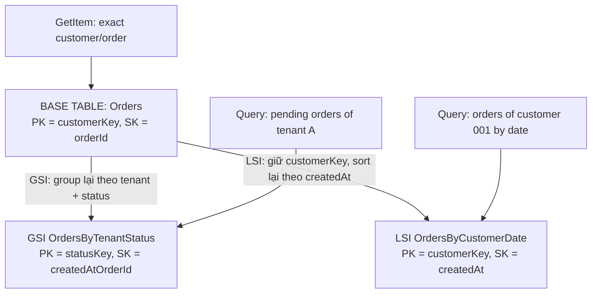
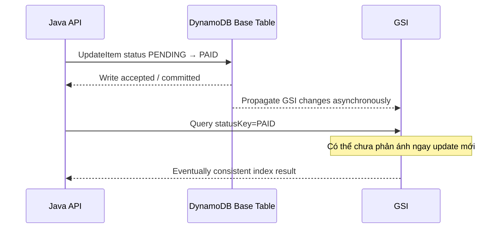
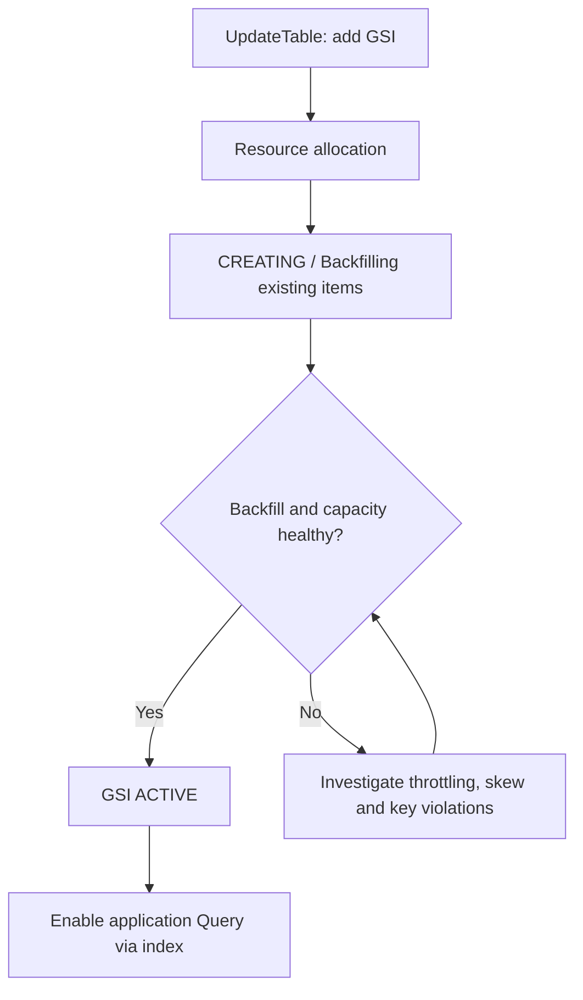

# Global Secondary Index và Local Secondary Index trong Amazon DynamoDB

Một hệ thống **Java Spring Boot** lưu đơn hàng trong **Amazon DynamoDB**. Khóa chính của bảng được tối ưu cho câu hỏi “liệt kê đơn hàng của khách hàng A”, nhưng đội chăm sóc khách hàng lại muốn “liệt kê tất cả đơn đang chờ xử lý của tenant X theo thời gian”; trang hồ sơ muốn “xem đơn của khách hàng A theo thời điểm tạo, mới nhất trước”.

Nếu chỉ có khóa chính, lập trình viên có thể nghĩ đến `Scan` toàn bảng rồi dùng `FilterExpression`. Điều này có thể hoạt động ở vài trăm bản ghi nhưng rất tốn read capacity, độ trễ và chi phí khi bảng có hàng triệu đơn. **Secondary indexes** cung cấp cách truy vấn theo các khóa thay thế, không cần nhân bản dữ liệu bằng một hệ thống tự quản lý.

DynamoDB có hai loại secondary index thường gặp:

- **Global Secondary Index (GSI):** có partition key khác với bảng gốc và có thể có sort key khác. Phù hợp truy vấn **vượt qua nhiều partition keys của base table**, được duy trì bất đồng bộ, chỉ hỗ trợ **eventually consistent reads**.
- **Local Secondary Index (LSI):** giữ **cùng partition key** với bảng gốc nhưng có **sort key khác**. Phù hợp đổi thứ tự truy vấn **bên trong một item collection**, hỗ trợ **strongly consistent reads**, nhưng phải tạo lúc tạo bảng và kéo theo **giới hạn 10 GiB cho mỗi item collection**.

> **Cập nhật quan trọng:** Từ tháng 11/2025, DynamoDB hỗ trợ **multi-attribute keys cho GSI**: tối đa bốn thuộc tính tạo partition key và bốn thuộc tính tạo sort key, thay cho việc luôn phải nối nhiều trường thành một chuỗi tổng hợp. Các ví dụ thực hành cơ bản ở bài này vẫn dùng GSI partition/sort key kiểu truyền thống vì dễ đọc; phần 13 giải thích lựa chọn mới. Tham khảo [AWS What's New: GSI multi-attribute keys](https://aws.amazon.com/about-aws/whats-new/2025/11/amazon-dynamodb-multi-attribute-composite-keys-global-secondary-indexes/).

Bài thuộc chương **DynamoDB** của module **CLOUD_PROVIDERS_AWS**, gắn với cách thiết kế ứng dụng an toàn trên AWS: phân phối dữ liệu qua hạ tầng Region/AZ, IAM/VPC, lưu trữ, serverless/Lambda, chọn access patterns, theo dõi throttling, khôi phục và tối ưu chi phí.

## 1. Mục tiêu học tập

Sau bài này, bạn có thể:

1. Phân biệt base table primary key, partition key, sort key, **GSI**, **LSI**, index key, projection và item collection.
2. Lựa chọn **GSI hoặc LSI** từ các access patterns thực tế, không bắt đầu bằng “cần tạo thêm index gì?”.
3. Hiểu vì sao **GSI eventual consistency** có thể trả dữ liệu cũ, còn **LSI strong consistency** chỉ giúp các truy vấn trong cùng base partition key.
4. Thiết kế index key có độ phân tán đủ tốt, tránh hot partition và tình trạng giới hạn 10 GiB do LSI.
5. Tính trade-off của `KEYS_ONLY`, `INCLUDE` và `ALL`, kể cả base-table fetch khi đọc LSI.
6. Viết `Query` trên GSI/LSI bằng **AWS SDK for Java v2** với pagination, `IndexName` và `ConsistentRead` đúng.
7. Tạo bảng có GSI/LSI bằng **CloudFormation**, thêm GSI vào bảng có sẵn qua quy trình triển khai an toàn.
8. Hiểu GSI backfill, write throttling/back-pressure, sparse index, capacity/WCU/RCU và giám sát CloudWatch.
9. Nhận diện lỗi `ValidationException`, `ItemCollectionSizeLimitExceededException`, thiếu projected attributes và data lag.
10. Áp dụng checklist bảo mật IAM/KMS, multi-tenant isolation, migration, test và quản lý chi phí.

## 2. Mô hình dữ liệu DynamoDB và vì sao index tồn tại

**Amazon DynamoDB** là cơ sở dữ liệu NoSQL dạng key-value/document được AWS quản lý, có thể mở rộng mà không phải quản trị DB servers. DynamoDB tổ chức dữ liệu theo **primary key** của từng item.

Có hai dạng primary key thông dụng:

- **Simple primary key:** chỉ **partition key**, ví dụ `userId`.
- **Composite primary key:** **partition key + sort key**, ví dụ `customerKey + orderId`.

Trong base table, cặp khóa chính phải xác định **duy nhất** một item. DynamoDB phân phối dữ liệu/throughput dựa trên khóa và các partition nội bộ. Khi dùng `Query`, bạn chỉ định giá trị partition key và có thể thêm điều kiện trên sort key.

```text
Base table: Orders

Partition key: customerKey (String)
Sort key:      orderId     (String)

customerKey                  orderId       status      createdAt
---------------------------------------------------------------------------
TENANT#A#CUSTOMER#001       ORDER#1001    PENDING     2026-11-20T08:00:00Z
TENANT#A#CUSTOMER#001       ORDER#1002    PAID        2026-11-20T09:00:00Z
TENANT#A#CUSTOMER#002       ORDER#1003    PENDING     2026-11-20T09:15:00Z
TENANT#B#CUSTOMER#010       ORDER#2001    PENDING     2026-11-20T10:00:00Z
```

Với khóa chính này, hai truy vấn hiệu quả là:

```text
GetItem(customerKey=TENANT#A#CUSTOMER#001, orderId=ORDER#1002)
Query(customerKey=TENANT#A#CUSTOMER#001)
```

Nhưng để truy vấn “mọi `PENDING` của tenant A” thì partition key `customerKey` không phù hợp: đơn nằm rải trên nhiều khách hàng. Muốn truy vấn “đơn của khách 001 theo `createdAt`” thì sort key `orderId` không cho phép sort theo thời gian theo cách tổng quát.

**Index giải quyết bài toán tạo thêm cách truy cập**, không thay đổi primary key của bảng gốc.

## 3. GSI và LSI: bảng so sánh cốt lõi

| Tiêu chí | **Global Secondary Index (GSI)** | **Local Secondary Index (LSI)** |
|---|---|---|
| Partition key | **Có thể khác** base table | **Phải giống** base table |
| Sort key | Tùy chọn theo schema GSI thông thường; có thể khác base | **Bắt buộc** và **khác** base table sort key |
| Phạm vi truy vấn | Trên những items được nhóm bởi **GSI partition key**; có thể đến từ nhiều base partitions | Trong **cùng một base partition key value** |
| Phân phối vật lý | Có không gian partition/capacity riêng | Item collection đồng vị với base partition |
| Thời điểm tạo | Khi tạo bảng hoặc **thêm vào bảng đã có** | **Chỉ khi tạo bảng** |
| Xóa index | Có thể xóa GSI sau này | Không thể xóa LSI riêng; thường phải tạo bảng mới |
| Read consistency | **Eventually consistent only** | **Eventually hoặc strongly consistent** |
| Capacity provisioned | GSI có RCU/WCU riêng | Chia sẻ RCU/WCU với base table |
| On-demand billing | Index requests/index writes được tính riêng; mode theo table | Được tính vào activity của base table |
| Query attributes chưa projected | **Không thể tự fetch** từ base table khi Query GSI | **Có thể fetch** từ base table, thêm read cost/latency |
| Size limit theo cùng base PK | Không chịu giới hạn item collection 10 GiB của LSI | **10 GiB/item collection**, gồm base items và các LSI entries liên quan |
| Số lượng mặc định | **20 GSI/table**, quota có thể đề nghị tăng | **5 LSI/table**, quota cố định |
| Phù hợp | Cross-customer/status/time lookup, alternate partition distribution | Same-customer query theo alternate sort key + strong reads |

**Ghi nhớ một câu:** GSI **đổi cách gom nhóm dữ liệu**, LSI **đổi cách sắp xếp dữ liệu trong cùng nhóm**.

Nguồn: [AWS — Secondary index comparison](https://docs.aws.amazon.com/amazondynamodb/latest/developerguide/SecondaryIndexes.html), [DynamoDB service quotas](https://docs.aws.amazon.com/amazondynamodb/latest/developerguide/ServiceQuotas.html).

## 4. Hình dung trực quan hai index



### 4.1. GSI tạo một access path mới

Trong base table, mỗi khách hàng là một partition key logic; GSI có thể gom tất cả đơn `PENDING` của tenant A, dù đơn nằm dưới khách hàng 001, 002, 003...

```text
GSI OrdersByTenantStatus

statusKey                 createdAtOrderId                     base orderId
------------------------------------------------------------------------------------
TENANT#A#STATUS#PENDING   2026-11-20T08:00:00Z#ORDER#1001     ORDER#1001
TENANT#A#STATUS#PENDING   2026-11-20T09:15:00Z#ORDER#1003     ORDER#1003
TENANT#A#STATUS#PAID      2026-11-20T09:00:00Z#ORDER#1002     ORDER#1002
TENANT#B#STATUS#PENDING   2026-11-20T10:00:00Z#ORDER#2001     ORDER#2001
```

**Đây là partition key của GSI**, không phải primary key của base table. Các mục index có thể chia sẻ giá trị GSI key — **GSI key không có ràng buộc unique** như base table primary key.

### 4.2. LSI đổi sort key cho cùng khách hàng

```text
LSI OrdersByCustomerDate

customerKey                  createdAt                    base orderId
--------------------------------------------------------------------------
TENANT#A#CUSTOMER#001       2026-11-20T08:00:00Z        ORDER#1001
TENANT#A#CUSTOMER#001       2026-11-20T09:00:00Z        ORDER#1002
TENANT#A#CUSTOMER#002       2026-11-20T09:15:00Z        ORDER#1003
```

Câu hỏi `Query(customerKey=TENANT#A#CUSTOMER#001)` trên LSI có thể trả đơn mới nhất trước nhờ sort key `createdAt`. Nhưng nó **không** trả đơn của mọi khách tenant A chỉ nhờ một giá trị tenantId: partition key ở LSI vẫn là `customerKey`.

### 4.3. Global không có nghĩa Scan cả thế giới

Tên “global” thể hiện **index có key distribution độc lập** với base table, không có nghĩa một `Query` GSI tự tìm mọi item không có điều kiện. `Query` vẫn cần key condition hợp lệ. Nếu cần toàn bộ index, `Scan` tồn tại nhưng thường đắt và không nên làm đường chính production.

## 5. GSI: key schema, dữ liệu và eventual consistency

Mỗi GSI thông thường được tạo với một **index partition key** và tùy chọn **index sort key**. Thuộc tính key phải có kiểu **String, Number hoặc Binary** ở top-level. Các trường làm index key có thể không phải base keys.

DynamoDB **tự duy trì** GSI khi application `PutItem`, `UpdateItem` hoặc `DeleteItem` vào **base table**. Application **không PutItem/UpdateItem trực tiếp vào index**.



### 5.1. Vì sao GSI chỉ eventual?

Thay đổi tới GSI được duy trì **bất đồng bộ** so với base table. Ngay sau khi ghi, query GSI có thể:

- Chưa thấy item vừa thêm.
- Vẫn thấy item đã bị xóa.
- Thấy giá trị projected cũ.
- Tạm thấy item trong nhóm trạng thái cũ trước khi index key chuyển từ `PENDING` sang `PAID`.

Trong điều kiện bình thường propagation thường nhanh, nhưng không có **thời gian trễ cứng** để ứng dụng dựa vào. **Không retry liên tục hàng nghìn lần** để ép GSI thành strongly consistent.

### 5.2. `ConsistentRead=true` không hoạt động với GSI

DynamoDB chỉ hỗ trợ **eventually consistent reads** trên GSI. Yêu cầu `ConsistentRead: true` khi Query GSI dẫn tới `ValidationException`; không có cách bật strong read bằng một tham số khác.

Với luồng bắt buộc nhìn thấy đơn vừa tạo:

- Dùng **GetItem** trên base table với `ConsistentRead=true` nếu đã có exact primary key.
- Hoặc dùng **Query** trên LSI với `ConsistentRead=true` nếu cùng partition key và mô hình đủ.
- Hoặc trả đối tượng vừa được ghi từ mutation/API và refresh sau, kết hợp version/correlation.
- Không dùng GSI như bằng chứng duy nhất cho một invariant giao dịch cần consistency mạnh.

Nguồn: [GSI consistency](https://docs.aws.amazon.com/amazondynamodb/latest/developerguide/GSI.html), [Read consistency](https://docs.aws.amazon.com/amazondynamodb/latest/developerguide/HowItWorks.ReadConsistency.html).

### 5.3. Sparse GSI: chỉ một phần items xuất hiện

Một item **chỉ xuất hiện trong GSI** khi các thuộc tính index key cần thiết có giá trị hợp lệ. Nếu thiếu `statusKey` hoặc `createdAtOrderId`, item không được thêm vào index đó.

Đây là **sparse index** — hữu ích cho những câu hỏi kiểu:

- Chỉ orders chưa hoàn thành.
- Chỉ các jobs `READY` để worker lấy.
- Chỉ records cần xử lý thủ công.
- Chỉ các phiên kết nối còn hiệu lực.

**Cẩn thận:** nếu item bị thiếu key do bug ở producer, query GSI sẽ **không thấy item** dù base table có dữ liệu. Giám sát data quality, không coi “không có trong GSI” luôn đồng nghĩa “không tồn tại”.

## 6. LSI: cùng partition key, sort key khác

LSI chỉ được khai báo **khi tạo base table** và yêu cầu base table có **composite primary key**. LSI sử dụng **cùng partition key** nhưng index sort key phải khác base table sort key.

Ví dụ:

```text
Base table:
    PK customerKey; SK orderId

LSI OrdersByCustomerDate:
    PK customerKey; SK createdAt
```

Khi có LSI, DynamoDB sắp xếp item collection của cùng partition key theo sort key LSI, hỗ trợ:

- `Query customerKey = A AND createdAt BETWEEN start AND end`.
- Sort kết quả theo `createdAt` tăng/giảm bằng `ScanIndexForward`.
- `ConsistentRead=true` nếu cần strong read.
- Fetch non-projected fields từ base table (có cost/latency thêm).

### 6.1. Khác GSI ở câu hỏi thiết kế

LSI **không** hỗ trợ truy vấn “tất cả orders có `status=PENDING` trên mọi customers” khi base PK là customerKey, vì bạn vẫn phải biết customerKey. Nếu nhu cầu đổi **partition key**, chọn GSI hoặc tái thiết kế table primary key.

### 6.2. LSI và strong consistency

Nếu query LSI với `ConsistentRead=true`, DynamoDB hỗ trợ đọc nhất quán mạnh cho dữ liệu trong phạm vi của LSI. Nhưng điều đó:

- **Không** làm một transaction phân tán qua nhiều items/tables tự trở thành atomic.
- **Không** giải quyết kết nối mạng timeout sau khi write commit chưa biết kết quả.
- **Không** cho phép strong read từ một GSI khác.
- **Không** khắc phục một access pattern không có partition key phù hợp.

Nguồn: [Local secondary indexes](https://docs.aws.amazon.com/amazondynamodb/latest/developerguide/LSI.html).

## 7. Thiết kế theo access patterns trước khi chọn index

Một cách thiết kế có kỷ luật:

1. Liệt kê **mọi câu hỏi nghiệp vụ** mà API cần trả lời.
2. Xác định partition key có thể biết trực tiếp từ request/auth context.
3. Xác định sort key, range, pagination, thứ tự, projected fields và consistency.
4. Ước lượng **cardinality**, item collection growth, request rate và workload burst.
5. Gán câu hỏi vào base table/LSI/GSI hoặc access pattern khác.
6. Tính rủi ro GSI lag/hot key, LSI 10 GiB, write amplification.
7. Viết query mẫu và load test với dữ liệu có phân bố thật.

### 7.1. Bảng quyết định cho Orders

| Câu hỏi | Điều kiện | Cần consistency? | Cách truy cập |
|---|---|---|---|
| Lấy chính xác một order | customerKey + orderId | Có thể strong | `GetItem` base |
| Liệt kê mọi đơn của một customer | customerKey | Eventual/strong tùy use case | `Query` base |
| Liệt kê đơn customer theo ngày | customerKey + createdAt range | Có thể strong | **LSI OrdersByCustomerDate** |
| Liệt kê PENDING của một tenant | tenantId + status + thời gian | Eventual chấp nhận được nếu dashboard | **GSI OrdersByTenantStatus** |
| Xem order vừa tạo ngay sau POST | Exact base key | Strong/read-your-write | `GetItem` base hoặc response từ write |
| Tìm toàn bộ đơn chứa substring ở ghi chú | Full-text condition | Không phải key lookup | OpenSearch/search architecture phù hợp; không Scan mặc định |
| Thống kê doanh thu hàng tháng | Aggregation lớn | Batch/near-realtime | Stream → warehouse/aggregation, không Query + Filter mọi item |

### 7.2. Đặt tên index theo query

Nên dùng tên mô tả **cách truy cập** như `OrdersByTenantStatus` và `OrdersByCustomerDate`, không phải `Index1`/`Index2`. Tên index là một phần contract của AWS SDK/IaC và có thể xuất hiện trong IAM policies, dashboards.

### 7.3. Tách tenant tại key level

Ví dụ `customerKey = TENANT#A#CUSTOMER#001`. Với multi-tenant app, phải kiểm tra tenant từ **IAM/Cognito/JWT đã xác thực**; không tin arbitrary `customerKey` do client tự truyền. Các GSI keys cũng cần tenant scoping, không để data của tenants khác vô tình trộn chung trong một truy vấn.

## 8. Projection: KEYS_ONLY, INCLUDE, ALL

Khi tạo GSI hoặc LSI, bạn chọn **projection** — tập fields từ base item được lưu trong index. Index luôn lưu **base table primary key attributes** và **index key attributes**; bạn chọn có đưa thêm fields khác hay không.

| Projection | Lưu gì? | Ưu điểm | Nhược điểm |
|---|---|---|---|
| `KEYS_ONLY` | Base keys + index keys | Nhỏ nhất, write/storage nhẹ | Query không trả đủ thông tin khác |
| `INCLUDE` | Keys + danh sách `NonKeyAttributes` | Cân đối read performance và write/storage | Phải dự đoán fields cần thiết |
| `ALL` | Toàn bộ fields item | Query linh hoạt nhất | Storage lớn, nhiều WCU hơn khi nhiều fields thay đổi |

### 8.1. Ví dụ với item đơn hàng

```json
{
  "customerKey": "TENANT#A#CUSTOMER#001",
  "orderId": "ORDER#1001",
  "tenantId": "A",
  "statusKey": "TENANT#A#STATUS#PENDING",
  "createdAt": "2026-11-20T08:00:00Z",
  "createdAtOrderId": "2026-11-20T08:00:00Z#ORDER#1001",
  "status": "PENDING",
  "totalMinorUnits": 159900,
  "shippingAddress": {
    "city": "HCM",
    "street": "(stored securely)"
  }
}
```

API dashboard chỉ cần `orderId`, `status`, `createdAt` và `totalMinorUnits`. Nếu GSI có INCLUDE `status, createdAt, totalMinorUnits`, có thể đọc **hoàn toàn từ GSI**, không cần sao chép `shippingAddress` nhạy cảm vào index.

**Đừng chọn ALL chỉ để “đỡ phải nghĩ”.** Nó làm dữ liệu ở index lớn hơn và có thể tăng chi phí storage/write, đồng thời nhân bản thông tin nhạy cảm trên nhiều access paths.

### 8.2. GSI không tự fetch attribute thiếu projection

Nếu GSI chỉ project `status` và `totalMinorUnits`, request tới GSI muốn `shippingAddress` không thể tự lấy từ base table.

Cách hợp lệ:

- Thiết kế projection bao gồm thuộc tính cần dùng.
- Query GSI để lấy **base keys**, rồi gọi `BatchGetItem`/`GetItem` trên base table để lấy chi tiết với read capacity riêng.
- Với bản ghi có tính nhạy cảm, cân nhắc cố ý không project field, yêu cầu một bước đọc với IAM/authorization kiểm soát chặt.

**Chú ý:** gọi `ProjectionExpression` khi Query GSI **không bổ sung** attributes chưa được project; nó chỉ chọn bớt những gì index đã có.

### 8.3. LSI có thể fetch từ base table

Nếu Query LSI cần `shippingAddress` nhưng LSI không project, DynamoDB có thể **tự fetch** từ base table, làm tăng read cost và latency. Đây là lợi thế về khả năng lấy đủ fields nhưng cũng là **bẫy hiệu năng**.

Nguồn: [GSI projections](https://docs.aws.amazon.com/amazondynamodb/latest/developerguide/GSI.html), [LSI projections and fetching](https://docs.aws.amazon.com/amazondynamodb/latest/developerguide/LSI.html).

## 9. Query, FilterExpression và pagination: tránh đọc thừa

DynamoDB `Query` có:

- `TableName`, tùy chọn `IndexName`.
- `KeyConditionExpression` — điều kiện trên index/base key để xác định tập cần đọc.
- `FilterExpression` — lọc **sau khi** đọc dữ liệu phù hợp key condition.
- `ProjectionExpression` — chọn fields trả về.
- `Limit`, `ExclusiveStartKey` — phân trang.
- `ScanIndexForward` — thứ tự sort key tăng/giảm.
- `ConsistentRead` — true có thể dùng với base/LSI, **không dùng với GSI**.

### 9.1. Vì sao FilterExpression không thay index?

Giả sử bạn query mọi orders của một tenant qua một GSI partition gồm 100.000 records, rồi lọc `status=PENDING` còn 200 records.

DynamoDB vẫn phải **đọc dữ liệu phù hợp key condition trước**, sau đó filter bớt, nên `FilterExpression` không làm biến mất read capacity cho 99.800 records bị loại. Muốn tối ưu, đưa `status` vào index key/access path để Query chỉ đọc phần cần thiết.

### 9.2. `Limit` và 1 MB page

`Query` có giới hạn kích thước page **1 MB dữ liệu được đọc** trước khi pagination tiếp tục. `Limit` giới hạn **số items được đánh giá** theo API semantics, không bảo đảm cuối cùng có đúng N items được trả nếu `FilterExpression` loại bớt.

- Nếu `LastEvaluatedKey` tồn tại, còn có thể có page tiếp theo.
- Khi còn `LastEvaluatedKey`, không suy response trả `Items=[]` nghĩa là toàn truy vấn đã hết.
- Tiếp tục với `ExclusiveStartKey` đúng index/key context.
- Không để frontend tự sửa/đổi tenant bằng cách truyền một cursor thô có thể lấy từ user khác; bảo vệ/tạo token theo API contract.

### 9.3. Sort key String không tự là date

Dùng ISO-8601 UTC có format ổn định như `2026-11-20T08:00:00Z` giúp string order tương ứng chronological order trong cùng representation. Nhưng nếu trộn timezone offsets, định dạng thiếu zero-padding hoặc milliseconds khác nhau, sắp xếp lexicographic có thể không phản ánh thời gian mong muốn.

Có thể dùng epoch milliseconds dưới dạng DynamoDB Number thay cho String. Chọn schema theo query patterns và khả năng hỗ trợ sorting/ranges.

## 10. AWS SDK for Java v2: Query trên GSI

Ví dụ function liệt kê đơn `PENDING` của tenant A theo `createdAtOrderId`, mới nhất trước. Các field phía dưới giả định GSI `OrdersByTenantStatus` với `statusKey` và `createdAtOrderId` đã tồn tại.

```java
import java.util.Map;

import software.amazon.awssdk.services.dynamodb.DynamoDbClient;
import software.amazon.awssdk.services.dynamodb.model.AttributeValue;
import software.amazon.awssdk.services.dynamodb.model.QueryRequest;
import software.amazon.awssdk.services.dynamodb.model.QueryResponse;
import software.amazon.awssdk.services.dynamodb.model.ReturnConsumedCapacity;

public final class OrdersByStatusQuery {
    private final DynamoDbClient dynamo;

    public OrdersByStatusQuery(DynamoDbClient dynamo) {
        this.dynamo = dynamo;
    }

    public QueryResponse latestPending(
            String tenantId, Map<String, AttributeValue> cursor) {

        // Production: tenantId MUST come from trusted auth context.
        String pk = "TENANT#" + tenantId + "#STATUS#PENDING";

        QueryRequest.Builder builder = QueryRequest.builder()
            .tableName("Orders")
            .indexName("OrdersByTenantStatus")
            .keyConditionExpression("statusKey = :pk")
            .expressionAttributeValues(Map.of(
                ":pk", AttributeValue.fromS(pk)
            ))
            .scanIndexForward(false)
            .limit(25)
            .returnConsumedCapacity(ReturnConsumedCapacity.INDEXES);

        if (cursor != null && !cursor.isEmpty()) {
            builder.exclusiveStartKey(cursor);
        }

        // No consistentRead(true): a GSI supports eventual reads only.
        return dynamo.query(builder.build());
    }
}
```

**Khi dùng trong HTTP API:**

- Lấy `tenantId` từ trusted identity, **không** cho user tự chọn tenant không thuộc quyền.
- `QueryResponse.items()` chứa items của **một page**, không mặc định tất cả.
- `QueryResponse.lastEvaluatedKey()` dùng để gọi page tiếp theo.
- `ReturnConsumedCapacity.INDEXES` hữu ích khi kiểm tra RCU đọc từ index.
- Dùng projection hợp lý để không trả PII nhạy cảm.
- Trong production, encode/sign cursor token hoặc dùng server-managed cursor, tránh client sửa key.
- Nếu cần read-your-writes ngay sau mutation, dùng base `GetItem`/thiết kế cache chứ không kỳ vọng index đã cập nhật.

### 10.1. Truy vấn theo khoảng thời gian

Vì `createdAtOrderId` bắt đầu bằng timestamp ISO-8601, có thể dùng `BETWEEN` hoặc `begins_with` theo thiết kế.

```java
QueryRequest request = QueryRequest.builder()
    .tableName("Orders")
    .indexName("OrdersByTenantStatus")
    .keyConditionExpression(
        "statusKey = :status AND begins_with(createdAtOrderId, :day)")
    .expressionAttributeValues(Map.of(
        ":status", AttributeValue.fromS("TENANT#A#STATUS#PENDING"),
        ":day", AttributeValue.fromS("2026-11-20")
    ))
    .scanIndexForward(false)
    .build();
```

Đây là fragment đặt trong method có các imports phù hợp; **không phải class Java độc lập**. `begins_with` chỉ hoạt động với sort key kiểu phù hợp. Với range timestamps, xác minh timezone và định dạng thống nhất.

## 11. AWS SDK for Java v2: Query trên LSI với strong read

Ví dụ hỏi “đơn hàng của customer 001 trong tháng 11” trên `OrdersByCustomerDate`:

```java
import java.util.Map;

import software.amazon.awssdk.services.dynamodb.DynamoDbClient;
import software.amazon.awssdk.services.dynamodb.model.AttributeValue;
import software.amazon.awssdk.services.dynamodb.model.QueryRequest;
import software.amazon.awssdk.services.dynamodb.model.QueryResponse;
import software.amazon.awssdk.services.dynamodb.model.ReturnConsumedCapacity;

public final class OrdersByCustomerDateQuery {
    private final DynamoDbClient dynamo;

    public OrdersByCustomerDateQuery(DynamoDbClient dynamo) {
        this.dynamo = dynamo;
    }

    public QueryResponse inNovember(String trustedCustomerKey) {
        QueryRequest req = QueryRequest.builder()
            .tableName("Orders")
            .indexName("OrdersByCustomerDate")
            .keyConditionExpression(
                "customerKey = :customer AND createdAt BETWEEN :from AND :to")
            .expressionAttributeValues(Map.of(
                ":customer", AttributeValue.fromS(trustedCustomerKey),
                ":from", AttributeValue.fromS("2026-11-01T00:00:00Z"),
                ":to", AttributeValue.fromS("2026-11-30T23:59:59Z")
            ))
            .consistentRead(true)
            .scanIndexForward(false)
            .limit(50)
            .returnConsumedCapacity(ReturnConsumedCapacity.INDEXES)
            .build();

        return dynamo.query(req);
    }
}
```

**Tại sao `consistentRead(true)` hợp lệ?** Vì đây là **LSI**, không phải GSI. Read capacity được tính vào **base table**; `ReturnConsumedCapacity` có thể giúp kiểm tra index/table read utilization theo response.

**Cảnh báo trong ví dụ:** thời điểm kết thúc `23:59:59Z` có thể bỏ qua bản ghi có fractional seconds sau 23:59:59; production nên dùng khoảng nửa mở `>= 2026-11-01T00:00:00Z` và `< 2026-12-01T00:00:00Z` theo khả năng biểu diễn điều kiện sort key. Vì DynamoDB `KeyConditionExpression` không có cặp điều kiện `>=` và `<` đồng thời theo cách bất kỳ, có thể dùng `BETWEEN` với upper boundary được chuẩn hóa chặt cho dữ liệu thực tế (hoặc numeric epoch và upper bound phù hợp). Không tùy tiện trộn timestamp formats.

### 11.1. LSI GetItem có tồn tại không?

**Không.** Cả GSI và LSI đều được truy vấn qua `Query` hoặc `Scan` với `IndexName`. `GetItem` và `BatchGetItem` **không hỗ trợ IndexName** để đọc trực tiếp một secondary index. Khi đã có base table primary key, dùng `GetItem` trên base table.

Nguồn: [DynamoDB LSI Query](https://docs.aws.amazon.com/amazondynamodb/latest/developerguide/LSI.html).

## 12. Sparse index pattern: index chỉ các item cần xử lý

Giả sử hệ thống chỉ cần “những đơn đang `PENDING`”. Không nhất thiết lưu mọi trạng thái trên index. Ta có thể để thuộc tính `pendingIndexPK` và `pendingIndexSK` **chỉ tồn tại khi trạng thái PENDING**.

```text
Base table item status=PENDING:
    pendingIndexPK = "TENANT#A#PENDING"
    pendingIndexSK = "2026-11-20T08:00:00Z#ORDER#1001"

Sau khi chuyển PAID:
    REMOVE pendingIndexPK, pendingIndexSK
```

GSI `PendingOrdersIndex` chỉ chứa những items còn hai index keys. Khi item chuyển trạng thái, DynamoDB cập nhật index bất đồng bộ và loại mục cũ.

### 12.1. Lợi ích

- Index nhỏ khi số pending items rất ít so với toàn bộ lịch sử.
- Ít write/storage trên các items đã hoàn thành.
- Query chỉ đúng subset công việc cần xử lý.

### 12.2. Bẫy correctness

- Nếu producer quên set sparse keys khi chuyển sang PENDING, item **không xuất hiện trong index**.
- Nếu worker đồng thời xử lý cùng một item, Query GSI có thể trả kết quả cũ. Dùng **conditional UpdateItem** trên base item để claim/transition state.
- Đừng coi việc biến mất khỏi GSI là bằng chứng transaction nghiệp vụ đã commit và được đối soát.
- Với job scheduler, cần tránh hot GSI partition do mọi jobs cùng ghi `PENDING` vào một key.

### 12.3. GSI sparse không tương đương server-side queue

Một GSI dùng để truy vấn “tasks ready” **không** có semantics SQS visibility timeout, lease/ack, DLQ và retry tự quản lý. Để chạy worker distribution, dùng SQS/Step Functions khi thích hợp, hoặc tự thiết kế conditional claim và durable lease đúng trong DynamoDB.

## 13. GSI multi-attribute keys: tính năng mới và cách dùng

Tài liệu AWS hiện hành hỗ trợ **multi-attribute composite keys trên GSI**. Thay vì tự tạo:

```text
GSI_PK = "TENANT#A#STATUS#PENDING"
GSI_SK = "2026-11-20T08:00:00Z#ORDER#1001"
```

có thể định nghĩa một GSI key gồm những **thuộc tính tự nhiên**:

```text
GSI partition key attributes:
    tenantId   (String)
    status     (String)

GSI sort key attributes:
    createdAt  (String)
    orderId    (String)
```

DynamoDB xử lý hashing của multi-attribute partition key và thứ tự theo multi-attribute sort key; bạn không phải materialize chuỗi `TENANT#...` bằng Java code.

### 13.1. Quy tắc hỗ trợ

- GSI có tối đa **4 partition key attributes** và **4 sort key attributes** (tổng tối đa 8).
- Những key attributes phải là scalar `String`, `Number` hoặc `Binary`.
- `Query` multi-attribute GSI phải có **điều kiện bằng trên toàn bộ partition key attributes**.
- Điều kiện sort keys đi **từ trái sang phải** theo thứ tự khai báo, không bỏ qua trường ở giữa.
- Điều kiện range (`>`, `<`, `BETWEEN`, `begins_with`) áp trên vị trí phù hợp ở cuối chuỗi sort-key predicates.
- Không nhầm **multi-attribute GSI** với LSI: LSI vẫn là **same base partition key + alternate sort key** theo semantics riêng.

### 13.2. Lợi ích và đánh đổi

| Tình huống | Multi-attribute GSI | Synthetic string GSI |
|---|---|---|
| Data đã có `tenantId`, `status`, `createdAt` | Không cần backfill trường nối chuỗi trước khi tạo GSI | Phải bổ sung `statusKey`/`createdAtOrderId` vào items |
| Cần giữ typed numeric sort | Có thể dùng Number key tự nhiên | Cần zero-padding hoặc encoding nhất quán nếu dùng String |
| Dễ thay đổi thứ tự/hierarchy | Thiết kế từ thứ tự attributes theo hỗ trợ | Có thể encode hierarchy chủ động trong chuỗi |
| Ứng dụng cũ/SDK/Infra tooling | Cần kiểm tra support của version/tool | Mô hình truyền thống phổ biến, dễ kiểm thử |

**Chọn dựa trên khả năng của AWS SDK/CloudFormation/IaC phiên bản đang sử dụng**. Ví dụ CloudFormation ở phần 18 dùng **kiểu GSI truyền thống** nên hoạt động với mô hình cơ bản; không dùng schema kiểu mới nếu pipeline/tooling chưa hỗ trợ.

Nguồn: [AWS GSI multi-attribute key schema](https://docs.aws.amazon.com/amazondynamodb/latest/developerguide/GSI.html), [Design pattern](https://docs.aws.amazon.com/amazondynamodb/latest/developerguide/GSI.DesignPattern.MultiAttributeKeys.html).

## 14. LSI item collection và giới hạn 10 GiB

Một **item collection** là **tập tất cả items trong base table có cùng partition key value**, cùng các index entries liên quan của LSI.

Với bảng có **ít nhất một LSI**, DynamoDB áp dụng giới hạn **10 GiB mỗi item collection**. Giới hạn này **không phải 10 GiB cho toàn bộ table**; table có thể lớn nếu có nhiều partition key values, mỗi collection không vượt giới hạn.

```text
Table Orders (có LSI OrdersByCustomerDate):

PK = TENANT#A#CUSTOMER#001
  ↳ Order 1001 + LSI entries
  ↳ Order 1002 + LSI entries
  ↳ ...
  ↳ Order 999999 + LSI entries

Tổng item collection (base + LSI related entries) > 10 GiB
→ writes làm tăng size collection có thể thất bại.
```

### 14.1. Vì sao giới hạn nguy hiểm?

Nếu model dùng `PK=TENANT#A` và tất cả hàng triệu orders của tenant A ở một item collection, việc thêm LSI có thể chặn phát triển khi tenant đó vượt 10 GiB. Đây là **giới hạn logic theo partition key**, không thể xử lý chỉ bằng tăng RCU/WCU.

Các operations thêm item hoặc làm item collection lớn hơn có thể nhận **`ItemCollectionSizeLimitExceededException`**. Không tiếp tục retry vô hạn lỗi này.

### 14.2. Cách giảm rủi ro

- Dùng partition key có phạm vi **bounded**: ví dụ customer/order group có giới hạn thực tế.
- Theo dõi `ReturnItemCollectionMetrics=SIZE` khi ghi để quan sát `SizeEstimateRangeGB`.
- Đặt ngưỡng cảnh báo nội bộ, ví dụ **8 GiB**, trước 10 GiB.
- Archive dữ liệu cũ và giảm số attributes projected nếu hợp đồng dữ liệu cho phép.
- Nếu một collection có thể tăng không giới hạn, **ưu tiên GSI hoặc thay đổi data model**.
- Nếu đã tạo LSI rồi, không thể đơn giản “drop LSI” như SQL để loại giới hạn: thường cần **migrate sang bảng mới** không có LSI.

### 14.3. Một lỗi thiết kế cần nhận ra sớm

**Không tạo LSI trên table `PK=tenantId` nếu tenant có thể có hàng triệu đơn không giới hạn** chỉ vì muốn sort theo `createdAt`. GSI hoặc partition key được chia theo tenant/time bucket có thể phù hợp hơn, nhưng phải đánh giá access patterns và query fan-out.

Nguồn: [LSI item collection limits](https://docs.aws.amazon.com/amazondynamodb/latest/developerguide/LSI.html).

## 15. Index key không unique, sorting và duplicate giá trị

### 15.1. Base primary key phải unique

DynamoDB primary key của bảng xác định duy nhất một item. `PutItem` dùng cùng key có thể **overwrite** nếu không đặt `ConditionExpression`.

### 15.2. GSI và LSI sort key không cần unique

Nhiều items có thể trùng index key values, ví dụ hai đơn của cùng customer tạo trong một giây với `createdAt` giống nhau. LSI có thể chứa nhiều items với same `customerKey + createdAt` và DynamoDB vẫn dùng **base primary key** để phân biệt.

Nhưng **sort order giữa các items có cùng LSI/GSI sort key không phải business deterministic ordering**. Nếu UI cần paging ổn định theo từng thứ tự duy nhất, cân nhắc:

- Index sort key kết hợp timestamp + orderId.
- Dùng timestamp precision đủ cao và event/order sequence.
- Dùng multi-attribute GSI sort key `createdAt, orderId` nếu phù hợp.
- Không tự suy ra database sẽ trả các items đồng key phụ theo base PK order.

### 15.3. LSI truy vấn theo thời gian nhưng cùng timestamp

Trong ví dụ `OrdersByCustomerDate`, sort key chỉ `createdAt`, nhiều orders có cùng timestamp có thể nằm sát nhau nhưng không có thứ tự phụ rõ. Nếu API yêu cầu stable ordering tuyệt đối, cần model khác (GSI sort key có tie-breaker, hoặc base SK được thiết kế lại).

## 16. Capacity: GSI và LSI tiêu thụ khác nhau

### 16.1. Provisioned mode

| Operation | GSI | LSI |
|---|---|---|
| `Query` index | Tiêu thụ **GSI RCU** | Tiêu thụ **base table RCU** |
| Insert/update ảnh hưởng index | Tiêu thụ **GSI WCU** và base table WCU | Tiêu thụ **base table WCU** cho base/index work |
| Index capacity configuration | GSI có read/write provisioned riêng | LSI không có provisioned throughput riêng |
| Index write không đủ capacity | **Có thể throttle writes base table** (GSI back-pressure) | Table throttling theo capacity và partition |
| Đổi capacity | GSI provisioned/autoscaling theo index | Table provisioned/autoscaling |

**Điểm dễ mắc:** một `UpdateItem` viết vào **base table** có thể bị throttled vì **một GSI thiếu write capacity**, dù base table vẫn còn headroom. Xem metrics theo **GSI** chứ không chỉ theo table.

### 16.2. On-demand mode

GSI thừa hưởng **capacity mode của base table**. Với on-demand, không khai báo `ProvisionedThroughput` từng GSI như provisioned mode, nhưng **index reads/writes/storage vẫn có chi phí**, quota và giới hạn theo partition/index. LSI activity tính với base table.

**Không có chuyện GSI miễn phí khi base table dùng PAY_PER_REQUEST.**

### 16.3. Phép tính mẫu

Giả định ghi **một item base 1,8 KiB** và một GSI entry **0,5 KiB**:

```text
Base PutItem:
  ceil(1.8 KiB / 1 KiB) = 2 write units tương đương.

GSI Insert:
  ceil(0.5 KiB / 1 KiB) = 1 write unit tương đương.

Tổng tác động theo ví dụ:
  2 base write units + 1 GSI write unit = 3.
```

Đây là **ví dụ đơn giản cho write không transactional**; thực tế projection, cập nhật key cũ→mới, delete/insert index entry, transaction mode, index count và billing mode làm kết quả khác.

Với **GSI eventual read** 8 index entries tổng 16 KiB:

```text
Đọc 16 KiB từ GSI (eventually consistent)
= ceil(16 / 4) × 0.5 = 2 RCU tương đương

Nếu query trên LSI mạnh nhất quán cùng 16 KiB projected data:
= ceil(16 / 4) × 1 = 4 RCU tương đương
```

**Lưu ý về LSI fetch:** nếu phải lấy thêm attributes chưa project từ base table, sẽ tốn thêm read capacity từ bảng gốc, không chỉ 4 RCU minh họa.

Nguồn: [GSI capacity](https://docs.aws.amazon.com/amazondynamodb/latest/developerguide/GSI.html), [LSI capacity](https://docs.aws.amazon.com/amazondynamodb/latest/developerguide/LSI.html), [DynamoDB pricing](https://aws.amazon.com/dynamodb/pricing/).

## 17. Write amplification và cập nhật index keys

Khi application update base item, DynamoDB duy trì index entries tương ứng. Với GSI:

| Thay đổi base item | Tác động GSI |
|---|---|
| Item mới có đầy đủ GSI keys | Thêm index entry |
| Item mới thiếu một GSI key | Không có index entry |
| Chỉ thay field không là GSI key và không projected | Thường không cần đổi index entry |
| Thay projected attribute | Cập nhật index entry |
| Thay GSI partition/sort key | **Xóa entry cũ, thêm entry mới** |
| Xóa GSI key khỏi item | Xóa index entry |
| Xóa base item | Xóa index entry liên quan |

### 17.1. Vì sao index theo `status` có thể đắt?

Một order đi qua `PENDING → PAID → SHIPPED → COMPLETED` làm thay `statusKey` nhiều lần. Mỗi lần chuyển có thể gây **delete + insert GSI entry** thay vì một update đơn giản.

Nếu order lớn và GSI projection = `ALL`, chi phí write/storage có thể cao. Hãy cân nhắc:

- Chỉ project fields phục vụ dashboard.
- Sparse index chỉ những states cần operational processing.
- Tách event history và current state trong schema phù hợp.
- Tính traffic updates theo trạng thái, không chỉ insert requests.

### 17.2. Index write throttling lan tới base table

Nếu GSI không đủ năng lực cập nhật, base writes có thể bị ảnh hưởng (back-pressure). Việc thêm index vào một production table lớn **không chỉ ảnh hưởng queries chạy trên index đó**.

Theo dõi `WriteThrottleEvents`, `ThrottledRequests`, `ConsumedWriteCapacityUnits` và các metrics theo index/Region phù hợp. Nếu dùng provisioned mode, cân đối index WCU theo base table write patterns và đặt autoscaling/monitoring phù hợp.

Nguồn: [GSI write throttling and back-pressure](https://docs.aws.amazon.com/amazondynamodb/latest/developerguide/gsi-throttling.html).

## 18. CloudFormation: bảng Orders có cả GSI và LSI

Mẫu dưới đây mô tả **table mới** ở một Region. Nếu apply thật sẽ tạo DynamoDB table và phát sinh chi phí.

```yaml
AWSTemplateFormatVersion: '2010-09-09'
Description: DynamoDB Orders with a GSI and an LSI

Resources:
  OrdersTable:
    Type: AWS::DynamoDB::Table
    DeletionPolicy: Retain
    UpdateReplacePolicy: Retain
    Properties:
      TableName: OrdersLearningExample
      BillingMode: PAY_PER_REQUEST
      PointInTimeRecoverySpecification:
        PointInTimeRecoveryEnabled: true
      SSESpecification:
        SSEEnabled: true
      AttributeDefinitions:
        - AttributeName: customerKey
          AttributeType: S
        - AttributeName: orderId
          AttributeType: S
        - AttributeName: createdAt
          AttributeType: S
        - AttributeName: statusKey
          AttributeType: S
        - AttributeName: createdAtOrderId
          AttributeType: S

      KeySchema:
        - AttributeName: customerKey
          KeyType: HASH
        - AttributeName: orderId
          KeyType: RANGE

      LocalSecondaryIndexes:
        - IndexName: OrdersByCustomerDate
          KeySchema:
            - AttributeName: customerKey
              KeyType: HASH
            - AttributeName: createdAt
              KeyType: RANGE
          Projection:
            ProjectionType: INCLUDE
            NonKeyAttributes:
              - status
              - totalMinorUnits

      GlobalSecondaryIndexes:
        - IndexName: OrdersByTenantStatus
          KeySchema:
            - AttributeName: statusKey
              KeyType: HASH
            - AttributeName: createdAtOrderId
              KeyType: RANGE
          Projection:
            ProjectionType: INCLUDE
            NonKeyAttributes:
              - status
              - createdAt
              - totalMinorUnits
              - tenantId

Outputs:
  TableName:
    Value: !Ref OrdersTable
  TableArn:
    Value: !GetAtt OrdersTable.Arn
```

### 18.1. Giải thích các lựa chọn

- `AttributeDefinitions` chỉ khai báo **key attributes** của table/index, **không** phải mọi thuộc tính như một SQL table schema.
- `KeySchema` của base: `customerKey + orderId`.
- `LocalSecondaryIndexes`: same partition key, alternate sort key `createdAt`.
- `GlobalSecondaryIndexes`: alternate partition key `statusKey`, alternate sort key `createdAtOrderId`.
- `ProjectionType: INCLUDE` giới hạn projected fields để giảm storage/write costs.
- `PAY_PER_REQUEST` giúp môi trường học không phải chọn RCU/WCU cố định nhưng **không miễn phí**.
- `PointInTimeRecoveryEnabled` giúp phục hồi lỗi dữ liệu theo khả năng dịch vụ; index **không thay backups/PITR**.
- `DeletionPolicy: Retain` giữ table khi stack bị xóa theo quy tắc CloudFormation, nên **cleanup phải làm thủ công theo phê duyệt**, tránh quên table bị tính tiền.
- `SSEEnabled` bật mã hóa theo thiết lập mặc định được dịch vụ hỗ trợ; với customer-managed KMS cần cấu hình và IAM/key policy riêng.
- `TableName` cố định có thể trùng nếu triển khai nhiều stacks; production nên đặt naming convention/parameters/tags thích hợp.

### 18.2. Đây là ví dụ data model, không phải định dạng CSV

Khi ứng dụng ghi order, nó phải cung cấp đúng keys/types:

```json
{
  "customerKey": { "S": "TENANT#A#CUSTOMER#001" },
  "orderId": { "S": "ORDER#1001" },
  "createdAt": { "S": "2026-11-20T08:00:00Z" },
  "statusKey": { "S": "TENANT#A#STATUS#PENDING" },
  "createdAtOrderId": { "S": "2026-11-20T08:00:00Z#ORDER#1001" },
  "status": { "S": "PENDING" },
  "tenantId": { "S": "A" },
  "totalMinorUnits": { "N": "159900" }
}
```

Đây là **DynamoDB low-level AttributeValue JSON representation**, không phải document JSON thông thường. Java AWS SDK v2 có thể dùng low-level `Map<String, AttributeValue>` hoặc Enhanced Client/POJO mapper theo nhu cầu.

## 19. Thêm GSI vào bảng đã có: online creation và backfill

GSI có thể được tạo sau khi table đang chạy. Khi thêm index mới, DynamoDB cần **backfill** từ base table để xây dựng index entries cho items hiện có.



### 19.1. Điểm cần biết

- `IndexStatus=CREATING` khi đang tạo; chỉ dùng index trong ứng dụng khi `ACTIVE`.
- Trong backfill, DynamoDB quét/đánh giá các items hiện có, sao chép index keys và projected fields hợp lệ.
- Những items thiếu index key không vào GSI; dữ liệu sai type/key size có thể tạo **index key violations**.
- GSI mới có thể làm **base writes bị throttled**, đặc biệt nếu index partition key quá ít phân tán hoặc write capacity index thiếu.
- Tạo GSI lớn có thể lâu; đừng coi “API update đã trả success” là index đã truy vấn được.
- Với những bảng rất lớn có thể có điều kiện kiểm tra/allowlisting AWS Support theo tài liệu mới.

### 19.2. Quy trình rollout an toàn

1. Kiểm tra base table/index quotas và thiết kế access patterns trên dữ liệu mẫu lớn.
2. Xác minh GSI key types trên dữ liệu cũ; backfill có thể không thêm các items có key violations.
3. Ước lượng index storage/write amp và chi phí.
4. Tạo GSI vào giờ thấp tải nếu có thể; cân nhắc khả năng throttle base traffic.
5. Theo dõi `OnlineIndexPercentageProgress`, index status, base writes/throttling và errors.
6. **Không chuyển application query sang GSI cho đến khi `ACTIVE`**.
7. Đối soát counts/samples và sparse rules, nhưng nhớ GSI eventual consistency.
8. Rollout feature flag/pipeline theo từng bước, cảnh báo trên business SLO và chi phí.
9. Nếu có sự cố back-pressure, dùng runbook giảm tải/hủy quá trình theo trạng thái/điều kiện AWS hỗ trợ.
10. Sau triển khai, tối ưu capacity/autoscaling và quan sát index mới như một tài nguyên độc lập.

### 19.3. LSI không có tương đương online add

**Không thể `UpdateTable` để thêm LSI** vào table đã tồn tại. Nếu cần LSI mới:

- Thiết kế **table mới** với LSI tại `CreateTable`.
- Di chuyển/import/stream dữ liệu, đồng bộ dual writes hoặc CDC theo kế hoạch.
- Chuyển application traffic có kiểm soát.
- Hoặc dùng **GSI** nếu access pattern và eventual consistency cho phép.

Chọn LSI ban đầu cần cân nhắc **future schema flexibility** và giới hạn item collection, không chỉ tiết kiệm một GSI.

Nguồn: [Managing GSIs online](https://docs.aws.amazon.com/amazondynamodb/latest/developerguide/GSI.OnlineOps.html), [LSI creation](https://docs.aws.amazon.com/amazondynamodb/latest/developerguide/LSI.html).

## 20. AWS CLI kiểm tra index (chỉ đọc)

Các ví dụ dùng Region `ap-southeast-1`, tên table giả định. Chạy trong AWS account/profile có quyền `dynamodb:DescribeTable`/`Query` phù hợp.

```bash
# Xác minh AWS caller
aws sts get-caller-identity

# Xem index names, key schemas và trạng thái
aws dynamodb describe-table \
  --table-name OrdersLearningExample \
  --region ap-southeast-1 \
  --query 'Table.{Status:TableStatus,Keys:KeySchema,LSI:LocalSecondaryIndexes,GSIs:GlobalSecondaryIndexes}' \
  --output json

# Query GSI (eventually consistent)
aws dynamodb query \
  --table-name OrdersLearningExample \
  --index-name OrdersByTenantStatus \
  --key-condition-expression 'statusKey = :pk' \
  --expression-attribute-values '{":pk":{"S":"TENANT#A#STATUS#PENDING"}}' \
  --max-items 10 \
  --region ap-southeast-1

# Query LSI với strong consistency
aws dynamodb query \
  --table-name OrdersLearningExample \
  --index-name OrdersByCustomerDate \
  --key-condition-expression 'customerKey = :pk' \
  --expression-attribute-values '{":pk":{"S":"TENANT#A#CUSTOMER#001"}}' \
  --consistent-read \
  --max-items 10 \
  --region ap-southeast-1
```

**Lưu ý:** CLI `--max-items` là tùy chọn **client-side pagination** của AWS CLI, không đồng nghĩa hoàn toàn với DynamoDB service `Limit`. Đọc `NextToken`/pagination theo SDK/CLI mode; tránh ứng dụng tự cho rằng query đã lấy đủ toàn bảng.

### 20.1. CLI thay đổi GSI là write operation

```bash
# CHỈ MINH HỌA, KHÔNG THỰC HIỆN VÀO PRODUCTION MÀ CHƯA REVIEW.
# UpdateTable thêm/xóa GSI có thể tác động dữ liệu, capacity và chi phí.
aws dynamodb update-table --help
```

Để thực hiện, nên quản lý qua **IaC/CloudFormation/Terraform** và change plan đã review, không tự viết lệnh cập nhật bảng production khi chưa biết impact.

## 21. Hot partition và data skew ở GSI

### 21.1. Tại sao alternate key cũng có thể hot?

Giả sử 70% doanh thu của công ty từ tenant A và đa số đơn đang `PENDING`:

```text
statusKey = TENANT#A#STATUS#PENDING
```

Hàng nghìn writers có thể cập nhật GSI entries dưới cùng **logical partition key**. Dù base table được phân phối đều theo customerKey, **GSI vẫn có thể hot**. DynamoDB có cơ chế adaptive capacity, nhưng không xóa mọi hạn chế về single-key workload và cấu trúc truy vấn.

### 21.2. Sharding một GSI hot key

Một lựa chọn:

```text
GSI PK = TENANT#A#STATUS#PENDING#SHARD#0
GSI PK = TENANT#A#STATUS#PENDING#SHARD#1
...
GSI PK = TENANT#A#STATUS#PENDING#SHARD#7
```

Producer chọn shard bằng hash ổn định của `orderId`. Reader muốn toàn bộ PENDING của tenant A thì:

1. Query **8 shard keys**.
2. Gộp/tự sort kết quả theo timestamp.
3. Xử lý pagination/cursors cho **mỗi shard**.
4. Dedupe theo base primary key khi cần và kiểm soát eventual consistency.

**Đánh đổi:** phân tán writes tốt hơn nhưng tăng query fan-out, code complexity, RCU, latency và khó có total order tuyệt đối. Không shard tùy tiện nếu throughput thấp.

### 21.3. Multi-attribute GSI có thay sharding không?

Đôi khi tổ hợp partition attributes (tenantId + status + region/site/customer group) làm tăng cardinality, giúp phân tán. Nhưng nếu tất cả traffic thuộc **đúng một tổ hợp key**, vẫn có hot-key risk. Chọn khóa từ **phân bố thực tế**, không chỉ số lượng trường trong schema.

Nguồn: [Index best practices](https://docs.aws.amazon.com/amazondynamodb/latest/developerguide/bp-indexes-general.html), [GSI write throttling](https://docs.aws.amazon.com/amazondynamodb/latest/developerguide/gsi-throttling.html).

## 22. Consistency, transactions và idempotency ở mức nghiệp vụ

### 22.1. GSI lag không phải transaction failure

Ví dụ `PutItem` trả success, nhưng ngay lập tức `Query GSI` không thấy item. Đây có thể là **eventual propagation**, không phải DynamoDB đã làm mất write.

**Không ghi lại cùng order bằng orderId mới** chỉ vì query GSI chưa thấy. Kiểm tra base table bằng key đúng/strong read khi cần, dùng operation ID và conditional writes để chống trùng.

### 22.2. GSI không phải unique constraint

Hai base items khác nhau có thể có cùng `statusKey` và `createdAtOrderId`. Nếu muốn đảm bảo email duy nhất, username duy nhất hoặc payment intent duy nhất, GSI **không cung cấp unique key constraint** theo cách SQL UNIQUE.

Có thể dùng **transactional unique sentinel item** hoặc conditional write thiết kế trên base table/keys phù hợp. Việc query GSI xem “đã có chưa” rồi insert là **race condition**, lại còn eventual.

### 22.3. LSI strong read có nghĩa gì trong workflow?

Một query trên LSI `ConsistentRead=true` đảm bảo dữ liệu đọc phản ánh committed updates đã hoàn tất theo DynamoDB semantics. Nhưng khi cần cập nhật nhiều items atomically, dùng **TransactWriteItems** hoặc mô hình nghiệp vụ phù hợp.

### 22.4. Thứ tự đọc và giao diện người dùng

Khi một dashboard đọc từ GSI eventual:

- Có thể dùng optimistic UI cho item vừa tạo.
- Hiển thị trạng thái `PENDING/PROCESSING` rõ ràng.
- Poll/reconcile theo request ID/primary key nếu cần.
- Không coi một update chậm < vài giây là bằng chứng giao dịch thất bại.
- Monitor business data freshness metrics nếu SLO quy định.

## 23. IAM, KMS, VPC và bảo mật chỉ mục

### 23.1. IAM có thể giới hạn table và index ARN

Một role chỉ cần đọc `OrdersByTenantStatus` có thể được cấp quyền `dynamodb:Query` trên ARN của index tương ứng:

```json
{
  "Version": "2012-10-17",
  "Statement": [
    {
      "Sid": "QueryOnlyStatusIndex",
      "Effect": "Allow",
      "Action": ["dynamodb:Query"],
      "Resource": [
        "arn:aws:dynamodb:ap-southeast-1:111122223333:table/OrdersLearningExample/index/OrdersByTenantStatus"
      ]
    }
  ]
}
```

Nếu app cần `GetItem` base table, cấp quyền **riêng** trên table ARN với operations và resource scope phù hợp. IAM không tự xác minh business tenant ownership từ một chuỗi client cung cấp.

### 23.2. Multi-tenant authorization

- Đưa `tenantId`/`customerKey` vào key theo business contract.
- Lấy tenant từ **trusted identity** (Cognito/OIDC/IAM/app claims được xác thực).
- Validate request parameters, không cho client tự chọn index name hay arbitrary `statusKey`.
- Giới hạn field-level access trong API; projection không phải một cơ chế authorization đầy đủ.
- Nếu dùng `dynamodb:LeadingKeys`/ABAC, thiết kế condition theo partition key **của đúng operation/index**, test cả base/LSI/GSI; một condition áp cho table không tự bảo vệ mọi GSI access path.

### 23.3. Mã hóa và network

- DynamoDB hỗ trợ encryption at rest; SSE có thể dùng AWS-owned/AWS-managed/customer-managed KMS keys theo lựa chọn.
- Với CMK, cần IAM/key policies thích hợp cho app và quản trị keys.
- Java Lambda/ECS trong private VPC có thể dùng **DynamoDB gateway VPC endpoint** (theo Region/VPC support) để truy cập dịch vụ mà không cần NAT cho đường DynamoDB đó.
- DynamoDB không chạy như EC2 database trong private subnet của bạn; không cấu hình DB security group TCP 5432 như RDS.
- App cần outbound HTTPS/TLS, endpoint policy, IAM và VPC routes hợp lệ.
- Không đưa raw PII/secret vào log/query result; GSI projection có thể nhân bản fields nhạy cảm.

### 23.4. Backup và DR

GSI/LSI **không phải backup**. Xóa nhầm/base table corruption sẽ lan sang indexes. Dùng **PITR, on-demand backup/AWS Backup, global tables/cross-Region strategies** theo yêu cầu RPO/RTO; index query consistency không thay DR plan.

## 24. CloudWatch và chẩn đoán index performance

### 24.1. Metrics nên theo dõi

| Nhóm | Metrics/tín hiệu | Mục đích |
|---|---|---|
| Capacity reads | `ConsumedReadCapacityUnits` theo table/GSI | Index query tốn bao nhiêu? |
| Capacity writes | `ConsumedWriteCapacityUnits` theo table/GSI | Write amplification/back-pressure? |
| Provisioned | `ProvisionedReadCapacityUnits`/`ProvisionedWriteCapacityUnits` | Có headroom không? |
| Throttling | `ReadThrottleEvents`, `WriteThrottleEvents`, `ThrottledRequests` | Lỗi do table hay GSI? |
| Index lifecycle | `OnlineIndexPercentageProgress`, `IndexStatus` | Backfill đã hoàn tất chưa? |
| Index errors | `ValidationException`/`ItemCollectionSizeLimitExceededException` | Key type/quota/LSI 10 GiB? |
| Hot key | Contributor Insights (nếu bật) | Phân bố partition keys/read/write |
| App | Query p95/p99, `ScannedCount`, `Count` | Filter lãng phí reads? |
| Cost | AWS Cost Explorer/Budgets | Storage/WCU/RCU tăng sau index mới? |

**Chú ý:** xem metrics với **dimensions TableName + GlobalSecondaryIndexName** khi cần. Chỉ dashboard table tổng quan có thể bỏ lỡ GSI nguyên nhân throttling. LSI tiêu thụ base table capacity nên quan sát table và request-level consumed capacity.

### 24.2. Chẩn đoán theo thứ tự

1. Xác định request `Query` đang dùng **base**, **GSI** hay **LSI**.
2. Xem `KeyConditionExpression`: đã có partition-key equality đúng chưa?
3. Xác minh `IndexName`/key schema bằng `DescribeTable`.
4. Kiểm tra `ProjectionExpression` có yêu cầu fields chưa project trên GSI không.
5. Xem `ConsistentRead` có bị bật trên GSI không.
6. Kiểm tra GSI status: `CREATING` hay `ACTIVE`.
7. Đọc `ConsumedCapacity`/`Count`/`ScannedCount` và `LastEvaluatedKey`.
8. Xem CloudWatch GSI/table throttles, hot keys, backfill/violations.
9. Với LSI, xem item collection size và `ItemCollectionSizeLimitExceededException`.
10. Đo end-to-end latency và business correctness, không chỉ API `200`.

### 24.3. Ma trận lỗi thường gặp

| Hiện tượng | Nguyên nhân có thể | Cách khắc phục |
|---|---|---|
| Query GSI ngay sau Put không thấy item | Eventual consistency | Base strong GetItem nếu cần read-your-write; chờ propagation |
| `ValidationException` với `ConsistentRead=true` | GSI không hỗ trợ strong read | Bỏ true hoặc đổi access path |
| Query GSI báo attribute chưa projected | GSI không fetch base attributes | Chỉnh projection/mô hình hoặc GetItem base riêng |
| LSI query đột nhiên chậm | Fetch non-projected fields từ base, collection lớn | Project fields thường dùng, đo RCUs |
| Base writes bị throttled sau tạo GSI | GSI write back-pressure/hot key | Xem index metrics, capacity/partition-key design |
| Item không có trong GSI | Thiếu GSI key, index lag, key violation | Kiểm tra base item và GSI state |
| `ItemCollectionSizeLimitExceededException` | LSI 10 GiB theo base PK | Archive/repartition/migrate table |
| `ValidationException` về key type | GSI/LSI key không phải S/N/B hoặc type mismatch | Sửa schema/data, quy trình backfill an toàn |
| GSI status `CREATING` nhiều giờ | Backfill lớn, skew, capacity constraints | Monitor progress, quota, AWS docs/support |
| GSI trả duplicates trên cùng index key | Index keys **không unique** | Dùng base primary key, business constraints riêng |
| Pagination có records trùng/thiếu khi data đang đổi | Dataset/index update giữa pages, eventual | Thiết kế cursor/version/idempotent clients |
| IAM AccessDenied chỉ trên GSI | Role thiếu ARN `table/.../index/...` | Cấp resource ARN đúng, least privilege |
| Giảm projection không thấy RCU giảm | Read size chưa vượt bước billing, filter vẫn đọc | Đo `ConsumedCapacity` và workload thật |
| Hot tenant/status làm tắc GSI | Một index partition key nhận quá nhiều traffic | Shard/thiết kế key khác, Contributor Insights |

Nguồn: [CloudWatch DynamoDB metrics](https://docs.aws.amazon.com/amazondynamodb/latest/developerguide/metrics-dimensions.html), [Troubleshooting throttling](https://docs.aws.amazon.com/amazondynamodb/latest/developerguide/TroubleshootingThrottling-cloudwatch.html).

## 25. Migration khi index hiện tại không đáp ứng nhu cầu

### 25.1. Thêm GSI: blue/green read path

1. Định nghĩa query mới và key format (synthetic hay multi-attribute).
2. Đảm bảo dữ liệu cũ có các fields cần thiết; backfill attributes nếu cần.
3. Tạo GSI, monitor `CREATING/ACTIVE` và throttles.
4. Đối soát sample queries, nhất là sparsity và tenant isolation.
5. Chuyển một tỷ lệ read traffic qua GSI bằng feature flag, so sánh latency/cost.
6. Chuyển toàn bộ khi đạt SLO, giữ rollback sang path cũ trong giai đoạn an toàn.
7. Dọn index cũ nếu không còn cần và không gây ảnh hưởng theo change policy.

### 25.2. Cần thêm LSI sau khi bảng đã chạy?

Không có API online add LSI. Chọn một trong các hướng:

- **GSI**: nếu eventual reads và key distribution mới được chấp nhận.
- **Table migration**: tạo bảng mới với đúng LSI, backfill/copy data, CDC/dual-write tương thích rồi switch.
- **Đổi base primary key**: nếu query theo ngày quan trọng nhất, base SK có thể là timestamp#orderId; cần đánh giá toàn bộ access patterns.

### 25.3. Migration có các lỗi gì?

- Viết vào source table trong lúc copy khiến data trôi nếu không có CDC/reconciliation.
- LSI item collection của bảng mới vượt 10 GiB ngay khi import.
- GSI key ở dữ liệu cũ bị null/không tồn tại → index sparse ngoài ý muốn.
- IAM/config ứng dụng trỏ index name cũ, gây `ResourceNotFoundException`.
- Tạo index rồi ngay lập tức gửi query trước `ACTIVE`.
- Projection thiếu fields khiến client không render được.
- Chưa có rollback/read verification, mất dữ liệu hoặc downtime.

**Không chạy Scan toàn bộ bảng production chỉ để backfill mà chưa tính read pressure/quota/cost và không có rate controls.**

## 26. Tình huống hệ thống Java: lựa chọn GSI/LSI theo SLO

Một hệ thống hỗ trợ 50 tenants, mỗi tenant có 10.000–2.000.000 đơn, orders được cập nhật trạng thái liên tục. Có ba API:

```text
GET /customers/{customerId}/orders
GET /customers/{customerId}/orders?sort=createdAt
GET /admin/orders?tenantId=A&status=PENDING
```

Thiết kế có thể như sau:

| API | Access path | Vì sao |
|---|---|---|
| Customer orders | Base PK `customerKey` | Query trong một customer |
| Customer orders theo ngày | LSI `OrdersByCustomerDate` **nếu item collection bounded** | Cùng PK, alternate sort, có thể strong |
| Admin pending của tenant | GSI `OrdersByTenantStatus` | Gộp orders của nhiều customers |
| Xem order vừa tạo chắc chắn | Base `GetItem(ConsistentRead=true)` | Không phụ thuộc GSI propagation |
| Báo cáo lịch sử nhiều năm | Export/S3/Athena hoặc pipeline reporting | Không ép một GSI giải quyết full analytics |

### 26.1. Vì sao cần xem lại LSI theo tăng trưởng?

Nếu một **customerKey** có thể tích lũy hơn 10 GiB items+LSI, không nên tạo LSI. Có thể đổi base PK thành `CUSTOMER#001#YEAR#2026` nhưng mọi câu Query toàn lịch sử lại cần fan-out theo years. Nếu thiết kế không phù hợp, chọn GSI hoặc mô hình dữ liệu khác.

### 26.2. Dashboard admin có nên chỉ dựa vào GSI?

Với danh sách PENDING, eventual read thường chấp nhận được nếu hiển thị trạng thái có độ trễ nhỏ. Khi admin bấm “xác nhận đơn”, backend phải dùng **conditional update** trên base item, không coi GSI item đó chắc chắn còn `PENDING`.

### 26.3. Index cost tăng khi đổi status thường xuyên

`OrdersByTenantStatus` có `statusKey` thay đổi khi đơn chuyển trạng thái. Mỗi transition có thể gây GSI delete+insert; nếu fan-out vào nhiều GSIs, write amplification tăng. Tính theo expected update rate, kích thước projected item và worst-case hot status partition, không chỉ theo số đơn mới mỗi giây.

## 27. Bài tập tình huống

### Bài A — Đổi partition key

Bảng `Orders` dùng `PK=customerId, SK=orderId`. Bạn cần tìm mọi đơn có `status=PENDING` từ nhiều customers.

**Hỏi:** LSI hay GSI? **Đáp án:** **GSI**, vì partition key cần khác customerId. LSI không giúp query nhiều customers mà không biết base PK.

### Bài B — Strong consistency

Sau `PutItem` thành công, ứng dụng query GSI và không tìm thấy item. Team bật `ConsistentRead=true` trên GSI.

**Đáp án:** sẽ không có strong read; DynamoDB có thể báo validation. Dùng base `GetItem` strong hoặc thiết kế read-your-write khác.

### Bài C — LSI và giới hạn 10 GiB

Bảng có LSI, `PK=tenantId`. Một tenant có item collection 9,8 GiB và sắp tăng 2 GiB.

**Đáp án:** rủi ro `ItemCollectionSizeLimitExceededException`; tăng WCU/RCU không xóa giới hạn. Cần archive/repartition/migrate hoặc dùng GSI.

### Bài D — Projection

GSI có `KEYS_ONLY`, client yêu cầu `shippingAddress` từ cùng Query. Có nhận được tự động không?

**Đáp án:** **Không**. GSI không fetch từ base table. Cần thiết kế projection hoặc lấy base item bằng khóa gốc và `GetItem`.

### Bài E — LSI thiếu projection

LSI có `INCLUDE(status)`; Query chọn cả `shippingAddress`.

**Đáp án:** DynamoDB có thể fetch từ base table, thêm read capacity và latency. Nếu thường dùng field này, xét projection nhưng phải cân đối storage/write/PII.

### Bài F — GSI write throttling

`UpdateItem` base table fail `ProvisionedThroughputExceededException` dù table RCU/WCU còn headroom. Vừa thêm một GSI.

**Đáp án:** GSI back-pressure có thể chặn base writes. Xem GSI WCU/partition skew, metrics theo index và online backfill.

### Bài G — Sparse GSI

Một `PENDING` order không xuất hiện trong `PendingOrdersIndex` do thiếu `pendingIndexPK`. Tăng read consistency có giúp không?

**Đáp án:** không. Item không có key nên **không được lập index**. Sửa producer/data quality và backfill keys có điều kiện.

### Bài H — Key uniqueness

Team dùng GSI key `email` để kiểm tra email đã tồn tại, rồi tạo user mới.

**Đáp án:** GSI index key **không unique**, Query GSI eventual còn race. Dùng conditional write/transactional unique sentinel có scope đúng.

### Bài I — Multi-attribute GSI

Bạn có `tenantId`, `status`, `createdAt` và `orderId`. Muốn index theo tenant+status rồi sort createdAt+orderId mà không nối key strings.

**Đáp án:** cân nhắc **multi-attribute GSI** partition key gồm `tenantId, status`, sort key gồm `createdAt, orderId`. Query phải equality trên cả partition key attributes, sort predicates theo thứ tự từ trái sang phải. Kiểm tra SDK/IaC support thực tế.

### Bài J — RCU tính toán

Một `Query` đọc 8 entries GSI, tổng projected index size 16 KiB, eventual consistent.

**Đáp án:** khoảng `(16/4)×0,5 = 2 RCU` tương đương; cộng các request khác và throughput mode khi tính hóa đơn.

### Bài K — Backfill

GSI mới được tạo, `DescribeTable` báo `CREATING`. Application lập tức gọi `Query(IndexName=...)`.

**Đáp án:** phải đợi `ACTIVE` theo quy trình deployment, theo dõi `OnlineIndexPercentageProgress` và base write throttles; không coi `UpdateTable` accepted là index dùng được ngay.

### Bài L — Client pagination

Query dùng `Limit=25`, `FilterExpression` loại 24 items nên response có 1 item và `LastEvaluatedKey`.

**Đáp án:** vẫn còn page tiếp theo; `Limit` không bảo đảm 25 items sau filter. Tiếp tục theo cursor đã được bảo vệ, tránh đọc quá nhiều.

### Bài M — Hot GSI partition

GSI `PK=STATUS#PENDING` cho toàn công ty, 50.000 events/giây và mọi writes cùng key.

**Đáp án:** hot key/partition có thể khiến throttling. Thiết kế tenant/time bucket/shard phù hợp, benchmark và theo dõi Contributor Insights; sharding làm reads fan-out phức tạp hơn.

### Bài N — LSI online add

Bảng Orders đã có dữ liệu và chưa có LSI. Developer đề nghị `UpdateTable` thêm LSI.

**Đáp án:** không hỗ trợ. Cần tạo bảng mới với LSI ngay khi tạo, hoặc chuyển access pattern sang GSI nếu thích hợp.

### Câu hỏi ôn tập

1. GSI có bắt buộc giữ cùng base partition key không?
2. LSI có thể dùng sort key khác base table không?
3. LSI có tạo sau table creation không?
4. GSI read có hỗ trợ `ConsistentRead=true` không?
5. LSI có hỗ trợ strongly consistent reads không?
6. Index projection `KEYS_ONLY` chứa base keys không?
7. GSI có tự fetch attribute chưa projected không?
8. LSI có thể fetch từ base table không?
9. FilterExpression có giảm read capacity của items đã đọc rồi bị lọc không?
10. `Limit` đảm bảo sẽ nhận đúng N items sau filter không?
11. Cả GSI/LSI có dùng `GetItem(IndexName=...)` được không?
12. GSI key có unique như base table primary key không?
13. Những item thiếu GSI key có xuất hiện trong GSI không?
14. GSI write capacity ở provisioned mode có độc lập table không?
15. GSI thiếu WCU có thể throttle base table writes không?
16. LSI dùng table capacity hay own index capacity?
17. Với bảng có LSI, giới hạn 10 GiB áp cho toàn table hay từng item collection?
18. LSI item collection gồm dữ liệu nào?
19. Quota GSI mặc định mỗi table là bao nhiêu, có thể đề nghị tăng không?
20. Quota LSI mỗi table là bao nhiêu?
21. GSI multi-attribute keys hỗ trợ tối đa bao nhiêu thuộc tính ở partition và sort?
22. Multi-attribute GSI query có thể bỏ qua một partition key attribute không?
23. `IndexStatus=CREATING` có nghĩa GSI đã ready cho traffic không?
24. GSI backfill có thể làm tăng throttling ở table không?
25. Khi state PENDING→PAID làm GSI key đổi, điều gì có thể xảy ra trong index?
26. Query GSI không thấy item ngay sau write có chứng minh write thất bại không?
27. GSI có thể dùng làm unique email constraint không?
28. Vì sao hot GSI PK vẫn nguy hiểm dù base PK phân tán tốt?
29. IAM role chỉ có `dynamodb:Query` trên table ARN có chắc query được GSI ARN không?
30. Có thể dùng index thay backup/PITR không?

**Đáp án nhanh:** (1) không; (2) có; (3) không; (4) không; (5) có; (6) có; (7) không; (8) có, tính thêm đọc; (9) không; (10) không; (11) không; (12) không; (13) không; (14) có; (15) có; (16) base table; (17) từng item collection; (18) items cùng base PK + index entries liên quan; (19) 20, adjustable; (20) 5; (21) 4+4; (22) không; (23) không; (24) có; (25) xóa entry cũ và thêm entry mới; (26) không; (27) không; (28) hot index partition key; (29) không, phải cấp đúng ARN index; (30) không.

## 28. Checklist production

- [ ] Đã thống kê access patterns, ước lượng request rates, cardinality và read/write ratio.
- [ ] Biết lúc nào phải đổi partition key (GSI) và lúc nào chỉ đổi sort key (LSI).
- [ ] GSI chỉ dùng với eventual consistency; critical read paths có giải pháp read-your-write.
- [ ] LSI chỉ được tạo khi tạo table; không kỳ vọng online add/drop.
- [ ] Đã dự báo item collection growth và **10 GiB** cho từng base partition key nếu dùng LSI.
- [ ] GSI/LSI key attributes, data types S/N/B và missing-key sparsity được xác minh.
- [ ] Đã cân nhắc **multi-attribute GSI** thay synthetic keys khi tooling hỗ trợ.
- [ ] Index names/key schemas không xung đột và có convention/ownership.
- [ ] GSI PK có phân tán, không tạo hot key `STATUS#PENDING` toàn hệ thống.
- [ ] Có kế hoạch sharding/fan-out hợp lý nếu tenant/status quá nóng.
- [ ] Projection `KEYS_ONLY/INCLUDE/ALL` được chọn theo fields trả về, write/storage/PII.
- [ ] `Query` dùng key conditions đúng, không thay bằng `Scan`/FilterExpression trên lượng lớn dữ liệu.
- [ ] `ConsistentRead=true` không được dùng trên GSI; dùng đúng base/LSI khi cần.
- [ ] Pagination xử lý `LastEvaluatedKey`, kể cả page rỗng do filter và 1 MB limit.
- [ ] Nếu query GSI rồi GetItem base, IAM/read capacity và consistency được tính đủ.
- [ ] GSI provisioned capacity/autoscaling hoặc on-demand quotas được đánh giá.
- [ ] Write amplification từ nhiều GSIs, trạng thái thay đổi và projections đã được tính.
- [ ] Đã có alarms table/GSI `ReadThrottleEvents`, `WriteThrottleEvents`, `ConsumedCapacity`.
- [ ] GSI online creation có backfill monitoring/feature flag/rollback plan.
- [ ] Không deploy query vào GSI trước khi `ACTIVE` và đối soát dữ liệu.
- [ ] LSI item collection metrics được quan sát khi workload tăng nhanh.
- [ ] Multi-tenant identity được kiểm tra ở API; không dựa vào projection như auth.
- [ ] IAM policies bao gồm đúng table/index ARNs, KMS và VPC endpoints theo nhu cầu.
- [ ] DynamoDB PITR/backups/DR có kế hoạch riêng, không xem index là backup.
- [ ] Benchmark cả happy path, concurrent status updates, GSI lag, hot key và throttling.
- [ ] Tính tổng phí storage/index RCU/WCU, CloudWatch/Contributor Insights và migrations.
- [ ] Có runbook query regression, data quality, capacity throttling và schema migration.

## 29. Tổng kết

**GSI** và **LSI** đều mở thêm cách truy vấn dữ liệu DynamoDB nhưng giải quyết **hai vấn đề khác nhau**:

- **GSI** cho phép phân phối lại item theo **alternate partition key** và tùy chọn sort key; có khả năng tạo sau table creation, scale/capacity riêng, nhưng **chỉ eventual consistency** và có thêm write/storage costs.
- **LSI** giữ **cùng partition key** của base table, đổi sort key, hỗ trợ **strong read** và có thể fetch non-projected fields. Đổi lại, LSI chỉ được tạo lúc table creation và gây **10 GiB item collection limit**.
- **Projection** quyết định performance/storage; **KeyConditionExpression** quyết định bao nhiêu data phải đọc, còn `FilterExpression` lọc sau khi đọc.
- **Multi-attribute GSI keys** mở rộng cách thiết kế index theo nhiều trường tự nhiên mà không luôn phải nối chuỗi.
- **Backfill, throttling, hot partitions, index lag, IAM và eventual consistency** phải được tính từ đầu khi đem index vào production.
- Với Java trên AWS, viết query bằng SDK v2, dùng base table strong read khi cần, đặt idempotency/conditional updates cho business invariants và đo consumed capacity/latency thực tế.

Một index tốt không phải index chứa nhiều fields nhất. Đó là index **phục vụ đúng access pattern, đủ phân tán, có consistency phù hợp, có chi phí dự đoán được và không tạo rủi ro vận hành khi workload tăng**.

### Tài liệu AWS chính thức

1. [Improving data access with secondary indexes](https://docs.aws.amazon.com/amazondynamodb/latest/developerguide/SecondaryIndexes.html)
2. [Using global secondary indexes](https://docs.aws.amazon.com/amazondynamodb/latest/developerguide/GSI.html)
3. [Local secondary indexes](https://docs.aws.amazon.com/amazondynamodb/latest/developerguide/LSI.html)
4. [DynamoDB read consistency](https://docs.aws.amazon.com/amazondynamodb/latest/developerguide/HowItWorks.ReadConsistency.html)
5. [General guidance for secondary indexes](https://docs.aws.amazon.com/amazondynamodb/latest/developerguide/bp-indexes-general.html)
6. [Managing GSI online operations](https://docs.aws.amazon.com/amazondynamodb/latest/developerguide/GSI.OnlineOps.html)
7. [GSI write throttling and back pressure](https://docs.aws.amazon.com/amazondynamodb/latest/developerguide/gsi-throttling.html)
8. [GSI multi-attribute keys pattern](https://docs.aws.amazon.com/amazondynamodb/latest/developerguide/GSI.DesignPattern.MultiAttributeKeys.html)
9. [AWS What's New — GSI composite multi-attribute keys](https://aws.amazon.com/about-aws/whats-new/2025/11/amazon-dynamodb-multi-attribute-composite-keys-global-secondary-indexes/)
10. [DynamoDB service quotas](https://docs.aws.amazon.com/amazondynamodb/latest/developerguide/ServiceQuotas.html)
11. [DynamoDB Query operation](https://docs.aws.amazon.com/amazondynamodb/latest/developerguide/Query.html)
12. [DynamoDB Query key condition expressions](https://docs.aws.amazon.com/amazondynamodb/latest/developerguide/Query.KeyConditionExpressions.html)
13. [DynamoDB Query filter expressions](https://docs.aws.amazon.com/amazondynamodb/latest/developerguide/Query.FilterExpression.html)
14. [Working with GSI in Java](https://docs.aws.amazon.com/amazondynamodb/latest/developerguide/GSI.html)
15. [Working with LSI in Java](https://docs.aws.amazon.com/amazondynamodb/latest/developerguide/LSI.html)
16. [DynamoDB CloudWatch metrics and dimensions](https://docs.aws.amazon.com/amazondynamodb/latest/developerguide/metrics-dimensions.html)
17. [Troubleshooting DynamoDB throttling](https://docs.aws.amazon.com/amazondynamodb/latest/developerguide/TroubleshootingThrottling-cloudwatch.html)
18. [AWS CloudFormation DynamoDB Table](https://docs.aws.amazon.com/AWSCloudFormation/latest/TemplateReference/aws-resource-dynamodb-table.html)
19. [AWS SDK for Java v2 DynamoDB examples](https://docs.aws.amazon.com/sdk-for-java/latest/developer-guide/java_dynamodb_code_examples.html)
20. [DynamoDB condition expressions](https://docs.aws.amazon.com/amazondynamodb/latest/developerguide/Expressions.ConditionExpressions.html)
21. [DynamoDB pricing](https://aws.amazon.com/dynamodb/pricing/)
22. [AWS Well-Architected Reliability Pillar](https://docs.aws.amazon.com/wellarchitected/latest/reliability-pillar/welcome.html)
