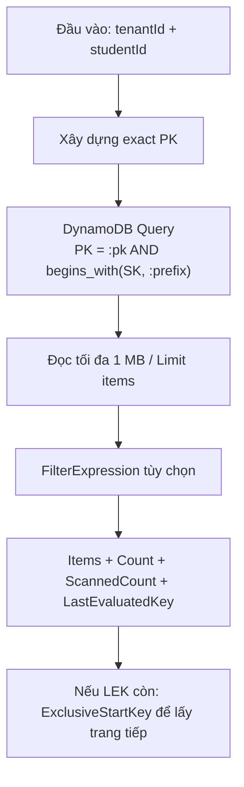
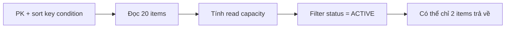
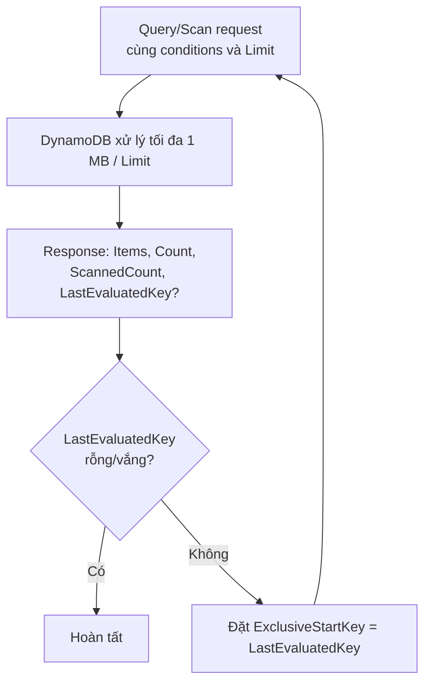
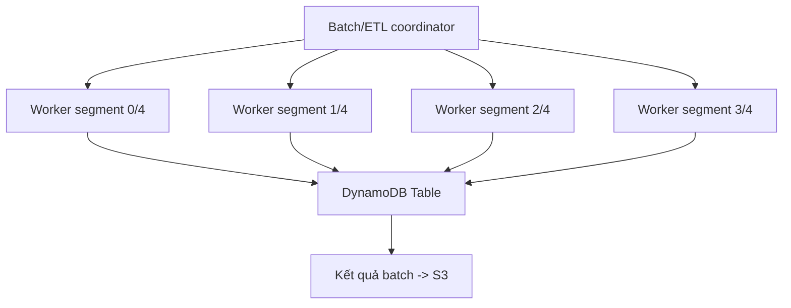
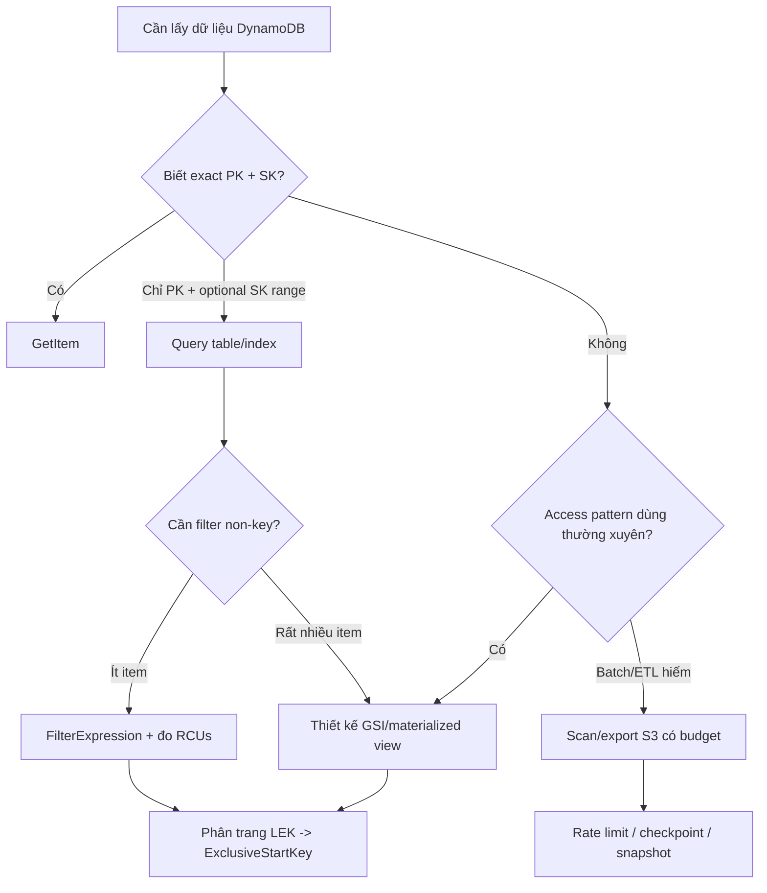

# Query, Scan, pagination và biểu thức lọc

> **Học phần:** CLOUD_PROVIDERS_AWS  
> **Chương:** DynamoDB  
> **Bài học:** Query, Scan, pagination và biểu thức lọc  
> **Bối cảnh:** Học cách đọc dữ liệu hiệu quả từ Amazon DynamoDB trong ứng dụng Java/Spring Boot, AWS Lambda và hệ sinh thái AWS có IAM, API Gateway, giám sát, phục hồi và kiểm soát chi phí.

## 1. Bài toán: tìm đúng dữ liệu thay vì đọc cả bảng

Giả sử nền tảng học Java lưu đăng ký khóa học và hoạt động học viên trong **Amazon DynamoDB**. Một API phải hỗ trợ:

- Liệt kê **20 đăng ký gần nhất** của học viên `student-17`.
- Lọc các đăng ký còn trạng thái `ACTIVE`.
- Hiển thị trang tiếp theo khi người dùng bấm **Xem thêm**.
- Tìm tất cả học viên của khóa `java-101`.
- Chạy báo cáo quản trị quét toàn bộ dữ liệu vào ban đêm.
- Không để một yêu cầu HTTP vô tình đọc hàng triệu items, gây tăng chi phí và throttling.

Cùng một mục tiêu lọc dữ liệu nhưng hai phương án có mức tài nguyên rất khác nhau:

```text
Query:
  Có partition key phù hợp -> đọc một tập mục tiêu -> lọc/đưa ra kết quả.

Scan:
  Không dựa vào partition key -> duyệt nhiều hoặc toàn bộ items -> lọc/đưa ra kết quả.
```

**Một biểu thức lọc không biến Scan thành Query.** DynamoDB áp `FilterExpression` **sau giai đoạn đọc**, nên có thể trả rất ít records trong khi vẫn tiêu thụ capacity để đọc rất nhiều dữ liệu.

### Kết quả cần đạt

Sau bài học, bạn có thể:

1. Phân biệt `Query`, `Scan`, `GetItem` và các trường hợp thiết kế Global Secondary Index (GSI).
2. Viết `KeyConditionExpression` đúng quy tắc partition key và sort key.
3. Dùng `FilterExpression`, `ProjectionExpression`, `ExpressionAttributeNames` và `ExpressionAttributeValues`.
4. Hiểu rõ `Limit`, **1 MB page**, `Count`, `ScannedCount` và `LastEvaluatedKey`.
5. Triển khai pagination bằng `ExclusiveStartKey` với AWS CLI và AWS SDK for Java 2.x.
6. Không nhầm API token `NextToken` của AWS CLI paginator với DynamoDB `LastEvaluatedKey`.
7. Thiết kế cursor pagination an toàn cho REST API có IAM/JWT và nhiều tenants.
8. Đánh giá read consistency, GSI/LSI, RCUs, hot partitions, Scan song song và lỗi throttling.
9. Kiểm thử, quan sát CloudWatch và chọn access pattern thay vì tối ưu theo cảm tính.

## 2. Data model mẫu: partition key và sort key

Bảng `CourseActivity` có **composite primary key**:

| Thuộc tính | Kiểu | Vai trò |
|---|---|---|
| `PK` | String | Partition key |
| `SK` | String | Sort key |
| `tenantId` | String | Thuộc tính nghiệp vụ |
| `studentId` | String | Thuộc tính nghiệp vụ |
| `courseId` | String | Thuộc tính nghiệp vụ |
| `status` | String | `ACTIVE`, `PENDING`, `CANCELLED` |
| `enrolledAt` | String ISO 8601 UTC | Thời điểm đăng ký |
| `GSI1PK` | String | Partition key trên GSI tùy item |
| `GSI1SK` | String | Sort key trên GSI tùy item |

**Quy ước key** của bài học:

```text
Base table:
  PK = TENANT#school-01#STUDENT#student-17
  SK = ENROLLMENT#2026-11-18T09:30:00Z#ORDER#order-001

Global secondary index GSI1:
  GSI1PK = TENANT#school-01#COURSE#java-101
  GSI1SK = ENROLLMENT#2026-11-18T09:30:00Z#STUDENT#student-17
```

Các chuỗi `TENANT#...` là một **quy ước thiết kế ứng dụng**, không phải cú pháp đặc biệt do DynamoDB tự hiểu.

### 2.1. Dữ liệu minh họa

| PK | SK | courseId | status | enrolledAt |
|---|---|---|---|---|
| `TENANT#school-01#STUDENT#student-17` | `ENROLLMENT#2026-11-16T11:00:00Z#ORDER#o1` | java-101 | ACTIVE | 2026-11-16T11:00:00Z |
| Cùng PK | `ENROLLMENT#2026-11-18T09:30:00Z#ORDER#o2` | aws-101 | PENDING | 2026-11-18T09:30:00Z |
| Cùng PK | `ENROLLMENT#2026-11-19T07:20:00Z#ORDER#o3` | java-202 | ACTIVE | 2026-11-19T07:20:00Z |
| `TENANT#school-01#STUDENT#student-42` | `ENROLLMENT#2026-11-17T08:40:00Z#ORDER#o4` | java-101 | ACTIVE | 2026-11-17T08:40:00Z |
| `TENANT#school-02#STUDENT#student-88` | `ENROLLMENT#2026-11-17T08:40:00Z#ORDER#o5` | java-101 | ACTIVE | 2026-11-17T08:40:00Z |

Trong bảng thực, mỗi row có đủ `PK` và `SK`; "Cùng PK" ở bảng chỉ để tránh lặp một chuỗi dài.

**Tại sao chọn sort key chứa ISO 8601 UTC?** Khi timestamp có định dạng nhất quán (UTC, cùng độ chính xác và độ dài), thứ tự **UTF-8 byte** của string timestamp phản ánh thứ tự thời gian. Không trộn các timezone/format/offset tùy ý rồi dựa vào thứ tự chữ.

### 2.2. Access patterns trước khi tạo index

| Yêu cầu | Key/access pattern cần có |
|---|---|
| Lấy một enrollment cụ thể nếu biết PK/SK | `GetItem` |
| 20 enrollments mới nhất của một học viên | `Query PK = ... AND begins_with(SK, 'ENROLLMENT#')`, đảo chiều |
| Enrollments trong một khoảng ngày | `Query PK = ... AND SK BETWEEN ... AND ...` |
| Học viên tham gia khóa java-101 | `Query GSI1PK = TENANT#school-01#COURSE#java-101` |
| Học viên đang ACTIVE của khóa java-101 (thường xuyên, số lượng lớn) | Thiết kế GSI key chứa `status` hoặc materialized view, **không chỉ filter toàn bộ GSI** |
| Báo cáo duyệt cả bảng theo lịch | `Scan` có kiểm soát hoặc xuất dữ liệu sang S3 |

**DynamoDB là NoSQL access-pattern-first.** Nếu muốn truy vấn bằng một thuộc tính không nằm trong key/index, không có câu lệnh "WHERE bất kỳ là nhanh" như một SQL engine tự chọn chỉ mục phù hợp.

## 3. Query: bắt buộc có partition key bằng một giá trị

`Query` tìm các items trong **một partition-key value** của bảng hoặc index. Với composite key, có thể bổ sung điều kiện sort key để giới hạn dải cần đọc.

Cú pháp khái quát:

```text
KeyConditionExpression:
  partition_key = :partitionValue
  [AND sort_key condition]
```

Các điều kiện được hỗ trợ cho sort key gồm:

| Toán tử/hàm | Ví dụ | Ý nghĩa |
|---|---|---|
| `=` | `SK = :exact` | Một sort key cụ thể |
| `<`, `<=` | `SK < :until` | Trước mốc khóa |
| `>`, `>=` | `SK >= :from` | Từ mốc khóa |
| `BETWEEN` | `SK BETWEEN :from AND :to` | Dải hai đầu bao gồm |
| `begins_with` | `begins_with(SK, :prefix)` | Tiền tố sort key |

**Không hợp lệ trong KeyConditionExpression:**

- Không có equality condition cho **partition key**.
- Dùng `contains(PK, :fragment)` hoặc `PK > :value` thay cho `PK = :value`.
- Dùng các non-key attributes như `status` hoặc `courseId` (trừ khi chúng là key của **index đang Query**).
- Dùng `OR` để chọn nhiều partition key values.
- Query dải sort key nhưng không chỉ ra partition key.

### 3.1. Query không phải Scan có thêm filter



Điều kiện key **được áp dụng để định vị dữ liệu cần đọc**, còn FilterExpression là sàng lọc kết quả **sau** khi đọc một phần dữ liệu.

### 3.2. Sắp xếp kết quả bằng sort key

`Query` trên bảng/index có sort key sẽ trả items theo **thứ tự sort key**:

- Với `Number` sort key: thứ tự số học.
- Với `String` sort key: thứ tự byte UTF-8.
- Mặc định: **tăng dần**.
- `ScanIndexForward=false`: **giảm dần**.

Ví dụ ba đăng ký 16/18/19 tháng 11, cùng PK và prefix `ENROLLMENT#`:

```text
ScanIndexForward=true:
  ENROLLMENT#2026-11-16...
  ENROLLMENT#2026-11-18...
  ENROLLMENT#2026-11-19...

ScanIndexForward=false:
  ENROLLMENT#2026-11-19...
  ENROLLMENT#2026-11-18...
  ENROLLMENT#2026-11-16...
```

**Scan không hỗ trợ `ScanIndexForward`.** Không trông chờ kết quả Scan được sắp xếp theo key hoặc timestamp.

## 4. AWS CLI: Query theo partition key và prefix

Những lệnh trong bài là ví dụ dành cho **AWS CLI v2**, Region `ap-southeast-1` và bảng sandbox giả định có dữ liệu như mục 2.

### 4.1. Kiểm tra account/table trước

```bash
aws sts get-caller-identity

aws dynamodb describe-table \
  --table-name CourseActivity \
  --region ap-southeast-1 \
  --query 'Table.{Status:TableStatus,KeySchema:KeySchema,Indexes:GlobalSecondaryIndexes[].IndexName}'
```

Không chạy Query lên bảng production khi chưa biết quyền IAM, key schema và dự kiến số items sẽ đọc.

### 4.2. Query 25 items tối đa mỗi lần đọc

```bash
aws dynamodb query \
  --table-name CourseActivity \
  --key-condition-expression '#pk = :pk AND begins_with(#sk, :prefix)' \
  --expression-attribute-names '{"#pk":"PK","#sk":"SK"}' \
  --expression-attribute-values '{":pk":{"S":"TENANT#school-01#STUDENT#student-17"},":prefix":{"S":"ENROLLMENT#"}}' \
  --scan-index-forward \
  --limit 25 \
  --return-consumed-capacity TOTAL \
  --no-paginate \
  --region ap-southeast-1
```

**Chú ý:** `--scan-index-forward` (không có giá trị) tương ứng true; nếu muốn dữ liệu mới nhất trước, phải dùng `--no-scan-index-forward`, **không** đưa string `false` phía sau `--scan-index-forward`. Ví dụ đúng:

```bash
aws dynamodb query \
  --table-name CourseActivity \
  --key-condition-expression '#pk = :pk AND begins_with(#sk, :prefix)' \
  --expression-attribute-names '{"#pk":"PK","#sk":"SK"}' \
  --expression-attribute-values '{":pk":{"S":"TENANT#school-01#STUDENT#student-17"},":prefix":{"S":"ENROLLMENT#"}}' \
  --no-scan-index-forward \
  --limit 25 \
  --return-consumed-capacity TOTAL \
  --no-paginate \
  --region ap-southeast-1
```

**Quan trọng:** `--limit 25` không bảo đảm 25 items sau filter, cũng không vượt qua giới hạn 1 MB. `--no-paginate` ngăn CLI tự lấy hết các trang; đây là công cụ để thấy một lần gọi service và `LastEvaluatedKey`.

### 4.3. Query theo dải ngày

Với sort key ISO UTC của cùng học viên:

```bash
aws dynamodb query \
  --table-name CourseActivity \
  --key-condition-expression '#pk = :pk AND #sk BETWEEN :start AND :end' \
  --expression-attribute-names '{"#pk":"PK","#sk":"SK"}' \
  --expression-attribute-values '{":pk":{"S":"TENANT#school-01#STUDENT#student-17"},":start":{"S":"ENROLLMENT#2026-11-01"},":end":{"S":"ENROLLMENT#2026-12-01"}}' \
  --region ap-southeast-1
```

**Bẫy boundary:** `BETWEEN` **bao gồm hai đầu**; sử dụng mốc `ENROLLMENT#2026-12-01` như ví dụ có thể phù hợp với key ISO có thêm phần `T...` nhưng không phải cách diễn đạt một khoảng thời gian nửa mở tuyệt đối cho mọi schema. Để triển khai nghiệp vụ nghiêm ngặt, chuẩn hóa timestamp, lựa chọn `>= :start AND < :end` không thể viết đồng thời hai điều kiện sort-key trong một `KeyConditionExpression` chuẩn (chỉ một sort-key condition); có thể dùng `BETWEEN` với end-of-day được chuẩn hóa hoặc thiết kế sort key Number epoch millis.

### 4.4. Một yêu cầu theo partition key chưa đủ nếu PK "nóng"

Nếu rất nhiều người đồng thời Query **một giá trị partition key** (ví dụ `TENANT#school-01#COURSE#popular-course`), bảng có thể gặp hot-key pressure bất chấp tổng provisioned capacity còn rộng. Cần thiết kế key distribution, caching, adaptive capacity, sharding có kiểm soát hoặc access pattern khác. **Đừng Scan để tránh hot partition**: Scan thường tốn hơn.

## 5. FilterExpression: lọc sau khi đọc, không giảm RCUs

Ví dụ cần hiển thị enrollments có `status=ACTIVE` của một học viên. Có thể thêm filter:

```bash
aws dynamodb query \
  --table-name CourseActivity \
  --key-condition-expression '#pk = :pk AND begins_with(#sk, :prefix)' \
  --filter-expression '#status = :active' \
  --expression-attribute-names '{"#pk":"PK","#sk":"SK","#status":"status"}' \
  --expression-attribute-values '{":pk":{"S":"TENANT#school-01#STUDENT#student-17"},":prefix":{"S":"ENROLLMENT#"},":active":{"S":"ACTIVE"}}' \
  --no-scan-index-forward \
  --limit 20 \
  --return-consumed-capacity TOTAL \
  --no-paginate \
  --region ap-southeast-1
```

**Thứ tự thực thi cần nhớ:**

1. Xác định key range qua `KeyConditionExpression`.
2. Đọc tối đa `Limit` **đã đánh giá** hoặc **1 MB**.
3. Sau đó mới đánh giá `FilterExpression`.
4. Trả items phù hợp filter, `Count`, `ScannedCount`, capacity và key phân trang nếu cần.



Nếu 20 items đã đọc mà chỉ 2 ACTIVE:

```text
Limit = 20
ScannedCount = 20  (đọc/evaluate trước filter)
Count = 2         (trả về sau filter)
Read capacity = dựa trên lượng item đã đọc, không dựa 2 kết quả
```

Con số là ví dụ minh họa. Một API đòi đúng 20 ACTIVE records có thể cần tiếp tục Query nhiều lần, mỗi lần tiêu tốn read capacity.

### 5.1. Những biểu thức lọc hữu ích

| Biểu thức | Ý nghĩa |
|---|---|
| `#status = :active` | Trạng thái chính xác |
| `#score >= :minScore` | Điểm từ ngưỡng |
| `attribute_exists(#completedAt)` | Có thuộc tính |
| `attribute_not_exists(#deletedAt)` | Chưa có thuộc tính |
| `contains(#tags, :tag)` | List/set/string có giá trị |
| `begins_with(#title, :prefix)` | Tên bắt đầu bằng tiền tố |
| `#status IN (:a, :b)` | Nằm trong tập giá trị |
| `#score BETWEEN :low AND :high` | Nằm trong khoảng |

**Lưu ý:** `FilterExpression` **không được chứa partition key hoặc sort key attributes** đang dùng cho Query. Các điều kiện key phải đặt trong `KeyConditionExpression`. Chức năng ở đây là lọc **non-key attributes**, không phải lối tắt để đổi partition.

### 5.2. Khi nào FilterExpression vẫn phù hợp?

- Partition key và sort key đã định vị một tập nhỏ, filter loại thêm vài items.
- Lọc tuỳ chọn không thường xuyên, đã chấp nhận RCUs.
- Tải ít và việc thêm GSI làm tăng write/index storage cost nhiều hơn lợi ích đọc.
- Phải trả về ít bytes để giảm băng thông/response payload.

**Không phù hợp:** Lọc `status=ACTIVE` giữa hàng triệu enrollment của một tenant bằng Scan trong mỗi HTTP request. Khi đó, cân nhắc GSI/sparse index/materialized view.

## 6. ProjectionExpression và ExpressionAttributeNames/Values

### 6.1. ProjectionExpression: chọn thuộc tính trả về

Khi chỉ cần hiển thị:

```text
courseId, status, enrolledAt
```

Có thể thêm:

```bash
--projection-expression 'PK, SK, courseId, #st, enrolledAt' \
--expression-attribute-names '{"#pk":"PK","#sk":"SK","#st":"status"}'
```

Đây là **mảnh tham số** để ghép vào lệnh Query có sẵn, không phải một lệnh AWS CLI độc lập.

**Điểm quan trọng:** Khi Query **base table**, ProjectionExpression không giảm RCUs, vì DynamoDB tính read capacity trên **item size được đọc**, không phải số attribute gửi về. Tuy nhiên nó giảm response bytes/serialization, mạng và dữ liệu nhạy cảm vô tình chuyển ra client.

**Ngoại lệ của index:** Nếu thiết kế GSI với `KEYS_ONLY` hoặc `INCLUDE` projection nhỏ, đọc item **nhỏ hơn đã được vật hóa trong index** có thể giảm chi phí đọc index; khác với việc dùng `ProjectionExpression` trên cùng một item đã đọc.

### 6.2. ExpressionAttributeNames

Một số tên thuộc tính trùng **reserved words** (ví dụ `status` có thể cần alias), chứa dấu chấm/dấu gạch ngang hoặc ký tự đặc biệt. Dùng alias `#...`:

```json
{
  "#pk": "PK",
  "#sk": "SK",
  "#st": "status",
  "#date": "enrolledAt"
}
```

Ví dụ `#st = :active`; DynamoDB sẽ thay `#st` bằng tên thuộc tính `status`.

### 6.3. ExpressionAttributeValues

Các giá trị được truyền qua placeholders `:...`, **không ghép chuỗi raw user input** vào expression.

```json
{
  ":pk": {"S": "TENANT#school-01#STUDENT#student-17"},
  ":prefix": {"S": "ENROLLMENT#"},
  ":active": {"S": "ACTIVE"},
  ":minScore": {"N": "70"}
}
```

Trong DynamoDB low-level API, `S` là string, `N` là number **biểu diễn dưới dạng string**, `BOOL` là boolean, `NULL`, `M`, `L` và các kiểu khác có cú pháp riêng.

**Không thay `:minScore` bằng `{"S":"70"}` nếu attribute `score` lưu kiểu Number**, vì DynamoDB không tự ép kiểu như một số SQL engines.

### 6.4. Bộ ba dễ nhầm

| Trường | Thời điểm | Tiết kiệm read capacity? |
|---|---|---|
| `KeyConditionExpression` | Xác định partition và sort-key range **trước đọc** | **Có thể**, nhờ hạn chế tập items cần đọc |
| `FilterExpression` | **Sau khi đọc** trang DynamoDB | **Không** |
| `ProjectionExpression` | Chọn thuộc tính **trả về** | **Không** cho cùng một tập item trên base table |

## 7. Scan: duyệt bảng hoặc index mà không yêu cầu partition key

`Scan` đọc nhiều items qua table/index, có thể lọc sau khi đọc. Nó thường là công cụ đúng cho:

- Batch migration có deadline được kiểm soát.
- Kiểm kê dữ liệu nhỏ trong sandbox.
- Bảo trì/ETL chạy nền với capacity budget, không phục vụ request latency thấp.
- Audit/khám phá bất thường khi không có index phù hợp.
- Một số bước dữ liệu ban đầu trước khi thiết kế lại indexes.

**Không nên** dùng Scan cho từng request "liệt kê 10 enrollments của học viên A" khi Query theo PK sẵn có.

### 7.1. Khác nhau về chi phí

Giả sử bảng có **1.000.000 items**, mỗi item trung bình **1 KB**, và chỉ 100 items thuộc một học viên.

- `Query` với PK phù hợp đọc khoảng 100 items (có thể nhiều trang).
- `Scan + FilterExpression` phải đánh giá khoảng 1.000.000 items nếu duyệt đủ bảng để xác định tất cả matches.
- Filter giúp **trả về ít bytes** hơn, nhưng không làm giảm read capacity tiêu thụ bởi items đã scan.
- `Limit=100` chỉ dừng **một trang** sau khi đánh giá tối đa 100 items hoặc 1 MB, không chứng minh đã kiểm tra đủ bảng.

Số items/size chỉ là ví dụ; chi phí thực còn phụ thuộc item size, consistency, index và cấu hình capacity.

### 7.2. Scan không có thứ tự đáng tin cậy

Kết quả `Scan` **không được sắp xếp theo SK**, ngay cả khi bảng có sort key. Không dùng Scan + client sort của một trang 100 items rồi coi là "100 gần nhất toàn bảng": bạn chưa đọc toàn bộ dữ liệu.

Nếu cần "mới nhất" trên nhiều partitions, hãy thiết kế GSI hoặc một bảng feed/materialized view với key có nghĩa, rồi Query theo sort key.

### 7.3. Scan read consistency

- Mặc định Scan dùng **eventually consistent reads**.
- Có thể đặt `ConsistentRead=true` khi Scan **base table/LSI** được hỗ trợ.
- **Strongly consistent Scan không bảo đảm snapshot isolation của toàn bảng**: items có thể thay đổi trong lúc các trang được đọc; không có một ảnh chụp atomic tại thời điểm bắt đầu.
- GSI chỉ hỗ trợ **eventually consistent reads**.

Với báo cáo cần một snapshot nhất quán của dữ liệu theo thời điểm, cân nhắc **DynamoDB export to S3 with PITR** khi phù hợp yêu cầu, hoặc pipeline CDC/streaming có cơ chế snapshot/cutoff riêng; không chỉ bật StrongRead rồi tuyên bố báo cáo nguyên tử.

## 8. Pagination: 1 MB, LastEvaluatedKey, ExclusiveStartKey

**DynamoDB Query và Scan chỉ xử lý tối đa khoảng 1 MB dữ liệu một lần gọi**, hoặc dừng sớm nếu `Limit` được đạt. Giới hạn này áp dụng **trước** `FilterExpression` và `ProjectionExpression`.

**Vòng lặp low-level chuẩn:**



Response ví dụ giản lược:

```json
{
  "Items": [
    {
      "PK": {"S": "TENANT#school-01#STUDENT#student-17"},
      "SK": {"S": "ENROLLMENT#2026-11-19T07:20:00Z#ORDER#o3"}
    }
  ],
  "Count": 1,
  "ScannedCount": 5,
  "LastEvaluatedKey": {
    "PK": {"S": "TENANT#school-01#STUDENT#student-17"},
    "SK": {"S": "ENROLLMENT#2026-11-18T09:30:00Z#ORDER#o2"}
  }
}
```

**Mấu chốt:**

1. `LastEvaluatedKey` là vị trí DynamoDB dừng **đánh giá**, không nhất thiết là item cuối cùng trả về sau filter.
2. Trang tiếp theo truyền nguyên map key đó vào `ExclusiveStartKey`.
3. Giữ nguyên table/index, key condition, filter, chiều sort, auth context; nếu đổi điều kiện giữa các trang, cursor cũ **không còn biểu diễn cùng tập kết quả**.
4. Chỉ khi `LastEvaluatedKey` **vắng hoặc rỗng** mới biết đã duyệt hết.
5. **Có LastEvaluatedKey chưa chắc chắc chắn có trang tiếp theo chứa item**; có thể là ranh giới cuối và call sau trả rỗng.

### 8.1. Trang rỗng nhưng vẫn có LastEvaluatedKey

Giả sử `Limit=5` và filter yêu cầu ACTIVE, nhưng năm items đầu tiên đều PENDING:

```json
{
  "Items": [],
  "Count": 0,
  "ScannedCount": 5,
  "LastEvaluatedKey": {
    "PK": {"S": "TENANT#school-01#STUDENT#student-17"},
    "SK": {"S": "ENROLLMENT#2026-11-18T09:30:00Z#ORDER#o2"}
  }
}
```

**Sai:** `if (items.isEmpty()) break;`

**Đúng:** Nếu `LastEvaluatedKey` còn, tiếp tục query (trong giới hạn request/latency budget của ứng dụng) vì các trang sau có thể chứa ACTIVE items.

### 8.2. Limit không phải page size sau filter

| `Limit` | `ScannedCount` trước filter | `Count` sau filter | Có thể còn cursor? |
|---:|---:|---:|---|
| 10 | 10 | 8 | Có |
| 10 | 10 | 0 | Có |
| 10 | 3 | 3 | Không |
| 100 | 40 (đã chạm 1 MB trước) | 2 | Có |

Tất cả số trên là ví dụ giả định. Không thể yêu cầu DynamoDB "trả **chính xác** 20 items sau filter" chỉ bằng `Limit=20`.

### 8.3. Offset pagination không phù hợp

DynamoDB không có native `OFFSET 50000` cho `Query`/`Scan` như SQL. Để bỏ qua 50.000 items, client vẫn phải đọc/tiêu thụ capacity khi duyệt từ đầu; đây là cách phân trang tốn kém và khó nhất quán khi dữ liệu thay đổi.

Thiết kế API nên ưu tiên **cursor-based pagination**:

```text
GET /enrollments?limit=20
-> items[], nextCursor

GET /enrollments?limit=20&cursor=<opaque-token>
-> items[], nextCursor hoặc null
```

### 8.4. Page consistency không phải snapshot

Nếu item mới được thêm/đổi status giữa trang 1 và trang 2:

- `ExclusiveStartKey` tiếp tục từ vị trí trong keyspace.
- Trên index/query eventually consistent, kết quả có thể chưa thấy cập nhật.
- Một item đổi thuộc tính filter trong lúc duyệt có thể xuất hiện hoặc không trong các trang tùy thời điểm.
- Không bảo đảm phân trang trên dữ liệu **đang thay đổi** là ảnh chụp cố định và không thể trùng/thiếu theo semantics ứng dụng.

Với yêu cầu audit nhất quán, cần snapshot/export hoặc một trường version/cutoff/query design phù hợp.

## 9. AWS CLI: phân trang đúng và ba cơ chế token

AWS CLI có **client-side paginator**; DynamoDB có **service-level pagination**. Chúng không đồng nhất.

### 9.1. Một request service với --no-paginate

```bash
aws dynamodb query \
  --table-name CourseActivity \
  --key-condition-expression 'PK = :pk' \
  --expression-attribute-values '{":pk":{"S":"TENANT#school-01#STUDENT#student-17"}}' \
  --limit 2 \
  --no-paginate \
  --region ap-southeast-1
```

Nếu còn dữ liệu, service response có `LastEvaluatedKey`. Lần tiếp theo truyền map đã nhận:

```bash
aws dynamodb query \
  --table-name CourseActivity \
  --key-condition-expression 'PK = :pk' \
  --expression-attribute-values '{":pk":{"S":"TENANT#school-01#STUDENT#student-17"}}' \
  --limit 2 \
  --exclusive-start-key '{"PK":{"S":"TENANT#school-01#STUDENT#student-17"},"SK":{"S":"ENROLLMENT#2026-11-18T09:30:00Z#ORDER#o2"}}' \
  --no-paginate \
  --region ap-southeast-1
```

**Không copy key mẫu như giá trị thật**: `ExclusiveStartKey` phải được lấy từ response trang trước cùng table/index/query. Với GSI, response cursor có thể chứa **GSI key lẫn primary key của base table**; luôn giữ nguyên map trả về.

### 9.2. CLI --page-size và --max-items

| Tham số | Lớp | Hành vi |
|---|---|---|
| `--limit` | DynamoDB API | Số items đánh giá tối đa trước filter cho **mỗi API request** |
| `--page-size` | AWS CLI paginator | Kích thước yêu cầu service ở mỗi lần gọi (thường ánh xạ giới hạn API) |
| `--max-items` | AWS CLI paginator | Giới hạn tổng số output items của CLI và trả `NextToken` của CLI khi còn |
| `--starting-token` | AWS CLI paginator | Resume từ CLI `NextToken` |
| `--no-paginate` | AWS CLI | Không tự gọi các trang tiếp theo |
| `--exclusive-start-key` | DynamoDB API | Resume từ **LastEvaluatedKey service** |

**Không truyền CLI `NextToken` vào DynamoDB `ExclusiveStartKey`.** Không lấy `LastEvaluatedKey` JSON của service rồi dùng làm `--starting-token`. Đó là hai loại cursor khác nhau.

Ví dụ CLI tự quản lý số output:

```bash
aws dynamodb query \
  --table-name CourseActivity \
  --key-condition-expression 'PK = :pk' \
  --expression-attribute-values '{":pk":{"S":"TENANT#school-01#STUDENT#student-17"}}' \
  --page-size 10 \
  --max-items 20 \
  --region ap-southeast-1
```

Nếu output chứa `NextToken`, dùng `--starting-token <NextToken>` ở lệnh kế tiếp, với các tham số tương tự. Theo AWS CLI, tránh kết hợp kích thước `--page-size` và `--max-items` khác biệt gây kết quả khó dự đoán; chọn tương thích khi phân trang CLI, hoặc quản lý trực tiếp service cursor.

## 10. Scan và lọc bằng AWS CLI

### 10.1. Scan một trang có giới hạn

```bash
aws dynamodb scan \
  --table-name CourseActivity \
  --filter-expression '#status = :active' \
  --expression-attribute-names '{"#status":"status"}' \
  --expression-attribute-values '{":active":{"S":"ACTIVE"}}' \
  --limit 100 \
  --return-consumed-capacity TOTAL \
  --no-paginate \
  --region ap-southeast-1
```

Lệnh này **đọc tối đa 100 items/1 MB trước filter**, chứ không bảo đảm trả 100 ACTIVE items hoặc kiểm kê toàn bảng.

### 10.2. Chỉ lấy số đếm qua Select COUNT

```bash
aws dynamodb scan \
  --table-name CourseActivity \
  --select COUNT \
  --no-paginate \
  --return-consumed-capacity TOTAL \
  --region ap-southeast-1
```

**Không hiểu `COUNT` là truy vấn metadata miễn phí.** DynamoDB vẫn đọc items để đếm và tiêu thụ read capacity, có giới hạn 1 MB/trang. Muốn count toàn bảng chính xác theo một mốc cần duyệt nhiều trang hoặc mô hình đếm chủ động và consistency phù hợp.

`DescribeTable.Table.ItemCount` là **thống kê ước lượng/cập nhật định kỳ**, không phải bộ đếm realtime chính xác cho một filter.

### 10.3. Đọc một số attribute cụ thể

```bash
aws dynamodb scan \
  --table-name CourseActivity \
  --projection-expression 'PK, SK, courseId, #st' \
  --expression-attribute-names '{"#st":"status"}' \
  --limit 50 \
  --no-paginate \
  --region ap-southeast-1
```

Kết quả network nhỏ hơn nếu item có nhiều attributes, nhưng **RCUs không giảm** chỉ vì projection expression khi scan cùng một bảng.

### 10.4. Rủi ro khi chạy Scan trong production

- Một full scan có thể tạo **burst RCU/ReadRequestUnits**, tăng latency hoặc throttling của API chính.
- Filter không hạn chế dữ liệu đã đọc, chỉ hạn chế trả về.
- Scan không có thứ tự và không có snapshot isolation.
- `--no-paginate` không giải quyết yêu cầu duyệt toàn bộ nếu cần đủ kết quả.
- AWS CLI default auto paginate có thể khiến lệnh vô tình lấy **toàn bộ bảng**, gây tốn tài nguyên và phí.

**Khuyến nghị:** Scan production chỉ thực hiện theo change plan/budget với `Limit`, paging, backoff, capacity monitoring và thời gian thích hợp. Với analytics lớn, xem xét DynamoDB export to S3, Athena/Glue.

## 11. Global Secondary Index và Local Secondary Index

Khi một access pattern không khớp với primary key, nên cân nhắc index **trước khi dùng Scan cho HTTP request thường xuyên**.

### 11.1. GSI: truy vấn theo khóa học

Tạo một GSI `GSI1` với:

```text
GSI1 partition key = GSI1PK
GSI1 sort key      = GSI1SK

GSI1PK = TENANT#school-01#COURSE#java-101
GSI1SK = ENROLLMENT#2026-11-17T08:40:00Z#STUDENT#student-42
```

AWS CLI:

```bash
aws dynamodb query \
  --table-name CourseActivity \
  --index-name GSI1 \
  --key-condition-expression '#pk = :course AND begins_with(#sk, :p)' \
  --expression-attribute-names '{"#pk":"GSI1PK","#sk":"GSI1SK"}' \
  --expression-attribute-values '{":course":{"S":"TENANT#school-01#COURSE#java-101"},":p":{"S":"ENROLLMENT#"}}' \
  --no-scan-index-forward \
  --limit 25 \
  --no-paginate \
  --region ap-southeast-1
```

**Điểm cần biết:**

- GSI có **partition key/sort key riêng**, khác base table.
- GSI đọc theo **eventually consistent**; `ConsistentRead=true` trên GSI sẽ bị từ chối.
- GSI chỉ chứa các attributes đã được **projected** vào index; không tự fetch non-projected attributes từ base table khi Query GSI.
- Tạo/cập nhật GSI có **write amplification**, storage và chi phí đọc riêng; không tạo nhiều GSIs vô tội vạ.
- GSI có thể là **sparse index**: chỉ các items có các index key attributes hợp lệ mới có mặt theo điều kiện schema.
- Trạng thái GSI cần `ACTIVE` trước khi Query production; tạo GSI trên bảng lớn có thời gian backfill.

### 11.2. LSI: cùng partition key, sort key khác

**Local Secondary Index (LSI)**:

- Có **partition key giống base table**.
- Có **sort key khác**.
- Phải tạo khi **tạo bảng**, không thêm LSI tùy ý sau khi bảng đã vận hành.
- Có thể hỗ trợ **strongly consistent reads** khi Query/Scan LSI.
- Trên table có LSI, mỗi item collection cùng partition key chịu **giới hạn 10 GB**.
- Nếu yêu cầu non-projected attributes, DynamoDB có thể fetch từ base table, làm tăng read capacity và latency.

**Không đổi từ GSI sang LSI chỉ để dùng strong consistency** khi cần phân vùng theo khóa học; LSI không cho phép partition key mới.

### 11.3. Khi filter nên thành một index key?

Ví dụ API thường xuyên lấy **ACTIVE enrollments của một khóa học** có hàng trăm nghìn học viên. Nếu GSI chỉ có key `COURSE#java-101` rồi filter status, read capacity có thể lớn.

Một GSI khác có thể dùng:

```text
GSI2PK = TENANT#school-01#COURSE#java-101#STATUS#ACTIVE
GSI2SK = ENROLLED#2026-11-18T09:30:00Z#STUDENT#student-17
```

Khi status đổi, ứng dụng **phải cập nhật index key attributes nhất quán** trên base item. GSI phản ánh thay đổi một cách eventually consistent. Không sử dụng GSI stale read như nguồn xác nhận thanh toán tuyệt đối nếu nghiệp vụ cần transactional correctness.

**Tradeoff:** Query hiệu quả hơn với access pattern này nhưng mỗi write có thể cập nhật thêm index, làm tăng chi phí và complexity.

## 12. Read consistency: mặc định eventual, strong chỉ nơi hỗ trợ

| Nguồn đọc | Eventually consistent | Strongly consistent |
|---|---|---|
| Base table (single Region) | Có | **Có**, dùng `ConsistentRead=true` |
| LSI | Có | **Có**, dùng `ConsistentRead=true` |
| GSI | **Có** | **Không** |
| Scan base table | Có | Có ở mức item, **không có snapshot toàn bảng** |

**Eventually consistent**: kết quả có thể chưa phản ánh write vừa thành công ngay tức thì, nhưng hệ thống sẽ hội tụ theo cơ chế DynamoDB.

**Strongly consistent**: đọc phiên bản dữ liệu mới nhất đã commit tại thời điểm read phù hợp trong giới hạn Region/table/index hỗ trợ. Không biến cả một chuỗi nhiều request phân trang thành một transaction snapshot.

### 12.1. Query strong consistency ở base table

```bash
aws dynamodb query \
  --table-name CourseActivity \
  --key-condition-expression 'PK = :pk' \
  --expression-attribute-values '{":pk":{"S":"TENANT#school-01#STUDENT#student-17"}}' \
  --consistent-read \
  --limit 20 \
  --no-paginate \
  --region ap-southeast-1
```

Đừng dùng `--consistent-read` với `--index-name GSI1`. AWS từ chối vì GSI chỉ hỗ trợ eventual reads.

### 12.2. Khi nào cần strong?

- Sau khi ghi enrollment, API phải xác nhận **đã tồn tại** ở base table trước khi trả một trạng thái nhạy cảm.
- Đọc một trạng thái vừa cập nhật để quyết định chuyển bước workflow, khi business semantics thực sự cần read-after-write.

**Vẫn cần conditional writes/transactions** khi nhiều caller cùng sửa item. Strong read rồi `UpdateItem` không có điều kiện vẫn có race condition giữa read và write.

### 12.3. Global tables là một chủ đề riêng

DynamoDB global tables hiện có các chế độ consistency phù hợp từng loại cấu hình, gồm những tùy chọn multi-Region mới hơn. Bài này tập trung **Query/Scan trên một table/index trong một Region**. Không suy từ `ConsistentRead=true` trên base table rằng mọi cross-Region read trong mọi global table mode đều luôn mạnh và đồng bộ; tra documentation global table mode tương ứng.
## 13. Java 17 + AWS SDK for Java 2.x: Query từng trang

Trong backend Spring Boot hoặc Lambda Java, nên dùng **AWS SDK for Java 2.x** với IAM role của ECS task/EC2 instance/Lambda execution environment. Không hard-code AWS access keys.

Dependency Maven điển hình: `software.amazon.awssdk:dynamodb`, quản lý phiên bản bằng AWS SDK BOM của dự án.

### 13.1. Ví dụ low-level Query API

Đoạn Java 17 hoàn chỉnh về logic một trang; table và dữ liệu phải tồn tại trong tài khoản sandbox:

```java
package example.course.dynamodb;

import java.util.Map;
import software.amazon.awssdk.regions.Region;
import software.amazon.awssdk.services.dynamodb.DynamoDbClient;
import software.amazon.awssdk.services.dynamodb.model.AttributeValue;
import software.amazon.awssdk.services.dynamodb.model.QueryRequest;
import software.amazon.awssdk.services.dynamodb.model.QueryResponse;
import software.amazon.awssdk.services.dynamodb.model.ReturnConsumedCapacity;

public final class EnrollmentQuery {
    private static final String TABLE = "CourseActivity";

    private EnrollmentQuery() {}

    public static QueryResponse queryActivePage(
            DynamoDbClient dynamo,
            String tenantId,
            String studentId,
            Map<String, AttributeValue> cursor) {

        // Production phải lấy tenantId/studentId từ identity đã xác minh,
        // không tin tenantId do client tự khai.
        String pk = "TENANT#" + tenantId + "#STUDENT#" + studentId;

        QueryRequest.Builder request = QueryRequest.builder()
                .tableName(TABLE)
                .keyConditionExpression(
                    "#pk = :pk AND begins_with(#sk, :prefix)")
                .filterExpression("#st = :active")
                .expressionAttributeNames(Map.of(
                    "#pk", "PK",
                    "#sk", "SK",
                    "#st", "status"))
                .expressionAttributeValues(Map.of(
                    ":pk", AttributeValue.builder().s(pk).build(),
                    ":prefix", AttributeValue.builder()
                        .s("ENROLLMENT#").build(),
                    ":active", AttributeValue.builder()
                        .s("ACTIVE").build()))
                .scanIndexForward(false)
                .limit(25)
                .returnConsumedCapacity(ReturnConsumedCapacity.TOTAL);

        if (cursor != null && !cursor.isEmpty()) {
            request.exclusiveStartKey(cursor);
        }

        return dynamo.query(request.build());
    }

    public static void main(String[] args) {
        try (DynamoDbClient client = DynamoDbClient.builder()
                .region(Region.AP_SOUTHEAST_1).build()) {

            Map<String, AttributeValue> cursor = Map.of();
            int requestCount = 0;
            int matchingItems = 0;

            do {
                QueryResponse response = queryActivePage(
                    client, "school-01", "student-17", cursor);

                matchingItems += response.items().size();

                System.out.printf(
                    "page=%d returned=%d evaluated=%d capacity=%s%n",
                    requestCount + 1,
                    response.count(),
                    response.scannedCount(),
                    response.consumedCapacity() == null
                        ? "n/a"
                        : response.consumedCapacity().capacityUnits());

                cursor = response.lastEvaluatedKey();
                requestCount++;

                // Lab guardrail: tránh lặp không giới hạn / vượt budget.
            } while (cursor != null
                    && !cursor.isEmpty()
                    && requestCount < 20);

            System.out.println("Matching items seen: " + matchingItems);
        }
    }
}
```

**Điểm cần nhận diện:**

- `QueryRequest.limit(25)` là số items DynamoDB **đánh giá tối đa trong một request**, không bảo đảm 25 ACTIVE records sau filter.
- `QueryResponse.items()` là dữ liệu được trả về **sau filter**.
- `QueryResponse.scannedCount()` biểu thị số items đọc/evaluate trước filter.
- `QueryResponse.lastEvaluatedKey()` trả map key cần dùng cho request kế tiếp.
- `returnConsumedCapacity(TOTAL)` giúp so sánh consumption giữa các access patterns.
- Vòng lặp có **20 requests tối đa** trong lab; không đảm bảo đã đọc hết nếu cursor vẫn còn.
- Không nên log đầy đủ `response.items()` nếu chứa dữ liệu học viên.

**Production:** Xây dựng API có budget về thời gian, capacity, số low-level requests, số items và quyền tenant, không để caller yêu cầu một vòng lặp không giới hạn.

### 13.2. Paginator của SDK v2

AWS SDK v2 hỗ trợ `queryPaginator(...)` để tự theo `LastEvaluatedKey`:

```java
QueryRequest request = QueryRequest.builder()
    .tableName("CourseActivity")
    .keyConditionExpression("#pk = :pk")
    .expressionAttributeNames(Map.of("#pk", "PK"))
    .expressionAttributeValues(Map.of(
        ":pk", AttributeValue.builder()
            .s("TENANT#school-01#STUDENT#student-17")
            .build()))
    .limit(25)
    .build();

// Lưu ý: vòng for này có thể tự gọi RẤT NHIỀU API requests.
for (QueryResponse page : client.queryPaginator(request)) {
    System.out.println("Page count: " + page.count());
}
```

`queryPaginator` hữu ích cho batch cần duyệt hết một partition, nhưng **nguy hiểm trong HTTP API latency thấp** nếu request có thể kéo theo hàng trăm calls. Với API "Xem thêm", chỉ lấy **một hoặc một số trang có budget** rồi trả cursor.

### 13.3. Java async paginator

`DynamoDbAsyncClient` có `queryPaginator(...)` trả `SdkPublisher<QueryResponse>` theo SDK v2. Thiết kế async cần:

- Backpressure theo subscriber.
- Giới hạn số pages/calls/concurrency.
- Cancellation/deadline theo request.
- Không dồn mọi items vào một List khi partition rất lớn.
- Bảo vệ AWS client resources, exception propagation và retry policy.

Async API không biến Scan thành Query hiệu quả; nó chỉ thay cách ứng dụng gửi yêu cầu và xử lý kết quả.

## 14. DynamoDB Enhanced Client: truy vấn bằng Java model

**Enhanced Client** giúp ánh xạ DynamoDB attributes sang Java bean và cung cấp `PageIterable<T>`/`PagePublisher<T>`. Sử dụng thư viện `software.amazon.awssdk:dynamodb-enhanced` cùng version SDK.

### 14.1. Model tối giản

```java
package example.course.dynamodb;

import software.amazon.awssdk.enhanced.dynamodb.mapper.annotations.DynamoDbAttribute;
import software.amazon.awssdk.enhanced.dynamodb.mapper.annotations.DynamoDbBean;
import software.amazon.awssdk.enhanced.dynamodb.mapper.annotations.DynamoDbPartitionKey;
import software.amazon.awssdk.enhanced.dynamodb.mapper.annotations.DynamoDbSortKey;

@DynamoDbBean
public class EnrollmentItem {
    private String pk;
    private String sk;
    private String courseId;
    private String status;

    @DynamoDbPartitionKey
    @DynamoDbAttribute("PK")
    public String getPk() { return pk; }
    public void setPk(String pk) { this.pk = pk; }

    @DynamoDbSortKey
    @DynamoDbAttribute("SK")
    public String getSk() { return sk; }
    public void setSk(String sk) { this.sk = sk; }

    public String getCourseId() { return courseId; }
    public void setCourseId(String courseId) { this.courseId = courseId; }

    public String getStatus() { return status; }
    public void setStatus(String status) { this.status = status; }
}
```

Nếu table chứa các attributes khác ngoài bean fields, Enhanced Client vẫn có thể đọc các thuộc tính được map; muốn hỗ trợ GSI ở Enhanced Client, cần khai báo secondary-index keys bằng annotations như `@DynamoDbSecondaryPartitionKey` và `@DynamoDbSecondarySortKey` hoặc table schema tường minh.

### 14.2. Query và xử lý từng trang

```java
package example.course.dynamodb;

import java.util.Map;
import software.amazon.awssdk.regions.Region;
import software.amazon.awssdk.services.dynamodb.DynamoDbClient;
import software.amazon.awssdk.enhanced.dynamodb.DynamoDbEnhancedClient;
import software.amazon.awssdk.enhanced.dynamodb.DynamoDbTable;
import software.amazon.awssdk.enhanced.dynamodb.TableSchema;
import software.amazon.awssdk.enhanced.dynamodb.Key;
import software.amazon.awssdk.enhanced.dynamodb.model.Page;
import software.amazon.awssdk.enhanced.dynamodb.model.PageIterable;
import software.amazon.awssdk.enhanced.dynamodb.model.QueryConditional;
import software.amazon.awssdk.enhanced.dynamodb.model.QueryEnhancedRequest;

public final class EnhancedQueryExample {
    public static void main(String[] args) {
        try (DynamoDbClient lowLevel = DynamoDbClient.builder()
                .region(Region.AP_SOUTHEAST_1).build()) {

            DynamoDbEnhancedClient enhanced =
                DynamoDbEnhancedClient.builder()
                    .dynamoDbClient(lowLevel).build();

            DynamoDbTable<EnrollmentItem> table =
                enhanced.table(
                    "CourseActivity",
                    TableSchema.fromBean(EnrollmentItem.class));

            QueryEnhancedRequest request =
                QueryEnhancedRequest.builder()
                    .queryConditional(
                        QueryConditional.sortBeginsWith(
                            Key.builder()
                                .partitionValue(
                                    "TENANT#school-01#STUDENT#student-17")
                                .sortValue("ENROLLMENT#")
                                .build()))
                    .scanIndexForward(false)
                    .limit(25)
                    .build();

            PageIterable<EnrollmentItem> pages = table.query(request);

            // Lưu ý: lặp hết PageIterable đồng nghĩa có thể query nhiều pages.
            int maxPages = 10;
            int processedPages = 0;

            for (Page<EnrollmentItem> page : pages) {
                for (EnrollmentItem item : page.items()) {
                    // Lab: chỉ log key đã giảm nhạy cảm.
                    System.out.println(item.getSk());
                }

                if (++processedPages >= maxPages) {
                    break;
                }
            }
        }
    }
}
```

**Không nhầm:** `QueryConditional.sortBeginsWith` vẫn yêu cầu partition value bên trong `Key`. Enhanced Client không cho phép Query thiếu partition key.

### 14.3. Một trang Enhanced Client và cursor

Mỗi `Page<T>` có `lastEvaluatedKey()`. Nếu API cần phân trang chủ động, dùng `QueryEnhancedRequest.exclusiveStartKey(...)` thay vì lặp tới hết. Tương tự low-level client, cần giữ đúng query context và bảo vệ cursor trên HTTP API.

**Quan trọng:** Enhanced Client tự xử lý pagination nhưng **không làm FilterExpression giảm RCU**, không biến GSI thành strongly consistent và không tự ngăn full Scan khi code gọi `table.scan()`.

## 15. Thiết kế REST API cursor pagination an toàn

Với Spring Boot/API Gateway:

```text
GET /students/me/enrollments?status=ACTIVE&limit=20

Response:
{
  "items": [
    {"courseId":"java-202","status":"ACTIVE"}
  ],
  "nextCursor": "opaque-signed-token"
}
```

Ở request kế tiếp:

```text
GET /students/me/enrollments?status=ACTIVE&limit=20&cursor=opaque-signed-token
```

### 15.1. Không phát hành cursor trần có thể bị thay đổi

`LastEvaluatedKey` có thể chứa key tenant/student ID và các thông tin nội bộ. Nếu trả trực tiếp JSON cho client mà không ràng buộc auth context, người dùng có thể:

- Tự sửa `PK` trong cursor sang tenant khác.
- Dùng cursor của học viên A trong session học viên B.
- Dùng cursor của filter `status=ACTIVE` cho query `status=CANCELLED`.
- Chuyển cursor của GSI sang base table query.
- Gửi cursor kích thước quá lớn để tăng cost parsing.

**Dù IAM/backend cần chặn thao tác trái phép, cursor phải được coi là dữ liệu do client kiểm soát.**

### 15.2. Nội dung một cursor đã ký

Một payload cursor nội bộ hợp lý:

```json
{
  "version": 1,
  "expiresAt": "2026-11-20T04:00:00Z",
  "tenantId": "school-01",
  "subject": "student-17",
  "table": "CourseActivity",
  "index": null,
  "queryHash": "sha256-of-normalized-query",
  "scanIndexForward": false,
  "lastEvaluatedKey": {
    "PK": {"S": "TENANT#school-01#STUDENT#student-17"},
    "SK": {"S": "ENROLLMENT#2026-11-18T09:30:00Z#ORDER#o2"}
  }
}
```

**Đây là payload nội bộ minh họa, không phải API response DynamoDB.** Server có thể mã hóa base64url rồi ký HMAC-SHA256 hoặc dùng AEAD để tạo opaque token, giữ key trong AWS Secrets Manager/KMS và hỗ trợ rotation. **Base64 đơn thuần không chống giả mạo**, và ký HMAC không mã hóa nội dung; nếu cursor chứa dữ liệu nhạy cảm, dùng encryption hoặc lưu server-side.

### 15.3. Quy tắc nhận cursor

1. Authenticate caller bằng JWT/IAM/Lambda authorizer đúng trust boundary.
2. Tính `tenantId` và `studentId` **từ identity đã xác minh**, không tin request parameter.
3. Giới hạn `limit` từ 1 tới một ngưỡng đã duyệt, ví dụ tối đa 50 items API.
4. Validate cursor signature/tag, expiry, version và kích thước.
5. Đối chiếu subject/tenant/table/index/filter/sort direction với request hiện tại.
6. Nếu hợp lệ, lấy `LastEvaluatedKey` và truyền vào `ExclusiveStartKey`.
7. Đọc tối đa số trang DynamoDB theo **latency/capacity budget**.
8. Trả kết quả và cursor mới; không expose IAM credentials hay raw tokens.
9. Nếu cursor sai/hết hạn, trả lỗi client rõ ràng (ví dụ 400) mà không lộ implementation details.

### 15.4. Lấy đúng 20 items sau filter có thể cần nhiều pages

Khi `FilterExpression` bỏ nhiều items, backend có thể cần:

```text
collected = []
cursor = verified request cursor
maxApiCalls = 5

while collected.size < 20 AND apiCalls < maxApiCalls:
    result = Query(Limit=remainingBudget, ExclusiveStartKey=cursor)
    collected += result.Items
    cursor = result.LastEvaluatedKey
    if cursor is empty: break

return first 20 collected + nextCursor from correct position
```

**Bẫy rất quan trọng:** Nếu backend **thu 30 matched items nhưng chỉ trả 20**, trả cursor bằng `LastEvaluatedKey` của trang 30 sẽ **bỏ qua 10 items chưa gửi**. Giải pháp: không đọc vượt số cần, hoặc giữ buffer với cursor server-side/cursor có state chính xác, hoặc chấp nhận page size biến động theo low-level requests. Đừng chỉ cắt list sau khi đọc rồi đặt LEK cuối trang.

Một chiến lược đơn giản là **mỗi HTTP page tương ứng một low-level Query page**, trả số lượng items biến đổi trong khoảng 0–limit; UI phải chấp nhận empty page kèm nextCursor và tiếp tục "Load more" theo nhu cầu.

### 15.5. Quyền là điều kiện bắt buộc, không phụ thuộc cursor

Backend cần kiểm tra ownership/tenant khi đọc từng object. Nếu caller đưa `studentId=student-99`, token thuộc `student-17` thì server vẫn chỉ Query đúng key được xác minh, hoặc từ chối nếu không có role giảng viên.

**Không dùng cursor để cấp phép:** Cursor chứng minh vị trí phân trang, **không chứng minh quyền của người dùng**.

## 16. Parallel Scan: khi cần duyệt bảng lớn trong batch

DynamoDB hỗ trợ **parallel Scan** để nhiều workers xử lý các logical segments của table/index. Mỗi worker có `Segment` và `TotalSegments`.



### 16.1. AWS CLI: một segment

```bash
aws dynamodb scan \
  --table-name CourseActivity \
  --segment 0 \
  --total-segments 4 \
  --limit 100 \
  --return-consumed-capacity TOTAL \
  --no-paginate \
  --region ap-southeast-1
```

Chạy các workers riêng cho `Segment = 0, 1, 2, 3`. Mỗi worker:

- Ghi lại `LastEvaluatedKey` **riêng** cho segment đó.
- Dùng `ExclusiveStartKey` của đúng segment ở request sau.
- Giữ `TotalSegments` và `Segment` nhất quán trong cả vòng quét.
- Điều chỉnh tốc độ đọc/backoff để không áp đảo read capacity của table.

**Không dùng một cursor của segment 0 để tiếp tục segment 1.** Không tăng `TotalSegments` giữa chừng mà nghĩ cursors cũ vẫn chỉ cùng một logical subset.

### 16.2. Java SDK v2: Scan từng segment

```java
ScanRequest.Builder request = ScanRequest.builder()
    .tableName("CourseActivity")
    .segment(segmentIndex)
    .totalSegments(totalSegments)
    .limit(100)
    .returnConsumedCapacity(ReturnConsumedCapacity.TOTAL);

if (cursor != null && !cursor.isEmpty()) {
    request.exclusiveStartKey(cursor);
}

ScanResponse page = client.scan(request.build());
// Lưu page.lastEvaluatedKey() cho đúng worker/segment.
```

Đoạn này là **snippet trong một method** nơi `client`, `segmentIndex`, `totalSegments` và `cursor` đã được khởi tạo; cần imports `ScanRequest`, `ScanResponse`, `DynamoDbClient` và `AttributeValue` phù hợp.

### 16.3. Parallel Scan không tiết kiệm RCUs

Parallel Scan có thể giảm **wall-clock time** khi có capacity và workers, nhưng:

- Tổng lượng dữ liệu phải đọc **không tự giảm**.
- Có thể tiêu thụ read capacity **nhanh hơn**, làm ảnh hưởng traffic production.
- Quá nhiều workers gây throttling và retry storm.
- Mỗi worker phải quản lý cursor, errors, rate limit và checkpoint riêng.
- Bảng thay đổi trong lúc scan làm kết quả không phải snapshot nhất quán.
- Chạy parallel scan trong Lambda cần quản lý memory, timeout, concurrency và kết quả ở S3.

**Không dùng Parallel Scan để làm phân trang cho người dùng cuối.** Nó phù hợp ETL/audit/công việc nền.

## 17. Read capacity, on-demand/provisioned và chi phí

Chi phí của Query/Scan phụ thuộc **dung lượng dữ liệu đọc**, consistency, số lần gọi và pricing mode. Với DynamoDB:

- **Provisioned capacity:** đọc tiêu thụ RCUs trong ngân sách provisioned của table/GSI; vượt capacity có thể throttled.
- **On-demand:** tính theo read request units, với điều kiện throughput/quotas riêng.
- Với non-transactional reads, một item hoặc lượng dữ liệu tương đương **tối đa 4 KB** cần khoảng **1 strongly consistent read unit** hoặc **0,5 eventually consistent read unit**.
- Items lớn hơn 4 KB tiêu thụ nhiều hơn theo đơn vị kích thước đọc được quy định.
- GSI có capacity/chi phí index riêng, LSI sử dụng capacity base table theo mô hình.
- `FilterExpression` hoặc `ProjectionExpression` trên cùng set items **không giảm read units**.

### 17.1. Ví dụ một item

Giả sử đọc một item **3 KB** bằng `GetItem` không transactional:

```text
Strongly consistent read   ≈ 1 RCU/RRU
Eventually consistent read ≈ 0,5 RCU/RRU
```

Một item **9 KB** vượt hai mốc 4 KB, số đơn vị có thể được làm tròn theo ba chunks:

```text
9 KB -> ceil(9 / 4) = 3 chunks
Strong  ≈ 3 read units
Eventual ≈ 1,5 read units
```

Các số chỉ minh họa logic làm tròn/consistency, không phải một hóa đơn chính xác cho mọi Query/Scan vì cách tính aggregate/read request units, item collections, indexes và thông số phân vùng có thể ảnh hưởng.

### 17.2. Ví dụ FilterExpression tiết kiệm network nhưng không tiết kiệm capacity

Giả sử một Query đọc một nhóm items có tổng dung lượng thực được tính phí tương đương **400 KiB**. Filter chỉ trả **20 KiB** kết quả:

```text
Data evaluated/read: 400 KiB
Response sent:        20 KiB
Capacity consumed:    dựa trên items/bytes đã đọc (400 KiB),
                      KHÔNG dựa trên response 20 KiB
```

Nếu nghiệp vụ thường xuyên chỉ cần 20 KiB, nên cân nhắc đưa điều kiện lọc thành **key của GSI**. Dù GSI làm tăng write/storage cost, nó có thể giảm chi phí đọc lâu dài.

### 17.3. Select COUNT không phải phép đếm miễn phí

`Select=COUNT` không trả items, nhưng DynamoDB vẫn đọc theo Query/Scan, vẫn chịu 1 MB/page và vẫn tốn RCUs. Nếu cần số học viên ACTIVE hiển thị liên tục, có thể duy trì **materialized counter** với transactions/idempotency phù hợp, thay vì Scan mọi lần vào dashboard.

### 17.4. Tối ưu dựa trên access pattern

| Biện pháp | Tác động |
|---|---|
| KeyConditionExpression càng hẹp càng tốt | Giảm số items cần đọc |
| GSI phù hợp truy cập thường xuyên | Giảm Scan/filter lớn, có write/index cost |
| Query đúng sort order, Limit vừa đủ | Giảm công việc/latency mỗi request |
| Eventual consistency khi phù hợp | Có thể giảm read capacity so với strong |
| ProjectionExpression | Giảm response bytes, không tự giảm RCUs base table |
| Cache ở application/CloudFront/Redis | Giảm truy cập lặp nếu cho phép stale data |
| DynamoDB export to S3 | Phù hợp analytics/snapshot, không đọc bảng qua Scan ở ứng dụng |
| Adaptive capacity/key distribution | Giảm hot-key throttling |
| Giới hạn API cursor và background workers | Giữ chi phí và backpressure trong ngân sách |

### 17.5. Đọc nhiều cũng có chi phí request khác

Ngoài read capacity, hãy tính log ingestion, Lambda duration, API Gateway requests, data transfer, GSI storage/writes, AWS KMS, Glue/Athena/S3 nếu dùng analytics. Không chỉ tính "tôi trả 20 items nên chắc rẻ".

## 18. IAM và cô lập dữ liệu đa tenant

### 18.1. IAM không nên cho mọi API client Scan bảng

Một AWS Lambda/ECS backend thường dùng **execution role/task role**. Chỉ cấp:

- `dynamodb:Query` cho table/GSI cần thiết.
- `dynamodb:GetItem` khi cần key lookup.
- `dynamodb:Scan` chỉ cho ETL role thực sự có nhiệm vụ quét toàn bảng.
- Tránh `dynamodb:*` trên `Resource:"*"`.

**Mô hình PK có tenant prefix** ở mục 2 cho phép IAM kiểm tra partition key sử dụng condition key `dynamodb:LeadingKeys`.

### 18.2. Ví dụ IAM condition theo tenant

Nếu caller IAM session có principal tag `tenant=school-01` từ một nguồn **đã xác minh**, policy có thể giới hạn Query/GetItem theo PK bắt đầu bằng `TENANT#school-01#`:

```json
{
  "Version": "2012-10-17",
  "Statement": [
    {
      "Sid": "TenantScopedReadOnly",
      "Effect": "Allow",
      "Action": [
        "dynamodb:GetItem",
        "dynamodb:Query"
      ],
      "Resource": [
        "arn:aws:dynamodb:ap-southeast-1:123456789012:table/CourseActivity",
        "arn:aws:dynamodb:ap-southeast-1:123456789012:table/CourseActivity/index/GSI1"
      ],
      "Condition": {
        "ForAllValues:StringLike": {
          "dynamodb:LeadingKeys": [
            "TENANT#${aws:PrincipalTag/tenant}#*"
          ]
        },
        "Null": {
          "dynamodb:LeadingKeys": "false"
        }
      }
    }
  ]
}
```

**Giải thích:**

- `ForAllValues` bắt buộc khi áp `dynamodb:LeadingKeys`; thêm `Null=false` để tránh grant ngoài ý muốn khi request không chứa partition key.
- IAM policy variable `${aws:PrincipalTag/tenant}` lấy tag từ IAM principal **đã được kiểm soát**, không được client tùy ý tự gán.
- Chỉ cấp `GetItem`/`Query`; **không cấp Scan**. `Scan` không có LeadingKeys trong request và có thể đọc xuyên partitions.
- Nếu Query GSI1, **GSI1PK cũng phải bắt đầu bằng tenant prefix** để policy không bị mâu thuẫn hoặc mở quyền.
- Policy này mới giới hạn theo **tenant**; chưa bảo đảm student A không đọc student B trong cùng tenant. Backend vẫn kiểm tra ownership và permissions.

**Phạm vi:** Đây là ví dụ IAM pattern. Trong production cần kiểm chứng quyền IAM effective, index ARN, session tags, permission boundaries, SCP, resource policies, KMS và trust boundary.

### 18.3. App JWT và IAM execution role khác nhau

Nếu API Gateway dùng JWT authorizer cho end user, một Lambda backend thường chạy bằng **một execution role dùng chung**. IAM chỉ thấy role của Lambda, không tự biết `studentId` của HTTP caller. Vì vậy:

1. API Gateway xác thực JWT; Lambda xác minh claims từ trusted integration context.
2. Backend lấy tenant/student/roles từ identity, không từ query parameter.
3. Backend xây PK đúng tenant/student/role permission.
4. IAM execution role chỉ cấp bảng/index cần truy cập.
5. Có thể dùng per-tenant isolation bằng session tags/assume role, nếu kiến trúc triển khai và đánh giá trust đầy đủ.
6. Thiết kế chống BOLA/IDOR khi caller đổi `studentId` hoặc cursor.

Không nghĩ việc gắn IAM policy `GetItem` đủ để ứng dụng tự động kiểm tra user A/B nếu tất cả user requests sử dụng cùng một Lambda role.

### 18.4. Mã hóa và quyền dữ liệu

DynamoDB cung cấp encryption at rest theo cấu hình dịch vụ; có thể sử dụng customer managed KMS keys khi yêu cầu. Nhưng mã hóa at rest **không thay thế** IAM authorization, tenant checks, auditing và bảo mật cursor. Không ghi dữ liệu cá nhân, JWT hay AWS credentials vào access logs/debug dumps.

## 19. CloudWatch: đo xem Query có thực sự hiệu quả không

Theo dõi ít nhất:

| Metric / signal | Khi nào hữu ích |
|---|---|
| `ConsumedReadCapacityUnits` | Tổng read capacity bị sử dụng, theo table/GSI |
| `ReadThrottleEvents` | Read operations bị throttled do capacity/partition pressure |
| `ThrottledRequests` | Requests bị throttled theo API/table/index dimensions |
| `SuccessfulRequestLatency` | Latency của operation Query/Scan |
| `SystemErrors`, `UserErrors` | Lỗi hệ thống và lỗi client |
| `ConditionalCheckFailedRequests` | Thất bại ở conditional writes khi app dùng idempotency |
| CloudWatch Contributor Insights | Phân tích hot keys/access patterns khi được bật |
| AWS SDK retry metrics/logs | Số attempts, backoff, timeout phía client |
| App-level counters | `Count`, `ScannedCount`, pages, bytes, duration và cursor hits |

### 19.1. Tỷ lệ lọc

Một chỉ số hữu ích:

```text
Filter selectivity = Count / ScannedCount

Ví dụ:
  Query:  18 / 20 = 90% retained
  Scan:   15 / 5000 = 0,3% retained
```

**Tỷ lệ thấp không phải lúc nào là lỗi** (ví dụ batch audit cố ý tìm sự kiện hiếm), nhưng với một API bị gọi thường xuyên, đây là dấu hiệu cần xem lại key/index.

Chú ý:

- `Count` và `ScannedCount` chỉ là số trong **một low-level page**.
- Muốn tổng theo nhiều pages phải cộng dồn.
- Không log toàn bộ `Items` hoặc PII chỉ để tính tỷ lệ.
- Không kết luận chỉ từ một request warm/cold; đo p95/p99, cost và traffic spikes.

### 19.2. AWS CLI xem CloudWatch metrics

Ví dụ liệt kê các dimension sets thực đang có:

```bash
aws cloudwatch list-metrics \
  --namespace AWS/DynamoDB \
  --metric-name ConsumedReadCapacityUnits \
  --region ap-southeast-1
```

Sau đó chọn đúng table/index dimensions trên dashboard, ví dụ `TableName=CourseActivity` hoặc kèm `GlobalSecondaryIndexName=GSI1` khi metric hỗ trợ. Không giả định mọi metric có cùng dimension set.

### 19.3. Logging cho Java/HTTP API

Log tối thiểu:

```text
requestId=...
operation=Query
table=CourseActivity
index=base|GSI1
pageCount=1
scannedCount=20
returnedCount=3
capacityUnits=...
durationMs=...
retryCount=...
```

**Không log:** Full PK chứa user IDs ở nơi không cần; full item JSON có PII; bearer JWT; opaque cursor; IAM session credentials.

Nếu cần truy vết, có thể hash/ẩn bớt tenant/student IDs và dùng request ID tương quan API Gateway → Lambda → DynamoDB.

## 20. Troubleshooting và các lỗi sai điển hình

| Lỗi / triệu chứng | Nguyên nhân thường gặp | Cách xử lý |
|---|---|---|
| `ValidationException: Query condition missed key schema element` | Thiếu partition key equality | Xem table/index key schema và KeyConditionExpression |
| `Query key condition not supported` | Dùng `contains`/`OR` hoặc toán tử không hợp lệ trên key | Đổi sang equality PK và sort-key conditions được hỗ trợ |
| `ValidationException: Filter Expression can only contain non-primary key attributes` | Đưa PK/SK vào filter của Query | Chuyển key conditions sang KeyConditionExpression |
| `Reserved keyword` trong expression | Dùng attribute name như `status` mà không alias | `ExpressionAttributeNames` |
| `Type mismatch` | Gán `S` cho Number hoặc ngược lại | Kiểm tra AttributeValue type |
| `The table does not have the specified index` | GSI chưa tạo/khác tên/chưa ACTIVE | DescribeTable, IndexName |
| `Consistent reads are not supported on global secondary indexes` | Dùng ConsistentRead true với GSI | Dùng eventual GSI; khi cần strong đọc base table |
| Query trả rỗng dù vừa ghi | Eventual consistency, GSI propagation hoặc PK sai | Đối chiếu item key, GSI key, consistency |
| Query trả ít hơn Limit | FilterExpression, 1 MB cap hoặc thiếu items | Xem Count/ScannedCount/LastEvaluatedKey |
| Query trả 0 items nhưng có LEK | Trang đã đọc toàn item không match filter | Tiếp tục pagination theo budget |
| Scan quá chậm/tốn RCU | Duyệt toàn bảng, filter lọc sau đọc | Thiết kế GSI/Query, rate limit hoặc export S3 |
| Scan return item không theo thời gian | Scan không sort | Không dùng Scan cho "newest" |
| `ProvisionedThroughputExceededException` / throttling | Thiếu capacity, hot key hoặc burst | Exponential backoff + jitter, phân phối keys, điều chỉnh mode/capacity |
| `AccessDeniedException` | IAM action/resource/index ARN hoặc LeadingKeys sai | Kiểm tra principal, role, table/GSI ARN, conditions |
| Pagination trùng/thiếu trong dữ liệu đổi liên tục | Không có snapshot, filter/index update giữa pages | Dùng cutoff/version, phân tích consistency hoặc snapshot |
| Cursor từ GSI gây lỗi khi query base table | Mismatch key/schema/context | Ràng buộc cursor với table/index/query hash |
| REST API trả 200 nhưng danh sách thiếu items | Backend dừng vì Items rỗng dù LEK còn | Chỉ dừng khi LEK rỗng hoặc đạt budget với cursor tiếp |
| Java SDK tự đọc cả bảng | Dùng paginator/Enhanced Client rồi iterate tất cả pages | Limit số requests, giới hạn Scan production |
| Có Count=0 và ScannedCount=0 nhưng bị tính capacity | Đọc key không tồn tại/chi phí tối thiểu | Hiểu min read charge và response semantics |

### 20.1. Cây quyết định



## 21. Quy trình review hiệu năng và chi phí

Đừng thay Query thành Scan vì "lệnh ngắn hơn". Hãy thực hiện:

1. **Mô tả access pattern**: tenant, user, course, status, thời gian, thứ tự, page size.
2. **Kiểm tra schema**: table PK/SK và GSIs; attributes projected, trạng thái indexes.
3. **Kiểm tra cách truy vấn**: PK equality, SK condition, FilterExpression, ProjectionExpression.
4. **Đo một request**: `ReturnConsumedCapacity=TOTAL`, `Count`, `ScannedCount`, `LastEvaluatedKey`, duration.
5. **Đo nhiều pages**: page count, thời gian xử lý, hiệu quả filter, read consumption.
6. **Kiểm tra consistency**: base table/LSI strong hay GSI eventual; nghiệp vụ có read-after-write không.
7. **Đánh giá concurrency**: vài trăm users cùng query một PK có hot key không; retries có bùng lên không.
8. **Bảo mật**: IAM actions, resource ARNs, LeadingKeys, JWT ownership và opaque cursor.
9. **Tính chi phí**: on-demand/provisioned, GSI writes, storage, app logs và downstream service costs.
10. **Đề xuất thay đổi**: sửa key schema, thêm GSI, dùng cache, chuyển analytics sang S3, giảm scan jobs.
11. **Kiểm thử thực tế**: 1/10/100/1.000 items, trang rỗng có cursor, đồng thời write, lỗi throttling và token giả.
12. **Giám sát sau deploy**: alarms, retry rates, p95 latency, cost anomaly và rollback.

### 21.1. Bảng ra quyết định

| Yêu cầu | Phương án nên cân nhắc |
|---|---|
| Một item theo composite key | GetItem |
| N items của một user, sắp theo ngày | Query PK + SK, ScanIndexForward=false |
| Dữ liệu cần filter vài records | Query + FilterExpression |
| Filter loại bỏ 99,99% items, chạy mọi request | Đổi key/GSI/materialized view |
| Xem thêm ở web/mobile | Query + cursor LEK, không offset |
| Phân tích hàng triệu items theo lịch | Export to S3/Athena hoặc bounded Scan |
| Duyệt bảng lớn có time budget | Parallel Scan có rate limit/checkpoint |
| Cần read-after-write mới nhất | Base table/LSI strongly consistent nếu hỗ trợ |
| Query theo GSI | Eventual consistency, index projection phù hợp |
| Multi-tenant serverless API | PK tenant prefix + backend ownership + IAM least privilege |

## 22. Lab: danh sách enrollments phân trang cho Course API

**Môi trường:** AWS account sandbox tại một Region được cấp quyền; IAM role giới hạn. Bài lab sử dụng `CourseActivity` và dữ liệu giả lập (không dùng hồ sơ học viên thật). Có thể dùng DynamoDB on-demand để tránh phải đặt provisioned capacity trong thử nghiệm nhỏ; vẫn cần kiểm soát số operations vì có phí.

### 22.1. Chuẩn bị

1. Tạo một table sandbox có `PK (S)` và `SK (S)`.
2. Tạo GSI1 với `GSI1PK (S)`, `GSI1SK (S)` nếu lab cần query theo course.
3. Nhập một số enrollment items, gồm ACTIVE/PENDING/CANCELLED của hai học viên và hai tenants.
4. Đảm bảo sample timestamps là ISO UTC thống nhất.
5. Ghi tên table/Region/ARN và cấu hình IAM.
6. Bật CloudWatch metrics mặc định; nếu cần contributor insights phải bật riêng và xem phí.
7. Ghi budget/cách cleanup sau lab.

### 22.2. Nhiệm vụ A: Query

- Query theo `PK = TENANT#school-01#STUDENT#student-17`.
- Thêm `begins_with(SK, 'ENROLLMENT#')`.
- Đảo thứ tự bằng `ScanIndexForward=false`.
- Đặt `Limit=2` và `--no-paginate`, quan sát `LastEvaluatedKey`.
- Dùng `ExclusiveStartKey` để lấy trang kế tiếp.
- Thêm `FilterExpression status=ACTIVE`, so `Count` và `ScannedCount`.
- Thử `ProjectionExpression`, ghi nhận bytes trả về và `ConsumedCapacity`.

### 22.3. Nhiệm vụ B: Scan

- Scan table với `Limit=5` và filter `status=ACTIVE`.
- Kiểm tra một trang có thể trả 0–5 items, nhưng vẫn có cursor.
- Ghi `Count`, `ScannedCount` và capacity.
- So sánh với Query cùng một student và giải thích vì sao cost khác.
- Nếu table sandbox đủ nhỏ, thử 2 segments parallel scan với checkpoints riêng.
- Không chạy Scan vô hạn nếu không còn budget hoặc API bị throttled.

### 22.4. Nhiệm vụ C: Java SDK v2

- Viết method `queryPage(tenantId, studentId, lastEvaluatedKey)` dựa trên mục 13.
- Xây Java Enhanced Client bean để đọc `PK/SK/courseId/status`.
- Giới hạn mỗi HTTP request một số low-level requests.
- Trả `nextCursor` có HMAC/encryption phù hợp; thử sửa cursor hoặc đổi tenant trong URL và xác minh bị từ chối.
- Thử hai request cùng cursor trong lúc dữ liệu thay đổi; ghi nhận ảnh hưởng consistency.

### 22.5. Bảng dữ liệu đo kiểm

| Thử nghiệm | Operation | Limit | Filter | Count | ScannedCount | ConsumedCapacity | LEK? | Duration |
|---|---|---:|---|---:|---:|---:|---|---|
| A1 | Query PK | 2 | Không | Đo | Đo | Đo | Có/Không | Đo |
| A2 | Query PK | 2 | ACTIVE | Đo | Đo | Đo | Có/Không | Đo |
| A3 | Query GSI1 | 5 | Không | Đo | Đo | Đo | Có/Không | Đo |
| B1 | Scan table | 5 | ACTIVE | Đo | Đo | Đo | Có/Không | Đo |
| B2 | Parallel Scan | 5/segment | ACTIVE | Đo | Đo | Đo | Có/Không | Đo |

Không tự điền số benchmark giả vào cột đo; dùng response/CloudWatch của sandbox và lưu ý về kích thước item khi so sánh.

### 22.6. Negative tests và điểm dễ mắc lỗi

| Test | Input | Kết quả mong đợi |
|---|---|---|
| T1 | Query chỉ có `status = ACTIVE` không PK | ValidationException |
| T2 | Query PK đúng, filter không match gì | Items rỗng nhưng LEK có thể còn |
| T3 | Query GSI1 với ConsistentRead=true | Bị từ chối |
| T4 | Đổi PK tenant từ school-01 sang school-02 | IAM/backend từ chối |
| T5 | Gửi cursor có signature sai | API từ chối, không gửi đến DynamoDB |
| T6 | Dùng cursor trang GSI cho table query | API từ chối do query context mismatch |
| T7 | Dừng vì Items rỗng mà LEK còn | Test phải phát hiện thiếu kết quả |
| T8 | Chạy Scan rất lớn không throttle control | Bị budget guardrail dừng; không thử production |
| T9 | FilterExpression trùng PK/SK | Bị từ chối hoặc phải chuyển thành key condition |
| T10 | AWS CLI NextToken truyền thành ExclusiveStartKey | Client validation lỗi; phân biệt 2 token |
| T11 | GSI write vừa hoàn tất nhưng query chưa thấy | Kiểm thử eventual consistency hợp lý |
| T12 | Batch count dùng COUNT và chỉ đọc một page | Test phải phát hiện total chưa đầy đủ |

### 22.7. Yêu cầu kết quả

Báo cáo ngắn gồm: lược đồ key/index, một Query và một Scan với kết quả đo thực, pagination cursor example, giải thích `Count/ScannedCount`, kiểm tra quyền tenant và một đề xuất tối ưu chi phí.

## 23. Câu hỏi tự kiểm tra

**1. Query có chạy được khi không biết partition key value không?**  
Không. `Query` yêu cầu điều kiện **bằng một giá trị** trên partition key của table/index.

**2. Query có thể dùng `contains(PK, :x)` để tìm tất cả partitions có chung prefix không?**  
Không. Key condition trên partition key là equality; muốn query theo tập khác phải thiết kế index/key.

**3. Điều kiện sort key có thể dùng những toán tử nào?**  
Các phép so sánh `=,<,<=,>,>=`, `BETWEEN` và `begins_with` trong điều kiện hợp lệ.

**4. Query trả dữ liệu theo thứ tự nào?**  
Theo sort key trong cùng partition-key value; mặc định tăng dần, `ScanIndexForward=false` là giảm dần.

**5. Scan có sắp xếp theo sort key không?**  
Không. Không dùng Scan để lấy 20 bản ghi mới nhất trên toàn bảng.

**6. FilterExpression có làm DynamoDB đọc ít items hơn không?**  
Không. Nó được áp dụng sau khi DynamoDB đã đọc tập items của một page.

**7. ProjectionExpression có làm giảm RCUs trên cùng items của base table không?**  
Không. Nó giảm attributes trả về; capacity vẫn dựa trên dữ liệu đã đọc.

**8. Limit=20 có bảo đảm Query trả 20 items ACTIVE sau filter không?**  
Không. Limit áp vào số items đã đánh giá, hoặc dừng ở 1 MB trước khi filter.

**9. Một Query response Items=[] thì có chắc đã hết dữ liệu không?**  
Không. Xem `LastEvaluatedKey`; filter có thể bỏ toàn bộ items của trang.

**10. LastEvaluatedKey khác ExclusiveStartKey như thế nào?**  
LEK là cursor server trả về; client truyền nguyên cursor vào ExclusiveStartKey cho request kế tiếp.

**11. Có LastEvaluatedKey khác rỗng là chắc chắn trang sau có items không?**  
Không. Chỉ khi LEK vắng/rỗng mới xác nhận đã hết; call sau có thể rỗng.

**12. AWS CLI NextToken có thể đưa vào ExclusiveStartKey không?**  
Không. `NextToken` là opaque token của CLI paginator; `ExclusiveStartKey` nhận DynamoDB key map.

**13. GSI có hỗ trợ strongly consistent Query không?**  
Không. GSI chỉ hỗ trợ eventually consistent reads.

**14. LSI có partition key mới khác base table không?**  
Không. LSI có cùng PK, sort key khác; được khai báo khi tạo table.

**15. Strongly consistent Scan có bảo đảm snapshot toàn bảng không?**  
Không. Nó cung cấp consistency ở mức item, không phải snapshot isolation.

**16. Parallel Scan có tự tiết kiệm read capacity không?**  
Không. Nó phân phối công việc qua segments, có thể đọc nhanh hơn và tiêu thụ capacity nhanh hơn.

**17. SELECT COUNT có được tính như thao tác metadata miễn phí không?**  
Không. Query/Scan với COUNT vẫn đọc và tiêu thụ capacity, có phân trang.

**18. Khi API đa tenant dùng cùng IAM execution role, ai kiểm tra user A chỉ đọc dữ liệu của A?**  
Backend phải kiểm tra quyền và xây key theo identity đã xác minh; IAM chung không tự phân biệt end users.

**19. Vì sao không phát hành raw LastEvaluatedKey làm quyền truy cập?**  
Cursor không chứng minh authorization, có thể bị chỉnh hoặc dùng chéo tenant/query; phải ràng buộc với identity và điều kiện request.

**20. Khi nào nên thiết kế GSI thay cho FilterExpression?**  
Khi một access pattern lặp thường xuyên phải lọc bỏ phần lớn items đã đọc, hoặc cần Query theo partition key khác.

## 24. Tổng kết và nguồn tham khảo AWS chính thức

**Query** là lựa chọn chủ đạo khi có access pattern theo partition key và sort key; nó định vị dữ liệu thay vì đọc rộng. **Scan** đọc nhiều/toàn bộ items và chỉ nên được dùng có chủ đích cho batch/maintenance/analytics với giới hạn tải. **FilterExpression** và **ProjectionExpression** có lợi ích về kết quả trả về, nhưng **không tự tiết kiệm read capacity trên cùng tập items**.

DynamoDB **phân trang tối đa 1 MB trước filter**; `Limit` giới hạn items đánh giá, không bảo đảm số kết quả. Để lấy trang tiếp theo, truyền `LastEvaluatedKey` vào `ExclusiveStartKey`, chỉ dừng khi key không còn; **đừng dừng vì Items rỗng**. Với REST API cần cursor đã xác minh, ràng buộc tenant/user/query, giới hạn requests và quan sát thực tế.

### Tài liệu AWS

- [Amazon DynamoDB — Query operation](https://docs.aws.amazon.com/amazondynamodb/latest/developerguide/Query.html)
- [Amazon DynamoDB — Key condition expressions](https://docs.aws.amazon.com/amazondynamodb/latest/developerguide/Query.KeyConditionExpressions.html)
- [Amazon DynamoDB — Filter expressions for Query](https://docs.aws.amazon.com/amazondynamodb/latest/developerguide/Query.FilterExpression.html)
- [Amazon DynamoDB — Other Query considerations, Count, ScannedCount, RCUs](https://docs.aws.amazon.com/amazondynamodb/latest/developerguide/Query.Other.html)
- [Amazon DynamoDB — Paginating Query results](https://docs.aws.amazon.com/amazondynamodb/latest/developerguide/Query.Pagination.html)
- [Amazon DynamoDB — Scan operation](https://docs.aws.amazon.com/amazondynamodb/latest/developerguide/Scan.html)
- [Amazon DynamoDB — Scan API Reference and snapshot warning](https://docs.aws.amazon.com/amazondynamodb/latest/APIReference/API_Scan.html)
- [Amazon DynamoDB — Projection expressions](https://docs.aws.amazon.com/amazondynamodb/latest/developerguide/Expressions.ProjectionExpressions.html)
- [Amazon DynamoDB — Expression attribute names](https://docs.aws.amazon.com/amazondynamodb/latest/developerguide/Expressions.ExpressionAttributeNames.html)
- [Amazon DynamoDB — Expressions and placeholders](https://docs.aws.amazon.com/amazondynamodb/latest/developerguide/Expressions.html)
- [Amazon DynamoDB — Global secondary indexes](https://docs.aws.amazon.com/amazondynamodb/latest/developerguide/GSI.html)
- [Amazon DynamoDB — Local secondary indexes](https://docs.aws.amazon.com/amazondynamodb/latest/developerguide/LSI.html)
- [Amazon DynamoDB — Read consistency](https://docs.aws.amazon.com/amazondynamodb/latest/developerguide/HowItWorks.ReadConsistency.html)
- [Amazon DynamoDB — Fine-grained IAM access control with LeadingKeys](https://docs.aws.amazon.com/amazondynamodb/latest/developerguide/specifying-conditions.html)
- [Amazon DynamoDB — Read capacity consumption](https://docs.aws.amazon.com/amazondynamodb/latest/developerguide/read-write-operations.html)
- [Amazon DynamoDB — Cost optimization for table usage patterns](https://docs.aws.amazon.com/amazondynamodb/latest/developerguide/CostOptimization_TableUsagePatterns.html)
- [AWS SDK for Java 2.x — DynamoDB programming/pagination](https://docs.aws.amazon.com/amazondynamodb/latest/developerguide/ProgrammingWithJava.html)
- [AWS SDK for Java 2.x — Enhanced Client paginated Query/Scan](https://docs.aws.amazon.com/sdk-for-java/latest/developer-guide/ddb-en-client-use-multirecord.html)
- [AWS CLI — Pagination options](https://docs.aws.amazon.com/cli/latest/userguide/cli-usage-pagination.html)
- [Amazon DynamoDB — CloudWatch metrics](https://docs.aws.amazon.com/amazondynamodb/latest/developerguide/metrics-dimensions.html)
- [Amazon DynamoDB — Export table to S3](https://docs.aws.amazon.com/amazondynamodb/latest/developerguide/S3DataExport.HowItWorks.html)
- [Amazon DynamoDB — Pricing](https://aws.amazon.com/dynamodb/pricing/)

> **Ghi nhớ:** **KeyConditionExpression thu hẹp dữ liệu trước khi đọc; FilterExpression lọc sau khi đọc.** Phân trang bằng LastEvaluatedKey/ExclusiveStartKey, không dùng OFFSET; đo RCUs và ScannedCount, chống dữ liệu đa tenant bị lộ, và ưu tiên Query/GSI cho những access patterns lặp thường xuyên.


