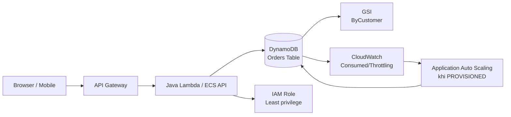
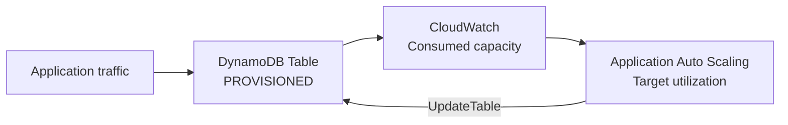
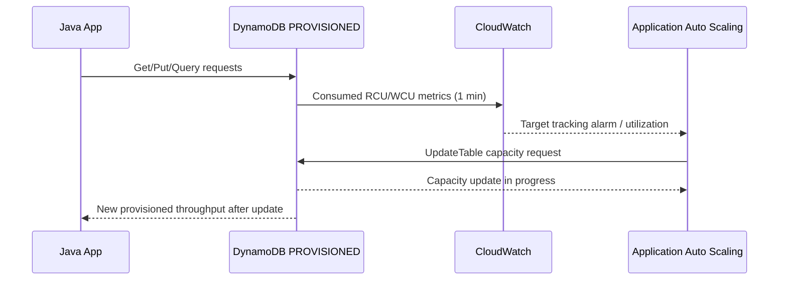
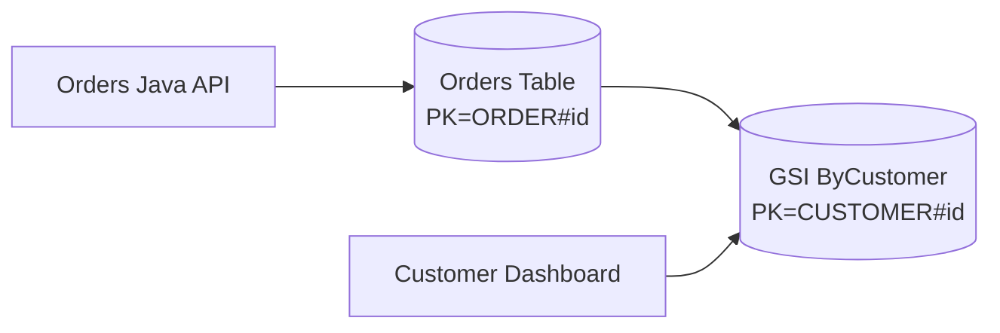
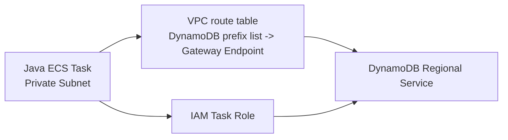
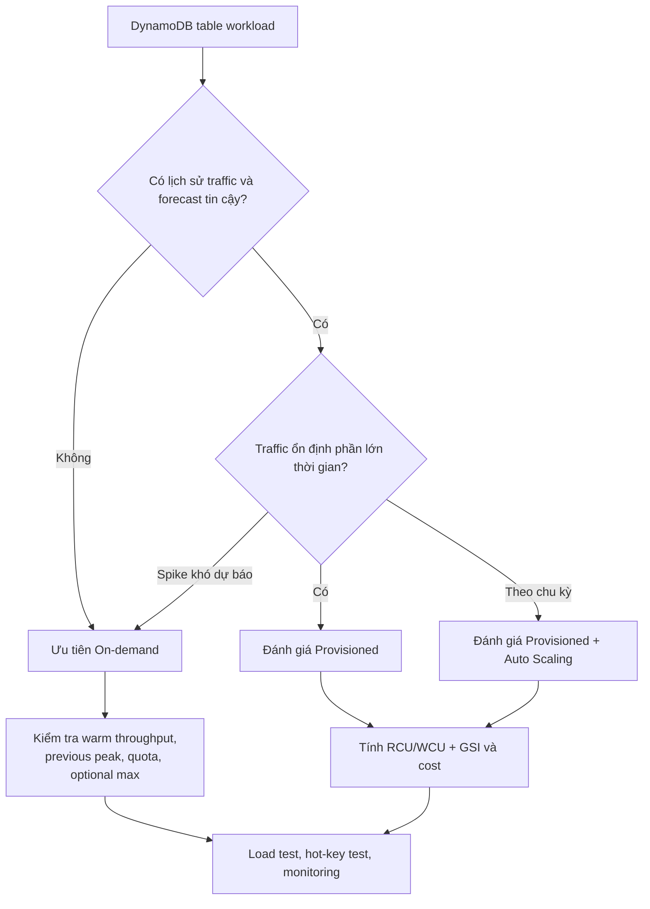

# On-demand, provisioned capacity và autoscaling

Amazon DynamoDB là cơ sở dữ liệu NoSQL được AWS quản lý, phục vụ truy cập theo **partition key**, độ trễ thấp và khả năng mở rộng lớn. Tuy nhiên, hai bảng có cùng schema vẫn có thể khác biệt đáng kể về **chi phí**, **cách xử lý đỉnh lưu lượng** và **nguyên nhân bị throttling**, chỉ vì chúng dùng **capacity mode** khác nhau.

DynamoDB cung cấp hai chế độ throughput chính: **On-demand (`PAY_PER_REQUEST`)** và **Provisioned (`PROVISIONED`)**. Với provisioned, có thể bật **DynamoDB auto scaling** thông qua **AWS Application Auto Scaling**. Hiểu đúng các khái niệm **RCU, WCU, RRU, WRU, target utilization, warm throughput, GSI capacity và hot partition** giúp lựa chọn cấu hình phù hợp thay vì tăng capacity theo cảm tính.

Bài thuộc chương **DynamoDB** của mô-đun **CLOUD_PROVIDERS_AWS**. Người học sẽ kết hợp thiết kế dữ liệu, IAM, Region/AZ, EC2/ECS/EKS/Lambda, AWS SDK for Java, CloudWatch và ngân sách để xây ứng dụng có khả năng mở rộng an toàn. Các giá trị giá tiền, quotas, tốc độ và mô phỏng trong bài chỉ có ý nghĩa khi đi cùng **Region, bảng giá và workload thực tế**; không có một con số phù hợp mọi môi trường.

> **Nguyên tắc:** **On-demand** tự điều chỉnh throughput và tính phí theo request units được dùng; **Provisioned** đặt RCU/WCU và tính phí theo dung lượng đã provision; **auto scaling** chỉ là cơ chế điều chỉnh provisioned capacity bằng metrics/target tracking, **không phải một capacity mode thứ ba**.

## 1. Mục tiêu học tập

Sau bài học, bạn có thể:

1. Phân biệt **DynamoDB On-demand, Provisioned và Provisioned + Auto Scaling**.
2. Giải thích **RCU/RRU, WCU/WRU** và cách tính theo **kích thước item, độ nhất quán và transaction**.
3. Ước lượng throughput từ requests/second, kích thước item, consistency, tần suất đọc/ghi và GSI.
4. Chọn **On-demand** cho tải khó dự đoán và **Provisioned** cho tải ổn định có thể dự báo.
5. Mô tả **warm throughput**, đỉnh lưu lượng trước đó và rủi ro bị throttle nếu tăng đột biến.
6. Cấu hình **maximum throughput** trên on-demand như một biện pháp kiểm soát chi phí **best effort**.
7. Tạo/đánh giá auto scaling gồm **minimum, maximum, target utilization** cho cả read/write và GSIs.
8. Giải thích vì sao target tracking không xử lý tất cả traffic spikes tức thì.
9. Phân biệt **table-level throttling**, **hot partition**, **GSI write back-pressure** và giới hạn service quotas.
10. Đọc CloudWatch metrics, consumed capacity trong AWS SDK/CLI, và response throttling reasons.
11. Sử dụng AWS CLI và AWS SDK for Java v2 để làm inventory, tạo bảng sandbox và kiểm tra request units.
12. Thiết kế retry **exponential backoff + jitter**, conditional writes/idempotency và key distribution.
13. So sánh chi phí **capacity-hours** và **request units** bằng công thức, không gắn cứng đơn giá.
14. Lập kế hoạch capacity, monitoring và kiểm soát ngân sách cho bảng đơn hàng có traffic theo mùa.

## 2. DynamoDB ở đâu trong kiến trúc ứng dụng?



DynamoDB là **regional managed service**; ứng dụng gọi DynamoDB qua AWS SDK/API bằng **IAM**. Bạn không tự chạy cluster database server, chọn EC2 instance cho DynamoDB hay đặt một database instance trong riêng VPC subnet. AWS vận hành storage và partitioning.

**Capacity mode là một cấu hình của bảng và GSIs**, không phải một lựa chọn kết nối qua TCP như RDS. Bảng vẫn có partition/sort keys, indexes, backups, IAM policies và metrics ở cả hai mode.

| Thành phần | Quyết định | Ví dụ |
| --- | --- | --- |
| **Partition key** | Phân phối và truy xuất dữ liệu | `PK=ORDER#abc` hoặc `PK=CUSTOMER#42` |
| **Sort key** | Sắp xếp items trong cùng logical partition | `SK=2026-11-20#ORDER#abc` |
| **Capacity mode** | Cách cấp throughput và tính phí | `PAY_PER_REQUEST`, `PROVISIONED` |
| **Read consistency** | Giá throughput và mức mới nhất của dữ liệu | Eventually consistent, strongly consistent |
| **Global Secondary Index (GSI)** | Truy vấn theo access pattern bổ sung | `GSI1PK=CUSTOMER#42` |
| **Application Auto Scaling** | Điều chỉnh RCU/WCU đã provision | Target tracking 70% |
| **Warm throughput** | Mức throughput khả dụng tức thì theo lịch sử/pre-warm | Read/write units per second |
| **IAM** | Principal được gọi DynamoDB API nào | `dynamodb:GetItem`, `PutItem` |
| **CloudWatch** | Quan sát usage/throttling/cost | `ConsumedReadCapacityUnits` |

## 3. Bản chất của hai capacity modes

### 3.1. On-demand — `PAY_PER_REQUEST`

- Không chỉ định số RCU/WCU cố định cho bảng.
- DynamoDB quản lý phần throughput scaling; phí throughput dựa trên **read/write request units thực sự sử dụng**.
- Phù hợp khi mới phát triển, lưu lượng thất thường, workload thay đổi khó đoán hoặc có những giai đoạn không có traffic.
- Có thể cấu hình **maximum on-demand throughput** cho read/write của bảng hoặc GSI như guardrail.
- Vẫn có thể bị **throttling** do partition hot key, account/table quotas, maximum throughput đã đặt hoặc traffic tăng quá nhanh so với mức warm/previous peak.

### 3.2. Provisioned — `PROVISIONED`

- Đặt số **RCU** và **WCU** mà bảng có thể dùng.
- Phí throughput tính theo **RCU-hours và WCU-hours đã provision**, **không phụ thuộc số request thực dùng** trong giờ đó.
- Khi đọc/ghi vượt mức capacity đã cấp, có thể bị throttle dù service vẫn khỏe.
- Phù hợp với throughput ổn định, đo được và có thể dự đoán.
- Có thể bật **Application Auto Scaling** cho table read/write, và từng GSI read/write, dựa trên target utilization và min/max capacity.

### 3.3. Provisioned + Auto Scaling

Đây vẫn là **PROVISIONED**:



Auto scaling giúp tiết kiệm so với cấp cố định theo đỉnh dài hạn khi workload có chu kỳ, nhưng **không phải tức thì**. Quyết định scale dựa trên CloudWatch data, có độ trễ đánh giá và update capacity.

### 3.4. So sánh nhanh

| Tiêu chí | **On-demand** | **Provisioned cố định** | **Provisioned + Auto Scaling** |
| --- | --- | --- | --- |
| Billing mode | `PAY_PER_REQUEST` | `PROVISIONED` | `PROVISIONED` |
| Cần xác định RCU/WCU? | Không | **Có** | Cần min/max và initial capacity |
| Tính phí throughput | Request units sử dụng | Provisioned capacity-hours | Provisioned capacity-hours thay đổi theo policy |
| Độ phức tạp vận hành | Thấp | Trung bình/cao | Trung bình/cao |
| Load không đều/khó đoán | **Phù hợp** | Dễ lãng phí/throttle | Có thể bị trễ scale |
| Workload ổn định 24/7 | Có thể phù hợp | **Đáng đánh giá** | Đáng đánh giá |
| Spikes ngắn vài giây | Có khả năng thích ứng trong warm/peak limits | Dựa trên capacity và burst | Auto scaling không phản ứng ngay |
| Cấu hình target tracking? | Không cần | Không | **Có** |
| Quản lý cost guardrail | Optional max throughput, Budgets | RCU/WCU rõ ràng | Min/max/target + Budgets |
| Rủi ro hot partition | **Có** | **Có** | **Có** |

**Khuyến nghị khởi đầu:** Với workload mới chưa có số liệu, đánh giá **On-demand** trước. Chuyển Provisioned khi có đủ metrics/thống kê để so sánh tổng chi phí và rủi ro throttling.

## 4. Capacity unit là gì?

DynamoDB tính throughput dựa trên **kích thước dữ liệu thực sự được đọc/ghi**, không chỉ số lần gọi SDK.

### 4.1. Read capacity

Một đơn vị đọc tương ứng:

| Loại đọc | Item tối đa 4 KiB | Đơn vị đọc |
| --- | --- | --- |
| **Strongly consistent** | 1 lần đọc | **1 RCU hoặc 1 RRU** |
| **Eventually consistent** | 1 lần đọc | **0,5 RCU hoặc 0,5 RRU** |
| **Transactional read** | 1 lần đọc | **2 RCU hoặc 2 RRU** |

Các item đọc lớn hơn **4 KiB** cần nhiều units tương ứng, làm tròn theo bội số 4 KiB. Với on-demand, **RRU** là đơn vị tính usage/billing; với provisioned, **RCU** mô tả throughput/giây đã cấp.

Để ước lượng với một item:

\[
\text{Read units} =
\left\lceil\frac{\text{item size (KiB)}}{4}\right\rceil
\times\text{consistency multiplier}
\]

Trong đó consistency multiplier là **1** (strong), **0,5** (eventual) hoặc **2** (transactional). Đây là công thức **đơn giản cho GetItem item đã tồn tại**; Query/Scan và non-existent reads có các chi tiết tính capacity riêng.

### 4.2. Write capacity

Một **write unit** phục vụ một write cho item có kích thước tối đa **1 KiB**:

\[
\text{Write units}
=\left\lceil\frac{\text{item size (KiB)}}{1}\right\rceil
\times\text{transaction multiplier}
\]

- Normal write: hệ số **1**.
- Transactional write: hệ số **2** cho hành động ghi trong transaction theo quy tắc DynamoDB.

Các thao tác `PutItem`/`UpdateItem`/`DeleteItem` có chi tiết tiêu thụ riêng. Ví dụ `UpdateItem` tính theo kích thước item trước/sau, lấy mức lớn hơn, không chỉ số byte mới thay đổi. Conditional write thất bại vẫn có thể tiêu thụ write capacity theo quy tắc dịch vụ.

### 4.3. Bảng ví dụ tính units

| Thao tác | Kích thước | Phép tính | Kết quả |
| --- | --- | --- | --- |
| Strong GetItem | 3 KiB | ceil(3/4) × 1 | **1 read unit** |
| Eventual GetItem | 3 KiB | ceil(3/4) × 0,5 | **0,5 read unit** |
| Strong GetItem | 6 KiB | ceil(6/4) × 1 | **2 read units** |
| Eventual GetItem | 8 KiB | ceil(8/4) × 0,5 | **1 read unit** |
| Transactional GetItem | 8 KiB | ceil(8/4) × 2 | **4 read units** |
| PutItem | 900 bytes | ceil(900/1024) | **1 write unit** |
| PutItem | 2,5 KiB | ceil(2,5/1) | **3 write units** |
| Transactional PutItem | 2,5 KiB | 3 × 2 | **6 write units** |

**KiB** ở đây dùng bội số **1024 bytes**, tương ứng cách DynamoDB đo kích thước theo tài liệu.

## 5. Tính RCU/WCU từ request rate

### 5.1. Bài toán reads

Ứng dụng có **100 strongly consistent GetItem/giây**, mỗi item 3 KiB:

\[
\text{RCU cần} = 100 \times \lceil3/4\rceil = 100
\]

Nếu chấp nhận eventual consistency:

\[
\text{RCU cần} = 100 \times 0{,}5 = 50
\]

Nếu mỗi item tăng lên 7 KiB và vẫn strong:

\[
100 \times \lceil7/4\rceil = 200\ \text{RCU}
\]

**Không phải cứ 100 requests/giây thì cần 100 RCUs**: item size, consistency, transactions và operation type thay đổi kết quả.

### 5.2. Bài toán writes

Một API ghi **60 items/giây**, item mới 2,2 KiB:

\[
60 \times \lceil2{,}2/1\rceil=180\ \text{WCU}
\]

Nếu mỗi item được ghi bằng transaction:

\[
60\times 3\times 2=360\ \text{WCU}
\]

Chưa tính **GSI write amplification**, global tables và các thao tác khác.

### 5.3. Batch/Query/Scan không phải miễn phí

- `BatchGetItem`: mỗi item có quy tắc round-up capacity riêng.
- `BatchWriteItem`: mỗi item tiêu thụ write units riêng, không phải một batch chỉ tính 1 WCU.
- `Query`: capacity dựa trên dữ liệu đọc/đánh giá theo key condition, không phải chỉ số items frontend hiển thị.
- `Scan`: đọc diện rộng và dễ tiêu thụ nhiều units, ảnh hưởng hot partitions và cost.
- `FilterExpression` với Query/Scan lọc **sau khi đọc**, không tự làm giảm RCUs đã tiêu thụ.
- `ProjectionExpression` trên table read thường **không** làm giảm consumed RCUs vì tính trên item được truy cập.
- Query một **GSI** tiêu thụ read units từ **index**, còn base-table writes có thể phát sinh **index write units**.

**Tối ưu access pattern và key design thường tiết kiệm hơn tăng RCU/WCU.**

## 6. On-demand: cơ chế scaling tự động

### 6.1. Không cần khai báo RCU/WCU

Tạo bảng On-demand:

```text
TableName: Orders
Partition key: pk (String)
Sort key: sk (String)
BillingMode: PAY_PER_REQUEST
```

Ứng dụng có thể bắt đầu từ lưu lượng rất thấp mà không phải giữ một số RCU/WCU được provision sẵn. Phí throughput đến từ requests/units thực tế, cùng các chi phí khác như storage, backups, streams, global tables hoặc transfer nếu được sử dụng.

### 6.2. Warm throughput mặc định

Theo tài liệu AWS, một **bảng on-demand mới** có mức **warm throughput mặc định hỗ trợ tức thì** tới khoảng:

- **12.000 read units/giây**.
- **4.000 write units/giây**.

Các giá trị là mức khả năng ban đầu, **không phải một mức phí tháng cố định** và không có nghĩa bỏ qua quotas khác. Bảng có thể tự nâng warm throughput khi phục vụ lưu lượng cao.

**Warm throughput** là mức throughput mà bảng/GSI có thể hỗ trợ **ngay lúc này**, dựa trên lịch sử hoặc được chủ động pre-warm. Nó có ở cả on-demand và provisioned, nhưng không thay cho **billing mode** hoặc số RCUs/WCUs đã provision.

### 6.3. “Tới gấp đôi previous peak” nghĩa là gì?

DynamoDB on-demand có thể xử lý ngay lưu lượng lên tới khoảng **2× previous peak** đã đạt được (trong giới hạn quota/partition và chính sách hiện hành).

Ví dụ một bảng từng đạt 10.000 read units/giây: nó có thể nhanh chóng phục vụ mức khoảng 20.000 read units/giây trong phạm vi điều kiện scaling. Nếu lưu lượng tăng vượt **2× previous peak trong 30 phút**, DynamoDB **có thể throttle** trong lúc phân bổ thêm năng lực.

Vì vậy câu “on-demand không bao giờ throttle” là **sai**.

### 6.4. Pre-warming cho chiến dịch lớn

Một cửa hàng biết sẽ có đợt giảm giá 100× traffic trong ít phút. Thay vì giả định on-demand sẽ tự vượt mọi previous peak:

1. Đo **`WarmThroughput`** hiện tại của bảng **và từng GSI**.
2. Dự báo peak RRU/WRU bằng item size, consistency và GSI writes.
3. Kiểm tra **quota per-table/index và Region**.
4. Cân nhắc tăng warm throughput **trước đợt sự kiện** bằng chức năng pre-warm.
5. Theo dõi completion/status, test tải phân tán keys.
6. Ghi nhận chi phí: **proactive pre-warm tăng warm throughput có thể phát sinh phí**, dù warm throughput tự nhiên từ lịch sử thì không tính phí riêng như vậy.
7. Kiểm tra hot keys, upstream API/Lambda concurrency và downstream SLO.

**Pre-warming không giải quyết một partition key bị truy cập quá nóng.** Nó bổ sung năng lực tổng thể nhưng không thay data modeling.

## 7. On-demand maximum throughput: guardrail khác auto scaling

DynamoDB cho phép đặt **`MaxReadRequestUnits`** và **`MaxWriteRequestUnits`** trên bảng on-demand hoặc GSI.

Ví dụ:

```yaml
BillingMode: PAY_PER_REQUEST
OnDemandThroughput:
  MaxReadRequestUnits: 5000
  MaxWriteRequestUnits: 1500
```

Ý nghĩa: ứng dụng đặt một **mục tiêu giới hạn** tốc độ tiêu thụ; khi vượt mức cấu hình, request có thể bị `ThrottlingException`. Điều này hữu ích khi cần chặn tác vụ bất thường khiến hóa đơn tăng hoặc bảo vệ hệ thống phụ thuộc.

**Không nhầm max on-demand throughput với RCU/WCU provisioned hoặc Application Auto Scaling min/max**.

| Thuộc tính | On-demand max throughput | Provisioned max auto scaling |
| --- | --- | --- |
| Ý nghĩa | Giới hạn usage rate của on-demand table/GSI | Giới hạn RCU/WCU mà auto scaling có thể provision |
| Đơn vị | Read/write request units/giây | RCU/WCU đã provision |
| Billing | Theo request units đã dùng | Theo capacity đã provision |
| Có scale-in/scale-out policy? | Không cần | Có khi bật auto scaling |
| Vượt ngưỡng | Có thể throttle | Có thể throttle khi demand vượt capacity |
| Hard cap tuyệt đối? | **Không**: AWS mô tả là **best effort**, có burst vượt mục tiêu | Capacity max là ceiling policy; vẫn cần xem quotas |

Maximum throughput on-demand có thể bị vượt tạm thời do **burst capacity** theo mô tả AWS. Do đó đây **không phải cơ chế giới hạn hóa đơn cứng tuyệt đối**. Cần thêm AWS Budgets, alarms, IAM, load testing và guardrails ứng dụng.

### 7.1. Giới hạn service quota

AWS hiện mô tả giới hạn mặc định khoảng **40.000 table-level read và write units/giây** cho on-demand theo service quotas, có thể xin nâng nếu cần. Quota thực tế phụ thuộc account/Region và có thể thay đổi; **luôn đọc Service Quotas**, không hard-code 40.000 trong hệ thống.

Trường hợp một bảng on-demand ít requests nhưng mọi requests dồn vào một **hot key** vẫn có thể throttle dù chưa chạm table-level quota.

## 8. Provisioned: cấp capacity rõ ràng

### 8.1. Bảng provisioned có gì?

```yaml
BillingMode: PROVISIONED
ProvisionedThroughput:
  ReadCapacityUnits: 120
  WriteCapacityUnits: 200
```

Theo nghĩa đơn giản, bảng có khả năng phục vụ khoảng 120 strongly consistent reads/s cho các items ≤4 KiB, hoặc 240 eventually consistent reads/s, và 200 writes/s cho items ≤1 KiB, **nếu traffic được phân tán phù hợp** và không vướng giới hạn khác.

**Không có nghĩa** bảng sẽ duy trì đúng 120 HTTP calls/s trong mọi trường hợp: request sizes và từng physical partition có thể khác.

### 8.2. Tính phí cho provisioned throughput

Với bảng được provision `R` RCUs và `W` WCUs trong `H` giờ:

\[
C_{\text{throughput}} \approx
R\times H\times P_{\text{RCU-hour}}
+W\times H\times P_{\text{WCU-hour}}
\]

Nếu capacity đổi theo thời gian, tính tổng theo từng khoảng:

\[
C_{\text{throughput}} \approx
\sum_i (R_i P_R + W_i P_W)\Delta t_i
\]

Giá `P_R`/`P_W` phụ thuộc Region, table class, tùy chọn reserved capacity và bảng giá hiện hành. Đây **chỉ là chi phí throughput**, chưa có storage, backups, PITR, data transfer, streams/exports hoặc GSI/index storage/capacity.

### 8.3. Provisioned có burst capacity không?

DynamoDB có **burst capacity** giúp xử lý một số đợt tăng ngắn hạn vượt tốc độ provisioned bình thường, trong giới hạn cơ chế dịch vụ. Nhưng:

- **Burst capacity không phải công suất được bảo đảm kéo dài vô hạn**.
- Không dùng burst như lý do đặt min RCU/WCU quá thấp cho traffic steady.
- Hot partition vẫn có thể throttle.
- Capacity đã provision quá thấp kéo dài sẽ khiến SDK retries/latency tăng.

### 8.4. Provisioned table với GSI

Một bảng provisioned có thể có:

```text
Orders base table:
  RCU = 300
  WCU = 200

GSI ByCustomer:
  RCU = 100
  WCU = 220
```

**Mỗi GSI có provisioned throughput riêng**. Query GSI tiêu thụ GSI read units, còn cập nhật attributes được index có thể tiêu thụ GSI write units. Nếu GSI write throughput thiếu, **base-table writes cũng có thể bị throttled** do index back-pressure.

Không chỉ giám sát bảng mà bỏ qua GSIs.

## 9. Ước lượng capacity có dự phòng

### 9.1. Quy trình sizing

1. Liệt kê **access patterns**: GetItem, Query, PutItem, UpdateItem, DeleteItem, Batch, Transactions, GSI queries.
2. Đo **item size thực** (bao gồm attribute names/data types).
3. Dự báo **requests/s trung bình, p95/p99 và peak**, phân biệt ngày thường/sale.
4. Phân loại reads mạnh/yếu/transactional, GSI eventual consistency.
5. Tính **consumed RCU/WCU** cho bảng và **từng GSI**.
6. Chọn hệ số dự phòng/target utilization cho latency/retries.
7. Kiểm tra **key distribution** và giới hạn partition.
8. Xem quota, warm throughput và Auto Scaling delay.
9. Thử bằng load test trên sandbox, quan sát CloudWatch/`ReturnConsumedCapacity`.
10. So sánh on-demand với provisioned theo **lịch usage**, không chỉ peak.

### 9.2. Ví dụ bảng đơn hàng

Giả sử trung bình:

- 120 GetItem/s, item 3 KiB, eventual read.
- 40 PutItem/s, item 1,5 KiB.
- Có một GSI phục vụ 60 Query/s, dữ liệu index trung bình 2 KiB mỗi query theo giả định.
- Mỗi Put có thể tạo một GSI entry 800 bytes.

Ước lượng **base table**:

\[
R_{\text{base}}=120\times 0{,}5=60\ \mathrm{RCU}
\]

\[
W_{\text{base}}=40\times\lceil1{,}5\rceil=80\ \mathrm{WCU}
\]

Ước lượng **GSI**:

\[
R_{\text{GSI}}=60\times0{,}5=30\ \mathrm{RCU}
\]

\[
W_{\text{GSI}}=40\times\lceil0{,}8\rceil=40\ \mathrm{WCU}
\]

Tổng logic là **60 RCU + 80 WCU trên bảng**, **30 RCU + 40 WCU trên GSI**, trong đó GSI tính phí/limits riêng. Các con số dựa trên giả định mỗi Query trả volume như một item và mỗi write đều update GSI; trong thực tế cần đo **actual consumed capacity**, vì Query trả nhiều items và GSI projection có thể thay kích thước.

### 9.3. Target utilization 70%

Nếu muốn vận hành provisioned target utilization 70% cho workload steady:

\[
R_{\text{provisioned}}\approx
\left\lceil\frac{60}{0{,}70}\right\rceil=86\ \mathrm{RCU}
\]

\[
W_{\text{provisioned}}\approx
\left\lceil\frac{80}{0{,}70}\right\rceil=115\ \mathrm{WCU}
\]

Đây chỉ là **ước lượng năng lực cần giữ**; policy target tracking sẽ điều chỉnh theo metrics/min/max và có độ trễ. Đặt max scale quá thấp vẫn throttle.

## 10. DynamoDB Auto Scaling hoạt động thế nào?

DynamoDB auto scaling sử dụng **AWS Application Auto Scaling** quản lý provisioned read/write capacity của bảng hoặc GSI.



Bạn cấu hình cho mỗi scalable dimension:

- **Minimum capacity** — RCUs/WCUs thấp nhất mà policy nên dùng.
- **Maximum capacity** — RCUs/WCUs cao nhất mà policy được phép mở rộng.
- **Target utilization** — phần trăm consumed/provisioned mà policy muốn duy trì.

Ví dụ:

```text
Orders table READ:
  Min: 50 RCU
  Max: 1500 RCU
  Target utilization: 70%

Orders table WRITE:
  Min: 20 WCU
  Max: 600 WCU
  Target utilization: 65%
```

**Read/Write là hai chiều scale riêng**, không mặc định đặt cùng min/max. Từng GSI cũng cần policy riêng khi ở provisioned.

### 10.1. Auto scaling không scale ngay trong vài milliseconds

Theo tài liệu AWS:

- DynamoDB phát consumed capacity metrics theo **chu kỳ 1 phút**.
- Scale-out theo policy có thể bắt đầu khi utilization vượt target trong **hai phút liên tiếp**, cộng thêm độ trễ CloudWatch/alarm.
- Scale-in thường yêu cầu **15 datapoints liên tiếp** dưới target, vì service tránh oscillation.
- Sau khi policy quyết định, `UpdateTable` còn cần thời gian thực hiện.

Tổng thời gian phản ứng có thể là **vài phút hoặc hơn** tùy tình huống. Trong khoảng này, request vượt provisioned units hiện tại **có thể bị throttle**.

> **Hệ quả:** DynamoDB auto scaling phù hợp các thay đổi lưu lượng có độ dài đủ lớn, **không phải cách bảo đảm xử lý spike gấp 100 lần trong một vài giây**.

### 10.2. Target utilization hợp lệ

AWS hỗ trợ target utilization **20%–90%** cho DynamoDB auto scaling.

| Target | Đánh đổi |
| --- | --- |
| 30% | Nhiều capacity buffer, chi phí provisioned có thể cao |
| 50% | Dự phòng nhiều hơn cho traffic dao động |
| 70% | Giá trị thông dụng/balanced baseline |
| 85–90% | Tiết kiệm capacity khi rất ổn định, nhưng dễ throttle hơn khi spike |
| Dưới 20% hoặc trên 90% | Không thuộc target range dịch vụ hỗ trợ |

**Không tự chọn 90% cho ứng dụng có traffic burst mạnh** chỉ vì muốn giảm phí. Phải xem p95/p99, service quotas, min/max và retry behavior.

### 10.3. Min/max capacity và thời gian cao điểm

Nếu policy:

```text
min=10 RCU
max=100 RCU
target=70%
```

mà ứng dụng yêu cầu steady **500 RCU/s**, auto scaling **không thể** giải quyết: policy bị chặn tại **100 RCU**. Muốn tăng max cần xem load budget/quota và chi phí; không phải chỉ đợi thêm vài phút.

Ngược lại nếu min=500 RCU khi ban đêm chỉ dùng 5 RCU/s, bạn vẫn bị tính phí cho mức min đó — auto scaling **không giảm dưới minimum**.

### 10.4. Scheduled scaling và planned peaks

Nếu traffic tăng mỗi tối 19:00 hoặc Black Friday:

- Với provisioned, cân nhắc **scheduled capacity increase** trước giờ cao điểm, sau đó target tracking điều chỉnh.
- Với on-demand, kiểm tra **warm throughput/pre-warm** và previous peak.
- Với cả hai, test **GSI capacity và key distribution** trước giờ chạy.
- Cần giám sát downstream Lambda/API/SQS và ứng dụng, không chỉ DynamoDB.

## 11. Từng GSI phải được xem như một resource capacity

### 11.1. Khi có GSI



GSI dùng một access pattern khác:

- `Query` trên GSI tiêu thụ **GSI read units**, không phải base-table reads.
- Base table `Put/Update/Delete` có thể làm thay đổi GSI entries, tiêu thụ **GSI write units**.
- GSI query chỉ **eventually consistent**, không hỗ trợ strongly consistent read trên GSI.
- Index projection làm thay đổi kích thước entry nên ảnh hưởng phí index read/write/storage.
- Một GSI provisioned thiếu WCU có thể làm base-table writes bị **back pressure/throttling**.

### 11.2. Provisioned GSI capacity và policy

Ví dụ:

```text
Orders table:
  Read 200 RCU with auto scaling
  Write 300 WCU with auto scaling

ByCustomer GSI:
  Read 100 RCU with auto scaling
  Write 350 WCU with auto scaling
```

Không phải cứ **base-table WCU=300** thì mọi GSI cũng cần đúng 300 WCU. Cần tính kích thước projected item, tỷ lệ writes tác động index và workload riêng. AWS thường khuyến nghị GSI write capacity đủ so với table để tránh back pressure; chọn số dựa trên thực tế.

### 11.3. On-demand GSI limits

GSI trên on-demand không phải provisioned RCU/WCU riêng; bạn vẫn có thể đặt **maximum on-demand throughput** cho **từng index**. Khi index chạm giới hạn hoặc hot partition, table operations liên quan có thể bị throttle.

**Chẩn đoán theo resource ARN** trong `ThrottlingReasons` để biết nguyên nhân xảy ra ở table hay index.

### 11.4. Local Secondary Index (LSI)

LSI có key/consistency và consumption khác GSI:

- LSI dùng throughput read từ **base table**, không có provisioned throughput riêng như GSI.
- LSI hỗ trợ strong consistent reads theo khả năng.
- Nó có giới hạn thiết kế (ví dụ item collection sizes).
- Không tạo policy auto scaling riêng cho LSI như GSI.

## 12. Hot partition và adaptive capacity

Một bảng có tổng 10.000 WCU **không bảo đảm** một partition key đơn lẻ có thể ghi 10.000 items/s. DynamoDB phân phối dữ liệu/throughput theo partition keys và physical partitions.

### 12.1. Ví dụ hot key

Thiết kế không tốt:

```text
PK = "TODAY"
SK = timestamp#orderId
```

Mọi orders mới cùng một partition key “TODAY”, traffic ghi tập trung; bảng có thể bị **key-range throughput throttling** dù tổng provisioned/on-demand capacity còn dư.

Thiết kế tốt hơn:

```text
PK = "CUSTOMER#<customerId>"
SK = "ORDER#<createdAt>#<orderId>"
```

Hoặc khi cần write-sharding:

```text
PK = "DATE#2026-11-20#SHARD#03"
SK = "ORDER#<orderId>"
```

**Write sharding** cần cân nhắc cách Query/aggregate qua nhiều shards, độ phức tạp và consistency. Không thêm shards chỉ vì thuật ngữ “hot partition”: đo thực tế trước.

### 12.2. Adaptive capacity không phá giới hạn partition

DynamoDB có **adaptive capacity** để điều chỉnh phân bổ throughput giữa partitions theo usage. Tuy nhiên, nó **không cho phép bỏ qua mọi per-partition throughput limit** và không sửa data model mất cân bằng.

Một giới hạn thường dùng khi giải thích là **khoảng 3.000 RCU và 1.000 WCU mỗi physical partition** theo những điều kiện service; nhưng capacity mode, item size, access patterns và partition behavior quyết định thực tế. **Không lấy số này thay tài liệu AWS quotas mới nhất**.

### 12.3. Dấu hiệu hot partition

- Throttling xảy ra dù table provisioned/consumed ratio còn thấp.
- Nhiều requests dùng cùng một partition key hoặc range.
- `ThrottlingReasons` chứa `KeyRangeThroughputExceeded`.
- Contributor Insights/CloudWatch cho thấy top keys hoặc traffic skew.
- Tăng table capacity không cải thiện tương ứng.

Giải pháp gồm **đổi partition key**, write-sharding, caching hợp lý, phân tách workload, request smoothing; không chỉ tăng max RCU/WCU.

## 13. Throttling có nhiều loại nguyên nhân

AWS công bố bốn nhóm nguyên nhân chính:

| Nhóm | Có ở mode nào? | Ví dụ reason |
| --- | --- | --- |
| **Key range/partition throughput** | Cả hai | `TableWriteKeyRangeThroughputExceeded` |
| **Provisioned capacity exhausted** | Provisioned | `TableReadProvisionedThroughputExceeded` |
| **Account/table quota exhausted** | On-demand | `TableWriteAccountLimitExceeded` |
| **Configured on-demand maximum** | On-demand | `IndexReadMaxOnDemandThroughputExceeded` |

`ThrottlingReasons` chỉ rõ:

- **Resource type**: `Table` hoặc `Index`.
- **Operation**: `Read` hoặc `Write`.
- **Limit**: `KeyRangeThroughputExceeded`, `ProvisionedThroughputExceeded`, `AccountLimitExceeded` hoặc `MaxOnDemandThroughputExceeded`.
- **Resource ARN**: bảng hoặc GSI cụ thể bị giới hạn.

**ThrottlingException không mặc nhiên có nghĩa phải mua thêm capacity.** Có thể là access pattern bị hot key, GSI WCU thiếu, on-demand maximum cố ý đặt thấp hoặc bảng đã chạm service quota.

## 14. Giám sát bằng CloudWatch metrics

### 14.1. Metrics cốt lõi

| Metric | Dùng để |
| --- | --- |
| `ConsumedReadCapacityUnits` | Đo read units đã tiêu thụ |
| `ConsumedWriteCapacityUnits` | Đo write units đã tiêu thụ |
| `ProvisionedReadCapacityUnits` | Capacity read provisioned hiện tại |
| `ProvisionedWriteCapacityUnits` | Capacity write provisioned hiện tại |
| `ReadThrottleEvents` / `WriteThrottleEvents` | Theo dõi read/write throttling |
| `ThrottledRequests` | Nhìn request throttled theo metric dimensions phù hợp |
| `SuccessfulRequestLatency` | Độ trễ phía DynamoDB |
| `SystemErrors` / `UserErrors` | Lỗi từ service/request |
| `OnDemandMaxReadRequestUnits` | Cấu hình on-demand read maximum |
| `OnDemandMaxWriteRequestUnits` | Cấu hình on-demand write maximum |
| `AccountMaxReads` / `AccountMaxWrites` | Theo dõi quota theo hỗ trợ |
| Per-index metrics | Kiểm tra GSIs độc lập |
| Contributor Insights | Phát hiện hot keys/traffic skew khi bật |

Tên metrics/dimensions và tính sẵn có phụ thuộc chế độ/tính năng. Đừng dùng một dashboard chung rồi giả định mọi metric tồn tại ở mọi bảng.

### 14.2. Đọc đúng đơn vị metric

`ConsumedReadCapacityUnits` trong CloudWatch có thể được tổng hợp theo **Sum/1 minute**. Để chuyển thành tốc độ read units/s bình quân:

\[
\text{RUs/s bình quân} \approx
\frac{\text{ConsumedReadCapacityUnits Sum trong 1 phút}}{60}
\]

Nếu CloudWatch báo `Sum=4.200` read units trong 1 phút:

\[
4200/60 = 70\ \text{read units/s bình quân}
\]

**Đây là trung bình một phút**, không phản ánh peak trong vài giây, distribution giữa partition keys hoặc application-side latency. Khi đánh giá auto scaling, xem cả sustained utilization và spike patterns.

### 14.3. Target utilization theo thực tế

\[
\text{Utilization}
= \frac{\text{consumed RCU/s}}{\text{provisioned RCU/s}}
\times 100\%
\]

Nếu dùng 70 RCU/s bình quân và bảng provisioned 100 RCU:

\[
\text{Utilization} \approx 70\%
\]

Khi chỉnh target, cân nhắc traffic peaks, CloudWatch delay và tốc độ thay đổi capacity.

### 14.4. Giám sát phía ứng dụng

Dùng structured logs/metrics cho:

- `operation`: GetItem, Query, PutItem, BatchWriteItem.
- `tableName`/indexName (không tiết lộ thông tin nhạy cảm).
- Request duration và retry attempts.
- `ReturnConsumedCapacity` của SDK.
- Throttling reason codes, affected resource ARN.
- AWS request ID, trace/correlation ID.
- Error type và rate của từng API route.
- Business outcomes và duplicated writes.

**Không log full item có PII, access keys, user tokens hoặc secrets** chỉ để debug capacity.

## 15. AWS SDK for Java v2: đo consumed capacity

SDK v2 dependency Maven thông dụng: `software.amazon.awssdk:dynamodb`, với phiên bản được quản lý bằng **AWS SDK BOM**.

### 15.1. GetItem có ReturnConsumedCapacity

```java
package example.dynamodb;

import software.amazon.awssdk.services.dynamodb.DynamoDbClient;
import software.amazon.awssdk.services.dynamodb.model.AttributeValue;
import software.amazon.awssdk.services.dynamodb.model.GetItemRequest;
import software.amazon.awssdk.services.dynamodb.model.GetItemResponse;
import software.amazon.awssdk.services.dynamodb.model.ReturnConsumedCapacity;

import java.util.Map;

public final class ReadOrder {
    public static void main(String[] args) {
        String table = System.getenv().getOrDefault(
            "DDB_TABLE", "OrdersDemo");

        try (DynamoDbClient db = DynamoDbClient.create()) {
            GetItemRequest request = GetItemRequest.builder()
                .tableName(table)
                .key(Map.of(
                    "pk", AttributeValue.builder().s("ORDER#42").build(),
                    "sk", AttributeValue.builder().s("META").build()))
                .consistentRead(false) // Eventually consistent
                .returnConsumedCapacity(ReturnConsumedCapacity.TOTAL)
                .build();

            GetItemResponse response = db.getItem(request);
            if (response.hasItem()) {
                System.out.println("Order exists");
            }
            if (response.consumedCapacity() != null) {
                System.out.println("Read units consumed = "
                    + response.consumedCapacity().capacityUnits());
            }
        }
    }
}
```

Ví dụ **read-only** nhưng nếu chạy trên AWS thật, `GetItem` vẫn có thể phát sinh phí request/capacity. SDK lấy Region/credentials qua **default provider chain** và IAM role; **không hard-code access key/secret**.

### 15.2. PutItem có conditional expression và capacity

```java
package example.dynamodb;

import software.amazon.awssdk.services.dynamodb.DynamoDbClient;
import software.amazon.awssdk.services.dynamodb.model.AttributeValue;
import software.amazon.awssdk.services.dynamodb.model.ConditionalCheckFailedException;
import software.amazon.awssdk.services.dynamodb.model.PutItemRequest;
import software.amazon.awssdk.services.dynamodb.model.PutItemResponse;
import software.amazon.awssdk.services.dynamodb.model.ReturnConsumedCapacity;

import java.util.Map;

public final class CreateOrder {
    public static void main(String[] args) {
        String table = System.getenv().getOrDefault(
            "DDB_TABLE", "OrdersDemo");
        String orderId = "ORDER#demo-42";

        Map<String, AttributeValue> item = Map.of(
            "pk", AttributeValue.builder().s(orderId).build(),
            "sk", AttributeValue.builder().s("META").build(),
            "status", AttributeValue.builder().s("NEW").build());

        try (DynamoDbClient db = DynamoDbClient.create()) {
            PutItemRequest request = PutItemRequest.builder()
                .tableName(table)
                .item(item)
                .conditionExpression("attribute_not_exists(pk)")
                .returnConsumedCapacity(ReturnConsumedCapacity.TOTAL)
                .build();

            PutItemResponse response = db.putItem(request);
            System.out.println("Consumed write units = "
                + response.consumedCapacity().capacityUnits());
        } catch (ConditionalCheckFailedException duplicate) {
            System.out.println("Order already exists: no overwrite");
        }
    }
}
```

**Đây là ví dụ WRITE, chỉ chạy trong sandbox với bảng riêng.** Conditional expression tránh ghi đè item đã có cùng primary key; với nghiệp vụ phức tạp cần thiết kế idempotency keys/transactions phù hợp. Conditional failures vẫn có thể tiêu thụ capacity. Không retry blind nếu request đã commit nhưng network response bị mất.

### 15.3. Quyền IAM tối thiểu

Một Lambda/ECS task đọc/ghi `OrdersDemo` không cần `dynamodb:*`:

```json
{
  "Version": "2012-10-17",
  "Statement": [
    {
      "Effect": "Allow",
      "Action": [
        "dynamodb:GetItem",
        "dynamodb:Query",
        "dynamodb:PutItem"
      ],
      "Resource": [
        "arn:aws:dynamodb:ap-southeast-1:123456789012:table/OrdersDemo",
        "arn:aws:dynamodb:ap-southeast-1:123456789012:table/OrdersDemo/index/*"
      ]
    }
  ]
}
```

**Giới hạn policy thực tế** cần theo từng action và tài nguyên; không cấp index ARN cho những actions không cần. Kết hợp condition keys `dynamodb:LeadingKeys` nếu mô hình đa tenant và IAM design phù hợp. Nhớ resource policy/IAM authorization không thay kiểm tra quyền nghiệp vụ trên từng order.

## 16. AWS CLI: đọc mode/capacity trước khi thay đổi

Các lệnh **read-only**; thay table/Region/profile theo tài khoản được cấp:

```bash
aws sts get-caller-identity --profile training

# Bảng, BillingMode, GSIs, throughput, warm throughput.
aws dynamodb describe-table \
  --table-name OrdersDemo \
  --region ap-southeast-1 --profile training

# Chỉ trích vài trường.
aws dynamodb describe-table \
  --table-name OrdersDemo \
  --query "Table.{Status:TableStatus,BillingMode:BillingModeSummary.BillingMode,RCU:ProvisionedThroughput.ReadCapacityUnits,WCU:ProvisionedThroughput.WriteCapacityUnits,GSIs:GlobalSecondaryIndexes,Warm:WarmThroughput,OnDemandMax:OnDemandThroughput}" \
  --region ap-southeast-1 --profile training

# Xem Application Auto Scaling targets/policies đã tồn tại.
aws application-autoscaling describe-scalable-targets \
  --service-namespace dynamodb \
  --region ap-southeast-1 --profile training

aws application-autoscaling describe-scaling-policies \
  --service-namespace dynamodb \
  --region ap-southeast-1 --profile training
```

Một bảng on-demand có `ProvisionedThroughput.ReadCapacityUnits=0` trong describe output, hoặc không có summary field ở trạng thái nhất định. Đừng kết luận “bảng không có capacity” chỉ vì RCU/WCU là zero: xem **BillingModeSummary, WarmThroughput và OnDemandThroughput**.

### 16.1. Đọc CloudWatch metric

```bash
# Minh họa: Sum consumed read units trong một cửa sổ 15 phút UTC.
aws cloudwatch get-metric-statistics \
  --namespace AWS/DynamoDB \
  --metric-name ConsumedReadCapacityUnits \
  --dimensions Name=TableName,Value=OrdersDemo \
  --statistics Sum \
  --period 60 \
  --start-time 2026-11-20T00:00:00Z \
  --end-time 2026-11-20T00:15:00Z \
  --region ap-southeast-1 --profile training
```

Thay khoảng thời gian bằng **window có dữ liệu thực tế**. Nếu metric trống, xem lại Region, TableName/GlobalSecondaryIndexName dimensions, retention và interval. Không coi zero điểm dữ liệu là zero usage.

### 16.2. Đọc autoscaling theo resource cụ thể

```bash
aws application-autoscaling describe-scaling-policies \
  --service-namespace dynamodb \
  --resource-id table/OrdersDemo \
  --region ap-southeast-1 --profile training

aws application-autoscaling describe-scaling-activities \
  --service-namespace dynamodb \
  --resource-id table/OrdersDemo \
  --region ap-southeast-1 --profile training
```

Kiểm tra `ScalableDimension` của read/write; nếu policy nằm trên GSI, `ResourceId` có dạng `table/OrdersDemo/index/ByCustomer`.

## 17. AWS CLI: tạo on-demand và provisioned tables trong sandbox

> **Cảnh báo thay đổi/chi phí:** Các lệnh `create-table`/`update-table` tạo hoặc sửa AWS resources, phát sinh chi phí read/write/storage hoặc ảnh hưởng production nếu chạy sai Region/table. Chỉ chạy trong sandbox được phê duyệt, có owner và cleanup plan. **Không chạy các lệnh sau để sửa bảng thật khi chỉ đang học lý thuyết.**

### 17.1. Tạo on-demand table

```bash
aws dynamodb create-table \
  --table-name OrdersDemo \
  --attribute-definitions \
    AttributeName=pk,AttributeType=S \
    AttributeName=sk,AttributeType=S \
  --key-schema \
    AttributeName=pk,KeyType=HASH \
    AttributeName=sk,KeyType=RANGE \
  --billing-mode PAY_PER_REQUEST \
  --region ap-southeast-1 --profile training

aws dynamodb wait table-exists \
  --table-name OrdersDemo \
  --region ap-southeast-1 --profile training
```

Không đặt RCU/WCU khi tạo bảng `PAY_PER_REQUEST`.

### 17.2. Tạo provisioned table

```bash
aws dynamodb create-table \
  --table-name OrdersProvisionedDemo \
  --attribute-definitions AttributeName=pk,AttributeType=S \
  --key-schema AttributeName=pk,KeyType=HASH \
  --billing-mode PROVISIONED \
  --provisioned-throughput ReadCapacityUnits=20,WriteCapacityUnits=10 \
  --region ap-southeast-1 --profile training
```

Đây là capacity **ban đầu cố định**; để tự thay đổi phải cấu hình Application Auto Scaling.

### 17.3. Đặt on-demand maximum throughput

```bash
# Tác động lên bảng hiện có. Đây là target best-effort, không phải hard billing cap.
aws dynamodb update-table \
  --table-name OrdersDemo \
  --on-demand-throughput MaxReadRequestUnits=5000,MaxWriteRequestUnits=1200 \
  --region ap-southeast-1 --profile training
```

Thay values theo nhu cầu; không đặt maximum thấp hơn traffic production mà chưa kiểm tra `ThrottlingReasons`/cost impact. Có thể cấu hình riêng trên GSIs theo API hỗ trợ.

### 17.4. Chuyển modes

```bash
# PROVISIONED -> PAY_PER_REQUEST (có giới hạn số lần chuyển).
aws dynamodb update-table \
  --table-name OrdersProvisionedDemo \
  --billing-mode PAY_PER_REQUEST \
  --region ap-southeast-1 --profile training

# PAY_PER_REQUEST -> PROVISIONED (cần initial capacity phù hợp).
aws dynamodb update-table \
  --table-name OrdersDemo \
  --billing-mode PROVISIONED \
  --provisioned-throughput ReadCapacityUnits=100,WriteCapacityUnits=50 \
  --region ap-southeast-1 --profile training
```

**Kiểm tra GSI capacity** khi chuyển sang provisioned; mỗi GSI cũng cần settings thích hợp. `UpdateTable` là asynchronous, đợi `ACTIVE` và readback trước khi thao tác tiếp.

Theo tài liệu hiện hành, bạn có thể chuyển **PROVISIONED → PAY_PER_REQUEST tối đa bốn lần trong 24 giờ rolling**, còn **PAY_PER_REQUEST → PROVISIONED** có thể yêu cầu bất kỳ lúc nào, nhưng vẫn chịu điều kiện/lifecycle của API.

**Đặc biệt:** Khi đổi mode bằng **Console**, AWS có thể xóa các auto scaling settings đã cấu hình; khi đổi bằng **CLI/SDK**, các policy cũ có thể được giữ và áp dụng lại khi quay về provisioned. Luôn inventory/review targets, policies và alarms sau migration.

## 18. AWS CLI: cấu hình DynamoDB Application Auto Scaling

Dưới đây là ví dụ **có thay đổi AWS**, chỉ dành sandbox và **bảng đã dùng PROVISIONED mode**.

### 18.1. Đăng ký read scalable target

```bash
aws application-autoscaling register-scalable-target \
  --service-namespace dynamodb \
  --resource-id table/OrdersProvisionedDemo \
  --scalable-dimension dynamodb:table:ReadCapacityUnits \
  --min-capacity 20 \
  --max-capacity 1000 \
  --region ap-southeast-1 --profile training
```

### 18.2. Tạo target tracking policy

```bash
# BASH quoting. Với PowerShell/cmd, dùng file JSON/escaping phù hợp.
aws application-autoscaling put-scaling-policy \
  --policy-name orders-read-target-70 \
  --service-namespace dynamodb \
  --resource-id table/OrdersProvisionedDemo \
  --scalable-dimension dynamodb:table:ReadCapacityUnits \
  --policy-type TargetTrackingScaling \
  --target-tracking-scaling-policy-configuration \
    '{"TargetValue":70.0,"PredefinedMetricSpecification":{"PredefinedMetricType":"DynamoDBReadCapacityUtilization"}}' \
  --region ap-southeast-1 --profile training
```

Target tracking 70% tìm cách giữ mức consumption/capacity quanh 70% **theo thời gian**, không bảo đảm scale tức thì.

### 18.3. Auto scaling cho writes

```bash
aws application-autoscaling register-scalable-target \
  --service-namespace dynamodb \
  --resource-id table/OrdersProvisionedDemo \
  --scalable-dimension dynamodb:table:WriteCapacityUnits \
  --min-capacity 10 \
  --max-capacity 600 \
  --region ap-southeast-1 --profile training

aws application-autoscaling put-scaling-policy \
  --policy-name orders-write-target-70 \
  --service-namespace dynamodb \
  --resource-id table/OrdersProvisionedDemo \
  --scalable-dimension dynamodb:table:WriteCapacityUnits \
  --policy-type TargetTrackingScaling \
  --target-tracking-scaling-policy-configuration \
    '{"TargetValue":70.0,"PredefinedMetricSpecification":{"PredefinedMetricType":"DynamoDBWriteCapacityUtilization"}}' \
  --region ap-southeast-1 --profile training
```

### 18.4. Nếu có GSI

Thay resource ID bằng:

```text
table/OrdersProvisionedDemo/index/ByCustomer
```

và scalable dimensions:

```text
dynamodb:index:ReadCapacityUnits
dynamodb:index:WriteCapacityUnits
```

**Không tạo auto scaling policy cho on-demand table** vì table mode đó không dùng provisioned RCU/WCU. Với IAM, Application Auto Scaling có cơ chế service-linked role; xác minh quyền `application-autoscaling:*` cần thiết theo least privilege và resource controls.

### 18.5. Rollback/cleanup

Khi kết thúc lab:

1. Xác nhận `sts get-caller-identity` và resource tags/owner.
2. Xem `describe-scaling-policies`/`describe-scalable-targets`.
3. Chỉ xóa policies/targets và tables **được tạo cho sandbox**.
4. Kiểm tra PITR/backups/streams/global tables và tài nguyên phụ thuộc.
5. Không xóa table production vì tên gần giống demo.

## 19. On-demand vs auto scaling: tránh hiểu lầm

| Phát biểu | Đúng/Sai | Giải thích |
| --- | --- | --- |
| “On-demand tự scaling và không cần target tracking” | **Đúng** | `PAY_PER_REQUEST` đã tự quản throughput |
| “On-demand không bao giờ throttle” | **Sai** | Hot keys, quotas, max throughput, rapid peak |
| “Provisioned auto scaling là một billing mode thứ ba” | **Sai** | Vẫn `PROVISIONED` |
| “Auto scaling có thể mất vài phút” | **Đúng** | CloudWatch + update delay |
| “Target 70% nghĩa là AWS bảo đảm dùng đúng 70% mọi giây” | **Sai** | Mục tiêu dài hạn, không hard SLA |
| “GSI có capacity riêng ở provisioned” | **Đúng** | RCU/WCU + policy riêng |
| “Tăng RCU của bảng sẽ sửa một GSI thiếu WCU” | **Sai** | Cần xem index write/back pressure |
| “Hot key có thể throttle trên on-demand” | **Đúng** | Partition-level throughput |
| “On-demand max throughput là hard budget cap” | **Sai** | AWS mô tả best effort/burst |
| “Provisioned tính phí theo RCU/WCU đã cấp cả khi ít request” | **Đúng** | Throughput pricing theo capacity-hours |
| “Query với FilterExpression chỉ tính RCU cho items cuối cùng” | **Sai** | Lọc sau khi đọc |
| “GSI hỗ trợ strongly consistent reads” | **Sai** | GSI reads là eventual |

## 20. Retry, backoff và idempotency

### 20.1. Khi gặp throttling

AWS SDK for Java v2 có retry strategy, nhưng ứng dụng phải thiết kế:

- **Exponential backoff + jitter**.
- Số lần retry và deadline hợp lý theo SLO của API.
- Gộp/batch jobs có pacing, không retry vô hạn.
- Xác định **resource bị throttle** bằng `ThrottlingReasons`.
- Tránh retry storm từ hàng nghìn Lambda instances cùng lúc.
- Với streaming/batch workers, dùng queue/backpressure nếu downstream không theo kịp.

### 20.2. Throttled writes khác duplicate writes

Nếu client gửi `PutItem`, network timeout sau khi DynamoDB đã ghi nhưng trước khi response đến, client **không chắc** lần write có thành công. Retry không có điều kiện có thể ghi đè item/side effects.

Để giảm rủi ro:

- Dùng **conditional expression** `attribute_not_exists(pk)` khi tạo record duy nhất.
- Dùng business idempotency key và conditional update/version attributes.
- Với nhiều items cần atomicity, xem **TransactWriteItems** và giới hạn/chi phí transactions.
- Đọc lại trạng thái khi kết quả không chắc, đừng lặp vô hạn.
- Không nhầm `ThrottlingException` với `ConditionalCheckFailedException`: conditional failure thường **không nên retry y hệt**.

### 20.3. Chi phí của retries

Throttling có thể làm:

- Số API attempts tăng, latency tăng, Lambda duration/timeout và log ingestion cao.
- Ứng dụng retries có thể đẩy traffic theo đợt nóng.
- Dù một số attempts bị throttle không tạo cùng consumption như successful request, **không nên giả định retry là miễn phí hoặc vô hại**.
- Tối ưu root cause thường giảm cost hơn chỉ tăng SDK retry count.

## 21. Private networking và IAM với DynamoDB

### 21.1. DynamoDB khác RDS VPC placement

DynamoDB là regional managed API; bảng **không nằm bên trong một private subnet của VPC bạn** giống RDS. Java Lambda/ECS/EC2 gọi DynamoDB qua AWS SDK HTTPS signed requests.

Nếu workload chạy trong **private subnet**, có thể dùng **DynamoDB gateway VPC endpoint** để truy cập service qua private AWS network path, không cần NAT cho DynamoDB traffic được hỗ trợ.



**Gateway endpoint không có Security Group gắn trực tiếp như interface endpoints.** IAM policies, endpoint policy, route table associations, VPC CIDRs/NACL và DNS/service endpoints vẫn quan trọng.

### 21.2. Không cần hard-code credentials

- Lambda dùng **execution role**.
- ECS task dùng **task role**.
- EC2 dùng **instance profile**.
- EKS dùng **Pod Identity/IRSA** theo môi trường.
- Java SDK lấy credentials từ default chain.
- Giới hạn `dynamodb:GetItem/Query/PutItem` theo ARN table/index và key conditions nếu phù hợp.

**IAM không thay data authorization.** Service có quyền `GetItem` trên bảng vẫn phải kiểm tra user/tenant sở hữu order cụ thể.

## 22. Tính và so sánh chi phí trên giấy

Không hard-code đơn giá, vì **Region, table class, reserved capacity, tính năng và thời điểm** ảnh hưởng giá. Dùng ký hiệu:

- `P_RRU` = giá / 1 triệu read request units on-demand.
- `P_WRU` = giá / 1 triệu write request units on-demand.
- `P_RCUh` = giá / RCU-hour provisioned.
- `P_WCUh` = giá / WCU-hour provisioned.
- `H` = số giờ trong kỳ đo.

### 22.1. Ví dụ tải ổn định

Giả sử **100 strong reads/s** items ≤4 KiB và **20 writes/s** items ≤1 KiB liên tục trong **30 ngày** (720 giờ).

Số request units/tháng:

\[
\text{RRU}=100\times 3600\times720 =259{,}200{,}000
\]

\[
\text{WRU}=20\times3600\times720 =51{,}840{,}000
\]

Chi phí on-demand throughput ước lượng:

\[
C_{\mathrm{OD}}
=\frac{259{,}200{,}000}{10^6}P_{\mathrm{RRU}}
+\frac{51{,}840{,}000}{10^6}P_{\mathrm{WRU}}
\]

Nếu chọn provisioned với target 70%:

\[
R\approx\lceil100/0{,}7\rceil=143;\quad
W\approx\lceil20/0{,}7\rceil=29
\]

\[
C_{\mathrm{Prov}}
\approx (143P_{\mathrm{RCUh}}+29P_{\mathrm{WCUh}})\times720
\]

Con số provisioning chỉ là **tính toán bình quân**. Trong thực tế cần sizing peak/partition/GSI và đo auto scaling, không giả định policy giữ đúng 143/29 mọi giờ.

### 22.2. Ví dụ lưu lượng theo mùa

Một bảng chỉ có traffic 8 giờ/ngày, còn 16 giờ ban đêm rất ít requests. Provisioned min capacity vẫn có chi phí, trong khi on-demand tính throughput theo requests.

Để chọn:

1. Vẽ biểu đồ traffic theo giờ/ngày.
2. Tính **đơn vị capacity thực dùng** (không chỉ số HTTP requests).
3. Ước lượng Provisioned min/max/time-weighted capacity.
4. Tính GSI read/write capacity và cost.
5. Cộng **storage, PITR/backups, Streams, global tables, exports, data transfer**.
6. Thử on-demand nếu workload mới hoặc thất thường.
7. Nếu ổn định, tính break-even với provisioned; theo dõi 2–4 tuần rồi điều chỉnh.

### 22.3. Những chi phí không biến mất khi dùng on-demand

| Hạng mục | On-demand | Provisioned |
| --- | --- | --- |
| Read/write throughput | Request units | Provisioned capacity-hours |
| Table/index storage | Có | Có |
| Backups/PITR/on-demand backups | Khi bật | Khi bật |
| Streams / export to S3 / import | Theo tính năng | Theo tính năng |
| Global table replication | Theo mode và replicas | Theo mode và replicas |
| Data transfer | Theo đường truyền | Theo đường truyền |
| CloudWatch logs/alarms / Contributor Insights | Theo sử dụng | Theo sử dụng |
| KMS customer keys | Khi cấu hình | Khi cấu hình |
| Application Lambda/ECS/API Gateway | Độc lập | Độc lập |

**On-demand không có nghĩa toàn bộ DynamoDB account là miễn phí khi không có requests**: storage và những tính năng khác vẫn có thể tính phí.

### 22.4. Reserved capacity

Với provisioned throughput, AWS có thể có lựa chọn **reserved capacity** theo điều kiện áp dụng. Không tự mua reserved capacity chỉ vì thấy giá trung bình thấp hơn: cần dự đoán usage dài hạn, hiểu commitments, table class và Region trước.

Xem [DynamoDB pricing](https://aws.amazon.com/dynamodb/pricing/) và [AWS Pricing Calculator](https://calculator.aws/) cho đơn giá hiện hành.

## 23. Khi nào chọn mode nào?



**Hướng dẫn thực dụng:**

- **New service chưa biết traffic**: On-demand, theo dõi request units và cost.
- **Batch workload chạy một số ngày/tháng**: On-demand thường dễ tối ưu vì không giữ provisioned capacity lúc nghỉ, nhưng phải kiểm tra peak/quota.
- **Lưu lượng đều 24/7**: so sánh provisioned với on-demand.
- **Thay đổi chậm theo giờ/ngày**: Provisioned + auto scaling có thể cân bằng cost.
- **Flash sale 100× trong 10 giây**: On-demand có pre-warm/smoothing hoặc provisioned scheduled increase; test key distribution và toàn pipeline.
- **SLA rất chặt, latency nhạy cảm**: đánh giá min capacity buffer, retries, GSI, API/Lambda limits; không chọn dựa trên giá alone.
- **Bảng không đồng đều keys**: sửa data model trước khi thay capacity mode.

## 24. Chuyển đổi mode: rủi ro vận hành

### 24.1. Provisioned → On-demand

- DynamoDB bỏ yêu cầu chỉ định RCU/WCU để phục vụ requests theo usage.
- Quá trình chuyển có thể mất vài phút; trong lúc chuyển, throughput có thể vẫn dựa trên provisioned capacity trước đó.
- **Tối đa bốn lần trong 24 giờ rolling** theo giới hạn AWS.
- Có thể cấu hình on-demand max throughput/cost controls.
- **Auto scaling settings**: Console có thể xóa; SDK/CLI có thể giữ cấu hình để dùng lại, cần audit.

### 24.2. On-demand → Provisioned

- Chọn initial RCU/WCU cho **bảng và GSI** đủ theo consumed peak.
- Xem CloudWatch consumption 30 phút gần nhất, p95/peak và forecast.
- Bật auto scaling min/max/target nếu muốn, kiểm tra service-linked role.
- Monitor `ProvisionedReadCapacityUnits`, `ProvisionedWriteCapacityUnits` và throttle.
- Không hạ capacity đột ngột trong giờ cao điểm khi chưa có kế hoạch rollback.

### 24.3. Migration runbook

```text
1. Identify table ARN, Region, owner, GSIs, Global Tables.
2. Capture 14–30 days consumed/peak/trough metrics.
3. Compare on-demand vs provisioned costs.
4. Check quota, warm throughput, hot keys and GSI back-pressure.
5. Review IAM/change approval and IaC drift implications.
6. Schedule change outside peak or plan prewarming/capacity buffer.
7. Execute UpdateTable in approved environment.
8. Wait for ACTIVE / readback mode and settings.
9. Verify auto scaling targets/policies and GSI settings.
10. Observe metrics, errors, latency, costs.
11. Record rollback plan; watch 24h switch restrictions.
```

**Đổi billing mode không phải một cách thay database schema hoặc tạo snapshot.** Tuy nhiên production changes vẫn cần backup/PITR, owner và change review.

## 25. Kiến trúc cho chiến dịch Black Friday

Giả sử **Orders table** bình thường:

```text
Normal:
  Reads: 1,000 RRU/s
  Writes: 200 WRU/s
  GSI queries: 500 RRU/s

Campaign:
  Reads: 30,000 RRU/s
  Writes: 8,000 WRU/s
  GSI queries: 15,000 RRU/s
  Rise time: < 5 minutes
```

### 25.1. Vì sao provisioned + auto scaling có thể chậm?

Nếu provisioned min giữ 1.000 RCU/200 WCU và policy chỉ scale sau CloudWatch alarms, lượng traffic có thể tăng gấp hàng chục lần **trước** khi `UpdateTable` hoàn tất. Burst capacity không nên là sự bảo đảm cho sự kiện này.

Cân nhắc scheduled increase hoặc pre-provision đủ sớm, kiểm tra GSI WCU/RRU, key distributions và quotas.

### 25.2. Vì sao on-demand cũng cần chuẩn bị?

- Kiểm tra **warm throughput** hiện tại của table/index.
- Nếu đỉnh mới vượt gấp đôi previous peak quá nhanh, cân nhắc **pre-warm có phí**.
- Xem service quotas mặc định/đã tăng và on-demand max throughput.
- Thực hiện load test với partition keys thực tế; không chỉ một hot key.
- Giám sát throttling reasons thay vì chỉ `ThrottledRequests` tổng.
- Kiểm tra Lambda concurrency/API Gateway throttling/upstream queues vì bottleneck có thể ngoài DynamoDB.

### 25.3. Bản kế hoạch kỹ thuật

| Thành phần | Việc chuẩn bị |
| --- | --- |
| DynamoDB table | Billing mode, throughput targets, warm throughput |
| GSIs | Projected item size, query rate, write amplification, peak throughput |
| Partition keys | Tránh dồn writes vào một `PK=BLACK_FRIDAY` |
| Java SDK | Timeouts, retry+jitter, consumed capacity logging |
| Lambda/ECS | Concurrency/connection/request limits |
| CloudWatch | Dashboard + alerts throttle/latency/consumption |
| Cost | Budgets, on-demand maximum best-effort guardrails, quota |
| Recovery | Idempotency, DLQ/SQS buffer nếu cần, rollback |
| IAM | Least privilege, no exposed credentials |
| Data safety | PITR/backups, conditional writes, encryption |

## 26. Bài thực hành: chọn capacity cho hệ thống đặt hàng

### 26.1. Bối cảnh

Một Java Spring Boot API chạy trong ECS Fargate, sau API Gateway/ALB, dùng DynamoDB bảng `Orders` và GSI `ByCustomer`. Hệ thống có các ngày bình thường và ngày Flash Sale.

| Thông số | Ngày thường | Flash Sale |
| --- | --- | --- |
| `GetItem` eventual, item 2 KiB | 100/s | 2.000/s |
| `PutItem` item 2,3 KiB | 20/s | 500/s |
| GSI query eventual, index data/query 4 KiB | 50/s | 1.000/s |
| Mẫu traffic | Gần ổn định theo giờ | Tăng trong vài phút |

### 26.2. Nhiệm vụ A — Tính units

**Ngày thường:**

\[
R_{\mathrm{base}}=100\times0{,}5=50\ \mathrm{RCU/s}
\]

\[
W_{\mathrm{base}}=20\times\lceil2{,}3\rceil=60\ \mathrm{WCU/s}
\]

\[
R_{\mathrm{GSI}}=50\times0{,}5=25\ \mathrm{RCU/s}
\]

**Flash Sale:**

\[
R_{\mathrm{base}}=2{,}000\times0{,}5=1{,}000\ \mathrm{RCU/s}
\]

\[
W_{\mathrm{base}}=500\times3=1{,}500\ \mathrm{WCU/s}
\]

\[
R_{\mathrm{GSI}}=1{,}000\times0{,}5=500\ \mathrm{RCU/s}
\]

Còn thiếu **GSI write units**, vì chưa cho biết GSI project attributes và tần suất base writes cập nhật index. Hãy đề xuất cách **đo actual GSI consumed capacity** thay vì tự bịa số.

### 26.3. Nhiệm vụ B — Chọn mode

Trả lời:

1. Nếu ứng dụng mới, chưa có historical peak, nên đánh giá mode nào trước?
2. Nếu phần lớn năm traffic đều và đo được, khi nào provisioned tiết kiệm hơn?
3. Nếu Flash Sale bắt đầu trong 1 phút, vì sao target tracking có thể không đủ?
4. On-demand cần kiểm tra **warm throughput và previous peak** thế nào?
5. Tại sao chỉ tăng table RCU mà không kiểm tra GSI WCU có thể vẫn throttle?
6. Vì sao bảng nhiều partition keys phân bố tốt hơn `PK=TODAY`?

### 26.4. Nhiệm vụ C — Tạo thiết kế autoscaling

Giả sử chọn provisioned:

```text
Orders table READ:
  min=75, max=2000, target=70%
Orders table WRITE:
  min=100, max=3000, target=65%
ByCustomer GSI READ:
  min=50, max=1200, target=70%
ByCustomer GSI WRITE:
  calculate from actual indexed write usage
```

Hãy nhận xét:

- Max có đủ cho Flash Sale không?
- Min và target có làm lãng phí nhiều giờ ít traffic không?
- Scheduled scaling nên thực hiện trước chiến dịch bao lâu và theo dữ liệu nào?
- Cần alarms nào khi `max=3000 WCU` đã chạm mà `ConsumedWriteCapacityUnits` tiếp tục tăng?
- Sau chiến dịch, scale-in sẽ bị trễ như thế nào?

### 26.5. Nhiệm vụ D — Tìm nguyên nhân throttling

Cho bốn sự kiện:

```text
A. TableReadProvisionedThroughputExceeded
B. IndexWriteProvisionedThroughputExceeded
C. TableWriteKeyRangeThroughputExceeded
D. TableReadMaxOnDemandThroughputExceeded
```

Hãy xác định mỗi lỗi thuộc **capacity mode, resource, operation, limit**, và đề xuất:

- A: capacity baseline/auto scaling max hoặc mode phù hợp.
- B: tăng/tối ưu GSI write capacity, projection, access patterns.
- C: sửa hot key/sharding/distribution, không chỉ mua throughput.
- D: xem guardrail on-demand max, cost risk, tăng/giữ limit theo approval.

### 26.6. Nhiệm vụ E — Read-only audit

Nếu được cấp AWS sandbox đã có table, thực hiện mục 16, **không tạo table mới**. Ghi:

```text
Account / Region: ...
Table name / ARN (redacted): ...
BillingMode: PAY_PER_REQUEST / PROVISIONED
Table class: Standard / Standard-IA
Partition key / Sort key: ...
GSIs / projections: ...
Table RCU/WCU or on-demand max: ...
GSI RCU/WCU or on-demand max: ...
WarmThroughput (table and indexes): ...
Previous peak / expected future peak: ...
Consumed RCU/WCU: hourly/daily, p95/peak
ThrottlingReasons / affected ARN: ...
Auto Scaling min/max/targets: ...
Policy status / scaling activities: ...
Hot key indicators / Contributor Insights: ...
SDK ReturnConsumedCapacity used? ...
Retry and idempotency strategy: ...
IAM role / VPC endpoint: ...
Cost estimate / owner / review date: ...
```

### 26.7. Tiêu chí đạt

Người học giải thích đúng mode/billing, tính đúng RCU/WCU và consistency, không nhầm target tracking với on-demand, xác định GSI read/write capacity, hot key và throttle reasons, thực hiện read-only audit và tính toán chi phí có Region/tải thực. Không bắt buộc tạo bảng AWS thật.

## 27. Câu hỏi tự kiểm tra

1. DynamoDB có những capacity modes nào?
2. Vì sao Provisioned + Auto Scaling **không** phải mode thứ ba?
3. On-demand tính phí throughput dựa trên capacity đã đặt hay request units đã dùng?
4. Provisioned tính phí cả khi bảng không có reads/writes trong một khoảng giờ không?
5. Một strongly consistent GetItem 3 KiB tốn mấy read units?
6. Một eventually consistent GetItem 3 KiB tốn mấy read units?
7. Một strongly consistent GetItem 9 KiB tốn mấy read units?
8. Một PutItem 2,2 KiB tốn mấy write units?
9. Transactional write/read khác normal về capacity thế nào?
10. `FilterExpression` làm giảm RCUs của Query/Scan hay không?
11. Khi truy vấn GSI, đọc tiêu thụ capacity ở bảng hay index?
12. Vì sao GSI bị write throttling có thể gây back-pressure cho table?
13. GSI có hỗ trợ strongly consistent reads không?
14. On-demand warm throughput cho bảng mới là gì?
15. Mức previous peak ×2 ảnh hưởng spikes thế nào?
16. Khi nào cần pre-warm và vì sao có thể phát sinh phí?
17. On-demand max throughput có là hard budget cap tuyệt đối không?
18. Các loại throttling chính ngoài thiếu provisioned RCU/WCU là gì?
19. Auto scaling policy cần min/max/target nào cho table read/write?
20. Target utilization của DynamoDB auto scaling có khoảng hợp lệ nào?
21. Vì sao auto scaling không theo kịp spike diễn ra trong vài giây?
22. Provisioned 100 RCU, tiêu thụ 70 RCU/s bình quân cho utilization bao nhiêu?
23. Nếu `max=100 WCU` nhưng workloads cần 500 WCU/s, policy có khắc phục không?
24. Một bảng on-demand có thể bị hot partition throttling không?
25. Tăng base table RCU có sửa GSI write throttling không?
26. `ReturnConsumedCapacity` giúp đo điều gì?
27. Khi gặp `ConditionalCheckFailedException`, có nên retry y hệt không?
28. IAM và DynamoDB gateway VPC endpoint giải quyết hai vấn đề khác nhau thế nào?
29. Vì sao on-demand không có requests nhưng vẫn có thể bị tính storage/backup phí?
30. Khi chuyển PAY_PER_REQUEST → PROVISIONED, cần làm gì với GSIs và auto scaling settings?
31. Vì sao cần kiểm tra `ResourceArn` trong ThrottlingReasons?
32. Khi nào nên cân nhắc SQS để làm mượt traffic writes vào DynamoDB?

## 28. Tài liệu AWS chính thức

1. [DynamoDB throughput capacity modes](https://docs.aws.amazon.com/amazondynamodb/latest/developerguide/capacity-mode.html).
2. [On-demand capacity mode](https://docs.aws.amazon.com/amazondynamodb/latest/developerguide/on-demand-capacity-mode.html).
3. [Provisioned capacity mode](https://docs.aws.amazon.com/amazondynamodb/latest/developerguide/provisioned-capacity-mode.html).
4. [DynamoDB read and write operations](https://docs.aws.amazon.com/amazondynamodb/latest/developerguide/read-write-operations.html).
5. [Understanding warm throughput](https://docs.aws.amazon.com/amazondynamodb/latest/developerguide/warm-throughput.html).
6. [Warm throughput scenarios](https://docs.aws.amazon.com/amazondynamodb/latest/developerguide/warm-throughput-scenarios.html).
7. [Maximum on-demand throughput for tables and GSIs](https://docs.aws.amazon.com/amazondynamodb/latest/developerguide/on-demand-capacity-mode-max-throughput.html).
8. [DynamoDB Auto Scaling](https://docs.aws.amazon.com/amazondynamodb/latest/developerguide/AutoScaling.html).
9. [Auto scaling cost optimization](https://docs.aws.amazon.com/amazondynamodb/latest/developerguide/CostOptimization_AutoScalingSettings.html).
10. [Capacity mode switching considerations](https://docs.aws.amazon.com/amazondynamodb/latest/developerguide/bp-switching-capacity-modes.html).
11. [DynamoDB capacity mode evaluation](https://docs.aws.amazon.com/amazondynamodb/latest/developerguide/CostOptimization_TableCapacityMode.html).
12. [Global Secondary Indexes](https://docs.aws.amazon.com/amazondynamodb/latest/developerguide/GSI.html).
13. [Secondary indexes considerations](https://docs.aws.amazon.com/amazondynamodb/latest/developerguide/SecondaryIndexes.html).
14. [DynamoDB service quotas](https://docs.aws.amazon.com/amazondynamodb/latest/developerguide/Constraints.html).
15. [Troubleshooting throttling](https://docs.aws.amazon.com/amazondynamodb/latest/developerguide/TroubleshootingThrottling.html).
16. [Diagnosing throttling reasons](https://docs.aws.amazon.com/amazondynamodb/latest/developerguide/throttling-diagnosing-workflow.html).
17. [DynamoDB error handling](https://docs.aws.amazon.com/amazondynamodb/latest/developerguide/Programming.Errors.html).
18. [DynamoDB global tables billing](https://docs.aws.amazon.com/amazondynamodb/latest/developerguide/global-tables-billing.html).
19. [AWS CLI DynamoDB create-table](https://docs.aws.amazon.com/cli/latest/reference/dynamodb/create-table.html).
20. [AWS CLI DynamoDB update-table](https://docs.aws.amazon.com/cli/latest/reference/dynamodb/update-table.html).
21. [AWS CLI Application Auto Scaling register-scalable-target](https://docs.aws.amazon.com/cli/latest/reference/application-autoscaling/register-scalable-target.html).
22. [AWS CLI Application Auto Scaling put-scaling-policy](https://docs.aws.amazon.com/cli/latest/reference/application-autoscaling/put-scaling-policy.html).
23. [AWS SDK for Java v2 DynamoDB examples](https://docs.aws.amazon.com/sdk-for-java/latest/developer-guide/java_dynamodb_code_examples.html).
24. [DynamoDB pricing](https://aws.amazon.com/dynamodb/pricing/).
25. [AWS Pricing Calculator](https://calculator.aws/).

> **Ghi nhớ:** Bắt đầu với **on-demand** khi chưa biết workload; xem **provisioned** khi lượng truy cập ổn định và có số liệu để dự báo; bật **auto scaling** nếu cần điều chỉnh provisioned RCU/WCU theo thời gian. Luôn tính capacity theo **kích thước item + consistency + transactions + GSI**, kiểm tra **warm throughput và hot keys**, đọc **ThrottlingReasons**, dùng **AWS SDK retry/idempotency**, giám sát CloudWatch và so sánh **throughput + storage + các tính năng bổ sung** theo Region thật.
