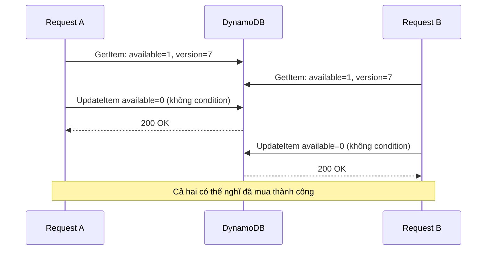
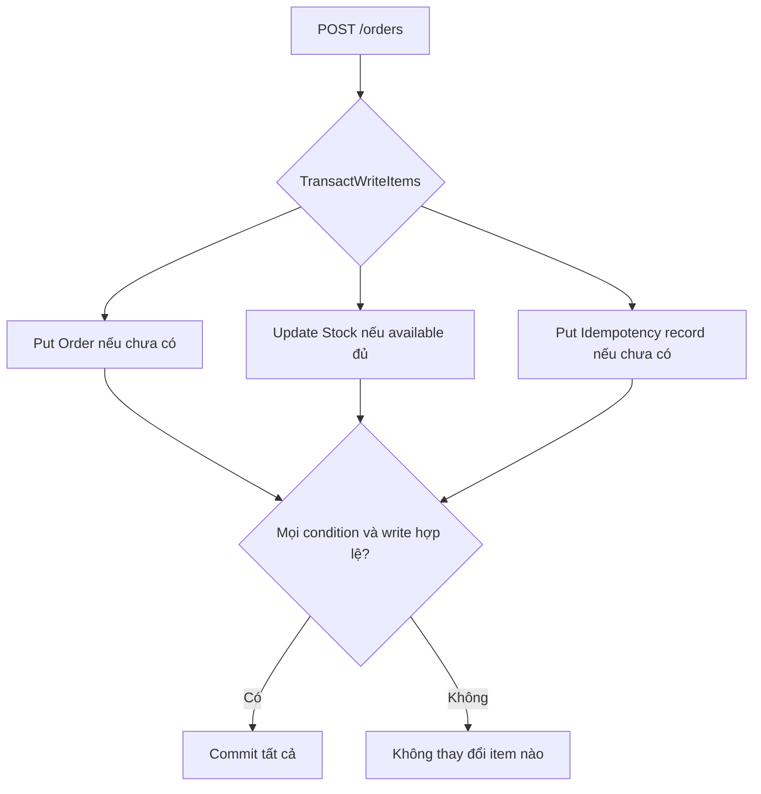
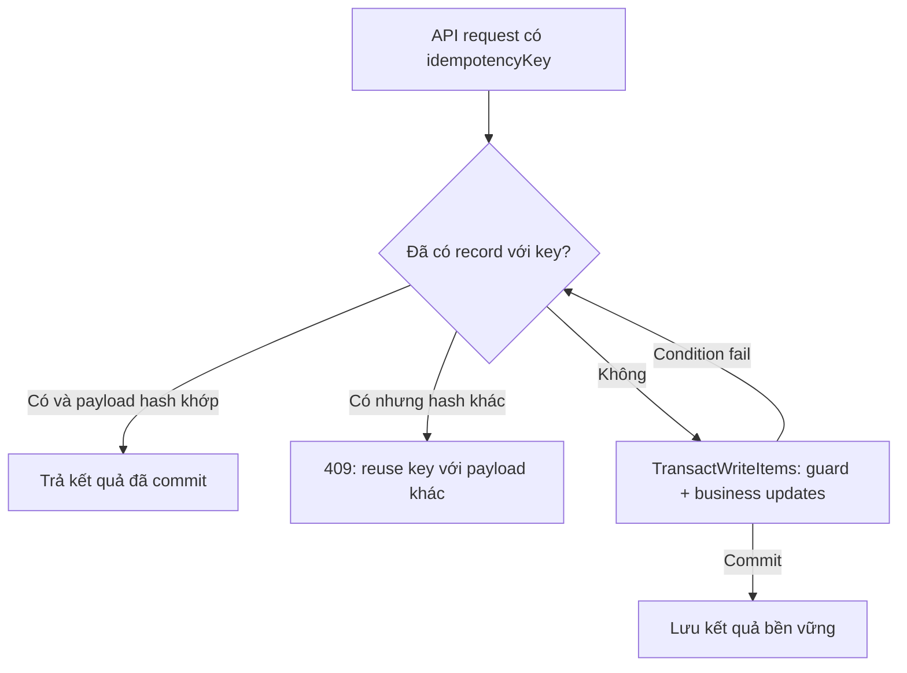
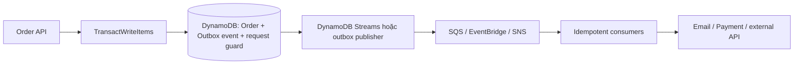
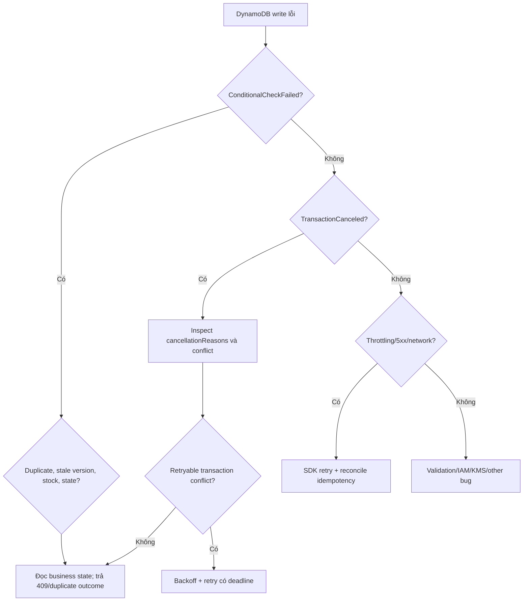
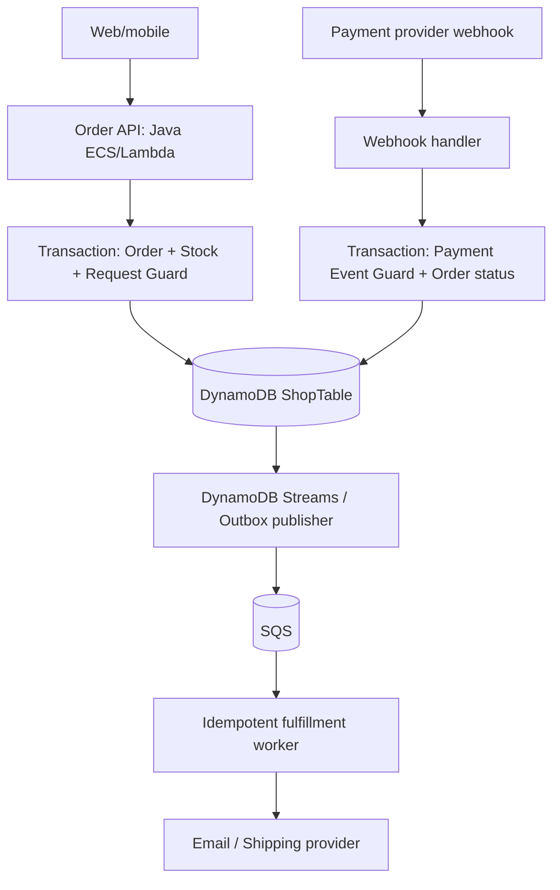

# Conditional write, optimistic locking và transaction

## 1. Bài toán nhất quán dữ liệu trên DynamoDB

Giả sử hệ thống bán hàng dùng Java Spring Boot chạy trên Amazon ECS/Lambda và lưu dữ liệu đơn hàng, tồn kho, giỏ hàng trong **Amazon DynamoDB**. Vào giờ khuyến mãi, hai request cùng mua sản phẩm chỉ còn một đơn vị; đồng thời nhân viên kho cập nhật số lượng và dịch vụ thanh toán gửi lại một webhook đã xử lý. Nếu mỗi request chỉ đọc dữ liệu rồi ghi lại theo giá trị đã thấy, ứng dụng có thể bán quá tồn kho, mất một bản cập nhật hoặc ghi hai lần cùng giao dịch.

**DynamoDB** cung cấp những primitive quan trọng để giải quyết các cuộc đua này:

- **Conditional write:** chỉ thực hiện Put/Update/Delete khi điều kiện trên trạng thái item hiện tại đúng.
- **Optimistic locking (OCC):** lưu **version** trên item và cập nhật chỉ khi version vẫn bằng giá trị client đã đọc.
- **Transaction:** thực thi nhiều thao tác trên những items khác nhau theo nguyên tắc **all-or-nothing** trong phạm vi hỗ trợ.

Đây là bài thuộc chương **DynamoDB** của module **CLOUD_PROVIDERS_AWS**. Module giới thiệu hạ tầng AWS từ Region/AZ, IAM, VPC, compute, storage, database đến integration/serverless, nhấn mạnh lựa chọn dịch vụ, triển khai an toàn, có giám sát, phục hồi và kiểm soát chi phí. Bài này đi sâu vào **đảm bảo điều kiện và tính toàn vẹn khi cập nhật DynamoDB**, chứ không chỉ mô tả các API CRUD.

Sau bài học, bạn có thể:

1. Phân biệt **atomic update trên một item**, **optimistic concurrency control** và **multi-item ACID transaction**.
2. Viết `ConditionExpression` đúng cho tạo mới, cập nhật số lượng, chống mất cập nhật và xóa có điều kiện.
3. Xây dựng khóa phiên bản `version`, phân biệt lỗi xung đột hợp lệ với lỗi hạ tầng cần retry.
4. Sử dụng `TransactWriteItems`, `TransactGetItems` và `ClientRequestToken` đúng giới hạn.
5. Thiết kế đặt hàng có **order, inventory, idempotency record** được cập nhật nguyên tử.
6. Triển khai ví dụ AWS CLI và **AWS SDK for Java 2.x**, quan sát metrics, IAM và chi phí.
7. Biết các điểm transaction **không** giải quyết: external payment/email, multi-Region replication, Streams consumers và schema access patterns.

## 2. Tại sao read rồi write thông thường có thể sai?

Hai Java services cùng đọc DynamoDB item:

```json
{
  "PK": "PRODUCT#P100",
  "SK": "STOCK",
  "available": 1,
  "version": 7
}
```

Cả A và B nhận `available=1`. Nếu cả hai tự tính `1 - 1 = 0` rồi gửi `UpdateItem` **không có điều kiện**, cả hai có thể trả về “mua hàng thành công”, trong khi chỉ có một đơn vị sản phẩm. Với một field khác, hai người sửa cùng lúc còn có thể **lost update**: giá trị mới của người A bị người B ghi đè.



**Ngay cả `ConsistentRead=true` cũng không khắc phục read–modify–write race**. Strongly consistent read có thể đưa ra giá trị mới nhất tại lúc đọc, nhưng dữ liệu vẫn có thể thay đổi **sau khi đọc và trước khi ghi**. Điều kiện phải được kiểm tra **cùng với thao tác ghi** ở phía DynamoDB.

### 2.1. Ba phạm vi giải quyết vấn đề

| Nhu cầu | Cơ chế phù hợp | Phạm vi đảm bảo |
| --- | --- | --- |
| Chỉ thêm một user nếu chưa tồn tại | `PutItem` + `attribute_not_exists` | Một item |
| Trừ tồn kho nếu còn đủ | `UpdateItem` + `ConditionExpression` | Một item, kiểm tra và update nguyên tử |
| Người dùng sửa hồ sơ từ phiên bản đã đọc | `version = expectedVersion` rồi tăng version | Một item, phát hiện stale writes |
| Tạo đơn và trừ kho đồng thời | `TransactWriteItems` | Nhiều items/tables trong cùng phạm vi transaction |
| Chống webhook thanh toán bị gửi lại nhiều lần | Idempotency item + condition/transaction | Tác động dữ liệu DynamoDB, vẫn cần xử lý external side effects |
| Xác nhận nhiều items ở một snapshot giao dịch | `TransactGetItems` | Nhiều items theo transaction read |

**Một item DynamoDB đã có tính nguyên tử cho các thao tác ghi đơn lẻ.** Không phải cứ có cạnh tranh là phải dùng transaction nhiều items: một `UpdateItem` với điều kiện đúng thường đơn giản và tiết kiệm hơn.

## 3. Khái niệm ConditionalExpression trong DynamoDB

Các API `PutItem`, `UpdateItem` và `DeleteItem` hỗ trợ **`ConditionExpression`**. DynamoDB kiểm tra biểu thức **trên item hiện đang có tại đúng primary key của request**; chỉ khi biểu thức đánh giá thành `true`, thay đổi mới được thực hiện.

```text
Client gửi:
  Key = (PK="PRODUCT#P100", SK="STOCK")
  UpdateExpression = "SET #qty = #qty - :one"
  ConditionExpression = "#qty >= :one"

DynamoDB tại thời điểm ghi:
  kiểm tra qty hiện tại >= 1?
      YES -> trừ 1 và commit một cách nguyên tử
      NO  -> từ chối toàn bộ UpdateItem
```

Nếu điều kiện sai, API phát sinh **`ConditionalCheckFailedException`** (HTTP 400, lỗi kiểm tra nghiệp vụ) và **không thực hiện write**. Không tự coi đây là lỗi server cần retry vô hạn.

### 3.1. Các toán tử và hàm thường gặp

| Biểu thức | Ý nghĩa | Ví dụ |
| --- | --- | --- |
| `attribute_exists(path)` | Thuộc tính có tồn tại trên item | Chỉ update item đã tồn tại |
| `attribute_not_exists(path)` | Thuộc tính chưa tồn tại | Chỉ tạo mới nếu chưa có item tại key |
| `#v = :expected` | Giá trị hiện tại đúng bằng expected | Optimistic locking |
| `#stock >= :qty` | Còn đủ số lượng | Trừ kho an toàn |
| `#status IN (:new,:pending)` | Trạng thái thuộc tập hợp cho phép | State transition |
| `begins_with(#sort, :prefix)` | String/binary path có prefix | Kiểm tra định dạng/giá trị |
| `contains(#tags, :tag)` | Kiểm tra thành phần chuỗi/set/list | Một loại business predicate |
| `size(#items) < :limit` | So sánh độ dài/kích thước attribute | Chặn list tăng vượt giới hạn |
| `AND`, `OR`, `NOT`, `( )` | Kết hợp điều kiện | Chặn trạng thái xung đột |

**`ConditionExpression` không phải cú pháp SQL `WHERE`**, không thể khóa hoặc quét mọi rows/items tùy ý. Nó đánh giá một item theo **primary key** được chỉ định; muốn uniqueness trên một email bất kỳ phải model key/guard item thích hợp, không viết điều kiện như SQL constraint toàn bảng.

### 3.2. ExpressionAttributeNames và ExpressionAttributeValues

Trong biểu thức DynamoDB, ký hiệu `#name` đại diện cho tên thuộc tính, `:value` đại diện cho **giá trị được typed**. Cách này giúp tránh vấn đề từ khóa dành riêng, dấu chấm trong tên, ký tự đặc biệt và injection kiểu ghép chuỗi.

```json
{
  "ExpressionAttributeNames": {
    "#status": "status",
    "#version": "version"
  },
  "ExpressionAttributeValues": {
    ":expected": { "N": "7" },
    ":next": { "S": "PAID" }
  }
}
```

**`N` là chuỗi biểu diễn số trong DynamoDB AttributeValue JSON**, không phải một JSON number thuần. Tương tự `S` là string, `BOOL` là boolean, `M` là map, `L` là list. Các lớp Enhanced Client có thể map Java types tự động, nhưng khi dùng CLI low-level phải khai báo đúng.

### 3.3. Khi condition sai, DynamoDB tiêu thụ gì?

Việc đánh giá điều kiện cần đọc item hiện có; condition failure **có thể tiêu thụ read capacity** theo kích thước item, dù **không ghi thay đổi**. Đừng nghĩ hàng trăm nghìn failed conditional writes là miễn phí hoặc không ảnh hưởng throughput. Theo dõi CloudWatch `ConditionalCheckFailedRequests` và cost/capacity, phân biệt giữa contention nghiệp vụ bình thường với thiết kế lỗi làm hệ thống thử ghi quá nhiều.

## 4. Conditional create: tránh ghi đè dữ liệu đã tồn tại

Mặc định, `PutItem` **thay thế toàn bộ item** khi primary key trùng (những attributes không xuất hiện trong request mới có thể bị mất). Nếu định nghĩa `PutItem` là thao tác “chỉ insert nếu chưa tồn tại”, cần thêm điều kiện.

### 4.1. AWS CLI PutItem chỉ khi item chưa có

Giả sử bảng thử nghiệm `ShopTable` có **partition key `PK`** và **sort key `SK`**, cả hai đều thuộc kiểu String:

```bash
aws dynamodb put-item \
  --table-name ShopTable \
  --item '{
    "PK": {"S": "ORDER#O101"},
    "SK": {"S": "META"},
    "customerId": {"S": "C001"},
    "status": {"S": "CREATED"},
    "version": {"N": "1"}
  }' \
  --condition-expression 'attribute_not_exists(#pk)' \
  --expression-attribute-names '{"#pk":"PK"}' \
  --region ap-southeast-1
```

Nếu item `(ORDER#O101, META)` chưa tồn tại, DynamoDB tạo mới. Nếu nó đã có, DynamoDB trả `ConditionalCheckFailedException` và **giữ nguyên bản ghi cũ**, tránh ghi đè order do request retry. Với composite key, điều kiện kiểm tra item **tại đúng cặp PK/SK**, không chặn mọi item có cùng PK nhưng khác SK.

### 4.2. Dùng condition để bảo vệ trạng thái

Đặt hàng có trạng thái `CREATED → PAID → FULFILLED`; một callback chậm không được đổi `FULFILLED` về `CREATED`. Có thể bảo vệ thao tác chuyển:

```text
UpdateExpression: SET #status = :paid
ConditionExpression: #status = :created

Nếu status hiện tại vẫn CREATED -> chuyển thành PAID.
Nếu status đã PAID hoặc CANCELLED -> từ chối.
```

Đây là **state transition guard**, không phải OCC đầy đủ khi nhiều attributes khác nhau cùng thay đổi. Có thể kết hợp cả status check và version check để bảo vệ thêm.

### 4.3. Lưu ý TTL và khóa đã hết hạn

**DynamoDB TTL** xóa items **bất đồng bộ** sau thời điểm hết hạn; item có TTL đã qua **có thể vẫn đang tồn tại** cho tới khi process TTL xóa nó. Điều kiện `attribute_not_exists(PK)` vì vậy vẫn có thể thất bại với một bản ghi “expired” theo logic ứng dụng.

Nếu thiết kế cho phép tái sử dụng logical key sau expiry, cần condition kiểm tra TTL và cập nhật state có kiểm soát; **không dựa vào việc TTL đã xóa ngay tại giây hết hạn**. Đặc biệt với idempotency keys, xóa quá sớm có thể cho phép cùng giao dịch được xử lý lại như mới.

## 5. Atomic update: trừ tồn kho an toàn trên một item

Khi số lượng còn lại nằm trong **một item**, có thể cập nhật số lượng và kiểm tra đủ hàng bằng **một UpdateItem**. Không cần đọc trước bằng GetItem chỉ để trừ số lượng:

```bash
aws dynamodb update-item \
  --table-name ShopTable \
  --key '{"PK":{"S":"PRODUCT#P100"},"SK":{"S":"STOCK"}}' \
  --update-expression 'SET #available = #available - :qty' \
  --condition-expression 'attribute_exists(#pk) AND #available >= :qty' \
  --expression-attribute-names '{"#pk":"PK","#available":"available"}' \
  --expression-attribute-values '{":qty":{"N":"1"}}' \
  --return-values ALL_NEW \
  --region ap-southeast-1
```

Hai requests cùng trừ 1 từ item có `available=1`:

```mermaid
sequenceDiagram
    participant A as Buyer A
    participant D as DynamoDB
    participant B as Buyer B
    A->>D: Update if available >= 1; available = available - 1
    B->>D: Update if available >= 1; available = available - 1
    D-->>A: Success (available = 0)
    D-->>B: ConditionalCheckFailedException
    Note over D: Chỉ một request có thể trừ đơn vị cuối cùng
```

Thứ tự A/B thắng trong thực tế không được định trước; ví dụ chỉ minh họa một người thắng. **Condition và update được xử lý nguyên tử trên cùng item**, tránh oversell riêng cho một SKU khi mọi đường cập nhật đều tuân theo điều kiện đó.

### 5.1. Tăng counter an toàn

Với counter không cần guard đặc biệt, có thể dùng một `UpdateItem`:

```text
UpdateExpression:
  SET #total = if_not_exists(#total, :zero) + :one

ExpressionAttributeValues:
  :zero = 0
  :one = 1
```

Đây là **atomic increment**, không phải “đọc total, tăng trong Java, ghi lại”. Với counter có giới hạn, thêm `ConditionExpression` để giới hạn cập nhật. Tuy nhiên **atomic increment không tự chống duplicate request**: nếu client retry một thao tác increment đã commit, số có thể tăng thêm lần nữa. Muốn idempotency gắn với event ID, dùng version/dedup record/transaction tùy nghiệp vụ.

### 5.2. DeleteItem có điều kiện

Khi muốn xóa giỏ hàng chỉ nếu chưa checkout:

```bash
aws dynamodb delete-item \
  --table-name ShopTable \
  --key '{"PK":{"S":"CART#C001"},"SK":{"S":"META"}}' \
  --condition-expression '#status = :open' \
  --expression-attribute-names '{"#status":"status"}' \
  --expression-attribute-values '{":open":{"S":"OPEN"}}' \
  --region ap-southeast-1
```

Nếu cart đã `CHECKED_OUT` hoặc không còn, condition false và **không xóa**. Đối với thao tác xóa dữ liệu có thể khôi phục, cân nhắc **soft delete/status transition** thay vì DeleteItem để lưu audit hoặc phục vụ restore khi chính sách yêu cầu.

## 6. Optimistic locking: cập nhật đúng phiên bản đã đọc

**Optimistic concurrency control (OCC)** giả định các xung đột không xảy ra liên tục. Thay vì giữ lock lâu trên database, ứng dụng đọc item cùng một **version number**, thực hiện chỉnh sửa, rồi gửi yêu cầu cập nhật có điều kiện **`version = expectedVersion`**. Nếu ai đó đã cập nhật trước, version khác đi và thao tác bị từ chối.

```mermaid
sequenceDiagram
    participant A as Nhân viên A
    participant D as DynamoDB
    participant B as Nhân viên B
    A->>D: GetItem -> version 7
    B->>D: GetItem -> version 7
    A->>D: Update status=PAID nếu version=7; version=8
    D-->>A: Success, version 8
    B->>D: Update status=CANCELLED nếu version=7; version=8
    D-->>B: ConditionalCheckFailedException
    B->>D: GetItem -> version 8; đối chiếu thay đổi
```

**Không tự ghi đè sau khi phát hiện conflict.** Người dùng B có thể phải nhìn lại trạng thái mới và quyết định có nên hủy một đơn đã thanh toán không. Tự đọc lại version mới rồi retry với `CANCELLED` mà không kiểm tra business rules có thể biến OCC thành last-writer-wins.

### 6.1. Chu trình read–compare–write

1. `GetItem` lấy item tại primary key, bao gồm `version=7`.
2. Ứng dụng thực hiện validation và chuẩn bị thay đổi.
3. `UpdateItem` có `ConditionExpression="#version = :expected"`.
4. Update expression thay đổi dữ liệu **và tăng version trong cùng thao tác nguyên tử**.
5. Nếu thành công, client nhận version mới; nếu thất bại, client xử lý conflict.

Các phiên bản do ứng dụng/SDK quản lý phải tăng **mỗi khi cập nhật những trường cần được OCC bảo vệ**. Nếu một service bỏ qua version và ghi không có điều kiện, OCC của các service khác không còn bảo vệ được toàn bộ cập nhật.

### 6.2. Ví dụ CLI bảo vệ version

Giả sử `ORDER#O101/META` hiện có `version=7` và `status=CREATED`:

```bash
aws dynamodb update-item \
  --table-name ShopTable \
  --key '{"PK":{"S":"ORDER#O101"},"SK":{"S":"META"}}' \
  --update-expression 'SET #status = :paid, #version = #version + :one' \
  --condition-expression '#version = :expected AND #status = :created' \
  --expression-attribute-names '{"#status":"status","#version":"version"}' \
  --expression-attribute-values '{
    ":paid":{"S":"PAID"},
    ":created":{"S":"CREATED"},
    ":expected":{"N":"7"},
    ":one":{"N":"1"}
  }' \
  --return-values ALL_NEW \
  --region ap-southeast-1
```

Nếu version hiện là 7 và status còn CREATED, cập nhật atomically thành `status=PAID, version=8`. Nếu version đã 8 hoặc status đã CANCELLED, toàn bộ update bị từ chối. Đặt **cả version và status** trong condition khi chúng đại diện cho hai điều kiện nghiệp vụ khác nhau.

### 6.3. Khi không cần OCC?

Với một atomic counter đơn thuần, `ADD` hoặc `SET counter=counter+:one` thường là đủ. Nếu việc tăng một lượt xem không cần chặn người khác tăng đồng thời, kiểm tra version có thể tạo xung đột không cần thiết. Nhưng nếu thao tác là **đặt một trạng thái đơn hàng, sửa thông tin nhiều trường hoặc giao dịch tiền**, version giúp bảo vệ logic read–modify–write.

### 6.4. Strong reads làm giảm stale read, không thay version

DynamoDB cho phép **strongly consistent `GetItem`** trên table và LSI theo khả năng hỗ trợ; **GSI chỉ hỗ trợ eventually consistent reads**. Một strongly consistent read có thể giúp lấy phiên bản mới nhất trước khi sửa nhưng **không khóa item** từ lúc đọc đến lúc ghi. Vì thế version condition vẫn cần thiết.

## 7. Java SDK 2.x: conditional UpdateItem với version

Ví dụ Java bên dưới dùng **AWS SDK for Java 2.x low-level `DynamoDbClient`**. Mã giả định bảng `ShopTable` có khóa `PK`/`SK` kiểu String và item có `version` kiểu Number; client credentials/Region được quản lý qua AWS SDK default provider chain.

```java
import java.util.Map;
import software.amazon.awssdk.services.dynamodb.DynamoDbClient;
import software.amazon.awssdk.services.dynamodb.model.AttributeValue;
import software.amazon.awssdk.services.dynamodb.model.ConditionalCheckFailedException;
import software.amazon.awssdk.services.dynamodb.model.ReturnValue;
import software.amazon.awssdk.services.dynamodb.model.UpdateItemRequest;

public final class OrderOptimisticLock {

    private static AttributeValue s(String value) {
        return AttributeValue.builder().s(value).build();
    }

    private static AttributeValue n(long value) {
        return AttributeValue.builder().n(Long.toString(value)).build();
    }

    public static Map<String, AttributeValue> setStatus(
            DynamoDbClient dynamo,
            String tableName,
            String orderId,
            String newStatus,
            long expectedVersion) {

        UpdateItemRequest request = UpdateItemRequest.builder()
                .tableName(tableName)
                .key(Map.of(
                        "PK", s("ORDER#" + orderId),
                        "SK", s("META")))
                .updateExpression(
                        "SET #status = :next, #version = #version + :one")
                .conditionExpression(
                        "attribute_exists(#pk) AND #version = :expected")
                .expressionAttributeNames(Map.of(
                        "#pk", "PK",
                        "#status", "status",
                        "#version", "version"))
                .expressionAttributeValues(Map.of(
                        ":next", s(newStatus),
                        ":expected", n(expectedVersion),
                        ":one", n(1)))
                .returnValues(ReturnValue.ALL_NEW)
                .build();

        try {
            return dynamo.updateItem(request).attributes();
        } catch (ConditionalCheckFailedException conflict) {
            // Trong HTTP API, thường map sang 409 Conflict sau khi
            // phân biệt stale version và record đã bị xóa.
            throw new IllegalStateException(
                    "Order was modified or no longer exists", conflict);
        }
    }
}
```

Đây là mã minh họa cách gọi DynamoDB, **không phải API hoàn chỉnh**. Ứng dụng production còn cần:

- Validate `newStatus` và transition hợp lệ, xác thực quyền user đối với `orderId`.
- Ánh xạ lỗi concurrency thành **409 Conflict** hoặc response nghiệp vụ phù hợp; đừng trả nội dung nhạy cảm trong exception.
- Phân biệt `ConditionalCheckFailedException` với `ProvisionedThroughputExceededException`, `ThrottlingException`, network timeout hoặc lỗi KMS/IAM.
- Không tăng version ngoài DynamoDB khi còn cần bảo đảm atomicity.
- Có logging/tracing theo request ID, không log secrets/PII.

### 7.1. DynamoDB Enhanced Client và annotation version

Với AWS SDK for Java 2.x **Enhanced Client**, có thể dùng `@DynamoDbVersionAttribute` cho một thuộc tính `version` của bean khi sử dụng **VersionedRecordExtension**. Extension áp dụng conditional write và increment phiên bản theo quy tắc của SDK:

```java
import software.amazon.awssdk.enhanced.dynamodb.mapper.annotations.DynamoDbBean;
import software.amazon.awssdk.enhanced.dynamodb.mapper.annotations.DynamoDbPartitionKey;
import software.amazon.awssdk.enhanced.dynamodb.mapper.annotations.DynamoDbSortKey;
import software.amazon.awssdk.enhanced.dynamodb.extensions.annotations.DynamoDbVersionAttribute;

@DynamoDbBean
public class OrderRecord {
    private String pk;
    private String sk;
    private Long version;

    @DynamoDbPartitionKey
    public String getPk() { return pk; }
    public void setPk(String pk) { this.pk = pk; }

    @DynamoDbSortKey
    public String getSk() { return sk; }
    public void setSk(String sk) { this.sk = sk; }

    @DynamoDbVersionAttribute
    public Long getVersion() { return version; }
    public void setVersion(Long version) { this.version = version; }
}
```

Trong cấu hình Enhanced Client thông thường, **VersionedRecordExtension là extension mặc định**; nếu tự chỉ định tập extensions, cần bảo đảm extension này vẫn được kích hoạt. Phiên bản ban đầu và bước tăng do SDK quản lý có thể cấu hình theo API/extension; tránh trộn **một số ghi version thủ công** với **các số ghi qua Enhanced Client** nếu chúng không dùng cùng một convention. Kiểm thử đường Put/Update/Delete và điều kiện bổ sung với SDK version thực tế.

### 7.2. Vì sao không dùng lock phân tán cho mọi cập nhật?

OCC hữu ích khi conflict không quá thường xuyên vì không cần giữ lock suốt thời gian người dùng chỉnh sửa. Nếu một item là **hot counter** và hàng nghìn clients update mỗi giây, OCC version check có thể tạo nhiều failed writes/retries. Khi đó xem:

- Thay bằng **atomic increment** nếu chỉ cần cộng/trừ.
- **Write sharding** cho counters không yêu cầu đọc kết quả nhất quán tức thời.
- Queue/partition theo key để tuần tự hóa update trước database.
- Transaction hoặc một item condition để kiểm tra invariant quan trọng.

**Không dùng lock toàn hệ thống** khi bài toán chỉ cần điều kiện nguyên tử trên đúng một item.

## 8. Xử lý conditional failure và retry đúng cách

`ConditionalCheckFailedException` có thể mang nhiều nghĩa:

- Người dùng tạo trùng cùng orderId.
- Stock không còn đủ.
- Status không còn ở trạng thái dự kiến.
- Version đã cũ do request khác cập nhật.
- Item đã bị xóa hoặc TTL đã xử lý.

**Không thể suy ra tất cả là lỗi hạ tầng.** API cần phân loại theo **use case**, trả response nhất quán cho client và chỉ retry khi có cơ sở.

| Tình huống | Hành vi phù hợp |
| --- | --- |
| Đặt hàng khi stock=0 | Trả out-of-stock/409; không retry mù |
| User A sửa version 7, hiện đã 8 | Đọc lại item, hiển thị/merge thay đổi theo nghiệp vụ |
| Producer gửi lại cùng requestId | Đọc idempotency record, trả kết quả cũ nếu request payload khớp |
| Ghi dữ liệu thất bại do throttling | SDK retries với exponential backoff + jitter, tối ưu capacity/hot keys |
| Timeout không rõ write đã commit hay chưa | Đọc durable state/idempotency key trước khi tạo side effect lần nữa |
| Transaction conflict giữa hai workflows | Retry toàn transaction có giới hạn sau backoff, kiểm tra điều kiện mới |

### 8.1. `ReturnValuesOnConditionCheckFailure`

DynamoDB hỗ trợ tùy chọn **`ReturnValuesOnConditionCheckFailure=ALL_OLD`** cho một số thao tác write/condition và trong transaction actions. Khi condition thất bại, API có thể trả hình ảnh **item hiện có** giúp chẩn đoán stale version hoặc stock thực tế mà không cần `GetItem` riêng.

```bash
aws dynamodb update-item \
  --table-name ShopTable \
  --key '{"PK":{"S":"ORDER#O101"},"SK":{"S":"META"}}' \
  --update-expression 'SET #status = :newStatus' \
  --condition-expression '#version = :expected' \
  --expression-attribute-names '{"#status":"status","#version":"version"}' \
  --expression-attribute-values '{
    ":newStatus":{"S":"PAID"},
    ":expected":{"N":"999"}
  }' \
  --return-values-on-condition-check-failure ALL_OLD \
  --region ap-southeast-1
```

Ví dụ cố ý dùng version 999 để minh họa thất bại; tùy dữ liệu thực, nếu item đang có version 999 thì update vẫn có thể thành công, nên **chỉ chạy trên sandbox**. Trả item cũ có thể chứa dữ liệu người dùng; **không log nguyên `ALL_OLD` hoặc trả hết về browser** nếu không có business authorization và data minimization.

### 8.2. Retry không phải cứ lặp request vô hạn

Một chính sách hợp lý:

1. Bắt `ConditionalCheckFailedException` riêng: dừng, phân tích status/version hoặc trả conflict.
2. Bắt throttling/network/service errors tạm thời: retry **có giới hạn**, exponential backoff + jitter, time budget phù hợp.
3. Với request **có tác dụng phụ**, dùng idempotency key và transactional guard để retry an toàn.
4. Nếu không biết kết quả write đã commit, **reconcile trạng thái durable** trước khi tái tạo đơn/charge payment.
5. Đặt CloudWatch alerts để biết tỷ lệ conflicts bất thường thay vì để clients retry tạo “thundering herd”.

**Conditional failure là một kết quả hợp lệ của cạnh tranh dữ liệu** và thường nên được xử lý ở lớp domain, không coi mặc định là HTTP 500.

## 9. Transaction trong DynamoDB: khi một item chưa đủ

Nếu một đơn hàng mới cần **trừ tồn kho** đồng thời **tạo bản ghi đơn hàng**, hai API calls độc lập có thể xảy ra:

```text
1. Update stock available = available - 1  -> SUCCESS
2. Put order                            -> FAIL

Kết quả:
  Tồn kho đã giảm nhưng không có đơn hàng.
```

Hoặc nếu đảo thứ tự:

```text
1. Put order                             -> SUCCESS
2. Update stock                          -> FAIL

Kết quả:
  Có đơn hàng nhưng không giữ được hàng tồn.
```

**`TransactWriteItems`** giải quyết điều này bằng cách gom nhiều actions vào **một transaction**: hoặc tất cả thay đổi hợp lệ và được commit, hoặc **không action nào được commit**. Trong cùng transaction có thể dùng:

- **`Put`**: thêm/thay thế item, có thể có condition.
- **`Update`**: sửa item, có thể có condition.
- **`Delete`**: xóa item, có thể có condition.
- **`ConditionCheck`**: xác minh một item khác thỏa điều kiện mà không thay đổi nó.



### 9.1. ACID và phạm vi của DynamoDB transaction

Trong phạm vi giao dịch được hỗ trợ, DynamoDB transactions có các đặc tính ACID:

- **Atomicity:** tất cả hoặc không item nào được commit.
- **Consistency:** các điều kiện được kiểm tra và cập nhật trong một transaction, giúp thực thi invariants mà ứng dụng định nghĩa.
- **Isolation:** các transactional operations được phối hợp theo isolation semantics của DynamoDB; cạnh tranh có thể gây transaction conflict/cancellation.
- **Durability:** dữ liệu commit được lưu bền vững theo kiến trúc DynamoDB của Region.

**DynamoDB không tự biết business invariant “không bán quá kho”** nếu bạn quên đặt `available >= :qty`. Transaction chỉ atomic với các actions bạn khai báo; thiếu condition thì transaction vẫn có thể trừ stock xuống âm.

### 9.2. Giới hạn cần nhớ

| Ràng buộc | Ý nghĩa vận hành |
| --- | --- |
| **Tối đa 100 actions/items** trong một transaction | Không gom hàng nghìn records vào một lệnh |
| **Tổng kích thước items tối đa 4 MB** | Một transaction lớn có thể vượt giới hạn dù ít items |
| **Một action trên mỗi item duy nhất** | Không được ConditionCheck và Update cùng một item trong cùng transaction |
| **Cùng AWS account và Region** | Không có transaction nguyên tử xuyên tài khoản hoặc xuyên Region |
| **Item vẫn chịu giới hạn 400 KB** | Transaction không nâng giới hạn kích thước item |
| **Capacity, hot partitions, conflicts và throttling vẫn áp dụng** | Không có unlimited throughput |
| **Không gồm external services** | SQS/SNS/email/payment provider không cùng ACID transaction |

**Không được dùng `BatchWriteItem` để thay `TransactWriteItems`.** BatchWrite xử lý nhiều Put/Delete nhưng **không hỗ trợ ConditionExpression** và có thể trả `UnprocessedItems`; nó không cung cấp atomicity nhiều items tương đương transaction.

### 9.3. Conflict và isolation không miễn phí

Hai transactions cùng sửa một item ở thời điểm giao nhau có thể xung đột. DynamoDB có thể từ chối một transaction với **`TransactionCanceledException`** hoặc conflict-related error; ứng dụng phải xem cancellation reasons khi SDK cung cấp và retry **toàn transaction** theo chính sách có giới hạn.

Không hứa 100% request đều commit thành công chỉ vì dùng transaction. Transaction bảo vệ tính toàn vẹn **khi thành công**, nhưng có thể tăng contention/cost và cần thiết kế API trả lỗi hợp lý.

## 10. Thực hành TransactWriteItems: tạo order và giữ tồn kho

Giả sử bảng `ShopTable` có composite key:

| Item | PK | SK | Thuộc tính |
| --- | --- | --- | --- |
| Stock | `PRODUCT#P100` | `STOCK` | `available = 5` |
| Order mới | `ORDER#O301` | `META` | Chưa tồn tại |
| Idempotency key | `REQUEST#req-001` | `META` | Chưa tồn tại |

Một order cần mua **2 units**. Ta muốn ba thay đổi thành công **cùng nhau**: tạo order mới, giảm stock đi 2, đánh dấu request ID đã dùng.

### 10.1. JSON file `transact-order.json`

```json
[
  {
    "Put": {
      "TableName": "ShopTable",
      "Item": {
        "PK": {"S": "ORDER#O301"},
        "SK": {"S": "META"},
        "customerId": {"S": "C001"},
        "productId": {"S": "P100"},
        "quantity": {"N": "2"},
        "status": {"S": "CREATED"},
        "version": {"N": "1"}
      },
      "ConditionExpression": "attribute_not_exists(#pk)",
      "ExpressionAttributeNames": {"#pk": "PK"}
    }
  },
  {
    "Update": {
      "TableName": "ShopTable",
      "Key": {
        "PK": {"S": "PRODUCT#P100"},
        "SK": {"S": "STOCK"}
      },
      "UpdateExpression": "SET #available = #available - :qty",
      "ConditionExpression": "attribute_exists(#pk) AND #available >= :qty",
      "ExpressionAttributeNames": {
        "#pk": "PK",
        "#available": "available"
      },
      "ExpressionAttributeValues": {
        ":qty": {"N": "2"}
      }
    }
  },
  {
    "Put": {
      "TableName": "ShopTable",
      "Item": {
        "PK": {"S": "REQUEST#req-001"},
        "SK": {"S": "META"},
        "orderId": {"S": "O301"},
        "requestHash": {"S": "example-payload-hash"}
      },
      "ConditionExpression": "attribute_not_exists(#pk)",
      "ExpressionAttributeNames": {"#pk": "PK"}
    }
  }
]
```

**Cả ba items có primary key khác nhau**, nên hợp lệ với quy tắc “không hai actions trên cùng item”. Nếu stock không đủ, order đã tồn tại hoặc request key đã tồn tại, **toàn transaction bị hủy**; không bị trừ một phần.

### 10.2. Chạy CLI từ tài khoản sandbox

```bash
# Xác nhận account, tránh gửi giao dịch đến bảng production
aws sts get-caller-identity

aws dynamodb transact-write-items \
  --transact-items file://transact-order.json \
  --client-request-token 'shop-order-req-001' \
  --region ap-southeast-1
```

Đây là lệnh **ghi dữ liệu thật**. Bài học giả định `ShopTable` đã tồn tại với key `PK`/`SK` kiểu String, item stock đang có `available >= 2` và permissions thích hợp; không đọc hoặc sửa bất kỳ tài nguyên AWS thực tế nào khi biên soạn tài liệu này.

`--client-request-token` của transaction API là **idempotency token của yêu cầu TransactWriteItems**, nhưng có thời hạn; nó **không thay thế** record `REQUEST#req-001` bền vững. Trong ví dụ `requestHash` là placeholder, production cần canonical hash của payload để phân biệt cùng idempotency key nhưng nội dung khác.

### 10.3. Đọc lại trạng thái

```bash
aws dynamodb get-item \
  --table-name ShopTable \
  --key '{"PK":{"S":"PRODUCT#P100"},"SK":{"S":"STOCK"}}' \
  --consistent-read \
  --region ap-southeast-1

aws dynamodb get-item \
  --table-name ShopTable \
  --key '{"PK":{"S":"ORDER#O301"},"SK":{"S":"META"}}' \
  --consistent-read \
  --region ap-southeast-1

aws dynamodb get-item \
  --table-name ShopTable \
  --key '{"PK":{"S":"REQUEST#req-001"},"SK":{"S":"META"}}' \
  --consistent-read \
  --region ap-southeast-1
```

Ba `GetItem` riêng lẻ được thực hiện ở ba thời điểm; **chúng không phải một snapshot transaction nhiều items**. Nếu cần đọc nhiều items trong một snapshot giao dịch, dùng **`TransactGetItems`**. Trong môi trường thử, có thể kiểm tra stock đã giảm đúng 2 và order/idempotency records xuất hiện cùng commit.

### 10.4. Khi người dùng gửi lại cùng request

Request với `req-001` tới lần nữa có thể gặp một trong hai tình huống:

1. Trong **cửa sổ idempotency API**, cùng `ClientRequestToken` với **tham số giống hệt** được DynamoDB coi là cùng lệnh.
2. Sau thời gian đó hoặc từ một producer khác, transaction sẽ thất bại ở **Put guard item** nếu record `REQUEST#req-001` vẫn tồn tại.

Khi guard đã tồn tại, backend **không nên trả lỗi 500**. Nó cần đọc record, xác minh request payload hash/orderId và trả kết quả đã tạo trước đó hoặc một lỗi “idempotency key reused with different payload”.

### 10.5. Không dùng ID ngẫu nhiên mới trong mỗi lần retry

Nếu một client retry cùng thao tác nhưng server lại tạo `O302` và `REQUEST#random-2` mới, cả Order ID lẫn guard ID đều thay đổi → transaction **không phát hiện được** hai request có cùng ý nghĩa nghiệp vụ. Business idempotency key phải ổn định qua retries của **cùng thao tác**, thường được client truyền hoặc server cấp trước rồi lưu bền vững.

## 11. ClientRequestToken và idempotency 10 phút

`TransactWriteItems` hỗ trợ `ClientRequestToken` để chống lặp lời gọi transaction trong **cửa sổ 10 phút**:

- **Cùng token + cùng tập tham số** trong window → operation được xem là idempotent.
- **Cùng token + tham số khác** trong window → `IdempotentParameterMismatch`.
- **Sau window**, token cũ có thể được xem như request mới, nên không thể coi nó là business idempotency key vĩnh viễn.

```text
10:00:00  POST /orders requestId=req-001
          Transaction(token=req-001) -> Commit

10:00:05  Network timeout, server/client retry
          Transaction(token=req-001, identical parameters)
          -> DynamoDB nhận là retry cùng transaction.

10:11:00  Một request mới dùng lại token req-001
          -> ngoài cửa sổ 10 phút; không bảo vệ business key
             nếu thiếu REQUEST#req-001 guard item.
```

**Không thay đổi `createdAt`, random order ID hoặc nội dung payload trong một retry với cùng client token** nếu muốn yêu cầu được coi là giống hệt. Nếu payload khác, DynamoDB có thể trả mismatch, điều này là hành vi bảo vệ hợp lệ.

### 11.1. API idempotency phải sống lâu theo nghiệp vụ

Ví dụ webhook thanh toán có thể được provider gửi lại sau **vài ngày**. Business deduplication nên có một item như:

```json
{
  "PK": "PAYMENT_EVENT#evt-7788",
  "SK": "META",
  "payloadHash": "sha256-of-canonical-event",
  "paymentId": "pay-42",
  "result": "APPLIED",
  "processedAt": "2026-11-20T09:00:00Z"
}
```

Giữ record ít nhất bằng retry horizon + chính sách audit. Nếu bật TTL, phải chấp nhận rằng **sau khi record bị xóa** một event cũ có thể được xem là mới. Với giao dịch tài chính, cân nhắc retention/ledger phù hợp quy định thay vì TTL quá ngắn.

### 11.2. Không thực hiện external API side effect trong DynamoDB transaction

`TransactWriteItems` không thể commit nguyên tử với **Stripe/PayPal/payment processor**, SNS, SQS, email hoặc HTTP API bên thứ ba. Nếu gọi payment API trước rồi transaction hủy, cần **compensation/refund/idempotency**. Nếu transaction commit trước nhưng không gửi SQS event, cần **transactional outbox** hoặc DynamoDB Streams + consumer được thiết kế at-least-once.

Một cách thiết kế:

1. Transaction ghi `Order` và `OUTBOX#event-id` cùng idempotency guard.
2. Consumer đọc DynamoDB Streams hoặc worker truy vấn outbox, publish event.
3. Consumer downstream xử lý idempotent theo `eventId`.
4. Nếu publish thất bại hoặc duplicate, retry và lưu trạng thái delivery.

**Atomic DynamoDB transaction không có nghĩa exactly-once toàn hệ thống**; ranh giới transaction kết thúc ở items thuộc DynamoDB API call đó.

## 12. ConditionCheck, TransactGetItems và hạn chế trên cùng item

### 12.1. ConditionCheck khác conditional Update

Giả sử chỉ muốn tạo order nếu customer vẫn **ACTIVE**:

```json
{
  "ConditionCheck": {
    "TableName": "ShopTable",
    "Key": {
      "PK": {"S": "CUSTOMER#C001"},
      "SK": {"S": "META"}
    },
    "ConditionExpression": "#active = :yes",
    "ExpressionAttributeNames": {
      "#active": "active"
    },
    "ExpressionAttributeValues": {
      ":yes": {"BOOL": true}
    }
  }
}
```

Thêm action này vào `TransactWriteItems` để bắt buộc customer vẫn active tại thời điểm transaction; action **không sửa customer item**. Có thể dùng cùng các actions ghi order, stock và idempotency nếu tổng vẫn nằm trong giới hạn giao dịch.

**Quy tắc quan trọng:** cùng một transaction, **không được `ConditionCheck` và `Update` trên đúng cùng một item**. Nếu muốn sửa stock **và** kiểm tra stock đủ, đặt điều kiện **trong `Update` action** như phần 10. Nếu chỉ muốn kiểm tra một item **khác** không sửa, dùng `ConditionCheck`.

### 12.2. TransactGetItems đọc nhiều items có transaction semantics

Khi giao diện cần đọc **order + stock** trong một transactional read, có thể dùng `TransactGetItems` với các `Get` actions:

```json
[
  {
    "Get": {
      "TableName": "ShopTable",
      "Key": {
        "PK": {"S": "ORDER#O301"},
        "SK": {"S": "META"}
      }
    }
  },
  {
    "Get": {
      "TableName": "ShopTable",
      "Key": {
        "PK": {"S": "PRODUCT#P100"},
        "SK": {"S": "STOCK"}
      }
    }
  }
]
```

Lưu thành `transact-read.json`, rồi:

```bash
aws dynamodb transact-get-items \
  --transact-items file://transact-read.json \
  --region ap-southeast-1
```

**TransactGetItems** trả các items theo ngữ nghĩa đọc transaction, không thực hiện ghi. Khi chỉ cần một item, `GetItem --consistent-read` thường đơn giản và ít tốn hơn; không cần TransactGetItems cho mọi màn hình.

### 12.3. Strongly consistent read không có nghĩa multi-item snapshot

Hai `GetItem --consistent-read` được thực hiện lần lượt không đảm bảo hai items thuộc cùng một thời điểm logic nếu có concurrent writers. `Query` hoặc `Scan` có thể đọc một loạt items nhưng **không tự mang atomic multi-item snapshot** chỉ vì bật ConsistentRead, và **GSI không hỗ trợ strongly consistent reads**. Khi yêu cầu giao dịch đọc nhiều items cùng nhau, dùng TransactGetItems trong giới hạn dịch vụ.

## 13. Uniqueness nhiều item: email và khóa giữ chỗ

DynamoDB đảm bảo tính duy nhất theo **primary key của item**, không có một ràng buộc UNIQUE tự động cho mọi attribute giống relational databases. Một **GSI trên email** giúp tìm kiếm user theo email nhưng **không tự chặn hai users dùng cùng email**.

### 13.1. Vì sao Query GSI rồi PutItem không đủ?

```text
Service A: Query GSI email=a@example.com -> chưa có
Service B: Query GSI email=a@example.com -> chưa có
Service A: Put USER#U1 -> success
Service B: Put USER#U2 -> success

Kết quả: hai user items cùng email.
```

Ngoài race giữa Query và Put, GSI còn đọc **eventually consistent**, nên dùng nó để quyết định uniqueness là không đáng tin. Giải pháp thường dùng là tạo **uniqueness guard item** với khóa có thể xác định từ email chuẩn hóa.

### 13.2. Transaction với guard item

Một transaction gồm:

```text
Put USER#U1 / PROFILE
  ConditionExpression: attribute_not_exists(PK)

Put EMAIL#<normalizedEmail> / UNIQUE
  ConditionExpression: attribute_not_exists(PK)
  userId: U1
```

Hai requests cùng email sẽ tranh **cùng guard key**; chỉ một transaction có thể tạo guard thành công. **Không đặt raw email chứa PII trực tiếp trong logs/metrics hoặc partition keys** nếu chính sách dữ liệu yêu cầu bảo vệ; có thể dùng canonicalize + HMAC có khóa bí mật, rotation strategy rõ ràng và lưu giá trị hiển thị được mã hóa ở vị trí phù hợp.

### 13.3. Đổi email phải chuyển guard cùng transaction

Đổi user email từ A sang B thường cần ba actions:

1. **Put guard B** nếu chưa tồn tại.
2. **Update user** sang email B với OCC version/status check.
3. **Delete guard A** nếu guard vẫn trỏ tới đúng user.

Nếu ba actions được thực hiện riêng rẽ, lỗi giữa chừng có thể tạo guard mồ côi hoặc hai emails cùng ánh xạ một user. Transaction bảo vệ tính toàn vẹn của **những items được khai báo**, nhưng client vẫn phải xử lý trạng thái “email B đã được người khác dùng” và retry/idempotency.

**Không dùng ConditionCheck rồi Delete cùng guard A** trong transaction; đặt condition `#userId = :expectedUser` trực tiếp trong `Delete` action vì DynamoDB cấm tác động hai lần trên cùng item.

## 14. Thiết kế idempotency cho API và sự kiện bất đồng bộ

### 14.1. Hai kiểu retry

- **Client/API retry:** người dùng nhấn đặt hàng, response timeout rồi nhấn lại; yêu cầu có thể đã commit.
- **Event-driven retry:** Lambda SQS consumer nhận lại một message hoặc EventBridge/SNS chuyển lại sự kiện vì delivery at-least-once.

Cả hai cần một business key ổn định, thường đặt theo **command ID/request ID/event ID** thay vì sử dụng ID mới ở mỗi lần retry.



### 14.2. Idempotency record không phải chỉ một cờ “đã xử lý”

Một schema thực tế có thể lưu:

| Attribute | Ví dụ | Mục đích |
| --- | --- | --- |
| `PK` | `REQUEST#req-001` | Định danh thao tác |
| `status` | `COMPLETED` / `IN_PROGRESS` | Quan sát vòng đời |
| `payloadHash` | SHA-256/HMAC của canonical request | Phát hiện cùng key khác payload |
| `resultReference` | `ORDER#O301` | Trả lại kết quả đã có |
| `createdAt` / `updatedAt` | UTC timestamps | Audit/troubleshooting |
| `expiresAt` | Epoch seconds | TTL tùy retry horizon/chính sách |

Nếu `IN_PROGRESS` được ghi trước rồi business write ở request thứ hai, cần **lease/state machine/timeout recovery**. Trong mẫu transaction phần 10, có thể tạo guard và order **cùng transaction**, tránh trạng thái “guard đã có nhưng order chưa được tạo” trong DynamoDB. Tuy nhiên trả response, payment và outbox là các bước bên ngoài cần quy trình reconcile riêng.

### 14.3. Transactional outbox và DynamoDB Streams



Một outbox event được ghi trong **cùng transaction** với order/stock giúp tránh mất sự kiện do “DB commit thành công nhưng publish event bị lỗi”. **DynamoDB Streams không tự cung cấp exactly-once downstream delivery**; consumer/stream processors có thể retry, và records của nhiều items trong một transaction không được đảm bảo luôn đến một downstream target thành một batch nguyên tử hay nằm liền nhau. Dùng `eventId` và dedup state ở consumer.

### 14.4. Không dùng TTL làm khóa chống trùng vô hạn

Nếu webhook có thể gửi lại sau 30 ngày nhưng idempotency record TTL chỉ 1 ngày, event ngày 30 sẽ có thể tạo write mới. Chọn retention theo **business retry horizon, audit và chính sách bảo mật**, không mặc định 24 giờ cho mọi sự kiện. DynamoDB TTL xóa bất đồng bộ, nên cũng không dùng nó làm clock chính xác.

## 15. Transaction conflicts, capacity và retry có kiểm soát

### 15.1. Vì sao transaction có thể bị hủy?

`TransactionCanceledException` có thể xảy ra khi:

- Một điều kiện sai: stock không đủ, version cũ, guard trùng.
- Một transaction khác đang sửa item liên quan và gây **transaction conflict**.
- Một item/action không đáp ứng validation, constraints hoặc size limits.
- Capacity/throttling không cho phép transaction được thực hiện.
- IAM/KMS hoặc các vấn đề cấu hình/quyền phù hợp được dịch vụ phản hồi.

Mỗi nguyên nhân cần một xử lý khác; **không phải mọi `TransactionCanceledException` đều là transaction conflict có thể retry**. Trong SDK Java, `CancellationReasons` có thể cung cấp chi tiết theo từng action; nên map tương ứng với business code và telemetry, không trả nguyên cấu trúc item hoặc secret ra client.

### 15.2. Mô hình retry khi transaction conflict

```text
attempt = 0
while attempt < MAX_ATTEMPTS:
    attempt++
    try TransactWriteItems(same logical command, stable idempotency key)
    if success: return business result

    if conditional failure:
        inspect business state; return conflict/not available

    if transaction conflict or throttling:
        backoff with jitter, then retry WITHIN deadline

    if ambiguous timeout:
        reconcile business idempotency record before new write

return retryable response / queue job for later
```

Lưu ý **cùng logical command** không nhất thiết là **cùng TransactWriteItems request bytes** nếu bạn đã đọc lại state và xây dựng transaction mới. Với `ClientRequestToken` trong window, thay đổi các tham số sẽ gây `IdempotentParameterMismatch`; phải **dùng token mới cho một transaction thực sự mới** sau khi đã xác minh trạng thái và business key, thay vì tái sử dụng token cũ cho request thay đổi.

### 15.3. Hot partition và contention

Một item toàn cục như `COUNTER#ALL_ORDERS` được hàng nghìn transactions cùng sửa sẽ tạo **hot key**, transaction conflicts và giới hạn throughput, dù bảng ở **on-demand** mode. DynamoDB tự scale partition capacity trong giới hạn, nhưng không thể phân tán một item duy nhất thành vô hạn writes không xung đột.

Giải pháp tùy invariant:

- Đối với số liệu thống kê, dùng **sharded counters** nếu chấp nhận aggregation.
- Đối với từng sản phẩm, phân vùng theo SKU/warehouse khi business cho phép.
- Đối với tồn kho, có thể dùng reservation tokens hoặc queue theo SKU để giảm tranh chấp.
- Đối với tài chính, tránh phá invariant chỉ để tăng throughput; dùng domain orchestration/ledger phù hợp.

**Không dùng transaction như một bản sửa chung cho data modeling sai.** Tối ưu partition key và access pattern thường có tác động lớn hơn việc tăng WCU trên một hot item.

## 16. Java SDK 2.x: TransactWriteItems cho đặt hàng

Mã ví dụ sau minh họa chính xác **cùng một giao dịch** gồm Put order, Update stock, Put request guard. Mọi thay đổi nằm trong một lần gọi `TransactWriteItems`, không phải ba `PutItem/UpdateItem` độc lập. Nó chưa xử lý validation đầy đủ, security hoặc mapping exception thành HTTP response.

```java
import java.util.List;
import java.util.Map;
import software.amazon.awssdk.services.dynamodb.DynamoDbClient;
import software.amazon.awssdk.services.dynamodb.model.AttributeValue;
import software.amazon.awssdk.services.dynamodb.model.Put;
import software.amazon.awssdk.services.dynamodb.model.TransactionCanceledException;
import software.amazon.awssdk.services.dynamodb.model.TransactWriteItem;
import software.amazon.awssdk.services.dynamodb.model.TransactWriteItemsRequest;
import software.amazon.awssdk.services.dynamodb.model.Update;

public final class PlaceOrderTransaction {
    private static AttributeValue s(String value) {
        return AttributeValue.builder().s(value).build();
    }

    private static AttributeValue n(long value) {
        return AttributeValue.builder().n(Long.toString(value)).build();
    }

    public static void reserve(
            DynamoDbClient dynamo,
            String table,
            String orderId,
            String productId,
            String requestId,
            long quantity) {

        if (quantity <= 0) {
            throw new IllegalArgumentException("quantity must be positive");
        }

        Put order = Put.builder()
                .tableName(table)
                .item(Map.of(
                        "PK", s("ORDER#" + orderId),
                        "SK", s("META"),
                        "productId", s(productId),
                        "quantity", n(quantity),
                        "status", s("CREATED")))
                .conditionExpression("attribute_not_exists(#pk)")
                .expressionAttributeNames(Map.of("#pk", "PK"))
                .build();

        Update stock = Update.builder()
                .tableName(table)
                .key(Map.of(
                        "PK", s("PRODUCT#" + productId),
                        "SK", s("STOCK")))
                .updateExpression(
                        "SET #available = #available - :qty")
                .conditionExpression(
                        "attribute_exists(#pk) AND #available >= :qty")
                .expressionAttributeNames(Map.of(
                        "#pk", "PK", "#available", "available"))
                .expressionAttributeValues(Map.of(":qty", n(quantity)))
                .build();

        Put requestGuard = Put.builder()
                .tableName(table)
                .item(Map.of(
                        "PK", s("REQUEST#" + requestId),
                        "SK", s("META"),
                        "orderId", s(orderId)))
                .conditionExpression("attribute_not_exists(#pk)")
                .expressionAttributeNames(Map.of("#pk", "PK"))
                .build();

        TransactWriteItemsRequest transaction =
                TransactWriteItemsRequest.builder()
                        .transactItems(
                                TransactWriteItem.builder().put(order).build(),
                                TransactWriteItem.builder().update(stock).build(),
                                TransactWriteItem.builder().put(requestGuard).build())
                        .clientRequestToken(requestId)
                        .build();

        try {
            dynamo.transactWriteItems(transaction);
        } catch (TransactionCanceledException canceled) {
            // Có thể do stock hết, guard trùng hoặc transaction conflict.
            // Cần phân loại cancellationReasons rồi reconcile state.
            throw canceled;
        }
    }
}
```

**Điều kiện để ví dụ hoạt động:** AWS SDK for Java 2.x phiên bản có model classes phù hợp, bảng có composite key String `PK`/`SK`, stock item tồn tại và có `available` Number đủ lớn, principal có IAM permissions, `requestId` thỏa giới hạn **ClientRequestToken** và không dùng lại với payload khác trong 10 phút.

**Mã này chỉ minh họa đường giao dịch:** chưa lưu payload hash, customer permissions, kiểm tra order status hay payment, nên **không dùng nguyên vẹn trong production**. Nếu client mất response sau commit, backend phải đọc durable request guard và order trước khi gửi lệnh mới với orderId/requestId mới.

### 16.1. Khi nào dùng Enhanced Client?

**Enhanced Client** giúp ánh xạ DynamoDB items sang Java beans/records và có extension quản lý version; nó làm code CRUD đơn giản hơn. Với **multi-item transaction** hoặc conditional logic phức tạp, có thể sử dụng `DynamoDbEnhancedClient.transactWriteItems` theo SDK API hoặc low-level client như ví dụ để nhìn rõ toàn bộ transaction actions.

**Không trộn phiên bản tự quản lý và phiên bản do Enhanced Client tự tăng mà không kiểm thử**. Khi có một service dùng Enhanced Client và service khác dùng low-level UpdateItem, tất cả services phải bảo đảm một version convention thống nhất.

### 16.2. Khi một giao dịch không thể gồm nhiều hàng nghìn items

Nếu phải nhập 20.000 records, không thể chia thành 200 transactions rồi coi **toàn bộ 20.000 items là atomic**. Các transactions độc lập có thể commit/rollback riêng.

Các lựa chọn khác:

- **Saga/workflow** với Step Functions và compensation actions khi cần.
- **State machine ở tầng nghiệp vụ**: ghi trạng thái PENDING/COMMITTED cho batch và chỉ publish sau hoàn tất.
- **Partition nghiệp vụ** thành nhiều giao dịch nhỏ với idempotency key, audit và replay.
- **BatchWriteItem** cho imports không cần atomic multi-item, chấp nhận retries `UnprocessedItems`.

Việc tách giao dịch phải theo **business invariant**, không chỉ theo hạn mức API.

## 17. Local single-item atomicity, transactions và toàn vẹn cross-Region

### 17.1. DynamoDB consistency: eventual và strong

Đối với một Region:

- **GetItem** trên base table có thể đọc eventually consistent (mặc định) hoặc strongly consistent với `ConsistentRead=true`.
- **LSI** có thể hỗ trợ strongly consistent reads theo yêu cầu của read API.
- **GSI chỉ đọc eventually consistent**, nên có thể chưa thấy item vừa ghi vào base table.
- **TransactGetItems** dành cho transactional reads nhiều items trong phạm vi được hỗ trợ.

**Dù đọc strong, vẫn phải dùng điều kiện khi ghi cạnh tranh**. Giữa kết quả Get và Update luôn có thể xuất hiện write khác.

### 17.2. DynamoDB Global Tables và xung đột đa Region

Nếu ứng dụng có DynamoDB Global Tables, hãy phân biệt rõ **mô hình replicated consistency của cấu hình đang dùng**. Với **Multi-Region eventual consistency (MREC)**, writes ở các Regions có thể được reconcile theo cơ chế **last-writer-wins**; một version condition thành công trong Region A **không tự khóa** cùng logical item trước concurrent write ở Region B.

AWS cũng có các mô hình Global Tables với **multi-Region strong consistency (MRSC)** theo điều kiện hỗ trợ khác, nhưng **không thể suy rằng mọi mode có cùng transaction/replication guarantees**. `TransactWriteItems` **không phải một transaction atomically commit tới nhiều Regions**; cần đọc tài liệu mode đang dùng và thử conflict/consistency theo kiến trúc thực tế.

Với một quy trình tài chính bắt buộc thứ tự toàn cục, nên xác định **authoritative writer Region**, partition ownership, ledger/version strategy và failover rules. Không dùng mỗi item `version=8` như một distributed lock xuyên Regions.

### 17.3. Streams và event consumers không nhìn thấy “transaction batch”

Một TransactWriteItems có thể sửa order và inventory cùng lúc. Khi bật **DynamoDB Streams**, các item changes được ghi thành stream records, nhưng AWS không bảo đảm **các stream records của toàn transaction sẽ luôn xuất hiện cùng một batch, cạnh nhau hoặc được xử lý nguyên tử** bởi consumer. Trong một transaction còn có thể có records từ các transactions khác xen vào.

Do đó, downstream consumers không được mặc định “thấy ORDER record thì INVENTORY record chắc chắn đã nằm trong cùng Lambda batch”. Nếu cần một **business event đã commit**, ghi **outbox event item** trong cùng transaction và xử lý theo event ID, hoặc dùng workflow downstream có kiểm soát.

## 18. Cost và capacity cho conditional writes, OCC và transactions

Từ góc độ phí DynamoDB, cần tính **read/write request units**, kích thước items, số attempts, mức cạnh tranh và loại API:

| Lựa chọn | Chi phí tương đối / tác động |
| --- | --- |
| `UpdateItem` không condition | Write request capacity theo item size/mode |
| `UpdateItem` có ConditionExpression thành công | Atomic conditional write; có thể đọc để đánh giá điều kiện |
| Conditional write thất bại | Không commit write nhưng vẫn có **read capacity** cho condition evaluation |
| OCC với nhiều conflicts | Read/write attempts tăng, latency và contention có thể cao |
| `TransactWriteItems` | Transactional writes dùng **capacity units cao hơn** nontransactional tương ứng |
| `TransactGetItems` | Transactional reads dùng **capacity cao hơn** standard Get tương ứng |
| Retry do throttling | Tăng số attempts, latency, consumed capacity và chi phí monitoring |
| GSI/Streams/Global Tables | Có thêm writes/replication/retention và chi phí riêng |

Theo mô hình DynamoDB request units, một **transactional write** thường tiêu tốn **gấp đôi write request units** so với nontransactional write của item cùng kích thước; transactional reads tương ứng cũng có mức tính cao hơn. **Giá tiền** theo Region, On-Demand/Provisioned, payload size, table class và thời điểm hiện hành; không chốt dollar number từ ví dụ mà không tra AWS Pricing.

### 18.1. Ví dụ tính tương đối

Giả sử một order transaction gồm ba items, mỗi item nhỏ hơn hoặc bằng 1 KB và không có GSIs/streams bổ sung:

```text
3 nontransactional writes thành công:
  xấp xỉ 3 write request units (nếu mỗi item <=1 KB)

3 transactional writes:
  xấp xỉ 6 write request units theo transactional write billing

Nhưng:
  nontransactional không đảm bảo all-or-nothing;
  transaction bảo vệ order + stock + request guard.
```

**Đừng giảm chi phí bằng cách bỏ atomicity cho giao dịch tài chính/stock invariant** khi rủi ro oversell cao hơn rất nhiều khoản tiết kiệm request units. Ngược lại, đừng dùng transaction cho một update duy nhất khi `UpdateItem + condition` đủ.

### 18.2. Backoff có thể rẻ hơn retry liên tục

Khi 50 clients cùng cập nhật một hot order, version 7 chỉ cho một write thắng; những clients còn lại có thể bị condition failure. Nếu tất cả retry ngay lập tức, nhiều attempts vẫn tiếp tục đụng nhau, kéo dài latency và tăng công suất vô ích. Đặt **exponential backoff + jitter** cho conflict có thể retry và **giới hạn attempts**, đồng thời sửa domain flow khi conflict là kết quả hợp lệ.

### 18.3. On-Demand không giải quyết logical conflicts

**DynamoDB On-Demand mode** điều chỉnh capacity billing/scaling theo request traffic, nhưng không làm xung đột version tự biến mất, cũng không biến một hot item thành nhiều item. Sizing key distributions, throttling policies, concurrency và data access patterns vẫn quan trọng.

## 19. Security và IAM: condition không thay authorization

`ConditionExpression` là **điều kiện về dữ liệu**, không phải cơ chế cấp quyền cho người gọi. Ví dụ một user gửi `orderId=O101` và đoán đúng version sẽ không được phép cập nhật đơn của người khác chỉ vì condition `version=7` đúng. Ứng dụng phải xác thực user, kiểm tra **ownership/tenant** và IAM permissions phù hợp.

### 19.1. Least privilege cho Java/ECS/Lambda

| Thành phần | Quyền cần | Không nên cấp |
| --- | --- | --- |
| Read-only API | `GetItem`/`Query` trên table/index được phép | Quyền DeleteTable/UpdateTable |
| Order write service | `PutItem`/`UpdateItem`/transactions cần thiết theo resources | `dynamodb:*` mọi bảng |
| DynamoDB Streams worker | Quyền đọc stream shard/records theo event source mapping | Quyền sửa/xóa bảng nếu chỉ xử lý events |
| CI/CD infrastructure | Quyền quản lý schema, indexes, PITR theo approval | Production admin cho mọi runtime roles |
| Backup/restore operator | Quyền backup/restore có audit | Cho mọi developer quyền xóa backup |

Với **TransactWriteItems**, IAM cần cho phép những operations đối với **tất cả bảng/items liên quan** theo authorization model DynamoDB. Không mặc định principal được phép Put order cũng được phép Update inventory nếu ở bảng khác hoặc policy có điều kiện. Với multi-tenant partition keys, có thể xem IAM condition key **`dynamodb:LeadingKeys`** để hạn chế leading partition key theo identity, nhưng phải kiểm tra chính sách cùng application-level tenant ownership.

### 19.2. Multi-tenant isolation

Một key design có thể là `PK = "TENANT#<tenantId>#ORDER#<orderId>"` hoặc partition theo tenant/entity tùy scale. Nếu API nhận `tenantId` từ client mà không đối chiếu JWT/IAM identity, attacker có thể đổi tenantId và ghi dữ liệu tenant khác. Transaction có thể đảm bảo atomicity **trên dữ liệu sai tenant** nếu thiếu authorization.

Nguyên tắc:

1. Xác thực caller (IAM, JWT/authorizer) trước khi gọi DynamoDB.
2. Derive tenant ID từ trusted identity/context, không chỉ từ request body.
3. Kiểm tra business permissions và trạng thái item.
4. IAM policy và item condition bổ sung nhau, không thay thế nhau.
5. Mã hóa/ẩn PII trong logs, exception details, DynamoDB Streams consumers và traces.

### 19.3. Encryption, networking và backups

- DynamoDB mã hóa dữ liệu **at rest** theo lựa chọn key management của dịch vụ; customer-managed KMS keys cho phép tăng kiểm soát/audit nhưng có chi phí và key policy considerations.
- Client kết nối AWS API qua **HTTPS/TLS**. Với workloads trong private subnets, có thể sử dụng **DynamoDB VPC gateway endpoint** cùng endpoint policy/route table phù hợp để tránh cần NAT Internet cho traffic DynamoDB ở Region.
- DynamoDB là managed regional API, **không phải một database TCP port cần mở inbound SG 5432/3306** như Aurora. Khi dùng VPC endpoint, IAM/endpoint/table policies vẫn phải cho phép thao tác.
- Bật **Point-in-Time Recovery (PITR)** và backups theo chính sách; thử restore chứ không chỉ bật cờ. **Conditional write/transaction không thay backup**.
- Quản lý table deletion protection, CloudTrail audit, IaC change reviews và Service Control Policies phù hợp.

### 19.4. Điều gì xảy ra khi dùng ALL_OLD trên condition failure?

Nếu app bật `ReturnValuesOnConditionCheckFailure=ALL_OLD`, response lỗi có thể chứa **toàn bộ item**. Dùng quyền, redaction, response mapping và logging phù hợp. Không đưa toàn bộ item lên frontend chỉ để nói “version cũ”: chỉ trả **409 Conflict** kèm mã lỗi và dữ liệu tối thiểu mà caller được phép đọc.

## 20. CloudWatch metrics, tracing và giám sát concurrency

DynamoDB phát metrics trong namespace **`AWS/DynamoDB`**, có thể kết hợp AWS SDK metrics và application logs để điều tra các lỗi cạnh tranh. Một số metrics thường cần:

| Metric/tín hiệu | Ý nghĩa | Khi cần hành động |
| --- | --- | --- |
| **`ConditionalCheckFailedRequests`** | Yêu cầu condition bị từ chối | Spike vượt baseline, OCC conflicts cao, request duplicates |
| **`TransactionConflict`** | Xung đột giao dịch trong DynamoDB | Contention, hot partition/hot key |
| **`ConsumedReadCapacityUnits`** | Read capacity units đã tiêu thụ | Failed conditions, GetItem/Query, transaction reads |
| **`ConsumedWriteCapacityUnits`** | Write capacity thực tế | Transactional writes, item size, retry patterns |
| **`ThrottledRequests`** và related throttle metrics | Requests bị throttling | Capacity, hot keys, global table/index impacts |
| **`SuccessfulRequestLatency`** | Latency cho requests thành công tại DynamoDB service | Tách service latency khỏi app/network latency |
| **`SystemErrors`** | Lỗi service-side | Cần xem AWS service health và retries |
| **`UserErrors`/domain error codes** | Lỗi request/validation theo loại | Không trộn conflict hợp lệ với lỗi lập trình |
| **Client-side retry count/timeouts** | Số lần SDK/HTTP phải thử lại | Tìm network hoặc hot items |
| **Business invariants** | Số oversell prevented, duplicate events, stale versions | Đo chất lượng dữ liệu, không chỉ service availability |

### 20.1. Không alarm mọi conditional failure là incident

Một API idempotent nhận lại cùng webhook có thể cố tạo guard item rồi bị `ConditionalCheckFailedException`; điều đó có thể là **kết quả đúng thiết kế**. Nếu alarm trên số failed conditions tuyệt đối, đội vận hành sẽ nhận nhiều false positives.

Thay vào đó:

- Phân loại **expected duplicate**, **stale client version** và **unexpected conflict** ở application telemetry.
- Theo dõi tỷ lệ conflict theo operation/resource/tenant (không gắn PII vào metric dimensions).
- Đặt threshold dựa trên baseline và **latency/business SLO**.
- Theo dõi **SDK retries/TransactionConflict** riêng khỏi conditional failures có chủ đích.
- Kiểm tra request shape và load sau mỗi release làm conflict rate tăng.

### 20.2. Lệnh tìm metrics có sẵn

```bash
# Đọc metadata CloudWatch metrics; không thay đổi tài nguyên
aws cloudwatch list-metrics \
  --namespace AWS/DynamoDB \
  --metric-name ConditionalCheckFailedRequests \
  --region ap-southeast-1

aws cloudwatch list-metrics \
  --namespace AWS/DynamoDB \
  --metric-name TransactionConflict \
  --region ap-southeast-1

# Xem bảng và billing mode hiện tại
aws dynamodb describe-table \
  --table-name ShopTable \
  --region ap-southeast-1
```

Dùng **dimensions chính xác do CloudWatch trả về** để dựng dashboards/alarms; không giả định mọi metric đều có dimension `Operation` hoặc `GlobalSecondaryIndexName` giống nhau. DynamoDB metrics có độ trễ và cách tổng hợp khác application traces.

### 20.3. CloudTrail, log và data access

CloudTrail có thể ghi các hoạt động quản trị DynamoDB; **data-plane operations** như PutItem/UpdateItem cần xem hỗ trợ/cấu hình **data events** nếu tổ chức yêu cầu audit sâu. Không mặc định CloudTrail lưu mọi giá trị items đã giao dịch.

Structured logs nên có:

```json
{
  "operation": "PlaceOrder",
  "requestId": "req-001",
  "orderId": "O301",
  "result": "CONFLICT",
  "expectedVersion": 7,
  "retryAttempt": 1,
  "durationMs": 23
}
```

Những giá trị này là minh họa. Trong ứng dụng thật, không log full item payload, token, credentials, email/địa chỉ hoặc thẻ thanh toán; dùng request ID/correlation ID và sanitized error codes.

## 21. Runbook: phân biệt business conflict và lỗi cần retry

| Triệu chứng | Nghi vấn | Cách kiểm tra |
| --- | --- | --- |
| PutItem lần hai ghi đè mất attributes | Thiếu ConditionExpression, PutItem replace item | Dùng attribute_not_exists; xem code paths |
| Hai người sửa cùng record làm mất update | Read-modify-write không có version | Thêm OCC version và 409 conflict |
| Trừ stock xuống âm | UpdateItem không có guard `available >= qty` | Dùng conditional atomic update |
| Order tạo nhưng stock chưa trừ | Hai write calls độc lập | Dùng TransactWriteItems hoặc saga phù hợp |
| Transaction luôn cancel | Condition sai, guard duplicate, item missing, validation | CancellationReasons, trạng thái items và request shape |
| Transaction bị conflict nhiều | Hot item nhiều writers | Phân vùng, serialize, giảm contention, backoff |
| Retry transaction trả IdempotentParameterMismatch | Dùng cùng ClientRequestToken nhưng tham số đã khác | Giữ payload giống hệt, hoặc bắt đầu logical attempt mới đúng quy trình |
| Sau 10 phút request duplicate được nhận như mới | Chỉ dùng ClientRequestToken, không có business guard | Durable idempotency record/unique key |
| Guard trùng nhưng API trả 500 | Duplicate hợp lệ bị coi là server error | Đọc record, so payload hash, trả kết quả cũ |
| Query GSI “không có email” rồi hai user cùng tạo | GSI eventual + read/write race | Transaction uniqueness guard |
| BatchWriteItem trả success nhưng thiếu items | Có `UnprocessedItems` hoặc không atomic | Retry riêng items chưa xử lý, không coi là transaction |
| Condition failure trả full customer item lên UI | ALL_OLD bị expose | Chặn PII/logging và kiểm tra authorization |
| Client timeout khi write | Không chắc request đã commit hay chưa | Reconcile với idempotency record/GetItem |
| Writes chậm dù On-Demand | Hot partition/conflicts/large items | Key design, metrics, SDK retries, load test |
| Streams consumer tạo email trùng | At-least-once downstream | Event ID, outbox, consumer dedup |
| Global Table ghi đồng thời nhiều Regions gây mất version | MREC conflict reconciliation | Writer ownership/mode-specific consistency |
| KMS/AccessDenied | IAM/endpoint/KMS key policy sai | Role identity, KMS grants, resource policies |

### 21.1. Cây chẩn đoán



### 21.2. Các lệnh chỉ đọc cho on-call

```bash
aws sts get-caller-identity

aws dynamodb describe-table \
  --table-name ShopTable \
  --region ap-southeast-1 \
  --query 'Table.{Status:TableStatus,KeySchema:KeySchema,BillingMode:BillingModeSummary,ItemCount:ItemCount,Indexes:GlobalSecondaryIndexes}'

aws dynamodb get-item \
  --table-name ShopTable \
  --key '{"PK":{"S":"ORDER#O301"},"SK":{"S":"META"}}' \
  --consistent-read \
  --region ap-southeast-1

aws dynamodb get-item \
  --table-name ShopTable \
  --key '{"PK":{"S":"REQUEST#req-001"},"SK":{"S":"META"}}' \
  --consistent-read \
  --region ap-southeast-1
```

Đọc item trong production có thể trả PII; on-call phải có quyền phù hợp, tránh dán nguyên output lên chat/ticket công khai. **Không chạy BatchWrite, Purge/DeleteTable, thay policy hoặc tăng capacity vô hạn như bước debug đầu tiên**. Bước đầu là xác định loại lỗi, vùng ảnh hưởng và trạng thái dữ liệu bền vững.

## 22. Case study: đơn hàng, tồn kho và webhook thanh toán

Một doanh nghiệp bán sản phẩm `P100`. Khi khách đặt hàng, hệ thống phải giữ 2 đơn vị tồn kho và ghi một order; khi webhook thanh toán đến, order đổi `CREATED → PAID` đúng một lần. Payment provider có thể gửi webhook lại, và hai khách hàng có thể đặt cùng SKU vào một thời điểm.

### 22.1. Kiến trúc đề xuất



**Order creation:**

1. Client gửi `POST /orders` cùng `Idempotency-Key=req-001`.
2. API xác thực user/tenant, validate productId/quantity và chuẩn hóa payload hash.
3. API gọi `TransactWriteItems`: Put order nếu chưa có, Update stock nếu đủ, Put request guard nếu chưa có.
4. Nếu commit, trả `201 Created` và orderId. Nếu timeout, kiểm tra guard/order trước khi quyết định retry.
5. Nếu stock không đủ, trả nghiệp vụ `409 Out of Stock`; không phải HTTP 500.

**Payment webhook:**

1. Verify signature/authenticity của provider, lấy `providerEventId` ổn định.
2. Transaction Put `PAYMENT_EVENT#eventId` nếu chưa có và Update order **chỉ khi status/expected version hợp lệ**.
3. Nếu event đã xử lý, trả thành công idempotent mà không cộng tiền/trừ kho lần nữa.
4. Nếu event đến sai thứ tự, state machine từ chối/đưa vào reconciliation tùy contract.
5. Ghi outbox event để kích hoạt shipping/email; consumers downstream tự chống trùng.

**Lưu ý:** payment provider có thể đã thực hiện giao dịch trước khi DynamoDB nhận webhook. Một transaction trong DynamoDB không thể rollback payment đã xảy ra ở provider; cần ledger, reconciliation và refund/compensation khi state lệch.

### 22.2. Trạng thái dữ liệu sau những tình huống cạnh tranh

| Tình huống | Kỳ vọng |
| --- | --- |
| Hai clients cùng mua một đơn vị cuối cùng | Chỉ một conditional stock update/transaction commit |
| Client timeout sau khi order commit | Retry dùng cùng request key, trả lại order đã có |
| Webhook thanh toán gửi lại 3 lần | Event guard khiến side effect chỉ áp dụng theo business record một lần |
| Nhân viên sửa order version cũ | OCC condition fail, yêu cầu merge/xác minh lại |
| Stock đủ nhưng Put order bị conflict | Transaction rollback cả stock, không trừ kho lẻ |
| Order và stock commit, publish SQS lỗi | Outbox/Streams retry có dedup, không mất event business |
| Worker gửi email xong rồi crash trước ghi ledger | Có thể gửi trùng; dùng provider idempotency hoặc workflow phù hợp |
| Global table active-active ở hai Regions | Phải thiết kế xung đột đa Region riêng, không trông chờ OCC trong một Region |

### 22.3. Những invariant phải kiểm thử

- Stock không bao giờ âm khi tất cả thao tác trừ kho đi qua condition/transaction.
- Mỗi `requestId` hợp lệ ánh xạ tối đa một order result, kể cả retry sau 10 phút.
- `version` tăng một lần cho mỗi business mutation có OCC.
- Order không chuyển ngược từ PAID sang CREATED/CANCELLED khi state machine không cho phép.
- Một transaction thất bại không để lại **order không có stock** hoặc **stock bị trừ mà không có order**.
- Logs và metrics đủ để phân biệt concurrency conflict, duplicate webhook và throttling.
- External side effects có cơ chế reconcile/dedup, không đồng nhất “DynamoDB commit” với “shipment đã hoàn tất”.

## 23. Bài thực hành sandbox theo từng bước

Ví dụ này dùng **một bảng nhỏ** để người học tự kiểm chứng các cơ chế. Tất cả lệnh có tác dụng ghi/xóa **phải chạy bằng AWS account sandbox được phép**, kiểm tra Region/tài khoản và ngân sách trước; không tự chạy trên production. Bài học chỉ cung cấp commands để tham khảo, **không thực thi AWS API**.

### 23.1. Tạo bảng thử nghiệm PK/SK

```bash
aws sts get-caller-identity

aws dynamodb create-table \
  --table-name ShopTable \
  --attribute-definitions AttributeName=PK,AttributeType=S AttributeName=SK,AttributeType=S \
  --key-schema AttributeName=PK,KeyType=HASH AttributeName=SK,KeyType=RANGE \
  --billing-mode PAY_PER_REQUEST \
  --region ap-southeast-1

aws dynamodb wait table-exists \
  --table-name ShopTable \
  --region ap-southeast-1
```

Lệnh có thể thất bại nếu tên `ShopTable` đã có trong tài khoản/Region; không tạo lại hoặc xóa bảng thật. Với sandbox shared, nên chọn tên bảng riêng, thay nhất quán trong toàn bộ ví dụ. `PAY_PER_REQUEST` là DynamoDB On-Demand, vẫn có chi phí request/storage; không đồng nghĩa miễn phí vô hạn.

### 23.2. Khởi tạo stock một lần

```bash
aws dynamodb put-item \
  --table-name ShopTable \
  --item '{
    "PK":{"S":"PRODUCT#P100"},
    "SK":{"S":"STOCK"},
    "available":{"N":"1"}
  }' \
  --condition-expression 'attribute_not_exists(#pk)' \
  --expression-attribute-names '{"#pk":"PK"}' \
  --region ap-southeast-1
```

Nếu chạy lại, điều kiện phát hiện item đã tồn tại. Đây là hành vi cố ý để tránh việc người học reset stock vô tình bằng PutItem mới.

### 23.3. Thử hai thao tác trừ cùng một đơn vị

Gửi hai lần lệnh conditional UpdateItem từ phần 5 (có thể từ hai terminals/requests). Với `available=1`, **chỉ một thao tác có thể commit**, thao tác kia sẽ nhận `ConditionalCheckFailedException` khi điều kiện không còn đúng. Đọc lại:

```bash
aws dynamodb get-item \
  --table-name ShopTable \
  --key '{"PK":{"S":"PRODUCT#P100"},"SK":{"S":"STOCK"}}' \
  --consistent-read \
  --region ap-southeast-1
```

Kết quả mong đợi là `available=0`. Nếu một lệnh gặp throttling/network failure hoặc chưa chạy thành công, **không suy rằng chắc chắn một success**; xác minh kết quả thực tế.

### 23.4. Thử tạo order và ghi trùng

Chạy PutItem phần 4 với orderId mới. Lần đầu tạo order nếu chưa tồn tại; lần thứ hai bị condition fail, giữ nguyên item. Sau đó chạy OCC phần 6 với **expectedVersion đúng**, ghi nhận version tăng; thử lần nữa với version cũ để thấy conflict. Đối với mỗi phép thử, nên ghi rõ **trạng thái item trước** và **sau** thay vì chỉ chụp response code.

### 23.5. Thử transaction all-or-nothing

Nạp stock `P100` về mức đủ qua **một thao tác được phê duyệt và có kiểm soát** trong sandbox, không ghi đè dữ liệu production. Chạy `transact-order.json` ở phần 10, sau đó đọc order/stock/request guard. Tiếp theo, dùng cùng order ID hoặc một item thiếu stock để thấy transaction bị cancel; xác minh **không có phần thay đổi** được commit trong lần thất bại.

### 23.6. Thử retry idempotent và cleanup

- Retry **cùng token/cùng transaction params** trong 10 phút, quan sát DynamoDB idempotency behavior.
- Gửi business request trùng **bằng một transaction mới**: guard key hoặc order key khiến nó thất bại; ứng dụng có thể đọc lại kết quả đã tạo.
- Thử đổi payload với cùng token trong 10 phút để nhận `IdempotentParameterMismatch`.
- Ghi lại RCU/WCU, latency và conditional failures trong CloudWatch (có độ trễ).
- Khi kết thúc, **chỉ xóa bảng sandbox do chính bạn tạo và được phép hủy**; DynamoDB deletion không thể hoàn tác nếu thiếu backup/snapshot, vì thế không đưa lệnh `delete-table` vào script được chạy tự động.

### 23.7. Bảng kiểm kết quả

| Thử nghiệm | Kết quả mong đợi | Có tác dụng ghi dữ liệu? |
| --- | --- | --- |
| PutItem mới có condition | Tạo đúng một item | Có |
| PutItem trùng key có condition | ConditionalCheckFailed, item cũ giữ nguyên | Không commit write |
| Trừ stock còn đúng 1 | Một request thành công, request khác fail | Có cho request thành công |
| OCC version cũ | ConditionalCheckFailed | Không commit write |
| Transaction tạo order/stock/guard hợp lệ | Tất cả items thay đổi | Có |
| Transaction stock không đủ | Không item nào đổi từ transaction đó | Không commit write |
| Cùng ClientRequestToken/params trong 10 phút | Idempotent transaction retry | Không tạo kết quả nghiệp vụ mới |
| GetItem ConsistentRead | Đọc item hiện tại ở Region/base table | Chỉ đọc, nhưng vẫn tiêu thụ RCUs |

## 24. Checklist thiết kế và triển khai production

1. **Xác định business invariant.** Quy tắc thực sự cần bảo vệ là stock không âm, order version tăng tuyến tính, unique email hay nhiều items phải thay đổi cùng nhau?
2. **Chọn primitive nhỏ nhất đủ đúng.** Một item → conditional UpdateItem; stale modification → OCC; nhiều items → TransactWriteItems; external side effects → workflow/outbox.
3. **Thiết kế khóa và access patterns.** Partition/sort keys phải hỗ trợ các điều kiện theo **đúng item**, không dựa vào Query GSI trước Put để bảo vệ uniqueness.
4. **Dùng expression placeholders.** `ExpressionAttributeNames/Values` thay ghép chuỗi trực tiếp; kiểm tra kiểu `S/N/BOOL` và tên reserved keywords.
5. **Chống overwrite vô tình.** PutItem cần `attribute_not_exists` nếu là create-only; đọc lại test với key đã tồn tại.
6. **Quản lý version nhất quán.** Mọi đường ghi lên item cần increment và kiểm tra version theo convention của ứng dụng/SDK, hoặc dùng atomic operations cho field có ngữ nghĩa phù hợp.
7. **Thiết kế transaction trong giới hạn.** Tối đa 100 items/actions, tổng 4 MB, mỗi item không bị tác động hai lần; Region/account và capacity được hỗ trợ.
8. **Đặt conditions trong transaction.** Put guard không tồn tại, Update stock có đủ số lượng, status/version transition hợp lệ; **all-or-nothing không tự kiểm tra nghiệp vụ nếu thiếu condition**.
9. **Idempotency ở cả API và event.** Stable request ID, hash payload, durable result record, TTL/retention theo retry horizon; ClientRequestToken 10 phút chỉ là một lớp phụ.
10. **Phân loại errors và retries.** Conditional failures là domain result; transaction conflicts/throttling/5xx có chính sách retry/backoff giới hạn; ambiguous outcomes cần state reconciliation.
11. **Giới hạn contention.** Hot item, global counters và concurrent reservations phải được load test; xem sharding/serialization nếu invariant cho phép.
12. **Kiểm thử reads đúng consistency.** Strong Get trên base table không thay conditional write; GSI eventual; transaction read nhiều items khi thật sự cần.
13. **Bảo vệ IAM và tenant boundaries.** Least privilege, `dynamodb:LeadingKeys` khi phù hợp, authorization ở application, encryption, VPC endpoints và audit.
14. **Giữ dữ liệu bền vững.** PITR/backups, table deletion protection, TTL hiểu đúng, streams/outbox và disaster recovery plan theo Region.
15. **Theo dõi chi phí và SLO.** Transactional request units, conditional failures, TransactionConflict, throttles, p95 latency, successful business commits.
16. **Kiểm thử failure modes.** Hai concurrent writers, duplicate webhook, provider timeout, network ambiguity, Streams retry, Global Tables conflict và incident runbook.

## 25. Câu hỏi tự kiểm tra

**Câu 1.** Hai requests đều đọc `available=1` bằng strongly consistent GetItem rồi ghi `available=0`. Tại sao vẫn có thể cả hai trả thành công?

**Gợi ý:** Strong read không khóa item giữa read và write. Dùng `UpdateItem + ConditionExpression="available >= 1"` để kiểm tra và trừ nguyên tử.

**Câu 2.** Muốn tạo một order chỉ khi key chưa tồn tại, dùng `PutItem` thế nào?

**Gợi ý:** `ConditionExpression=attribute_not_exists(PK)`. Với composite key, condition kiểm tra item tại đúng cặp PK/SK.

**Câu 3.** `ConditionalCheckFailedException` có mặc định là lỗi máy chủ 500 và phải retry không?

**Gợi ý:** Không. Nó thường biểu thị conflict/stale version/stock insufficient/duplicate; xử lý ở tầng business theo use case.

**Câu 4.** Optimistic locking bảo vệ cái gì?

**Gợi ý:** Dùng `version` trên item, chỉ cập nhật khi `version=expected` và tăng version trong cùng write; phát hiện stale updates.

**Câu 5.** Vì sao cần tăng version trong cùng `UpdateItem` thay vì gọi hai API riêng?

**Gợi ý:** Nếu status/data đổi rồi version update riêng thất bại, OCC không phản ánh đúng trạng thái. Atomic write giữ invariant.

**Câu 6.** Một transaction cần Update stock và kiểm tra stock đủ. Có nên dùng `ConditionCheck(stock)` rồi `Update(stock)` trong cùng transaction?

**Gợi ý:** Không. DynamoDB không cho hai transaction actions trên **cùng item**. Đặt điều kiện `available>=qty` trực tiếp trong Update.

**Câu 7.** `TransactWriteItems` tối đa bao nhiêu items/actions và tổng dữ liệu?

**Gợi ý:** **100 unique items/actions** và tổng kích thước **4 MB**, mỗi item vẫn giới hạn 400 KB.

**Câu 8.** DynamoDB transaction có thể atomically commit order ở Singapore và charge payment qua API bên thứ ba không?

**Gợi ý:** Không. Transaction atomic trong DynamoDB cùng Region/account; payment/external services cần idempotency, outbox/saga/compensation.

**Câu 9.** `ClientRequestToken` đủ để chặn cùng một payment webhook lặp lại sau 30 ngày không?

**Gợi ý:** Không. Token chỉ có cửa sổ **10 phút**; cần idempotency record/ledger bền vững theo retry horizon.

**Câu 10.** Gửi cùng client token nhưng request JSON khác trong 10 phút thì điều gì xảy ra?

**Gợi ý:** DynamoDB có thể trả `IdempotentParameterMismatch`; không tự gộp hai giao dịch có nội dung khác nhau.

**Câu 11.** Query GSI email không có kết quả rồi PutItem user có bảo đảm email duy nhất không?

**Gợi ý:** Không. GSI eventual và Query/Put có race. Dùng guard item dựa trên normalized email, tạo trong transaction với condition.

**Câu 12.** Condition fail có thể tiêu thụ capacity và làm phát sinh chi phí không?

**Gợi ý:** Có. DynamoDB cần đọc item để kiểm tra, dù không commit write; theo dõi read capacity/ConditionalCheckFailedRequests.

**Câu 13.** Tại sao không dùng `BatchWriteItem` thay cho TransactWriteItems?

**Gợi ý:** BatchWrite không hỗ trợ conditional expressions và có thể có `UnprocessedItems`, không đảm bảo all-or-nothing.

**Câu 14.** Nếu `ReturnValuesOnConditionCheckFailure=ALL_OLD`, rủi ro bảo mật là gì?

**Gợi ý:** Error response có thể mang toàn bộ item cũ, gồm dữ liệu nhạy cảm; phải phân quyền, redaction và tránh trả/log nguyên nội dung.

**Câu 15.** Khi GSI không thấy record vừa ghi, có chứng minh transaction failed không?

**Gợi ý:** Không. GSI eventually consistent; kiểm tra base table bằng GetItem strongly consistent/transaction reads và idempotency state.

**Câu 16.** Một Global Table MREC có hai Regions đồng thời cập nhật cùng key/version. OCC trong Region A có bảo vệ được cả Region B không?

**Gợi ý:** Không. Phải hiểu replication/conflict semantics của từng Global Tables mode, thiết kế writer ownership và business reconciliation.

**Câu 17.** Order transaction đã commit nhưng SQS consumer gửi email hai lần; DynamoDB transaction bị lỗi sao?

**Gợi ý:** Không nhất thiết. Transaction không kéo dài tới email; Streams/SQS có delivery/retries riêng, consumer phải idempotent.

**Câu 18.** Nếu mọi transaction cùng update một item `GLOBAL#COUNTER` và conflict rate cao, chỉ tăng WCU có giải quyết được không?

**Gợi ý:** Chưa chắc. Đó là **hot item/contention**; cân nhắc sharding/queue serialization hoặc thay đổi access patterns theo invariant.

## 26. Ghi nhớ

**DynamoDB Conditional write** bảo đảm **kiểm tra điều kiện và ghi trên một item là một thao tác nguyên tử**. Dùng `attribute_not_exists` để không ghi đè khi tạo mới, `available >= qty` để trừ kho an toàn, và `ConditionExpression` bảo vệ state transitions. **Optimistic locking** dùng **version** để phát hiện stale modifications và tránh mất cập nhật; khi bị conflict, ứng dụng cần phản hồi/merge theo nghiệp vụ chứ không ghi đè mù.

**`TransactWriteItems`** đảm bảo **all-or-nothing trên nhiều items**, dùng `Put`, `Update`, `Delete` và `ConditionCheck` trong giới hạn tối đa **100 unique actions/items, 4 MB**, không hai actions trên cùng item và không transaction nguyên tử xuyên account/Region. **`TransactGetItems`** dùng cho đọc nhiều items theo transaction semantics. Transaction xử lý atomicity **bên trong DynamoDB**, không bao gồm email, payment providers, SQS hoặc mọi downstream side effects.

**Idempotency là điều kiện bắt buộc** khi có retry/network timeout/at-least-once delivery. `ClientRequestToken` chỉ hỗ trợ **10 phút**, nên API và event processing cần business idempotency record bền vững. Vận hành production phải quan sát `ConditionalCheckFailedRequests`, `TransactionConflict`, throttling và business SLO, bảo vệ IAM/tenant boundaries, thiết kế partition keys, backup/PITR, logging an toàn và chạy thử tình huống cạnh tranh thật. Chọn primitive đơn giản nhất đáp ứng invariant và total cost — không bỏ điều kiện quan trọng chỉ để giảm vài request units.

### Tài liệu AWS tham khảo

- [Amazon DynamoDB — Condition expressions](https://docs.aws.amazon.com/amazondynamodb/latest/developerguide/Expressions.ConditionExpressions.html)
- [Amazon DynamoDB — Operators and functions for expressions](https://docs.aws.amazon.com/amazondynamodb/latest/developerguide/Expressions.OperatorsAndFunctions.html)
- [Amazon DynamoDB — Update expressions](https://docs.aws.amazon.com/amazondynamodb/latest/developerguide/Expressions.UpdateExpressions.html)
- [Amazon DynamoDB — Expression attribute names](https://docs.aws.amazon.com/amazondynamodb/latest/developerguide/Expressions.ExpressionAttributeNames.html)
- [Amazon DynamoDB — Optimistic locking with version number](https://docs.aws.amazon.com/amazondynamodb/latest/developerguide/DynamoDBMapper.OptimisticLocking.html)
- [AWS SDK for Java 2.x — Enhanced Client extensions](https://docs.aws.amazon.com/sdk-for-java/latest/developer-guide/ddb-en-client-extensions.html)
- [Amazon DynamoDB — Transactions and transaction APIs](https://docs.aws.amazon.com/amazondynamodb/latest/developerguide/transaction-apis.html)
- [Amazon DynamoDB — DynamoDB transaction best practices](https://docs.aws.amazon.com/amazondynamodb/latest/developerguide/transaction-apis.html#transaction-best-practices)
- [Amazon DynamoDB — Read consistency](https://docs.aws.amazon.com/amazondynamodb/latest/developerguide/HowItWorks.ReadConsistency.html)
- [Amazon DynamoDB — Global Tables](https://docs.aws.amazon.com/amazondynamodb/latest/developerguide/GlobalTables.html)
- [Amazon DynamoDB — DynamoDB Streams and change data capture](https://docs.aws.amazon.com/amazondynamodb/latest/developerguide/Streams.html)
- [Amazon DynamoDB — Time to Live (TTL)](https://docs.aws.amazon.com/amazondynamodb/latest/developerguide/TTL.html)
- [Amazon DynamoDB — Best practices for querying/indexes](https://docs.aws.amazon.com/amazondynamodb/latest/developerguide/bp-indexes.html)
- [Amazon DynamoDB — Error handling with DynamoDB](https://docs.aws.amazon.com/amazondynamodb/latest/developerguide/Programming.Errors.html)
- [Amazon DynamoDB — CloudWatch metrics](https://docs.aws.amazon.com/amazondynamodb/latest/developerguide/metrics-dimensions.html)
- [Amazon DynamoDB — IAM authorization](https://docs.aws.amazon.com/amazondynamodb/latest/developerguide/security-iam.html)
- [Amazon DynamoDB — DynamoDB VPC endpoints](https://docs.aws.amazon.com/amazondynamodb/latest/developerguide/vpc-endpoints-dynamodb.html)
- [Amazon DynamoDB — Point-in-time recovery](https://docs.aws.amazon.com/amazondynamodb/latest/developerguide/PointInTimeRecovery.html)
- [AWS CLI — TransactWriteItems](https://docs.aws.amazon.com/cli/latest/reference/dynamodb/transact-write-items.html)
- [Amazon DynamoDB pricing](https://aws.amazon.com/dynamodb/pricing/)


