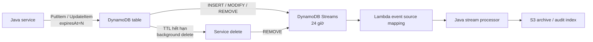
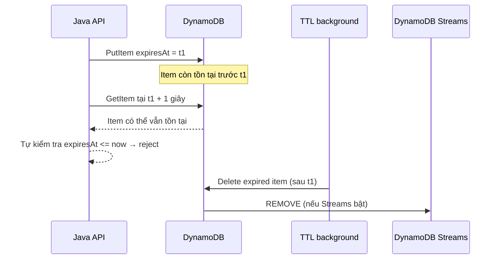
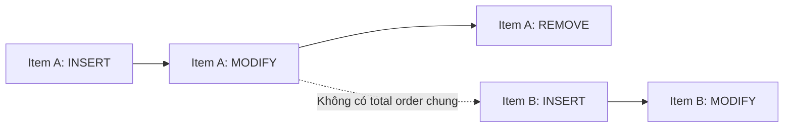
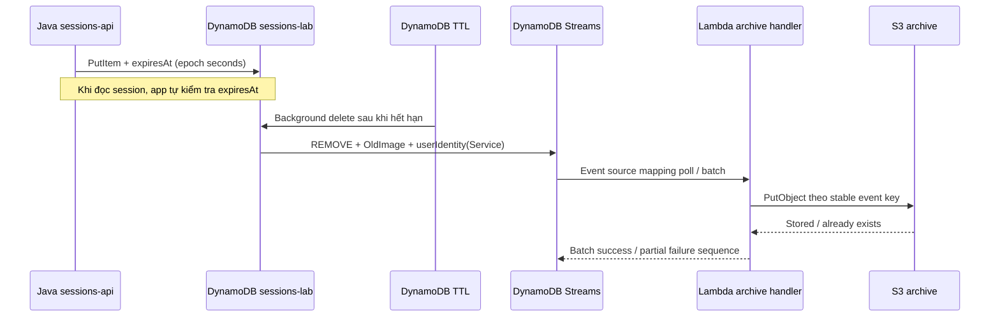

# TTL, DynamoDB Streams và xử lý thay đổi dữ liệu

> **Chương:** DynamoDB  
> **Module:** `CLOUD_PROVIDERS_AWS`  
> **Bối cảnh:** Trong hệ sinh thái AWS, DynamoDB giúp lưu trạng thái ứng dụng với độ trễ thấp; Time to Live (TTL) dọn dữ liệu hết hạn, còn DynamoDB Streams ghi lại thay đổi để các thành phần xử lý bất đồng bộ. Bài học kết hợp lựa chọn dịch vụ, bảo mật IAM/KMS, Lambda/Java, giám sát, phục hồi và chi phí.  
> **Lưu ý:** Tất cả bảng, tài khoản, ARN, bucket, thời điểm và dữ liệu bên dưới chỉ là ví dụ. Lệnh tạo/sửa tài nguyên phải được chạy trên môi trường thực hành được phép, không áp dụng trực tiếp cho production.

## Mục tiêu học tập

Sau khi học xong, bạn có thể:

1. Giải thích **DynamoDB TTL** là một cơ chế xóa dữ liệu nền, không phải bộ định thời thực thi sự kiện đúng giây.
2. Lưu TTL bằng **Number: Unix epoch seconds**, tính đúng từ `Instant` trong Java, phân biệt giây với mili giây và nhận biết dữ liệu TTL không hợp lệ.
3. Xử lý các item **đã hết hạn nhưng chưa bị xóa** khi `GetItem`, `Query` hoặc `Scan`; dùng `FilterExpression` và `ConditionExpression` đúng chỗ.
4. Phân biệt **DynamoDB Streams** với TTL, Kinesis Data Streams, EventBridge Pipes và backup/PITR; giải thích giới hạn lưu trữ stream **24 giờ**.
5. Chọn `KEYS_ONLY`, `NEW_IMAGE`, `OLD_IMAGE` hoặc `NEW_AND_OLD_IMAGES` phù hợp với việc tạo audit, đồng bộ search index hoặc lưu trữ item hết hạn.
6. Đọc bản ghi `INSERT`, `MODIFY`, `REMOVE` và nhận ra bản ghi **TTL service deletion** nhờ `userIdentity` ở Region nơi TTL thực sự xóa.
7. Cấu hình Lambda **event source mapping** và kiểm soát `StartingPosition`, batch size, retries, checkpoint, `ParallelizationFactor`, error destination và event filtering.
8. Viết Java consumer theo nguyên tắc **idempotent**, trả **partial batch failure bằng DynamoDB stream sequence number**, không nhầm với SQS message ID.
9. Phân tích Global Tables, TTL replication, stream ordering, IAM/KMS, costs, monitoring và failure/replay strategy.
10. Thiết kế một luồng **session expiry → DynamoDB TTL → Streams → Lambda → S3 archive** có kiểm thử và khả năng xử lý lỗi.

## 1. Hai cơ chế khác nhau: TTL và Streams

**TTL** quyết định *khi nào một item được xem là đã hết hạn* để DynamoDB có thể dọn bằng background process. **DynamoDB Streams** ghi lại *những thay đổi thực sự đã xảy ra* trên table.



**Một thay đổi ở DynamoDB có thể tạo stream record; một giá trị TTL đã qua thời hạn không có nghĩa item lập tức bị xóa hoặc có stream record ngay thời điểm đó.**

### 1.1 Những việc TTL làm và không làm

| TTL làm được | TTL không bảo đảm |
|---|---|
| Lưu thời điểm hết hạn riêng cho từng item | Xóa item đúng thời khắc hết hạn |
| Xóa item hết hạn bằng background process | Token/session hết hạn lập tức biến mất khỏi `GetItem` |
| Xóa không tính write throughput tại Region phát sinh TTL delete | Không còn storage/read cost trong lúc item vẫn đang chờ xóa |
| Phát sinh service `REMOVE` record khi Streams bật | Bản ghi stream là một event scheduler có SLA chính xác |
| Giúp giữ table nhỏ hơn về lâu dài | Thay thế backup, audit log lâu dài hoặc retention policy tuân thủ |

### 1.2 Những việc Streams làm và không làm

| Streams làm được | Streams không bảo đảm |
|---|---|
| Ghi `INSERT`/`MODIFY`/`REMOVE` gần thời gian thực | Giữ dữ liệu stream quá **24 giờ** |
| Lưu key và tùy chọn ảnh cũ/mới | Ghi lại toàn bộ dữ liệu lịch sử trước khi Streams được bật |
| Bảo toàn thứ tự thay đổi **trên cùng một item** | Thứ tự toàn cục giữa mọi items/partitions |
| Cho Lambda đọc bản ghi và xử lý bất đồng bộ | Exactly-once execution của Lambda/backend |
| Là nguồn cho CDC, cache/index đồng bộ | Là immutable audit archive nhiều năm |

### 1.3 Ví dụ ngữ cảnh

Ứng dụng thương mại điện tử lưu:

- `SESSION#...`: phiên đăng nhập với `expiresAt`.
- `CART#...`: giỏ hàng tạm với TTL dài hơn.
- `ORDER#...`: đơn hàng quan trọng **không có TTL**.
- `LOCK#...`: soft lock với thời hạn ngắn và kiểm tra logic hết hạn tại thời điểm đọc.

Khi một session quá hạn, backend phải coi nó là hết hạn **ngay trong logic xác thực**, dù DynamoDB vẫn còn record; TTL sẽ dọn sau. Khi DynamoDB thật sự xóa record, Streams có thể được dùng để lưu một bản snapshot vào S3 hoặc chạy cleanup không đòi thời gian chính xác.

## 2. TTL schema: một attribute Number dạng Unix epoch seconds

Để sử dụng TTL:

1. Chọn một attribute của item, ví dụ `expiresAt`.
2. Bật TTL ở cấp **table** với đúng tên attribute `expiresAt`.
3. Đặt giá trị attribute đó là DynamoDB **Number** biểu diễn **Unix epoch seconds** (UTC).
4. Duy trì expiration policy theo nghiệp vụ, ví dụ ngày hết hạn session hoặc thời hạn giữ giỏ hàng.

Một item minh họa:

```json
{
  "PK": {"S": "SESSION#sess-a12"},
  "SK": {"S": "META"},
  "tenantId": {"S": "tenant-demo"},
  "userId": {"S": "user-demo"},
  "createdAt": {"S": "2026-11-20T03:30:00Z"},
  "expiresAt": {"N": "1795231800"}
}
```

`expiresAt` là **N**, không phải `S`, không phải ISO-8601 date string; giá trị chỉ là ví dụ. DynamoDB TTL theo attribute name **phân biệt chữ hoa/thường**, nên `ExpiresAt` và `expiresAt` không phải cùng field.

### 2.1 Giây khác mili giây

```java
import java.time.Duration;
import java.time.Instant;

Instant expires = Instant.now().plus(Duration.ofHours(24));
long epochSeconds = expires.getEpochSecond();      // đúng
long epochMillis = expires.toEpochMilli();         // SAI nếu dùng làm TTL
```

Đặt epoch **milliseconds** vào TTL thường cho ra timestamp xa trong tương lai nhiều nghìn năm, khiến item không hết hạn vào lúc mong đợi.

**Không nhân 1.000** trước khi lưu; khi cần expiry “sau 30 phút”, dùng `Instant.now().plus(Duration.ofMinutes(30)).getEpochSecond()`.

### 2.2 Những giá trị TTL sẽ bị bỏ qua

DynamoDB TTL bỏ qua hoặc không coi là TTL hợp lệ khi:

- Item không có attribute TTL đã cấu hình.
- Attribute không phải **Number**.
- Giá trị nằm **hơn 5 năm trong quá khứ** theo quy tắc AWS.
- Giá trị thuộc loại string như `"2026-12-01T00:00:00Z"`.
- Có sai tên attribute do phân biệt chữ hoa/thường.
- TTL của table chưa ở trạng thái hoạt động.

TTL không tự buộc item bắt buộc có `expiresAt`. Trong một single-table design, nhiều item quan trọng có thể **không có TTL** và do đó không tự động hết hạn.

### 2.3 Một table có một tên TTL attribute đang được cấu hình

Bạn không thể bật song song hai TTL attributes `cartExpiresAt` và `sessionExpiresAt` như hai cấu hình TTL độc lập trong cùng một table. Hãy chuẩn hóa tên `expiresAt` và tính expiration policy **theo từng item**:

```text
SESSION#... : expiresAt = now + 24 hours
CART#...    : expiresAt = now + 30 days
ORDER#...   : không có expiresAt
```

Nếu cần thêm trường `businessExpiresAt` cho nghiệp vụ, có thể giữ riêng nhưng TTL service chỉ theo attribute được bật ở table.

## 3. TTL không xóa đúng thời gian: thiết kế kiểm tra hết hạn

DynamoDB xóa TTL items **bất đồng bộ**, thường trong khoảng vài ngày và có thể chậm hơn thời điểm `expiresAt`. AWS không cam kết một delete job được thực thi chính xác vào giây expiry.



### 3.1 `GetItem` vẫn có thể trả về expired item

Dù `expiresAt < now`, item vẫn có thể được trả cho `GetItem` trước khi TTL deletion hoàn tất. Vì vậy khi xác thực session:

```java
long now = Instant.now().getEpochSecond();
boolean isExpired = expireAt != null && expireAt <= now;

if (isExpired) {
    // Không cấp quyền truy cập dù DynamoDB còn record.
    throw new SecurityException("Session expired");
}
```

Trong hệ thống bảo mật, không dựa vào TTL service để revoke token/session tức thì. Nếu cần chặn ngay khi logout, cập nhật trạng thái `revoked` hoặc xóa có điều kiện; backend kiểm tra cả `expiresAt` lẫn trạng thái revoke.

### 3.2 `Query` và `Scan` dùng FilterExpression

AWS gợi ý lọc expired items khi đọc:

```text
KeyConditionExpression: PK = :pk
FilterExpression: attribute_not_exists(expiresAt) OR expiresAt > :now
```

- `KeyConditionExpression` giới hạn items theo partition/sort key; phù hợp cách DynamoDB truy vấn.
- `FilterExpression` chạy **sau khi đọc các items phù hợp key**, nên **không làm giảm RCU đã đọc**; có thể giảm dữ liệu trả về.
- `Query` còn giới hạn page size; nếu items bị filter hết, kết quả có thể có `Items=[]` nhưng vẫn có `LastEvaluatedKey`. Cần pagination đúng.
- Với `GetItem` không có `FilterExpression`, ứng dụng phải tự kiểm tra expiry.
- Với GSI, data propagation và read consistency còn phụ thuộc index; TTL không bảo đảm mọi index đã xóa ngay khi hết hạn.

### 3.3 Item hết hạn còn có thể bị sửa

Trước khi TTL background process xóa, một item expired có thể được sửa, xóa hoặc **gia hạn TTL**. Nếu đặt `expiresAt` trong tương lai hoặc bỏ attribute TTL **trước khi item bị xóa**, DynamoDB không còn xem item đó là expired theo giá trị mới.

Tuy nhiên có race condition giữa thao tác sửa và service delete. Để tránh “hồi sinh” một session đã hết hạn hoặc ghi vào item vừa bị xóa, sử dụng `ConditionExpression` và business version.

Ví dụ chỉ update session còn hiệu lực:

```text
ConditionExpression: attribute_exists(PK) AND expiresAt > :now
UpdateExpression: SET lastSeenAt = :now, expiresAt = :future
```

Một request cập nhật hết hạn bị từ chối bằng `ConditionalCheckFailedException`. Nếu nghiệp vụ cho phép gia hạn sau expiry, phải xác thực lại/chấp nhận rủi ro và thiết kế concurrency rõ ràng.

### 3.4 TTL không phù hợp để đặt lịch chính xác

| Yêu cầu | Giải pháp thường hợp lý |
|---|---|
| Dọn session/cart/log tạm sau thời gian giữ | **DynamoDB TTL** |
| Không cho session expired truy cập ngay | **Kiểm tra expiry khi đọc/authorize** |
| Gửi email đúng 9:00 sáng ngày mai | **EventBridge Scheduler**, Step Functions Wait hoặc scheduling service |
| Chuyển đơn sang trạng thái EXPIRED tại thời hạn | Scheduler + đọc lại state và conditional update |
| Lưu toàn bộ lịch sử thay đổi nhiều năm | S3 audit/archive hoặc stream pipeline có retention dài |
| Chạy cleanup best-effort sau item deletion | **TTL + DynamoDB Streams + Lambda** |

**Mấu chốt:** TTL deletion là sự kiện “dữ liệu đã được xóa”, không phải thông báo bảo đảm phát ngay vào lúc business deadline.

## 4. Bật, kiểm tra và thay đổi TTL

### 4.1 Đọc TTL configuration (read-only)

```bash
aws dynamodb describe-time-to-live \
  --table-name sessions-lab \
  --region ap-southeast-1 \
  --output json
```

Kết quả khi đã bật:

```json
{
  "TimeToLiveDescription": {
    "TimeToLiveStatus": "ENABLED",
    "AttributeName": "expiresAt"
  }
}
```

Các trạng thái có thể gồm `ENABLING`, `ENABLED`, `DISABLING` và `DISABLED`. Đừng đánh dấu thử nghiệm thành công khi status chưa hoàn tất.

### 4.2 Bật TTL (thay đổi tài nguyên)

```bash
aws dynamodb update-time-to-live \
  --table-name sessions-lab \
  --time-to-live-specification "Enabled=true,AttributeName=expiresAt" \
  --region ap-southeast-1
```

**Cảnh báo:** Đổi TTL trên table thật có thể xóa dữ liệu được gắn expiry; phải biết trước bao nhiêu items đã có `expiresAt`.

Theo AWS API, thay đổi enable/disable TTL có thể mất **tới một giờ** để hoàn tất; thực hiện một lời gọi thay đổi khác trong khoảng này có thể gặp `ValidationException`. Nếu muốn đổi tên TTL attribute, làm theo quy trình disable → chờ hoàn tất → enable attribute mới, không coi đây là update tức thì.

### 4.3 Thử một item trên table đã tạo trước

Dùng Bash; `expiresAt` được tính từ UTC hiện tại:

```bash
EXPIRY=$(date -u -d '+1 hour' +%s)

aws dynamodb put-item \
  --table-name sessions-lab \
  --item "{\"PK\":{\"S\":\"SESSION#test-001\"},\"SK\":{\"S\":\"META\"},\"expiresAt\":{\"N\":\"$EXPIRY\"}}" \
  --region ap-southeast-1
```

Đây là lệnh **ghi item thật** và phụ thuộc GNU `date`, nên không chạy nguyên xi trên PowerShell/Windows; với ứng dụng Java, nên tạo item bằng SDK và `Instant`.

### 4.4 Không disable TTL để “xóa nhanh” items

Disable TTL **ngừng cơ chế dọn tự động**; nó không xóa tất cả expired items ngay. Nếu muốn xóa hàng loạt chính xác, cần một job quét/Query theo access pattern và batch deletes có kiểm soát capacity, thời gian và giá thành.

## 5. Viết item TTL từ Java (AWS SDK for Java v2)

Ví dụ một Java service tạo session record với TTL 24 giờ. Bảng minh họa có composite key `PK`, `SK`. Dependency `software.amazon.awssdk:dynamodb`.

```java
package example.dynamodb;

import java.time.Duration;
import java.time.Instant;
import java.util.Map;
import software.amazon.awssdk.regions.Region;
import software.amazon.awssdk.services.dynamodb.DynamoDbClient;
import software.amazon.awssdk.services.dynamodb.model.AttributeValue;
import software.amazon.awssdk.services.dynamodb.model.PutItemRequest;

public final class SessionStore {
    private static final String TABLE = "sessions-lab";

    private final DynamoDbClient dynamoDb;

    public SessionStore(DynamoDbClient dynamoDb) {
        this.dynamoDb = dynamoDb;
    }

    public void createSession(String sessionId, String userId) {
        long expires = Instant.now()
            .plus(Duration.ofHours(24))
            .getEpochSecond();

        Map<String, AttributeValue> item = Map.of(
            "PK", AttributeValue.builder()
                .s("SESSION#" + sessionId).build(),
            "SK", AttributeValue.builder().s("META").build(),
            "userId", AttributeValue.builder().s(userId).build(),
            "expiresAt", AttributeValue.builder()
                .n(Long.toString(expires)).build()
        );

        dynamoDb.putItem(PutItemRequest.builder()
            .tableName(TABLE)
            .item(item)
            .conditionExpression(
                "attribute_not_exists(PK) AND attribute_not_exists(SK)")
            .build());
    }

    public static void main(String[] args) {
        try (DynamoDbClient db = DynamoDbClient.builder()
                .region(Region.AP_SOUTHEAST_1).build()) {
            new SessionStore(db).createSession(
                "demo-001", "user-demo");
        }
    }
}
```

### 5.1 Tại sao có ConditionExpression?

Mẫu không overwrite session đã tồn tại cùng khóa. Nếu `PutItem` không có condition và trùng key, nó có thể thay item cũ, phát sinh Streams `MODIFY` và làm sai business state.

Lưu ý điều kiện `attribute_not_exists(PK) AND attribute_not_exists(SK)` là ví dụ bảo vệ uniqueness; với DynamoDB composite primary key, người dùng thường dùng `attribute_not_exists(PK)` là đủ cho conditional put trên item trùng full key. Business rules phải xác định có được tạo lại sessionId đã expired hay không.

### 5.2 Đọc với expiry validation

Sau `GetItem`, parse:

```java
import java.time.Instant;
import java.util.Map;
import software.amazon.awssdk.services.dynamodb.model.AttributeValue;

static boolean usable(Map<String, AttributeValue> item) {
    if (item == null || item.isEmpty()) return false;
    AttributeValue ttl = item.get("expiresAt");
    if (ttl == null || ttl.n() == null) return false;

    long expirationSeconds = Long.parseLong(ttl.n());
    return expirationSeconds > Instant.now().getEpochSecond();
}
```

Đoạn này áp chính sách “session **bắt buộc** có TTL”. Với các table chứa cả persistent records không có TTL, policy đọc cần phân loại record type chứ không mặc định thiếu expiresAt là invalid.

### 5.3 Clock skew và security

- Dùng UTC/Epoch, không tính TTL bằng giờ địa phương kiểu `LocalDateTime.now()`.
- Nếu token/session quan trọng, cần tính clock skew an toàn giữa các systems.
- Không tin TTL do browser gửi để tự cho phép session sống 100 năm; backend đặt expiration policy.
- Không log session tokens/keys hoặc user PII.
- Có thể dùng DynamoDB conditional writes/version checks để chống concurrency race.

## 6. DynamoDB Streams: Change Data Capture (CDC)

**DynamoDB Streams** là một ordered log của các thay đổi **cấp item** được bật theo table, lưu bản ghi trong tối đa **24 giờ**.

Các thao tác phát sinh record thường gồm:

- `PutItem` tạo item: `INSERT`.
- `UpdateItem` hoặc thay thế item có thay đổi: `MODIFY`.
- `DeleteItem` hoặc TTL service delete: `REMOVE`.
- Transaction writes (khi làm thay đổi item): các stream records tương ứng.

Một `UpdateItem` không làm thay đổi dữ liệu thực tế có thể **không** phát record theo tài liệu AWS.

### 6.1 Bốn stream view types

| StreamViewType | Nội dung record | Use case |
|---|---|---|
| `KEYS_ONLY` | Primary key của item thay đổi | Trigger fetch/tính toán từ key, workload cần ít payload |
| `NEW_IMAGE` | Item **sau** INSERT/MODIFY | Đồng bộ projection/search index theo trạng thái mới |
| `OLD_IMAGE` | Item **trước** MODIFY/REMOVE | Lưu snapshot trước khi xóa, phân tích dữ liệu cũ |
| `NEW_AND_OLD_IMAGES` | Cả item trước và sau, khi loại event có ảnh tương ứng | Diff changes, audit, đồng bộ index và archive TTL deletes |

**Khi muốn archive item bị TTL xóa, chọn `OLD_IMAGE` hoặc `NEW_AND_OLD_IMAGES`**. `KEYS_ONLY` không chứa payload trước khi xóa; `NEW_IMAGE` không giúp lấy toàn bộ body của một `REMOVE`.

### 6.2 Ảnh cũ/mới theo event

| Event | Keys | OldImage | NewImage |
|---|---|---|---|
| `INSERT` | Có | Không | Có nếu view chứa new image |
| `MODIFY` | Có | Có nếu view chứa old image | Có nếu view chứa new image |
| `REMOVE` | Có | Có nếu view chứa old image | Không |

Không cố đọc `NewImage` trong `REMOVE` rồi coi `null` là lỗi dịch vụ.

### 6.3 Stream retention chỉ 24 giờ

Streams chỉ giữ records **24 giờ**; record cũ hơn có thể bị trim. Đây **không phải** audit/event log bền lâu và không thể tăng retention DynamoDB Streams lên 7 ngày theo `MaximumRecordAgeInSeconds` của Lambda.

Nếu consumer dừng lâu hơn retention:

- Các records quá hạn không thể đọc lại từ DynamoDB Streams.
- Đặt `MaximumRetryAttempts=-1` chỉ nghĩa retry đến khi record bị loại bởi age/retention; không giữ record mãi.
- Muốn replay nhiều ngày, cần archive pipeline riêng, Kinesis Data Streams với retention cấu hình phù hợp, EventBridge/SQS/S3 outbox hoặc phục hồi state theo batch snapshot/reconciliation.

## 7. Bật Streams và đọc cấu hình

### 7.1 Xem table stream status (read-only)

```bash
aws dynamodb describe-table \
  --table-name sessions-lab \
  --region ap-southeast-1 \
  --query 'Table.{Name:TableName,StreamSpec:StreamSpecification,StreamArn:LatestStreamArn,Status:TableStatus}' \
  --output json
```

Có thể thấy:

```json
{
  "Name": "sessions-lab",
  "StreamSpec": {
    "StreamEnabled": true,
    "StreamViewType": "NEW_AND_OLD_IMAGES"
  },
  "StreamArn": "arn:aws:dynamodb:ap-southeast-1:111122223333:table/sessions-lab/stream/2026-11-20T03:00:00.000",
  "Status": "ACTIVE"
}
```

`StreamArn` là ARN của **stream instance**, không phải ARN table. Dùng stream ARN khi cấu hình Lambda event source mapping.

### 7.2 Bật Streams trên table đã tồn tại (thay đổi)

```bash
aws dynamodb update-table \
  --table-name sessions-lab \
  --stream-specification StreamEnabled=true,StreamViewType=NEW_AND_OLD_IMAGES \
  --region ap-southeast-1
```

Nếu table đang có stream, thay view type thường phải **tắt rồi bật lại** với cấu hình mới; điều đó có thể tạo một **stream ARN mới**, ảnh hưởng Lambda mappings/consumer positions. Không thao tác bừa khi một stream đang được Global Tables hoặc consumer khác sử dụng.

### 7.3 Streams không có dữ liệu lịch sử trước khi bật

Bật Streams lúc 10:00 **không tạo các `INSERT` events cho mọi item đã có từ 9:00**. Nếu cần seed search index/analytics lần đầu:

1. Export/Scan dữ liệu hiện hữu theo strategy phù hợp.
2. Bật Streams và tạo consumer/checkpoint hợp lệ.
3. Kết hợp snapshot với CDC mà không tạo gaps/duplication.
4. Áp dụng versioning/idempotency để hợp nhất snapshot + stream events.

Đừng nhầm DynamoDB Streams với database backup/PITR; mục đích và retention khác nhau.

## 8. DynamoDB stream event: schema và thứ tự

Một Lambda event từ DynamoDB Streams có outer `Records[]`. Mỗi record thường chứa:

- `eventID` và `eventName`.
- `eventSource="aws:dynamodb"`.
- `awsRegion` và `eventSourceARN`.
- `dynamodb.Keys`, `NewImage`, `OldImage` khi được cấu hình.
- `dynamodb.SequenceNumber`.
- `dynamodb.ApproximateCreationDateTime`.
- `dynamodb.StreamViewType` và `SizeBytes`.
- `userIdentity` khi được thêm, ví dụ TTL service delete trong Region gốc.

Ví dụ rút gọn:

```json
{
  "Records": [
    {
      "eventID": "evt-record-001",
      "eventName": "MODIFY",
      "eventVersion": "1.1",
      "eventSource": "aws:dynamodb",
      "awsRegion": "ap-southeast-1",
      "eventSourceARN": "arn:aws:dynamodb:ap-southeast-1:111122223333:table/sessions-lab/stream/2026-11-20T03:00:00.000",
      "dynamodb": {
        "ApproximateCreationDateTime": 1795145400,
        "Keys": {
          "PK": {"S": "SESSION#demo-001"},
          "SK": {"S": "META"}
        },
        "OldImage": {
          "status": {"S": "ACTIVE"},
          "expiresAt": {"N": "1795231800"}
        },
        "NewImage": {
          "status": {"S": "REVOKED"},
          "expiresAt": {"N": "1795231800"}
        },
        "SequenceNumber": "1234567890123456789",
        "StreamViewType": "NEW_AND_OLD_IMAGES",
        "SizeBytes": 230
      }
    }
  ]
}
```

`eventVersion`, timestamp, sequence numbers và ARN trong ví dụ chỉ minh họa. `OldImage`/`NewImage` thường chứa **DynamoDB AttributeValue JSON** như `{"S":"..."}`/`{"N":"..."}`, không phải business JSON đơn giản.

### 8.1 Streams bảo đảm thứ tự đến mức nào?

AWS bảo đảm các stream records cho **cùng một item** xuất hiện theo đúng thứ tự item được thay đổi. Không có thứ tự toàn cục giữa nhiều items.



Với Lambda event source mapping:

- Stream có **shards**; Lambda đọc theo shard lineage và checkpoints.
- `ParallelizationFactor` 1–10 cho phép nhiều concurrent batches/shard.
- Lambda giữ ordering theo cùng item/partitioning constraint của stream.
- Consumer không nên suy ra tất cả updates của hai items khác nhau là một transaction order chỉ vì timestamps gần nhau.

### 8.2 Một record trong stream khác một lần Lambda invocation

Một Lambda invocation có thể nhận **nhiều Records**. Cùng record cũng có thể được Lambda retry nhiều lần do lỗi, timeout hoặc cơ chế at-least-once. Do đó:

> **“Một stream record xuất hiện một lần trong log” không đồng nghĩa “business side effect chỉ chạy một lần”.**

Cần durable idempotency cho mọi consumer có hậu quả nghiệp vụ: email, billing, ledger, S3 export, search index.

## 9. TTL service deletion khác DeleteItem thủ công

Khi TTL thật sự xóa một item, Streams có `eventName="REMOVE"`. Để phân biệt với `DeleteItem` do app thực hiện, trong **Region nơi TTL delete xảy ra**, record có `userIdentity`:

```json
{
  "Records": [
    {
      "eventName": "REMOVE",
      "userIdentity": {
        "type": "Service",
        "principalId": "dynamodb.amazonaws.com"
      },
      "dynamodb": {
        "Keys": {
          "PK": {"S": "SESSION#demo-001"}
        },
        "OldImage": {
          "PK": {"S": "SESSION#demo-001"},
          "expiresAt": {"N": "1795231800"}
        },
        "SequenceNumber": "1234567890123456790",
        "StreamViewType": "OLD_IMAGE"
      }
    }
  ]
}
```

Mẫu được lược bỏ nhiều trường kỹ thuật và chỉ thể hiện các trường nhận dạng.

### 9.1 Quy tắc nhận diện TTL delete

```text
eventName == "REMOVE"
AND userIdentity.type == "Service"
AND userIdentity.principalId == "dynamodb.amazonaws.com"
```

**Không xem mọi `REMOVE` đều do TTL**, vì app có thể gọi `DeleteItem` để logout, reset state hoặc xóa theo yêu cầu pháp lý. Không dựa chỉ vào `OldImage.expiresAt <= now` vì app cũng có thể chủ động xóa một item hết hạn.

### 9.2 Với Global Tables, chỉ Region gốc có dấu service TTL

Với DynamoDB Global Tables có hỗ trợ TTL, item có thể được TTL xóa tại Region A và delete được **replicate** sang các Regions B/C.

- **Region nơi TTL thực thi:** stream record có `userIdentity.type=Service` và `principalId=dynamodb.amazonaws.com`.
- **Các Region nhận replicated delete:** stream record **không có** trường nhận diện TTL như trên.
- Một Lambda chỉ filter TTL service delete ở Region B/C có thể **không bao giờ thấy** bản replicated delete.
- Nếu cần một lần archive cho mỗi TTL delete, thiết kế consumer ở Region gốc/sự kiện được phát theo kiến trúc phù hợp và dedup xuyên Regions.

Không dùng `awsRegion` của record một mình để suy mọi delete là TTL, và không giả định Global Tables là globally ordered stream.

## 10. Mô hình xử lý: TTL → Streams → Lambda → S3

Ví dụ: các sessions cần sống 24 giờ. Khi DynamoDB thực sự dọn item, hệ thống lưu snapshot **OldImage** vào S3 để phục vụ quy trình kiểm toán/hỗ trợ nội bộ trong thời gian retention cho phép.



### 10.1 Vì sao chọn OLD_IMAGE?

Nếu muốn archive nội dung **trước khi bị xóa**, dùng `OLD_IMAGE` hoặc `NEW_AND_OLD_IMAGES`. Nếu chỉ `KEYS_ONLY`:

- Không thể gọi `GetItem` sau khi item đã bị xóa và hy vọng lấy full snapshot.
- Nếu chỉ cần key để cleanup một hệ thống thứ hai, `KEYS_ONLY` có thể đủ; cần thiết kế về idempotency và dữ liệu thiếu.
- Nếu indexer cần tạo/update/delete search docs, `NEW_AND_OLD_IMAGES` thường thuận tiện hơn.

### 10.2 Archive phải có retention và privacy policy

S3 archive không nên “vô thời hạn” chỉ vì TTL đã xóa dữ liệu ở DynamoDB:

- Xác định mục đích xử lý, thời gian giữ và các yêu cầu xóa dữ liệu cá nhân.
- Dùng S3 bucket private, Block Public Access, TLS và SSE-KMS nếu policy yêu cầu.
- Đặt S3 lifecycle retention phù hợp; cân nhắc S3 Object Lock khi audit compliance thực sự yêu cầu, có hệ quả quyền xóa.
- Không lưu raw session token/password vào archived `OldImage`.
- Nếu item chứa PII, chỉ archive những fields cần thiết hoặc áp dụng redaction/encryption theo policy.
- Monitoring/permissions của S3 archive khác với DynamoDB Streams.

## 11. Lambda event source mapping: ai đọc stream?

Trong mô hình DynamoDB Streams → Lambda, **Lambda event source mapping poll** stream bằng quyền từ **Lambda execution role** và invoke handler bằng batches. DynamoDB **không** cần một `lambda:AddPermission` resource-based policy kiểu SNS/API Gateway để chủ động gọi function.

### 11.1 Thành phần

| Thành phần | Chịu trách nhiệm |
|---|---|
| DynamoDB table + Streams | Ghi change records vào shards |
| Event source mapping | Poll shards, batch, checkpoint, invoke Lambda |
| Lambda execution role | Quyền `dynamodb:DescribeStream`, `GetRecords`, `GetShardIterator`, `ListStreams`, CloudWatch Logs và target resource |
| Lambda handler | Phân loại event, xử lý business, idempotency, return success/failure |
| Failure destination | Lưu metadata hoặc payload của discarded records theo loại đích hỗ trợ |
| CloudWatch metrics | IteratorAge, Errors, Throttles, Duration, concurrency, on-failure counts |

### 11.2 StartingPosition: LATEST vs TRIM_HORIZON

| Giá trị | Ý nghĩa | Nguy cơ |
|---|---|---|
| `TRIM_HORIZON` | Bắt đầu từ record cũ nhất **còn trong 24 giờ retention** | Có thể xử lý backlog/records không mong muốn nếu đã có dữ liệu |
| `LATEST` | Bắt đầu từ thời điểm gần nhất khi reader vào hoạt động | Có thể **bỏ lỡ** records trong quá trình tạo/update mapping do eventual consistency |

AWS khuyên dùng `TRIM_HORIZON` để tránh mất events trong lúc khởi tạo mapping. Điều này **không hồi phục** records đã quá 24 giờ.

### 11.3 Mapping cần thời gian khởi động

Tạo/sửa event source mapping có thể mất vài phút để polling hoạt động hoặc cập nhật. Đừng publish một event ngay sau khi tạo mapping `LATEST` rồi cho rằng Lambda sẽ thấy chắc chắn.

Các trạng thái cần xem: `Creating`, `Enabling`, `Enabled`, `Updating`, `Disabled`, `Failed` theo API. Kiểm tra `State`, `LastProcessingResult` và timestamps.

### 11.4 Batch và parallelism

- Poll interval base của Lambda với DynamoDB Streams thường khoảng **4 lần/giây mỗi shard**.
- `BatchSize` mặc định **100**, tối đa **10.000** theo tài liệu.
- Batch cũng bị giới hạn payload invocation **6 MiB**.
- `MaximumBatchingWindowInSeconds` có thể buffer tối đa **300 giây**, mặc định **0**.
- `ParallelizationFactor` mặc định **1**, tối đa **10** concurrent batches/shard.
- Dù song song hóa, ordering của các changes thuộc **cùng item** được giữ theo semantics hỗ trợ.

Tăng batch size giảm số invocations nhưng tăng thời gian xử lý, memory và retry blast radius. Tăng parallelization không tự làm downstream API/DynamoDB/S3 có thêm capacity.

### 11.5 Nhiều consumers cùng đọc một stream

Theo hướng dẫn Lambda/DynamoDB:

- Với **single-Region table không là global table**, nên thiết kế **tối đa khoảng hai Lambda functions** đọc đồng thời một stream shard để tránh throttling.
- Với **Global Tables**, AWS thường khuyến nghị **một Lambda function** đọc stream shard để giảm contention.
- Nếu cần fan-out tới rất nhiều services, cân nhắc **một processor phát events ra SNS/EventBridge/SQS**, EventBridge Pipes, hoặc stream architecture thích hợp.

Không tạo mười Lambda event source mappings trên cùng stream chỉ vì muốn mười đội cùng nhận mọi event.

## 12. Partial batch failure: điều gì xảy ra khi một record lỗi?

Mặc định, Lambda chỉ checkpoint một batch khi **cả batch được xử lý thành công**. Nếu handler throw ở record 5/100, toàn batch có thể được retry, kể cả records 1–4 đã ghi vào S3 hoặc side-effect DB.

Để giảm reprocessing:

1. Bật `FunctionResponseTypes=ReportBatchItemFailures` ở event source mapping.
2. Handler trả `batchItemFailures` với `itemIdentifier` là **`dynamodb.SequenceNumber`** của record đầu tiên bị lỗi.
3. Lambda dùng sequence number thấp nhất làm checkpoint và retry từ record đó trở đi.

```json
{
  "batchItemFailures": [
    {
      "itemIdentifier": "1234567890123456790"
    }
  ]
}
```

**Không dùng `eventID`, `receiptHandle` hay `MessageId`**. Với SQS, item identifier là SQS message ID; với **DynamoDB Streams**, item identifier là **stream sequence number**.

### 12.1 Vì sao nên dừng ở record đầu tiên lỗi?

Nếu batch records theo sequence:

```text
seq=101 → xử lý OK
seq=102 → xử lý OK
seq=103 → lỗi
seq=104 → chưa xử lý
seq=105 → chưa xử lý
```

Trả `itemIdentifier=103` giúp Lambda retry **103 trở đi**. Nếu handler tiếp tục xử lý 104–105 nhưng chỉ trả lỗi 103, chúng vẫn có thể bị retry và cần idempotency. Với workloads yêu cầu thứ tự đơn giản, **dừng tại lỗi đầu tiên** thường dễ chứng minh correctness.

### 12.2 Các cấu hình retry quan trọng

| Mapping option | Ý nghĩa |
|---|---|
| `MaximumRetryAttempts` | Giới hạn số lần retry lỗi; mặc định -1 cho tới khi record hết hạn |
| `MaximumRecordAgeInSeconds` | Giới hạn tuổi record trước khi discard; không kéo dài 24h Streams retention |
| `BisectBatchOnFunctionError` | Chia batch lỗi thành hai phần để cô lập record lỗi |
| `FunctionResponseTypes` | Cần chứa `ReportBatchItemFailures` để response partial được xử lý |
| `DestinationConfig.OnFailure` | Đưa thông tin record/batch bị discard tới đích được hỗ trợ |
| `ParallelizationFactor` | Tăng khả năng xử lý song song trên shard, có bảo toàn ordering theo item |
| `MaximumBatchingWindowInSeconds` | Tăng batching, có thể đổi latency và error batch size |

Nếu `ReportBatchItemFailures` **chưa bật**, handler trả JSON partial failure đúng schema vẫn không làm Lambda partial checkpoint như mong đợi.

### 12.3 DLQ của Streams mapping không giống SQS source-queue DLQ

DynamoDB Streams không có “SQS source queue” mặc định. Error destination cấu hình ở **Lambda event source mapping** có thể là **SQS/SNS**, và các tính năng hỗ trợ đích lưu full record như S3 tùy loại source/version. Với SQS/SNS failure destination, payload thường là **invocation/stream metadata**, không phải bản sao full item đầy đủ; cần thiết kế khả năng recover/replay phù hợp.

**Đừng đợi tới khi record đã hết 24 giờ rồi mới điều tra:** nếu chỉ có metadata và stream đã trim, không thể tự lấy lại `OldImage` đã mất từ stream.

## 13. Java Lambda consumer: lưu TTL-deleted OldImage vào S3

Ví dụ Java 21 handler nhận event JSON dạng Map để dễ nhìn contract. Nó chỉ xử lý **TTL service REMOVE** của **Region phát sinh deletion**. Mỗi archived object dùng key ổn định dựa trên stream ARN + sequence number và sử dụng S3 conditional put chống overwrite.

Dependencies:

- `com.amazonaws:aws-lambda-java-core`.
- `software.amazon.awssdk:s3`.
- `com.fasterxml.jackson.core:jackson-databind`.

Environment: `ARCHIVE_BUCKET`.

```java
package example.dynamodb;

import com.amazonaws.services.lambda.runtime.Context;
import com.amazonaws.services.lambda.runtime.RequestHandler;
import com.fasterxml.jackson.databind.ObjectMapper;
import java.nio.charset.StandardCharsets;
import java.security.MessageDigest;
import java.util.HexFormat;
import java.util.List;
import java.util.Map;
import software.amazon.awssdk.core.sync.RequestBody;
import software.amazon.awssdk.services.s3.S3Client;
import software.amazon.awssdk.services.s3.model.PutObjectRequest;
import software.amazon.awssdk.services.s3.model.S3Exception;

public final class TtlArchiveHandler
        implements RequestHandler<Map<String, Object>, Map<String, Object>> {

    private static final String BUCKET =
        System.getenv("ARCHIVE_BUCKET");
    private static final S3Client S3 = S3Client.create();
    private static final ObjectMapper JSON = new ObjectMapper();

    @Override
    public Map<String, Object> handleRequest(
            Map<String, Object> event, Context context) {

        Object rawRecords = event.get("Records");
        if (!(rawRecords instanceof List<?> records)) {
            throw new IllegalArgumentException("Missing Records");
        }

        for (Object rawRecord : records) {
            Map<String, Object> record = objectMap(rawRecord);
            Map<String, Object> change = objectMap(record.get("dynamodb"));
            String sequence = requiredString(change, "SequenceNumber");

            try {
                if (isLocalTtlDelete(record)) {
                    archiveOldImage(record, change, sequence);
                }
                // Non-TTL events: intentionally ignored.
            } catch (Exception ex) {
                // Không log OldImage/PII/secret.
                context.getLogger().log(
                    "Archive failure for stream sequence; will retry\n");
                return Map.of(
                    "batchItemFailures",
                    List.of(Map.of("itemIdentifier", sequence)));
            }
        }

        return Map.of("batchItemFailures", List.of());
    }

    private static boolean isLocalTtlDelete(Map<String, Object> record) {
        if (!"REMOVE".equals(record.get("eventName"))) {
            return false;
        }
        Map<String, Object> identity =
            objectMap(record.get("userIdentity"));
        return "Service".equals(identity.get("type"))
            && "dynamodb.amazonaws.com".equals(identity.get("principalId"));
    }

    private static void archiveOldImage(
            Map<String, Object> record,
            Map<String, Object> change,
            String sequence) throws Exception {

        Object oldImage = change.get("OldImage");
        if (!(oldImage instanceof Map<?, ?>)) {
            throw new IllegalStateException(
                "OLD_IMAGE stream view required");
        }
        String streamArn = requiredString(record, "eventSourceARN");
        String archiveKey = "ttl-deletes/" +
            sha256(streamArn + ":" + sequence) + ".json";

        byte[] body = JSON.writeValueAsBytes(Map.of(
            "streamArn", streamArn,
            "sequenceNumber", sequence,
            "oldImage", oldImage
        ));

        PutObjectRequest request = PutObjectRequest.builder()
            .bucket(BUCKET)
            .key(archiveKey)
            .contentType("application/json")
            .ifNoneMatch("*")
            .build();

        try {
            S3.putObject(request, RequestBody.fromBytes(body));
        } catch (S3Exception ex) {
            if (ex.statusCode() == 412) {
                return; // Object đã tồn tại: retry idempotent.
            }
            throw ex;
        }
    }

    private static String sha256(String input) throws Exception {
        byte[] digest = MessageDigest.getInstance("SHA-256")
            .digest(input.getBytes(StandardCharsets.UTF_8));
        return HexFormat.of().formatHex(digest);
    }

    @SuppressWarnings("unchecked")
    private static Map<String, Object> objectMap(Object input) {
        if (!(input instanceof Map<?, ?>)) return Map.of();
        return (Map<String, Object>) input;
    }

    private static String requiredString(
            Map<String, Object> input, String field) {
        Object value = input.get(field);
        if (!(value instanceof String s) || s.isBlank()) {
            throw new IllegalArgumentException(
                "Required stream field missing");
        }
        return s;
    }
}
```

### 13.1 Tại sao một object key ổn định?

Lambda có thể gọi lại cùng record. Nếu mỗi lần retry tạo key mới từ timestamp ngẫu nhiên, S3 có thể nhận nhiều bản archive trùng. Dùng hash của **stream ARN + sequence number** giúp cùng stream record dùng cùng key.

`If-None-Match: *` chống ghi đè object đã tồn tại; S3 có thể trả 412 (đã có object). Với concurrent conditional writes, các trạng thái lỗi khác có thể cần retry có kiểm soát theo SDK. **Không coi lặp request là hoàn toàn miễn phí** — vẫn có API/compute costs.

### 13.2 Vì sao xử lý tuần tự và dừng khi lỗi?

DynamoDB Streams quan tâm ordering theo item. Đoạn này tuần tự từng record và trả **sequence number của record đầu tiên fail**, để Lambda retry nó và phần chưa xử lý. Đây là lựa chọn đơn giản giúp giảm duplication so với “xử lý tiếp rồi báo lỗi tất cả”.

### 13.3 Giới hạn cần bổ sung ở production

Đây là handler minh họa contract, chưa phải hoàn chỉnh cho kiểm toán nghiêm ngặt:

- Cấu hình **ReportBatchItemFailures** ở mapping.
- Kiểm soát timeout/S3 retries, encryption, lifecycle và bucket policy.
- Chuẩn hóa archive schema/version và redaction PII.
- Nếu dùng S3 Object Versioning/replication, xác định retention và chi phí.
- Với Global Tables, handler chỉ nhận TTL service deletes trong Region nơi xóa; có thể cần xử lý/định tuyến multi-Region.
- Nếu record thiếu sequence/OldImage, pre-loop validation có thể làm cả batch fail thay vì partial response; cần logging/alert và cấu hình bisect/on-failure.
- Không gửi mọi stream event vào S3 chỉ để xử lý TTL nếu đã có event filter phù hợp.
- Kết quả một S3 `PutObject` không tự thay thế yêu cầu audit trail bất biến/không thể xóa, IAM governance hay legal hold.

## 14. Event filtering: tiết kiệm Lambda nhưng phải hiểu filter

AWS cho phép cấu hình filter trên event source mapping để Lambda chỉ nhận records phù hợp.

### 14.1 Lọc TTL service deletes

Theo tài liệu AWS DynamoDB TTL + Streams, filter pattern chuyên biệt:

```json
{
  "userIdentity": {
    "type": ["Service"],
    "principalId": ["dynamodb.amazonaws.com"]
  }
}
```

Với filter này, Lambda chỉ được invoke cho records có identity phù hợp, vốn là TTL service deletes trong Region gốc. **Không đủ** để nhận các TTL deletes replicated sang Region khác vì identity field không tồn tại ở stream record replicated.

### 14.2 Lọc theo item attributes

Với DynamoDB stream event, business attributes được bọc dạng AttributeValue, ví dụ:

```json
{
  "dynamodb": {
    "NewImage": {
      "entityType": {
        "S": ["ORDER"]
      },
      "status": {
        "S": ["PAID"]
      }
    }
  }
}
```

Đây là **event filter pattern**, không phải một stream record thực: list `["ORDER"]`/`["PAID"]` là các giá trị được filter chấp nhận. Muốn lọc theo `NewImage` thì stream view phải có NEW_IMAGE/NEW_AND_OLD_IMAGES.

### 14.3 Filtering không phải authorization

Nếu client có quyền tự ghi `entityType=ORDER` hoặc `tenantId=tenant-a`, nó có thể tạo records match filter. IAM vẫn phải giới hạn ai được ghi table; handler phải kiểm tra quyền/business schema.

**Filtered records không được Lambda retry bằng handler**, vì chúng bị bỏ qua bởi filter trước invoke. Đừng sử dụng filter để “bảo đảm đã audit mọi event” nếu filter policy có thể thay đổi ngoài quy trình review.

## 15. Thiết lập Lambda mapping bằng AWS CLI

> **Cảnh báo:** Các lệnh tạo/sửa mapping là thao tác thay đổi hạ tầng và có thể gây Lambda invocations/cost. Chỉ thực hiện trên tài khoản được phép. ARN và function name là placeholder.

### 15.1 Kiểm tra stream ARN và Lambda role (read-only)

```bash
aws dynamodb describe-table \
  --table-name sessions-lab \
  --region ap-southeast-1 \
  --query 'Table.LatestStreamArn' \
  --output text

aws lambda get-function-configuration \
  --function-name ttl-archive-handler \
  --region ap-southeast-1 \
  --query '{Name:FunctionName,Runtime:Runtime,Handler:Handler,Timeout:Timeout,Role:Role}' \
  --output json
```

### 15.2 Tạo mapping với partial batch failures

Ví dụ **Bash**:

```bash
aws lambda create-event-source-mapping \
  --function-name ttl-archive-handler \
  --event-source-arn arn:aws:dynamodb:ap-southeast-1:111122223333:table/sessions-lab/stream/2026-11-20T03:00:00.000 \
  --starting-position TRIM_HORIZON \
  --batch-size 100 \
  --maximum-batching-window-in-seconds 1 \
  --function-response-types ReportBatchItemFailures \
  --bisect-batch-on-function-error \
  --maximum-retry-attempts 10 \
  --region ap-southeast-1
```

Phải thay stream ARN bằng giá trị từ `DescribeTable`. Nếu stream đã có record trong 24 giờ, `TRIM_HORIZON` có thể gây xử lý backlog, nên handler cần idempotency và kế hoạch dữ liệu.

### 15.3 Tạo mapping có filter TTL

Có thể kết hợp filter criteria, ví dụ:

```bash
aws lambda create-event-source-mapping \
  --function-name ttl-archive-handler \
  --event-source-arn arn:aws:dynamodb:ap-southeast-1:111122223333:table/sessions-lab/stream/2026-11-20T03:00:00.000 \
  --starting-position TRIM_HORIZON \
  --batch-size 100 \
  --function-response-types ReportBatchItemFailures \
  --filter-criteria '{"Filters":[{"Pattern":"{\"userIdentity\":{\"type\":[\"Service\"],\"principalId\":[\"dynamodb.amazonaws.com\"]}}"}]}' \
  --region ap-southeast-1
```

**Không tạo cả hai mappings cho cùng mục đích trên production**. Đây là **hai cách minh họa**: mapping đầu không lọc và handler tự nhận diện TTL; mapping sau lọc trước invoke và handler vẫn kiểm tra an toàn. Với PowerShell, quy tắc escaping JSON khác Bash; nên dùng file JSON với `file://`/CLI input file để giảm sai quote.

### 15.4 Đọc mapping (read-only)

```bash
aws lambda list-event-source-mappings \
  --function-name ttl-archive-handler \
  --region ap-southeast-1 \
  --query 'EventSourceMappings[].{UUID:UUID,State:State,Source:EventSourceArn,BatchSize:BatchSize,StartingPosition:StartingPosition,LastProcessingResult:LastProcessingResult,FunctionResponseTypes:FunctionResponseTypes}' \
  --output json
```

Xem:

- `State=Enabled`.
- `LastProcessingResult` và errors.
- `FunctionResponseTypes` có `ReportBatchItemFailures`.
- `EventSourceArn` có khớp **LatestStreamArn** hay không.
- `BatchSize`, `ParallelizationFactor`, `MaximumRetryAttempts` và on-failure destination.
- CloudWatch `IteratorAge` không tăng kéo dài.

### 15.5 Failure destination

Khi failure/retry limit khiến records bị discard, Lambda event source mapping có thể gửi notification tới **SQS/SNS** và những đích được hỗ trợ theo tính năng như S3. Nếu dùng SQS/SNS, cần xác nhận **payload có đủ dữ liệu để recovery hay chỉ metadata**, và có quyền gửi đến destination.

Không dùng chính DynamoDB source table để ghi tất cả failure notifications nếu hành vi đó có thể tạo stream-trigger feedback loop.

## 16. IAM, KMS và data protection

### 16.1 Permissions của Lambda execution role

Ví dụ policy **chỉ đọc** một stream:

```json
{
  "Version": "2012-10-17",
  "Statement": [
    {
      "Sid": "ReadSessionChanges",
      "Effect": "Allow",
      "Action": [
        "dynamodb:DescribeStream",
        "dynamodb:GetRecords",
        "dynamodb:GetShardIterator",
        "dynamodb:ListStreams"
      ],
      "Resource": "arn:aws:dynamodb:ap-southeast-1:111122223333:table/sessions-lab/stream/*"
    },
    {
      "Sid": "WriteArchive",
      "Effect": "Allow",
      "Action": ["s3:PutObject"],
      "Resource": "arn:aws:s3:::company-ttl-archive-demo/ttl-deletes/*"
    }
  ]
}
```

Policy còn cần logging/tracing permissions theo runtime/configuration và phù hợp với setup. `ListStreams` đôi khi cần resource scope mở rộng tùy IAM action semantics; kiểm tra IAM reference/simulator thực tế trước khi deploy. Với strict least privilege, có thể điều chỉnh statement riêng cho list/describe actions theo loại resource được API hỗ trợ.

### 16.2 Vì sao không cấp `lambda:InvokeFunction` cho DynamoDB service principal?

Lambda service quản lý event source mapping, **poll** DynamoDB Streams qua execution role và invoke function. Đây là **pull integration**, khác SNS/API Gateway trigger có resource-based permission cho service principal.

Đối với Lambda archive lên S3:

- Stream read permissions cấp cho Lambda execution role.
- S3 write permissions cấp cho role và bucket policy tương ứng.
- Nếu S3 bucket dùng SSE-KMS, role còn cần KMS permissions theo bucket/key policy.
- Không thêm `dynamodb:DeleteItem` cho role chỉ để đọc TTL changes.
- Không cho wildcard S3 write mọi buckets nếu chỉ một archive prefix được dùng.

### 16.3 Streams chứa data theo `OLD_IMAGE/NEW_IMAGE`

Nếu table chứa:

- Session tokens,
- Email/phone/address,
- Internal pricing/business secrets,

thì stream record có thể chứa các trường này theo view type. Chọn stream view đúng nhu cầu, redact/transform trước khi phát downstream, đặt CloudWatch log retention và hạn chế quyền đọc stream.

### 16.4 KMS encryption và network

DynamoDB encrypt at rest dữ liệu, bao gồm stream data theo dịch vụ. Khi dùng customer managed key, key policy/grants/IAM phải phù hợp. Lambda trong private VPC cần đường truy cập S3/DynamoDB/KMS qua endpoints/NAT và security/network policies tương ứng.

Không đặt Lambda vào VPC chỉ vì mong Streams “an toàn hơn” mà chưa tính network/cold starts; event source mapping polling do Lambda service quản lý, nhưng **code** muốn gọi S3/DynamoDB cần kết nối theo runtime environment.

## 17. Global Tables: TTL, Streams và chi phí khác single-Region

Global Tables có những mô hình consistency khác nhau; cần phân biệt:

- **MREC (multi-Region eventual consistency):** TTL được hỗ trợ và settings đồng bộ theo replicas.
- **MRSC (multi-Region strong consistency):** theo AWS docs hiện hành, **không hỗ trợ cấu hình TTL deletion**.

### 17.1 TTL replicated deletes

Với MREC global table:

1. TTL service xóa item tại Region A.
2. Delete được replicate sang các Region B/C.
3. **Initial TTL delete** tại Region A không tốn write throughput charge tương ứng.
4. **Replicated deletes** tại Region B/C **tiêu tốn replicated write capacity**, phát sinh chi phí.
5. Nếu replicas provisioned quá thấp, replicated delete workload có thể góp phần throttling.
6. Trong streams ở B/C, record replicated delete không mang `userIdentity` đánh dấu TTL như Region A.

Do đó, câu “TTL xóa miễn phí” đúng ở **source Region** nhưng **không đúng khi bỏ qua replicated write charges** của Global Tables.

### 17.2 Tránh xử lý side effect nhiều Regions

Nếu triển khai archive Lambda ở cả ba Regions và mỗi stream consumer xử lý mọi `REMOVE`:

- Một TTL delete có thể tạo nhiều processing actions vì replicated stream changes.
- Nếu lưu vào cùng S3 bucket/DB, có thể double-charge hoặc ghi trùng.
- Dùng một strategy xác định nguồn gốc, event idempotency và region ownership.
- Nếu archive chỉ TTL delete service, filter `userIdentity` tại Region gốc; kiểm tra kỹ mixed origins và failover scenario.

### 17.3 Global Tables không cho total order toàn cục

MREC replication có eventual consistency và conflict handling theo mô hình Global Tables; stream records trên các Regions có thể khác nhau. Không dùng timestamps/sequence numbers từ hai stream ARNs khác Region để suy một thứ tự tuyệt đối cho mọi changes.

Đối với transaction quan trọng xuyên Region, phải thiết kế conflict rules, idempotency và reconciliation, hoặc chọn mô hình consistency/architecture đáp ứng yêu cầu.

## 18. Monitor TTL và Streams/Lambda bằng CloudWatch

### 18.1 Metrics đáng theo dõi

| Nguồn | Metric / tín hiệu | Mục đích |
|---|---|---|
| DynamoDB | `TimeToLiveDeletedItemCount` | Số item bị TTL xóa thực tế theo table/time |
| DynamoDB | Table `ConsumedReadCapacityUnits`/`ConsumedWriteCapacityUnits` | Storage/read/write workload và cost |
| DynamoDB | `ThrottledRequests`/`SystemErrors` | Table/index capacity hoặc errors |
| Lambda event source mapping | `IteratorAge` (ms) | Consumer có bị trễ so với stream records không |
| Lambda | `Errors`/`Throttles`/`Duration` | Handler errors, concurrency, latency |
| Lambda | `Invocations`, concurrent executions | Workload/cost/scale |
| S3 | Object creation errors/logs, bucket usage | Archive có đang hoạt động |
| Global Tables | `ReplicationLatency` khi MREC | Changes giữa Regions bị trễ |
| Custom business metrics | Expired sessions rejected, archived TTL deletes, skipped records | Business correctness |

**Quan trọng:** `TimeToLiveDeletedItemCount` chỉ đếm items TTL **đã bị xóa**, không đo số items đã đến hạn nhưng còn chờ xóa. Không thể dùng nó làm SLA “session hết hạn đúng giây”.

### 18.2 IteratorAge và giới hạn 24 giờ

Nếu `IteratorAge` tăng liên tục gần 24 giờ, consumer có nguy cơ bị trim records trước khi xử lý. Các nguyên nhân:

- Lambda throttles / reserved concurrency quá thấp.
- Handler timeout hoặc một poison record lặp lại.
- Downstream S3/API chậm, thiếu KMS/IAM permission.
- Quá nhiều consumers cùng shard gây DynamoDB Streams read throttling.
- Batch size/parallelization chưa cân bằng với throughput.
- Consumer bị disable trong thời gian dài.

**Đừng chỉ tăng retry vô hạn**; cần xử lý nguyên nhân, cảnh báo sớm, DLQ/error destinations và durable archive/reconciliation.

### 18.3 Logging và trace

Log hữu ích:

```json
{
  "component": "ttl-archive",
  "streamSequence": "1234567890123456790",
  "eventName": "REMOVE",
  "outcome": "ARCHIVED",
  "durationMs": 73
}
```

Không log nguyên `OldImage` nếu có session tokens/PII. Kết hợp request ID của Lambda, stream sequence, stream ARN hash và archive key để correlation mà không làm lộ dữ liệu nhạy cảm.

## 19. Performance, failure và phục hồi

### 19.1 Các failure modes

| Triệu chứng | Nguyên nhân thường gặp | Hướng kiểm tra |
|---|---|---|
| Item quá hạn vẫn được GetItem | TTL async, chưa background delete | Backend check expiresAt, TTL status |
| TTL không xóa item dù nhiều ngày | TTL sai tên, kiểu string/ms, status chưa bật, timestamp quá xa quá khứ | DescribeTTL, item attribute raw |
| Stream không có record | Streams chưa bật lúc write, view type sai, no-op update | DescribeTable, LatestStreamArn |
| TTL delete nhưng không thấy `userIdentity` | Stream ở replica Region, không phải local TTL service delete | Region gốc/Global Tables |
| Lambda mapping `Enabled` nhưng không nhận events | LATEST creation gap, wrong stream ARN, filter mismatch | State, LastProcessingResult, CloudWatch logs |
| Lambda xử lý same record hai lần | At-least-once/retries/batch failure | Durable idempotency |
| Handler trả partial failure mà whole batch retry | `ReportBatchItemFailures` chưa bật hoặc response sai | ESM config và itemIdentifier |
| Handler dùng SQS messageId làm itemIdentifier | DynamoDB Streams cần `SequenceNumber` | JSON response schema |
| IteratorAge tăng | Poison record/throttling/downstream chậm | Lambda errors, duration, IAM, S3/KMS |
| OldImage rỗng khi REMOVE | StreamViewType không có OLD_IMAGE | Recreate stream với view đúng, cập nhật mapping |
| Archive không ghi S3 | IAM/bucket policy/SSE-KMS, endpoint/network | CloudWatch logs, CloudTrail, S3 policy |
| Stream record quá 24h | Retention không mở rộng được | S3/Kinesis archive, reconciliation |
| Global table replicated TTL cost cao | RWRU/replicated WCU từ TTL deletes | Regional metrics + bills |
| Dữ liệu archive trùng | Retry, nhiều Regions, unstable key | Stable event key, conditional writes |

### 19.2 Runbook điều tra

1. Xác định **Account, Region, TableName, TTL attribute name, LatestStreamArn**.
2. Kiểm tra `DescribeTimeToLive` ở trạng thái `ENABLED`.
3. Đọc trực tiếp item với phép kiểm tra epoch seconds (không log PII).
4. Xem TTL metric `TimeToLiveDeletedItemCount` và thời gian chờ.
5. Kiểm tra StreamViewType và ARN có bị đổi sau disable/enable không.
6. Xem Lambda mapping State/StartingPosition/FilterCriteria/ResponseTypes.
7. Đọc Lambda Logs, Errors/Throttles/Duration và IteratorAge.
8. Kiểm tra IAM/KMS/S3 bucket, event source mapping destination.
9. Nếu data mất quá 24h, không thử gọi GetRecords vô hạn; chuyển sang reconciliation/replay từ hệ thống lưu bền.
10. Sau sửa, tạo test event mới với ID riêng, đối chiếu S3 archive và chi phí/metrics.

### 19.3 Khi nào cần hệ thống khác?

| Yêu cầu | Thường chọn |
|---|---|
| Dọn item không cần nữa | TTL |
| Phản ứng near-real-time với item changes | DynamoDB Streams + Lambda |
| Filter/enrich/route đến services ngoài Lambda | EventBridge Pipes hoặc stream processor |
| Retention CDC dài hơn 24h | Kinesis Data Streams destination hoặc archive pipeline thiết kế riêng |
| Fan-out tới nhiều workers độc lập | Stream-to-EventBridge/SNS/SQS hoặc routing bus phù hợp |
| Strict-time business event | EventBridge Scheduler / Step Functions Wait |
| Long-term immutable audit | S3 audit/log strategy có compliance controls |
| Khôi phục bảng sau xóa nhầm | DynamoDB PITR/backups, không phải Streams |

## 20. Chi phí và các giới hạn thiết kế

### 20.1 TTL cost

- TTL service delete ở source Region không tốn write capacity charge tương ứng.
- Item còn chờ xóa vẫn chiếm storage và có thể tiêu tốn read capacity khi truy vấn.
- Với Global Tables MREC, **replicated deletes** có chi phí capacity.
- TTL không tự thay thế S3 lifecycle, CloudWatch log retention hoặc xóa PII ở downstream stores.

### 20.2 DynamoDB Streams/Lambda cost

- Bật Streams có thể làm records lớn hơn theo `StreamViewType`; cần cân nhắc dữ liệu truyền downstream.
- Với Lambda trigger đọc DynamoDB Streams, DynamoDB Streams `GetRecords` API calls từ Lambda **không bị tính phí** theo hướng dẫn AWS; Lambda invocations/duration vẫn được tính.
- Tự xây consumer SDK/adapter, các stream API calls và quotas có thể khác mô hình Lambda.
- More Lambda mappings/readers có thể tăng contention và throttling.
- Ghi S3 archive có object/write/storage/request/KMS/lifecycle charges.
- On-failure SQS/SNS notifications và tracing/logs có chi phí riêng.

### 20.3 Retention và luật dữ liệu

TTL và Streams **không** tự đáp ứng chính sách xóa dữ liệu trong toàn hệ thống nếu bạn đã copy data sang S3, Elasticsearch/OpenSearch, Redshift hoặc các Regions khác.

Cần data lineage, retention policy, deletion propagation và cách thực hiện GDPR/luật dữ liệu tương ứng. Nếu dùng S3 Object Lock cho audit, nên cân nhắc legal requirements vì đối tượng đang bị lock có thể không xóa ngay theo yêu cầu người dùng.

## 21. CloudFormation: khai báo table có TTL và Streams

Ví dụ **resource fragment** cho một DynamoDB table đơn giản có **partition key PK**, stream `OLD_IMAGE` và TTL `expiresAt`:

```yaml
Resources:
  SessionTable:
    Type: AWS::DynamoDB::Table
    DeletionPolicy: Retain
    UpdateReplacePolicy: Retain
    Properties:
      TableName: sessions-lab
      BillingMode: PAY_PER_REQUEST
      AttributeDefinitions:
        - AttributeName: PK
          AttributeType: S
      KeySchema:
        - AttributeName: PK
          KeyType: HASH
      StreamSpecification:
        StreamViewType: OLD_IMAGE
      TimeToLiveSpecification:
        AttributeName: expiresAt
        Enabled: true
      SSESpecification:
        SSEEnabled: true
      PointInTimeRecoverySpecification:
        PointInTimeRecoveryEnabled: true
      DeletionProtectionEnabled: true
```

**Mẫu này không có `SK`**. Nếu chạy code Java mục 5 sử dụng `PK + SK`, phải thêm `SK` vào `AttributeDefinitions` và `KeySchema` (sort key), hoặc sửa code theo table schema thật. Đây là điểm cần kiểm tra khi triển khai: **key schema của Java và CloudFormation phải khớp**, nếu không `ValidationException`.

### 21.1 Table schema khớp code Java `PK + SK`

Để dùng trực tiếp code mục 5, thay:

```yaml
AttributeDefinitions:
  - AttributeName: PK
    AttributeType: S
  - AttributeName: SK
    AttributeType: S
KeySchema:
  - AttributeName: PK
    KeyType: HASH
  - AttributeName: SK
    KeyType: RANGE
```

**TTL attribute `expiresAt` không cần đưa vào `AttributeDefinitions`** trừ khi nó là key attribute của một index (thường không cần). `AttributeDefinitions` chỉ khai báo attributes của primary/index keys.

### 21.2 IaC quan trọng hơn click qua Console

- TTL enabled/attribute name và StreamViewType phải nằm trong version control.
- Lambda mapping phải dùng đúng stream ARN và permissions.
- Thay Streams view có thể tạo ARN mới, phá mapping cũ.
- `DeletionProtectionEnabled` + PITR + retention không có nghĩa không bao giờ mất data nếu code sai.
- Tách staging/prod accounts hoặc stacks; không dùng table/bucket production chỉ để thử TTL.
- Kiểm tra CloudFormation Change Set trước khi thay StreamSpecification hay table key schema.
- Xác minh thực tế `DescribeTimeToLive`, `DescribeTable` và mapping sau deploy.

## 22. Bài lab: session hết hạn, stream xử lý archive

**Chuẩn bị:** một AWS sandbox Region `ap-southeast-1`, DynamoDB table `sessions-lab` có `PK`/`SK`, bucket private để archive, Java Lambda handler đã đóng gói và permissions. Chỉ dùng test identities.

### 22.1 Các bước thực hành

1. Tạo table có `PK (S)` và `SK (S)`, bật DynamoDB Streams `OLD_IMAGE`.
2. Bật TTL với `expiresAt`, xác minh `ENABLED`.
3. Tạo session `SESSION#lab-001`, `SK=META`, `expiresAt=now+120s`.
4. Trước khi expire, đọc item và kiểm tra còn hợp lệ bằng code Java.
5. Sau 120 giây, kiểm tra business policy phải từ chối session **dù item còn tồn tại**.
6. Tạo Java Lambda archive S3 với bucket private và least-privilege role.
7. Tạo event source mapping `TRIM_HORIZON`, `ReportBatchItemFailures`, filter TTL service delete nếu phù hợp.
8. Chờ TTL service delete **không có SLA chính xác**; quan sát `TimeToLiveDeletedItemCount`, stream record và object S3.
9. Gọi lại cùng event mock Lambda để kiểm tra idempotency của archive key, không tạo bản logical archive trùng.
10. Tạo `DeleteItem` manual trên một test item khác và xác nhận handler **không** coi đó là TTL service delete.
11. Thử mô phỏng S3 deny ở staging để quan sát Lambda retry/IteratorAge rồi khôi phục permission.
12. Dọn tài nguyên và tắt service/bucket không còn cần để tránh phí.

### 22.2 Kết quả mong đợi

| Quan sát | Kỳ vọng |
|---|---|
| Expired session tại API | Bị từ chối ngay bởi `expiresAt <= now` |
| Item sau expiry | Có thể vẫn đọc thấy một thời gian |
| TTL deletion | Xảy ra bất đồng bộ, thường vài ngày |
| Stream record | `REMOVE` + `userIdentity` (Region gốc) |
| OldImage | Có nếu StreamViewType chứa OLD_IMAGE |
| Lambda mapping | Có thể retry cùng record |
| S3 archive | Một logical object theo stable stream key |
| Lỗi S3 | Có báo lỗi và retry/failure destination |
| Data sau 24 giờ trong stream | Không còn đáng tin để replay |

### 22.3 Những sai lầm lab cần tránh

- Đợi đúng hai phút rồi kết luận AWS TTL bị lỗi nếu item chưa biến mất.
- Viết expiresAt bằng milliseconds hoặc string ISO.
- Chỉ tạo `KEYS_ONLY` stream nhưng cần archive OldImage.
- Dùng `eventID` thay vì `dynamodb.SequenceNumber` cho partial batch failures.
- Dùng filter TTL service delete ở **replicated Region** rồi chờ userIdentity xuất hiện.
- Coi stream chỉ giữ một bản và handler chỉ chạy một lần.
- Dùng public S3 bucket hoặc log nội dung session token.

## 23. Câu hỏi tự kiểm tra

**Bài 1 — Epoch seconds.** Java lưu TTL bằng `Instant.now().toEpochMilli()`. Vì sao item không được xóa đúng dự kiến?

**Bài 2 — Expired item.** Một session đã quá hạn 5 phút nhưng `GetItem` vẫn có dữ liệu. API có được cho user dùng session này không?

**Bài 3 — TTL item attribute.** Một table dùng TTL attribute `expiresAt`; một item có `ExpiresAt={"S":"2026-11-20"}`. Điều gì xảy ra?

**Bài 4 — TTL không tự xóa.** Vì sao `TimeToLiveDeletedItemCount=0` ngay sau khi 1.000 items hết hạn không chứng minh TTL đã lỗi?

**Bài 5 — Query filter.** `FilterExpression expiresAt > :now` có giảm consumed RCUs tương ứng với items bị lọc không? `GetItem` có dùng filter expression được không?

**Bài 6 — Race condition.** App muốn gia hạn một session đã expired trong khi TTL background delete có thể đang chạy. Dùng điều kiện nào để tránh ghi sai?

**Bài 7 — Stream view.** Bạn muốn lưu full content item **trước khi TTL xóa**. Chọn `KEYS_ONLY`, `NEW_IMAGE`, `OLD_IMAGE` hay `NEW_AND_OLD_IMAGES`?

**Bài 8 — Retention.** Consumer DynamoDB Streams bị dừng 3 ngày, sau đó bật lại với `TRIM_HORIZON`. Có đọc lại đủ 3 ngày events không?

**Bài 9 — Ordering.** DynamoDB Streams bảo đảm thứ tự updates cho toàn bộ table hay chỉ cho cùng item?

**Bài 10 — TTL vs manual delete.** Một stream `REMOVE` không có `userIdentity`. Có chắc nó là `DeleteItem` thủ công không? Vì sao?

**Bài 11 — Global Tables.** TTL xóa item tại Singapore và replicated delete xuất hiện tại Tokyo. Stream ở Tokyo có `userIdentity.principalId=dynamodb.amazonaws.com` không? Chi phí write ở Tokyo thế nào?

**Bài 12 — Strong consistency.** Global Tables kiểu MRSC có thể bật TTL delete không theo docs hiện hành?

**Bài 13 — Partial failure.** Lambda xử lý 5 stream records, record số 3 lỗi. Phải trả `itemIdentifier` là field nào?

**Bài 14 — StartingPosition.** Vì sao `LATEST` ngay khi tạo event source mapping có thể làm mất một vài events? Cách giảm rủi ro?

**Bài 15 — Idempotency.** Lambda PutObject S3 thành công nhưng bị timeout trước khi báo success. Cần làm gì để tránh archive trùng sau retry?

**Bài 16 — Filters.** Một filter chỉ xử lý `dynamodb.NewImage.status=PAID`. Nếu stream view là `KEYS_ONLY`, có match không?

**Bài 17 — Poison record.** `IteratorAge` tăng gần 24 giờ vì một record lỗi lặp lại. Chỉ tăng `MaximumRetryAttempts` có cứu dữ liệu không?

**Bài 18 — Permissions.** Lambda đọc stream bị AccessDenied. Có cần thêm permission `lambda:InvokeFunction` cho DynamoDB principal hay sửa Lambda execution role?

**Bài 19 — Strict-time task.** Hệ thống phải thu hồi booking lúc chính xác 14:00. Có nên dùng TTL delete event như scheduler không?

**Bài 20 — Audit.** Khi TTL xóa dữ liệu trong DynamoDB, S3 archive có bị xóa theo không? Có yêu cầu data retention nào?

<details>
<summary>Gợi ý đáp án</summary>

1. Epoch milliseconds lớn hơn epoch seconds khoảng 1.000 lần; TTL cần DynamoDB Number Unix epoch **seconds**.
2. Không. API tự kiểm tra expiry; TTL delete là background eventual deletion.
3. Sai attribute name/case và type String; TTL process bỏ qua.
4. TTL bất đồng bộ, có thể mất vài ngày; metric đếm **deletes đã thực hiện**.
5. Không, FilterExpression sau đọc; `GetItem` tự kiểm tra.
6. Điều kiện kiểm tra item tồn tại + `expiresAt > :now` (hoặc business version), xử lý `ConditionalCheckFailedException`.
7. `OLD_IMAGE` hoặc `NEW_AND_OLD_IMAGES`.
8. Không. Streams chỉ giữ 24h, TRIM_HORIZON chỉ tới record cũ nhất còn lại.
9. Thứ tự với **cùng item**, không có total order giữa tất cả items.
10. Không. Có thể là replicated TTL delete trong Global Table replica Region, nơi userIdentity không có.
11. Không có TTL service identity ở replica stream; replicated delete bị tính capacity/cost tại Region đích.
12. Không; MRSC hiện không hỗ trợ TTL deletion configuration.
13. `dynamodb.SequenceNumber` của record đầu tiên lỗi; bật `ReportBatchItemFailures`.
14. Polling mapping creation eventually consistent; dùng `TRIM_HORIZON`, idempotent consumer và kiểm tra backlog.
15. Dùng stable idempotency key + S3 conditional put/transactional inbox, retry-safe xử lý.
16. Không có NewImage nên không match theo điều kiện đó.
17. Không; 24h retention vẫn áp dụng. Khắc phục lỗi, DLQ/failure destination và reconcile nhanh.
18. Lambda execution role cần quyền DynamoDB Streams; mapping là poll integration.
19. Không. Dùng EventBridge Scheduler/Step Functions Wait cùng conditional state update.
20. Không tự xóa; S3 có lifecycle/permissions/legal policy riêng, cần quản trị PII và retention.

</details>

## 24. Checklist production

- [ ] TTL attribute dùng đúng tên và kiểu DynamoDB Number **Unix epoch seconds**.
- [ ] Backend tự kiểm tra expiresAt khi đọc/authorize; không đợi background delete.
- [ ] Dùng conditional writes để bảo vệ expired/removed items trước race conditions.
- [ ] TTL được bật đúng table, status `ENABLED` và metrics theo dõi.
- [ ] Biết TTL service delete có thể trễ nhiều ngày, không dùng làm scheduler đúng giờ.
- [ ] Streams bật trước thời điểm cần CDC, chọn view type đúng use case.
- [ ] Hiểu Streams retention 24h và không coi nó là durable audit archive.
- [ ] Có chiến lược seed snapshot + CDC nếu cần dữ liệu trước khi bật stream.
- [ ] Lambda mapping dùng stream ARN hiện hành, đúng StartingPosition và quyền read.
- [ ] Bật partial batch failures nếu handler sử dụng; `itemIdentifier` là SequenceNumber.
- [ ] Idempotency được lưu bền cho những side effects quan trọng.
- [ ] Có handling poison records, retries/bisect/max age và failure destination phù hợp.
- [ ] Có alarm `IteratorAge`, Lambda Errors/Throttles/Duration và TTL deletion counts.
- [ ] Filter pattern dựa trên stream data có thật; TTL service deletes nhận diện đúng Region.
- [ ] Global Tables MREC replicated TTL deletes/cost, MRSC TTL limitation được kiểm tra.
- [ ] IAM quyền stream/S3 giới hạn least privilege; không mở `dynamodb:*` cho Lambda.
- [ ] KMS encryption, S3 private bucket, logs không chứa session tokens/PII.
- [ ] Có backup/PITR, S3/archive retention và reconciliation nếu stream đã trim.
- [ ] IaC quản lý TTL, StreamViewType, Lambda mapping, IAM và thay ARN sau stream recreation.
- [ ] Đã kiểm thử retry, failure, manual delete vs TTL delete, Global Tables và data privacy.
- [ ] Có budget cho DynamoDB storage/reads, Global Tables replicated writes, Lambda/S3/KMS/CloudWatch.

## Tài liệu AWS chính thức

- [DynamoDB — Using time to live (TTL)](https://docs.aws.amazon.com/amazondynamodb/latest/developerguide/TTL.html)
- [DynamoDB — Enable TTL](https://docs.aws.amazon.com/amazondynamodb/latest/developerguide/time-to-live-ttl-how-to.html)
- [DynamoDB — Computing TTL](https://docs.aws.amazon.com/amazondynamodb/latest/developerguide/time-to-live-ttl-before-you-start.html)
- [DynamoDB — Working with expired items](https://docs.aws.amazon.com/amazondynamodb/latest/developerguide/ttl-expired-items.html)
- [DynamoDB — TTL and Streams integration](https://docs.aws.amazon.com/amazondynamodb/latest/developerguide/time-to-live-ttl-streams.html)
- [DynamoDB — Change data capture via Streams](https://docs.aws.amazon.com/amazondynamodb/latest/developerguide/Streams.html)
- [DynamoDB — Global Tables core concepts, TTL and Streams](https://docs.aws.amazon.com/amazondynamodb/latest/developerguide/globaltables-CoreConcepts.html)
- [AWS Lambda — DynamoDB Streams integration](https://docs.aws.amazon.com/lambda/latest/dg/with-ddb.html)
- [AWS Lambda — DynamoDB event source mapping parameters](https://docs.aws.amazon.com/lambda/latest/dg/services-ddb-params.html)
- [AWS Lambda — Partial batch response for DynamoDB](https://docs.aws.amazon.com/lambda/latest/dg/services-ddb-batchfailurereporting.html)
- [AWS Lambda — DynamoDB event filtering](https://docs.aws.amazon.com/lambda/latest/dg/with-ddb-filtering.html)
- [AWS Lambda — Handle discarded DynamoDB stream records](https://docs.aws.amazon.com/lambda/latest/dg/services-ddb-errors.html)
- [AWS Lambda — Amazon DynamoDB Streams permissions](https://docs.aws.amazon.com/lambda/latest/dg/with-ddb.html)
- [DynamoDB — CloudWatch metrics including TTL deletes](https://docs.aws.amazon.com/amazondynamodb/latest/developerguide/metrics-dimensions.html)
- [DynamoDB — Data modeling building blocks](https://docs.aws.amazon.com/amazondynamodb/latest/developerguide/data-modeling-blocks.html)
- [AWS CloudFormation — DynamoDB Table TTL and Stream specifications](https://docs.aws.amazon.com/AWSCloudFormation/latest/TemplateReference/aws-resource-dynamodb-table.html)
- [AWS CLI — DynamoDB update-time-to-live](https://docs.aws.amazon.com/cli/latest/reference/dynamodb/update-time-to-live.html)
- [AWS CLI — Lambda create-event-source-mapping](https://docs.aws.amazon.com/cli/latest/reference/lambda/create-event-source-mapping.html)

**Điểm cần ghi nhớ:** **DynamoDB TTL** là cách dọn items theo thời hạn nhưng **không có SLA xóa chính xác**, nên ứng dụng vẫn phải kiểm tra `expiresAt` khi đọc. **DynamoDB Streams** là change log có **24 giờ retention**, có thứ tự theo item và phù hợp CDC/trigger Lambda. Khi kết hợp **TTL + Streams**, có thể nhận diện service `REMOVE` qua `userIdentity` trong Region gốc, lưu `OldImage` vào S3 và tự động hóa cleanup. Muốn đáng tin cậy phải dùng đúng epoch seconds, stream view, event source mapping/partial batch response, idempotency, IAM/KMS, monitoring, Global Tables awareness và durable recovery ngoài cửa sổ 24 giờ.

