# ElastiCache và lựa chọn engine cache

> **Chương:** Cache và dữ liệu chuyên dụng · **Mô-đun:** `CLOUD_PROVIDERS_AWS` (`LANG=vi`)

## 1. Bài toán: giảm độ trễ và tải lên database mà không làm sai dữ liệu

Một cửa hàng trực tuyến dùng **Spring Boot trên Amazon ECS**, lưu đơn hàng trong **Amazon RDS/Aurora**, thông tin sản phẩm trong **DynamoDB**. Trang chi tiết sản phẩm nhận 10.000 yêu cầu/giây trong khuyến mãi. Nếu mỗi request đều đọc cùng thông tin sản phẩm từ database:

- Database có thể bị tăng CPU, I/O, connection count hoặc throughput consumption.
- API p95/p99 latency tăng, dù nhiều yêu cầu chỉ đọc dữ liệu gần giống nhau.
- Chi phí mở rộng database tăng không tương xứng với lượng dữ liệu mới.
- Hệ thống dễ lỗi dây chuyền khi database hoặc network chậm.

**Amazon ElastiCache** là dịch vụ AWS quản lý **in-memory caching/key-value workloads**, hỗ trợ các engine **Valkey**, **Redis OSS** và **Memcached**, qua hai kiểu triển khai chính **Serverless** và **node-based clusters**. Đưa những giá trị đọc nhiều và có thể tái tạo vào cache giúp giảm độ trễ và giảm tải cho data source, nhưng đặt ra câu hỏi: **engine nào phù hợp, cache được làm mới thế nào, cần bao nhiêu bộ nhớ, ai có quyền truy cập và điều gì xảy ra khi cache mất dữ liệu?**

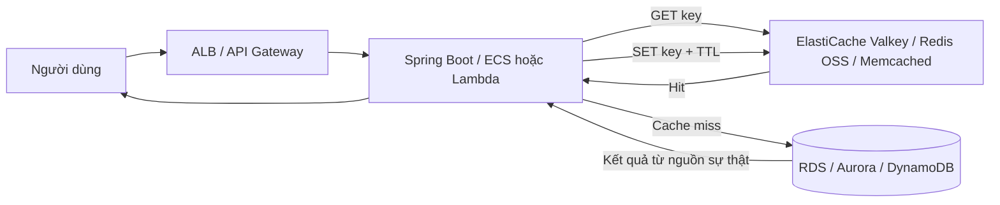

**Cache không tự đảm bảo dữ liệu luôn đúng.** Nếu giá sản phẩm đổi nhưng cache vẫn còn giá cũ, khách có thể xem số tiền không đúng; nếu tồn kho được lưu ở cache mà không kiểm tra database trong giao dịch đặt hàng, có thể bán vượt hàng. Cần xác định **source of truth**, freshness/SLO và chính sách invalidation trước khi bật cache.

Trong phạm vi `CLOUD_PROVIDERS_AWS`, bài này gắn với **Region/AZ, IAM, VPC, ECS/Lambda, RDS/Aurora, DynamoDB, CloudWatch, cơ chế phục hồi, bảo mật và FinOps**.

**Sau bài học, người học có thể:**

1. So sánh **Valkey, Redis OSS và Memcached** dựa trên data structures, scaling, durability, availability và features.
2. Chọn **ElastiCache Serverless hay node-based** theo độ biến động traffic, topology, khả năng điều chỉnh tham số và dự toán phí.
3. Phân biệt Redis/Valkey **cluster mode enabled/disabled**, shards/slots, primary/read replicas, Memcached consistent hashing.
4. Thiết kế **cache-aside, read-through, write-through, write-behind**, TTL, eviction, jitter, negative cache và chống cache stampede.
5. Xây Spring Boot Java service dùng Lettuce hoặc AWS GLIDE/Redis-compatible client, bảo vệ key names, serialization, circuit breaker.
6. Cấu hình VPC security groups, TLS, RBAC/ACL và **IAM authentication** với điều kiện phiên bản/15-phút token.
7. Hiểu HA/Multi-AZ, cache backups, cold-start/warm-up, DR, consistency và cách xử lý cache outages.
8. Đo hit rate, latency, memory/ECPU, evictions, hot keys và chi phí; hoàn thành bài tập thiết kế.

## 2. ElastiCache là gì — và không phải là gì?

### 2.1. Dịch vụ quản lý cache, không thay thế database một cách mặc định

Với ứng dụng thông thường, ElastiCache giữ **bản sao dữ liệu có thời hạn**, còn RDS/Aurora/DynamoDB là **nguồn dữ liệu có durability và transaction semantics**. AWS vận hành hạ tầng cache: provisioning, node replacements, patching theo cấu hình, monitoring, backups và scaling options. Đội ứng dụng vẫn chịu trách nhiệm:

- Chọn **keys, values, data model và TTL**.
- Tổ chức mạng và quyền truy cập.
- Định nghĩa **hit/miss**, consistency và chính sách cập nhật.
- Đảm bảo service hoạt động hợp lý khi cache không sẵn sàng.
- Tính toán capacity, hot keys, connection pools và SLA nghiệp vụ.

Một cache miss nên được xem là **trạng thái bình thường**, không phải một lỗi nghiêm trọng. Thông tin giỏ hàng/phiên người dùng có thể được thiết kế tái tạo theo policy; **thanh toán, trạng thái tồn kho/đơn hàng authoritative** cần data store đáng tin và business authorization.

**Ngoại lệ hiện đại:** AWS đã thêm tùy chọn **durability** cho những cấu hình **node-based Valkey 9.0+ cluster mode enabled được hỗ trợ**, với Multi-AZ transactional log và cấu hình synchronous/asynchronous writes. Tính năng này mở rộng use cases vượt cache thuần túy, nhưng **không có nghĩa mọi ElastiCache deployment đều bền vững** hoặc phù hợp làm primary database; cần đánh giá engine, topology, write mode, eviction policy, transaction/consistency semantics và yêu cầu backup. Xem [ElastiCache durability options](https://docs.aws.amazon.com/AmazonElastiCache/latest/dg/Durability.Options.html).

### 2.2. Data path trong AWS

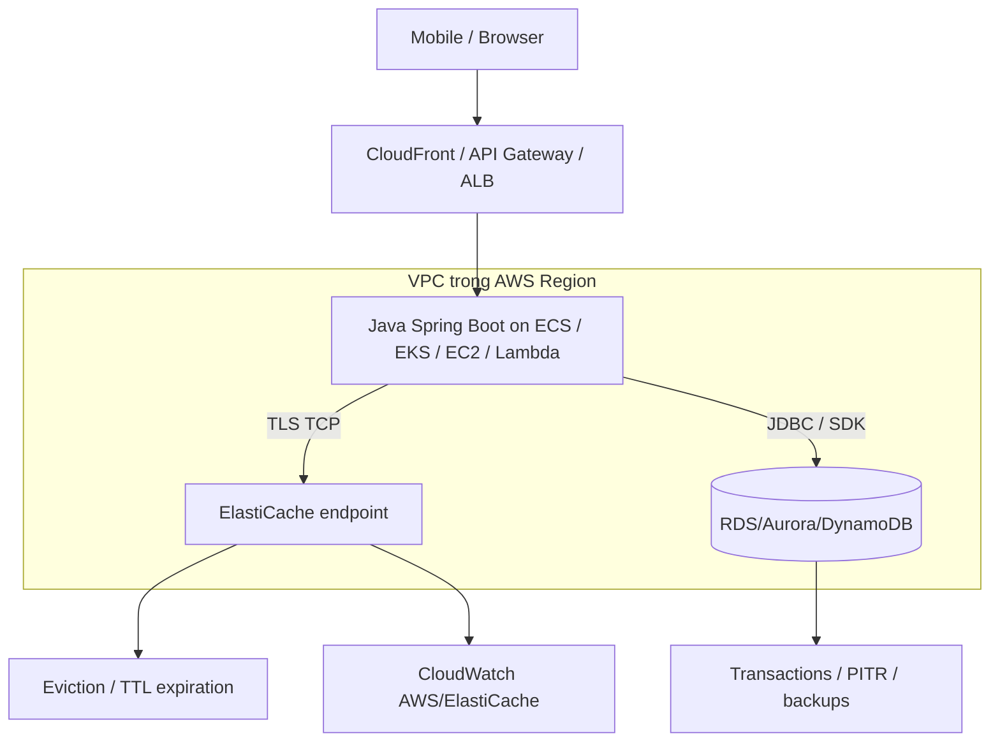

ElastiCache **không phải HTTP CDN cache**. **Amazon CloudFront** lưu HTTP responses/objects gần edge; ElastiCache lưu key-value dùng bởi backend. Hai lớp có thể dùng chung: CloudFront giảm request đến origin, ElastiCache giảm request từ backend xuống database. Chúng có chiến lược TTL/invalidation **khác nhau**.

### 2.3. So sánh với những lựa chọn liên quan

| Công nghệ | Phù hợp khi nào? | Ràng buộc chính |
| --- | --- | --- |
| **Amazon ElastiCache** | Cache chung nhiều instances/services, rất nhanh, key-value; Valkey/Redis OSS/Memcached. | Cần TTL/eviction/HA/security; không mặc định authoritative storage. |
| **Cache tại tiến trình Java (Caffeine)** | Dữ liệu nhỏ, cực nhanh, không muốn network hop. | Mỗi ECS task/JVM có cache riêng, invalidation phân tán khó, mất khi restart. |
| **CloudFront** | Cache HTTP/HTTPS ở edge: ảnh, static assets, API responses theo policy. | Cần bảo vệ private responses, cache-key và CDN invalidation. |
| **DynamoDB DAX** | Tăng tốc đọc DynamoDB bằng write-through/read-through behavior tích hợp API tương thích theo điều kiện. | Không thay ElastiCache cho generic keys/Redis commands hoặc multi-source data. |
| **Amazon MemoryDB** | In-memory database với durability được thiết kế cho dữ liệu primary theo tính năng hỗ trợ. | Trade-off khác về độ trễ, chi phí, transactions/DR; không mặc định giống Valkey 9 durable mode. |
| **RDS/Aurora read replica** | Scale truy vấn SQL khi cần joins/constraints và data freshness theo replication. | Vẫn là database, không có cache TTL/eviction tự động. |
| **SQS/Kinesis** | Buffer/stream events bền vững và xử lý async. | Không phải nơi GET cache object theo arbitrary key tốc độ rất cao. |

**Nguyên tắc:** Chọn **công cụ theo semantics dữ liệu**, không chỉ theo latency. “Muốn nhanh hơn” chưa đủ để thay database bằng một cache.

## 3. Ba cache engines: Valkey, Redis OSS và Memcached

### 3.1. Valkey — lựa chọn cân nhắc đầu tiên cho thiết kế mới

**Valkey** là engine open-source thuộc Linux Foundation, phát triển tương thích với các Redis OSS APIs/dữ liệu phổ biến từ nhánh Redis OSS 7.2. ElastiCache hỗ trợ Valkey qua Serverless và node-based; các dòng Valkey mới phát triển memory efficiency, search, data structures và durability options theo phiên bản.

Chọn Valkey khi ứng dụng cần:

- **Strings, hashes, lists, sets, sorted sets, counters**, expiry và atomic operations.
- Cache-aside hoặc Redis-compatible libraries cho Java.
- Pub/Sub, leaderboards, ephemeral coordination hoặc rate-limit structures theo security review.
- Replication/Multi-AZ, shard scaling và backup/restore.
- Kiểm soát chi phí, hệ sinh thái open-source và lộ trình engine hiện đại.
- Tính năng phiên bản mới (ví dụ vector/full-text search hay durability ở Valkey 9+) **sau khi kiểm tra Region/version/deployment compatibility**.

**Lưu ý compatibility:** “Valkey tương thích Redis OSS” **không có nghĩa mọi Redis module, Lua script, client command và snapshot đều tương thích tuyệt đối**. Kiểm thử commands, ACL, clusters, encoding và mức version trước khi migration.

### 3.2. Redis OSS — hợp lý cho hệ thống hiện có

**Redis OSS** là engine Redis open-source đã được nhiều ứng dụng tích hợp. ElastiCache duy trì các phiên bản Redis OSS được hỗ trợ và khả năng chuyển một số cụm sang Valkey. Chọn Redis OSS khi:

- Hệ thống đang vận hành tốt và có ràng buộc client/feature chưa thử trên Valkey.
- Một chính sách compliance/compatibility hoặc roadmap cụ thể yêu cầu engine này.
- Có kế hoạch migration từng bước thay vì nâng cấp production đồng loạt.

Không lựa chọn Redis OSS chỉ vì bài tutorial Java cũ dùng tên `RedisTemplate`: thư viện Redis protocol trong Spring cũng có thể làm việc với **Valkey** khi tương thích. Với dự án mới, so sánh Valkey hiện hành về tính năng, chi phí, hỗ trợ và support lifecycle.

### 3.3. Memcached — đơn giản, multi-threaded, cache object thuần túy

**Memcached** có mô hình key-value đơn giản, hỗ trợ thao tác `get/set/add/delete/incr/decr` và client-side sharding cho node-based cluster. Nó thường là lựa chọn tốt khi:

- Workload chỉ cần lưu và đọc **opaque objects** với TTL, không dùng sets/sorted sets/scripts.
- Muốn một engine **multi-threaded** đơn giản và scale-out bằng thêm nodes.
- Chấp nhận mất cache khi node fail, có thể rebuild từ database.
- Dùng consistent hashing/client discovery và không cần Redis data structures.

**Memcached node-based** không có **native replication, automatic failover kiểu Valkey/Redis OSS và node-based snapshot backup**. Tính năng backup **có** cho **Memcached Serverless** trên AWS hiện hành; không được nói chung “Memcached không thể backup” mà không phân biệt deployment type. Xem [Snapshot and restore](https://docs.aws.amazon.com/AmazonElastiCache/latest/dg/backups.html).

### 3.4. Bảng quyết định engine theo chức năng

| Tiêu chí | Valkey | Redis OSS | Memcached |
| --- | --- | --- | --- |
| In-memory key-value | Có | Có | Có |
| Chuỗi và object cache | Có | Có | Có |
| Hashes, lists, sets, sorted sets | Có | Có | **Không cùng bộ data structures** |
| Atomic increments/TTL | Có | Có | Có, trong command set khác |
| Pub/Sub, Lua/functions, advanced commands | Có theo version | Có theo version | Không theo Redis semantics |
| Engine multi-threaded | Xử lý commands chủ yếu theo mô hình Redis-compatible; có enhanced I/O threading ở versions hỗ trợ | Truyền thống thiên single-threaded command execution | **Có**, multi-threaded command processing |
| Node-based replication & automatic failover | **Có**, cấu hình Multi-AZ/replicas | **Có**, cấu hình Multi-AZ/replicas | **Không** theo kiểu đó |
| Node-based backup/snapshot | **Có** | **Có** | **Không** |
| Serverless snapshot/backup | **Có** | **Có** | **Có** |
| Cluster-aware sharding | Serverless luôn cluster mode, node-based tùy mode | Tương tự | Client-side sharding trong node-based |
| IAM auth/RBAC | Có theo version/config, thường qua ACL user | Có theo version/config | Memcached auth model khác, **không mặc định Redis ACL** |
| Optional node-based durability ngoài cache thông thường | **Valkey 9.0+ cluster mode enabled theo deployment/options** | Không mặc định đồng nhất | Không |

Đây là **ma trận chọn kiến trúc**, không phải danh sách mọi tính năng trong mọi AWS Region. Ví dụ tìm kiếm vector/hybrid và Valkey 9.x không đồng nghĩa Memcached hay Redis OSS có cùng lệnh; kiểm tra [Engine selection](https://docs.aws.amazon.com/AmazonElastiCache/latest/dg/SelectEngine.html) và [Engine versions](https://docs.aws.amazon.com/AmazonElastiCache/latest/dg/engine-versions.html).

### 3.5. Tình huống chọn nhanh

| Workload | Có thể chọn | Lý do |
| --- | --- | --- |
| Product catalog cache cho Spring Boot, nhiều ECS tasks | **Valkey** Serverless/node-based | Shared cache, TTL, đa kiểu dữ liệu, HA. |
| Chỉ cache serialized JSON response, tự rebuild, nhiều CPU cores | **Memcached** | Model đơn giản, đa luồng, scale-out. |
| Leaderboard `ZADD/ZRANGE`, sorted sets | **Valkey/Redis OSS** | Memcached không có Redis sorted sets. |
| Redis-compatible app hiện tại cần tránh migration downtime | **Redis OSS tạm thời hoặc chuyển Valkey có kiểm thử** | Giữ tương thích, lộ trình thay đổi. |
| Session store cần chống mất session khi node fail | **Valkey/Redis OSS HA với TTL và chiến lược session** | Replication/backups hỗ trợ, nhưng không cam kết 0 mất mát với mọi mode. |
| Số dư ví/payment authoritative ledger | **RDS/Aurora/DynamoDB hoặc giải pháp durability đã đánh giá** | Không dựa vào cache eviction để giữ tiền. |
| AI embeddings/vector search trên Valkey mới | **Valkey theo version hỗ trợ** | Đánh giá index memory, latency/cost và so sánh OpenSearch/vector DB. |

## 4. Chọn kiểu triển khai: Serverless hay node-based?

### 4.1. Serverless: AWS tự phân phối và mở rộng tài nguyên cache

**ElastiCache Serverless** quản lý scaling capacity thay cho người dùng: không phải chọn node type, số shards/replicas hoặc sắp đặt AZ thủ công như node-based. Phù hợp khi traffic **biến động khó dự đoán**, muốn thử nghiệm nhanh hoặc giảm công việc vận hành. Với Valkey/Redis OSS Serverless:

- Cụm sử dụng **cluster mode enabled**; client phải hỗ trợ cluster-aware routing để theo dõi hash slots và redirects.
- ElastiCache phân phối dữ liệu/compute qua nhiều AZ theo mô hình dịch vụ, tự điều chỉnh capacity trong giới hạn/quota.
- **TLS và mã hóa at rest** được bật mặc định theo cơ chế Serverless.
- Có thể đặt **cache usage limits** cho data storage và request processing theo giới hạn dịch vụ, nhưng cần theo dõi throttling.
- Các metrics như `BytesUsedForCache`, `CacheHitRate` và `ElastiCacheProcessingUnits` giúp dự toán phí.
- Valkey/Redis OSS có thể dùng snapshots tự động/thủ công; **Memcached Serverless** cũng hỗ trợ snapshots theo tài liệu AWS hiện hành.
- Các parameters/features không đồng nhất với node-based, không cho tùy chỉnh mọi option.

**Điểm mới cần kiểm tra:** AWS có **public endpoint** cho **ElastiCache Serverless for Valkey 9.0+** trong những Region/cấu hình được hỗ trợ. Public endpoint đòi **IAM authentication và TLS 1.3**, không dùng VPC security group cho public endpoint. **Không được suy từ tính năng mới này rằng mọi ElastiCache cache đều public** hoặc nên expose cache qua Internet. Production nội bộ đa phần vẫn nên chọn **VPC-private endpoint** với SG least privilege; public endpoint chỉ phù hợp khi đánh giá security/network cụ thể. Tham khảo [Connect to a cache with a public endpoint](https://docs.aws.amazon.com/AmazonElastiCache/latest/dg/connecting-public-endpoint.html).

### 4.2. Node-based: chủ động topology và capacity

**Node-based** cho phép quản lý rõ:

- Engine/version, node type (memory/CPU/network), số nodes.
- Với Valkey/Redis OSS: cluster mode, **number of shards**, replicas per shard, Multi-AZ, automatic failover.
- Memcached: số nodes, node discovery/client-side consistent hashing và cache subnet group.
- Engine **parameter groups**, backup windows, maintenance windows, encryption/authentication, reserved memory theo loại cache.
- Một số loại cluster và engine versions hỗ trợ **data tiering** (RAM + local SSD) hoặc **Valkey 9.0+ cluster mode enabled durability** theo tính năng được hỗ trợ.

Node-based phù hợp khi **traffic tương đối ổn định**, có capacity forecasts, muốn kiểm soát CPU/memory, network placement, tuning/maintenance hoặc pricing theo node-hours và Savings Plans/Reserved Nodes (theo eligibility).

### 4.3. So sánh theo hoạt động thực tế

| Tiêu chí | Serverless | Node-based |
| --- | --- | --- |
| Provisioning | Khai báo cache, engine, giới hạn, VPC/subnets/user group. | Khai báo node type, topology, shards/replicas, AZ placement. |
| Tăng/giảm công suất | AWS tự điều chỉnh trong service limits. | Team chủ động resize, reshard hoặc cấu hình autoscaling hỗ trợ. |
| Valkey/Redis OSS cluster mode | **Enabled**; cần client hỗ trợ cluster. | Enabled hoặc disabled tùy thiết kế. |
| Multi-AZ | Service tự quản lý theo mô hình serverless. | Phải cấu hình replica/Multi-AZ để đạt HA tương ứng. |
| Fine-tuning parameters | Một tập hợp giới hạn, nhiều cài đặt do AWS quản lý. | Nhiều tham số tùy chỉnh qua parameter group theo engine. |
| Metrics | Cache-level và ECPU; dimension `clusterId` cho serverless. | Per-node/per-shard, host metrics và engine metrics. |
| Chi phí | Dựa trên data storage và **ECPUs**/consumption theo bảng giá. | Dựa trên node-hours, node types, data transfer/backups/tiering. |
| Workload thích hợp | Thay đổi mạnh, thiếu baseline, nhanh triển khai. | Ổn định, predictable, tối ưu latency/capacity cụ thể. |
| Backup | Valkey/Redis OSS; **Memcached Serverless** có backup. | Valkey/Redis OSS; **Memcached node-based không có snapshot**. |
| Internet connectivity | Có public endpoint **trong loại Valkey Serverless 9+ được hỗ trợ**; mặc định VPC use case phải cấu hình. | Thường VPC-private. |

**Không mặc định Serverless luôn rẻ hơn**. Serverless có thể hợp lý với tải rất biến động, nhưng cache lưu trữ lớn và request volume lớn/ổn định có thể đáng so sánh với node-based. Tính theo **đúng pattern commands và ECPU**, không chỉ số GET/s.

### 4.4. Checklist ra quyết định

Trả lời trước khi tạo:

1. Workload có dùng Redis data structures/atomic commands không? Nếu có, ưu tiên **Valkey/Redis OSS** thay vì Memcached.
2. Cache có thể mất hết và tự build lại không? Nếu không, đánh giá **durability mode** hoặc data store chính, đừng giả định cache thuần đáp ứng.
3. Tải giờ cao điểm so với trung bình chênh bao nhiêu? Có cần auto scaling?
4. Có yêu cầu cluster-aware client, hỗ trợ MOVED/ASK/resharding không?
5. Có yêu cầu customer-managed parameter group, Lua/modules, data tiering, search, snapshot và Multi-AZ control không?
6. Cần private network, IAM authentication, RBAC/ACL và KMS như thế nào?
7. Ước lượng tổng bytes, object cardinality, command rate, hot keys và ECPU.
8. Có tiêu chuẩn RTO/RPO cụ thể và vùng/khoảng thời gian bảo vệ trước AZ failure không?

## 5. Kiến trúc Redis/Valkey: cluster mode, shards và replicas

### 5.1. Cluster mode disabled

Với **node-based Valkey/Redis OSS cluster mode disabled**, mô hình cổ điển gồm **một primary** và tùy cấu hình có **read replicas**:

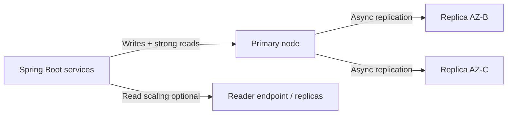

Các điểm cần nhớ:

- Một primary quản lý toàn bộ keyspace; scale-out writes bằng shards không có trong mode disabled.
- Read replicas giúp giảm tải đọc, nhưng **replication là bất đồng bộ** trong cấu hình caching thông thường, nên có thể đọc stale data trên replica.
- Khi primary hỏng và **Multi-AZ automatic failover** được bật, ElastiCache có thể promote replica thành primary. App cần reconnect/refresh DNS và retry phù hợp.
- Với một cluster thật sự chỉ có single node/no replica, **không có failover sang replica**.

**Không định nghĩa “có 2 nodes” đồng nghĩa đã bật Multi-AZ**. Phải kiểm tra replica nằm ở AZ khác và `AutomaticFailover`/`MultiAZ` cấu hình chính xác.

### 5.2. Cluster mode enabled: sharding theo 16.384 hash slots

Trong Redis/Valkey Cluster, keyspace được chia thành **16.384 hash slots**. Các shards sở hữu ranges/slots, mỗi shard có primary và tùy cấu hình replicas. Một key thường được ánh xạ qua CRC16 modulo 16.384, với **hash tags** trong `{...}` giúp các keys cùng slot khi cần multi-key atomic operation.

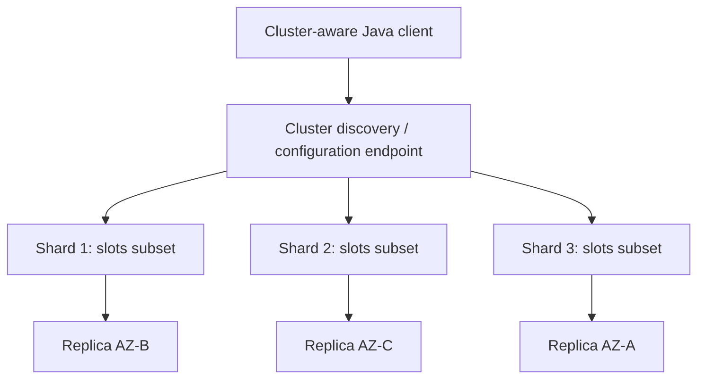

Hệ quả cho Java:

- Dùng **cluster-aware Redis client** (Lettuce cluster/GLIDE/JedisCluster), không chỉ single-node connection tới một shard.
- Client phải hiểu cluster topology và tự xử lý **MOVED/ASK redirects**, resharding, node replacement.
- Nhiều **multi-key** commands hoặc Lua operations chỉ được phép khi các keys ở **cùng hash slot**; nếu khác slot có thể gặp `CROSSSLOT`.
- Không nhồi toàn bộ keys vào một hash tag `{all}`, vì sẽ gây **hot shard**/mất ý nghĩa sharding.
- Serverless Valkey/Redis OSS hoạt động theo cluster mode enabled, nhưng topologies và endpoint access được AWS tự quản lý; ứng dụng vẫn phải hỗ trợ cluster semantics.

Ví dụ keys theo đơn hàng:

```text
order:{ord-123}:summary
order:{ord-123}:status
order:{ord-123}:items
```

Ba keys có cùng `{ord-123}` nên nằm trong cùng hash slot, hỗ trợ các thao tác cần co-location. Không dùng hash tag cho tất cả khách hàng làm một “giải pháp” chung; phải dựa trên access pattern.

### 5.3. Memcached node-based: sharding ở client

Memcached node-based không có keyslot/replication semantics của Redis Cluster. Client chọn node dựa trên **consistent hashing** của key và danh sách endpoints. Khi thêm/bớt node:

- Một phần keys chuyển mapping → **cache misses tăng**/cold cache.
- Node bị hỏng có thể làm mất keys trên node đó; **không có native replica tự chứa cùng dữ liệu**.
- Client cần **node discovery** hoặc config refresh; consistent hashing giảm số keys bị remap so với simple modulo hashing.
- App phải chịu được **partial misses** và rebuild từ source of truth.

Memcached Serverless che phần topology/scaling, nhưng không có nghĩa node-based Memcached tự được thêm replication sau khi đổi endpoint.

### 5.4. Read/write consistency trong cache

| Kiến trúc | Mức nhất quán thường thấy | Rủi ro |
| --- | --- | --- |
| Primary read/write | Đọc dữ liệu mới sau write từ primary theo command order và connection semantics. | Một số workflows vẫn race với DB/source-of-truth. |
| Replica read | **Eventual consistency** do async replication trong caching mode. | Read sau write có thể thấy phiên bản cũ. |
| Serverless read-optimized endpoint/port `6380` | **Eventually consistent read** nếu client dùng `READONLY`/replica reads. | Không dùng cho balance/stock cần nhìn bản mới ngay. |
| Application local near-cache | Mỗi instance có TTL/update riêng. | Cross-instance stale data nếu thiếu invalidation. |
| Data-store query | SQL/DynamoDB theo consistency và transaction options. | Độ trễ/cost cao hơn nhưng semantics mạnh hơn. |

**Mức nhất quán cuối cùng phụ thuộc cả logic cache và database.** Một primary Redis đọc đúng giá trị trong cache **không có nghĩa giá trị đó bằng dữ liệu authoritative mới nhất** nếu invalidation bị lỗi.

### 5.5. HA và giới hạn không được quên

Với node-based Valkey/Redis OSS, AWS khuyến nghị **Multi-AZ với ít nhất một replica ở AZ khác** để automatic failover. Đây là cách tăng availability, **không mặc định exactly-once durability**: async replication có khả năng mất một số writes mới nhất khi failover. Nếu buộc không mất dữ liệu, đánh giá durability mode của Valkey 9+, hệ thống nguồn dữ liệu bền vững hoặc giải pháp khác.

Một application vẫn phải có **retry with jitter, short timeouts, connection pool limits, circuit breaker** và giảm traffic xuống DB có kiểm soát khi cache lỗi. Multi-AZ không làm app hết chịu lỗi nếu client pin IP cũ, không refresh DNS hoặc chỉ kết nối một node.

## 6. Cache patterns: chọn cách đọc/ghi đúng với business data

### 6.1. Cache-aside (lazy loading) — mặc định dễ triển khai

**Cache-aside** là ứng dụng tự kiểm tra cache trước, khi miss mới đọc DB và đưa kết quả vào cache:

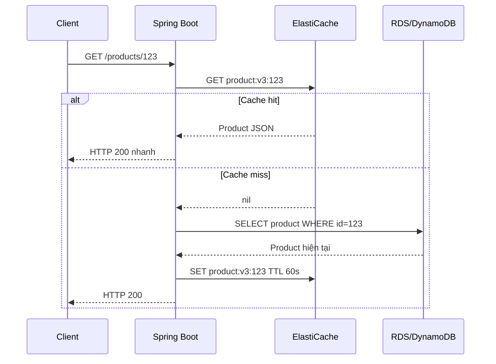

Ưu điểm:

- Chỉ cache các keys có traffic đọc; tránh lấp đầy bằng dữ liệu không được sử dụng.
- Cache outage có thể **fallback sang DB** nếu logic và capacity cho phép.
- Hợp với danh mục sản phẩm, cấu hình ít đổi, public profiles được phân quyền đúng.

Nhược điểm:

- Cache miss lần đầu có DB latency; sau deploy/failover sẽ có **cold cache**.
- **Cache stampede** khi nhiều requests cùng miss một hot key.
- Nếu giá trong DB thay đổi nhưng key chưa bị invalidate, người dùng đọc stale value tới khi TTL hết.

**Mẫu Java pseudo-code:**

```java
public Product getProduct(String id) {
    Product cached = cache.get("product:v3:" + id);
    if (cached != null) {
        return cached;
    }
    Product fromDb = repository.findById(id).orElseThrow();
    cache.put("product:v3:" + id, fromDb, Duration.ofSeconds(60));
    return fromDb;
}
```

`cache`/`repository` là interfaces giả định; code production phải xử lý timeout, negative-cache cho not-found và đồng thời nhiều writers, không chỉ sao chép mẩu này.

### 6.2. Read-through

**Read-through** đưa việc load dữ liệu khi miss vào một lớp cache/provider abstraction để ứng dụng gọi API giống như cache đọc tự động. Với ElastiCache dùng Redis/Valkey, **AWS không tự nối đến RDS/DynamoDB để load một record** khi `GET` miss: bạn phải viết loader/application middleware hoặc dùng thư viện có read-through behavior.

| Cache-aside | Read-through |
| --- | --- |
| Application kiểm tra miss và đọc DB. | Loader/cache abstraction chịu trách nhiệm fallback và populate. |
| Dễ kiểm soát trong Spring service. | Dễ tái sử dụng nhưng cần hiểu loader exceptions, concurrency. |
| Có thể log rõ user/business context. | Cần đảm bảo không bypass authorization và tenant isolation. |

Đừng đánh đồng read-through trong một thư viện Java với **ElastiCache mặc định có kết nối database** — không có cơ chế “cứ tạo cache là AWS tự nạp dữ liệu từ RDS”.

### 6.3. Write-through

**Write-through** đồng bộ cập nhật cache khi application ghi dữ liệu nguồn:

```text
PUT /products/123
    ├─ Commit DB update
    └─ Update/delete cache entry ngay sau commit
```

Một vấn đề: **DB transaction và cache write không có ACID transaction chung**. Nếu DB update thành công nhưng cache update thất bại, cache cũ có thể còn stale. Đối với nhiều hệ thống, sau khi DB commit nên **invalidate key** thay vì ghi cache value theo thứ tự có thể race.

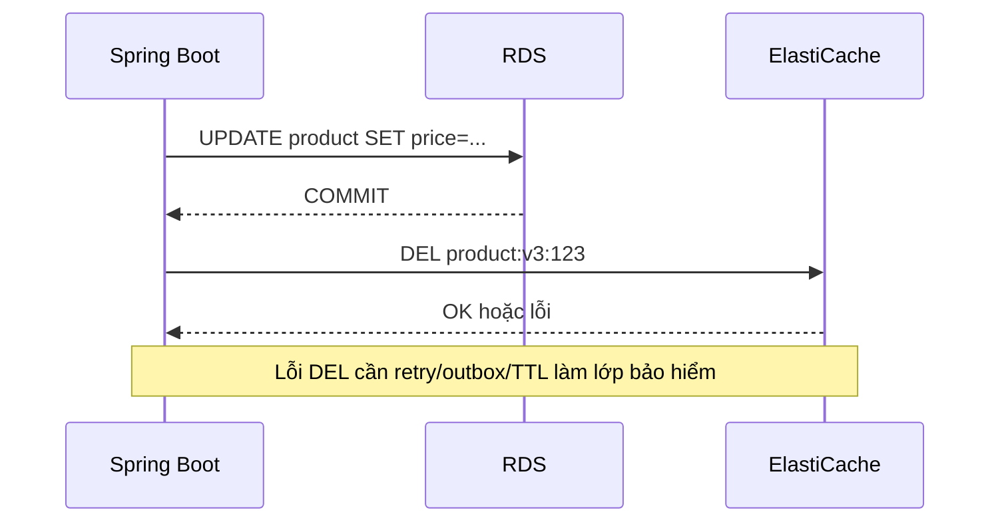

**Không invalidation trước DB COMMIT** rồi nghĩ đã an toàn: giữa lúc xóa key và transaction commit, một request khác có thể đọc **giá cũ** từ DB rồi populate lại cache; sau commit cache vẫn stale. Invalidate sau commit, cân nhắc versioning/CAS hoặc event-driven invalidation cho các tình huống có race; dùng TTL làm giới hạn stale tối đa tương đối (không bảo đảm chính xác nếu loader sai).

### 6.4. Write-behind / write-back

**Write-behind** cập nhật cache trước, ghi database sau một cách bất đồng bộ:

```text
Client -> Cache accepts new value -> Queue/worker -> Database eventually updates
```

Ưu điểm là giảm latency đồng bộ trong một số use cases, nhưng rủi ro tăng:

- Cache crash/restart có thể làm mất writes chưa flush nếu durability không đủ.
- Đọc ở DB có thể thấy stale values.
- Cần retry/DLQ/idempotency, ordering, backpressure, RPO và audit.
- Có thể dẫn tới **mất đơn, mất thanh toán** nếu dùng làm authoritative write path mà không có giải pháp durability đã review.

**Khuyến nghị:** Với đơn hàng/tiền/tồn kho, ghi vào database authoritative trước và dùng cache như read optimization; nếu cần xử lý async, dùng **SQS/Kinesis/EventBridge + durable DB outbox** phù hợp thay vì dựa vào một write-behind cache thuần.

### 6.5. Write-around

**Write-around** ghi thẳng DB nhưng không populate cache; request đọc sau đó sẽ miss và load. Phù hợp khi lượng dữ liệu mới ghi **không chắc sẽ được đọc**; tránh cache pollution. Nhược điểm là cold read sau write và nguy cơ còn cache cũ nếu key không được invalidated.

### 6.6. Nên cache cái gì?

| Dữ liệu | Chiến lược tham khảo | Cần lưu ý |
| --- | --- | --- |
| Catalog, sản phẩm ít thay đổi | Cache-aside, TTL ~30–300s, event invalidation khi update. | Giá/khuyến mãi có thể thay nhanh; không dùng cache làm giá thanh toán cuối. |
| User profile ít nhạy cảm | Cache-aside, TTL ngắn và tenant-aware key. | Bảo vệ PII/authorization; invalidate khi đổi profile. |
| API reference metadata / feature flag | Cache-aside với version key hoặc push invalidation. | Rollout cần tính nhất quán theo tenant/cấu hình. |
| Session data | Valkey/Redis compatible TTL, HA/backup tùy RTO. | Cookie/token/session security, logout invalidation, failover. |
| Rate limiting | Atomic counters/sorted sets với TTL và Lua/commands tùy engine. | Phân tán, clock, hot keys, bypass khi cache lỗi; security-sensitive policy. |
| Top-K leaderboard | Valkey/Redis sorted sets. | Snapshot/rebuild, ranking updates, memory cardinality. |
| Inventory/payment ledger | **Database là source of truth**, cache chỉ hỗ trợ đọc. | Transaction/conditional updates, replay safety, không giảm stock chỉ trong cache. |
| Public CDN images | **CloudFront/S3**, không đưa binary lớn vào Valkey chỉ để làm CDN. | Object size, transfer cost và edge caching. |

**Bài tập quyết định:** Nếu một key có thể bị xóa mà ứng dụng không thể tái tạo và không có lớp durability đã đánh giá, nó **không còn chỉ là cache**; cần thiết kế recovery theo nghiệp vụ.

## 7. TTL, eviction, invalidation và cache stampede

### 7.1. TTL là giới hạn thời gian, không phải cập nhật theo sự thật

**TTL (Time To Live)** xác định thời hạn key tồn tại trước expiry, ví dụ:

```text
SET product:v3:123 {"name":"Coffee","price":59000} EX 60
TTL product:v3:123
GET product:v3:123
```

Một cache key với TTL 60s có thể bị xóa **sớm hơn** do eviction, memory pressure hoặc thao tác invalidation; TTL không bảo đảm tồn tại đủ 60s. Nếu DB đổi tại giây thứ 1, giá trị còn lại có thể stale gần 59s. TTL cũng **không bảo đảm server và client thống nhất về thời gian** khi có local caches hoặc asynchronous loaders.

TTL nên được chọn theo **staleness budget** của dữ liệu, không đặt mọi key cùng 24 giờ chỉ để tăng hit rate.

### 7.2. Các eviction policies thông dụng của Valkey/Redis OSS

| Chính sách | Key nào có thể bị đẩy ra khi thiếu memory? | Tình huống phù hợp |
| --- | --- | --- |
| `allkeys-lru` | Keys trong toàn bộ keyspace, gần LRU. | General-purpose cache, nhất là khi có key thiếu TTL. |
| `allkeys-lfu` | Keys ít được truy cập theo ước lượng LFU. | Hot-set ổn định, workload lặp lại. |
| `volatile-lru` | **Chỉ keys đã đặt TTL**, theo gần LRU. | Mọi cacheable keys đều có TTL; không TTL keys được giữ. |
| `volatile-ttl` | Trong số các keys có TTL, ưu tiên thời hạn ngắn hơn. | Tình huống muốn ưu tiên những keys sắp hết hạn. |
| `noeviction` | **Không evict**; writes có thể trả OOM khi hết giới hạn. | Workload có state không được tự động evict, sau khi đánh giá durability/capacity. |
| `allkeys-random` | Chọn ngẫu nhiên keys. | Đặc biệt; không mặc định là tốt hơn LRU/LFU. |

**Mặc định có thể là `volatile-lru`**, nghĩa là **keys không TTL không được evict**; nếu quá nhiều keys không TTL, writes có thể lỗi OOM. Với cache thông thường, AWS khuyến nghị cân nhắc `allkeys-lru` trên custom parameter group tùy workload. Tuy nhiên, không áp parameter group node-based lên Serverless khi service không cho chỉnh tham số này. Đối chiếu [Engine specific parameters](https://docs.aws.amazon.com/AmazonElastiCache/latest/dg/ParameterGroups.Engine.html).

### 7.3. TTL jitter để tránh stampede đồng thời

Nếu 10.000 keys đều được ghi lúc 09:00 với TTL chính xác 3600s, nhiều keys sẽ hết hạn **đồng loạt lúc 10:00**, gây burst DB load. **Jitter** phân tán TTL ngẫu nhiên:

```java
import java.time.Duration;
import java.util.concurrent.ThreadLocalRandom;

Duration ttlWithJitter(Duration base) {
    long seconds = base.getSeconds();
    long jitter = ThreadLocalRandom.current().nextLong(0, Math.max(1, seconds / 10));
    return Duration.ofSeconds(seconds + jitter);
}
```

Đây là ví dụ thêm **0–10%** random jitter theo từng key; chọn khoảng thích hợp với stale tolerance. Không dùng jitter lớn hơn staleness SLO. Nếu cần security-sensitive expiry (OTP/session), TTL policy phải bám các yêu cầu bảo mật chặt chẽ, không tùy ý kéo dài.

### 7.4. Cache stampede / thundering herd

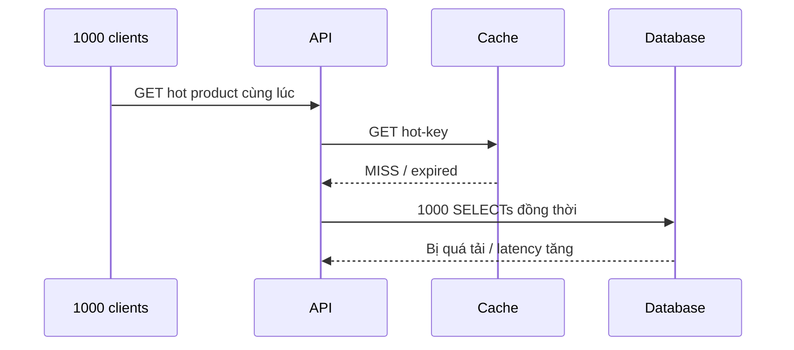

Các phương án:

1. **Single-flight trong process**: các requests cùng key chia sẻ một future/inflight load.
2. **Distributed lock/SET NX EX** hoặc lease để chỉ một worker làm mới key; có TTL lock và owner token.
3. **Stale-while-revalidate**: trả bản hơi cũ theo hợp đồng, refresh trong background.
4. **Proactive refresh** cho hot keys trước expiry.
5. **TTL jitter**, rate limiting và **bulkhead/concurrency cap** khi gọi database.
6. **Negative caching** cho not-found phổ biến, TTL ngắn để không che dữ liệu mới.

**Distributed lock bằng Redis không mặc định là khóa giao dịch an toàn tuyệt đối**: lease có thể hết khi worker vẫn chạy, clock/network partitions gây cạnh tranh. Với hành động có side effects như trừ tiền/kho, sử dụng database conditional update/fencing token và transaction design phù hợp, không dựa duy nhất trên cache lock.

### 7.5. Negative caching: nhớ kết quả không tìm thấy

Một endpoint tìm product ID không tồn tại có thể bị scan hàng chục nghìn lần, mỗi lần DB lookup tốn chi phí. Có thể cache **sentinel NOT_FOUND** trong 5–15s:

```text
GET product:v3:999999 -> cache miss
DB SELECT -> no rows
SET product:v3:999999 {"_state":"NOT_FOUND"} EX 10
```

Nhưng:

- Phải phân biệt **không tìm thấy** với lỗi DB timeout/permission denied; **không cache lỗi kỹ thuật như not-found**.
- Dùng TTL ngắn để tránh người dùng tạo record xong vẫn thấy 404 quá lâu.
- Bảo vệ enumeration: không dùng cache timing để tiết lộ record của tenant khác.
- Định dạng sentinel phải có version, không nhầm với product JSON thật.

### 7.6. Key naming, namespaces và schema version

Ví dụ key format:

```text
shop:prod:product:v3:123
shop:prod:category:v2:8
shop:prod:session:v1:<opaque-session-id>
shop:prod:tenant:<tenant-id>:settings:v4
```

**Không nhúng mật khẩu, bearer token, email/số điện thoại dạng plaintext vào key names** vì logs/metrics có thể lộ key names. Dùng opaque IDs/hashes khi cần, tránh hash guessable của email đối với sensitive data. Đặt version trong key cho phép **schema/key migration** từng bước; key cũ hết TTL tự nhiên thay vì phải chạy `KEYS *` rồi xóa hàng triệu keys.

### 7.7. Không dùng lệnh nguy hiểm trong production

Những lệnh Valkey/Redis như `KEYS *`, `FLUSHALL`, `FLUSHDB` hoặc `MONITOR` có thể gây CPU/blocking, xóa toàn bộ data hoặc lộ dữ liệu. Node-based/Serverless có thể hạn chế vài lệnh, nhưng **không lấy hạn chế của dịch vụ làm lớp bảo vệ duy nhất**. Với thao tác tìm kiếm key, dùng `SCAN` có bounds/slow down theo nhu cầu, permissions ACL giới hạn admin commands và thời gian bảo trì; **SCAN cũng tiêu tốn tài nguyên** khi keyspace lớn.

## 8. Capacity planning: memory, network, CPU, hot keys và chi phí mỗi request

### 8.1. Đừng ước lượng chỉ bằng kích thước JSON

Một key-value cache dùng nhiều memory hơn kích thước payload thuần vì **key metadata, expiration dictionary, allocator fragmentation, replication buffers, output buffers và các data structures**. Ví dụ giả định:

```text
Số hot products cần cache                5,000,000 keys
Payload JSON trung bình                   600 bytes/key
Key + metadata/allocator overhead giả định 250 bytes/key
Tổng trung bình                           850 bytes/key
Raw data                                  ~4.25 GB (decimal)
Headroom ví dụ 40%                        ~5.95 GB (trước buffers/replicas)
```

Các số là **mô phỏng**, không phải công thức sizing chuẩn cho mọi version/node type. Key dạng hash, sorted set, JSON string lớn hoặc search index có overhead khác nhau. Node-based phải cộng thêm:

- Headroom cho writes burst, rehashing, failover, buffer memory.
- Replicas theo HA (mỗi replica giữ dataset của shard).
- Shard distribution/hot-key skew, memory fragmentation.
- Reserved memory để snapshot/fork/backup theo engine.
- Nếu có data tiering, RAM vs local SSD hit patterns và I/O penalty.

**Phải load test** với dữ liệu và commands đại diện, theo dõi `BytesUsedForCache`, `DatabaseMemoryUsagePercentage`/memory fragmentation, evictions và throughput. Đừng chọn 1 node rồi “hi vọng auto-scale” nếu đó là node-based config chưa bật scaling.

### 8.2. Tại sao cache hit rate cao chưa đủ?

Một tỷ lệ **95% hit rate** nghe tốt, nhưng nếu 5% misses chính là những queries nặng nhất hoặc rơi vào peak 1.000 req/s, DB vẫn có thể quá tải. Trong một giờ 100 triệu request:

```text
Requests:              100,000,000
Cache hit rate:          95%
Database miss requests: 5,000,000
```

Số lần query DB thực tế còn phụ thuộc batching, dedup, single-flight và negative caching. Cần đo:

- **Application-level p50/p95/p99 latency** của cache hit và miss.
- Tỷ lệ cache miss theo **endpoint/business key**, không chỉ trung bình.
- DB QPS/CPU/IOPS/active connections trước và sau caching.
- Cache CPU/engine CPU, network bytes, command latency, shard distribution.
- Chi phí mỗi successful business request, không chỉ chi phí cluster riêng.

### 8.3. Hot keys và hot shards

Một sản phẩm viral nhận 50% requests có thể tạo một hot key, đẩy tải về một shard dù tổng memory còn rất trống. **Thêm shards không nhất thiết giúp** nếu mọi requests dùng cùng hash slot:

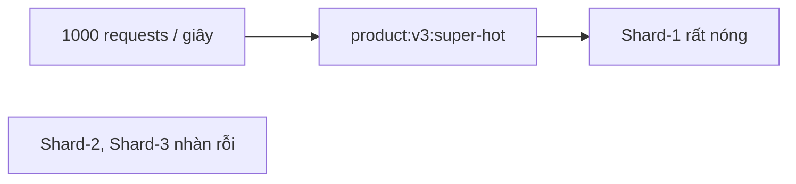

Biện pháp:

1. Cache kết quả cục bộ trong JVM với TTL rất ngắn (**near-cache**) nếu chấp nhận stale.
2. Phân tán reads qua read replicas/read-optimized endpoint nếu consistency cho phép.
3. Replicate hot immutable value dưới nhiều keys có chủ đích, nhưng phải thiết kế invalidation và consistency.
4. Dùng CloudFront cho **public HTTP responses** nếu phù hợp, tránh dồn mọi request tới backend.
5. Batch/pipeline commands (đúng client/mode), giảm high-cost commands và payload lớn.
6. Theo dõi per-shard CPU/hot-key metrics/sampling theo khả năng engine hỗ trợ.

Không tự nhân bản keys chứa session/PII sang nhiều tenant hoặc biến mỗi yêu cầu thành một key mới vô hạn để giảm hotspot — có thể phá memory budget và security boundary.

### 8.4. Connection management

Mỗi ECS task/Lambda instance tạo quá nhiều TCP/TLS connections có thể gây:

- `CurrConnections` tăng, memory overhead và CPU/TLS handshake.
- Connection timeout khi security groups/conntrack limits/node limit gần trần.
- Latency spike hoặc exhaustion khi ứng dụng redeploy và tất cả instances reconnect cùng lúc.
- DNS/IP cũ sau failover nếu client cache IP vĩnh viễn.

Khuyến nghị cho Java:

- Reuse **one client bean per application instance** (Lettuce/GLIDE/Jedis pool phù hợp).
- Đặt connect/read timeouts, max connections và command queue bounds.
- Dùng SSL/TLS verify certificate, không `insecureTrustManager` trong production.
- Client cluster mode refresh topology, retry redirects và DNS TTL hợp lý.
- Với AWS Lambda, tạo client ngoài handler khi an toàn để reuse warm environment, nhưng phải handle stale sockets/reconnect và giới hạn concurrency.

### 8.5. Định cỡ Serverless theo ECPU

ElastiCache Serverless tính tài nguyên xử lý theo **ElastiCache Processing Units (ECPUs)**, phụ thuộc lượng dữ liệu đọc/ghi và CPU cost của commands. Hai workloads cùng 100.000 requests/s có thể sử dụng ECPU khác nhau nếu:

- Workload A chủ yếu `GET` keys 100 bytes.
- Workload B dùng `ZRANGE` với kết quả lớn, `MGET` nhiều keys hoặc search queries phức tạp.
- Workload C ghi values 50 KiB và có nhiều index updates.

Vì vậy **không lấy QPS × một con số ECPU cố định cho mọi lệnh**; đo `ElastiCacheProcessingUnits`, `BytesUsedForCache`, request latency và throttling trên prototype. AWS có per-cache/per-slot limits và quota tăng được theo điều kiện; đừng giả định “serverless vô hạn” hoặc một hot hash slot có thể dùng toàn bộ capacity của cache.

## 9. Bảo mật: VPC, TLS, RBAC/ACL, AUTH và IAM

### 9.1. Mô hình truy cập không chỉ là security group

Có **bốn lớp** kiểm soát:

1. **Network:** VPC subnets, SG/NACL, routing và endpoint loại private/public.
2. **Encryption:** TLS in-transit, encryption at rest/KMS theo deployment.
3. **Authentication:** Valkey/Redis OSS ACL users/password hoặc **IAM authentication** (nếu hỗ trợ), Memcached auth features theo deployment.
4. **Authorization:** Cho phép users chỉ thực hiện commands và key patterns phù hợp, IAM role chỉ quản lý tài nguyên cần thiết.

**IAM quản lý cache ≠ IAM đăng nhập vào data plane**. Role có `elasticache:DescribeServerlessCaches` không đương nhiên được gửi `GET/SET` vào Valkey. Với IAM authentication, phải có IAM-enabled ElastiCache user và `elasticache:Connect` với quyền trên **cả cache ARN và user ARN**.

### 9.2. Private VPC network và cổng

| Kiểu cache | Cổng tiêu biểu | Nơi truy cập |
| --- | --- | --- |
| Valkey/Redis OSS **node-based** | `6379` mặc định (có thể tùy cấu hình theo engine). | VPC network/private routes, security groups. |
| Valkey/Redis OSS **Serverless VPC** | `6379` primary/read-write và `6380` read-optimized/replica reads. | VPC endpoints/service-managed network, SG. |
| Memcached **node-based** | `11211`. | VPC, client-side node mapping. |
| Memcached **Serverless VPC** | `11211` và `11212` theo service endpoint behavior. | VPC network theo configuration. |
| Valkey **Serverless public** được hỗ trợ | `6379` qua **TLS 1.3 + IAM auth**. | Internet endpoint, không có VPC SG trên chính public endpoint. |

**Network rule mẫu:** Cache SG inbound **6379/6380** (nếu serverless Valkey/Redis) chỉ cho **SG của ECS task/EC2/Lambda ENI**, không mở `0.0.0.0/0`. Từ workload SG có outbound traffic tới cache port, DNS resolution và routing đúng VPC. Không thử mở public network để sửa lỗi `ETIMEDOUT` mà không xác minh account/VPC/subnets/port.

**Caveat khi dùng AWS Lambda trong VPC:** Lambda functions cần gắn VPC subnets/security groups có đường tới private cache endpoint; Lambda ngoài VPC không tự truy cập private cache. Khi gắn VPC, đường đi AWS APIs (Secrets Manager/KMS) có thể cần VPC endpoints/NAT theo use case. Security groups và network routes không thay IAM/data-plane auth.

### 9.3. TLS và encryption at rest

- **Serverless** dùng TLS/encryption-at-rest theo cấu hình dịch vụ; với cache public Valkey, AWS yêu cầu **TLS 1.3**.
- Node-based Valkey/Redis OSS hỗ trợ **in-transit encryption (TLS)** và at-rest encryption; kiểm tra engine/version/node type và các cài đặt lúc tạo/cập nhật cluster.
- Với customer-managed AWS KMS key, cần IAM/key policy bảo vệ snapshots/recovery; disable key có thể ảnh hưởng restore/data access.
- Java client **phải validate certificate hostname/CA**, không đặt `trustAll=true`/`sslVerify=false` trong production.
- TLS giúp mã hóa đường truyền, nhưng **không sửa** các lỗi ACL cho phép `FLUSHALL` hoặc key chứa dữ liệu không được phân quyền.

### 9.4. Role-Based Access Control (RBAC/ACL)

Với Valkey/Redis OSS hỗ trợ ACLs, định nghĩa **ElastiCache users** và **user groups** thay vì cho mọi service dùng cùng `default` user unrestricted. Ví dụ ý tưởng:

```text
Service orders-read:
  Allowed commands: GET, MGET, PING
  Allowed key prefix: shop:prod:catalog:*

Service orders-write:
  Allowed commands: GET, SET, DEL, EXPIRE, PING
  Allowed key prefix: shop:prod:catalog:*
```

Đây là **policy description**, không phải cú pháp AWS CLI trực tiếp. Cú pháp thực của Valkey ACL access strings có dạng `on ~shop:prod:catalog:* +get +mget +ping` hoặc commands phù hợp; **đừng cấp `+@all` cho mọi application user**. Check keys/commands cần thiết cho Spring Cache abstraction, serializer, publish/invalidation và cluster topology.

**Legacy AUTH token** dùng cho một số **node-based Valkey/Redis OSS** nhưng AWS khuyến nghị RBAC; Serverless dùng user groups/RBAC thay vì old single AUTH token mechanism. Với password-based users, lưu credentials trong **AWS Secrets Manager** và rotate theo quy trình được hỗ trợ; không hard-code trong code, Docker image hay Git.

### 9.5. IAM authentication: token 15 phút, connection 12 giờ

AWS ElastiCache hỗ trợ IAM auth khi dùng **Valkey 7.2+ hoặc Redis OSS 7.0+**, với **TLS bắt buộc**. Ý tưởng:

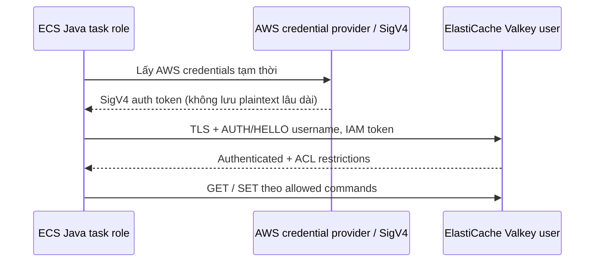

Quy định quan trọng:

- IAM-enabled ElastiCache user cần **`user-id == user-name`**.
- IAM policy có `elasticache:Connect` trên cache và user (đúng ARNs).
- **IAM token hợp lệ 15 phút** khi dùng để authenticate; client nên tạo token mới cho **mỗi connection/re-auth**, không cache token đến hết lifetime session.
- Một connection IAM-authenticated bị **disconnect sau 12 giờ** nếu không re-auth; để duy trì cần `AUTH`/`HELLO` với token mới theo quy định.
- Re-authentication không thực hiện bên trong `MULTI/EXEC` hoặc Lua script.
- Dùng client có **credentials provider** tự refresh token (AWS GLIDE 2.2+ hỗ trợ IAM built-in) hoặc implement đúng [IAM authentication](https://docs.aws.amazon.com/AmazonElastiCache/latest/dg/auth-iam.html).

**Không nhầm**: Token 15 phút **không có nghĩa mọi GET sau phút 15 đều bị từ chối trên một TCP connection đang authenticated**. Đó là thời hạn token dùng để AUTH/reauth, còn connection có chính sách 12 giờ riêng.

### 9.6. IAM policy minh họa

Giả sử cache ở account `111122223333`/Region `ap-southeast-1` và ElastiCache IAM user `orders-reader`:

```json
{
  "Version": "2012-10-17",
  "Statement": [
    {
      "Sid": "ConnectToOnlyOrdersCacheAsReader",
      "Effect": "Allow",
      "Action": "elasticache:Connect",
      "Resource": [
        "arn:aws:elasticache:ap-southeast-1:111122223333:serverlesscache:orders-cache",
        "arn:aws:elasticache:ap-southeast-1:111122223333:user:orders-reader"
      ]
    }
  ]
}
```

Đây là **identity policy** cho ECS task role hoặc workload IAM role, không tự tạo user `orders-reader`; còn phải tạo **ElastiCache IAM user**, gắn vào user group và cache, chỉ định ACL key patterns/commands. Với **node-based replication group**, resource ARN loại `replicationgroup` thay cho `serverlesscache`.

Không cấp `elasticache:*` trên `*` chỉ để chương trình kết nối. Quản lý riêng permissions như `CreateServerlessCache`, `DeleteReplicationGroup`, `ModifyUserGroup`/`ModifyUser` và `Describe*`. Giới hạn CloudTrail access/alarms cho thay đổi cache/delete/ACL.

### 9.7. Multi-tenant và secrets

Nếu cache dùng chung nhiều tenants, key naming không tự tạo security isolation. Một bug có thể lấy key `tenant:B:settings` trong khi user thuộc tenant A. Cần:

- Server-side authorization trước khi tạo cache key từ user input.
- Prefix key theo tenant ID **được lấy từ validated identity**, không lấy nguyên chuỗi `tenantId` trong body.
- Nếu rủi ro cao, tách user groups/cache resources theo tenant/domain thay vì một keyspace chung.
- Không cache authorization decisions lâu sau khi quyền user thay đổi, trừ khi có revoke/versioning.
- Mã hóa TLS/KMS, logging redaction, kiểm tra PII và retention theo compliance.
- Giới hạn admin commands cho service accounts và audit `ModifyUser`/`DeleteServerlessCache`.

## 10. AWS CLI: kiểm kê, tạo cache lab và kiểm tra endpoint

Các lệnh ở đây dùng **AWS CLI v2 trên Bash/CloudShell**. Account `111122223333`, IDs/subnets/SGs là **dữ liệu minh họa**, không được chạy nguyên văn. **Chỉ tạo tài nguyên trong AWS lab được phép**, vì ElastiCache có thể phát sinh phí theo giờ/data/ECPU ngay cả khi chưa có traffic. Không tạo cache trong default VPC có security group quá rộng hoặc ở production ngoài IaC.

### 10.1. Đọc cấu hình cache hiện có (không thay đổi tài nguyên)

```bash
aws sts get-caller-identity

aws elasticache describe-serverless-caches \
  --region ap-southeast-1 \
  --query 'ServerlessCaches[].{Name:ServerlessCacheName,Engine:Engine,Version:MajorEngineVersion,Status:Status,Endpoint:Endpoint.Address,Port:Endpoint.Port,UserGroup:UserGroupId}' \
  --output table

aws elasticache describe-replication-groups \
  --region ap-southeast-1 \
  --query 'ReplicationGroups[].{ID:ReplicationGroupId,Engine:Engine,Status:Status,ClusterMode:ClusterMode,MultiAZ:MultiAZ,AutomaticFailover:AutomaticFailover,Durability:EffectiveDurability}' \
  --output table

aws elasticache describe-cache-clusters \
  --region ap-southeast-1 \
  --show-cache-node-info \
  --query 'CacheClusters[].{ID:CacheClusterId,Engine:Engine,Status:CacheClusterStatus,NodeType:CacheNodeType,NumNodes:NumCacheNodes}' \
  --output table
```

**Ý nghĩa:**

- `describe-serverless-caches` cho serverless cache, endpoint/engine và policies.
- `describe-replication-groups` cho node-based Valkey/Redis OSS replication groups, Multi-AZ/failover và durability flags.
- `describe-cache-clusters` cho node-based cache clusters, bao gồm Memcached node info; không dùng một lệnh đơn lẻ để suy ra mọi topology.
- Muốn kiểm tra actual security groups, subnet endpoints, TLS, user groups, snapshot retention, read/primary endpoints, đọc chi tiết object thay vì chỉ các trường rút gọn.

Đây là **control-plane AWS CLI**, cần IAM permission `elasticache:Describe*` và đường tới AWS API endpoint; **không chứng minh** Java app có quyền data-plane `GET/SET` hoặc kết nối VPC.

### 10.2. Tạo Serverless Valkey cache trong private VPC (lab)

Giả sử đã có hai private subnet IDs trong cùng VPC, cache SG chỉ cho ECS task SG vào ports phù hợp, và user group `lab-catalog-readwrite` đã được security review:

```bash
aws elasticache create-serverless-cache \
  --region ap-southeast-1 \
  --serverless-cache-name lab-catalog-cache \
  --description "Lab shared product catalog cache" \
  --engine valkey \
  --subnet-ids subnet-0123456789abcdef0 subnet-0fedcba9876543210 \
  --security-group-ids sg-0123456789abcdef0 \
  --user-group-id lab-catalog-readwrite \
  --snapshot-retention-limit 1
```

Lệnh tạo **cache thật** và tạo phí; IDs là placeholders. `--snapshot-retention-limit 1` chỉ minh họa lab snapshot policy, không thay thế data source backup. User group phải được tạo trước, với users/ACLs và credentials hoặc IAM auth phù hợp.

Sau khi chạy, cần kiểm tra:

```bash
aws elasticache describe-serverless-caches \
  --region ap-southeast-1 \
  --serverless-cache-name lab-catalog-cache \
  --query 'ServerlessCaches[0].{Status:Status,Engine:Engine,Endpoint:Endpoint,ReaderEndpoint:ReaderEndpoint,Subnets:SubnetIds,SG:SecurityGroupIds,UserGroup:UserGroupId}' \
  --output json
```

Chờ `Status=available` trước khi kết nối. Endpoint là DNS do AWS cấp, không suy ra từ tên cache; serverless cluster client phải xử lý **cluster mode**. Nếu muốn kiểm thử command GET/SET, chạy từ **EC2/ECS/Lambda trong VPC hoặc đường kết nối đã được phép** chứ không mở toàn Internet.

### 10.3. Tạo node-based Valkey replication group (lab)

Ví dụ node-based **cluster mode disabled** với một primary và một replica trên AZ khác để thử HA; lựa chọn instance class phải được kiểm tra availability/engine:

```bash
aws elasticache create-replication-group \
  --region ap-southeast-1 \
  --replication-group-id lab-catalog-rg \
  --replication-group-description "Lab product catalog cache" \
  --engine valkey \
  --cache-node-type cache.m7g.large \
  --num-cache-clusters 2 \
  --automatic-failover-enabled \
  --multi-az-enabled \
  --cache-subnet-group-name lab-cache-private-subnets \
  --security-group-ids sg-0123456789abcdef0 \
  --transit-encryption-enabled \
  --at-rest-encryption-enabled \
  --user-group-ids lab-catalog-readwrite \
  --snapshot-retention-limit 1
```

**Điều kiện:** Cache subnet group tồn tại và có AZ/subnets phù hợp; user group hợp lệ; region có `cache.m7g.large`, VPC security group và quota đủ; IAM roles có create permissions. Đây là **mẫu thực hành**, không mặc định đáp ứng production capacity/SLO.

Sau khi sẵn sàng:

```bash
aws elasticache describe-replication-groups \
  --region ap-southeast-1 \
  --replication-group-id lab-catalog-rg \
  --query 'ReplicationGroups[0].{Status:Status,MultiAZ:MultiAZ,AutomaticFailover:AutomaticFailover,Primary:NodeGroups[0].PrimaryEndpoint,Reader:NodeGroups[0].ReaderEndpoint,SnapshotRetention:SnapshotRetentionLimit}' \
  --output json
```

**Lưu ý topology:** Node-based cluster mode enabled có **configuration endpoint**/nhiều shards, không chọn `NodeGroups[0].PrimaryEndpoint` làm cách duy nhất để truy cập toàn keyspace. Client và query cần đúng topology. Một replication group đang `creating` hoặc `modifying` có thể chưa nhận traffic.

### 10.4. Chỉ đọc engine versions và parameter groups

```bash
aws elasticache describe-cache-engine-versions \
  --region ap-southeast-1 \
  --engine valkey \
  --query 'CacheEngineVersions[].{Version:EngineVersion,ParameterFamily:CacheParameterGroupFamily}' \
  --output table

aws elasticache describe-cache-parameter-groups \
  --region ap-southeast-1 \
  --query 'CacheParameterGroups[].{Name:CacheParameterGroupName,Family:CacheParameterGroupFamily}' \
  --output table
```

Đừng hard-code phiên bản Valkey/Redis OSS trong IaC dựa vào tutorial cũ nếu Region hiện tại có patch/lifecycle khác. **Không tùy tiện update parameter group đang dùng bởi nhiều clusters**, vì có thể cần reboot hoặc thay behavior memory/commands.

### 10.5. Kết nối kiểm thử qua TLS (chỉ khi đã có data-plane credentials)

Đối với **Valkey/Redis OSS ACL user dùng mật khẩu**, công cụ `valkey-cli` hoặc `redis-cli` có thể kết nối tới private endpoint:

```bash
# Chạy từ một máy lab trong VPC, không đưa password vào history.
export VALKEYCLI_AUTH='<password-from-allowed-secret-store>'
valkey-cli -c \
  -h lab-catalog-cache.example.serverless.apse1.cache.amazonaws.com \
  -p 6379 --tls --user lab-app-user PING
unset VALKEYCLI_AUTH
```

Host và user trên là placeholder; lệnh không chạy nếu chưa tạo cache/user. Trong production **không đặt password thô trong command literal như trên**, sử dụng secure credential retrieval, hạn chế shell history/process exposure và security audit. Nếu dùng IAM auth, **không** lấy một string static password làm IAM token lâu dài: tạo SigV4 token mới hoặc dùng credentials provider có auto-refresh.

Đối với serverless Memcached, dùng client Memcached hỗ trợ encryption/topology của AWS theo tài liệu tương ứng; **không chạy `valkey-cli`/`redis-cli` vào Memcached**. Với node-based Memcached, check `configuration endpoint`/node discovery và version tương thích.

### 10.6. Dọn lab và ngăn mất dữ liệu

Khi được phép:

1. Đảm bảo không còn ECS/Lambda app traffic dùng cache lab.
2. Nếu data không tái tạo được, tạo snapshot trước theo retention/approval và đợi `available`.
3. Xóa serverless cache/replication group **đúng tên lab**, không dùng production identifiers.
4. Không xóa các user groups, subnets, SGs, KMS keys dùng chung.
5. Kiểm tra snapshots/manual snapshots còn chiếm storage/chi phí và dọn theo policy.

**Không tự động chạy lệnh delete trong tài liệu này.** Bất kỳ cache eviction/flush/delete nào có thể làm session/logout/traffic ảnh hưởng dù mọi record ở database còn nguyên.

## 11. Java Spring Boot: cache-aside dùng Lettuce và Valkey/Redis OSS

### 11.1. Thư viện và cấu hình

Spring Data Redis (thường cùng **Lettuce**) cung cấp các Redis-compatible commands và abstractions. Valkey thường tương thích với Redis protocol trong tính năng phổ biến; cần kiểm tra library/engine/cluster mode tương ứng. Với Spring Boot:

```xml
<!-- Thêm trong pom.xml của một ứng dụng Spring Boot có dependency management phù hợp -->
<dependency>
    <groupId>org.springframework.boot</groupId>
    <artifactId>spring-boot-starter-data-redis</artifactId>
</dependency>
```

Cấu hình cho **Serverless Valkey dùng cluster mode** với ACL password-based user:

```yaml
spring:
  data:
    redis:
      client-type: lettuce
      cluster:
        nodes:
          - "${CACHE_HOST}:6379"
      username: "${CACHE_USER}"
      password: "${CACHE_PASSWORD}"
      ssl:
        enabled: true
      connect-timeout: 2s
      timeout: 1500ms
```

Các biến `CACHE_HOST`, `CACHE_USER` và `CACHE_PASSWORD` là **runtime placeholders**, phải được cung cấp qua ECS task definition/Secrets Manager/Parameter Store hoặc cấu hình tương ứng. Không ghi credentials vào Git hay Docker image. Đối với **IAM auth**, cấu hình password tĩnh không tự tạo token mới: dùng **AWS GLIDE built-in IAM** hoặc Lettuce custom credentials provider có SigV4 refresh; không chỉ thay `CACHE_PASSWORD` bằng token tạo một lần.

**Cluster vs standalone:** Nếu dùng **node-based cluster mode disabled**, cấu hình `spring.data.redis.host`/`port` thay vì `cluster.nodes`. Serverless Valkey/Redis OSS yêu cầu cluster-aware client; nếu ứng dụng báo `MOVED`/`ASK` hoặc chỉ truy cập được một phần keys, trước hết kiểm tra client topology configuration.

### 11.2. Code `StringRedisTemplate` cache-aside an toàn

Ví dụ cho product catalog, lưu JSON bằng Jackson `ObjectMapper` và TTL có jitter. Đây là **ví dụ khung hoàn chỉnh ở mức service**, với `ProductRepository` và `Product` là domain types ứng dụng cung cấp:

```java
import com.fasterxml.jackson.core.JsonProcessingException;
import com.fasterxml.jackson.databind.ObjectMapper;
import java.time.Duration;
import java.util.Optional;
import java.util.concurrent.ThreadLocalRandom;
import org.springframework.dao.DataAccessException;
import org.springframework.data.redis.core.StringRedisTemplate;
import org.springframework.stereotype.Service;

@Service
public class ProductCatalogService {
    private final StringRedisTemplate redis;
    private final ProductRepository db;
    private final ObjectMapper mapper;

    public ProductCatalogService(StringRedisTemplate redis,
                                 ProductRepository db,
                                 ObjectMapper mapper) {
        this.redis = redis;
        this.db = db;
        this.mapper = mapper;
    }

    public Optional<Product> getProduct(String id) {
        // id đã được validate và authorization check ở boundary.
        String key = "shop:prod:product:v3:" + id;
        try {
            String json = redis.opsForValue().get(key);
            if (json != null) {
                return Optional.of(mapper.readValue(json, Product.class));
            }
        } catch (DataAccessException | JsonProcessingException cacheError) {
            // Cache failure: không phá request. Log metadata đã redacted,
            // tăng cache_error metric; không log token/PII/value.
        }

        Optional<Product> product = db.findById(id);
        if (product.isPresent()) {
            try {
                String json = mapper.writeValueAsString(product.get());
                long jitterSeconds = ThreadLocalRandom.current().nextLong(0, 11);
                redis.opsForValue().set(key, json,
                        Duration.ofSeconds(60 + jitterSeconds));
            } catch (DataAccessException | JsonProcessingException cacheError) {
                // Best-effort cache write; đọc DB vừa thành công vẫn trả kết quả.
            }
        }
        return product;
    }
}
```

**Điểm bảo mật:** `Product` phải là DTO đã lọc dữ liệu theo quyền truy cập; không cache Java entity đầy đủ có email/giá nội bộ rồi trả cho mọi user. Nếu endpoint theo tenant, key cần tenant namespace và authorization dựa trên token tin cậy. **Cache fallback** an toàn cho catalog nhưng với rate-limit/security-session controls cần quyết định **fail-open hay fail-closed** theo threat model riêng.

**Điểm consistency:** Nếu `db.findById` chạy trong transaction chưa commit, không được đưa một value chưa commit vào cache. Những thay đổi tạo/cập nhật sản phẩm cần **invalidate sau commit** và chống race condition, không chỉ dựa vào read method.

### 11.3. Invalidation sau DB commit trong Spring

Ví dụ sự kiện ứng dụng sau khi cập nhật giá sản phẩm:

```java
import org.springframework.context.ApplicationEventPublisher;
import org.springframework.dao.DataAccessException;
import org.springframework.data.redis.core.StringRedisTemplate;
import org.springframework.stereotype.Service;
import org.springframework.transaction.annotation.Transactional;
import org.springframework.transaction.event.TransactionPhase;
import org.springframework.transaction.event.TransactionalEventListener;

record ProductChanged(String productId) {}

@Service
public class ProductWriter {
    private final ProductRepository db;
    private final ApplicationEventPublisher events;

    public ProductWriter(ProductRepository db, ApplicationEventPublisher events) {
        this.db = db;
        this.events = events;
    }

    @Transactional
    public void changePrice(String id, long newPrice) {
        Product product = db.findById(id).orElseThrow();
        product.setPrice(newPrice);
        db.save(product);
        events.publishEvent(new ProductChanged(id));
    }
}

@org.springframework.stereotype.Component
class ProductCacheInvalidator {
    private final StringRedisTemplate redis;

    ProductCacheInvalidator(StringRedisTemplate redis) {
        this.redis = redis;
    }

    @TransactionalEventListener(phase = TransactionPhase.AFTER_COMMIT)
    public void onChanged(ProductChanged event) {
        try {
            redis.delete("shop:prod:product:v3:" + event.productId());
        } catch (DataAccessException e) {
            // DB đã COMMIT: ghi metric/alert và xử lý retry qua outbox;
            // không giả vờ rollback transaction đã hoàn tất.
        }
    }
}
```

**Giới hạn:** `AFTER_COMMIT` giúp tránh invalidating **trước** DB commit, nhưng listener vẫn chạy trong process. Nếu ECS task crash sau commit trước khi cache delete, invalidation **có thể bị bỏ lỡ**. Với dữ liệu cần độ tươi mạnh, dùng **transactional outbox + EventBridge/SQS consumer invalidate idempotently**, versioned keys hoặc DB-derived version check. TTL giới hạn staleness tương đối chứ không làm atomic DB + cache write.

### 11.4. Khi dùng Spring `@Cacheable`

`@Cacheable`, `@CacheEvict` và `RedisCacheManager` giúp giảm boilerplate. Tuy nhiên:

- Default serializer/JDK serialization có rủi ro tương thích và bảo mật khi deserialize dữ liệu không tin cậy; dùng **JSON serializer với DTO types allowlist** và schema version.
- `@Cacheable` qua AOP proxy **không chạy khi tự gọi method trong cùng bean** theo cơ chế proxy thông thường.
- `@CacheEvict` không tự hỗ trợ transaction cross-store; cân nhắc after-commit hook hoặc outbox.
- TTL có thể cấu hình per cache; cần kiểm tra cache manager khi có nhiều tenants/regions.
- Không cache exception, HTTP unauthorized/forbidden, hoặc các dữ liệu nhạy cảm dễ lộ qua key collisions.

### 11.5. AWS GLIDE thay vì Lettuce khi cần tính năng AWS/IAM

**AWS GLIDE** là client Valkey/Redis-compatible hỗ trợ nhiều ngôn ngữ, có Java support và **GLIDE 2.2+ IAM authentication tích hợp** cho ElastiCache. Đánh giá GLIDE khi ứng dụng cần:

- IAM SigV4 token rotation tự động.
- Cluster topology handling và advanced Valkey features mới.
- Observability/performance theo API của GLIDE.

Không bê nguyên API syntax của Lettuce (`StringRedisTemplate`) sang GLIDE: đó là **hai client libraries khác nhau**. Chọn một client theo compatibility matrix/benchmark, có test reconnect, TLS, auth và transaction. Tài liệu AWS: [IAM authentication and GLIDE](https://docs.aws.amazon.com/AmazonElastiCache/latest/dg/auth-iam.html).

### 11.6. Memcached trong Java

Với Memcached, dùng client chuyên dụng hỗ trợ Memcached protocol, ví dụ **spymemcached/XMemcached** hoặc thư viện phù hợp với serverless requirements; không dùng `StringRedisTemplate` hoặc lệnh Redis. Với node-based Memcached, cấu hình node discovery/consistent hashing và timeout. Với Serverless, đọc yêu cầu TLS/endpoint/port và client version trong [Memcached Serverless](https://docs.aws.amazon.com/AmazonElastiCache/latest/dg/WhatIs.deployment.html).

**Adapter abstraction:** Nếu ứng dụng chỉ cần `get/put/delete/ttl`, có thể định nghĩa interface `CacheStore` và implement Valkey/Memcached khác nhau; nhưng **không giả định** Memcached hỗ trợ Redis sorted-set/rate-limit Lua semantics. Những features đó là phần ràng buộc engine, không phải chi tiết kết nối.

## 12. High availability, backups và phục hồi cache

### 12.1. Cache outage không được biến thành toàn bộ hệ thống outage

Hệ thống cache nên có chiến lược khi:

- Một node/AZ bị lỗi, replica cần được promote.
- DNS endpoint đổi, client sockets cũ mất kết nối.
- Cache bị flush, restart, reshard, scale-out hoặc lạnh sau deploy.
- KMS/IAM/Secrets Manager configuration gây lỗi authenticate.
- Redis/Valkey trả `OOM`/throttling, Memcached node chết.
- Traffic spike làm cache và database **cùng quá tải**.

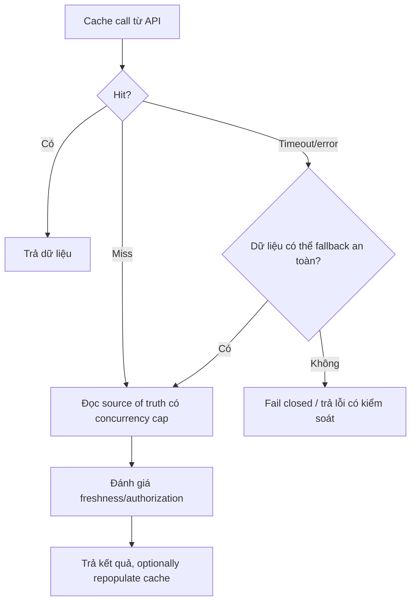

Với **product catalog** thường có thể fallback; với **rate-limit login, authorization revocation hoặc critical lock**, fail-open làm mất lớp bảo vệ. Quyết định fail-open/fail-closed là một **business/security policy**, không phải chỉ một đoạn `try-catch`.

### 12.2. Multi-AZ và automatic failover

**Valkey/Redis OSS node-based:** Cấu hình replication group có primary + replicas, bố trí trên ít nhất hai AZ, bật `AutomaticFailover` và `MultiAZ` theo hỗ trợ. Nếu primary mất, ElastiCache promote một replica và tạo replica thay thế theo quy trình. Trong khoảng failover:

- Reads/writes có thể gặp timeout/lỗi tạm thời.
- Client phải retry **bounded** với backoff và refresh DNS/topology.
- Async replica lag có thể khiến những writes gần lúc lỗi không xuất hiện ở new primary.
- Cần theo dõi replication lag, failover events và business-side effects.

**Memcached node-based:** Không có native replication/automatic failover; khi node mất, client remap keys và tự rehydrate cache từ DB. Serverless Memcached quản lý availability khác node-based, nhưng nghiệp vụ vẫn cần chấp nhận **cache misses** và test outage.

**Serverless:** AWS tự phân phối cache để tăng HA; người dùng không trực tiếp chọn mỗi shard replica/AZ như node-based. Tuy nhiên serverless availability **không phải** bảo đảm cache keys sống mãi: eviction, TTL và failure behavior vẫn tồn tại. Có thể lựa chọn snapshots tùy engine và restore thành cache mới.

### 12.3. Backups: phân biệt deployment type

| Cấu hình | Automatic/manual snapshots | Có restore cache từ snapshot? | Ghi chú |
| --- | --- | --- | --- |
| **Valkey Serverless** | **Có** | **Có** | Snapshot không ảnh hưởng workload theo mô tả dịch vụ. |
| **Redis OSS Serverless** | **Có** | **Có** | Cross-compatible theo điều kiện version. |
| **Memcached Serverless** | **Có** | **Có** | Tính năng AWS mới, khác Memcached node-based. |
| **Valkey node-based** | **Có** | **Có** | Backup có thể ảnh hưởng tài nguyên node (memory/fork), cân nhắc replica. |
| **Redis OSS node-based** | **Có** | **Có** | Tương tự Valkey node-based. |
| **Memcached node-based** | **Không** có ElastiCache node-based snapshot feature. | Không theo cơ chế này. | Rebuild từ DB/application hoặc migration strategy. |

ElastiCache snapshots được lưu trên hạ tầng S3 do dịch vụ quản lý, không phải một file trong bucket của ứng dụng mà bạn tùy ý đọc như JSON. Khi restore thường tạo **cache mới**, cần kiểm tra engine/version, endpoint, SG, users/TLS và ứng dụng cutover. **Backup snapshot của cache không phải RDS PITR**; giữa hai snapshots có thể mất thay đổi, và có thể mất/cache rebuild tùy use case.

Nguồn: [Snapshot and restore](https://docs.aws.amazon.com/AmazonElastiCache/latest/dg/backups.html) và [Scheduling automatic backups](https://docs.aws.amazon.com/AmazonElastiCache/latest/dg/backups-automatic.html).

### 12.4. Snapshot trước maintenance và DR runbook

1. Xác định **cache có data cần giữ không** hay có thể warm lại từ source.
2. Kiểm tra backup retention/manual snapshot state, KMS/access permissions.
3. Với node-based Valkey/Redis OSS, cân nhắc snapshot từ **replica** để giảm ảnh hưởng lên primary theo hướng dẫn AWS.
4. Restore vào **cache mới trong private VPC**, gắn user group/SG/endpoint phù hợp.
5. Dùng test client đọc vài key có known values và sample GET/SET có kiểm soát.
6. Nếu dữ liệu cache có thể stale, invalidate/flush **chỉ trên cache mới** hoặc rebuild theo source; không mở lỗi stale trong production.
7. Cutover cấu hình client endpoint và theo dõi miss rate/DB QPS/p95 latency.
8. Giữ khả năng rollback và dọn bản restore có approval, không xóa snapshot gốc khi chưa test.

**Không coi restore cache như khôi phục một database có strong data integrity**. Nếu session/cache không chấp nhận mất, thiết kế lại **source of truth, transactional durability, writes, backups và replay**; đừng đưa state quan trọng vào volatile keys với `allkeys-lru` rồi kỳ vọng snapshot cuối ngày luôn đủ.

### 12.5. Global datastore và cross-Region

Một số **node-based Valkey/Redis OSS** configurations hỗ trợ **Global Datastore** để replication giữa Regions, giúp giảm độ trễ đọc và DR theo tính năng/version phù hợp. Tuy nhiên:

- Replication thường **bất đồng bộ**, nên cần đo lag/RPO và xử lý conflict/failover.
- Không mặc định áp Global Datastore cho **Memcached** hoặc mọi **Serverless** cache.
- Global replication **không thay backup**: lệnh xóa/ghi sai có thể truyền sang Region khác.
- Nếu đang dùng Global Datastore, plan failover/failback, writer endpoint và data reconciliation cần review.

Với ứng dụng nhiều Regions, cache thường cần **regionalization**: mỗi Region giữ cache riêng gần services, cùng đọc từ replicated authoritative DB, kèm local invalidation. Bài toán cross-Region cache latency/replication có thể phức tạp hơn việc mỗi Region tự warm từ DB.

### 12.6. Valkey durable mode không đồng nghĩa mọi cache đều durable

Với những **node-based Valkey 9.0+ cluster mode enabled** có durability feature theo engine/version/instance support, có thể chọn **synchronous** hoặc **asynchronous** transactional log durability:

- **Sync mode** hướng đến no data loss khi failure theo những điều kiện documented, đổi lại có thể có latency/throughput tradeoff.
- **Async mode** ưu tiên write performance và có thể có một khoảng dữ liệu mới nhất chưa được durable khi failure.
- Phải dùng policies như **`noeviction`** nếu dữ liệu không được phép biến mất do memory pressure; default `volatile-lru` có thể evict keys có TTL.
- Cần thiết kế snapshots/restore, access control, app transaction/idempotency và backup retention riêng.

Chỉ chọn durability khi nghiệp vụ thực sự cần **cache làm data store đáng tin cậy** và đã so sánh với MemoryDB/RDS/DynamoDB. Đối với cache thông thường, thêm durability có thể tăng chi phí/latency mà không giải quyết được **cache invalidation**.

## 13. Giám sát CloudWatch: metrics cho engine và deployment

### 13.1. Node-based Valkey/Redis OSS

Trong namespace `AWS/ElastiCache`, nên theo dõi theo **CacheClusterId, CacheNodeId** hoặc shard/node dimensions được AWS hỗ trợ:

| Metric | Phản ánh | Hướng xử lý |
| --- | --- | --- |
| `CacheHits` / `CacheMisses` | Hit/miss trên engine. | Phân tích ratio và latency app; không chỉ nhìn một giá trị tuyệt đối. |
| `EngineCPUUtilization` | CPU dùng cho engine processing path. | Hot shard, high-cost commands, pipeline, scale. |
| `CPUUtilization` | Tổng CPU node, gồm nhiều threads/OS. | Host/overhead; kết hợp EngineCPU và node size. |
| `DatabaseMemoryUsagePercentage` | Tỷ lệ memory dùng cho dataset theo engine semantics. | Tăng nodes/shards, TTL/eviction/tối ưu payload. |
| `BytesUsedForCache` | Bộ nhớ engine dùng lưu data theo định nghĩa metric. | Size planning và memory growth. |
| `FreeableMemory` / `SwapUsage` | OS memory và swap. | Memory pressure/buffers, sizing. |
| `Evictions` | Keys bị evict do memory pressure. | Kiểm tra policy và hit-rate/latency impacts. |
| `CurrConnections` / `NewConnections` | Connections hiện tại/mới. | Reconnect storms, pool oversizing, leak. |
| `ReplicationLag` | Độ trễ replicas từ primary khi metric áp dụng. | Stale reads/HA RPO. |
| `NetworkBytesIn` / `NetworkBytesOut` | Network throughput. | Payload lớn, saturation, large GET/MGET. |
| `SuccessfulReadRequestLatency` / `SuccessfulWriteRequestLatency` | Latency phần xử lý thành công từ phía cache. | Track trend, compare application end-to-end latency. |

**CPU lưu ý:** Với node types mới có enhanced I/O, CPUUtilization của OS có thể khác EngineCPUUtilization; AWS khuyến nghị xem **EngineCPUUtilization** để hiểu engine thread load theo tính năng. Không dùng ngưỡng một size CPU cố định cho mọi engine/node; kiểm tra [Which metrics should I monitor?](https://docs.aws.amazon.com/AmazonElastiCache/latest/dg/CacheMetrics.WhichShouldIMonitor.html).

### 13.2. ElastiCache Serverless

Serverless dùng namespace `AWS/ElastiCache`, nhưng **dimension `clusterId`** tương ứng serverless cache name, khác node-based `CacheClusterId`. Các chỉ số:

| Metric | Mục đích |
| --- | --- |
| `CacheHitRate` | Tỷ lệ hit 0..1 từ hits/(hits+misses) trong khoảng theo dịch vụ. |
| `BytesUsedForCache` | Data storage consumed, kể cả indexes theo engine. |
| `ElastiCacheProcessingUnits` | ECPUs tiêu thụ bởi requests, quan trọng cho bill và capacity. |
| `SuccessfulReadRequestLatency` / `SuccessfulWriteRequestLatency` | Server-side operation latency. |
| `TotalCmdsCount` | Số commands được thực hiện. |
| `ThrottledRequests` hoặc throttling-related metrics theo engine/version | Nguy cơ chạm throughput/usage limits. |

Kiểm tra metrics tên/thống kê đúng tài liệu và cache type: Valkey/Redis OSS vs Memcached serverless có một số chỉ số khác nhau. **Đừng dùng node-based per-node dashboard cho serverless** rồi kết luận không có data. Nguồn: [Serverless Valkey/Redis metrics](https://docs.aws.amazon.com/AmazonElastiCache/latest/dg/serverless-metrics-events-redis.html).

### 13.3. Node-based Memcached

Memcached dùng `AWS/ElastiCache` node metrics và Memcached-specific:

- `GetHits` / `GetMisses`, `CmdGet`, `CmdSet`.
- `Evictions` và `Reclaimed` (tùy engine/metrics).
- `BytesUsedForCacheItems`, `CurrItems`, `CurrConnections`.
- `CPUUtilization`, `NetworkBytesIn/Out`, traffic per node.

Memcached có **slab allocator**, phân phối memory theo item sizes; có thể thấy evictions trong một số slab classes dù node còn bộ nhớ tổng ở chỗ khác. Tối ưu cần đo **item size distribution** và client consistent hashing, không chỉ tăng tổng node RAM.

### 13.4. Theo dõi từ phía ứng dụng Java

Cache metrics chỉ cho thấy phần server xử lý. Ở Spring Boot/Micrometer nên thêm:

| App metric | Tại sao cần |
| --- | --- |
| `cache_hit_count` / `cache_miss_count` theo cache namespace. | Nắm tỷ lệ thật của endpoint/business key. |
| `cache_request_duration_seconds` p95/p99. | Bao gồm network, TLS/cluster redirects, serialization, client queueing. |
| `cache_errors_total` theo timeout/ACL/OOM/CONNECT. | Cảnh báo outage trước khi database gánh toàn tải. |
| `cache_fallback_db_queries_total`. | Tính overload của source DB. |
| `cache_refresh_duration_seconds` và stampede suppressed count. | Đo preload/proactive refresh hiệu quả. |
| `keyspace_bytes_estimate` / average payload bytes (không log key values). | Tránh store large serialized blobs. |
| `cache_invalidation_failures_total`. | Phát hiện stale data do invalidation trễ. |

**Không dùng key value/userId/tenantId thô làm high-cardinality metrics labels**, vì có thể vừa lộ PII vừa làm CloudWatch/Prometheus tốn phí. Dùng **cache_name** và **operation** có số lượng label giới hạn.

### 13.5. Alert theo hậu quả nghiệp vụ

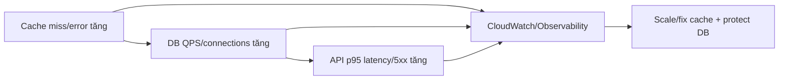

Các cảnh báo nên gồm:

1. Cache hit rate giảm bất thường **trong traffic đủ lớn**.
2. Engine CPU, memory pressure, evictions/hot shard gần saturation.
3. Throttles/errors/OOM/reconnect storm tăng.
4. Database fallback load vượt budget khi cache lỗi.
5. API p95/p99 latency và transaction success rate giảm.
6. HA/failover/restart/auth/KMS events không mong muốn.
7. Serverless ECPU/data usage hoặc node-hours tăng khác baseline.

Mỗi alert cần **owner, SLO, thời gian quan sát, ngưỡng, runbook và suppression trong bảo trì**. Không khẳng định cache khỏe chỉ vì `CacheHitRate=99%` nếu 1% còn lại là requests quan trọng hoặc giá trị cache stale.

## 14. FinOps: chọn cache theo tổng chi phí ứng dụng

### 14.1. Những khoản phí cần dự toán

| Hạng mục | Khi nào phát sinh | Điều khiển |
| --- | --- | --- |
| **Node-based node-hours** | Mỗi primary/replica node chạy theo node type/time. | Sizing, autoscaling options, reserved-node pricing khi đủ điều kiện. |
| **Serverless data storage** | Dung lượng cache data được giữ theo đơn vị tính phí. | TTL, key cardinality, schema/payload compression khi cần. |
| **Serverless ECPUs** | Đọc/ghi/commands tiêu tốn compute/network. | Optimize commands, batching, trim payload, near-cache. |
| **Backups/manual snapshots** | Dữ liệu được lưu theo retention và engine/deployment. | Retention phù hợp, dọn test snapshots theo approval. |
| **Cross-AZ/Region transfer** | Traffic giữa services/cache replicas hoặc cross-Region data movement theo pricing. | Kiểm tra network placement/transfer policy, không bỏ HA vì muốn tránh transfer. |
| **CloudWatch logs/metrics** | Log ingestion/storage, custom metric labels, alarms. | Redaction, retention, low-cardinality labels. |
| **KMS/Secrets Manager** | Customer-managed encryption/auth credentials, API requests theo pricing. | Thiết kế key rotation/secret retrieval hợp lý. |
| **Source DB** | Misses và fallback tăng DB queries/IOPS/RCUs. | Phân tích total system cost, không chỉ hóa đơn cache. |
| **Engineering/operations** | Client topology, code migration, on-call, patching/DR. | Serverless giảm manual capacity nhưng không xóa toàn bộ trách nhiệm app. |

**Không khẳng định một engine có giá rẻ hơn cố định trong mọi Region/time.** AWS công bố ưu đãi Valkey so với Redis OSS ở các cấu hình nhất định, nhưng cần dùng **AWS Pricing Calculator**, bảng giá hiện hành, dự tính ECPU/GB-hours/node-hours và thực tế Cost Explorer. Đừng đưa con số ngân sách từ một Region sang Region khác không kiểm tra.

### 14.2. Bài toán so sánh Serverless và node-based

Giả sử một hệ thống có:

```text
Ngày bình thường:  5,000 GET/s và ~40 GiB hot dataset
Giờ khuyến mãi:    120,000 GET/s trong 30 phút
P95 target:        dưới 20 ms end-to-end cache retrieval
RTO khi cache lỗi: trong 15 phút, DB phải được bảo vệ
```

Đừng so bằng “5.000 QPS” đơn lẻ. Một phương pháp:

1. Dùng prototype với 100% commands thực (GET/MGET/HGET/ZRANGE), payload sizes và burst shape.
2. Đo ECPU và data used của Serverless, throttling/latency.
3. Benchmark node-based với 1–N shards, primary/replicas Multi-AZ, đo CPU/memory/network.
4. Tính phí ở **cả peak và off-peak**, cộng backup, transfer, logs và chi phí source DB misses.
5. Kiểm tra RTO/RPO/failover và nhân sự trực vận hành.
6. Chọn phương án đạt SLO với chi phí kỳ vọng và rủi ro phù hợp, không chỉ giá cache node-hour nhỏ nhất.

### 14.3. Cache stampede có thể làm “tiết kiệm cache” thành quá tải DB

Nếu bạn giảm cache size/TTL quá mạnh để tiết kiệm, misses tăng và RDS phải chạy nhiều truy vấn đắt. Một mô hình chi phí khái niệm:

\[
\text{Total cost} =
\text{Cache cost}
+ \text{DB cost}
+ \text{Network/Monitoring cost}
+ \text{Incident cost}
\]

**Tối ưu ở chi phí mỗi giao dịch thành công**, không tối ưu chi phí cache riêng. Nếu DB mở rộng 10 lần vì cache misses, có thể tốn hơn cache node lớn/optimized TTL. Ngược lại, cache hàng trăm GiB dữ liệu hầu như không được đọc cũng phí.

### 14.4. Tags, budgets và cleanup

Thực hành:

- Tag `Environment`, `Application`, `Owner`, `CostCenter`, `ExpiresAt` cho **lab/test resources**.
- AWS Budgets alert khi Serverless ECPU/storage hoặc node-hours vượt baseline.
- Kiểm kê snapshot retention và cache không có traffic nhưng vẫn chạy.
- Điều tra `Evictions`/miss ratio trước khi resize xuống.
- Dọn lab qua IaC/approval, không xóa cache production chỉ vì có ít traffic trong một ngày.
- Nếu chọn durability/snapshots dài hạn, cộng phí và backup test jobs vào quyết định.

## 15. Nâng cấp engine, chuyển Redis OSS sang Valkey và rollback

### 15.1. Khi nào cần chuyển?

Các lý do có thể gồm Valkey được hỗ trợ mới hơn, tối ưu hiệu năng/chi phí, lifecycle Redis OSS, tính năng mới hoặc định hướng open-source. **Không bắt buộc migration chỉ vì tên thư viện Spring là “Redis”.** Ứng dụng có thể giữ Redis-compatible client trong khi engine backend chạy Valkey nếu commands/protocol phù hợp.

### 15.2. Ma trận tương thích trước migration

| Nhóm kiểm tra | Vì sao quan trọng? |
| --- | --- |
| Engine versions và parameter group family | Custom Redis OSS parameter group không phải lúc nào dùng ngay với Valkey new major version. |
| Client driver/protocol | Spring Data Redis/Lettuce/GLIDE/Jedis version hỗ trợ engine commands và cluster topology. |
| Lua/functions/ACL | Unsupported commands hoặc differences có thể gây lỗi runtime. |
| Serialization | Snapshot/cache data có thể encode schema cũ/codec khác. |
| Cluster mode | Client single-node không tự thành cluster-aware khi chuyển sang Serverless. |
| TLS/IAM credentials | IAM token refresh và RBAC user/group cần tương thích sau upgrade. |
| Shards/replication/HA | Upgrade/failover có thể ngắt connection ngắn, DNS/IP đổi. |
| Backup/restore | Tạo snapshot, thử restore, biết lộ trình rollback của engine/version. |
| Feature tier/version | Vector/search/durability/advanced commands không hỗ trợ trên mọi versions. |

### 15.3. Redis OSS → Valkey: quá trình được AWS hỗ trợ

AWS có **cross-engine upgrade** từ Redis OSS sang Valkey theo các phiên bản/cấu hình được hỗ trợ, có thể giữ endpoint DNS trong nhiều trường hợp nhưng underlying IP thay đổi khi upgrade node-based. Với Redis OSS 5.0.6+ AWS mô tả **gián đoạn nhỏ** khi failover; phiên bản cũ hơn có thể cần propagation lâu hơn. Phải test trong staging, không hứa “zero downtime” cho mọi tải.

Ví dụ AWS CLI **thay đổi production nếu chạy thật**, chỉ minh họa concept:

```bash
# Chỉ chạy trong account lab/đã phê duyệt; xác nhận engine version availability.
aws elasticache modify-replication-group \
  --region ap-southeast-1 \
  --replication-group-id lab-redis-to-valkey \
  --engine valkey \
  --engine-version 9.0
```

Với **custom parameter group**, phải có Valkey-compatible parameter group và truyền thêm `--cache-parameter-group-name`. Với Serverless migration khác CLI: `modify-serverless-cache --engine valkey --major-engine-version ...` theo API và support level. Cần snapshot/backup, staged deployment, feature compatibility và alerting. Nguồn: [Upgrading engine versions including cross-engine upgrades](https://docs.aws.amazon.com/AmazonElastiCache/latest/dg/VersionManagement.HowTo.html).

### 15.4. Rollback không phải luôn “chọn phiên bản cũ”

AWS generally **không cho downgrade** một node-based cluster xuống phiên bản engine thấp hơn chỉ bằng version change. Có ngoại lệ/đường rollback cross-engine được hỗ trợ trong những trường hợp cụ thể, ví dụ Valkey 7.2 quay lại Redis OSS 7.1 theo AWS documentation. **Đừng dựa vào ngoại lệ này** để lập runbook rollback Valkey 9.0 về Redis OSS hoặc engine major thấp bất kỳ.

Phương án rollback an toàn hơn trong nhiều trường hợp:

1. Giữ bản backup/snapshot trước migration và kiểm tra restore trong lab.
2. Canary một nhóm ứng dụng hoặc chuyển data sang cluster **mới** nếu cần topology/version khác.
3. Sẵn sàng DNS/app config rollback và hiểu cache data được warm/rebuilt thế nào.
4. Nếu cache chứa state quan trọng, thiết kế data migration/dual-write/ordering rõ ràng, không xóa cluster cũ trước sign-off.
5. Theo dõi `CacheHitRate`, `Errors`, p95 latency, DB fallback, session loss và traffic.

### 15.5. Từ node-based → Serverless hoặc ngược lại

ElastiCache có khả năng **restore backup Valkey/Redis OSS** giữa deployment types theo các điều kiện và còn có online-migration options cho một số nguồn self-managed. Tuy nhiên:

- Serverless Valkey/Redis OSS sử dụng **cluster mode enabled** → phải test client.
- Snapshot restore tạo cache/endpoint mới; không tự cutover DNS trong ứng dụng.
- Migration qua restore là một **checkpoint**, có thể mất những writes sau mốc nếu không có stream/dual write/online migration thiết kế.
- Parameter groups, user groups/ACL, IAM authentication và backups cần cấu hình lại theo type đích.
- RTO/RPO của traffic thật phải đo, không giả định một lần “restore available” là đã chuyển xong.

Nếu một app chưa cần cluster mode và đang dùng Redis OSS single-node, chuyển sang Serverless **không chỉ là sửa hostname**; trước hết cần library client cluster-aware và cơ chế xử lý redirects/slot keys.

### 15.6. Không dùng cache migration để thay đổi source of truth

Nếu dữ liệu in-memory hiện là authoritative, cần một **data-migration plan** khác với việc xóa và warm cache:

- Đánh giá durability feature/backup, transactional semantics, idempotency.
- Đảm bảo tối thiểu một consistent snapshot hoặc event-log/DB backup có thể recover.
- Chặn/điều phối writes tại cutover, tránh split brain giữa hai clusters.
- Test fallback khi một cache bị unreachable, Redis cluster resharding, IAM token expiry.
- Có tiêu chí dữ liệu không mất, latency/throughput, rollback và post-cutover monitoring.

Cache là tầng tối ưu hóa, nhưng **khi biến nó thành nguồn dữ liệu chính, kỹ thuật vận hành phải đạt chuẩn data store**.

## 16. Xử lý sự cố: cache chậm, mất kết nối hoặc dữ liệu sai

### 16.1. Bảng chẩn đoán theo triệu chứng

| Triệu chứng | Nguyên nhân cần kiểm tra | Bằng chứng và cách xử lý |
| --- | --- | --- |
| `Connection timeout` tới private cache. | Sai VPC/subnet/SG/route/DNS, cổng không mở, cache chưa available. | `describe-serverless-caches`/`describe-replication-groups`, VPC Flow Logs/SGs, kiểm tra port từ workload SG. |
| Serverless connect được `6379` nhưng `6380` timeout. | SG chỉ mở 6379; client thử read-optimized port/topology. | SG inbound 6379/6380 từ app SG, client settings, AWS docs. |
| `NOAUTH Authentication required`. | Client không gửi user/token hoặc default user policy đã đổi. | User group/ACL, credentials provider, secrets đúng deployment. |
| `WRONGPASS invalid username-password pair`. | Sai username/password/ACL, password rotation không đồng bộ. | Kiểm tra user status, secret version và client credentials. |
| IAM auth sau 15 phút reconnect thất bại. | Tái dùng SigV4 token quá hạn thay vì generate token mới. | Credentials provider, token lifetime, GLIDE IAM support, IAM policy. |
| IAM auth sau 12 giờ socket đứt. | Connection lifetime giới hạn trong IAM auth. | Client logs/re-auth/refresh/reconnect, backoff. |
| `NOPERM` khi `GET/SET`. | User ACL thiếu command hoặc key pattern. | `UserGroupId`/ElastiCache access string, key names, least privilege. |
| `MOVED` / `ASK` hoặc `CROSSSLOT`. | Client không cluster-aware, keys không cùng slot, resharding. | Cluster topology refresh, hash tags, chọn đúng client. |
| `OOM command not allowed`. | Memory đầy, `noeviction` hoặc `volatile-*` không có keys evictable. | `DatabaseMemoryUsagePercentage`, `Evictions`, TTL coverage, memory policy. |
| `Evictions` tăng nhưng freeable memory còn. | Engine maxmemory/reserved memory, shard-specific pressure, slab allocation. | Per-node/slot metrics, key size, parameter group, TTL policy. |
| Hit rate giảm sau deploy. | Key prefix/schema version đổi, TTL hết đồng loạt, cluster reshard, cache flush. | Key samples redacted, client version/config, cache warmup, DB fallback. |
| Một shard CPU 95%, tổng cluster CPU 30%. | **Hot key/hash slot**, skewed distribution, high-cost commands. | `EngineCPUUtilization` per shard, key distribution, hot keys, pipeline. |
| Redis primary writes thành công nhưng replica trả cũ. | **Asynchronous replication** và read-from-replica. | Replica lag, chọn primary cho read-after-write, consistency requirements. |
| API 500 khi cache outage. | Code coi cache là dependency bắt buộc, không có fallback/circuit breaker. | Spring logs, DB traffic, bounded fallback, security fail policy. |
| API 500 dù cache vẫn xanh. | RDS bị overload do misses, serialization failure hoặc stale data bug. | API p95, DB QPS/connection count, application cache counters. |
| Session mất sau node failover. | Cache dùng làm source of truth, async replication loss, session TTL/eviction. | Replication lag, backup, session store/design, versioned session policy. |
| Memcached node-based không có snapshot. | Engine/deployment **không hỗ trợ** native snapshot. | Đổi sang Memcached Serverless/Valkey hoặc rebuild từ DB theo design. |
| Cost tăng trong Serverless nhưng hits không đổi. | Large payloads/high-cost commands, ECPU tăng, keys sống quá lâu. | ECPU, BytesUsedForCache, cost dashboard và command mix. |
| Restore snapshot xong app không kết nối. | Cache endpoint mới, SG/user group/KMS/engine/SSL config khác nguồn. | Describe restored cache, TLS test, IAM/ACL and credentials. |
| Cluster mode disabled client dùng Serverless. | Serverless Valkey/Redis OSS yêu cầu cluster-aware client. | Spring/Lettuce cluster config hoặc GLIDE cluster client. |
| Cross-Region dữ liệu cũ dù “replication enabled”. | Replica lag hoặc Global Datastore async replication. | Region metrics, read routing, RPO requirements. |

### 16.2. Runbook điều tra trong 10 bước

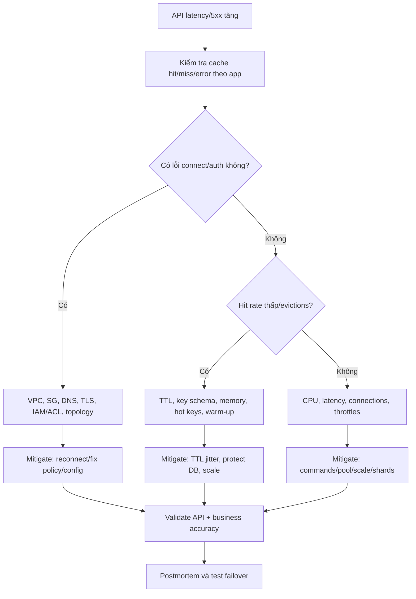

1. **Xác định scope:** App/service, Region, VPC, cache name, engine/type, thời gian bắt đầu sự cố.
2. **Kiểm tra mức ảnh hưởng:** API latency/5xx, rate-limit failures, login/session impact, DB pressure.
3. **Đọc cache config:** `Status`, engine/version, endpoints, Multi-AZ, SG, user groups, TLS/KMS.
4. **Xem metrics:** app hit/miss/timeouts, CloudWatch per-node/per-shard hoặc Serverless ECPU/memory.
5. **Kiểm tra network:** đúng port từ source SG, private route/DNS, VPC Flow Logs; không mở public inbound.
6. **Kiểm tra auth:** ACL user/password/Secrets Manager rotation, IAM `elasticache:Connect`, SigV4 token.
7. **Kiểm tra memory/commands:** TTL missing, evictions, key size, hot spots, `noeviction` OOM.
8. **Giảm blast radius:** cache bypass có giới hạn, per-key single-flight, DB rate limit/circuit breaker, scale khi cần.
9. **Validate recovery:** cache reconnect, p95 latency, hit rate, DB QPS và business correctness, session risk.
10. **Điều tra nguyên nhân gốc:** deployment diff, engine upgrade, parameter/ACL changes, CloudTrail, backup/DR tests.

**Không nên giải quyết mọi lỗi bằng `FLUSHALL` hoặc restart cả cluster.** Có thể biến một vấn đề hot key thành full-cache miss storm và làm DB outage. Cân nhắc key-specific invalidation/version bump, rollback client hoặc scale shard có kế hoạch.

### 16.3. Case study: Cache hit cao nhưng giá sản phẩm đã sai

**Sự cố:** Một sản phẩm giảm giá từ 100.000 xuống 80.000 VND lúc 09:00. Cache key có TTL 6 giờ, app không invalidate sau DB commit. Tới 09:30 user vẫn thấy 100.000 VND, `CacheHitRate=99%`.

Giải thích:

- Redis/Valkey hoạt động đúng theo cache contract; **dữ liệu nghiệp vụ sai vì invalidation strategy thiếu**.
- Tăng node/replica hoặc chuyển từ Redis OSS sang Valkey **không sửa stale price**.
- Cần **invalidate key sau commit** hoặc event-driven invalidation với outbox, TTL phù hợp freshness SLO.
- Ở bước checkout, tính giá tại **authoritative DB** trong transaction, không tin cached display price.
- Business monitoring phải gồm **catalog price mismatch** hoặc synthetic check, không chỉ hit rate.

### 16.4. Case study: Cache stampede đánh sập RDS

Một chương trình marketing làm 2 triệu người dùng mở cùng một product. Key `product:v3:hot` hết TTL lúc 10:00:00. 20.000 concurrent requests cùng `GET` miss và gọi RDS. RDS max connections tăng, API 503.

**Khắc phục có kiểm soát:**

1. Ngăn tăng traffic DB bằng **single-flight/distributed refresh lease** và concurrency limit.
2. Dùng stale-while-revalidate nếu cho phép giá trị hơi cũ; **không** cho stale giá checkout.
3. Bật TTL jitter/proactive refresh cho hot keys, cân nhắc near-cache.
4. Kiểm tra RDS capacity và có fallback graceful degradation.
5. Sau sự cố, load test cold-cache scenario với burst thật; không chỉ benchmark cache hit.

### 16.5. Case study: IAM token static sau 15 phút

ECS task lấy IAM auth token một lần khi startup, lưu như mật khẩu trong Lettuce config. Ban đầu GET/SET hoạt động; sau nhiều phút đến lúc TCP reconnect, AUTH dùng lại token đã expired và fail.

**Cách sửa:** Dùng credentials provider generate **new SigV4 token trên mỗi connect/reauth**; GLIDE IAM support hoặc custom provider được test. Mở rộng IAM policy `elasticache:Connect` đúng cache/user, verify TLS, không hard-code static token vào task definition. Khi connection sống dài, handle reauth/disconnect 12 giờ theo AWS.

### 16.6. Case study: Chọn Memcached vì tưởng có HA như Redis

Một ứng dụng lưu session chỉ trong **Memcached node-based** với ba nodes, nhưng không có source-of-truth hoặc session regeneration policy. Khi một node hỏng, khoảng một phần ba sessions mất; application ép users login lại.

**Gốc vấn đề:** Memcached node-based sharding **không có replicas** như Valkey. Thêm nodes không đảm bảo giữ session khi node chết. Các lựa chọn:

- Chấp nhận session loss trong SLO và làm UX recovery tốt hơn.
- Chuyển session store sang Valkey/Redis OSS Multi-AZ với TTL/ACL/backup phù hợp.
- Dùng signed/short-lived tokens và server-side session revocation design khác.
- Không biến sessions thành nơi lưu trạng thái giao dịch không thể tái tạo.

### 16.7. Case study: Hot slot do hash tag dùng sai

Một developer gán mọi key vào `{global}` để chạy multi-key Lua operations:

```text
shop:{global}:product:1
shop:{global}:product:2
shop:{global}:product:300000
```

Mọi key được hash vào **một Redis Cluster hash slot**, nên dù tăng 8 shards, shard chứa slot đó vẫn quá tải. Cách sửa là **hash tag theo entity/aggregate** (`{order-123}`, `{user-456}`) và thiết kế transactions/multi-key commands trong phạm vi đúng; còn nếu workflow cần multi-entity transaction, dùng database.

## 17. Bài tập thực hành và tình huống ra quyết định

> **Quy tắc lab:** Chỉ tạo ElastiCache resources trong AWS account được cấp phép và có ngân sách. Cache Serverless/node-based có thể tạo phí ngay cả khi ít traffic. Nếu không có lab, hãy làm **bảng quyết định, script dự kiến và expected outputs** trên giấy; không cần chạy lệnh vào production.

### Bài tập 1 — Chọn Valkey, Redis OSS hay Memcached

Ba nhóm có nhu cầu:

1. **Catalog service:** Spring Boot, 2 triệu products, Redis-compatible key-value cache, TTL 60–300s, traffic biến động.
2. **Gaming leaderboard:** cập nhật ranking theo score, cần sorted sets và atomic increments.
3. **Image metadata cache:** chỉ lưu opaque JSON values, không cần lists/sets/scripts, dữ liệu có thể rebuild.

Đối với mỗi nhóm:

- Chọn **Valkey/Redis OSS/Memcached** và giải thích engine features.
- Nếu chọn Valkey, nêu lợi ích/rủi ro khi dùng engine version mới vs client Java cũ.
- Xác định Serverless hay node-based, Multi-AZ/replication, expected cache miss handling.
- Chọn TTL/invalidation và cách bảo vệ DB khi cache lỗi.
- Thiết kế dashboard hit rate, p95 latency, memory/ECPU/evictions và cost.
- Nếu nhóm chỉ có một server JVM, khi nào Caffeine local-cache có thể đủ?

**Tiêu chí đạt:** Không chọn Memcached cho sorted sets và không dùng cache thuần làm authoritative payment ledger.

### Bài tập 2 — Serverless so với node-based trong peak traffic

Workload:

```text
Traffic bình thường:  2,000 GET/s
Traffic khuyến mãi:   100,000 GET/s
Data hot set:         20 GiB
Max acceptable stale: 60 giây
SLO p95:              dưới 20 ms cho cache retrieval
```

Hãy:

1. Nêu lý do Serverless phù hợp và lý do node-based vẫn có thể tốt hơn.
2. Lập kế hoạch benchmark để đo **ECPU/bytes, EngineCPUUtilization/memory, p95, hot shards**.
3. Đề xuất 2 AZ/replica topology cho node-based Valkey.
4. Nếu dùng Serverless Valkey, client cần hiểu cluster mode thế nào?
5. Tính tổng hệ thống cost và DB miss impacts, không chỉ cache bill.
6. Nêu tình huống Memcached có thể hợp lý nếu data structures không cần Redis.

### Bài tập 3 — Viết cache-aside và TTL jitter

Một Spring Boot service đọc `Product` từ RDS:

1. Viết hàm `getProduct(id)` thực hiện `GET → DB fallback → SETEX`.
2. Thêm TTL cơ sở 60s với jitter ngẫu nhiên 0–10s.
3. Định nghĩa negative-cache sentinel cho product ID không tồn tại với TTL 10s.
4. Phân biệt DB `not-found` với DB timeout, không cache timeout như 404.
5. Ghi metrics hit/miss/cache_error và latency, che PII.
6. Định nghĩa cách invalidate sau DB commit khi giá đổi.
7. Nếu 2.000 requests cùng miss một key, dùng single-flight/refresh lock thế nào?

**Tiêu chí đạt:** Cache outage không tự khiến product read thất bại nếu DB đủ capacity, đồng thời lỗi authorization không được fail-open.

### Bài tập 4 — Cluster mode, hash slots và multi-key operations

Có những keys:

```text
order:{123}:status
order:{123}:items
order:{124}:status
user:{123}:profile
```

Trả lời:

- Hai keys nào cùng hash slot do `{123}`?
- Vì sao `order:{123}:status` và `user:{123}:profile` **cũng cùng slot** dù khác business domain?
- Điều gì xảy ra nếu chạy multi-key Lua command trên `order:{123}:status` và `order:{124}:status`?
- Vì sao không nên đặt tất cả keys dưới `{global}`?
- Node-based cluster mode disabled khác enabled thế nào?
- Serverless Valkey/Redis OSS yêu cầu kiểu client nào?
- Khi resharding, client cần xử lý `MOVED/ASK` và refresh topology ra sao?

**Tiêu chí đạt:** Hiểu hash tags chỉ giải quyết co-location kỹ thuật, không thay business transaction boundary.

### Bài tập 5 — Bảo mật IAM/TLS/RBAC

Một ECS service `catalog-reader` chỉ cần GET keys có prefix `shop:prod:catalog:*` trên Valkey cache `orders-cache`.

1. Viết IAM identity policy cho `elasticache:Connect` tới cache ARN và user ARN, không cấp `elasticache:*`.
2. Tạo mô tả Valkey ACL chỉ cho `GET`/`MGET`/`PING` trên key prefix phù hợp.
3. Thiết kế user group gắn vào cache theo IAM auth, TLS bắt buộc.
4. Giải thích IAM token **15 phút** và connection re-auth/**12 giờ**.
5. Nếu Java process giữ static token trong environment khi startup, điều gì xảy ra khi reconnect sau 30 phút?
6. Cần dùng SGs/ports gì nếu là Serverless Valkey private VPC?
7. Nếu cache là **public endpoint Valkey 9+**, vì sao cần IAM/TLS 1.3 và khi nào nên tránh public?

**Tiêu chí đạt:** Không hard-code secret, không mở cache SG với inbound `0.0.0.0/0`.

### Bài tập 6 — Mất cache do failover

Một node-based Redis OSS deployment có **primary duy nhất**, không replica. Khi AZ bị lỗi:

1. Có automatic failover không?
2. Nếu bật Multi-AZ với primary + replica AZ khác, hành vi tốt hơn ra sao?
3. Vì sao asynchronous replication vẫn có thể mất những writes mới nhất?
4. Những retry/DNS/topology handling nào cần trong Java client?
5. Nếu toàn cache trở nên cold, RDS phải chịu điều gì?
6. Đề xuất single-flight/concurrency caps để bảo vệ RDS.
7. Nếu sessions cần không mất mát, phải thiết kế ra sao ngoài một key volatile với TTL?

### Bài tập 7 — Khác biệt backup giữa các engine

Điền `Có/Không` cho những hàng:

| Engine | Node-based snapshot | Serverless snapshot |
| --- | --- | --- |
| Valkey | ? | ? |
| Redis OSS | ? | ? |
| Memcached | ? | ? |

Tiếp tục:

1. Vì sao không nói chung “Memcached không có snapshot”?
2. Khi restore Valkey backup thành cache mới, endpoint/config/SG/user group thay đổi thế nào?
3. Snapshot có thể khôi phục tới từng giây bất kỳ như RDS PITR không?
4. Cache-aside workload có thật sự cần restore snapshot nếu DB là source of truth không?
5. Nếu cache dùng durability mode, cần điều chỉnh eviction policy và backup strategy gì?
6. Lập kế hoạch restore test và cutover.

### Bài tập 8 — Tính memory và chống eviction

Một cluster Valkey node-based:

```text
5,000,000 keys
Average JSON value size 600 bytes
Average key + metadata overhead giả định 250 bytes
Reserve 40% headroom ở cấp tính toán
```

1. Ước lượng raw dataset bytes và GB trước headroom.
2. Tính capacity sau headroom và giải thích **chưa tính** replica/buffers/fragmentation.
3. Nếu dùng 3 replicas theo HA, tổng memory footprint các bản sao ảnh hưởng thế nào?
4. Với `volatile-lru` nhưng 80% keys không TTL, điều gì xảy ra khi memory đầy?
5. Đề xuất `allkeys-lru`/`allkeys-lfu`, TTL và eviction policy theo use case.
6. Nếu 1% hot keys nhận 90% traffic, thêm shards có giúp hay cần thêm near-cache/read replicas?

### Bài tập 9 — Redis OSS → Valkey migration

Ứng dụng Spring Boot dùng Lettuce và Redis OSS 7.1 node-based, hiện có Lua scripts và một custom parameter group.

Hãy thiết kế:

1. Client/command/serialization/ACL compatibility tests.
2. Engine version và parameter group family mới.
3. Snapshot/backup trước upgrade và restore drill.
4. Staging load test với hot keys, memory, latency, reconnect/failover.
5. Quy trình `modify-replication-group --engine valkey` theo một version **có hỗ trợ trong Region**.
6. Khi nào IP endpoints đổi và ứng dụng phải refresh DNS?
7. Tại sao không mặc định downgrade Valkey 9 về Redis OSS nếu lỗi?
8. Rollback bằng cache cũ/new cache cùng kế hoạch data cutover và safety.

### Bài tập 10 — Incident tabletop: cache vừa nhanh vừa sai

Một cửa hàng có:

- ElastiCache Valkey Serverless, 98% cache hit rate.
- API catalog p95 5 ms, nhưng sản phẩm vừa giảm giá vẫn hiển thị giá cũ 2 giờ.
- Bộ phận thanh toán phải xử lý 500 giao dịch điều chỉnh.
- Một deploy mới còn làm connection count tăng và DB fallback load spike.

Đóng vai **Application owner, SRE, DBA, Security, FinOps** để:

1. Phân biệt **cache performance success** với **business correctness failure**.
2. Tìm đường write/update giá và invalidation sau DB commit.
3. Quyết định có dùng key version bump/targeted invalidation không; vì sao không dùng `FLUSHALL`?
4. Bảo vệ checkout bằng authoritative DB price.
5. Giảm reconnect storm/connection pools, đo ECPU/DB QPS.
6. Thiết lập alert stale price/synthetic business checks.
7. Ghi incident timeline, evidence, data reconciliation và phương án phòng tái diễn.

### Câu hỏi tự kiểm tra

1. Amazon ElastiCache hỗ trợ ba engines nào?
2. Valkey khác Redis OSS về định hướng và phiên bản như thế nào?
3. Tại sao Memcached phù hợp cache object đơn giản nhưng không dùng Redis sorted sets?
4. Memcached **node-based** có native replication/backup không?
5. Memcached **Serverless** có hỗ trợ snapshot theo AWS hiện hành không?
6. ElastiCache Serverless và node-based khác nhau về capacity management/cost?
7. Serverless Valkey/Redis OSS dùng cluster mode enabled hay disabled?
8. Redis Cluster có bao nhiêu hash slots?
9. Tại sao hai keys có cùng hash tag nằm cùng slot?
10. `CROSSSLOT` xuất hiện trong trường hợp nào?
11. Cluster-aware client phải xử lý `MOVED` và `ASK` thế nào?
12. Read replica bất đồng bộ có bảo đảm read-after-write nhất quán như primary không?
13. Multi-AZ automatic failover của Valkey cần topology gì?
14. Cache-aside khác write-through và write-behind ra sao?
15. Vì sao write-behind nguy hiểm với payments/tồn kho authoritative?
16. TTL có bảo đảm một key tồn tại đủ chính xác thời hạn đã đặt không?
17. `allkeys-lru` khác `volatile-lru` thế nào?
18. Khi chọn `noeviction` và memory đầy, client thấy điều gì?
19. Cache stampede là gì, làm sao tránh?
20. Negative caching khác cache lỗi database timeout thế nào?
21. Serverless ECPU đo điều gì và tại sao 100 GET khác 100 ZRANGE?
22. Vì sao tăng shards không tự xử lý hot key chỉ nằm trong một slot?
23. VPC SG và ElastiCache RBAC xử lý hai loại quyền nào?
24. IAM auth yêu cầu Valkey/Redis OSS phiên bản tối thiểu nào?
25. IAM auth token 15 phút và connection lifetime 12 giờ khác nhau ra sao?
26. Vì sao app có quyền `DescribeServerlessCaches` chưa chắc được `GET`?
27. Vì sao cache snapshot restore khác RDS PITR?
28. Valkey durable node-based mode có tự tắt eviction không?
29. CloudWatch `clusterId` cho serverless khác `CacheClusterId` node-based thế nào?
30. Vì sao tối ưu **tổng chi phí API + DB + cache** tốt hơn chỉ tối ưu giá cache?
31. Vì sao Spring `@CacheEvict` trong cùng tiến trình chưa đảm bảo invalidation khi DB commit?
32. Vì sao access control trong API vẫn bắt buộc dù cache key đã có tenant prefix?

## 18. Tài liệu AWS chính thức và checklist vận hành

ElastiCache thay đổi nhanh theo **engine version, deployment type, Region, security features và pricing**, đặc biệt với **Valkey 9.x**, **Serverless public endpoints**, Memcached Serverless snapshots và Valkey durability. Trước khi triển khai production, kiểm tra tài liệu chính thức và chạy proof-of-concept trong Region mục tiêu.

### 18.1. Tổng quan và chọn engine

- [Amazon ElastiCache — User Guide](https://docs.aws.amazon.com/AmazonElastiCache/latest/dg/WhatIs.html)
- [Comparing node-based Valkey, Redis OSS, and Memcached engines](https://docs.aws.amazon.com/AmazonElastiCache/latest/dg/SelectEngine.html)
- [Choosing between Serverless caching and node-based clusters](https://docs.aws.amazon.com/AmazonElastiCache/latest/dg/WhatIs.deployment.html)
- [Supported engine versions and upgrades](https://docs.aws.amazon.com/AmazonElastiCache/latest/dg/engine-versions.html)
- [Upgrade and cross-engine upgrade from Redis OSS to Valkey](https://docs.aws.amazon.com/AmazonElastiCache/latest/dg/VersionManagement.HowTo.html)
- [Upgrade considerations and application connection behavior](https://docs.aws.amazon.com/AmazonElastiCache/latest/dg/VersionManagement-upgrade-considerations.html)
- [Online migration to node-based ElastiCache](https://docs.aws.amazon.com/AmazonElastiCache/latest/dg/OnlineMigration.html)
- [Migrating to ElastiCache Serverless](https://docs.aws.amazon.com/AmazonElastiCache/latest/dg/migration-to-serverless-procedure.html)

### 18.2. Memory, replication, availability và backup

- [Valkey and Redis OSS configuration and limits](https://docs.aws.amazon.com/AmazonElastiCache/latest/dg/RedisConfiguration.html)
- [Cache parameter groups and eviction policies](https://docs.aws.amazon.com/AmazonElastiCache/latest/dg/ParameterGroups.Engine.html)
- [Multi-AZ with automatic failover for Valkey/Redis OSS](https://docs.aws.amazon.com/AmazonElastiCache/latest/dg/AutoFailover.html)
- [ElastiCache resilience and availability](https://docs.aws.amazon.com/AmazonElastiCache/latest/dg/disaster-recovery-resiliency.html)
- [Snapshot and restore, including Serverless Memcached](https://docs.aws.amazon.com/AmazonElastiCache/latest/dg/backups.html)
- [Automatic backups for node-based/Serverless caches](https://docs.aws.amazon.com/AmazonElastiCache/latest/dg/backups-automatic.html)
- [ElastiCache durability modes in supported Valkey configurations](https://docs.aws.amazon.com/AmazonElastiCache/latest/dg/Durability.Options.html)
- [Distributed KV caching and memory/eviction](https://docs.aws.amazon.com/AmazonElastiCache/latest/dg/distributed-kv-caching-configuration.html)

### 18.3. IAM, TLS, network và clients

- [Authentication and authorization in ElastiCache](https://docs.aws.amazon.com/AmazonElastiCache/latest/dg/auth-redis.html)
- [Role-Based Access Control (RBAC) and user groups](https://docs.aws.amazon.com/AmazonElastiCache/latest/dg/Clusters.RBAC.html)
- [ElastiCache IAM authentication](https://docs.aws.amazon.com/AmazonElastiCache/latest/dg/auth-iam.html)
- [Migrating password-based authentication to IAM](https://docs.aws.amazon.com/AmazonElastiCache/latest/dg/auth-to-iam-migration.html)
- [Legacy AUTH command authentication](https://docs.aws.amazon.com/AmazonElastiCache/latest/dg/auth.html)
- [Accessing ElastiCache clusters and replication groups](https://docs.aws.amazon.com/AmazonElastiCache/latest/dg/accessing-elasticache.html)
- [Setting up VPC/security groups and ports](https://docs.aws.amazon.com/AmazonElastiCache/latest/dg/set-up.html)
- [Connecting to Serverless Valkey public endpoint](https://docs.aws.amazon.com/AmazonElastiCache/latest/dg/connecting-public-endpoint.html)
- [Creating a Valkey Serverless public endpoint](https://docs.aws.amazon.com/AmazonElastiCache/latest/dg/serverless-public-endpoints-chapter.html)
- [Troubleshooting cache connections](https://docs.aws.amazon.com/AmazonElastiCache/latest/dg/TroubleshootingConnections.html)

### 18.4. Monitoring, CLI và pricing

- [CloudWatch metrics to monitor for ElastiCache](https://docs.aws.amazon.com/AmazonElastiCache/latest/dg/CacheMetrics.WhichShouldIMonitor.html)
- [ElastiCache CloudWatch node/cluster metrics](https://docs.aws.amazon.com/AmazonElastiCache/latest/dg/CloudWatchMetrics.html)
- [Serverless Valkey/Redis OSS metrics and events](https://docs.aws.amazon.com/AmazonElastiCache/latest/dg/serverless-metrics-events-redis.html)
- [Serverless Memcached metrics and events](https://docs.aws.amazon.com/AmazonElastiCache/latest/dg/serverless-metrics-events.memcached.html)
- [Memcached node metrics](https://docs.aws.amazon.com/AmazonElastiCache/latest/dg/CacheMetrics.Memcached.html)
- [ElastiCache troubleshooting best practices](https://docs.aws.amazon.com/AmazonElastiCache/latest/dg/wwe-troubleshooting.html)
- [AWS CLI — create-serverless-cache](https://docs.aws.amazon.com/cli/latest/reference/elasticache/create-serverless-cache.html)
- [AWS CLI — create-replication-group](https://docs.aws.amazon.com/cli/latest/reference/elasticache/create-replication-group.html)
- [AWS CLI — describe-serverless-caches](https://docs.aws.amazon.com/cli/latest/reference/elasticache/describe-serverless-caches.html)
- [AWS CLI — describe-replication-groups](https://docs.aws.amazon.com/cli/latest/reference/elasticache/describe-replication-groups.html)
- [Amazon ElastiCache pricing](https://aws.amazon.com/elasticache/pricing/)
- [Amazon ElastiCache FAQs](https://aws.amazon.com/elasticache/faqs/)

### 18.5. Checklist trước khi triển khai production

| Câu hỏi | Bằng chứng cần có |
| --- | --- |
| **Engine đã đúng?** | Valkey/Redis OSS/Memcached theo required data structures, client compatibility, HA và features. |
| **Deployment type đã đúng?** | Serverless/node-based benchmark với traffic, data set, node/ECPU cost và SLO. |
| **Cache data có tái tạo được không?** | Source of truth rõ ràng, TTL/invalidation, backup/durability khi cần. |
| **Consistency được định nghĩa?** | Staleness budget, read-after-write, cache-aside/invalidation contract. |
| **Hot keys/stampede đã xử lý?** | Load test burst, TTL jitter, single-flight, DB backpressure, multi-key hash slot tests. |
| **VPC và TLS an toàn?** | Private SG least privilege, đúng ports, TLS hostname verification, KMS/ACL/IAM. |
| **IAM auth có refresh?** | IAM token 15 phút, connection 12 giờ, workload credentials provider, required ACL scopes. |
| **HA/DR có thật?** | Multi-AZ/replicas hoặc Serverless behavior, failover drill, snapshot restore và warm-up. |
| **Java client chịu được failover?** | Cluster-aware, DNS refresh, MOVED/ASK, connect timeout, circuit breaker, retries bounded. |
| **Có quan sát business impact?** | Hit/miss, error, cache latency, DB fallback, API p95, stale data detection. |
| **Chi phí đã được cân đối?** | Node/ECPU/GB-hours, database reduction, transfer/logging/backup, alerts. |
| **Có runbook?** | Owner, rollback engine/config, cache outage mitigation, recovery and cleanup approvals. |

**Ghi nhớ:** **Valkey** là lựa chọn đáng đánh giá đầu tiên cho nhiều ứng dụng mới dùng Redis-compatible APIs; **Redis OSS** phù hợp khi cần duy trì tương thích hệ thống hiện hữu; **Memcached** hiệu quả cho object cache đơn giản, nhưng cần phân biệt **node-based (không native snapshot/replication)** với **Serverless (có backup theo tính năng AWS)**. **Serverless** ưu tiên auto scaling/ít vận hành, **node-based** cho quyền kiểm soát topology/cost chi tiết. Dù chọn engine nào, tính đúng đắn phụ thuộc **source of truth, TTL/invalidation, security, failover, chống stampede và observability** — không có cache hit rate cao nào tự chứng minh dữ liệu nghiệp vụ luôn đúng.
