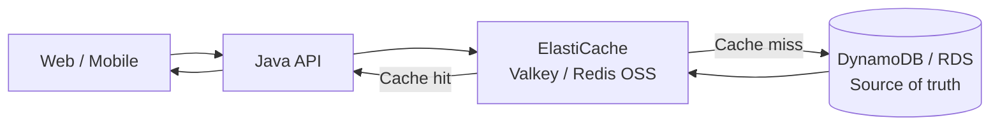
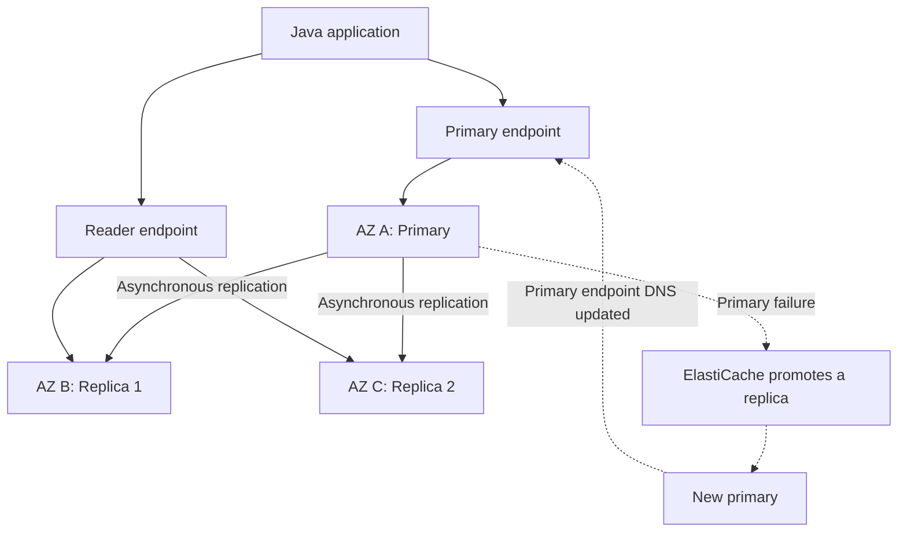
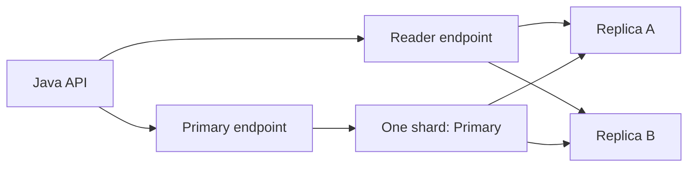
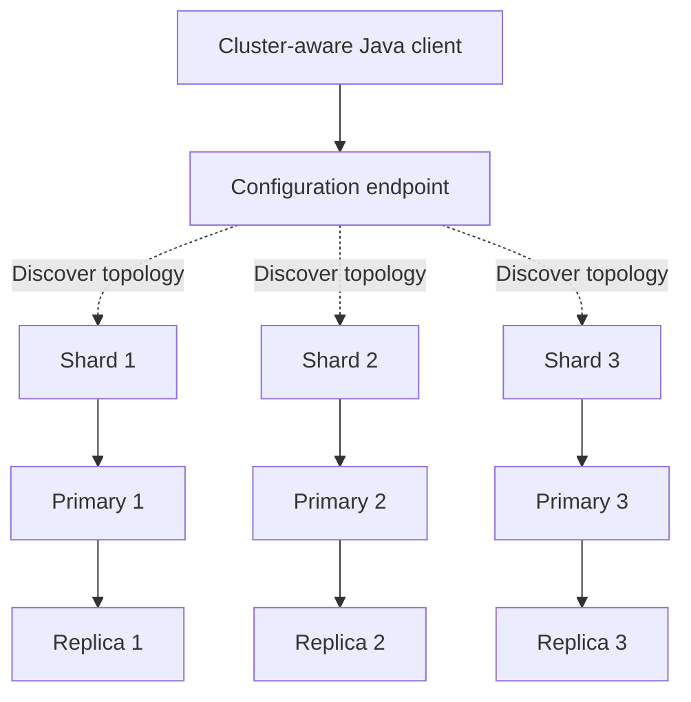
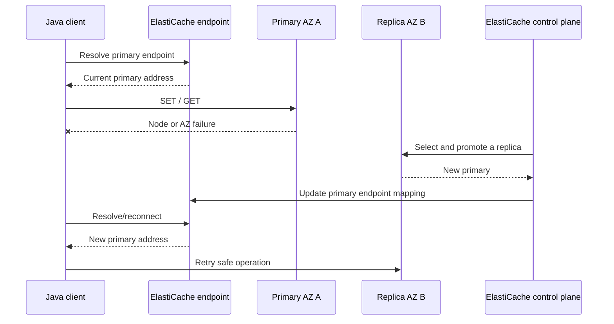

# Replication, failover và phân mảnh cache

Một hệ thống Java Spring Boot lưu thông tin sản phẩm trong Amazon DynamoDB, còn **Amazon ElastiCache for Valkey/Redis OSS** giữ dữ liệu thường được đọc như product details, session, rate-limit counters và kết quả truy vấn. Khi lượng truy cập tăng, một cache node có thể trở thành nút nghẽn. Khi primary gặp sự cố, ứng dụng cần tiếp tục đọc/ghi mà không làm người dùng nhận lỗi kéo dài. Khi dataset lớn hơn khả năng của một node, đội phát triển cần chia dữ liệu thành nhiều shards.

Ba kỹ thuật thường được nhắc cùng nhau nhưng giải quyết những vấn đề khác nhau:

- **Replication:** sao chép dữ liệu từ primary sang replicas để có bản dự phòng và có thể phân tải một số reads.
- **Failover:** promote một replica thành primary khi primary hiện tại không còn khả dụng.
- **Sharding:** chia keyspace/dataset thành nhiều phần, mỗi phần do một shard chịu trách nhiệm, nhằm mở rộng dung lượng và throughput.

Replication tăng khả năng chịu lỗi và có thể tăng read capacity; failover rút ngắn gián đoạn khi node lỗi; sharding phân tán writes và dữ liệu. Không kỹ thuật nào tự tạo ra **backup**, **strong consistency**, hay bảo đảm mọi request đang chạy đều thành công khi chuyển node.

Bài học thuộc chương **Cache và dữ liệu chuyên dụng** trong module **CLOUD_PROVIDERS_AWS**. Nội dung tập trung vào ElastiCache for Valkey/Redis OSS, replication groups, Multi-AZ automatic failover, cluster mode, hash slots, endpoint, Java client và cách phối hợp cache với database nguồn để ứng dụng có thể giám sát, phục hồi và kiểm soát chi phí.

## 1. Mục tiêu học tập

Sau bài này, bạn có thể:

1. Phân biệt cache replication, read scaling, automatic failover, sharding và backup.
2. Mô tả replication group gồm primary và replicas trong ElastiCache for Valkey/Redis OSS.
3. Phân biệt **cluster mode disabled** và **cluster mode enabled**, primary/reader/configuration/node endpoints.
4. Giải thích Multi-AZ và điều kiện cần để ElastiCache tự động failover.
5. Hiểu replication lag, stale reads và rủi ro mất các writes chưa được replica nhận trước failover.
6. Giải thích Redis Cluster hash slots, MOVED, ASK, resharding và hash tags.
7. Thiết kế cache keys, sharding strategy và access patterns để tránh hot keys.
8. Cấu hình Java/Spring Boot client cluster-aware, TLS, reconnect và topology refresh.
9. Xây dựng cache-aside/invalidation, TTL, idempotency và graceful cache degradation.
10. Giám sát failover, replication lag, CPU, memory, evictions, connections và chi phí.
11. Phân biệt ElastiCache Redis/Valkey với Memcached và ElastiCache Serverless.
12. Lập runbook kiểm thử failover, resharding, node replacement và phục hồi.

## 2. Cache là lớp tăng tốc, không mặc định là nguồn dữ liệu chuẩn

Một cache giữ bản sao dữ liệu được đọc thường xuyên để giảm latency và tải lên database. Trong kiến trúc phổ biến:



Cache thường có thể bị xóa, evict, flush hoặc mất dữ liệu khi node thay thế/failover. Vì vậy, nếu ứng dụng không có yêu cầu đặc biệt và chưa thiết kế durability, **database mới là nguồn dữ liệu chuẩn (source of truth)**.

| Thành phần | Vai trò |
|---|---|
| Database nguồn | Dữ liệu nghiệp vụ bền vững, transaction/constraint theo mô hình |
| Cache primary | Nhận writes của cache và phục vụ reads |
| Cache replica | Nhận dữ liệu replicate, có thể phục vụ reads và được promote khi failover |
| Cache client | Quản lý endpoint, connections, retries, cluster topology |
| Invalidation/event path | Cập nhật hoặc xóa cache khi database thay đổi |
| Monitoring | Phát hiện node failure, lag, evictions, hot key, stale data |

**Không lưu duy nhất dữ liệu không thể tái tạo vào cache** rồi giả định Multi-AZ replication tương đương backup database. Replication phục vụ HA; nó có thể sao chép cả thao tác xóa nhầm và không cung cấp lịch sử point-in-time như một hệ thống backup.

## 3. Replication, failover và sharding giải quyết ba bài toán khác nhau

| Kỹ thuật | Điều được cải thiện | Không tự giải quyết |
|---|---|---|
| **Replication** | Bản sao dữ liệu, khả năng phục vụ read từ replicas | Write throughput của một primary, backup, strong consistency |
| **Failover** | Chuyển vai trò primary sang replica khi lỗi | Request đang chạy, unknown write outcome, logical corruption |
| **Sharding** | Phân phối keyspace, dung lượng và writes qua nhiều primary nodes | Hot key đơn lẻ, cross-shard transaction, global ordering |
| **Multi-AZ** | Tách node ra các Availability Zones để giảm rủi ro AZ | Regional DR, backup, ứng dụng tự reconnect |
| **Snapshot/backup** | Phục hồi dữ liệu theo điểm lưu | Tự động tiếp nhận traffic trong vài giây |
| **Client retry/idempotency** | Ứng dụng vượt qua lỗi kết nối/duplicate an toàn hơn | Khôi phục cache data nếu không có nguồn tái tạo |

Một replication group có thể có replicas nhưng **không có automatic failover** nếu chưa bật cấu hình/điều kiện phù hợp. Một cluster có nhiều shards vẫn có thể có shard không chịu lỗi nếu shard đó không có replica. Hãy đánh giá từng shard và từng failure domain.

## 4. ElastiCache for Valkey/Redis OSS replication group

Amazon ElastiCache cung cấp dịch vụ cache được quản lý. Với engine **Valkey** hoặc **Redis OSS**, cấu hình replication group thường gồm:

- **Primary node:** nhận writes; cũng có thể phục vụ reads.
- **Replica nodes:** nhận dữ liệu từ primary theo replication; có thể phục vụ read traffic.
- **Replication group:** nhóm các cache nodes có quan hệ primary/replica, failover và endpoint được dịch vụ quản lý.
- **Node group/shard:** đơn vị partition keyspace khi cluster mode enabled.
- **Multi-AZ:** đặt các nodes ở nhiều AZ và hỗ trợ automatic failover khi cấu hình đáp ứng điều kiện.



**Replication của Redis/Valkey là bất đồng bộ.** Replica có thể trễ so với primary; không nên giả định mọi write đã được áp dụng đồng thời trên tất cả replicas. Khi primary lỗi đột ngột, những writes chưa replicate có thể không xuất hiện trên primary mới. AWS quản lý quá trình promotion/endpoint, nhưng ứng dụng vẫn cần xử lý reconnect và tính đúng đắn nghiệp vụ.

Nguồn: [ElastiCache replication](https://docs.aws.amazon.com/AmazonElastiCache/latest/dg/Replication.html), [Valkey/Redis OSS Multi-AZ](https://docs.aws.amazon.com/AmazonElastiCache/latest/dg/AutoFailover.html).

## 5. Cluster mode disabled: một shard, có thể có replicas

Trong **cluster mode disabled**, replication group có **một shard/node group**:

- Một primary node nhận tất cả writes.
- Có thể có một hoặc nhiều replicas theo quota/engine/node configuration được hỗ trợ.
- Replicas có thể phục vụ read queries nếu ứng dụng dùng reader endpoint hoặc node endpoint phù hợp.
- Không có horizontal sharding của keyspace giữa nhiều primaries; write capacity vẫn phụ thuộc primary.



### 5.1. Khi phù hợp?

- Dataset vừa trong memory của một node.
- Write workload có thể xử lý bởi một primary.
- Cần replica cho HA và/hoặc read scaling.
- Muốn ứng dụng đơn giản hơn so với Redis Cluster multi-shard.
- Keyspace chưa cần phân phối qua nhiều primaries.

### 5.2. Giới hạn

- **Một primary là giới hạn write throughput** chính.
- Scale up bằng node class lớn hơn có thể tăng capacity nhưng có giới hạn.
- Replicas tăng read capacity nhưng không cộng dồn thành write capacity.
- Khi primary failover, các connections hiện tại có thể bị reset; client phải reconnect.
- Reader endpoint thường phân phối **connections** tới replicas; một connection lâu sống có thể tiếp tục dùng cùng replica, không có nghĩa từng command được load balance lại.

### 5.3. Endpoints

| Endpoint | Mục đích |
|---|---|
| **Primary endpoint** | DNS name luôn hướng tới primary hiện tại; dùng writes và critical read-after-write |
| **Reader endpoint** | Phân phối kết nối read tới replicas; dùng cho stale-tolerant reads |
| **Node endpoint** | Trỏ một node cụ thể; chủ yếu phục vụ chẩn đoán/kiểm thử, tránh hardcode làm HA endpoint |

**Không dùng replica node endpoint làm write endpoint.** Replica là read-only theo vai trò; sau promotion, node roles có thể thay đổi. Ứng dụng nên dùng endpoint theo vai trò do ElastiCache cung cấp.

## 6. Cluster mode enabled: nhiều shards để scale ngang

**Cluster mode enabled** chia keyspace thành nhiều **shards/node groups**. Mỗi shard có một primary và có thể có replicas. Mỗi primary chịu trách nhiệm một phần hash slots; writes được phân phối theo key.



### 6.1. Lợi ích

- Dữ liệu lớn hơn khả năng memory/throughput của một primary có thể được phân tán.
- Writes được xử lý bởi nhiều primary nodes khác nhau.
- Mỗi shard có replica để phục vụ read và có thể được promote khi primary shard lỗi.
- Có thể reshard khi cần tăng/giảm số node groups theo khả năng dịch vụ và engine version.

### 6.2. Đánh đổi

- Client phải **cluster-aware** và hiểu topology/redirects.
- Một request có thể chạm nhiều shards; multi-key operations bị ràng buộc slot.
- Resharding, scaling và failover phức tạp hơn.
- Hot key không được giải quyết chỉ vì có nhiều shards: một key vẫn thuộc một slot.
- Không phải mọi command, transaction hoặc Lua script đều có thể hoạt động xuyên nhiều slots.

### 6.3. Không nhầm shard với replica

- **Shard** là phần keyspace riêng, có primary riêng.
- **Replica** là bản sao của một primary shard.
- Thêm replica tăng HA/read capacity của shard, không chia thêm keyspace.
- Thêm shard tăng khả năng phân phối keyspace/write load, nhưng không tự tạo replica nếu không cấu hình.

## 7. Redis Cluster hash slots: dữ liệu được phân phối thế nào?

Redis Cluster chia keyspace thành **16.384 hash slots**. Một key được gán vào slot dựa trên hash của key (Redis Cluster dùng CRC16 và modulo 16384). Các shards sở hữu các dải slots khác nhau.

```text
hashSlot(key) = CRC16(key) mod 16384

Ví dụ minh họa:
  slot 0..5000       → shard A
  slot 5001..11000   → shard B
  slot 11001..16383  → shard C
```

Dải slot thực tế được phân bổ theo topology hiện tại; không hardcode các dải minh họa ở trên.

### 7.1. Client routing

Cluster-aware client xác định slot cho key và gửi command tới node sở hữu slot. Nếu topology thay đổi:

- **MOVED**: server báo slot hiện do node khác sở hữu; client cập nhật topology/routing.
- **ASK**: trong quá trình slot đang di chuyển, client được yêu cầu gửi command tiếp theo tới node đích theo quy trình ASKING.
- Client không hiểu redirect có thể trả lỗi dù cluster vẫn khỏe.

### 7.2. Multi-key commands và CROSSSLOT

Một số lệnh nhiều keys như MGET, MSET, transaction hoặc Lua script yêu cầu keys liên quan cùng hash slot (tùy command/engine support). Nếu các keys thuộc các slots khác nhau, Redis Cluster có thể trả lỗi CROSSSLOT.

Ví dụ:

```text
MGET customer:1:profile customer:2:profile
→ có thể CROSSSLOT nếu 2 keys ở slots khác nhau

MGET customer:{42}:profile customer:{42}:cart
→ cùng hash tag {42}, được ánh xạ cùng slot
```

### 7.3. Hash tags

Phần nằm trong cặp dấu ngoặc nhọn đầu tiên hợp lệ được dùng để tính hash slot. Hash tags giúp colocate các keys cần thao tác cùng nhau:

```text
order:{ORD-123}:status
order:{ORD-123}:items
order:{ORD-123}:lock
```

Ba keys trên cùng slot, thuận tiện cho multi-key operations của một order.

**Đừng dùng một hash tag chung như GLOBAL cho toàn bộ hệ thống** chỉ để mọi multi-key command cùng slot. Điều đó gom mọi keys vào một slot, tạo hot shard và phá mục tiêu phân tán. Chọn hash tag theo **aggregate/business consistency boundary**.

Nguồn: [Redis Cluster specification](https://redis.io/docs/latest/operate/oss_and_stack/reference/cluster-spec/), [ElastiCache cluster mode](https://docs.aws.amazon.com/AmazonElastiCache/latest/dg/Replication.Redis-RedisCluster.html).

## 8. Replication và sharding: tác động đến throughput

| Thay đổi | Write throughput | Read throughput | Memory capacity | HA |
|---|---|---|---|---|
| Thêm replica vào một shard | Không tăng write primary đáng kể | Có thể tăng read capacity | Tốn thêm node memory/replication | Có thêm failover candidate |
| Tăng primary node class | Có thể tăng write capacity của primary | Có thể tăng read capacity | Tăng memory mỗi node | Không thay replica topology |
| Thêm shard | Có thể phân tán writes qua nhiều primaries | Thêm nodes phục vụ reads | Tăng tổng memory cluster | Mỗi shard vẫn cần replicas |
| Bật Multi-AZ automatic failover | Không nhằm tăng throughput | Không phải read scaling feature | Tốn compute ở AZ khác | Tăng khả năng phục hồi node/AZ |

**Replication không phải sharding.** Một primary cùng ba replicas vẫn là một shard nếu cluster mode disabled. Cả ba replicas có thể giữ cùng dataset, nên tổng dung lượng hữu ích không tăng gấp bốn.

**Sharding không tự là HA.** Cluster có sáu shards nhưng mỗi shard chỉ có primary sẽ có thể mất dữ liệu/cache availability của shard khi node đó lỗi. Cần replica và automatic failover phù hợp cho từng shard.

## 9. Multi-AZ và automatic failover

Với replication group có replicas, **Multi-AZ automatic failover** cho phép ElastiCache phát hiện primary không khả dụng, chọn replica phù hợp và promote thành primary. Điều kiện cấu hình cụ thể phụ thuộc engine/version/cluster mode/Region; thông thường cần bật Multi-AZ/automatic failover và có replica ở AZ khác.



### 9.1. Những gì ứng dụng cần chờ

- Detection và promotion của ElastiCache.
- Endpoint/DNS update và client DNS refresh.
- TCP reconnect và TLS handshake.
- Redis client topology refresh nếu cluster mode enabled.
- Application retry/backoff.
- Warm-up/cache repopulation nếu dữ liệu thiếu hoặc eviction xảy ra.

Không đưa ra một con số RTO duy nhất cho mọi cluster. Failover duration phụ thuộc topology, engine, node type, tình trạng replication và network/client behavior. Hãy đo trong staging và đặt SLO end-to-end.

### 9.2. Điều kiện topology quan trọng

- Primary và replicas nên phân bố ở **các AZ khác nhau**.
- Nếu mọi replicas nằm cùng AZ với primary, mất AZ có thể làm mất cả nhóm nodes.
- Với cluster mode enabled, kiểm tra **từng shard** có replica và placement phù hợp.
- Đừng để subnet group chỉ có một AZ nếu cần Multi-AZ.
- Đảm bảo security groups, routes, NACLs và DNS resolution cho phép ứng dụng kết nối node sau promotion.

### 9.3. Automatic failover không đồng nghĩa không có lỗi

Trong lúc chuyển vai trò, ứng dụng có thể gặp READONLY, MASTERDOWN, connection reset, timeout, cluster redirection hoặc transient errors. Client phải xử lý đúng, không gửi một lệnh non-idempotent vô hạn.

Nguồn: [ElastiCache Multi-AZ automatic failover](https://docs.aws.amazon.com/AmazonElastiCache/latest/dg/AutoFailover.html).

## 10. Replication lag và stale reads

Replication của Valkey/Redis OSS trong ElastiCache là **asynchronous**. Primary có thể đã trả lời thành công một write trong khi replica chưa áp dụng lệnh tương ứng.

Ví dụ:

```text
T0: SET order:123:status "PAID" trên primary → OK
T1: API đọc qua reader endpoint
T2: Replica chưa nhận/apply update
T3: GET order:123:status → "PENDING" (stale)
T4: Replica catch up → "PAID"
```

### 10.1. Chọn read endpoint theo consistency

| Nhu cầu | Endpoint/read path |
|---|---|
| Read-after-write quan trọng | Primary endpoint / writer node |
| Session state cần cập nhật tức thời | Primary hoặc thiết kế consistency riêng |
| Dashboard chấp nhận stale trong thời gian ngắn | Reader endpoint |
| Best-effort product cache | Reader endpoint có thể phù hợp |
| Counter/rate limit không được lệch | Thiết kế atomic operation trên primary và đánh giá failover loss |
| Critical business truth | Đọc database nguồn, không dựa vào replica cache |

### 10.2. Replica lag không có strong-read switch

Redis/Valkey replicas không có một flag tương đương DynamoDB ConsistentRead=true để bắt replica chờ đồng bộ mọi lệnh. Muốn đảm bảo read-after-write ở mức ứng dụng, route critical reads về primary hoặc dùng database nguồn với consistency phù hợp.

### 10.3. Failover và dữ liệu chưa replicate

Nếu primary lỗi trước khi replica nhận một write, primary mới có thể thiếu write đó. Đối với dữ liệu cache có thể tái tạo, ứng dụng có thể refill từ DB nguồn. Đối với dữ liệu nghiệp vụ duy nhất nằm trong cache, đây là rủi ro thiết kế: **không coi cache replication là durable transaction log**.

## 11. Failover ảnh hưởng client và connections thế nào?

Khi primary bị promote hoặc shard topology thay đổi:

- TCP connections tới node cũ có thể bị đóng.
- DNS endpoint có thể đổi IP; clients phải resolve lại.
- Pool connections giữ socket cũ có thể tiếp tục lỗi cho đến khi bị loại bỏ.
- Cluster mode enabled có thể cần refresh topology và xử lý MOVED/ASK.
- In-flight commands có thể có kết quả không rõ: command có thể đã chạy nhưng response bị mất.
- Pipeline/batch nhiều commands có thể có một phần đã thực hiện trước khi connection reset.

**Không tự động retry mọi command**. Ví dụ GET thường có thể retry; SET key value với cùng value thường idempotent theo trạng thái cuối, nhưng INCR, LPUSH, XADD hoặc một Lua script có side effect có thể chạy hai lần.

### 11.1. Retry policy

- Chỉ retry các lỗi tạm thời/connection errors được xác định.
- Dùng exponential backoff + jitter và giới hạn số lần/thời gian.
- Tránh mọi application pods reconnect đồng thời sau failover.
- Rebuild stale connections; không giữ socket chết trong pool.
- Với operation không idempotent, dùng operation ID/deduplication record hoặc đọc lại trạng thái để reconcile.
- Khi cache unavailable, fallback về DB phải có concurrency/rate limits để tránh **cache failure → DB overload**.

### 11.2. DNS và JVM

Dùng hostname endpoint của ElastiCache, không hardcode private IP. Java/JVM và DNS resolver có thể cache hostname; cấu hình DNS TTL hợp lý theo runtime, driver và hướng dẫn dịch vụ, rồi test reconnect. DNS refresh **không tự sửa cluster topology** nếu client cluster mode không hỗ trợ discovery.

## 12. Cluster-aware Java client: Lettuce và Spring Data Redis

Với **cluster mode enabled**, ứng dụng cần Redis Cluster-aware client. Client phải:

1. Kết nối seed/configuration endpoint.
2. Discover nodes và hash slot topology.
3. Route key commands tới node sở hữu slot.
4. Xử lý MOVED/ASK.
5. Refresh topology sau reshard/failover.
6. Quản lý connection pools, TLS, timeout và reconnect.

Các thư viện Java thường gặp:

- **Lettuce:** hỗ trợ Redis Cluster, reactive/non-blocking API và topology refresh.
- **Jedis:** có cluster-aware client APIs; kiểm tra behavior theo phiên bản.
- **Spring Data Redis:** abstraction RedisTemplate/StringRedisTemplate, thường dùng Lettuce hoặc Jedis làm driver.

### 12.1. Spring Boot: cluster mode disabled

Ví dụ application.yml cho primary endpoint:

```yaml
spring:
  data:
    redis:
      host: my-cache-primary.xxxxxx.use1.cache.amazonaws.com
      port: 6379
      ssl:
        enabled: true
      timeout: 2s
      connect-timeout: 2s
      # Password/ACL credentials lấy từ secret runtime,
      # không ghi plaintext vào repository.
```

Với reader endpoint cho stale-tolerant reads, cấu hình một Redis connection factory/route riêng hoặc cách đọc được client hỗ trợ. Không đổi toàn bộ RedisTemplate sang reader endpoint nếu writes cũng đi qua template đó.

### 12.2. Spring Boot: cluster mode enabled

Ví dụ seed node:

```yaml
spring:
  data:
    redis:
      cluster:
        nodes:
          - my-cache-configuration.xxxxxx.clustercfg.use1.cache.amazonaws.com:6379
      ssl:
        enabled: true
      timeout: 2s
      connect-timeout: 2s
```

**Configuration endpoint là điểm bootstrap/discovery**, không có nghĩa mọi commands luôn đi tới một node. Driver phải đọc topology và route tới primary/replica node endpoints theo cluster protocol.

Property names thay đổi theo Spring Boot generation (ví dụ prefix spring.redis ở một số phiên bản cũ và spring.data.redis ở phiên bản mới). Hãy xác minh với phiên bản dependency thực tế.

### 12.3. Topology refresh với Lettuce

Khi dùng cluster mode enabled, có thể cấu hình periodic/adaptive topology refresh theo phiên bản Lettuce:

```java
import java.time.Duration;
import io.lettuce.core.cluster.ClusterClientOptions;
import io.lettuce.core.cluster.ClusterTopologyRefreshOptions;

ClusterTopologyRefreshOptions topologyOptions =
    ClusterTopologyRefreshOptions.builder()
        .enablePeriodicRefresh(Duration.ofSeconds(30))
        .enableAllAdaptiveRefreshTriggers()
        .build();

ClusterClientOptions clientOptions =
    ClusterClientOptions.builder()
        .topologyRefreshOptions(topologyOptions)
        .build();
```

Đây là **fragment cấu hình**, cần gắn vào LettuceClientConfiguration/connection factory phù hợp với Spring Data Redis và version Lettuce. Không copy riêng fragment rồi kỳ vọng Spring Boot tự áp dụng. Refresh quá dày tạo thêm connections/traffic; refresh quá thưa làm client chậm nhận topology mới.

Nguồn: [Spring Data Redis](https://docs.spring.io/spring-data/redis/reference/), [Lettuce Redis Cluster](https://redis.github.io/lettuce/).

## 13. Java cache-aside và invalidation

Ví dụ service đọc product:

```java
@Service
public class ProductService {
    private final ProductRepository repository;

    public ProductService(ProductRepository repository) {
        this.repository = repository;
    }

    @Cacheable(cacheNames = "product", key = "#productId",
               unless = "#result == null")
    public Product getProduct(String productId) {
        return repository.findById(productId)
            .orElseThrow(() -> new NotFoundException(productId));
    }

    @CacheEvict(cacheNames = "product", key = "#product.id")
    public Product updateProduct(Product product) {
        return repository.save(product);
    }
}
```

Ví dụ này thể hiện cache abstraction, nhưng cần chú ý:

- @Cacheable chỉ có hiệu lực khi Spring Cache được bật và cache manager/serializer được cấu hình.
- @CacheEvict phải chạy **sau khi database transaction commit**; nếu evict trước commit hoặc method transaction rollback, cache có thể bị inconsistent.
- Nếu có nhiều application instances, cache eviction phải lan tới mọi nodes; local in-memory cache không đủ.
- Khi database update thành công nhưng cache invalidation event bị mất, stale entry có thể còn đến TTL. Dùng outbox/CDC hoặc cơ chế invalidation đáng tin cậy nếu yêu cầu chặt.
- Key phải namespace theo tenant/locale/version nếu các giá trị khác nhau theo người dùng.

### 13.1. TTL và cache stampede

Nếu một hot key hết hạn cùng lúc, hàng nghìn requests có thể cùng truy vấn DB. Giảm stampede bằng:

- TTL jitter (randomize expiration).
- Single-flight/request coalescing trong app hoặc distributed lock có giới hạn.
- Stale-while-revalidate khi nghiệp vụ chấp nhận dữ liệu cũ.
- Pre-warming các keys quan trọng.
- Rate limits và concurrency caps cho cache miss.
- Negative caching có TTL ngắn nếu cần tránh truy vấn lặp với IDs không tồn tại.

### 13.2. Invalidation là một bài toán consistency

Các chiến lược:

| Chiến lược | Cách hoạt động | Trade-off |
|---|---|---|
| TTL only | Dữ liệu cũ hết hạn sau thời gian định trước | Đơn giản, stale window rõ |
| Cache-aside + delete on write | Sau DB commit, xóa cache key | Phải bảo đảm invalidation được phát |
| Write-through | Ghi DB rồi cập nhật cache đồng bộ | Request chậm hơn; phải xử lý partial failure |
| Outbox/CDC invalidation | Phát event sau transaction commit | Eventual invalidation, cần retry/idempotency |
| Versioned cache key | Dùng version trong key | Tránh stale overwrite, tăng key count/cleanup |

**Không update cache trước khi DB commit** rồi trả thành công nếu transaction DB có thể rollback. Khi write thất bại, cache có thể chứa dữ liệu chưa từng tồn tại.

## 14. Cache keys và sharding strategy

Sharding hiệu quả khi keys được phân phối tương đối đều và query có thể route đến đúng shard.

### 14.1. Chọn key có cardinality phù hợp

Các ví dụ:

```text
product:{productId}:details
session:{sessionId}
cart:{customerId}
rate:{tenantId}:{apiKey}:{minute}
leaderboard:{gameId}:{season}
```

Trong cluster mode enabled, Redis Cluster dùng hash của key để phân phối slots. Key prefix có thể giúp namespace, nhưng hash tag {...} quyết định phần key dùng để đặt slot khi được dùng.

### 14.2. Tránh hot keys

Một key như global:homepage:counter nhận hàng trăm nghìn increments/giây vẫn nằm trên **một shard**, dù cluster có 50 shards. Có thể phân tán counters thành nhiều buckets rồi aggregate:

```text
counter:homepage:0
counter:homepage:1
...
counter:homepage:15

Write: chọn bucket bằng hash(requestId)
Read: sum 16 buckets
```

Đổi lại, reads phải aggregate, counter có thể không phản ánh tức thời chính xác và cần quản lý bucket lifecycle.

### 14.3. Hot shard do phân bố key không đều

Nếu 80% requests thuộc một tenant/tenantKey, hash distribution vẫn có thể dồn tải vào một số keys/slots. Phân tích access frequency, key cardinality, request sizes và command cost; không chỉ đếm số keys mỗi shard.

### 14.4. Multi-key consistency boundary

Nếu các keys cần atomic operation cùng nhau, dùng hash tag có chủ đích:

```text
account:{A-100}:balance
account:{A-100}:ledger:last
account:{A-100}:lock
```

Đừng gộp tất cả accounts vào cùng tag. Mục tiêu là **colocate trong phạm vi một aggregate**, không phải gom toàn cluster về một shard.

## 15. Resharding và thay đổi topology

Khi cluster mode enabled, số shards có thể được thay đổi qua scaling/resharding operations được ElastiCache hỗ trợ. Dịch vụ di chuyển hash slots giữa shards trong quá trình resharding.

### 15.1. Điều gì xảy ra?

- Một số slots chuyển từ source shard sang destination shard.
- Client có thể nhận MOVED/ASK trong quá trình cập nhật topology.
- Một số operations có thể retry; commands có thể chậm hơn bình thường.
- Node CPU/network và replication traffic có thể tăng.
- Hot key vẫn nằm một slot; thêm shards không chia nhỏ tự động một key.

### 15.2. Quy trình thay đổi shards

1. Đo memory/CPU/network, per-shard load và slot distribution.
2. Xác định tăng/giảm shards có giải quyết bottleneck thật không.
3. Kiểm tra client cluster-aware, redirect handling và topology refresh.
4. Xác minh replicas/Multi-AZ cho topology mới.
5. Chọn cửa sổ thay đổi, theo dõi latency/error rates.
6. Reshard theo quy trình ElastiCache, không sửa slot map thủ công.
7. Đo lại key distribution và hot shards.
8. Đối soát app behavior, đặc biệt multi-key operations/hash tags.
9. Có kế hoạch rollback/scale adjustment theo khả năng dịch vụ.

**Không coi resharding là thao tác vô hình**: client cũ không cluster-aware hoặc giữ topology lâu có thể lỗi khi slot di chuyển.

## 16. Failover có thể làm mất write nào?

Vì replication bất đồng bộ, có một cửa sổ:

```text
Primary:
  SET payment:123:status "CAPTURED" → trả OK
Replica:
  Chưa nhận/apply command

Primary crash:
  Replica được promote
  Key payment:123:status vẫn có giá trị cũ hoặc chưa tồn tại
```

Điều này đặc biệt quan trọng nếu cache đang bị dùng sai làm nơi duy nhất lưu business state.

### 16.1. Phân loại dữ liệu cache

| Loại dữ liệu | Nếu mất một số writes khi failover | Thiết kế |
|---|---|---|
| Product details cache | Có thể refill từ DB | Cache-aside + TTL |
| Session cache | Có thể bắt user đăng nhập lại | Chấp nhận loss theo policy hoặc dùng session store bền vững hơn |
| Rate-limit counter | Có thể cho phép một số requests vượt quota | Chọn datastore/algorithm đáp ứng security requirement |
| Shopping cart cache | Có thể mất cập nhật cuối | Durable cart in DB hoặc event log, cache chỉ là projection |
| Payment status | Không chấp nhận mất | Database/payment provider là source of truth; cache chỉ đọc |
| Distributed lock | Có thể gây race nếu lock sai | Fencing token/lease và hệ thống lock phù hợp |

### 16.2. Cache replication không phải durable consensus

Đừng diễn giải replication async thành consensus/quorum transaction như database phân tán có hợp đồng khác. Nếu nghiệp vụ cần ghi không mất, hãy chọn database và transaction semantics phù hợp; cache có thể là lớp tăng tốc.

## 17. Phân biệt Valkey/Redis OSS và Memcached

| Đặc tính | **ElastiCache for Valkey / Redis OSS** | **ElastiCache for Memcached** |
|---|---|---|
| Data structures | Strings, hashes, lists, sets, sorted sets, streams (tùy engine/version) | Chủ yếu key/value cache đơn giản |
| Replication | Primary/replica | Không có replication tương đương Redis replication group |
| Automatic failover Multi-AZ | Có theo cấu hình hỗ trợ | Không có mô hình primary/replica automatic failover tương tự |
| Sharding | Redis Cluster/cluster mode enabled | Thường phân phối keys ở client qua các nodes |
| Persistence/snapshot | Có snapshot/backup capabilities theo engine/config | Không coi là durable store; cache node failure có thể mất dữ liệu |
| HA | Replicas + Multi-AZ | Client xử lý node loss/repopulation |
| Transactions/scripts | Nhiều khả năng hơn, theo engine/cluster constraints | Không tương đương Redis |
| Use cases | Cache, sessions, counters, queues/data structures, leaderboards | Cache đơn giản, high-throughput key/value, multi-threaded |

Nếu chỉ cần cache key/value đơn giản và chấp nhận repopulate khi node mất, Memcached có thể đủ. Nếu cần replication, failover, Redis data structures, atomic commands hoặc cluster-aware sharding, Valkey/Redis OSS thường phù hợp hơn.

## 18. ElastiCache Serverless: ai quản lý sharding/failover?

**ElastiCache Serverless** là mô hình khác với provisioned replication groups. AWS quản lý việc phân phối dữ liệu, scaling capacity và hạ tầng HA; người dùng làm việc qua endpoint serverless và capacity/usage model theo dịch vụ.

- Không trực tiếp thiết kế số shard/replica như replication group provisioned.
- Không áp dụng nguyên các endpoint primary/reader/configuration của provisioned replication group.
- Client compatibility, supported engine/version, TLS/auth, network và scaling behavior cần kiểm tra theo serverless cache docs.
- Chi phí theo capacity/data storage/usage model của serverless; không so sánh đơn giản bằng node-hour.

Chọn serverless khi muốn giảm quản trị node/topology và workload biến động; chọn provisioned replication group khi cần kiểm soát node class/shards/replicas cụ thể và đã hiểu vận hành.

Nguồn: [ElastiCache Serverless](https://docs.aws.amazon.com/AmazonElastiCache/latest/dg/WhatIs.serverless.html).

## 19. Bảo mật: TLS, AUTH, IAM và VPC

Cache thường chứa session, tokens hoặc thông tin người dùng; không nên xem “chỉ là cache” là lý do bỏ bảo mật.

### 19.1. Network isolation

- Đặt cache trong **private subnets** của VPC.
- Security group chỉ cho phép TCP port phù hợp từ application SG.
- Không bật public access cho production cache.
- Với Multi-AZ, subnet group phải bao phủ AZ cần thiết.
- Kiểm tra route/NACL/SG và DNS sau node promotion.
- Không hardcode IP; dùng endpoint hostname.

### 19.2. Encryption

- Bật **in-transit encryption (TLS)** khi engine/node configuration hỗ trợ và phù hợp policy.
- Bật **at-rest encryption** cho dữ liệu lưu trên disk/snapshots theo khả năng engine/Region.
- Nếu dùng customer-managed KMS, quản lý key policy và IAM tối thiểu.
- Không log password, AUTH token, session token hoặc raw sensitive cache values.

### 19.3. Authentication và IAM

ElastiCache có các lựa chọn auth theo engine/mode, ví dụ Redis AUTH token/ACL users và IAM authentication trong những trường hợp được hỗ trợ. Không suy ra IAM auth có sẵn cho mọi engine/version/cache type; kiểm tra compatibility.

- Tách users theo app/service.
- Quyền commands/key patterns ở mức tối thiểu nếu dùng ACL.
- Secrets Manager/secret rotation có kế hoạch reconnect.
- Không dùng default user/password chung cho mọi environments.
- Redis ACL key patterns và command permissions cần test cùng application scripts.

### 19.4. VPC networking

Ứng dụng ECS/EKS/EC2/Lambda trong VPC phải có route tới cache subnets và security group phù hợp. Cache không phải public API endpoint; không mở inbound 0.0.0.0/0 để “test nhanh”.

## 20. Monitoring và cảnh báo vận hành

### 20.1. Metrics cần theo dõi

| Metric/tín hiệu | Ý nghĩa | Câu hỏi |
|---|---|---|
| CPUUtilization | CPU node | Primary/shard có bão hòa? |
| FreeableMemory | Memory còn khả dụng | Có nguy cơ memory pressure? |
| DatabaseMemoryUsagePercentage (nếu metric hỗ trợ) | Tỷ lệ memory dùng cho dữ liệu/cache | Cần scale node/shard? |
| Evictions | Số keys bị evict | Memory policy/TTL có phù hợp? |
| CurrConnections / NewConnections | Kết nối hiện tại/mới | Có connection storm sau failover? |
| ReplicationLag | Replica trễ so với primary | Read stale và failover candidate risk? |
| NetworkBytesIn/Out | Network traffic | Shard/node có hot traffic? |
| CacheHits / CacheMisses | Hit ratio | Cache có hiệu quả? |
| SwapUsage | Swap activity | Memory sizing có vấn đề? |
| EngineCPUUtilization (nếu có) | CPU engine process | CPU engine hay host bottleneck? |
| Events/failover notifications | Node/replication group state changes | Khi nào primary được promote? |

Tên metrics, dimensions và khả năng hiển thị tùy engine, node type, ElastiCache deployment mode và CloudWatch integration. Xác minh metrics thực tế của replication group, không giả định mọi metric có ở mọi cache type.

### 20.2. Alert hữu ích

- Primary node unhealthy hoặc failover event xảy ra.
- Replica lag vượt ngưỡng SLO.
- CPU/memory/network liên tục cao.
- Evictions tăng mạnh hoặc hit ratio giảm.
- Connections tăng bất thường sau deploy/failover.
- Cache miss rate tăng kéo theo DynamoDB/RDS read spikes.
- Một shard nóng hơn nhiều shards khác.
- Resharding/maintenance kéo dài hơn kế hoạch.
- Chi phí cache nodes, cross-AZ transfer hoặc serverless usage tăng bất thường.

### 20.3. Đừng chỉ theo dõi hit ratio

Hit ratio cao vẫn có thể che lỗi stale data hoặc hot key. Hit ratio thấp có thể là cold start sau failover/reshard. Kết hợp metrics cache với DB latency, business request latency, error rate và dữ liệu nghiệp vụ.

Nguồn: [Monitoring ElastiCache](https://docs.aws.amazon.com/AmazonElastiCache/latest/dg/CacheMetrics.html).

## 21. Chi phí và capacity planning

### 21.1. Thành phần chi phí

- Node-hours cho primary và replicas.
- Số shards × số replicas/shard × node class.
- Memory capacity và data overhead.
- Cross-AZ data transfer/replication traffic theo cách triển khai.
- Backup/snapshots và storage.
- ElastiCache Serverless usage/storage nếu chọn serverless.
- CloudWatch metrics/logging, alarms và observability.
- Network routing/NAT/VPC endpoints tùy kiến trúc.
- Cost của database refill khi cache miss/eviction/failover.
- Engineering/operational effort để reshard, test và triage.

### 21.2. Ví dụ quy mô

Giả sử provisioned cluster mode enabled có **3 shards**, mỗi shard gồm **1 primary + 1 replica**:

```text
3 shards × (1 primary + 1 replica)
= 6 cache nodes tổng cộng

Nếu tăng replicas/shard lên 2:
3 × (1 + 2) = 9 cache nodes

Nếu tăng shards từ 3 lên 6 và giữ 1 replica:
6 × (1 + 1) = 12 cache nodes
```

Đây là phép tính số node, **chưa phải báo giá**. Node class, Region, reserved/on-demand pricing, storage/backup, cross-AZ transfer và traffic quyết định chi phí thực tế.

### 21.3. Đừng scale theo memory một chiều

Một node còn memory nhưng CPU đã bão hòa vì Lua scripts/large sorted sets; tăng memory chưa chắc giải quyết. Ngược lại, CPU thấp nhưng evictions cao có thể do node class thiếu RAM hoặc TTL/key cardinality. Đo CPU, memory, network, ops/sec, command latency và hot key trước khi scale.

## 22. AWS CLI: xem topology và trạng thái (read-only)

Các lệnh dưới đây chỉ đọc thông tin cấu hình; thay identifiers bằng replication group được cấp phép.

```bash
# Xác minh account
aws sts get-caller-identity

# Xem replication group, endpoints và cluster mode
aws elasticache describe-replication-groups \
  --replication-group-id orders-cache \
  --region ap-southeast-1 \
  --query 'ReplicationGroups[0].{Status:Status,ClusterEnabled:ClusterEnabled,MultiAZ:MultiAZ,AutomaticFailover:AutomaticFailover,Members:MemberClusters,ConfigurationEndpoint:ConfigurationEndpoint,NodeGroups:NodeGroups}' \
  --output json

# Xem các cache clusters/nodes
aws elasticache describe-cache-clusters \
  --show-cache-node-info \
  --region ap-southeast-1

# Xem cache subnet groups
aws elasticache describe-cache-subnet-groups \
  --region ap-southeast-1

# Xem events gần đây
aws elasticache describe-events \
  --source-type replication-group \
  --source-identifier orders-cache \
  --duration 120 \
  --region ap-southeast-1
```

**Không gọi describe-cache-clusters mà bỏ --show-cache-node-info rồi suy ra node endpoints đã được liệt kê đầy đủ.** Kiểm tra NodeGroups, member nodes và endpoint fields theo resource type.

### 22.1. Kiểm tra endpoint DNS

Trong môi trường ứng dụng/VPC được phép:

```bash
nslookup orders-cache.xxxxxx.use1.cache.amazonaws.com
```

Kết quả IP có thể thay đổi khi failover. Không copy IP này vào config production; dùng DNS endpoint do ElastiCache cung cấp.

## 23. Diễn tập failover và resharding an toàn

Failover test là **thao tác thay đổi thật** trên cache replication group. Chỉ thực hiện ở staging hoặc production sau phê duyệt, có owner, thời gian, monitoring và rollback/mitigation plan.

### 23.1. Checklist trước diễn tập

1. Xác minh replication group/cluster mode/engine/version và node groups.
2. Đảm bảo replicas khỏe, Multi-AZ và automatic failover đang bật theo topology.
3. Ghi baseline latency, error rate, ReplicationLag, connections và cache hit ratio.
4. Chạy synthetic workload với operation IDs để phát hiện duplicate/lost writes.
5. Kiểm tra Java client dùng primary/reader/configuration endpoints đúng.
6. Đảm bảo cache miss fallback không làm database quá tải.
7. Chuẩn bị dashboards, alarms và người trực.

### 23.2. Trong diễn tập

- Ghi thời điểm bắt đầu failover.
- Quan sát ElastiCache events và node role change.
- Theo dõi DNS resolution, TCP reconnect và cluster topology refresh.
- Ghi các lỗi READONLY, timeout, MOVED/ASK, CLUSTERDOWN nếu có.
- Đo thời gian đến khi request cache thành công ổn định.
- Kiểm tra dữ liệu vừa ghi trước/sát failover có bị thiếu không.
- Không gửi retry không giới hạn hoặc flush cache để “làm sạch” sự cố.

### 23.3. Sau diễn tập

- Xác nhận primary/replicas và AZ placement.
- Kiểm tra replica lag đã về ngưỡng bình thường.
- Đo cache warm-up, hit ratio và DB load.
- Đối soát business data trong source database.
- Ghi application RTO thực tế, không chỉ thời gian AWS event.
- Điều chỉnh retry, connection pool, DNS/topology refresh và alarms.

### 23.4. TestFailover API

AWS có API/CLI TestFailover cho những replication group/node group được hỗ trợ. Đây là **write operation có thể gây gián đoạn**; kiểm tra engine, cluster mode, trạng thái và giới hạn hiện hành trước khi dùng. Không chạy lệnh test failover trong production theo bài học hoặc chỉ để kiểm tra quyền.

Nguồn: [ElastiCache test failover](https://docs.aws.amazon.com/AmazonElastiCache/latest/APIReference/API_TestFailover.html).

## 24. CloudFormation: replication group Multi-AZ cluster mode disabled

Ví dụ minh họa tạo một **Redis OSS replication group** với primary và một replica. Cấu hình có Multi-AZ/automatic failover và TLS/at-rest encryption. Việc deploy sẽ tạo tài nguyên tính phí.

```yaml
AWSTemplateFormatVersion: '2010-09-09'
Description: ElastiCache Redis OSS replication group with Multi-AZ failover

Parameters:
  CacheSubnetGroupName:
    Type: String
  CacheSecurityGroupId:
    Type: AWS::EC2::SecurityGroup::Id

Resources:
  OrdersCache:
    Type: AWS::ElastiCache::ReplicationGroup
    Properties:
      ReplicationGroupDescription: Orders cache HA example
      Engine: redis
      CacheNodeType: cache.t4g.small
      NumCacheClusters: 2
      AutomaticFailoverEnabled: true
      MultiAZEnabled: true
      CacheSubnetGroupName: !Ref CacheSubnetGroupName
      SecurityGroupIds:
        - !Ref CacheSecurityGroupId
      TransitEncryptionEnabled: true
      AtRestEncryptionEnabled: true
      AutoMinorVersionUpgrade: true
      SnapshotRetentionLimit: 1

Outputs:
  PrimaryEndpoint:
    Value: !GetAtt OrdersCache.PrimaryEndPoint.Address
  ReaderEndpoint:
    Value: !GetAtt OrdersCache.ReaderEndPoint.Address
```

### 24.1. Điều kiện cần kiểm tra

- Cache subnet group có subnets ở các AZ phù hợp.
- Security group chỉ cho phép ứng dụng truy cập đúng port cache.
- Node class/engine version được hỗ trợ trong Region.
- Multi-AZ automatic failover đáp ứng điều kiện số nodes/replicas và engine.
- NumCacheClusters: 2 trong ví dụ là tổng số cache clusters/nodes của **cluster mode disabled** (một primary + một replica); nó **không** tạo hai shards.
- Snapshot retention không thay backup policy dài hạn hoặc nguồn dữ liệu chuẩn.
- TLS/at-rest encryption cần tương thích engine, client và parameter group.
- Tên endpoint output là DNS address; app vẫn phải refresh connections khi failover.
- Quản lý deletion protection, tags, maintenance window, log delivery, auth token/ACL và secret theo yêu cầu thực tế.

### 24.2. Cluster mode enabled cần cấu hình khác

Cluster mode enabled dùng NumNodeGroups và ReplicasPerNodeGroup cùng parameter group hỗ trợ cluster mode; không dùng NumCacheClusters để diễn đạt số shards. Cần cấu hình engine/parameter group, node class, subnet groups, encryption, auth và quotas theo phiên bản AWS/Valkey/Redis OSS đang dùng. Ví dụ ở đây cố ý chỉ tạo cluster mode disabled để tránh nhầm semantics.

## 25. Chẩn đoán sự cố thường gặp

| Triệu chứng | Nguyên nhân khả dĩ | Hướng kiểm tra |
|---|---|---|
| Primary endpoint timeout sau failover | DNS cache/stale TCP connections | JVM DNS, pool, reconnect, ElastiCache events |
| READONLY error khi ghi | Client vẫn kết nối replica hoặc endpoint sai | Primary endpoint, node role, stale topology |
| MOVED lặp lại | Client không refresh cluster topology | Cluster-aware client, slot map, version |
| ASK/MOVED trong resharding | Slot đang chuyển hoặc client xử lý redirect chưa đúng | Client support, topology refresh |
| CROSSSLOT | Multi-key command chạm nhiều hash slots | Hash tags/aggregate key design |
| Replica trả dữ liệu cũ | Replication lag/eventual replication | Route critical read về primary, đo lag |
| Một shard CPU cao, shard khác thấp | Hot keys/key distribution skew | Key cardinality, per-shard metrics, sharding |
| Evictions tăng | Memory pressure, TTL/eviction policy | Memory usage, key size, node class |
| DB quá tải khi cache failover | Cache miss stampede/fallback không giới hạn | Rate limits, request coalescing, warm-up |
| Cache miss tăng sau reshard | Cold keys, topology changes, key migration | Warm-up, hit ratio, application errors |
| Java không kết nối TLS | Client truststore/TLS config/port | Certificate, SSL config, security groups |
| Automatic failover không kích hoạt | Chưa bật Multi-AZ/automatic failover hoặc topology không hợp lệ | Replication group config, replicas, engine support |
| Writes mất sau promotion | Replica chưa nhận write trước primary failure | Replication semantics, database source of truth |
| Reader endpoint chỉ dùng một replica | Một connection pool lâu sống, DNS/connection distribution | Reader endpoint semantics, pool/connections |
| Memory đủ nhưng latency cao | CPU/network/large commands/slow scripts | Engine CPU, command latency, payload size |

### 25.1. Thứ tự điều tra

1. Xác định cache type: Valkey/Redis OSS provisioned replication group hay Serverless, cluster mode enabled/disabled.
2. Xem replication group status, Multi-AZ/automatic failover, shard/member state.
3. Kiểm tra ElastiCache events, CloudWatch metrics và timestamps.
4. Kiểm tra endpoint đúng vai trò: primary, reader, configuration hay node.
5. Kiểm tra DNS resolution, TLS, security groups, subnet/AZ.
6. Xem client topology, MOVED/ASK, reconnect và connection pool.
7. Đo replica lag, CPU, memory, evictions, network và hot shards.
8. Xác định cache miss có làm database bị overload.
9. Đối soát dữ liệu quan trọng với source of truth; không lấy cache làm chứng cứ cuối cùng.
10. Sửa nguyên nhân, canary và đo lại failover/resharding.

## 26. Bài tập tình huống

### Bài A — Replication hay sharding?

Một cache có một primary và hai replicas. Write throughput không tăng dù thêm replica.

**Đáp án:** replicas chủ yếu tăng HA/read capacity. Muốn phân tán writes, cần sharding/cluster mode enabled hoặc scale primary phù hợp.

### Bài B — Multi-AZ failover

Replication group có primary và replica cùng AZ, automatic failover chưa bật. Một AZ bị lỗi.

**Đáp án:** topology không đáp ứng HA cross-AZ như kỳ vọng. Phải phân bố replicas qua AZ khác và bật cấu hình Multi-AZ/automatic failover phù hợp.

### Bài C — Stale read

Java ghi SET order:123:status PAID vào primary, sau đó đọc qua reader endpoint và thấy PENDING.

**Đáp án:** replica replication bất đồng bộ; read từ replica có thể stale. Critical read-after-write dùng primary hoặc database nguồn.

### Bài D — Cluster mode enabled

Client dùng RedisTemplate kết nối configuration endpoint nhưng không cluster-aware; sau resharding, nhiều lệnh trả MOVED.

**Đáp án:** cần Redis Cluster-aware driver, topology discovery và redirect handling. Configuration endpoint là bootstrap endpoint, không phải một Redis node đơn giản cho mọi commands.

### Bài E — CROSSSLOT

Lua script cập nhật cart:1 và inventory:sku-1 trong cluster, hai keys thuộc slot khác nhau.

**Đáp án:** Redis Cluster không cho multi-key script tùy ý trên nhiều slots. Nếu logic thực sự cần atomicity trong cùng cluster operation, thiết kế hash tags theo aggregate/consistency boundary hoặc tách thành workflow có compensation.

### Bài F — Hot key

Cluster có 12 shards nhưng global:counter nhận 90% writes.

**Đáp án:** một key thuộc một slot, nên vẫn nóng ở một shard. Chia counter thành buckets và aggregate, hoặc dùng dịch vụ phù hợp với workload counter.

### Bài G — Write bị mất sau failover

Một INCR payment:count trả OK, primary crash trước khi replica apply. Replica được promote và counter thấp hơn.

**Đáp án:** replication async có thể làm mất write chưa replicate. Không dùng cache làm nguồn sự thật cho payment count; ghi ledger/database bền vững và dùng cache làm projection.

### Bài H — Cache stampede

Failover làm nhiều cache keys miss cùng lúc; hàng nghìn requests đọc DynamoDB.

**Đáp án:** request coalescing, TTL jitter, stale-while-revalidate, warm-up và concurrency/rate limits. Fallback cần bảo vệ DB nguồn.

### Bài I — Reader endpoint

Đội vận hành dùng reader endpoint nhưng chỉ thấy một replica nhận traffic.

**Đáp án:** reader endpoint phân phối connection, không phải từng command; connection pool lâu sống có thể giữ một replica. Kiểm tra pool/connections và per-node metrics.

### Bài J — Chọn Memcached hay Valkey

Ứng dụng chỉ cần cache JSON đơn giản, không cần replication/data structures; hoặc cần Redis Cluster, atomic counters và Multi-AZ failover.

**Đáp án:** Memcached có thể đủ cho key/value cache best-effort; Valkey/Redis OSS phù hợp hơn khi cần replication, failover và Redis data structures.

### Bài K — Failover có phải backup?

Người dùng xóa nhầm toàn bộ session keys trên primary. Đội vận hành yêu cầu failover để lấy lại keys.

**Đáp án:** thao tác xóa có thể replicate sang replicas. Failover không phải point-in-time restore. Cần nguồn tái tạo hoặc snapshot/backup phù hợp.

### Bài L — Đếm nodes

Cluster mode enabled có 4 shards, mỗi shard có 1 primary và 2 replicas.

**Đáp án:** tổng số cache nodes là 4 × (1 + 2) = 12. Có 4 primary shards, không phải 12 shards.

### Bài M — Resharding

Sau tăng shard count, một số client cũ nhận MOVED liên tục.

**Đáp án:** client không cập nhật topology hoặc không hỗ trợ cluster redirects đúng. Nâng cấp/cấu hình cluster-aware driver và topology refresh.

### Bài N — Cache invalidation

DB commit product price mới nhưng event invalidation thất bại; cache vẫn giữ giá cũ.

**Đáp án:** outbox/CDC hoặc invalidation retry đáng tin cậy, TTL làm safety net, versioned keys khi phù hợp. Không update cache trước DB commit.

### Câu hỏi ôn tập

1. Replication và sharding khác nhau ở điểm nào?
2. Thêm replica có làm tăng write throughput của một primary không?
3. Failover làm gì với replica?
4. Redis/Valkey replication có đồng bộ hoàn toàn không?
5. Primary endpoint dùng cho mục đích gì?
6. Reader endpoint phân phối connection hay từng command?
7. Cluster mode disabled có bao nhiêu shards?
8. Cluster mode enabled chia keyspace dựa trên khái niệm nào?
9. Redis Cluster có bao nhiêu hash slots?
10. MOVED và ASK có ý nghĩa gì?
11. Vì sao multi-key commands có thể báo CROSSSLOT?
12. Hash tag {order-1} giúp điều gì?
13. Một hot key có tự được chia qua nhiều shards không?
14. Multi-AZ có thay backup không?
15. Failover có thể mất write nào?
16. Khi nào cần đọc từ primary thay vì reader endpoint?
17. Vì sao client phải cluster-aware trong cluster mode enabled?
18. Configuration endpoint có phải node endpoint không?
19. DNS refresh có thay thế topology refresh không?
20. INCR có thể retry mù sau timeout không?
21. Cache stampede ảnh hưởng database thế nào?
22. Memcached có replication/failover giống Redis replication group không?
23. Cluster mode enabled có cần replica cho từng shard nếu muốn HA không?
24. Vì sao NumCacheClusters không đồng nghĩa số shards?
25. Những metrics nào giúp phát hiện hot shard và memory pressure?

**Đáp án nhanh:** (1) bản sao vs chia keyspace; (2) không; (3) promote thành primary; (4) không, asynchronous; (5) write/current primary; (6) connections; (7) một; (8) 16.384 hash slots; (9) 16.384; (10) redirect slot/temporary migration redirect; (11) keys ở slots khác nhau; (12) colocate keys cùng slot; (13) không; (14) không; (15) write chưa replicate; (16) read-after-write/critical consistency; (17) discovery/routing/redirect; (18) không; (19) không; (20) không, có thể increment hai lần; (21) tạo DB overload; (22) không; (23) có nếu yêu cầu failover cho shard; (24) cluster mode disabled là node count trong một shard; (25) per-shard CPU/network, replication lag, memory, evictions và hot-key insights.

## 27. Checklist production

- [ ] Đã xác định cache là source of truth hay chỉ là derived/cache layer.
- [ ] Đã chọn Valkey/Redis OSS, Memcached hoặc Serverless theo data structures, HA và scale.
- [ ] Cluster mode disabled/enabled được chọn theo write throughput, dataset và complexity.
- [ ] Mỗi shard cần HA đã có replica và AZ placement phù hợp.
- [ ] Multi-AZ/automatic failover được bật và kiểm tra theo engine/version/Region.
- [ ] Ứng dụng dùng đúng primary/reader/configuration/node endpoints.
- [ ] Không hardcode node IP hoặc dùng node endpoint cố định làm HA endpoint.
- [ ] Java client cluster-aware khi cluster mode enabled; hỗ trợ MOVED/ASK.
- [ ] DNS cache, topology refresh, connection pool, TLS và reconnect được kiểm thử.
- [ ] Read-after-write/critical reads không dựa vào replica eventual.
- [ ] Business data không chỉ nằm trong cache nếu không chấp nhận mất.
- [ ] Retry có bounded attempts/backoff/jitter; non-idempotent commands có reconciliation.
- [ ] Cache-aside invalidation chạy sau DB commit; có outbox/CDC khi yêu cầu.
- [ ] TTL jitter, stampede protection, cache warm-up và DB fallback limits được thiết kế.
- [ ] Keys có phân bố phù hợp; tránh hot keys/hash tags gom toàn cluster.
- [ ] Multi-key operations/Lua scripts được thiết kế theo hash-slot boundaries.
- [ ] Resharding/scaling có runbook, topology-aware clients và monitoring.
- [ ] Replication lag, CPU, memory, evictions, connections, network và cache hit/miss được theo dõi.
- [ ] CloudWatch alerts có owner/on-call và ngưỡng theo SLO.
- [ ] Cache subnet group/private subnets/SG/TLS/KMS/ACL/IAM được cấu hình least privilege.
- [ ] Failover drill đo end-to-end recovery và dữ liệu thiếu/duplicate.
- [ ] Backup/snapshot và database source recovery được thiết kế riêng.
- [ ] Chi phí nodes/replicas/shards/network/backup/observability đã được tính.
- [ ] Có kiểm thử cold cache, node loss, AZ failure, hot shard, replica lag và DB overload.

## 28. Tổng kết

**Replication, failover và sharding** là ba phần bổ sung cho nhau khi thiết kế cache HA/scale trên AWS:

- **Replication** tạo bản sao primary sang replicas, có thể phục vụ read và làm failover candidate; replication bất đồng bộ có thể có lag.
- **Failover** promote replica khi primary lỗi; DNS/endpoints được quản lý nhưng client phải reconnect, refresh topology và retry an toàn.
- **Sharding** chia keyspace qua nhiều primaries để tăng memory/write capacity; Redis Cluster dùng **16.384 hash slots**, redirect MOVED/ASK và hash tags cho multi-key operations.
- **Cluster mode disabled** có một shard; **cluster mode enabled** có nhiều shards và yêu cầu client cluster-aware.
- **Multi-AZ automatic failover** tăng khả năng chịu lỗi node/AZ, nhưng không thay backup/PITR/DR và không bảo đảm request đang chạy không lỗi.
- **Cache consistency** phải được thiết kế cùng database nguồn: primary cho critical read-after-write, reader replicas cho stale-tolerant reads, invalidation sau commit và idempotency cho retries.
- **Monitoring và cost controls** phải bao gồm per-shard load, replication lag, evictions, connection churn, cache miss/DB fallback và số replicas/nodes thực tế.

Một cache production tốt không chỉ có nhiều nodes. Nó có **key design phân tán, replicas đặt đúng AZ, client hiểu topology, invalidation rõ ràng, fallback có giới hạn, dữ liệu nguồn bền vững và runbook failover đã được diễn tập**.

### Tài liệu AWS và nhà cung cấp chính thức

1. [Amazon ElastiCache User Guide](https://docs.aws.amazon.com/AmazonElastiCache/latest/dg/WhatIs.html)
2. [ElastiCache replication](https://docs.aws.amazon.com/AmazonElastiCache/latest/dg/Replication.html)
3. [Multi-AZ and automatic failover](https://docs.aws.amazon.com/AmazonElastiCache/latest/dg/AutoFailover.html)
4. [ElastiCache for Redis OSS cluster mode](https://docs.aws.amazon.com/AmazonElastiCache/latest/dg/Replication.Redis-RedisCluster.html)
5. [ElastiCache endpoints](https://docs.aws.amazon.com/AmazonElastiCache/latest/dg/Endpoints.html)
6. [ElastiCache resharding](https://docs.aws.amazon.com/AmazonElastiCache/latest/dg/Scaling.RedisCluster.html)
7. [Testing automatic failover](https://docs.aws.amazon.com/AmazonElastiCache/latest/APIReference/API_TestFailover.html)
8. [Monitoring ElastiCache](https://docs.aws.amazon.com/AmazonElastiCache/latest/dg/CacheMetrics.html)
9. [ElastiCache Serverless](https://docs.aws.amazon.com/AmazonElastiCache/latest/dg/WhatIs.serverless.html)
10. [ElastiCache security](https://docs.aws.amazon.com/AmazonElastiCache/latest/dg/WhatIs.Security.html)
11. [ElastiCache pricing](https://aws.amazon.com/elasticache/pricing/)
12. [Redis Cluster specification](https://redis.io/docs/latest/operate/oss_and_stack/reference/cluster-spec/)
13. [Redis Cluster tutorial](https://redis.io/docs/latest/operate/oss_and_stack/management/scaling/)
14. [Spring Data Redis reference](https://docs.spring.io/spring-data/redis/reference/)
15. [Lettuce documentation](https://redis.github.io/lettuce/)
16. [AWS Well-Architected Reliability Pillar](https://docs.aws.amazon.com/wellarchitected/latest/reliability-pillar/welcome.html)
