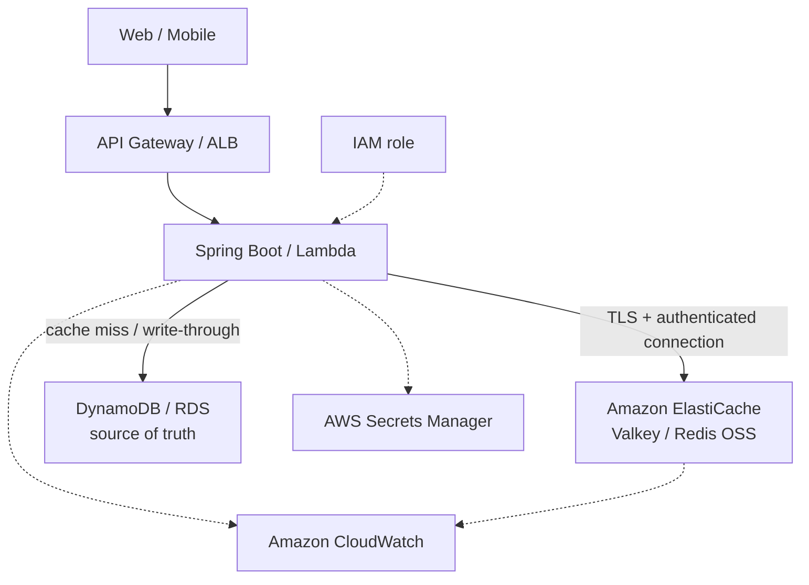
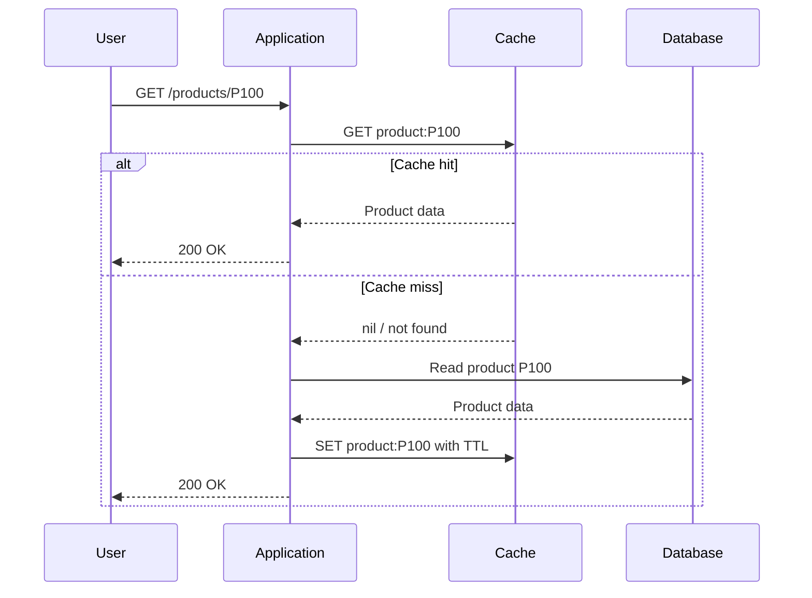
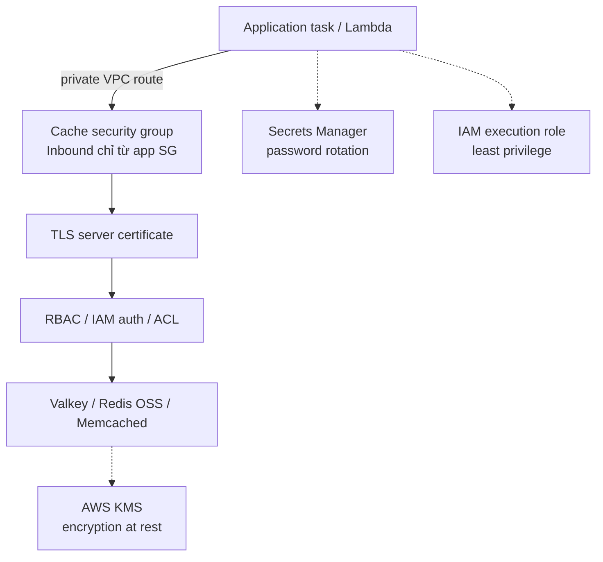
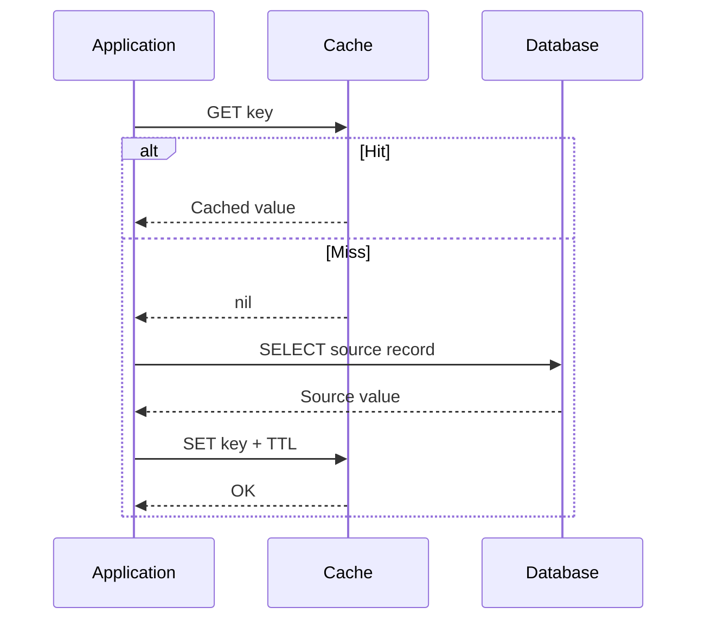
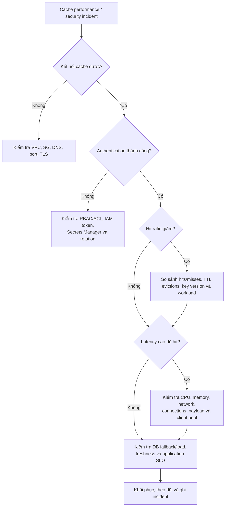

# Bảo mật kết nối và quan sát cache hit ratio trên AWS

> **Chương:** Cache và dữ liệu chuyên dụng  
> **Module:** CLOUD_PROVIDERS_AWS  
> **Mục tiêu:** bảo vệ đường kết nối giữa ứng dụng và cache, chọn cơ chế TLS/xác thực/phân quyền phù hợp với dịch vụ AWS, quản lý credentials an toàn, đo cache hit ratio đúng cách và kết hợp các chỉ số vận hành để cải thiện độ trễ, độ tin cậy và chi phí.
>
> **Phạm vi:** Amazon ElastiCache for Valkey/Redis OSS/Memcached, Amazon MemoryDB và DynamoDB Accelerator (DAX). Tên metrics, phiên bản engine, giới hạn TLS, cơ chế auth và tính năng thay đổi theo loại cache/Region; cần kiểm tra đúng tài liệu AWS cho tài nguyên đang dùng.

## 1. Bài toán: cache nhanh nhưng không trở thành cửa hậu dữ liệu

Một ứng dụng thương mại điện tử chạy trên ECS và Lambda sử dụng cache cho:

- Thông tin sản phẩm được đọc nhiều lần.
- Session đăng nhập và trạng thái giỏ hàng.
- Kết quả truy vấn dashboard.
- Rate limit và idempotency keys.
- Một số dữ liệu tham chiếu dùng chung giữa nhiều services.

Kiến trúc có thể dùng Amazon ElastiCache for Valkey/Redis OSS làm cache phân tán:



Nếu cache không được bảo vệ, một workload có quyền kết nối mạng có thể đọc session hoặc dữ liệu nhạy cảm, xóa keys, chạy command quản trị hoặc làm cạn tài nguyên. Nếu chỉ bật TLS nhưng dùng chung một tài khoản toàn quyền, người kết nối vẫn có thể thực hiện thao tác vượt nhu cầu. Nếu cache hit ratio không được đo đúng, đội vận hành có thể tăng node size hoặc thay TTL mà không giải quyết nguyên nhân thật.

Một triển khai tốt cần trả lời bốn câu hỏi:

1. **Ai có thể đến endpoint?** VPC, subnet, security groups, routing.
2. **Ai được xác thực và được làm gì?** TLS, user/ACL, IAM, least privilege.
3. **Dữ liệu và credentials được bảo vệ thế nào?** Encryption at rest, Secrets Manager, rotation, logging.
4. **Cache có thực sự giảm tải và độ trễ không?** Hit/miss ratio, latency, evictions, memory, connections và backend load.

**Cache là lớp tăng tốc, không tự trở thành nguồn dữ liệu chuẩn.** Cache miss, restart hoặc eviction phải được xử lý như một tình huống bình thường; ứng dụng vẫn cần bảo vệ database và dữ liệu gốc.

## 2. Phân biệt cache, in-memory database và cache chuyên dụng

Không phải dịch vụ nào có tên “in-memory” cũng có cùng mục tiêu hoặc metric.

| Dịch vụ | Vai trò | Cơ chế kết nối/bảo mật | Hit ratio quan sát |
|---|---|---|---|
| **ElastiCache for Valkey / Redis OSS** | Cache phân tán, data structures, session, counters, pub/sub | VPC, TLS, AUTH/RBAC hoặc IAM auth tùy engine/version | **CacheHitRate**, **CacheHits**, **CacheMisses** |
| **ElastiCache for Memcached** | Cache key-value đơn giản, multi-threaded | VPC, security groups, TLS theo phiên bản; không có RBAC/IAM auth như Valkey/Redis | **GetHits**, **GetMisses**, tự tính ratio |
| **Amazon MemoryDB** | Cơ sở dữ liệu in-memory tương thích Redis/Valkey, có durability | VPC, TLS, ACL, IAM auth theo version | Không dùng cùng khái niệm CacheHitRate của ElastiCache |
| **DynamoDB Accelerator (DAX)** | Cache chuyên dụng trước DynamoDB, API-compatible | VPC, IAM riêng cho DAX và service role đến DynamoDB, TLS/KMS | **ItemCacheHits/Misses**, **QueryCacheHits/Misses**, **ScanCacheHits/Misses** |

### 2.1. Chọn đúng dịch vụ

- Chọn **ElastiCache** khi cần cache dữ liệu ứng dụng có TTL, key/value hoặc data structures, giảm tải database và có thể tái tạo khi cache mất.
- Chọn **Memcached** khi workload cần cache đơn giản, multi-threaded và không yêu cầu Redis/Valkey features hoặc user-level ACL.
- Chọn **MemoryDB** khi cần database tương thích Redis/Valkey với dữ liệu bền vững và khả năng phục hồi, không chỉ một cache có thể xóa rồi nạp lại.
- Chọn **DAX** khi ứng dụng dùng DynamoDB SDK và cần cache các thao tác đọc tương thích; DAX không phải cache Redis tổng quát.

**Không áp cùng một công thức/metric tên gọi cho mọi dịch vụ.** ElastiCache Valkey/Redis OSS có **CacheHitRate**; Memcached cung cấp **GetHits/GetMisses**; DAX có các nhóm metrics riêng cho Item, Query và Scan.

## 3. Cache hit và cache miss là gì?

Giả sử ứng dụng cần đọc sản phẩm **PRODUCT#P100**.

1. Ứng dụng tra cache.
2. Nếu key tồn tại và còn TTL, cache trả dữ liệu: **cache hit**.
3. Nếu key không tồn tại, đã hết hạn hoặc đã bị eviction, cache trả miss: **cache miss**.
4. Ứng dụng đọc database, trả response và thường ghi giá trị vào cache.



### 3.1. Công thức cơ bản

\[
\text{Cache Hit Ratio} =
\frac{\text{Cache Hits}}
{\text{Cache Hits}+\text{Cache Misses}}
\times 100\%
\]

Ví dụ trong một khoảng đo:

- 8.500 lượt đọc tìm thấy key.
- 1.500 lượt đọc không tìm thấy key.

\[
\frac{8.500}{8.500+1.500}\times100=85\%
\]

Hit ratio là **tỷ lệ key lookups có kết quả trong cache** theo định nghĩa metric của engine. Nó không tự động là tỷ lệ HTTP requests thành công, tỷ lệ database requests được tránh hoặc tỷ lệ bytes được tiết kiệm.

### 3.2. Hit ratio cao có luôn tốt?

Không nhất thiết. Ví dụ:

- Cache hit 99%, nhưng mỗi hit mất 100 ms do network/client connection hoặc payload quá lớn.
- Cache hit 95%, nhưng dữ liệu cũ do invalidation sai.
- Cache hit 50%, nhưng chỉ một phần nhỏ request đọc dữ liệu có thể cache; phần còn lại là truy vấn duy nhất.
- Cache hit 40% vì vừa deploy và cache đang warm-up; đây có thể là giai đoạn tạm thời.

Cần xem **hit ratio cùng latency, eviction, memory, CPU, connections, network và tải database**.

### 3.3. Phân biệt miss, expired và eviction

Một lookup không tìm thấy key có thể do:

- Key chưa từng được ghi.
- TTL đã hết hạn.
- Cache bị xóa/flush.
- Cache node restart/failover và chưa có dữ liệu.
- Key bị eviction vì memory policy hoặc cache thiếu dung lượng.
- Ứng dụng tạo key không ổn định (khác casing, serialization, tenant prefix).
- Cache invalidation hoặc versioning xóa key chủ động.

**CacheMisses không chỉ ra chính xác nguyên nhân.** Phải ghép với **Evictions**, **Reclaimed**, **CurrItems**, memory usage, TTL, deployment events và application logs.

## 4. Bảo mật theo nhiều lớp

### 4.1. Authentication khác authorization

| Lớp | Câu hỏi | Công cụ/cơ chế |
|---|---|---|
| Network access | Client nào có thể mở TCP connection? | VPC, subnet group, security groups, NACL, routing |
| Encryption | Dữ liệu truyền đi có được bảo vệ? | TLS |
| Authentication | Client là ai? | RBAC/ACL, AUTH token, IAM auth, client identity |
| Authorization | Client được chạy command nào/truy cập keys nào? | Valkey/Redis ACL access strings, IAM policies, DAX access control |
| Encryption at rest | Dữ liệu lưu trên disk/backup có được mã hóa? | AWS KMS, service-managed/customer-managed key |
| Secret management | Password/token được lưu, cấp và rotate ra sao? | AWS Secrets Manager, IAM roles |
| Audit/monitoring | Ai thay đổi cấu hình hoặc có lần truy cập bất thường? | CloudTrail, CloudWatch, application audit |

**TLS không thay authentication.** TLS mã hóa đường truyền và giúp client xác minh server, nhưng nếu server cho phép kết nối không cần credentials thì client có network access vẫn có thể thực hiện các commands được mở.

**Authentication cũng không thay authorization.** Một user đăng nhập thành công nhưng được cấp **+@all ~*** vẫn có quyền rộng hơn một service chỉ cần GET trên **catalog::***.

### 4.2. Sơ đồ trust boundaries



Không đưa cache endpoint ra Internet công cộng để thuận tiện cho developer. Với production, đặt cache trong private subnets của VPC và chỉ cho phép security group của các application workloads cần thiết truy cập đúng port.

## 5. Network security: VPC, subnet và security groups

### 5.1. Private cache subnets

Mô hình thường dùng:

- Cache subnet group bao gồm private subnets ở các Availability Zones phù hợp.
- Cache nodes không public-accessible.
- Application tasks/instances nằm trong VPC hoặc kết nối qua private networking được thiết kế.
- Security group của cache chỉ cho phép **source là security group của app** trên port cần thiết.
- Không mở cache port cho **0.0.0.0/0**, toàn bộ CIDR VPC hoặc mạng văn phòng nếu không có lý do và kiểm soát cụ thể.
- NACL/route tables cần cho phép luồng request và response.
- Dùng VPC Flow Logs khi cần điều tra network connections.

Ví dụ rule logic:

| Resource | Direction | Protocol/port | Source |
|---|---|---|---|
| Cache security group | Inbound | TCP 6379 (Valkey/Redis OSS) | **sg-app-prod** |
| Cache security group | Inbound | TCP 11211 (Memcached) | **sg-app-prod** |
| DAX security group | Inbound | TCP 9111 (TLS) | **sg-app-prod** |
| App security group | Outbound | TCP cache port | Cache security group |

Port có thể khác theo dịch vụ, TLS mode và cấu hình. Kiểm tra endpoint/port trong mô tả resource thay vì đoán từ tên engine.

### 5.2. Security group tham chiếu security group

Ví dụ: **sg-cache-prod** cho phép inbound TCP 6379 với source **sg-app-prod**. Khi ECS task được gắn **sg-app-prod**, nó có thể kết nối; một EC2 instance khác trong cùng VPC nhưng không có SG đó không tự động được phép.

Đây là cách quản lý truy cập theo workload identity/network boundary tốt hơn việc thêm một dải IP rộng. Khi scale ECS/Lambda, SG vẫn theo resource thay vì phải cập nhật IP từng instance.

### 5.3. TLS không có nghĩa cần public endpoint

- ElastiCache/MemoryDB/DAX được thiết kế cho truy cập qua VPC.
- TLS bảo vệ nội dung và xác thực server trên đường truyền.
- Private routing và security group giới hạn nguồn có thể kết nối.
- Nếu cần developer truy cập từ laptop, dùng VPN/Client VPN/bastion hoặc môi trường dev trong VPC theo chính sách; không mở endpoint cache trực tiếp ra Internet.

**Không nhúng username/password vào URL public hoặc file cấu hình frontend.** Browser/mobile app không nên kết nối trực tiếp đến cache nội bộ; backend là lớp trung gian xác thực người dùng cuối và áp dụng quyền nghiệp vụ.

## 6. TLS trên ElastiCache: bảo vệ dữ liệu khi truyền

### 6.1. TLS làm gì?

ElastiCache in-transit encryption bảo vệ:

- Kết nối client ↔ cache nodes.
- Luồng dữ liệu giữa các nodes trong cluster/replication group.
- Xác thực server để client kiểm tra đang kết nối đúng cache endpoint.
- Client authentication cho Valkey/Redis OSS qua AUTH/RBAC/IAM khi cấu hình.

**ElastiCache không hỗ trợ mutual TLS (mTLS)** theo tài liệu dịch vụ. Vì vậy không thiết kế quy trình yêu cầu mỗi client trình client certificate để cache xác thực; dùng các cơ chế auth được hỗ trợ cùng VPC security groups.

### 6.2. Điều kiện phiên bản cần nhớ

| Loại cache | Điều kiện TLS đáng chú ý |
|---|---|
| Valkey/Redis OSS serverless | TLS luôn được bật |
| Valkey/Redis OSS node-based | Bật bằng **TransitEncryptionEnabled**; thay đổi trên replication group hiện hữu hỗ trợ với Valkey 7.2+ và Redis OSS 7+ |
| Memcached node-based | Hỗ trợ từ Memcached 1.6.12; chỉ bật khi tạo cluster |
| Memcached serverless | Kiểm tra trạng thái/cấu hình TLS theo serverless cache cụ thể |

Theo lịch thay đổi AWS công bố, từ **28/04/2026**, minimum supported TLS version là **TLS 1.2** cho ElastiCache Valkey 7.2+ và Redis OSS 6+. Public endpoints yêu cầu **TLS 1.3**. Kiểm tra endpoint type và client TLS support trước khi chuyển đổi.

### 6.3. Transit encryption mode: Preferred và Required

Với các cấu hình có hỗ trợ, mode có thể giúp chuyển đổi client:

- **Preferred:** cho phép giai đoạn chuyển tiếp khi còn client chưa dùng TLS.
- **Required:** bắt buộc TLS; kết nối không mã hóa bị từ chối.

Quy trình an toàn:

1. Inventory mọi clients, SDKs, connection pools, jobs và scripts.
2. Kiểm tra client hỗ trợ TLS và CA/server hostname validation.
3. Bật TLS theo cách dịch vụ/version cho phép trong môi trường staging.
4. Triển khai client dùng **rediss://** hoặc SSL configuration tương ứng.
5. Quan sát authentication failures, connection errors và latency.
6. Chuyển sang **Required** sau khi mọi clients đã dùng TLS.
7. Gỡ bỏ fallback plaintext sau cutover.

### 6.4. TLS có chi phí hiệu năng

TLS tiêu tốn CPU và chi phí handshake. Để giảm overhead:

- Dùng connection pooling/persistent connections, không tạo TLS connection cho mỗi request.
- Tránh mở/đóng cache connections trong từng HTTP handler.
- Dùng client library hỗ trợ keep-alive, reconnect và TLS.
- Benchmark p95/p99 latency và CPU với payload/traffic thật.
- Không tắt TLS trong production chỉ vì benchmark micro-test cho thấy plaintext nhanh hơn.

AWS khuyến nghị duy trì TLS connections để giảm overhead do tạo kết nối mới. Cluster names cũng cần tránh thông tin nhạy cảm vì tên cluster có thể xuất hiện trong TLS certificate và public Certificate Transparency logs.

### 6.5. Cấu hình TLS ở client Java

Ví dụ dùng Lettuce với Redis URI có TLS và user RBAC. Password được lấy từ secret provider tại runtime, không hard-code vào source:

```java
import io.lettuce.core.RedisClient;
import io.lettuce.core.RedisURI;
import io.lettuce.core.api.StatefulRedisConnection;
import io.lettuce.core.api.sync.RedisCommands;

import java.time.Duration;

public class SecureCacheClient {
    public static void main(String[] args) {
        String host = System.getenv("CACHE_HOST");
        String username = System.getenv("CACHE_USERNAME");

        // Minh họa: ứng dụng đọc secret từ Secrets Manager
        // thông qua một secret provider đã được cấu hình IAM.
        String password = loadPasswordFromSecretProvider();

        RedisURI redisUri = RedisURI.builder()
                .withHost(host)
                .withPort(6379)
                .withSsl(true)
                .withVerifyPeer(true)
                .withAuthentication(username, password)
                .withTimeout(Duration.ofMillis(500))
                .build();

        RedisClient client = RedisClient.create(redisUri);
        try (StatefulRedisConnection<String, String> connection =
                     client.connect()) {
            RedisCommands<String, String> commands = connection.sync();
            System.out.println(commands.ping());
        } finally {
            client.shutdown();
        }
    }

    private static String loadPasswordFromSecretProvider() {
        // Thay bằng AWS Secrets Manager integration có kiểm soát.
        throw new UnsupportedOperationException("Configure secret provider");
    }
}
```

Đây là ví dụ minh họa kết nối TLS/password RBAC. Ứng dụng production nên quản lý client/connection pool ở vòng đời service thay vì tạo client mới cho mỗi request. Nếu dùng IAM authentication, cần client credentials provider tương thích để tạo và làm mới token trước khi hết hạn; không dùng password cố định thay cho IAM token.

## 7. Encryption at rest: bảo vệ dữ liệu lưu trên cache

### 7.1. ElastiCache Valkey/Redis OSS

Encryption at rest bảo vệ dữ liệu trên disk trong các hoạt động như sync, backup và swap, cùng backups lưu trên Amazon S3. Điều kiện chính:

- Node-based replication groups: hỗ trợ Valkey 7.2+ và Redis OSS 4.0.10+ trên các node types được hỗ trợ.
- Serverless caches: at-rest encryption luôn bật.
- Node-based: bật khi tạo replication group; không thể bật/tắt tại chỗ bằng modify.
- Nếu cần bật trên cluster hiện hữu, thường phải backup, restore sang replication group mới đã mã hóa, đổi endpoint và sau đó xử lý cluster cũ.
- Có thể dùng service-managed key hoặc symmetric customer-managed KMS key khi được hỗ trợ.

Nếu cache đã mã hóa bằng customer-managed KMS key, **không disable/delete key hoặc revoke grants tùy tiện**; cache/backups có thể không phục hồi được.

### 7.2. Memcached

- Memcached node-based có TLS từ version 1.6.12 theo điều kiện dịch vụ.
- **At-rest encryption với Memcached chỉ hỗ trợ serverless caches** theo tài liệu ElastiCache hiện hành.
- Không suy từ “Memcached có encryption features” rằng mọi node-based Memcached cluster đều có at-rest encryption.

### 7.3. MemoryDB

MemoryDB luôn bật at-rest encryption cho transaction logs, disk/sync/snapshot operations và snapshots trong S3; có thể chọn service-managed hoặc customer-managed KMS key theo cấu hình hỗ trợ. In-transit TLS bảo vệ kết nối client và replication.

### 7.4. DAX

DAX cho phép bật at-rest encryption và in-transit encryption khi tạo cluster. Với in-transit encryption, DAX dùng TLS và certificate X.509 của cluster để client xác thực server. Không thể bật in-transit encryption cho một cluster DAX hiện hữu; cần tạo cluster mới có mã hóa, chuyển traffic rồi xóa cluster cũ sau khi hoàn tất.

DAX at-rest encryption dùng AWS-managed KMS key; customer-managed KMS keys không được hỗ trợ theo tài liệu DAX hiện hành. Kiểm tra node types được hỗ trợ và cấu hình tại thời điểm tạo.

## 8. Authentication và authorization trên Valkey/Redis OSS

### 8.1. RBAC/ACL: nên ưu tiên phân quyền theo user

Với Valkey/Redis OSS hỗ trợ RBAC:

- Tạo user riêng cho từng workload/service hoặc nhóm chức năng.
- Gắn user vào user group rồi associate group với cache.
- Dùng access string để giới hạn commands và key patterns.
- Không dùng một user **default** có quyền toàn bộ cho mọi application.
- Tách read-only worker, write worker và admin/operator.

Theo feature support của ElastiCache, RBAC áp dụng cho Valkey **7.2 trở lên** và Redis OSS **6.0 đến 7.2**. User group engine type phải tương thích với cache engine; xác minh phiên bản/engine cụ thể trong Region trước khi tạo hoặc migrate user groups. Với serverless caches, RBAC là cơ chế kiểm soát truy cập bắt buộc.

Ví dụ access string chỉ cho phép đọc các keys thuộc namespace **catalog::***:

```text
on ~catalog::* -@all +@read
```

Giải thích:

- **on**: user được kích hoạt.
- **~catalog::***: giới hạn key pattern.
- **-@all**: bỏ toàn bộ command categories.
- **+@read**: cấp nhóm read commands.

Đây là ví dụ quyền; hãy test command thực tế mà client/library cần. Một client có thể cần thêm commands cho health check, connection initialization hoặc cluster discovery. Cấp đúng các commands cần dùng, không mở **+@all** chỉ để xử lý một lỗi khởi tạo.

### 8.2. RBAC khác AUTH token

| Cơ chế | Phạm vi | Đặc điểm |
|---|---|---|
| **RBAC/ACL** | Theo user | Password hoặc IAM authentication; giới hạn commands và key patterns |
| **AUTH token** | Token ở mức cluster/node-based | Đơn giản hơn, nhưng không có phân quyền per-user/per-command như RBAC |
| **IAM authentication** | Theo IAM identity + ElastiCache user | Token SigV4 ngắn hạn; yêu cầu TLS và engine version phù hợp |

AUTH token/password vẫn có thể tồn tại cho một số node-based clusters, nhưng AWS đã định hướng RBAC cho kiểm soát user. **Tất cả serverless caches phải sử dụng RBAC**. Không dùng một token duy nhất chia sẻ cho toàn bộ microservices nếu cần audit và giới hạn quyền theo service.

### 8.3. IAM authentication cho ElastiCache

IAM authentication cho Valkey/Redis OSS có các điều kiện:

- Valkey **7.2+** hoặc Redis OSS **7.0+**.
- Cache phải bật **TLS**.
- Tạo ElastiCache user với authentication mode là IAM.
- IAM identity/role cần policy cho phép **elasticache:Connect** trên **cache ARN và user ARN**.
- IAM authentication token được ký theo AWS Signature Version 4 và dùng như password trong **AUTH/HELLO**.
- Token có hiệu lực **15 phút**.
- IAM-authenticated connection tự disconnect sau **12 giờ**; client có thể kéo dài bằng cách re-authenticate với token mới.
- IAM-enabled user có **username** và **user id** phải giống nhau.
- Client nên hỗ trợ credentials provider để tạo token mới khi thiết lập/re-auth connection.

**Không lưu IAM token 15 phút vào file config như password vĩnh viễn.** Không tái sử dụng token đã hết hạn cho connection mới hoặc re-auth.

### 8.4. IAM auth không thay access string

IAM trả lời câu hỏi principal có được kết nối với cache/user không; RBAC access string quyết định user được chạy command nào và thao tác key nào. Cần cấu hình cả hai.

### 8.5. AUTH token rotation

Với các node-based Valkey/Redis OSS versions hỗ trợ, có thể rotate AUTH token theo chiến lược:

1. **ROTATE**: thêm token mới trong khi giữ token cũ trong giai đoạn chuyển tiếp.
2. Cập nhật clients dùng token mới.
3. Xác nhận không còn clients dùng token cũ.
4. **SET**: chỉ giữ token mới, loại token cũ.

Đây là ví dụ migration cần kiểm thử và change approval. **--apply-immediately** có thể làm thay đổi production ngay; không chạy lệnh rotate trong giờ cao điểm nếu chưa có kế hoạch reconnect.

## 9. Secrets Manager, IAM roles và quản lý credentials

### 9.1. Không để secrets trong source code

Không lưu:

- Redis AUTH token/password.
- RBAC user passwords.
- MemoryDB ACL passwords.
- DAX endpoint/role config cùng credentials nhạy cảm (nếu có).
- AWS access key/secret key dài hạn.
- IAM authentication token đã ký.

Dùng IAM task role/execution role và AWS Secrets Manager cho password-based auth. Secret chỉ được đọc bởi service role cần thiết.

### 9.2. Automatic password rotation

ElastiCache RBAC users có thể tích hợp AWS Secrets Manager để tự động rotate passwords thông qua Lambda rotation function. Rotation cần:

- Secret gắn với đúng ElastiCache user ARN.
- Lambda có quyền giới hạn **elasticache:DescribeUsers**, **elasticache:ModifyUser** và các Secrets Manager actions cần thiết.
- Client đọc secret theo version/rotation state và reconnect sau khi password đổi.
- Có giai đoạn overlap hoặc quy trình rollout phù hợp để tránh tất cả clients bị **WRONGPASS**.
- Test rotation trong staging và đo connection errors trước production.

**Rotation không có nghĩa ứng dụng tự biết password đã đổi.** Connection pool cần lấy secret mới, tạo connection mới và đóng connection cũ theo chính sách.

### 9.3. IAM least privilege

Tách quyền:

| Principal | Quyền |
|---|---|
| Application runtime role | **elasticache:Connect** cho cache/user cụ thể hoặc **secretsmanager:GetSecretValue** cho secret cần dùng |
| Cache operator | Quản lý cache/users/user groups trong phạm vi vận hành |
| Rotation Lambda role | Đọc/ghi đúng secret và modify đúng user |
| Monitoring role | Đọc CloudWatch metrics/logs và mô tả tài nguyên |
| Security auditor | Đọc CloudTrail, config và audit evidence |

Không cấp **elasticache:\***, **secretsmanager:\*** hoặc quyền quản trị cache cho mọi runtime tasks. Cần tách **control-plane IAM** (tạo/sửa resource) khỏi **data-plane permissions** (kết nối và thao tác keys).

## 10. Memcached: giới hạn bảo mật cần tính đến

Memcached phù hợp cache đơn giản nhưng không có cùng mô hình user groups, Redis ACL hoặc IAM authentication như ElastiCache Valkey/Redis OSS.

- Dùng private subnets và security groups rất chặt.
- Bật TLS khi version/cache mode hỗ trợ; node-based Memcached 1.6.12+ chỉ bật TLS khi tạo cluster.
- Không coi TLS là xác thực từng ứng dụng; nó bảo vệ đường truyền và server identity.
- Chỉ các application workloads cần thiết được phép truy cập cache port.
- Không dùng Memcached làm kho dữ liệu cần quyền per-key/per-command phức tạp.
- Không đưa cache port ra public Internet.
- Với serverless Memcached, kiểm tra encryption capabilities và resource configuration thực tế.

Nếu workload cần user-level permissions, token rotation, ACL command restrictions hoặc IAM auth, đánh giá Valkey/Redis OSS thay vì cố mô phỏng những chức năng đó bằng security groups.

## 11. Cache hit ratio trên ElastiCache Valkey và Redis OSS

### 11.1. Các metrics cốt lõi

Trong namespace CloudWatch **AWS/ElastiCache**, Valkey/Redis OSS có:

| Metric | Ý nghĩa | Unit |
|---|---|---|
| **CacheHits** | Số lần read-only key lookup tìm thấy key trong main dictionary | Count |
| **CacheMisses** | Số lần read-only key lookup không tìm thấy key | Count |
| **CacheHitRate** | Hit ratio được engine/service tính từ hits và misses | Percent hoặc ratio tùy cache mode |
| **Evictions** | Số keys bị loại vì đạt giới hạn maxmemory | Count |
| **Reclaimed** | Số key hết hạn được thu hồi | Count |
| **CurrItems** | Số items hiện có trong cache | Count |
| **BytesUsedForCache** | Bộ nhớ engine dùng cho dataset, buffers và overhead | Bytes |
| **DatabaseMemoryUsagePercentage** | Tỷ lệ memory đang dùng so với maxmemory | Percent |
| **EngineCPUUtilization** | CPU của engine thread | Percent |
| **CurrConnections** | Số client connections hiện tại | Count |
| **NewConnections** | Số connections mới được chấp nhận trong kỳ | Count |
| **ReplicationLag** | Độ trễ replica so với primary | Seconds |
| **SuccessfulReadRequestLatency** | Latency của các read requests thành công | Microseconds |

**CacheHits/CacheMisses** được suy ra từ keyspace hits/misses của Valkey/Redis OSS. Đây là số lần lookup key đọc thành công/thất bại theo định nghĩa engine; không phải bộ đếm mọi loại command hoặc mọi HTTP request của ứng dụng.

### 11.2. Công thức AWS dùng cho CacheHitRate

Với Valkey/Redis OSS node-based, AWS mô tả:

\[
\text{CacheHitRate} =
100 \times
\frac{\text{CacheHits}}
{\text{CacheHits}+\text{CacheMisses}}
\]

Metric **CacheHitRate** của node-based cluster được biểu diễn từ **0 đến 100** (phần trăm).

AWS nêu rằng hit rate thấp hơn khoảng **80%** có thể cho thấy một lượng đáng kể keys bị evict, expire hoặc không tồn tại. Đây là dấu hiệu để điều tra, **không phải ngưỡng SLO chung cho mọi workload**. Một cache cho dữ liệu có vòng đời ngắn hoặc request gần như không lặp có thể có hit ratio thấp mà vẫn đáp ứng thiết kế.

### 11.3. Node-based và serverless có cách biểu diễn khác nhau

| Loại ElastiCache | CacheHitRate metric |
|---|---|
| Node-based Valkey/Redis OSS | Phần trăm từ **0 đến 100** |
| Serverless Valkey/Redis OSS | Ratio từ **0 đến 1** |

Ví dụ:

- Node-based báo **85** nghĩa là 85%.
- Serverless báo **0.85** cũng nghĩa là 85%.

Không copy alarm threshold từ node-based sang serverless mà không đổi đơn vị. Nếu dashboard/alert được dùng lại, cần chia threshold phần trăm cho 100 khi áp vào serverless ratio.

### 11.4. Metrics theo node, không chỉ theo tên cluster

ElastiCache publish engine metrics theo từng cache node trong các khoảng **60 giây**. Trong replication group/cluster mode enabled:

- Primary và replicas có thể nhận traffic khác nhau.
- Mỗi shard có key distribution riêng.
- Một node có thể hit ratio thấp hơn hẳn các node khác.
- Cluster-wide average có thể che một node bị nóng hoặc mất cache.
- Nếu application chỉ đọc primary, metrics ở replica không phản ánh workload thực tế; ngược lại, nếu đọc từ reader endpoint, cần xem các reader nodes.

Hãy quan sát cả **replication group/cluster và từng node/shard**. Trong Console, tab Metrics có thể chỉ hiển thị tối đa 16 nodes mỗi lần; dùng filter Node ID/Shard ID để xem các nhóm còn lại.

### 11.5. Ví dụ tính ratio từ counters

Một node trong 5 phút có:

- Sum(CacheHits) = 45.000.
- Sum(CacheMisses) = 5.000.

\[
\frac{45.000}{45.000+5.000}\times100=90\%
\]

Node khác có:

- Sum(CacheHits) = 900.
- Sum(CacheMisses) = 100.

Cũng có 90%. Nhưng nếu node thứ ba có 100 hits và 900 misses, cluster đang có một phân vùng workload khác biệt; xem từng node giúp tìm ra nguyên nhân.

**Không chỉ nhìn average của từng node percentage** nếu cần một ratio tổng có trọng số. Cộng counters trước, sau đó tính tỷ lệ:

\[
\text{Cluster Hit Ratio} =
\frac{\sum_i H_i}{\sum_i H_i+\sum_i M_i}\times100
\]

Trong đó H là hits và M là misses của các nodes thuộc workload cần tổng hợp. Đừng cộng lặp một node hoặc trộn metrics của cache khác.

## 12. CloudWatch metric math: tính ratio đúng trên một cửa sổ thời gian

### 12.1. Vì sao Average của các tỷ lệ có thể sai?

Giả sử hai phút có traffic rất khác nhau:

| Phút | Hits | Misses | Hit ratio |
|---|---:|---:|---:|
| 1 | 900 | 100 | 90% |
| 2 | 10 | 90 | 10% |

Average của hai tỷ lệ theo phút là:

\[
(90\%+10\%)/2=50\%
\]

Nhưng tỷ lệ theo tổng request là:

\[
\frac{900+10}{900+100+10+90}
=\frac{910}{1.100}
\approx82,73\%
\]

Với serverless ElastiCache, **CacheHitRate** được phát dưới dạng ratio theo từng phút. Khi xem Average trên period dài hơn một phút, CloudWatch cho ra average của các ratio từng phút. Muốn tính ratio chính xác cho toàn cửa sổ, dùng metric math trên **Sum(CacheHits)** và **Sum(CacheMisses)**.

### 12.2. Metric math trong CloudWatch

Tạo hai metrics trong cùng namespace/dimensions:

- **m1** = Sum của **CacheHits**.
- **m2** = Sum của **CacheMisses**.

Expression:

```text
100 * m1 / (m1 + m2)
```

Kết quả là phần trăm. Nếu muốn ratio 0–1, bỏ hệ số 100.

**Chọn cùng period, cùng node/cluster dimensions và cùng time range** cho hai counters. Không lấy hits từ node A rồi chia cho misses của toàn cluster.

### 12.3. Statistic nào dùng cho từng loại metric?

| Metric type | Statistic thường hữu ích | Vì sao |
|---|---|---|
| CacheHits / CacheMisses | **Sum** | Đếm số hits/misses trong period |
| GetHits / GetMisses (Memcached) | **Sum** | Tính ratio từ số get thành công/thất bại |
| CacheHitRate (node-based) | Average/Minimum/Maximum tùy dashboard | Metric đã là percentage theo node/period |
| CacheHitRate (serverless) | Average cho xu hướng; metric math counters cho exact window | Average dài hơn 1 phút là average của ratios từng phút |
| CPUUtilization / EngineCPUUtilization | Average, Maximum | Theo dõi mức sử dụng CPU và peak |
| Latency | Average, p90/p95/p99 khi metric hỗ trợ | Average có thể che tail latency |
| CurrConnections | Average/Maximum | Số kết nối tại thời điểm |
| Evictions / Reclaimed | Sum | Số lần loại key trong period |

### 12.4. Lệnh AWS CLI lấy metrics

Ví dụ đọc counters cho một node Valkey/Redis OSS:

```bash
aws cloudwatch get-metric-statistics \
  --region ap-southeast-1 \
  --namespace AWS/ElastiCache \
  --metric-name CacheHits \
  --dimensions Name=CacheClusterId,Value=shop-cache-001 Name=CacheNodeId,Value=0001 \
  --statistics Sum \
  --start-time 2026-11-20T02:00:00Z \
  --end-time 2026-11-20T03:00:00Z \
  --period 60 \
  --output json
```

Lấy misses tương tự bằng metric name **CacheMisses**. Đây là lệnh **read-only**, nhưng cần IAM permission đọc CloudWatch metrics. Thay cache/node IDs và thời gian bằng tài nguyên thực.

Với replication group hoặc cluster mode enabled, hãy xác định dimension set đúng từ CloudWatch Metrics/Console. Không đoán rằng mọi metric đều dùng cùng dimensions; một số metrics được publish ở node level, cluster level hoặc theo shard tùy engine/mode.

### 12.5. Dùng CloudWatch dashboard

Một dashboard vận hành nên có:

1. Hit ratio theo thời gian (cả node-level và aggregate).
2. Hits/misses tuyệt đối để hiểu volume.
3. Evictions/Reclaimed.
4. Memory usage và bytes used.
5. EngineCPUUtilization/CPUUtilization.
6. SuccessfulReadRequestLatency/SuccessfulWriteRequestLatency.
7. CurrConnections/NewConnections/RejectedConnections.
8. ReplicationLag.
9. AuthenticationFailures/authorization failures.
10. Database request rate và latency để biết cache có thực sự giảm tải nguồn dữ liệu.

Đặt alarm theo baseline và SLO. Ví dụ cảnh báo hit ratio giảm đột ngột trong 10 phút **kèm** backend DB read load tăng là tín hiệu đáng chú ý hơn một threshold hit ratio đứng riêng.

## 13. Cache hit ratio trên Memcached

Memcached có metrics khác Valkey/Redis OSS. ElastiCache cung cấp:

| Metric | Ý nghĩa |
|---|---|
| **GetHits** | Số get requests tìm thấy key |
| **GetMisses** | Số get requests không tìm thấy key |
| **CmdGet** | Số get commands nhận được |
| **GetHits + GetMisses** | Tổng các get lookup được phân loại hit/miss |
| **Evictions** | Items chưa hết hạn bị loại để dành chỗ cho writes |
| **Reclaimed** | Items hết hạn được thu hồi để dành chỗ |
| **CurrConnections** | Connections hiện tại, gồm cả một số connections nội bộ/monitoring |
| **CurrItems** | Số items hiện lưu |
| **BytesUsedForCacheItems** | Bộ nhớ dùng cho cache items |
| **UnusedMemory** | Bộ nhớ chưa dùng theo cách tính của Memcached; không đồng nghĩa toàn bộ có thể dùng cho items mới |

Memcached không cung cấp cùng metric **CacheHitRate** như Valkey/Redis OSS trong bảng metrics node-based thông thường. Tính get hit ratio:

\[
\text{Memcached Get Hit Ratio} =
\frac{\text{GetHits}}
{\text{GetHits}+\text{GetMisses}}\times100\%
\]

Ví dụ:

- GetHits = 72.000.
- GetMisses = 8.000.

Get hit ratio = 90%.

### 13.1. Không trộn get hit ratio với CAS hit ratio

Memcached có các metrics khác như **CasHits**, **CasMisses**, **IncrHits**, **IncrMisses**, **DeleteHits** và **DeleteMisses**. Chúng đo các loại operation khác nhau.

Nếu ứng dụng dùng CAS nhiều, theo dõi CAS hit/miss riêng. Không cộng CAS hits vào GetHits để báo một con số “cache hit ratio” duy nhất nếu chưa định nghĩa rõ mẫu số và mục tiêu.

### 13.2. Memcached multi-threaded

Memcached dùng nhiều threads; CPU utilization có cách diễn giải khác Redis/Valkey engine thread. Một node có CPU cao có thể cần scale up hoặc thêm nodes, nhưng hãy ghép:

- CPUUtilization.
- GetHits/GetMisses và CmdGet.
- Evictions/Reclaimed.
- CurrConnections/NewConnections.
- Network bytes in/out.
- Application latency và request rate.

Không dùng ngưỡng EngineCPUUtilization của Redis để đánh giá Memcached vì engine và metrics khác nhau.

## 14. Cache hit ratio trên DynamoDB Accelerator (DAX)

DAX là cache chuyên dụng cho các thao tác DynamoDB. Nó có các cache paths khác nhau:

- **Item cache:** kết quả GetItem/BatchGetItem.
- **Query cache:** kết quả Query.
- **Scan cache:** kết quả Scan.

Các metrics chính:

| Cache path | Hit metric | Miss metric |
|---|---|---|
| Item | **ItemCacheHits** | **ItemCacheMisses** |
| Query | **QueryCacheHits** | **QueryCacheMisses** |
| Scan | **ScanCacheHits** | **ScanCacheMisses** |

Công thức cho từng loại:

\[
\text{Item Hit Ratio} =
\frac{\text{ItemCacheHits}}
{\text{ItemCacheHits}+\text{ItemCacheMisses}}
\]

Tương tự với Query và Scan.

**Không gộp các counters khác loại một cách máy móc.** Một Query có thể trả nhiều items, trong khi ItemCacheHits đếm item results; ý nghĩa mẫu số khác nhau. Hãy báo cáo riêng theo operation class hoặc xác định metric application-level có định nghĩa rõ.

### 14.1. DAX không phải đường đi miễn phí bỏ qua authorization

DAX và DynamoDB có **các access control mechanisms riêng**:

- IAM policy cho phép application gọi DAX actions.
- DAX cluster có service role riêng để truy cập DynamoDB tables.
- Dữ liệu đọc qua DAX chịu quyền của DAX cluster service role trong mô hình truy cập DAX; không nên giả định mọi IAM restrictions ở caller đối với DynamoDB sẽ tự được thực thi giống hệt khi request đi qua DAX.
- DAX không cung cấp user-level isolation trên cùng cluster như một database có ACL theo user.

Nếu cần tenant/table isolation, hãy tách cluster hoặc thiết kế IAM policies/service roles phù hợp. Không cho nhiều workloads có mức quyền khác nhau dùng chung DAX cluster chỉ vì chúng đều cần cache.

### 14.2. DAX phù hợp với workload nào?

DAX thường có lợi khi:

- Ứng dụng đọc lặp lại cùng item hoặc query.
- Có read-heavy traffic và dữ liệu chấp nhận eventual consistency theo mô hình DAX.
- Cần độ trễ microseconds cho cached reads.
- Workload có key popularity skew, nhiều request lặp vào một số items.

DAX có thể không phù hợp nếu:

- Hầu hết reads là unique keys, ít lặp lại.
- Workload write-intensive và cần cache invalidation phức tạp.
- Ứng dụng phụ thuộc strongly consistent reads hoặc các operations không được DAX cache như mong muốn.
- Hit rate thấp làm chi phí cluster không tương xứng lợi ích.

AWS hướng dẫn DAX workloads thường có hit rates cao (tham khảo 85–95% ở các ứng dụng phù hợp), nhưng phải load-test với **key distribution và operation mix thực tế**.

## 15. MemoryDB: database in-memory có durability

MemoryDB tương thích Valkey/Redis OSS và cung cấp mô hình dữ liệu in-memory với transaction log/durability. Vì vậy:

- Không coi MemoryDB như một ElastiCache cache có thể xóa toàn bộ khi cần.
- Bảo mật kết nối bằng TLS và VPC security groups.
- Dùng ACL/user groups để giới hạn commands/keys.
- IAM auth cho Valkey/Redis OSS version 7+ có token ngắn hạn; token 15 phút, connection IAM-authenticated tự disconnect sau 12 giờ nếu không re-authenticate.
- At-rest encryption luôn bật và bảo vệ transaction logs, disk/snapshot data.
- Monitor replication, latency, memory, connections và errors theo MemoryDB metrics.

**Không áp CacheHitRate của ElastiCache lên MemoryDB nếu dịch vụ/metric không công bố chỉ số đó.** Với MemoryDB, theo dõi hiệu năng và access patterns theo metrics của chính service và application telemetry.


## 16. Diễn giải hit ratio theo workload, không theo một ngưỡng chung

### 16.1. Tỷ lệ thấp có thể do cache cold

Sau khi deploy cluster mới, failover hoặc flush/restart, cache chưa có nhiều keys. Một giai đoạn đầu sẽ có misses cao; khi ứng dụng nạp lại các keys phổ biến, hit ratio có thể tăng.

Để phân biệt cold start với lỗi kéo dài:

- So sánh CacheHits và CacheMisses theo thời gian.
- Xem CurrItems/BytesUsedForCache tăng dần hay đứng yên.
- Xem Reclaimed/Evictions có tăng bất thường không.
- Đối chiếu thời điểm deployment, failover, flush hoặc traffic shift.
- Kiểm tra application logs xem có lỗi key serialization hoặc cache writes thất bại.

### 16.2. Tỷ lệ thấp do workload không phù hợp cache

Một số workload có đặc điểm:

- Mỗi request đọc một key duy nhất.
- Dữ liệu thay đổi liên tục, TTL ngắn.
- Query có tham số gần như không lặp lại.
- Key space quá lớn so với cache memory.
- Traffic thay đổi nhanh theo campaign hoặc user cohort.

Trong các trường hợp này, thêm memory chưa chắc tăng hit ratio. Cần xác định dữ liệu nào có tính lặp, có thể cache bao lâu và chi phí miss có đáng để tối ưu.

### 16.3. Tỷ lệ cao nhưng database vẫn tải nặng

Có thể do:

- Một nhóm request không đi qua cache.
- Cache chỉ bao phủ product reads, còn reporting/analytics đọc thẳng DB.
- Nhiều cache keys có payload nhỏ nhưng database queries miss rất đắt.
- TTL hoặc invalidation khiến một số loại dữ liệu miss liên tục.
- Application sử dụng cache cho reads nhưng vẫn ghi DB nhiều.
- Metrics cache chỉ đo key lookups, không đo toàn bộ API requests.

Cần có **application-level cache instrumentation**: endpoint, cache key family, hit/miss, fallback source, latency, payload size và tenant/workload class. Không ghi raw secrets hoặc PII vào metric dimensions.

### 16.4. Tỷ lệ cao nhưng response vẫn chậm

Hit ratio không đo latency. Kiểm tra:

- Cache client connection pool có tạo quá nhiều connections không?
- TLS handshake có xảy ra liên tục do connection churn không?
- Cache engine CPU có cao hoặc traffic management active không?
- Payload quá lớn, serialization/deserialization có tốn thời gian không?
- Network path giữa app và cache có cross-AZ/cross-Region không cần thiết?
- Có hot keys, large values hoặc commands tốn CPU không?
- Application thread pool có bị block khi chờ cache không?

Đo **p50/p95/p99 end-to-end** và cache command latency. Chỉ tăng node size sau khi xác định bottleneck.

## 17. TTL, invalidation và các vấn đề thường làm giảm hit ratio

### 17.1. TTL cần phù hợp với độ mới của dữ liệu

TTL quá ngắn:

- Key hết hạn trước khi request lặp lại.
- Cache miss tăng và DB nhận thêm reads.
- Nhiều keys hết hạn đồng thời có thể tạo traffic burst.

TTL quá dài:

- Dữ liệu stale có thể được trả sau khi DB đã thay đổi.
- Invalidation khó hơn.
- Cache giữ keys ít dùng, tăng memory pressure/evictions.

TTL nên dựa trên **độ chấp nhận stale**, tần suất cập nhật và pattern truy cập của dữ liệu. Product catalog có thể chấp nhận TTL dài hơn trạng thái thanh toán; authorization/entitlement cần chính sách freshness chặt hơn.

### 17.2. TTL jitter tránh expiration đồng thời

Nếu 100.000 keys được nạp cùng một thời điểm với TTL chính xác 300 giây, nhiều keys có thể hết hạn cùng lúc. Khi traffic quay lại, ứng dụng tạo một đợt miss và DB load tăng đột ngột.

Thêm jitter:

```java
import java.time.Duration;
import java.util.concurrent.ThreadLocalRandom;

public class CacheTtl {
    public static Duration ttlWithJitter(Duration base, int jitterSeconds) {
        int extra = ThreadLocalRandom.current()
                .nextInt(0, jitterSeconds + 1);
        return base.plusSeconds(extra);
    }
}
```

Ví dụ TTL cơ sở 300 giây, jitter 0–60 giây. Đây là ví dụ; chọn khoảng jitter theo freshness requirement, không dùng ngẫu nhiên để kéo TTL vượt giới hạn nghiệp vụ.

### 17.3. Cache stampede

Cache stampede xảy ra khi một key phổ biến hết hạn và nhiều requests đồng thời cùng đọc DB rồi ghi lại cache.

Biện pháp:

- Single-flight/request coalescing: một request nạp dữ liệu, các requests khác chờ kết quả.
- Soft TTL: refresh nền trước khi hard expiry.
- TTL jitter.
- Distributed lock có timeout/lease phù hợp nếu cần, tránh lock vĩnh viễn.
- Stale-while-revalidate khi nghiệp vụ cho phép.
- Giới hạn concurrency của cache-miss fallback để bảo vệ DB.

**Không mặc định mọi cache miss đều nên tạo một query DB độc lập.**

### 17.4. Cache penetration

Cache penetration xảy ra khi client liên tục yêu cầu các keys không tồn tại, khiến cache luôn miss và DB bị truy vấn lặp lại.

Biện pháp:

- Validate request/key trước khi query.
- Negative caching cho kết quả “không tồn tại” với TTL ngắn, nếu an toàn.
- Rate limit theo principal/tenant/IP.
- Bloom filter hoặc cấu trúc kiểm tra membership khi workload và false-positive trade-off phù hợp.
- Theo dõi tỷ lệ miss trên các key families và nguồn gọi.

Không cache “not found” quá lâu nếu tài nguyên có thể được tạo ngay sau đó.

### 17.5. Cache poisoning và key collision

- Chuẩn hóa key format; tránh để user-controlled strings tự tạo namespace.
- Bao gồm tenant/authorization context trong cache key khi dữ liệu có phạm vi tenant.
- Không dùng cùng key cho hai response khác nhau do thiếu locale, role, feature flag hoặc version.
- Validate dữ liệu trước khi cache.
- Không cho client cuối gọi trực tiếp cache commands.
- Khi serialization thay đổi, cân nhắc version prefix như **v2:catalog:...** để tránh đọc nhầm format cũ.

**Cache hit trả về dữ liệu sai nguy hiểm hơn cache miss.** Hit ratio cao không có ý nghĩa nếu cache key không đại diện đầy đủ cho điều kiện của response.

## 18. Caching patterns và freshness

| Pattern | Luồng | Ưu điểm | Rủi ro/đánh đổi |
|---|---|---|---|
| **Cache-aside** | App đọc cache; miss thì đọc DB rồi set cache | Đơn giản, phổ biến | Stampede, stale window, app quản lý logic |
| **Read-through** | Cache layer chịu trách nhiệm nạp từ source | App code đơn giản hơn | Phụ thuộc cache/client integration |
| **Write-through** | Write cập nhật DB và cache theo một quy trình | Cache gần với source | Consistency/partial failure cần thiết kế |
| **Write-behind** | Cache nhận write trước, đồng bộ source sau | Có thể giảm write latency | Rủi ro durability/data loss, ordering phức tạp |
| **Refresh-ahead** | Nạp lại key trước khi TTL hết | Giảm miss cho keys nóng | Tốn refresh work cho keys không còn được dùng |

Với cache-aside, một luồng cơ bản:



### 18.1. Invalidation sau update

Khi DB được cập nhật:

- **Delete key** rồi để lần đọc tiếp theo nạp lại.
- **Update cache value** nếu có thể xác định đúng payload.
- Dùng event/outbox/stream để phát invalidation sau commit.
- Version key hoặc namespace version để tránh race giữa dữ liệu cũ/mới.

Nếu DB commit thành công nhưng cache update thất bại, ứng dụng cần có cách khôi phục hoặc chấp nhận stale window đã được xác định. Không thực hiện DB write và cache write như thể chúng là một transaction phân tán nguyên tử.

### 18.2. Cache consistency theo nghiệp vụ

| Dữ liệu | Freshness gợi ý | Cách cân nhắc |
|---|---|---|
| Product descriptions | Có thể chấp nhận stale ngắn | TTL + event invalidation |
| Price/discount | Nhạy cảm hơn | TTL ngắn, invalidation và kiểm tra giá tại checkout |
| Payment status | Không dùng cache làm nguồn xác nhận cuối | Đọc source of truth cho quyết định tài chính |
| User session | Theo policy session | TTL, revoke/rotation, tenant/user boundary |
| Feature flags | Theo yêu cầu rollout | TTL ngắn hoặc push invalidation |
| Rate limit counters | Cần semantics rõ | Atomic operations, key isolation, expiry |
| Reference data | Thường ít thay đổi | TTL dài hơn và versioned invalidation |

## 19. Quan sát cache: metrics cần xem cùng nhau

### 19.1. ElastiCache Valkey/Redis OSS

| Nhóm | Metrics | Câu hỏi |
|---|---|---|
| Cache efficiency | CacheHitRate, CacheHits, CacheMisses | Key lookups có lặp lại không? |
| Memory | BytesUsedForCache, DatabaseMemoryUsagePercentage, CurrItems | Dataset có gần giới hạn memory không? |
| Eviction/expiry | Evictions, Reclaimed, DB0AverageTTL | Miss do eviction hay TTL? |
| CPU | EngineCPUUtilization, CPUUtilization | Engine thread/host có bão hòa không? |
| Connections | CurrConnections, NewConnections, RejectedConnections | Connection churn hoặc maxclients? |
| Latency | SuccessfulReadRequestLatency, SuccessfulWriteRequestLatency | Cache command latency thay đổi thế nào? |
| Replication | ReplicationLag, ReplicationBytes | Replica có theo kịp primary không? |
| Security | AuthenticationFailures, CommandAuthorizationFailures, KeyAuthorizationFailures | Có auth/ACL failures bất thường không? |
| Traffic management | TrafficManagementActive, network allowance metrics | Node có bị điều tiết vì tải quá cao không? |

Với node có **2 vCPU hoặc ít hơn**, AWS khuyến nghị theo dõi CPUUtilization vì background processes có thể chiếm phần đáng kể CPU host. Với node lớn hơn, EngineCPUUtilization cho thấy mức sử dụng engine thread rõ hơn; vẫn nên xem CPUUtilization khi điều tra host overload.

### 19.2. Memcached

Theo dõi:

- GetHits/GetMisses/CmdGet.
- Evictions/Reclaimed.
- BytesUsedForCacheItems/UnusedMemory.
- CurrConnections/NewConnections.
- CPUUtilization, network bytes và application latency.

Memcached multi-threaded nên cách đọc CPU khác Valkey/Redis OSS single-threaded engine. Khi CPU tăng, có thể scale up node type hoặc scale out bằng thêm nodes theo topology phù hợp.

### 19.3. DAX

Theo dõi riêng:

- ItemCacheHits/ItemCacheMisses.
- QueryCacheHits/QueryCacheMisses.
- ScanCacheHits/ScanCacheMisses.
- CPUUtilization.
- CacheMemoryUtilization.
- EvictedSize.
- ErrorRequestCount, FaultRequestCount, ThrottledRequestCount.
- Latency và NetworkBytesIn/Out.

Nếu DAX hit ratio thấp, xem TTL, key popularity, operation mix và read/write ratio trước khi tăng node count.

### 19.4. Application-level metrics

CloudWatch engine metrics không biết endpoint nghiệp vụ nào chậm. Ứng dụng nên phát metrics có cardinality được kiểm soát:

- Cache operation type: get/set/mget/query.
- Cache key family: product/session/configuration.
- Result: hit/miss/error/timeout.
- Cache client latency p50/p95/p99.
- Fallback database latency và request count.
- Tenant/workload class dưới dạng dimension đã chuẩn hóa, không đưa raw email/user ID làm metric dimension.

Không log password, IAM auth token, session token, raw payload nhạy cảm hoặc toàn bộ cache values.

## 20. Dashboard và alarm gợi ý

### 20.1. Dashboard theo thứ tự điều tra

Một dashboard cache production nên có bốn hàng:

1. **Business impact:** API p95/p99, DB read rate/latency, error rate.
2. **Cache effectiveness:** hit ratio, hits/misses, miss rate theo key family.
3. **Cache health:** CPU, memory, evictions, connections, latency, replication lag.
4. **Security/operations:** auth failures, ACL denials, failover/restarts, configuration changes.

### 20.2. Ví dụ alarm

| Alarm | Điều kiện ví dụ | Hành động |
|---|---|---|
| Hit ratio drop | Giảm mạnh so với baseline trong 5–10 phút | Kiểm tra deployment, TTL, invalidation, key version |
| Evictions sustained | Evictions tăng liên tục cùng memory pressure | Kiểm tra working set, TTL, node size/policy |
| Engine CPU high | EngineCPUUtilization gần ngưỡng theo node class | Tìm command nóng, large payload, scale |
| Connection spike | CurrConnections/NewConnections tăng bất thường | Kiểm tra pool lifecycle/reconnect storm |
| Rejected connections | RejectedConnections > 0 kéo dài | Kiểm tra maxclients, pool, node capacity |
| Read/write latency | p95/p99 vượt SLO | Kiểm tra network, engine CPU, commands |
| Replication lag | Vượt freshness requirement | Điều tra write load/replica health |
| Auth failures | AuthenticationFailures tăng đột ngột | Kiểm tra credential rollout hoặc truy cập bất thường |
| DAX throttling | ThrottledRequestCount tăng | Kiểm tra CPU/node capacity/request bursts |

Các ngưỡng trên là gợi ý thiết kế alarm, không phải giá trị mặc định cho mọi cache. Đặt threshold từ baseline, SLO và load test.

### 20.3. Tránh alarm false positive

- Hit ratio thấp trong cold start có thể bình thường.
- Evictions bằng 0 không chứng minh cache đủ memory; có thể TTL làm items hết hạn trước khi cần eviction.
- CacheHitRate cao nhưng request volume rất thấp không chứng minh cache có lợi ích kinh tế.
- CurrConnections bao gồm một số service/internal connections; không so trực tiếp với số requests.
- Average latency có thể tốt trong khi p99 xấu; dùng percentile khi metric hỗ trợ.


## 21. AWS CLI: kiểm tra cấu hình bảo mật và trạng thái cache

> Các lệnh dưới đây là **read-only**. Chúng cần AWS CLI v2, Region chính xác và IAM permissions tương ứng. Thay IDs bằng tài nguyên lab/production được phép kiểm tra. Một số response có endpoint/tags nội bộ; không đưa nguyên output vào public logs.

### 21.1. Xem replication group ElastiCache

```bash
aws elasticache describe-replication-groups \
  --region ap-southeast-1 \
  --replication-group-id shop-cache-prod \
  --query 'ReplicationGroups[0].{Id:ReplicationGroupId,Status:Status,Engine:Engine,EngineVersion:EngineVersion,TransitEncryption:TransitEncryptionEnabled,TransitMode:TransitEncryptionMode,AtRestEncryption:AtRestEncryptionEnabled,AuthTokenEnabled:AuthTokenEnabled,MultiAZ:MultiAZ,AutomaticFailover:AutomaticFailover,NodeGroups:NodeGroups[*].{Id:NodeGroupId,Status:Status,Primary:PrimaryEndpoint.Address,Reader:ReaderEndpoint.Address}}' \
  --output json
```

Không truy vấn/print toàn bộ secret hoặc token. Trạng thái encryption/authentication cần được kiểm tra trên đúng replication group, không suy từ tên cache hoặc security group.

### 21.2. Xem users và user groups RBAC

```bash
aws elasticache describe-users \
  --region ap-southeast-1 \
  --user-id app-catalog-read \
  --query 'Users[0].{UserId:UserId,UserName:UserName,Status:Status,Engine:Engine,AccessString:AccessString,AuthenticationType:Authentication.Type}' \
  --output json

aws elasticache describe-user-groups \
  --region ap-southeast-1 \
  --user-group-id app-cache-users \
  --query 'UserGroups[0].{Id:UserGroupId,Status:Status,Engine:Engine,Users:UserIds}' \
  --output json
```

**DescribeUsers** trả về metadata/access string; không cần in password. Kiểm tra user có được bật, đúng engine và group đang associated với cache.

### 21.3. Xem serverless cache

```bash
aws elasticache describe-serverless-caches \
  --region ap-southeast-1 \
  --serverless-cache-name shop-cache-serverless \
  --query 'ServerlessCaches[0].{Name:ServerlessCacheName,Status:Status,Engine:Engine,Endpoint:Endpoint,ReaderEndpoint:ReaderEndpoint,FullEngineVersion:FullEngineVersion,StorageEncryptionType:StorageEncryptionType,ConnectionType:ConnectionType,UserGroupId:UserGroupId,SecurityGroupIds:SecurityGroupIds,SubnetIds:SubnetIds}' \
  --output json
```

Kiểm tra schema output của API/CLI version hiện hành trước khi dùng query trong automation. Không suy ra cache có TLS/auth chỉ từ UserGroupId; xác minh resource settings và client connection behavior.

### 21.4. Xem Memcached cluster

```bash
aws elasticache describe-cache-clusters \
  --region ap-southeast-1 \
  --cache-cluster-id shop-memcached-001 \
  --show-cache-node-info \
  --query 'CacheClusters[0].{Status:CacheClusterStatus,Engine:Engine,EngineVersion:EngineVersion,TransitEncryption:TransitEncryptionEnabled,Nodes:CacheNodes[*].{Id:CacheNodeId,Address:Endpoint.Address,Port:Endpoint.Port}}' \
  --output json
```

Với Memcached, at-rest encryption có giới hạn riêng: node-based và serverless không có cùng feature set. Đối chiếu loại cache với tài liệu AWS trước khi kết luận.

### 21.5. Xem user và ACL của MemoryDB

```bash
aws memorydb describe-users \
  --region ap-southeast-1 \
  --user-name app-session-user \
  --query 'Users[0].{Name:Name,Status:Status,ACL:AccessString,Authentication:Authentication.Type}' \
  --output json

aws memorydb describe-acls \
  --region ap-southeast-1 \
  --acl-name app-session-acl \
  --query 'ACLs[0].{Name:Name,Status:Status,UserNames:UserNames}' \
  --output json
```

MemoryDB ACL/user configuration khác ElastiCache user group API. Không copy IAM policy/resource ARN của ElastiCache sang MemoryDB; IAM action kết nối của MemoryDB là **memorydb:Connect**.

### 21.6. Xem DAX cluster

```bash
aws dax describe-clusters \
  --region ap-southeast-1 \
  --cluster-name-contains shop-dax \
  --query 'Clusters[*].{Name:ClusterName,Status:Status,Endpoint:ClusterDiscoveryEndpoint,Nodes:Nodes[*].{Id:NodeId,Status:NodeStatus,Address:Endpoint.Address,Port:Endpoint.Port}}' \
  --output json
```

DAX cluster endpoint và encryption mode cần được kiểm tra trước khi client kết nối. DAX có IAM policy riêng cho các DAX API actions và service role riêng để đọc/ghi DynamoDB.

### 21.7. Liệt kê CloudWatch metrics

```bash
aws cloudwatch list-metrics \
  --region ap-southeast-1 \
  --namespace AWS/ElastiCache \
  --metric-name CacheHits \
  --output json

aws cloudwatch list-metrics \
  --region ap-southeast-1 \
  --namespace AWS/ElastiCache \
  --metric-name CacheHitRate \
  --output json

aws cloudwatch list-metrics \
  --region ap-southeast-1 \
  --namespace AWS/DAX \
  --metric-name ItemCacheHits \
  --output json
```

**list-metrics** liệt kê metric/dimensions có dữ liệu theo điều kiện CloudWatch; không phải lúc nào cũng trả metrics chưa phát sinh hoặc mọi dimensions lịch sử.

### 21.8. Lấy CacheHits của một node

```bash
aws cloudwatch get-metric-statistics \
  --region ap-southeast-1 \
  --namespace AWS/ElastiCache \
  --metric-name CacheHits \
  --dimensions Name=CacheClusterId,Value=shop-cache-prod Name=CacheNodeId,Value=0001 \
  --statistics Sum \
  --start-time 2026-11-20T02:00:00Z \
  --end-time 2026-11-20T03:00:00Z \
  --period 60 \
  --output json
```

Chạy tương tự với **CacheMisses**. Đảm bảo dimensions, period và time range giống nhau trước khi tính ratio.

### 21.9. Lấy metrics Memcached

```bash
aws cloudwatch get-metric-statistics \
  --region ap-southeast-1 \
  --namespace AWS/ElastiCache \
  --metric-name GetHits \
  --dimensions Name=CacheClusterId,Value=shop-memcached-001 Name=CacheNodeId,Value=0001 \
  --statistics Sum \
  --start-time 2026-11-20T02:00:00Z \
  --end-time 2026-11-20T03:00:00Z \
  --period 60 \
  --output json
```

Lặp lại với **GetMisses**. Tính Get hit ratio bằng tổng hits chia cho tổng hits + misses.

### 21.10. Đọc DAX hit metrics

```bash
aws cloudwatch get-metric-statistics \
  --region ap-southeast-1 \
  --namespace AWS/DAX \
  --metric-name ItemCacheHits \
  --dimensions Name=ClusterId,Value=shop-dax \
  --statistics Sum \
  --start-time 2026-11-20T02:00:00Z \
  --end-time 2026-11-20T03:00:00Z \
  --period 60 \
  --output json
```

DAX metrics có dimension sets riêng như ClusterId/NodeId tùy metric. Dùng CloudWatch Metrics console hoặc list-metrics để xác định đúng dimensions của cluster.

## 22. Infrastructure as Code: bật TLS, at-rest encryption và RBAC

Đoạn CloudFormation dưới đây minh họa một ElastiCache Valkey replication group node-based có TLS bắt buộc, encryption at rest và user group RBAC.

```yaml
Resources:
  CacheSecurityGroup:
    Type: AWS::EC2::SecurityGroup
    Properties:
      GroupDescription: Allow cache access from application tasks only
      VpcId: !Ref VpcId
      SecurityGroupIngress:
        - IpProtocol: tcp
          FromPort: 6379
          ToPort: 6379
          SourceSecurityGroupId: !Ref ApplicationSecurityGroup

  CacheSubnetGroup:
    Type: AWS::ElastiCache::SubnetGroup
    Properties:
      Description: Private subnets for application cache
      SubnetIds:
        - !Ref PrivateSubnetA
        - !Ref PrivateSubnetB

  CacheReplicationGroup:
    Type: AWS::ElastiCache::ReplicationGroup
    Properties:
      ReplicationGroupDescription: Application cache with TLS and RBAC
      Engine: valkey
      CacheNodeType: cache.r7g.large
      NumCacheClusters: 2
      AutomaticFailoverEnabled: true
      MultiAZEnabled: true
      TransitEncryptionEnabled: true
      TransitEncryptionMode: required
      AtRestEncryptionEnabled: true
      CacheSubnetGroupName: !Ref CacheSubnetGroup
      SecurityGroupIds:
        - !GetAtt CacheSecurityGroup.GroupId
      UserGroupIds:
        - !Ref CacheUserGroupId
```

Đây là **mẫu cấu hình rút gọn**, các parameters/Resources như VpcId, PrivateSubnetA/B, ApplicationSecurityGroup và CacheUserGroupId phải được định nghĩa đúng trong template thực tế. Kiểm tra engine version, node type, RBAC user group compatibility, KMS requirements và Region support trước khi deploy.

**Không đưa password hoặc AUTH token dạng plaintext vào template/Git.** Với RBAC password-based users, dùng Secrets Manager/rotation hoặc IAM authentication khi phù hợp. Nếu dùng IAM auth, tạo user/group với authentication mode IAM và cấp policy **elasticache:Connect** cho đúng cache/user ARN.

### 22.1. Tại sao cần tạo mới khi bật encryption?

Một số cấu hình encryption không thể bật trực tiếp trên resource node-based đang chạy. Kế hoạch migration thường là:

1. Tạo snapshot/backup theo khả năng dịch vụ.
2. Tạo cache/replication group mới với encryption và auth settings mong muốn.
3. Cấu hình security groups, users/user groups và TLS clients.
4. Warm cache hoặc chuyển traffic có kiểm soát.
5. So sánh latency, hit ratio, auth failures và backend load.
6. Cut over endpoint/configuration.
7. Giữ resource cũ trong thời gian rollback đã định rồi mới xóa.

Cache có thể tái tạo nhưng vẫn có thể chứa sessions/counters quan trọng trong khoảng thời gian ngắn. Phân loại dữ liệu và xác định ảnh hưởng trước khi flush/migrate.

## 23. DAX security: một trust model khác ElastiCache

DAX có hai IAM relationships cần hiểu:

1. **Application → DAX:** application principal cần các DAX actions phù hợp như GetItem/Query/PutItem trên cluster.
2. **DAX cluster service role → DynamoDB:** cluster role cần DynamoDB permissions cho các tables mà DAX được phép truy cập.

DAX không cung cấp user-level data isolation theo từng user ứng dụng trên cùng cluster. Khi application truy cập DynamoDB qua DAX, quyền hiệu lực ở data path được xác định bởi quyền của DAX cluster role; không giả định IAM restrictions của caller trên DynamoDB được áp lại theo cùng cách.

Nếu hai workloads cần quyền khác nhau:

- Tách DAX clusters và service roles theo trust boundary.
- Chỉ cấp DynamoDB table ARNs cần thiết cho từng cluster role.
- Dùng security groups giới hạn client connections.
- Bật TLS và at-rest encryption khi tạo cluster.
- Xem xét key/tenant authorization ở application layer.

**Đừng chia sẻ một DAX cluster cho các workloads có quyền truy cập dữ liệu khác nhau** nếu cluster role có thể đọc nhiều tables hơn một workload được phép.

## 24. Troubleshooting: kết nối và xác thực cache

| Triệu chứng | Nguyên nhân cần kiểm tra | Hướng xử lý |
|---|---|---|
| TCP timeout | Security group, subnet, route, NACL, sai port | Kiểm tra app SG → cache SG, endpoint và DNS |
| TLS handshake failure | Client không hỗ trợ TLS version/cipher, CA trust sai | Cập nhật runtime/client, kiểm tra CA và hostname |
| Certificate hostname mismatch | Kết nối bằng IP hoặc hostname không khớp endpoint | Dùng endpoint DNS của AWS và bật peer verification |
| NOAUTH / authentication required | Client gửi command trước AUTH/HELLO | Cấu hình credentials ngay lúc tạo connection |
| WRONGPASS | Password/user sai, secret vừa rotate, token IAM hết hạn | Đọc secret version mới, refresh token, kiểm tra username |
| IAM auth AccessDenied | Thiếu elasticache:Connect hoặc sai ARN cache/user | Kiểm tra policy và resource ARNs |
| IAM token rejected | Token quá 15 phút, cache name case sai, credentials hết hạn | Tạo token mới bằng role credentials hợp lệ |
| Connection bị ngắt sau nhiều giờ | IAM connection chạm giới hạn 12 giờ | Client credentials provider cần re-auth bằng token mới |
| Permission denied cho command | RBAC access string thiếu command category | Cấp command cụ thể, không bật toàn quyền nếu không cần |
| Key access denied | ACL key pattern không khớp namespace | Kiểm tra key prefix và access string |
| AuthenticationFailures tăng | Credential rollout sai hoặc truy cập trái phép | Kiểm tra ACL LOG, CloudWatch và client deployments |
| Cache không bật at-rest encryption | Node-based resource được tạo trước đó không mã hóa | Backup/restore sang resource mới có encryption |
| DAX không truy cập được table | Cluster service role thiếu DynamoDB permission | Kiểm tra service role, table ARN và DAX cluster policy |

## 25. Troubleshooting: hit ratio và hiệu năng

| Triệu chứng | Nguyên nhân có thể | Cách điều tra |
|---|---|---|
| Hit ratio thấp sau deployment | Cache cold hoặc key version thay đổi | So sánh deployment time, CurrItems, hits/misses |
| Hit ratio giảm dần | TTL quá ngắn, working set tăng, eviction | Xem TTL, Evictions, memory usage và key distribution |
| Hit ratio thấp nhưng Evictions = 0 | Keys chưa tồn tại, workload không lặp, TTL expiry | Xem Reclaimed, GetMisses, application key patterns |
| Hit ratio cao nhưng API chậm | Network/serialization/CPU/connection pool | Đo client latency và engine latency p95/p99 |
| DB load tăng dù cache ratio cao | Một số endpoints bypass cache hoặc write load tăng | Instrument cache coverage theo API/key family |
| Evictions tăng | Memory không đủ hoặc maxmemory policy | Xem BytesUsedForCache, DatabaseMemoryUsagePercentage |
| CurrConnections tăng nhanh | Connection leak/churn/reconnect storm | Dùng pool, xem NewConnections và application lifecycle |
| RejectedConnections tăng | maxclients hoặc node capacity | Kiểm tra pool size, connection counts và node type |
| EngineCPUUtilization cao | Hot commands, large keys, Lua/script, traffic tăng | Xem command latency, top workload, scale phù hợp |
| ReplicaLag tăng | Write throughput/replication pressure | Kiểm tra primary load, replication bytes và failover events |
| DAX Item hit cao nhưng Query hit thấp | Workload GetItem lặp nhưng Query patterns ít lặp | Tách ratios theo operation; xem Query parameters/TTL |
| DAX ErrorRequestCount tăng | Throttling, bad requests, capacity | Xem ThrottledRequestCount, CPU và client errors |
| Miss spike sau TTL | Keys expire đồng loạt | TTL jitter, refresh-ahead, request coalescing |
| DB overload khi cache miss | Cache stampede hoặc miss burst | Single-flight, bounded concurrency, stale-while-revalidate |
| Data stale dù hit ratio tốt | Invalidation/TTL quá dài hoặc key collision | Version key, event invalidation và freshness tests |

### 25.1. Runbook theo thứ tự



**Không tăng node size trước khi xác định nguyên nhân.** Nếu lỗi do TLS trust, secret rotation hoặc key pattern, scale cache không giải quyết được.

## 26. Bài tập tình huống và đáp án

### Bài 1 — Tính hit ratio

Trong 10 phút, cache có 9.000 hits và 1.000 misses. Hit ratio là bao nhiêu?

**Đáp án:** \(9.000/(9.000+1.000)=90\%\).

### Bài 2 — Node-based vs serverless

CloudWatch ElastiCache node-based báo CacheHitRate = 82; serverless báo 0.82. Có phải serverless thấp hơn 100 lần?

**Đáp án:** Không. Node-based biểu diễn 0–100, serverless biểu diễn 0–1. Cả hai đều là 82%.

### Bài 3 — Weighted ratio

Phút A có 900 hits/100 misses; phút B có 10 hits/90 misses. Average của hai minute ratios là 50%, nhưng ratio trên tổng counters là bao nhiêu?

**Đáp án:** \((900+10)/(900+100+10+90)=82,73\%\). Với cửa sổ dài, dùng Sum hits và Sum misses để tính ratio có trọng số.

### Bài 4 — Memcached metric

Memcached không có CacheHitRate metric như Valkey/Redis OSS. Nên tính từ metrics nào?

**Đáp án:** **GetHits/(GetHits+GetMisses)**. Nếu dùng CAS/incr/decr, theo dõi các hit/miss counters riêng cho operation đó.

### Bài 5 — DAX metrics

Ứng dụng có GetItem và Query. Nên quan sát metrics nào?

**Đáp án:** ItemCacheHits/Misses cho GetItem/BatchGetItem; QueryCacheHits/Misses cho Query. Nếu có Scan, thêm ScanCacheHits/Misses. Không gộp mọi operation vào một ratio nếu chưa định nghĩa rõ.

### Bài 6 — TLS không đồng nghĩa authentication

Cache đã bật TLS nhưng không yêu cầu user/password/ACL. Client có network access có thể chạy command không?

**Đáp án:** Có thể, tùy cấu hình access control. TLS bảo vệ transport và server identity; vẫn cần authentication/authorization.

### Bài 7 — ElastiCache IAM auth

Một client dùng Valkey 7.2, TLS bật, nhưng IAM auth bị từ chối. Những điểm nào cần kiểm tra?

**Đáp án:** IAM-enabled ElastiCache user, username=user ID, policy **elasticache:Connect** trên cache ARN và user ARN, token SigV4 còn hạn 15 phút, cache name lowercase và role credentials còn hiệu lực.

### Bài 8 — IAM token hết hạn

Ứng dụng giữ connection IAM-authenticated trong 13 giờ mà không re-auth. Điều gì có thể xảy ra?

**Đáp án:** ElastiCache tự disconnect IAM-authenticated connection sau 12 giờ. Client cần credentials provider và re-auth bằng token mới trước/đúng chu kỳ.

### Bài 9 — RBAC

Một reporting worker chỉ cần đọc keys bắt đầu bằng **report::**. Có nên cấp **+@all ~***?

**Đáp án:** Không. Dùng access string giới hạn key pattern và read commands, ví dụ **on ~report::* -@all +@read**, sau đó test các commands cần thiết.

### Bài 10 — Memcached encryption at rest

Một node-based Memcached 1.6.12 cluster bật TLS. Có thể kết luận at-rest encryption đã bật?

**Đáp án:** Không. ElastiCache at-rest encryption cho Memcached chỉ hỗ trợ serverless caches theo tài liệu hiện hành. TLS chỉ là in-transit encryption.

### Bài 11 — DAX IAM

Một user có DynamoDB permission giới hạn một table nhưng gọi DAX cluster có service role đọc nhiều tables. Có thể dùng DAX chung an toàn không?

**Đáp án:** Không nên giả định caller restrictions được thực thi lại qua DAX. DAX có access control riêng và dùng cluster service role đến DynamoDB; tách clusters/roles theo trust boundary.

### Bài 12 — Cache stampede

Một key phổ biến hết hạn và 5.000 requests cùng đọc DB. Giải pháp nào phù hợp?

**Đáp án:** Request coalescing/single-flight, TTL jitter, refresh-ahead, stale-while-revalidate hoặc bounded concurrency. Tăng cache memory không tự ngăn đồng loạt miss.

### Bài 13 — Cache penetration

Client gửi hàng triệu IDs không tồn tại làm cache miss liên tục. Có thể làm gì?

**Đáp án:** Validate input, rate limit, negative caching TTL ngắn, Bloom filter khi phù hợp và monitor miss rate theo key family.

### Bài 14 — Hit ratio cao nhưng latency cao

Cache hit 98%, nhưng API p99 tăng từ 20 ms lên 250 ms. Nên xem gì?

**Đáp án:** Client/network latency, TLS handshake/connection churn, engine CPU, hot commands, payload size, serialization, pool saturation và p99 cache command latency.

### Bài 15 — Eviction tăng

CacheHitRate giảm cùng lúc Evictions và DatabaseMemoryUsagePercentage tăng. Có thể là nguyên nhân gì?

**Đáp án:** Working set vượt khả năng memory hoặc cache policy làm key bị loại. Xem key sizes, TTL, memory overhead, node size và access distribution trước khi scale.

### Bài 16 — CacheHitRate serverless

Một dashboard lấy Average(CacheHitRate) trong 60 phút và gọi đó là exact weighted ratio. Nhận định đúng không?

**Đáp án:** Không nhất thiết. Average dài hơn một phút là average của per-minute ratios. Exact ratio cần metric math từ Sum(CacheHits) và Sum(CacheMisses).

### Bài 17 — Secrets Manager rotation

Password đã rotate nhưng application tiếp tục nhận WRONGPASS. Điều gì cần kiểm tra?

**Đáp án:** Secret version/stage, client secret cache TTL, connection pool có tạo connections mới với secret mới không, rotation Lambda status và user/group association.

### Bài 18 — TLS migration

Sau khi chuyển TransitEncryptionMode sang Required, một worker cũ không kết nối được. Tại sao?

**Đáp án:** Worker chưa bật TLS hoặc dùng client/runtime không hỗ trợ TLS version/cipher được yêu cầu. Inventory tất cả clients và rollout TLS trước khi chuyển Required.

### Bài 19 — CloudWatch dimensions

Cache cluster có 12 nodes nhưng dashboard chỉ hiển thị một đường CacheHitRate. Có thể thiếu gì?

**Đáp án:** Node dimensions hoặc aggregation. Xem metrics theo CacheClusterId/CacheNodeId hoặc shard, sau đó tính aggregate có trọng số từ counters.

### Bài 20 — DAX phù hợp?

Một ứng dụng DynamoDB đọc hầu hết là unique keys, ít lặp lại, hit ratio 15%. Có nên tiếp tục tăng DAX nodes?

**Đáp án:** Không mặc định. Đánh giá TTL, key distribution và workload fit; DAX phù hợp nhất khi có repeated reads và hit rate đủ cao. Nếu workload không lặp, chi phí cluster có thể không đáng.

### Bài 21 — MemoryDB và CacheHitRate

Một team tạo dashboard MemoryDB bằng metric CacheHitRate của ElastiCache. Có nên coi metric đó là chỉ số chuẩn của MemoryDB?

**Đáp án:** Không. MemoryDB là durable in-memory database; dùng metrics và application telemetry mà MemoryDB thực sự cung cấp, không áp metrics ElastiCache.

### Bài 22 — Key isolation

Hai tenants dùng chung cache key **profile:123**. Điều gì có thể xảy ra?

**Đáp án:** Cache collision/cross-tenant data exposure. Thêm tenant namespace vào key, ví dụ **tenant:T001:profile:123**, và xác minh tenant từ trusted identity ở backend.

### Bài 23 — At-rest encryption migration

Một replication group node-based đã tạo mà không bật at-rest encryption. Có thể bật trực tiếp bằng modify?

**Đáp án:** Không. Cần backup/restore sang replication group mới bật encryption, cập nhật endpoint và cutover theo kế hoạch.

### Bài 24 — Không log credentials

Application log ghi toàn bộ Redis URI có username/password để debug. Rủi ro là gì?

**Đáp án:** Credential exposure qua logs, dashboards, traces và incident exports. Log host/port, connection result và request ID; redact password, IAM token và secret values.

### Bài 25 — Đặt alarm hit ratio

Hit ratio giảm từ 90% xuống 75% trong 2 phút sau deploy, nhưng DB load và API latency vẫn bình thường. Có cần rollback ngay?

**Đáp án:** Không tự động. Kiểm tra traffic mix, cache warm-up, key version, deployment và SLO; dùng baseline/impact để quyết định.

## 27. Checklist trước khi đưa cache vào production

1. **Service fit:** ElastiCache, Memcached, MemoryDB hay DAX phù hợp workload và consistency requirements?
2. **Network:** cache nằm trong private VPC/subnets; SG chỉ cho phép app SG trên port cần thiết.
3. **TLS:** in-transit encryption bật; client xác minh server certificate/hostname; TLS version phù hợp.
4. **Authentication:** RBAC/ACL, IAM auth hoặc cơ chế phù hợp đã bật; không dùng unauthenticated access.
5. **Authorization:** access strings chỉ cấp commands/key patterns cần thiết; DAX service role chỉ đọc/ghi tables cần thiết.
6. **At rest:** bật encryption khi tạo resource theo feature support; kiểm tra KMS key lifecycle.
7. **Secrets:** không hard-code; Secrets Manager/IAM role; rotation đã diễn tập.
8. **Connection lifecycle:** pool, keep-alive, timeout, reconnect, TLS reuse và IAM token refresh.
9. **Cache key design:** tenant namespace, key version, serialization và authorization context đầy đủ.
10. **TTL:** phù hợp freshness; dùng jitter nếu expiration burst có thể xảy ra.
11. **Invalidation:** xác định update/delete propagation và stale window.
12. **Stampede/penetration:** request coalescing, negative caching, rate limiting và bounded fallback.
13. **Hit ratio:** xác định công thức/metrics riêng theo engine và operation class.
14. **Aggregation:** dùng Sum hits/misses để tính ratio weighted cho cửa sổ dài; tránh average-of-ratios khi cần exact aggregate.
15. **Per-node view:** theo dõi từng node/shard và workload distribution.
16. **Latency:** p95/p99 cache client và end-to-end API.
17. **Capacity:** CPU, memory, evictions, connections, network và replication lag.
18. **Security metrics:** authentication/authorization failures, CloudTrail config changes và ACL logs.
19. **Alarms:** thresholds theo baseline/SLO; phân biệt cold cache với sự cố.
20. **Cost:** node/serverless usage, data transfer, Secrets Manager, CloudWatch logs/metrics và DAX/MemoryDB costs.
21. **Incident runbook:** xử lý secret rotation, TLS migration, cache flush, failover, stampede và backend overload.
22. **Load test:** traffic mix, key distribution, TTL, hit ratio và peak concurrency giống production.
23. **Data classification:** không cache PII/secrets không cần thiết; giới hạn log/metrics dimensions.
24. **Recovery:** biết dữ liệu nào có thể tái tạo và dữ liệu nào cần durability/backup.
25. **Review định kỳ:** kiểm tra hit ratio, freshness, workload mix và permissions khi hệ thống thay đổi.

**Ghi nhớ cuối bài:** bảo vệ cache cần kết hợp **private network, TLS, authentication, authorization, encryption at rest và secrets management**. Cache hit ratio phải được tính theo đúng semantics của dịch vụ: ElastiCache Valkey/Redis OSS, Memcached và DAX có các metrics khác nhau; MemoryDB là durable in-memory database chứ không phải cache metric tương đương. Hit ratio chỉ có ý nghĩa khi đọc cùng **latency, evictions, memory, CPU, connections, database load và freshness**. Một cache tốt phải nhanh, đúng dữ liệu, có quyền truy cập giới hạn và có thể vận hành được khi miss, expire, failover hoặc credential rotation.

## Tài liệu AWS chính thức

- [Data security in Amazon ElastiCache](https://docs.aws.amazon.com/AmazonElastiCache/latest/dg/encryption.html)
- [ElastiCache in-transit encryption (TLS)](https://docs.aws.amazon.com/AmazonElastiCache/latest/dg/in-transit-encryption.html)
- [At-rest encryption in ElastiCache](https://docs.aws.amazon.com/AmazonElastiCache/latest/dg/at-rest-encryption.html)
- [Authenticating with IAM in ElastiCache](https://docs.aws.amazon.com/AmazonElastiCache/latest/dg/auth-iam.html)
- [Role-Based Access Control (RBAC) in ElastiCache](https://docs.aws.amazon.com/AmazonElastiCache/latest/dg/Clusters.RBAC.html)
- [Valkey and Redis OSS AUTH](https://docs.aws.amazon.com/AmazonElastiCache/latest/dg/auth.html)
- [Automatically rotating ElastiCache passwords with Secrets Manager](https://docs.aws.amazon.com/AmazonElastiCache/latest/dg/User-Secrets-Manager.html)
- [Metrics for Valkey and Redis OSS](https://docs.aws.amazon.com/AmazonElastiCache/latest/dg/CacheMetrics.Redis.html)
- [Metrics for Memcached](https://docs.aws.amazon.com/AmazonElastiCache/latest/dg/CacheMetrics.Memcached.html)
- [Which ElastiCache metrics should I monitor?](https://docs.aws.amazon.com/AmazonElastiCache/latest/dg/CacheMetrics.WhichShouldIMonitor.html)
- [Monitoring CloudWatch cluster and node metrics](https://docs.aws.amazon.com/AmazonElastiCache/latest/dg/CloudWatchMetrics.html)
- [Metrics and events for Memcached serverless caches](https://docs.aws.amazon.com/AmazonElastiCache/latest/dg/serverless-metrics-events.memcached.html)
- [Data security in MemoryDB](https://docs.aws.amazon.com/memorydb/latest/devguide/encryption.html)
- [In-transit encryption in MemoryDB](https://docs.aws.amazon.com/memorydb/latest/devguide/in-transit-encryption.html)
- [MemoryDB IAM authentication](https://docs.aws.amazon.com/memorydb/latest/devguide/auth-iam.html)
- [MemoryDB security](https://docs.aws.amazon.com/memorydb/latest/devguide/memorydb-security.html)
- [Monitoring DAX](https://docs.aws.amazon.com/amazondynamodb/latest/developerguide/pres-guide-monitor-dax.html)
- [DAX cluster sizing and hit-rate guidance](https://docs.aws.amazon.com/amazondynamodb/latest/developerguide/DAX.sizing-guide.html)
- [DAX encryption in transit](https://docs.aws.amazon.com/amazondynamodb/latest/developerguide/DAXEncryptionInTransit.html)
- [DAX encryption at rest](https://docs.aws.amazon.com/amazondynamodb/latest/developerguide/DAXEncryptionAtRest.html)
- [DAX access control](https://docs.aws.amazon.com/amazondynamodb/latest/developerguide/DAX.access-control.html)
- [Amazon ElastiCache pricing](https://aws.amazon.com/elasticache/pricing/)
- [Amazon MemoryDB pricing](https://aws.amazon.com/memorydb/pricing/)
- [Amazon DynamoDB pricing](https://aws.amazon.com/dynamodb/pricing/)

