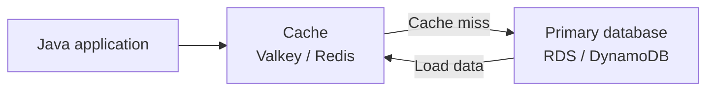
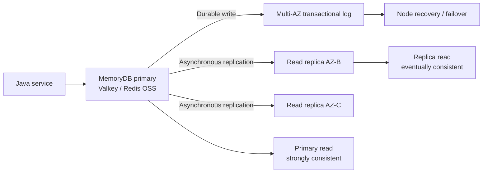
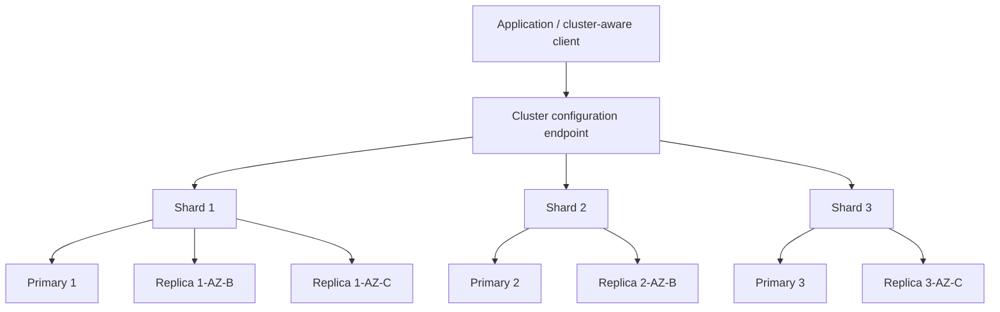
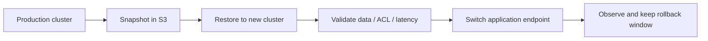
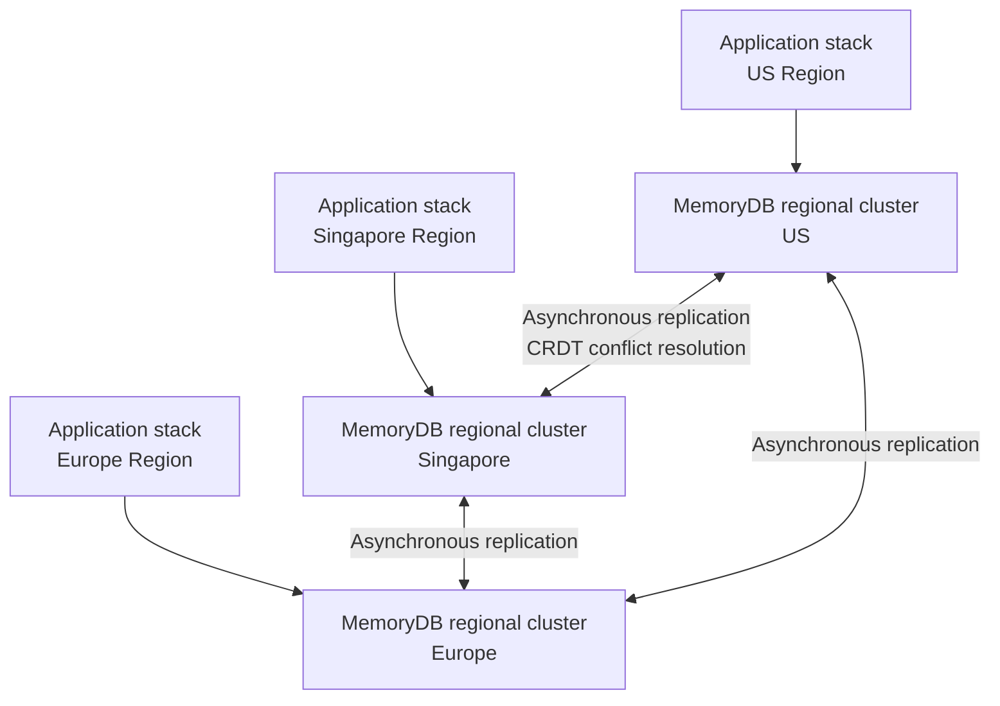
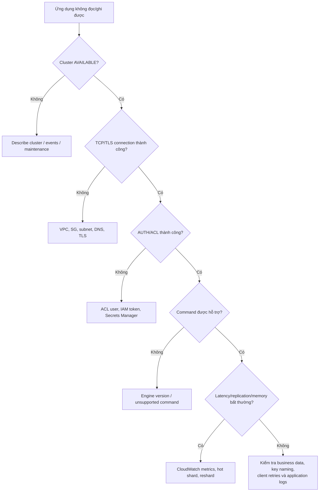
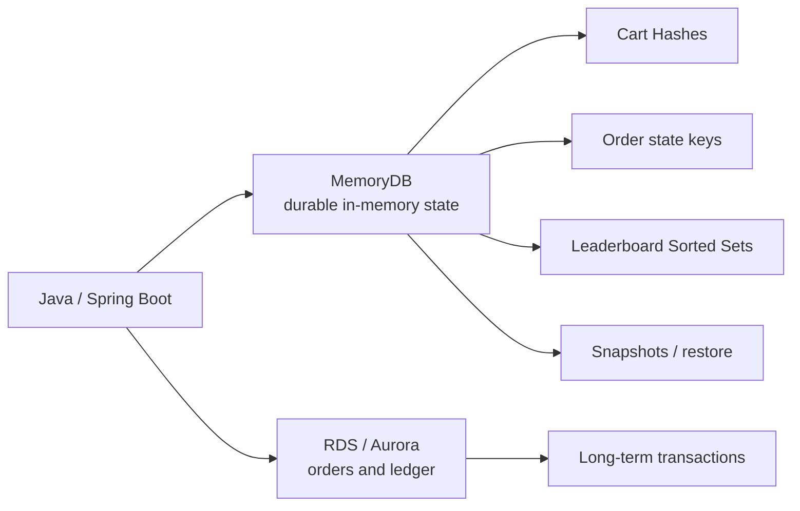

# Amazon MemoryDB và lưu trữ dữ liệu trong bộ nhớ có độ bền

## Mục tiêu học tập

Sau bài học, bạn có thể:

1. Giải thích vì sao **Amazon MemoryDB** là cơ sở dữ liệu trong bộ nhớ có độ bền, khác với cache có thể tái tạo từ database nguồn.
2. Mô tả kiến trúc **primary, read replicas, shards và Multi-AZ transactional log**, hiểu cách MemoryDB xác nhận ghi, khôi phục node và failover.
3. Phân biệt **strong consistency trên primary** với **eventual consistency trên replicas**, từ đó chọn đúng endpoint cho thao tác đọc quan trọng.
4. Chọn **Valkey hoặc Redis OSS engine compatibility**, đánh giá khả năng tương thích lệnh, cấu trúc dữ liệu và thư viện client trước khi migrate.
5. Quyết định khi nào dùng **MemoryDB, ElastiCache, DynamoDB hoặc RDS/Aurora**; hiểu rằng durable in-memory database không thay thế mọi mô hình dữ liệu.
6. Thiết kế **shards, replicas, key distribution, hash slots, TTL, snapshots và restore** theo workload, RPO/RTO và ngân sách.
7. Phân tích **MemoryDB Multi-Region active-active**, CRDT/LWW, eventual consistency và các giới hạn về TTL, failover, transaction, vector search và data tiering.
8. Bảo vệ cluster bằng **VPC/subnet groups, security groups, TLS, encryption at rest, ACLs, IAM authentication và least privilege**.
9. Kết nối ứng dụng Java bằng **Lettuce/Redis-compatible client**, quản lý connection pool, cluster discovery, retry, idempotency và credential rotation.
10. Tạo cluster thử nghiệm bằng AWS CLI, kiểm tra read/write, tạo snapshot, theo dõi CloudWatch metrics, đánh giá chi phí và dọn tài nguyên an toàn.

## 1. Bài toán: cache nhanh nhưng dữ liệu quan trọng cần tồn tại sau sự cố

Một ứng dụng thương mại điện tử viết bằng Java/Spring Boot cần đọc trạng thái đơn hàng, giỏ hàng, phiên đăng nhập và bảng xếp hạng gần như tức thời. Một lựa chọn quen thuộc là dùng Redis-compatible cache trước database:



Mô hình cache này giúp giảm latency và tải đọc database, nhưng cache thường được xem là **dữ liệu có thể tái tạo**. Khi cache node mất dữ liệu, ứng dụng phải nạp lại từ database nguồn. Nếu cache đang giữ dữ liệu nghiệp vụ duy nhất, chẳng hạn giỏ hàng chưa được ghi xuống database, việc mất cache có thể gây lỗi nghiệp vụ.

Một số workload cần cả:

- **Đọc rất nhanh** bằng cấu trúc dữ liệu trong bộ nhớ như String, Hash, Set và Sorted Set.
- **Ghi có độ bền** và khả năng phục hồi khi node hoặc Availability Zone gặp sự cố.
- **Tính nhất quán rõ ràng** khi ứng dụng đọc ngay sau một lần ghi.
- **Tự động failover** và quản lý cluster thay vì tự vận hành Redis servers.

Đây là bài toán của **Amazon MemoryDB**: một durable in-memory database tương thích với Valkey và Redis OSS, được thiết kế để có thể làm **primary database hiệu năng cao** cho một số ứng dụng microservices.

### 1.1. MemoryDB là gì?

Amazon MemoryDB lưu dataset trong bộ nhớ để đạt độ trễ đọc microsecond và ghi single-digit millisecond trong các workload phù hợp. Đồng thời, dịch vụ lưu các ghi đã được xác nhận vào **distributed Multi-AZ transactional log** trước khi trả kết quả thành công cho client.



Điểm khác biệt cốt lõi: **replica không phải nơi duy nhất giữ bản sao dữ liệu đã commit**. Transaction log đa AZ cung cấp đường khôi phục bền vững; replicas giúp mở rộng đọc và hỗ trợ failover.

### 1.2. Durable in-memory không có nghĩa mọi thứ chỉ nằm trong RAM

MemoryDB dùng engine Valkey/Redis OSS để xử lý dữ liệu trong bộ nhớ, đồng thời lưu write history vào transactional log phân tán qua nhiều AZ. Khi primary bị lỗi, dịch vụ có thể khôi phục node hoặc promote replica phù hợp dựa trên log.

- **In-memory** nói về cách phục vụ dữ liệu và hiệu năng của engine.
- **Durable** nói về cách bảo vệ các write đã được xác nhận và khả năng khôi phục.
- **Snapshot** là bản sao lưu theo thời điểm để khôi phục/tạo cluster mới; snapshot không phải cơ chế ghi bền duy nhất.
- **Replica** là bản sao phục vụ đọc và failover; replica replication là bất đồng bộ.

Không nên diễn giải “dữ liệu nằm trong RAM” thành “mất RAM là mất hết dữ liệu”, cũng không nên hiểu “durable” thành “không cần backup, snapshot hoặc kiểm thử restore”.

## 2. Khi nào MemoryDB phù hợp?

### 2.1. Workload có thể hưởng lợi

| Workload | Vì sao MemoryDB có thể phù hợp? | Thiết kế cần chú ý |
| --- | --- | --- |
| **Session store** | Truy cập key theo user/session với latency thấp, có thể giữ trạng thái bền. | TTL, key namespace, session rotation, dữ liệu nhạy cảm. |
| **Shopping cart** | Cập nhật giỏ hàng nhanh bằng Hash/Set, cần giữ nội dung sau node failure. | Idempotent updates, cart version, expiry policy. |
| **Order state / microservice state** | Đọc/ghi trạng thái có key đã biết, throughput cao. | Business invariants, transactions, idempotency, reconciliation. |
| **Leaderboard / ranking** | Sorted Set hỗ trợ rank và score queries. | Hot keys, cardinality, write distribution. |
| **Counters / rate limiting** | Atomic commands và Lua scripts cho phép cập nhật nhanh. | Atomicity theo shard, key design, time windows. |
| **Real-time application state** | Hash/Set/List/Sorted Set và Pub/Sub theo engine/version hỗ trợ. | Command compatibility, fanout, reconnect và persistence semantics. |
| **Vector search** | Một số engine/version hỗ trợ index vector trên dữ liệu Hash/JSON. | Vector capacity, index backfill, giới hạn scaling và feature compatibility. |

### 2.2. Khi nào nên chọn dịch vụ khác?

| Nhu cầu | Dịch vụ thường phù hợp hơn | Lý do |
| --- | --- | --- |
| Quan hệ phức tạp, JOIN, transaction SQL, ad hoc queries | **Amazon RDS / Aurora** | Mô hình quan hệ và SQL. |
| Key-value/Document serverless, dữ liệu lớn, single-digit millisecond | **Amazon DynamoDB** | Phân tán, durable storage, capacity modes và truy cập theo key/index. |
| Cache để tăng tốc database có sẵn, có thể tái tạo dữ liệu | **Amazon ElastiCache** | Cache-oriented workloads; Valkey/Redis OSS/Memcached options. |
| Search toàn văn, filter nhiều thuộc tính và relevance | **Amazon OpenSearch Service** | Search index và truy vấn tìm kiếm. |
| Phân tích dữ liệu lớn, lịch sử dài hạn | **Amazon S3 + Athena/Glue** | Object storage và analytics. |
| Quan hệ nhiều-nhiều, traversal graph | **Amazon Neptune** | Graph data model. |

MemoryDB không thay thế relational database cho các truy vấn JOIN hoặc báo cáo tùy ý. Một hệ thống vẫn có thể dùng **MemoryDB cho state tốc độ cao** và **RDS/DynamoDB cho dữ liệu giao dịch hoặc nguồn dữ liệu khác**, tùy cách chia ownership và consistency.

### 2.3. MemoryDB và ElastiCache: phân biệt theo yêu cầu durability

| Tiêu chí | Amazon MemoryDB | Amazon ElastiCache |
| --- | --- | --- |
| Định vị điển hình | **Durable in-memory primary database**. | Thường dùng làm **cache/data store tăng tốc** cho hệ thống khác. |
| Engine | Valkey và Redis OSS theo phiên bản được hỗ trợ. | Valkey, Redis OSS và Memcached theo deployment options. |
| Ghi bền | Multi-AZ transactional log là nền tảng durability của MemoryDB. | **ElastiCache for Valkey node-based** hiện có durability options với synchronous/asynchronous writes; kiểm tra engine version/Region availability và cấu hình cụ thể. |
| Multi-Region active-active | Có MemoryDB Multi-Region với CRDT trong các Region/engine được hỗ trợ. | Khả năng khác theo tính năng ElastiCache; không mặc định tương đương MemoryDB Multi-Region. |
| Khi chọn | Dữ liệu chính cần durability, read latency rất thấp và Valkey/Redis APIs. | Cần cache trước DB, hoặc dùng ElastiCache durability nếu phiên bản/tính năng đáp ứng. |

**Không nên học thuộc rằng ElastiCache luôn ephemeral.** AWS hiện đã có durability cho **ElastiCache for Valkey node-based**; synchronous writes được lưu vào Multi-AZ log trước khi trả response, còn asynchronous writes lưu log sau response và có rủi ro mất một khoảng dữ liệu chưa commit khi lỗi. FAQ hiện hành của AWS khuyến nghị cân nhắc **ElastiCache cho workload mới** vì durability cho phép dùng dịch vụ này cả làm cache lẫn persistent data store; MemoryDB vẫn phù hợp khi tính năng/kiến trúc cụ thể của nó đáp ứng yêu cầu tốt hơn. Hãy so sánh đúng engine/version, synchronous hay asynchronous writes, Multi-Region, command compatibility, migration và yêu cầu vận hành tại thời điểm thiết kế.

## 3. Kiến trúc cluster: primary, replicas, shards và endpoints

### 3.1. Cluster và shard

Một **MemoryDB cluster** gồm một hoặc nhiều **shards** (còn gọi là node groups). Mỗi shard có:

- **Một primary node**: nhận writes và có thể phục vụ reads.
- **Các read replicas**: bản sao read-only của primary, có thể phục vụ reads khi ứng dụng chọn replica endpoint/READONLY.
- **Transaction log**: nơi lưu bền các writes đã được xác nhận qua nhiều AZ.

Một cluster có thể phân vùng dữ liệu qua nhiều shards. Theo giới hạn dịch vụ hiện hành, MemoryDB hỗ trợ tối đa **500 shards và 500 nodes mỗi cluster**; mỗi shard có một primary và có thể có tối đa 5 replicas, nhưng tổng node count giới hạn số kết hợp khả dụng. Ví dụ 500 shards không có replicas hoặc 100 shards với 4 replicas/shard đều chạm giới hạn 500 nodes. Hãy xác minh Service Quotas và giới hạn theo Region/engine trước khi thiết kế.



### 3.2. Scale write và read theo hướng khác nhau

| Thay đổi | Tác động chính |
| --- | --- |
| Thêm **shards** | Tăng khả năng phân vùng dữ liệu và write throughput tổng thể khi key distribution phù hợp. |
| Thêm **replicas/shard** | Tăng khả năng phục vụ read traffic và khả năng sẵn sàng khi có node/AZ failure. |
| Tăng **node type** | Tăng CPU, memory và network capacity trên mỗi node. |
| Giảm shards/replicas/node type | Có thể giảm chi phí nhưng cần đủ memory, throughput và resilience sau khi scale. |

Thêm replicas **không tự tăng write throughput của một shard**, vì writes vẫn được định tuyến tới primary của shard. Thêm shards chỉ có lợi khi workload có đủ keys phân phối qua các slots; một hot key vẫn có thể nóng ở một shard.

### 3.3. Endpoints cần phân biệt

| Endpoint | Vai trò | Dùng khi |
| --- | --- | --- |
| **Cluster configuration endpoint** | Entry point để cluster-aware client khám phá topology/shards và hash-slot map. | Kết nối ứng dụng cluster mode enabled; đây là endpoint nên cấu hình cho client. |
| **Primary node endpoint** | Endpoint của primary thuộc một shard cụ thể. | Chỉ dùng khi thao tác vận hành/direct-node được tài liệu hướng dẫn; không hardcode endpoint này cho ứng dụng cluster-aware. |
| **Replica node endpoint** | Endpoint của read replica thuộc một shard cụ thể. | Direct replica reads/troubleshooting khi client và consistency model cho phép. |

Trong cluster mode enabled, nên dùng **cluster configuration endpoint** cùng client hỗ trợ Redis/Valkey Cluster protocol, để client theo dõi slot map và chuyển writes tới primary của shard tương ứng. Không có một primary duy nhất cho toàn cluster nhiều shards; không hardcode IP/endpoint của node vì node có thể thay đổi sau failover/maintenance.

### 3.4. Hash slots và key co-location

Cluster mode sử dụng **16.384 hash slots** để phân phối keys. Một key được hash vào một slot, slot thuộc về một shard.

Ví dụ:

```text
order:1001:status  -> một hash slot -> shard 1
order:1002:status  -> một hash slot -> shard 2
cart:customer:007  -> một hash slot -> shard 3
```

Nếu nhiều keys phải tham gia cùng một thao tác nhiều-key/transaction/Lua script, chúng thường phải nằm **cùng hash slot**. Redis/Valkey hỗ trợ **hash tags** dùng phần nằm trong dấu ngoặc nhọn để tính slot:

```text
order:{1001}:status
order:{1001}:items
order:{1001}:payment
```

Các keys trên có chung hash tag `{1001}` và được đặt cùng slot, hỗ trợ một số thao tác nhiều key. Nhưng nếu mọi đơn dùng hash tag `{all}`, bạn có thể tạo **hot shard**. Chọn tag theo aggregate nhỏ, có đủ concurrency, không theo một giá trị toàn hệ thống.

### 3.5. Multi-AZ và automatic failover

Khi bật Multi-AZ và có replica phù hợp:

1. MemoryDB phát hiện primary node/AZ gặp sự cố.
2. Dịch vụ xác định replica nhất quán và thực hiện failover.
3. Replica được promote thành primary để tiếp tục nhận writes.
4. Node thay thế được tạo và đồng bộ từ transactional log.

**Failover vẫn có thể làm client mất kết nối trong một khoảng ngắn.** Ứng dụng cần reconnect, refresh topology, retry an toàn và không giữ endpoint IP cố định. Multi-AZ giảm downtime và bảo vệ dữ liệu đã commit, nhưng không loại bỏ mọi lỗi ứng dụng, network partition hoặc sự cố ở tầng client.

## 4. Độ bền và tính nhất quán: phần quan trọng nhất của MemoryDB

### 4.1. Write được xác nhận sau khi lưu vào transactional log

Trong MemoryDB single-Region:

1. Client gửi lệnh ghi tới primary của shard.
2. MemoryDB ghi dữ liệu vào **distributed Multi-AZ transactional log**.
3. Khi write được xác nhận, dữ liệu đã được lưu bền trong log.
4. Primary cập nhật dữ liệu phục vụ lệnh tiếp theo; replicas nhận thay đổi qua replication bất đồng bộ.

Điều này tạo ra hai đặc tính khác nhau:

- **Durability:** write đã được xác nhận được bảo vệ qua Multi-AZ log và dùng để phục hồi sau lỗi node.
- **Replica freshness:** read replica có thể chưa nhận thay đổi mới nhất vì replication bất đồng bộ.

### 4.2. Primary strong, replica eventual

| Nơi đọc | Consistency | Cách dùng |
| --- | --- | --- |
| **Primary node** | Strong consistency đối với các write thành công trước đó. | Đọc sau khi cập nhật trạng thái thanh toán, tồn kho hoặc phiên giao dịch. |
| **Read replica** | Eventual consistency; có thể trễ so với primary. | Dashboard, leaderboard hoặc dữ liệu chấp nhận lag. |
| **Replica đơn lẻ** | Sequential consistency theo thứ tự cập nhật đã áp dụng trên replica đó. | Tránh giả định replica đọc được write mới nhất vừa commit ở primary. |

Ví dụ:

```text
1. SET order:1001:status "PAID"  -> primary xác nhận
2. GET order:1001:status         -> primary trả "PAID"
3. READONLY + GET ...            -> replica có thể tạm trả "PENDING"
4. Sau replication              -> replica trả "PAID"
```

Nếu ứng dụng vừa ghi xong rồi đọc lại để quyết định nghiệp vụ, hãy đọc từ **primary**. Đọc từ replica chỉ khi ứng dụng chấp nhận eventual consistency. Đừng xem replica lag là dữ liệu bị mất nếu primary đã xác nhận write.

### 4.3. Replica lag và failover

Replica replication là bất đồng bộ nên cần theo dõi **ReplicationLag**. Khi primary fail, MemoryDB chọn replica nhất quán theo cơ chế failover và transactional log bảo vệ các writes đã được xác nhận. Nhưng trong lúc failover:

- Connection hiện tại có thể bị đóng.
- Client cần reconnect và khám phá topology mới.
- Request đang bay có thể có kết quả không rõ ràng ở phía client.
- Ứng dụng cần idempotency key cho thao tác ghi có side effect.

Không retry một lệnh tăng tiền, trừ số lượng hoặc ghi nhận thanh toán bằng một operation ID mới chỉ vì socket bị reset. Hãy đọc lại trạng thái theo key nghiệp vụ hoặc dùng operation idempotent.

### 4.4. Durability không đồng nghĩa transaction ACID như RDBMS

MemoryDB có các lệnh transaction kiểu Valkey/Redis như MULTI/EXEC và Lua scripting theo phiên bản/command hỗ trợ. Nhưng điều đó không biến MemoryDB thành relational database:

- Không có SQL JOIN hay foreign-key constraints như RDS.
- Multi-key commands/transactions trong cluster mode phải tuân theo hash-slot constraints.
- Transaction không bao gồm side effect ở payment gateway, RDS hoặc SNS.
- Atomicity của một nhóm lệnh trong engine khác với transaction phân tán giữa nhiều dịch vụ.

Hãy thiết kế **business idempotency, conditional logic và reconciliation** cho thao tác có giá trị tiền tệ hoặc cập nhật dữ liệu ở nhiều hệ thống.

## 5. Snapshots, backup và khôi phục

### 5.1. Transaction log và snapshot giải quyết hai vấn đề khác nhau

| Cơ chế | Mục đích | Phạm vi |
| --- | --- | --- |
| **Multi-AZ transactional log** | Bảo vệ writes đã được xác nhận và hỗ trợ recovery/failover của cluster. | Hoạt động liên tục theo kiến trúc MemoryDB. |
| **Automatic snapshot** | Tạo điểm khôi phục theo lịch và giữ theo retention đã cấu hình. | Toàn bộ cluster metadata và data tại thời điểm snapshot. |
| **Manual snapshot** | Tạo bản sao trước migration, thay đổi engine hoặc thao tác rủi ro. | Snapshot do operator chủ động yêu cầu. |
| **Restore from snapshot** | Tạo cluster mới với dữ liệu từ snapshot. | Không phải rollback tại chỗ trên cluster đang chạy. |

MemoryDB lưu snapshots vào **Amazon S3**. Snapshot chứa metadata và dữ liệu của cluster; có thể dùng để tạo cluster mới tại thời điểm khôi phục hoặc seed một cluster khác theo điều kiện hỗ trợ.

### 5.2. Khi nào cần snapshot?

- Trước khi thay đổi engine version hoặc thực hiện migration.
- Trước khi thay đổi cấu trúc dữ liệu có ảnh hưởng nhiều ứng dụng.
- Trước khi thay đổi shard count hoặc các cấu hình vận hành lớn nếu quy trình yêu cầu.
- Theo lịch backup để đáp ứng yêu cầu phục hồi sau lỗi ứng dụng hoặc thao tác xóa nhầm.
- Trước khi xóa cluster, nếu cần giữ dữ liệu để audit/restore.

**Snapshot không thay thế Multi-AZ failover**, và Multi-AZ failover cũng không thay thế backup. Nếu ứng dụng ghi nhầm giá trị hợp lệ, transactional log có thể bảo vệ chính giá trị sai đó; snapshot/restore và quy trình phục hồi logic vẫn quan trọng.

### 5.3. Restore tạo cluster mới

Quy trình khôi phục thường gồm:

1. Chọn snapshot và xác minh thời điểm dữ liệu.
2. Tạo **cluster mới** từ snapshot, chọn subnet group, security groups, ACL, node type, shards và các cấu hình tương thích.
3. Chờ cluster mới ở trạng thái AVAILABLE.
4. Kết nối ứng dụng thử nghiệm tới endpoint mới, xác minh dữ liệu, command compatibility và hiệu năng.
5. Chuyển traffic theo kế hoạch (DNS/config/secret/service discovery).
6. Giữ cluster cũ theo thời gian rollback đã duyệt, rồi mới xóa.



Restore không phải thao tác “rewind cluster hiện tại” và có thể cần thời gian theo kích thước dataset. Hãy đo RTO bằng diễn tập thực tế, không suy ra từ việc snapshot đã tồn tại.

### 5.4. RPO/RTO và runbook

| Khái niệm | Câu hỏi cần trả lời |
| --- | --- |
| **RPO** (Recovery Point Objective) | Chấp nhận mất tối đa bao nhiêu dữ liệu theo thời gian trong kịch bản lỗi cụ thể? |
| **RTO** (Recovery Time Objective) | Dịch vụ phải phục hồi trong bao lâu? |
| **Backup retention** | Giữ snapshots bao lâu để đáp ứng policy? |
| **Restore test** | Bao lâu thử khôi phục một cluster thật và xác minh business data? |
| **Failover test** | Client có reconnect và xử lý ambiguous writes đúng không? |

Một runbook production nên có owner, cluster ARN, snapshot ARN/name, subnet/security group, ACL/user, KMS key, engine version, endpoint update steps, validation queries, rollback và cleanup approval.

## 6. Engine compatibility và cấu trúc dữ liệu Valkey/Redis OSS

### 6.1. Tương thích protocol không có nghĩa mọi command đều giống nhau

MemoryDB hỗ trợ **Valkey và Redis OSS** theo các engine versions được AWS công bố. Ứng dụng có thể tái sử dụng nhiều client và data structures tương thích, nhưng cần xác minh:

- Engine version/patch version đang chạy.
- Command và subcommand mà MemoryDB hỗ trợ.
- Cluster mode, multi-key/transaction constraints và Pub/Sub behavior.
- ACL rules, TLS, client library version và connection pooling.
- Tính năng riêng như vector search, data tiering hoặc Multi-Region.

Không giả định “Redis OSS compatible” nghĩa là mọi module/plugin, lệnh admin hoặc lệnh từ Redis self-managed đều có sẵn. Hãy chạy compatibility tests trên cluster staging.

### 6.2. Một số cấu trúc dữ liệu phổ biến

| Data structure | Ví dụ lệnh | Ứng dụng |
| --- | --- | --- |
| **String** | SET, GET, INCR, MGET | Token, trạng thái nhỏ, counter. |
| **Hash** | HSET, HGET, HGETALL | Cart, user/session profile, order summary. |
| **List** | LPUSH, RPOP, LRANGE | Queue nhẹ trong phạm vi command được hỗ trợ; cân nhắc SQS cho durable messaging. |
| **Set** | SADD, SISMEMBER, SMEMBERS | Tags, membership, unique values. |
| **Sorted Set** | ZADD, ZRANGE, ZREVRANK | Leaderboard, ranking, time/score ordering. |
| **Pub/Sub** | PUBLISH, SUBSCRIBE | Notification realtime; cần reconnect và không xem như durable event log. |
| **Streams** | XADD, XREADGROUP | Event stream theo engine/feature support; xác minh version/command availability. |

### 6.3. TTL và expiration

Trong MemoryDB single-Region, Valkey/Redis OSS commands như EXPIRE/PEXPIRE có thể đặt TTL cho keys theo engine/version hỗ trợ. Khi key hết hạn, dữ liệu không còn được ứng dụng xem là hợp lệ theo semantics của engine; thời điểm giải phóng bộ nhớ có thể không trùng chính xác với giây TTL kết thúc.

Ví dụ:

```text
SET session:user-007 "..."
EXPIRE session:user-007 3600

SET cart:user-007 "..."
EXPIRE cart:user-007 86400
```

Không dùng TTL để thay thế workflow nghiệp vụ cần xử lý chính xác đúng thời điểm, chẳng hạn tự động hoàn tiền khi đơn hết hạn. Hãy dùng scheduler/event workflow để xử lý nghiệp vụ, còn TTL chỉ là chính sách vòng đời dữ liệu.

**Lưu ý đặc biệt:** MemoryDB **Multi-Region không hỗ trợ TTL** theo tài liệu giới hạn hiện hành. Nếu ứng dụng cần expiration trong Multi-Region, phải thiết kế expiration logic riêng và hiểu cách đồng bộ/resolve state.

### 6.4. Vector search trong MemoryDB

MemoryDB có **vector search** cho các engine/version hỗ trợ, dùng để lưu embedding và thực hiện tìm kiếm vector gần đúng cùng với dữ liệu ứng dụng. Các trường hợp gồm:

- Retrieval-Augmented Generation (RAG) cho dữ liệu cần truy xuất nhanh.
- Recommendation realtime.
- Anomaly detection và document retrieval.

Vector search không tự động có trên mọi cluster: tính năng có từ **MemoryDB 7.1**, hỗ trợ node types **R6g, R7g và T4g**, và phải bật khi tạo cluster bằng parameter group phù hợp. **Không thể bật vector search bằng cách cập nhật một cluster hiện có**; nếu cần, tạo cluster search-enabled mới hoặc restore từ snapshot theo điều kiện AWS hỗ trợ. Giới hạn hiện hành gồm tối đa **32.768 dimensions/vector**, **10 indexes** và **50 fields/index**. Cần tính RAM cho vector data và index.

Một số giới hạn cần nhớ:

- Vector search giới hạn ở **một shard** theo tài liệu tính năng hiện hành; không giả định scale ngang bằng cách thêm shards.
- Index backfill có thể chưa hoàn tất ngay khi node trở lại trạng thái phục vụ.
- Snapshot/restore và engine compatibility cần tuân theo hướng dẫn vector search.
- **MemoryDB Multi-Region không hỗ trợ vector search** theo danh sách giới hạn hiện tại.

Không chọn MemoryDB vector search chỉ vì ứng dụng có embedding. So sánh số vector, dimensions, recall/latency, metadata filters, index scale và chi phí với OpenSearch hoặc vector database chuyên dụng.

## 7. Data tiering và mở rộng cluster

### 7.1. Data tiering với node family r6gd

MemoryDB hỗ trợ **data tiering** trên các node type thuộc family **r6gd**. Keys luôn ở DRAM; values ít được truy cập có thể được chuyển từ memory sang local SSD theo cơ chế LRU. Khi ứng dụng đọc value trên SSD, MemoryDB tự đưa dữ liệu trở lại memory trước khi xử lý request.

Data tiering phù hợp khi workload thường xuyên truy cập một phần nhỏ của dataset (AWS gợi ý khoảng **tối đa 20%** dữ liệu được truy cập thường xuyên) và ứng dụng chấp nhận latency bổ sung cho dữ liệu nằm trên SSD. Với ví dụ string value 500 bytes, AWS nêu mức latency đọc bổ sung khoảng **450 microseconds** cho dữ liệu SSD; con số thực tế phụ thuộc workload, node và kích thước value.

Không nên bật data tiering khi phần lớn dữ liệu đều nóng, P99 latency rất nhạy, hoặc workload cần vector search/Multi-Region không tương thích. Đo tỷ lệ hot/cold và latency trước khi chọn node family r6gd.

### 7.2. Horizontal và vertical scaling

MemoryDB hỗ trợ **online resharding** để tăng/giảm số shards trong khi cluster tiếp tục phục vụ requests. Resharding vẫn tốn CPU/network và có thể làm latency tăng tạm thời.

Trước khi reshard:

1. Đo CPU, memory, network throughput, connections và replication lag.
2. Kiểm tra key distribution và shard skew; thêm shard không tự sửa hot key.
3. Load test client behavior khi slot migration xảy ra.
4. Xem xét các keys/items rất lớn có thể không được di chuyển như mong muốn trong một số trường hợp.
5. Thực hiện vào thời điểm tải thấp và theo dõi latency/throttling.

Đổi node type là **vertical scaling**. Nếu scale down, xác minh free memory trên node mới đủ chứa dataset, engine overhead, replication buffers và fragmentation. Không chỉ nhìn dung lượng dữ liệu logic.

## 8. MemoryDB Multi-Region: active-active và CRDT

### 8.1. Khi nào cần Multi-Region?

Một ứng dụng toàn cầu có thể cần đọc/ghi gần người dùng tại nhiều AWS Regions. MemoryDB Multi-Region cung cấp **active-active replication**: mỗi Region có regional cluster phục vụ local reads/writes, dữ liệu được truyền bất đồng bộ giữa các Region. Tính năng này hiện yêu cầu **Valkey 7.3 trở lên**, node family/size được hỗ trợ (tối thiểu **db.r7g.xlarge** theo yêu cầu hiện hành) và tối đa **5 Regions** trong một Multi-Region cluster. Các regional clusters phải dùng cùng số shards, node type, Valkey engine version, TLS và parameter group; số replicas có thể khác nhau giữa các Regions. Kiểm tra danh sách Region/node type hỗ trợ trước khi triển khai.



AWS cho biết dữ liệu thường được truyền tới các Region thành viên trong khoảng **dưới một giây**, nhưng đây là hành vi thường thấy, không phải RPO/RTO SLA.

### 8.2. Conflict resolution với CRDT và Last Writer Wins

Khi hai Region cùng cập nhật một key gần như đồng thời, MemoryDB Multi-Region dùng **Conflict-free Replicated Data Types (CRDT)** và **Last Writer Wins (LWW)** để hội tụ dữ liệu:

- Với **String**, conflict được resolve ở cấp key.
- Với các collection như **Hash, Set và Sorted Set**, conflict có thể được resolve ở cấp sub-key/element theo semantics được hỗ trợ.
- Các cập nhật đồng thời tới những fields/elements khác nhau có thể được merge.
- Cập nhật cạnh tranh lên cùng một giá trị có thể bị một write thắng theo LWW.

Ví dụ Hash:

```text
Region A: HSET cart:007 itemA 2
Region B: HSET cart:007 itemB 1

Sau replication:
cart:007 = { itemA: 2, itemB: 1 }
```

Nếu cả hai Region đồng thời ghi **cùng field itemA** với giá trị khác nhau, LWW sẽ quyết định giá trị cuối cùng được hội tụ. Vì vậy ứng dụng không nên dựa vào Multi-Region để thực hiện transaction toàn cầu yêu cầu khóa/serialization tuyệt đối.

### 8.3. Multi-Region không phải synchronous global database

| Đặc tính | MemoryDB Multi-Region |
| --- | --- |
| Read/write local | Có, mỗi Region có regional cluster. |
| Replication | Bất đồng bộ. |
| Consistency | Eventual giữa Regions; conflict được giải quyết bằng CRDT/LWW. |
| Write conflict | Tự động reconcile theo quy tắc của engine/data type. |
| Local durability | Writes được bảo vệ bởi Multi-AZ transaction log trong Region. |
| Cross-Region transaction atomicity | **Không bảo đảm**; transaction atomic trong một Region, không atomic xuyên Regions. |
| Regional failover | Ứng dụng phải phát hiện sự cố và chuyển traffic; không có một endpoint toàn cầu tự động chuyển traffic thay bạn. |
| RPO/RTO SLA | Không có RPO/RTO SLA được nêu cho Multi-Region. |

Nếu một Region bị cô lập, nó có thể tiếp tục nhận local writes; replication lag có thể tăng trong thời gian cô lập. Khi kết nối phục hồi, các pending writes sẽ tiếp tục được truyền và conflict được reconcile.

### 8.4. Các giới hạn Multi-Region cần nhớ

- **Không hỗ trợ TTL**.
- **Không hỗ trợ data tiering**.
- **Không hỗ trợ vector search**.
- Không hỗ trợ một số read-modify-write commands và command/data types nhất định.
- Transactions chỉ bảo đảm atomicity **trong một Region**, không phải giữa các Regions.
- Không có **single global endpoint** hoặc regional automatic failover; ứng dụng phải chuyển traffic sang application stack và regional cluster khác.
- Cần theo dõi metric **MultiRegionClusterReplicationLag** và quyết định khi nào chuyển traffic theo yêu cầu RPO của hệ thống.

Trước khi chọn Multi-Region, kiểm tra danh sách supported/unsupported commands và engine version. Không migrate workload dùng Redis Streams, TTL hoặc lệnh read-modify-write mà chưa kiểm thử.

### 8.5. Thiết kế ứng dụng tránh conflict

- Chia **ownership theo Region/tenant/entity** nếu có thể, để mỗi key thường chỉ được ghi từ một Region.
- Dùng operation IDs và idempotency keys; tránh dựa vào thứ tự giữa các Regions.
- Thiết kế data model sao cho cập nhật độc lập ở các sub-keys có thể merge an toàn.
- Với business invariant toàn cầu (ví dụ trừ tiền tài khoản), dùng hệ thống transaction/ledger có consistency phù hợp; không để CRDT LWW quyết định giá trị tài chính cuối cùng.
- Tự xây traffic steering, health checks, regional routing và reconciliation runbooks.

## 9. Security: VPC, TLS, ACL và IAM

### 9.1. MemoryDB chạy trong VPC

MemoryDB cluster được tạo trong **Amazon VPC**, không phải public database endpoint. Ứng dụng cần đường mạng hợp lệ tới cluster:

1. Đặt cluster trong subnet group gồm các private subnets phù hợp ở nhiều AZ.
2. Gắn security group chuyên dụng cho cluster.
3. Chỉ cho phép inbound TCP từ security group của application workloads tới port cluster (mặc định **6379**).
4. Kiểm tra DNS, route tables, NACL, VPC peering/Transit Gateway/VPN nếu client ở VPC hoặc network khác.

Không mở security group rộng cho mọi nguồn chỉ để thử kết nối. Tạo security group chuyên dụng cho MemoryDB, tránh dùng default SG dùng chung cho workload khác.

### 9.2. Encryption in transit và at rest

- **TLS in transit** bảo vệ dữ liệu giữa ứng dụng và node, cũng như giữa các node theo cấu hình dịch vụ.
- **Encryption at rest** bảo vệ transactional log và dữ liệu trên đĩa trong snapshot operations.
- Có thể dùng AWS-owned key hoặc customer managed KMS key theo yêu cầu quản trị.

TLS nên được bật trong production. Client phải xác minh certificate/hostname và dùng endpoint DNS của MemoryDB, không tắt certificate validation để xử lý lỗi kết nối.

### 9.3. IAM control plane khác với Redis/Valkey data access

Có ba lớp cần phân biệt:

| Lớp | Công cụ | Mục đích |
| --- | --- | --- |
| Quản trị AWS resources | **IAM policies** | Ai được tạo, sửa, xóa, mô tả cluster, user, ACL, snapshot. |
| Xác thực/ủy quyền command tới engine | **MemoryDB users + ACLs** | Ai được AUTH và được phép chạy commands/key patterns nào. |
| Network access | **VPC + security groups + TLS** | Workload nào có thể mở kết nối tới endpoint/port. |

Một IAM role có quyền `memorydb:DescribeClusters` **không tự động có quyền chạy GET/SET trên data plane**. Ngược lại, ACL user có thể chạy SET/GET không có nghĩa principal được phép tạo cluster hoặc xóa snapshot.

### 9.4. ACL users và access strings

MemoryDB dùng **Access Control Lists (ACLs)** để nhóm users và gắn quyền truy cập vào cluster. Access string có thể giới hạn user có được bật hay không, key patterns được truy cập và command categories/commands cụ thể.

Ví dụ user ứng dụng chỉ truy cập key namespace orders:

```text
on ~orders:* +@read +@write +ping
```

Đây là ví dụ khởi đầu; cần rà soát lệnh thực tế, script, transaction và key patterns. Tránh `+@all`/`~*` cho application users nếu không cần. Lưu password trong AWS Secrets Manager, rotate và không ghi vào source control/logs.

### 9.5. IAM authentication cho Valkey/Redis OSS 7+

Với engine Valkey hoặc Redis OSS **version 7.0 trở lên**, MemoryDB hỗ trợ **IAM authentication**:

1. Tạo MemoryDB user với authentication mode `iam`.
2. Gắn user vào ACL và ACL vào cluster.
3. IAM identity/role của ứng dụng có quyền `memorydb:Connect` trên **cluster ARN và user ARN**.
4. Ứng dụng dùng AWS credentials để ký SigV4 và tạo token xác thực tạm thời.
5. Client gửi token như password trong AUTH/HELLO khi mở hoặc làm mới connection.

Token IAM có hiệu lực **15 phút**; kết nối IAM-authenticated có thể bị ngắt sau **12 giờ** nếu không được gia hạn bằng token mới. Dùng client/credentials provider hỗ trợ refresh tự động cho connection lâu dài.

Một số giới hạn cần biết: IAM authentication không hỗ trợ MULTI/EXEC theo tài liệu hiện hành; không dùng token tĩnh 15 phút làm mật khẩu hardcode cho pool chạy dài hạn.

### 9.6. Least privilege

Tách roles:

- **Deployment role**: tạo cluster, subnet group, user, ACL, snapshot và cấu hình.
- **Application role**: chỉ quyền kết nối `memorydb:Connect` (nếu dùng IAM auth) và các AWS actions thực sự cần.
- **Operations role**: xem metrics, events, snapshot, describe/modify theo quy trình.

Không cấp `memorydb:*` cho application runtime chỉ vì ứng dụng cần đọc/ghi dữ liệu. Data-plane commands phải được giới hạn thêm qua ACL.

## 10. Lab AWS CLI: tạo MemoryDB cluster thử nghiệm

Lab này tạo một cluster Valkey nhỏ, có **hai shards, một replica mỗi shard, TLS và ACL user**. Các subnet/security groups là tài nguyên VPC có sẵn trong account thử nghiệm.

> **Cảnh báo chi phí:** MemoryDB tính phí node theo thời gian cluster hoạt động, kể cả khi ứng dụng không gửi request. Chỉ thực hiện lab trong account được phép, xác minh Region/VPC, và xóa cluster/snapshot lab khi hoàn tất. Không chạy các lệnh cleanup trên tài nguyên dùng chung hoặc production.

### 10.1. Điều kiện đầu vào

Chuẩn bị:

- AWS CLI đã cấu hình credential và Region.
- Một VPC có **private subnets ở ít nhất hai AZ**.
- Một security group dành riêng cho MemoryDB.
- Inbound rule TCP **6379** trên MemoryDB security group, source là **application security group**.
- IAM role của người chạy lab có quyền tạo user/ACL/subnet group/cluster và `iam:PassRole` nếu quy trình yêu cầu service-linked role.

Xác minh account và Region:

```bash
aws sts get-caller-identity
aws configure get region
```

Ví dụ dưới dùng Region `ap-southeast-1`. Thay subnet IDs/security group ID bằng giá trị thật trong **cùng VPC**:

```bash
REGION=ap-southeast-1
SUBNET_A=subnet-0123456789abcdef0
SUBNET_B=subnet-0fedcba9876543210
MEMORYDB_SG=sg-0123456789abcdef0
```

Không dùng những ID ví dụ như thể chúng tồn tại trong account của bạn.

### 10.2. Tạo subnet group

```bash
aws memorydb create-subnet-group \
  --subnet-group-name orders-lab-subnets \
  --description "Private subnets for MemoryDB lesson lab" \
  --subnet-ids "$SUBNET_A" "$SUBNET_B" \
  --region "$REGION"

aws memorydb describe-subnet-groups \
  --subnet-group-name orders-lab-subnets \
  --region "$REGION"
```

Subnet group cho biết MemoryDB được đặt node vào những subnets nào. Chọn subnets thuộc nhiều AZ để triển khai Multi-AZ; không chọn subnet public với kỳ vọng cluster có public IP.

### 10.3. Tạo user bằng password và access string giới hạn

Tạo file `memorydb-user.json`:

```json
{
  "UserName": "orders-app",
  "AuthenticationMode": {
    "Type": "password",
    "Passwords": [
      "<replace-with-generated-strong-password>"
    ]
  },
  "AccessString": "on ~orders:* +@read +@write +ping"
}
```

Thay placeholder bằng password ngẫu nhiên mạnh, chỉ lưu tạm trong nơi bảo mật. Production nên tạo/rotate secret qua **AWS Secrets Manager**, tránh để password trong shell history, file source control hoặc log.

```bash
aws memorydb create-user \
  --cli-input-json file://memorydb-user.json \
  --region "$REGION"

aws memorydb create-acl \
  --acl-name orders-lab-acl \
  --user-names orders-app \
  --region "$REGION"
```

Access string chỉ cho phép user bật, truy cập keys có prefix `orders:`, chạy command categories read/write và `PING`. Khi dùng lệnh thực tế, rà soát command categories và key patterns để tránh cấp quyền rộng hơn ứng dụng cần.

### 10.4. Tạo cluster

```bash
aws memorydb create-cluster \
  --cluster-name orders-memorydb-lab \
  --description "Durable in-memory database lesson lab" \
  --engine valkey \
  --node-type db.r6g.large \
  --num-shards 2 \
  --num-replicas-per-shard 1 \
  --subnet-group-name orders-lab-subnets \
  --security-group-ids "$MEMORYDB_SG" \
  --acl-name orders-lab-acl \
  --tls-enabled \
  --snapshot-retention-limit 3 \
  --region "$REGION"
```

Chọn engine version theo danh sách được MemoryDB hỗ trợ trong Region khi triển khai. Nếu cần cố định version, thêm `--engine-version` sau khi xác minh tương thích client và feature.

### 10.5. Lấy cluster endpoint

```bash
aws memorydb describe-clusters \
  --cluster-name orders-memorydb-lab \
  --region "$REGION" \
  --query 'Clusters[0].ClusterEndpoint'
```

Với cluster mode enabled, lấy **cluster configuration endpoint** để dùng với client hỗ trợ cluster discovery. Không hardcode node endpoint/IP vào application config.

### 10.6. Kết nối bằng redis-cli

Chạy từ EC2/compute workload có network access tới MemoryDB security group:

```bash
redis-cli -c \
  -h "<cluster-configuration-endpoint>" \
  -p 6379 \
  --tls \
  --user orders-app \
  --askpass
```

Khi được hỏi, nhập password lab đã lưu an toàn. Flag `-c` bật cluster mode để redis-cli theo redirect tới shard phù hợp.

Thử ghi/đọc:

```text
SET orders:1001:status PAID
GET orders:1001:status

HSET orders:1001 customerId c007 currency VND
HGETALL orders:1001
PING
```

Các key đều có prefix `orders:` nên phù hợp ACL. Nếu thử key `cart:customer:007`, user này phải bị từ chối do access string không cho phép namespace đó.

### 10.7. Tạo snapshot thủ công

```bash
aws memorydb create-snapshot \
  --cluster-name orders-memorydb-lab \
  --snapshot-name orders-memorydb-lab-before-change \
  --region "$REGION"

aws memorydb describe-snapshots \
  --cluster-name orders-memorydb-lab \
  --region "$REGION"
```

Đợi snapshot hoàn thành trước khi dùng restore. Snapshot là bản sao tại thời điểm cụ thể, không phải một endpoint có thể query trực tiếp.

### 10.8. Restore sang cluster mới

Restore cần **cluster name mới** và cấu hình subnet/ACL/node phù hợp. Ví dụ:

```bash
aws memorydb create-cluster \
  --cluster-name orders-memorydb-restore-lab \
  --description "Restore test from lesson snapshot" \
  --engine valkey \
  --node-type db.r6g.large \
  --num-shards 2 \
  --num-replicas-per-shard 1 \
  --subnet-group-name orders-lab-subnets \
  --security-group-ids "$MEMORYDB_SG" \
  --acl-name orders-lab-acl \
  --tls-enabled \
  --snapshot-name orders-memorydb-lab-before-change \
  --region "$REGION"
```

Sau khi cluster mới AVAILABLE, lấy endpoint mới và kiểm tra `GET orders:1001:status`. Ứng dụng không tự chuyển sang cluster restore; cần thay endpoint bằng config/service discovery sau khi đã kiểm thử.

### 10.9. Cleanup lab an toàn

Chỉ xóa những resource **do chính lab tạo** và sau khi xác minh không còn workload/connection sử dụng:

```bash
aws memorydb delete-cluster \
  --cluster-name orders-memorydb-restore-lab \
  --region "$REGION"

aws memorydb delete-cluster \
  --cluster-name orders-memorydb-lab \
  --region "$REGION"
```

Sau khi clusters đã xóa, có thể xóa snapshot lab nếu không còn nhu cầu restore:

```bash
aws memorydb delete-snapshot \
  --snapshot-name orders-memorydb-lab-before-change \
  --region "$REGION"
```

Sau đó xóa ACL, user và subnet group nếu chúng không còn được resource khác dùng. **Không xóa VPC/subnets/security group dùng chung** chỉ vì đã kết thúc bài học. Kiểm tra billing sau cleanup vì snapshot/storage và các tài nguyên phụ có thể còn tồn tại.

## 11. Kết nối Java với Lettuce

MemoryDB sử dụng Valkey/Redis OSS protocol, vì vậy ứng dụng Java có thể dùng client tương thích như **Lettuce**, Jedis hoặc Valkey GLIDE. Client phải hỗ trợ TLS và cluster discovery nếu cluster mode enabled.

### 11.1. Dependencies và cấu hình

Với Maven, thêm dependency Lettuce và quản lý version bằng dependency management của dự án:

```xml
<dependency>
    <groupId>io.lettuce</groupId>
    <artifactId>lettuce-core</artifactId>
</dependency>
```

Các cấu hình runtime nên đến từ environment/Secrets Manager:

```text
MEMORYDB_HOST=<cluster-configuration-endpoint>
MEMORYDB_PORT=6379
MEMORYDB_USERNAME=orders-app
MEMORYDB_PASSWORD=<loaded-from-secrets-manager>
```

Không ghi password vào application.yml commit vào Git, exception message hoặc log.

### 11.2. Java cluster client

Ví dụ dùng Lettuce với ACL username/password và TLS:

```java
import io.lettuce.core.RedisURI;
import io.lettuce.core.cluster.RedisClusterClient;
import io.lettuce.core.cluster.api.StatefulRedisClusterConnection;
import io.lettuce.core.cluster.api.sync.RedisAdvancedClusterCommands;
import java.util.Map;

public final class MemoryDbOrderStore {
    public static void main(String[] args) {
        String host = System.getenv("MEMORYDB_HOST");
        String username = System.getenv("MEMORYDB_USERNAME");
        String password = System.getenv("MEMORYDB_PASSWORD");

        if (host == null || username == null || password == null) {
            throw new IllegalStateException("MemoryDB connection settings are required");
        }

        RedisURI uri = RedisURI.Builder.redis(host, 6379)
                .withSsl(true)
                .withAuthentication(username, password)
                .build();

        RedisClusterClient client = RedisClusterClient.create(uri);
        try (StatefulRedisClusterConnection<String, String> connection =
                     client.connect()) {
            RedisAdvancedClusterCommands<String, String> commands = connection.sync();

            commands.set("orders:1001:status", "PAID");
            String status = commands.get("orders:1001:status");

            commands.hset("orders:1001", Map.of(
                    "customerId", "c007",
                    "currency", "VND",
                    "status", status
            ));

            System.out.println("Order status updated: " + status);
        } finally {
            client.shutdown();
        }
    }
}
```

Đây là ví dụ minh họa lifecycle cho một chương trình nhỏ. Trong Spring Boot production, tạo **RedisClusterClient/connection factory dùng chung**, quản lý pool, timeout và shutdown bằng application lifecycle; không tạo một client mới cho mỗi HTTP request.

### 11.3. IAM authentication trong ứng dụng Java

Nếu dùng IAM authentication:

- Tạo user với auth mode `iam`, gắn vào ACL.
- Application role có `memorydb:Connect` trên cluster ARN và user ARN.
- Dùng AWS credential provider chain (IAM role của ECS/EKS/EC2/Lambda) để ký SigV4 token.
- Cấu hình Lettuce credentials provider để **tạo/làm mới token** thay vì giữ một token 15 phút trong cấu hình tĩnh.

AWS có ví dụ Java chính thức dùng `IAMAuthTokenRequest`, SigV4 presigned request và Lettuce `RedisCredentialsProvider`. Hãy dùng mẫu tương thích với phiên bản SDK/client đang triển khai; không tự tái sử dụng token cũ sau khi hết hạn.

### 11.4. Retry và connection management

- Dùng cluster-aware client và cluster configuration endpoint.
- Bật TLS, xác minh certificate chain và hostname.
- Cấu hình connect timeout, command timeout, reconnect delay và pool size theo tải thực.
- Sau failover/resharding, refresh topology và cho client reconnect.
- Chỉ retry lệnh idempotent hoặc có operation ID; một timeout không chứng minh server chưa thực hiện command.
- Không retry vô hạn khi lỗi ACL, authentication, unsupported command hoặc invalid key.

## 12. Giám sát MemoryDB bằng CloudWatch

Namespace metrics là **AWS/MemoryDB**. Các metric được phát ở cấp node; phải xem đúng ClusterName/NodeId và engine version.

| Metric | Ý nghĩa | Cách dùng |
| --- | --- | --- |
| `CPUUtilization` | CPU host. | Theo dõi node quá tải, nhất là node nhỏ. |
| `EngineCPUUtilization` | CPU của engine thread. | Theo dõi engine workload trên node có nhiều vCPU. |
| `BytesUsedForMemoryDB` | Bộ nhớ engine sử dụng cho dataset/buffers. | Dự báo memory pressure và scale. |
| `DatabaseMemoryUsagePercentage` / `DatabaseCapacityUsagePercentage` | Tỷ lệ memory/data capacity đã sử dụng. | Đặt ngưỡng headroom trước khi chạm giới hạn. |
| `FreeableMemory` | Bộ nhớ còn khả dụng trên host. | Cảnh báo khi gần cạn. |
| `SwapUsage` | Swap đang sử dụng. | Phát hiện memory pressure. |
| `Evictions` | Số keys bị eviction theo engine metrics. | Điều tra memory pressure hoặc maxmemory behavior. |
| `CurrConnections` | Số client connections hiện tại. | Phát hiện connection leak hoặc pool tăng đột biến. |
| `ReplicationLag` | Độ trễ replica so với primary. | Chọn read replica có lag phù hợp, cảnh báo replication. |
| `SuccessfulReadRequestLatency` / `SuccessfulWriteRequestLatency` | Latency command thành công trên các engine versions hỗ trợ. | Đặt SLO latency theo p95/p99. |
| `AuthenticationFailures` | Lượt AUTH thất bại. | Phát hiện password sai hoặc truy cập trái phép. |
| `CommandAuthorizationFailures` / `KeyAuthorizationFailures` | Lệnh hoặc key bị ACL từ chối. | Phát hiện ACL quá chặt hoặc hành vi truy cập không mong muốn. |
| `MaxReplicationThroughput` / `ReplicationDelayedWriteCommands` | Throughput replication quan sát được và write commands bị trì hoãn do synchronous replication. | Theo dõi write bursts và replication throughput pressure. |
| `MultiRegionClusterReplicationLag` | Lag giữa các Region của Multi-Region cluster. | Theo dõi RPO thực tế và quyết định failover/routing. |

### 12.1. Engine CPU và host CPU

Engine thread có thể bận trong khi host vẫn còn CPU dành cho background processes, hoặc host bị quá tải do cả engine lẫn tiến trình quản lý. AWS khuyến nghị theo dõi:

- Node nhỏ (2 vCPU trở xuống): chú ý **CPUUtilization** host-level.
- Node lớn hơn: dùng **EngineCPUUtilization** cùng CPUUtilization để hiểu workload.

Không scale chỉ dựa vào một metric. Xem cả memory, swap, network, connections, replication lag và latency.

### 12.2. Alarm và dashboard gợi ý

- Alarm CPU/EngineCPU cao liên tục.
- Alarm FreeableMemory thấp hoặc SwapUsage tăng.
- Alarm Evictions khác 0 nếu ứng dụng kỳ vọng không eviction dữ liệu.
- Alarm ReplicationLag tăng vượt ngưỡng nghiệp vụ.
- Alarm AuthenticationFailures tăng đột biến.
- Dashboard successful read/write latency và connections.
- Với Multi-Region, alarm MultiRegionClusterReplicationLag và regional application health.

Metrics là dữ liệu hạ tầng; thêm application metrics như `cart_write_success_total`, `order_state_read_latency`, `duplicate_operation_total` để biết business outcome. Không đưa password, token hoặc dữ liệu cá nhân vào metric dimensions.

## 13. Chi phí và giới hạn cần tính trước

### 13.1. Các thành phần chi phí

| Thành phần | Tác động chi phí |
| --- | --- |
| **Node hours** | Số node × thời gian chạy × node type. Replicas và shards đều làm tăng node count. |
| **Data written** | MemoryDB tính phí theo volume dữ liệu ghi (key, value và command); không tính data-written charge cho reads theo pricing model hiện hành. |
| **Snapshot storage** | Snapshot giữ lại lâu hơn có thể phát sinh phí storage. |
| **Cross-Region data transfer** | Multi-Region replication có thể phát sinh transfer giữa các Regions. |
| **KMS / CloudWatch / networking** | Customer managed KMS, metrics/logs và VPC/network resources có thể phát sinh phí riêng. |

Không đưa một mức giá USD cố định vì giá phụ thuộc Region, node type, engine, số shards/replicas, dữ liệu ghi, snapshot retention và thời điểm. Dùng **AWS Pricing Calculator**, MemoryDB pricing page, Cost Explorer và AWS Budgets.

### 13.2. Vì sao replica và shard ảnh hưởng ngân sách?

Ví dụ cluster có 3 shards, mỗi shard 1 primary + 2 replicas:

```text
3 shards × 3 nodes/shard = 9 nodes
```

Nếu giảm replicas từ 2 xuống 1, node count giảm nhưng khả năng scale read và resilience thay đổi. Nếu tăng shards, dữ liệu được phân phối rộng hơn nhưng tổng node cost và operational complexity có thể tăng.

### 13.3. Quota và sizing

Trước khi production, kiểm tra:

- Node types/engine versions được hỗ trợ tại Region.
- Tổng số shards/nodes và replicas theo Service Quotas.
- Dataset size, overhead, fragmentation và headroom.
- Network throughput, max replication throughput và command latency.
- Cluster connection limits và client pool sizes.
- Data tiering/vector search/Multi-Region compatibility.
- Backup retention và khả năng restore trong RTO.

MemoryDB là in-memory database, nên **memory sizing là quyết định quan trọng**. Ước lượng dataset chỉ bằng tổng kích thước JSON/business records thường đánh giá thấp overhead của engine, keys, hash tables, replication và buffers.

### 13.4. Tối ưu chi phí mà không làm mất durability

1. Chọn node type theo memory và throughput đã đo, không theo mức nhỏ nhất có thể khởi tạo.
2. Dùng số shards đủ phân phối hot keys; không tăng shard nếu workload chỉ có một key nóng.
3. Chọn số replicas theo read throughput và resilience yêu cầu.
4. Dùng data tiering r6gd khi tỷ lệ hot/cold và latency phù hợp.
5. Đặt snapshot retention theo policy, xóa manual snapshots không còn cần.
6. Theo dõi data written, cluster node hours và cross-Region transfer.
7. Tránh tạo cluster production không dùng hoặc để lab chạy sau khi hoàn thành.

## 14. Troubleshooting theo triệu chứng

| Triệu chứng | Nguyên nhân khả dĩ | Hướng kiểm tra |
| --- | --- | --- |
| Client timeout khi connect | Sai endpoint, SG/NACL/route, DNS hoặc cluster chưa AVAILABLE. | Cluster status, subnet group, SG inbound 6379, DNS resolution. |
| TLS handshake fail | Client không bật TLS, trust chain/hostname sai hoặc cấu hình certificate. | Client SSL settings, endpoint hostname, certificate validation. |
| AUTH/NOAUTH/WRONGPASS | Username/password sai, ACL user inactive hoặc user chưa gắn vào ACL. | User status, ACL membership, Secrets Manager version. |
| IAM auth AccessDenied | Thiếu memorydb:Connect trên cluster/user ARN hoặc token hết hạn. | IAM policy, user auth mode, SigV4 Region/cluster name, token freshness. |
| GET/SET bị NOPERM | ACL access string không cho command hoặc key pattern. | User access string, key prefix, command category. |
| MOVED/ASK errors | Client không hỗ trợ cluster mode hoặc không theo redirect. | Cluster-aware client, endpoint config, refresh topology. |
| Latency tăng sau resharding | Slot migration, CPU/network pressure hoặc hot shard. | Shard-level metrics, client retries, key distribution. |
| Read replica trả dữ liệu cũ | ReplicationLag và eventual consistency. | Đọc primary cho read-after-write; theo dõi replica lag. |
| Memory pressure / eviction | Dataset lớn, key growth, fragmentation hoặc node quá nhỏ. | BytesUsedForMemoryDB, FreeableMemory, SwapUsage, Evictions. |
| CPU host cao nhưng engine CPU vừa phải | Background processes cũng dùng CPU hoặc node nhỏ. | Xem đồng thời CPUUtilization và EngineCPUUtilization. |
| Failover làm lỗi request | Client giữ connection cũ, retry không idempotent hoặc endpoint IP hardcode. | Reconnect, topology refresh, operation ID, application logs. |
| Snapshot restore không có dữ liệu mới nhất | Snapshot cũ hơn thời điểm write hoặc restore nhầm snapshot. | Snapshot timestamp/status, source cluster, test data. |
| Multi-Region dữ liệu khác nhau tạm thời | Replication lag hoặc concurrent updates. | MultiRegionClusterReplicationLag, CRDT/LWW, ownership rules. |
| Multi-Region command trả lỗi | Command/type không nằm trong supported command set. | Kiểm tra danh sách unsupported commands cho engine/version. |
| Vector query lỗi sau restart | Index backfill chưa hoàn tất hoặc memory không đủ. | Vector index status/backfill, memory, logs. |

### Quy trình điều tra



Không tắt TLS, mở SG cho mọi nguồn hoặc cấp ACL `+@all` để “sửa nhanh”. Xác định lớp lỗi trước rồi thay đổi đúng quyền/cấu hình.

## 15. Tình huống thiết kế: giỏ hàng và trạng thái đơn hàng

### Bối cảnh

Một cửa hàng trực tuyến có Java Order API, 1 triệu khách hàng và các đợt flash sale:

- Giỏ hàng phải được đọc/ghi nhanh và không mất khi node/AZ lỗi.
- Order state được cập nhật bởi payment và fulfillment workers.
- Dashboard cần đọc leaderboard và trạng thái gần realtime.
- Dữ liệu giao dịch dài hạn vẫn được lưu trong RDS/Aurora.
- Ứng dụng chạy trong VPC ở Singapore; sau này có thể mở thêm Region.

### 15.1. Kiến trúc đề xuất



### 15.2. Phân chia ownership dữ liệu

| Dữ liệu | Nơi lưu chính | Lý do |
| --- | --- | --- |
| Giỏ hàng active | MemoryDB Hash/Set | Đọc/ghi nhanh; durability giúp giữ dữ liệu sau node/AZ failure. |
| Trạng thái tạm của workflow | MemoryDB key/value hoặc RDS tùy invariant | Chọn consistency và transaction theo nghiệp vụ. |
| Payment ledger / hóa đơn chính thức | RDS/Aurora | Transaction và ràng buộc dữ liệu quan trọng. |
| Leaderboard | MemoryDB Sorted Set | Rank/score access pattern phù hợp. |
| Báo cáo dài hạn | S3/Athena hoặc warehouse | Phân tích lịch sử, không làm full scan trên in-memory store. |

### 15.3. Những quyết định cần kiểm thử

1. Giỏ hàng có TTL ở single-Region; nếu chuyển Multi-Region phải thiết kế expiry riêng vì tính năng Multi-Region không hỗ trợ TTL.
2. Order state đọc sau khi ghi phải đi primary nếu cần strong consistency.
3. Payment update cần operation ID và reconciliation; không coi MemoryDB MULTI/EXEC là transaction xuyên RDS và payment provider.
4. Leaderboard có hot key và write concentration; kiểm tra shard distribution.
5. Failover phải được kiểm thử với client reconnect, ambiguous writes và connection pool.
6. Snapshot restore phải kiểm tra dữ liệu, ACL, TLS, endpoint và rollback trước khi chuyển traffic.

### 15.4. Khi nào mở rộng Multi-Region?

Chỉ mở Multi-Region nếu yêu cầu local read/write latency hoặc availability đa Region đủ lớn để chấp nhận:

- Eventual consistency giữa Regions.
- CRDT/LWW conflict semantics.
- Ứng dụng tự routing/failover.
- Không có TTL, vector search và data tiering.
- Không có transaction atomic xuyên Regions.

Không dùng Multi-Region làm sổ cái thanh toán hoặc nguồn quyết định số dư toàn cầu nếu nghiệp vụ yêu cầu serialization/consistency mạnh.

## 16. Những ngộ nhận thường gặp

**Ngộ nhận 1: “MemoryDB chỉ là cache Redis có snapshot.”**

Không. MemoryDB là durable in-memory database với Multi-AZ transactional log để bảo vệ các writes đã được xác nhận.

**Ngộ nhận 2: “Có replica nghĩa là mọi read đều strong.”**

Không. Primary có strong consistency; replicas nhận cập nhật bất đồng bộ và có thể lag.

**Ngộ nhận 3: “Thêm replicas sẽ tăng write throughput.”**

Không. Replica chủ yếu mở rộng read capacity và availability; writes vẫn đi qua primary của shard.

**Ngộ nhận 4: “Multi-AZ failover không làm client mất kết nối.”**

Không. Client có thể phải reconnect, refresh topology và xử lý request đang bay không rõ kết quả.

**Ngộ nhận 5: “Snapshot là cách duy nhất để bảo vệ dữ liệu MemoryDB.”**

Không. Transactional log đa AZ bảo vệ writes đã xác nhận; snapshot hỗ trợ backup/restore và phục hồi logic.

**Ngộ nhận 6: “Restore snapshot sẽ ghi đè cluster hiện tại.”**

Không. Restore tạo cluster mới; ứng dụng phải kiểm thử và chuyển endpoint/config.

**Ngộ nhận 7: “Valkey/Redis compatibility có nghĩa mọi command/module đều được hỗ trợ.”**

Không. MemoryDB có danh sách commands/features được hỗ trợ theo engine version; phải chạy compatibility tests.

**Ngộ nhận 8: “MemoryDB Multi-Region là synchronous global database.”**

Không. Replication bất đồng bộ, consistency eventual, conflict được resolve theo CRDT/LWW.

**Ngộ nhận 9: “Multi-Region tự động chuyển traffic khi một Region lỗi.”**

Không. Ứng dụng phải xây regional health checks, traffic routing và failover runbook.

**Ngộ nhận 10: “MemoryDB Multi-Region hỗ trợ mọi Redis command như single-Region.”**

Không. Một số command/data types, TTL, data tiering và vector search không được hỗ trợ.

**Ngộ nhận 11: “IAM role có quyền describe cluster thì có thể GET/SET.”**

Không. IAM control plane và data-plane ACL/authentication là hai lớp khác nhau.

**Ngộ nhận 12: “Mở port 6379 cho 0.0.0.0/0 là cách dễ nhất để kết nối.”**

Không. Cluster nằm trong VPC và nên giới hạn security group source theo application security group.

**Ngộ nhận 13: “IAM auth token 15 phút dùng được mãi cho connection pool.”**

Không. Client cần refresh token; kết nối IAM còn có giới hạn thời gian 12 giờ nếu không gia hạn.

**Ngộ nhận 14: “MemoryDB thay thế RDS cho mọi dữ liệu.”**

Không. MemoryDB tối ưu key/value và cấu trúc dữ liệu in-memory; SQL joins, relational constraints và ledger có thể cần RDS/Aurora.

**Ngộ nhận 15: “ElastiCache lúc nào cũng không durable.”**

Không. ElastiCache for Valkey 9.0+ node-based có durability options; cần so sánh đúng version/configuration.

## 17. Câu hỏi tự kiểm tra

**Câu 1.** Điều gì làm MemoryDB khác cache truyền thống?

**Đáp án:** Writes đã được xác nhận được lưu trong **Multi-AZ transactional log**, cho phép phục hồi bền vững; cache truyền thống thường được xem là dữ liệu có thể tái tạo.

**Câu 2.** Vì sao đọc primary sau khi ghi có thể cần thiết?

**Đáp án:** Primary cung cấp strong consistency; replica có thể chưa nhận write mới do replication bất đồng bộ.

**Câu 3.** Thêm read replicas có làm tăng write throughput của một shard không?

**Đáp án:** Không. Replicas tăng read capacity/availability; writes vẫn đi qua primary.

**Câu 4.** Vì sao cluster-aware client cần cluster configuration endpoint?

**Đáp án:** Để khám phá shard topology/hash slots và định tuyến command tới node đúng; IP node có thể thay đổi sau failover.

**Câu 5.** Hash tag trong key pattern dùng để làm gì?

**Đáp án:** Đưa nhiều keys vào cùng hash slot để hỗ trợ multi-key commands/transactions/Lua scripts theo giới hạn cluster.

**Câu 6.** Snapshot có thay thế transactional log không?

**Đáp án:** Không. Transaction log bảo vệ writes đã xác nhận; snapshot tạo điểm backup để restore cluster mới.

**Câu 7.** Restore snapshot có ghi đè cluster hiện tại không?

**Đáp án:** Không. Restore tạo cluster mới và cần kiểm thử/chuyển endpoint.

**Câu 8.** Data tiering hỗ trợ node family nào?

**Đáp án:** Node family **r6gd**, với values cold được chuyển sang local SSD còn keys vẫn ở memory.

**Câu 9.** MemoryDB Multi-Region dùng cơ chế nào để xử lý concurrent updates?

**Đáp án:** CRDT và Last Writer Wins theo data type/semantics được hỗ trợ.

**Câu 10.** MemoryDB Multi-Region có hỗ trợ TTL và vector search không?

**Đáp án:** Không theo giới hạn hiện hành; cũng không hỗ trợ data tiering.

**Câu 11.** IAM permission nào cho phép ứng dụng IAM-authenticated kết nối tới cluster/user?

**Đáp án:** `memorydb:Connect` trên cả cluster ARN và user ARN, đồng thời user phải được tạo với auth mode IAM và gắn ACL.

**Câu 12.** IAM authentication token có hiệu lực bao lâu?

**Đáp án:** **15 phút**; dùng credentials provider để refresh token, và lưu ý kết nối IAM có giới hạn 12 giờ nếu không gia hạn.

**Câu 13.** Vì sao ACL cần giới hạn key patterns?

**Đáp án:** Để application user chỉ truy cập namespace cần thiết, ví dụ `orders:*`, giảm rủi ro đọc/ghi nhầm dữ liệu khác.

**Câu 14.** Metric nào đo replica lag?

**Đáp án:** `ReplicationLag`; với Multi-Region dùng `MultiRegionClusterReplicationLag`.

**Câu 15.** Một request ghi timeout ở client có chứng minh MemoryDB chưa thực hiện write không?

**Đáp án:** Không. Kết quả có thể ambiguous; dùng operation ID/idempotency và đọc lại trạng thái từ primary.

## Tài liệu AWS chính thức

- [Amazon MemoryDB — Developer Guide](https://docs.aws.amazon.com/memorydb/latest/devguide/what-is-memorydb.html)
- [How MemoryDB works](https://docs.aws.amazon.com/memorydb/latest/devguide/what-is-memorydb.html)
- [Supported MemoryDB engine versions](https://docs.aws.amazon.com/memorydb/latest/devguide/engine-versions.html)
- [Durability in MemoryDB](https://docs.aws.amazon.com/memorydb/latest/devguide/durability.html)
- [MemoryDB consistency](https://docs.aws.amazon.com/memorydb/latest/devguide/consistency.html)
- [MemoryDB clusters and shards](https://docs.aws.amazon.com/memorydb/latest/devguide/clusters.html)
- [MemoryDB service quotas](https://docs.aws.amazon.com/memorydb/latest/devguide/limits.html)
- [Finding connection endpoints](https://docs.aws.amazon.com/memorydb/latest/devguide/endpoints.html)
- [Authenticating users with ACLs](https://docs.aws.amazon.com/memorydb/latest/devguide/clusters.acls.html)
- [Authenticating with IAM](https://docs.aws.amazon.com/memorydb/latest/devguide/auth-iam.html)
- [MemoryDB Multi-Region](https://docs.aws.amazon.com/memorydb/latest/devguide/multi-Region.html)
- [Supported and unsupported Multi-Region commands](https://docs.aws.amazon.com/memorydb/latest/devguide/multi-Region.SupportedCommands.html)
- [Vector search overview](https://docs.aws.amazon.com/memorydb/latest/devguide/vector-search.html)
- [Creating a vector-search-enabled cluster](https://docs.aws.amazon.com/memorydb/latest/devguide/vector-search-cluster.html)
- [Vector search features and limits](https://docs.aws.amazon.com/memorydb/latest/devguide/vector-search-limits.html)
- [Data tiering](https://docs.aws.amazon.com/memorydb/latest/devguide/data-tiering.html)
- [MemoryDB snapshots](https://docs.aws.amazon.com/memorydb/latest/devguide/snapshots.html)
- [Creating a subnet group](https://docs.aws.amazon.com/memorydb/latest/devguide/subnetgroups.creating.html)
- [MemoryDB metrics](https://docs.aws.amazon.com/memorydb/latest/devguide/metrics.memorydb.html)
- [Which MemoryDB metrics should I monitor?](https://docs.aws.amazon.com/memorydb/latest/devguide/metrics.whichshouldimonitor.html)
- [AWS CLI — create-cluster](https://docs.aws.amazon.com/cli/latest/reference/memorydb/create-cluster.html)
- [AWS CLI — create-user](https://docs.aws.amazon.com/cli/latest/reference/memorydb/create-user.html)
- [AWS CLI — create-acl](https://docs.aws.amazon.com/cli/latest/reference/memorydb/create-acl.html)
- [Choosing an AWS database service](https://docs.aws.amazon.com/decision-guides/latest/decision-guides/databases-on-aws-how-to-choose.html)
- [Amazon MemoryDB pricing](https://aws.amazon.com/memorydb/pricing/)
- [Amazon MemoryDB FAQs — MemoryDB or ElastiCache for new workloads?](https://aws.amazon.com/memorydb/faqs/)
- [Amazon ElastiCache durability for Valkey](https://docs.aws.amazon.com/AmazonElastiCache/latest/dg/durability.html)

**Ghi nhớ:** Chọn MemoryDB khi ứng dụng cần **data structures trong bộ nhớ với durability**, primary/replica consistency rõ ràng và khả năng phục hồi Multi-AZ. Thiết kế shards/keys theo tải, đọc primary khi cần strong consistency, dùng snapshots để phục hồi logic, bảo vệ bằng VPC/TLS/ACL/IAM và kiểm thử client reconnect. Với Multi-Region, phải chấp nhận eventual consistency/CRDT, tự quản lý regional routing và kiểm tra giới hạn command. Hãy chọn dịch vụ theo workload: MemoryDB cho durable in-memory state, ElastiCache cho cache hoặc các durability options phù hợp, DynamoDB cho key-value serverless và RDS/Aurora cho relational transactions.
