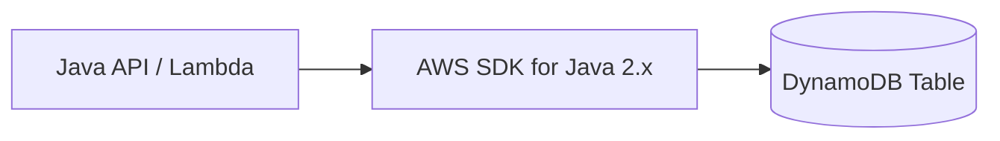
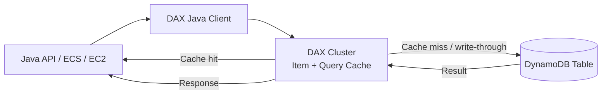
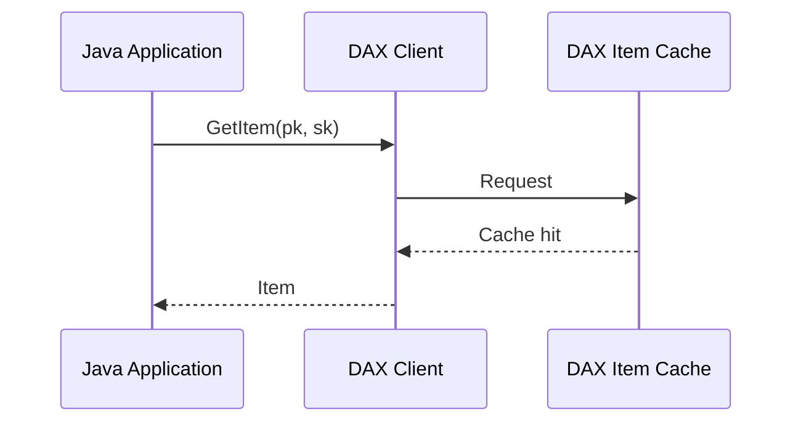
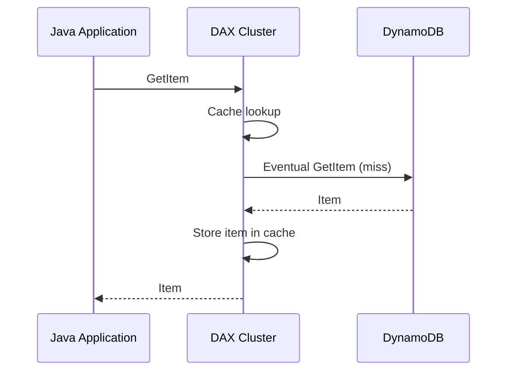
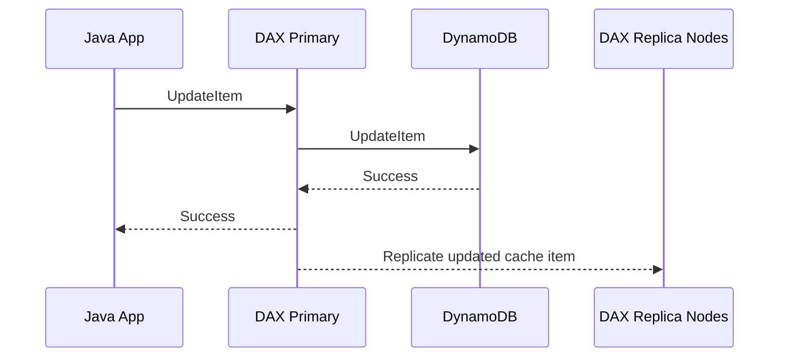
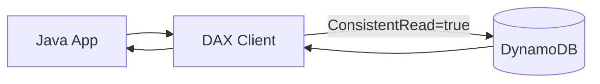
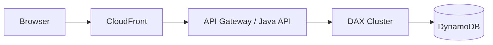
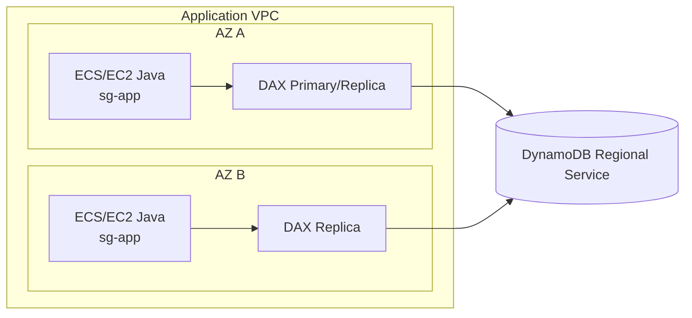
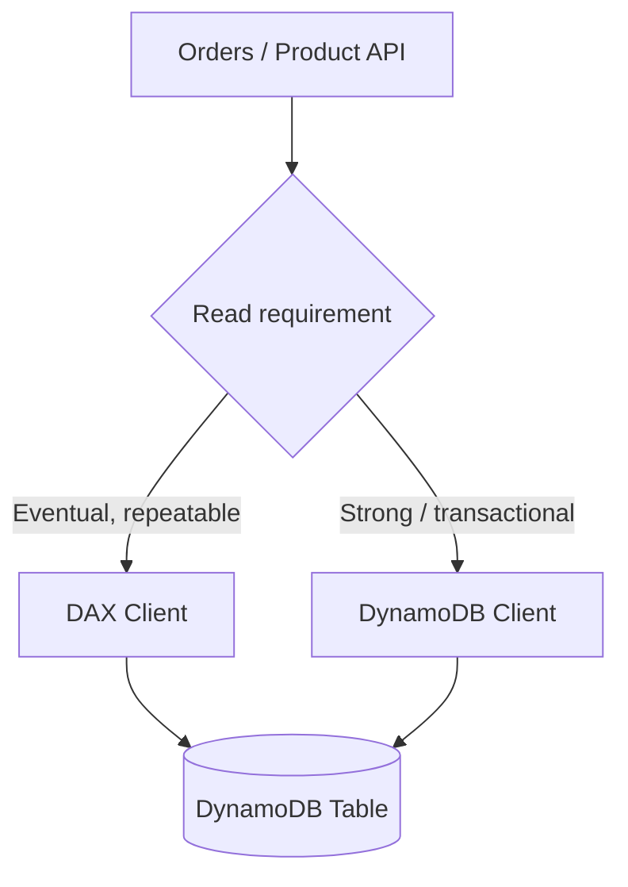

# DynamoDB Accelerator và tăng tốc truy vấn DynamoDB

**Amazon DynamoDB Accelerator (DAX)** là cache trong bộ nhớ được quản lý dành riêng cho DynamoDB. Ứng dụng Java dùng DAX client để gửi DynamoDB API requests tới cluster; DAX có thể trả dữ liệu từ **item cache** hoặc **query cache**, và chuyển những yêu cầu cần đọc dữ liệu từ bảng về DynamoDB. Với workload đọc lặp lại, DAX có thể giảm độ trễ đọc ở phía cache xuống mức microsecond và giảm số read requests đi tới DynamoDB.

DAX không phải database mới và không thay thế DynamoDB. DynamoDB vẫn là **nguồn dữ liệu chính (system of record)**; DAX giữ bản sao dữ liệu trong bộ nhớ theo TTL và chính sách LRU. Ứng dụng phải hiểu dữ liệu có thể cũ, các thao tác nào được cache, cách DAX cập nhật cache khi ghi và những request nào vẫn phải đi thẳng tới DynamoDB.

Bài thuộc chương **Cache và dữ liệu chuyên dụng** của mô-đun **CLOUD_PROVIDERS_AWS**. Nội dung kết nối DynamoDB data modeling, IAM, VPC, EC2/ECS/EKS/Lambda, AWS SDK for Java, CloudWatch, hiệu năng, khả năng phục hồi và chi phí.

> **Nguyên tắc:** DAX phù hợp với **đọc nhiều, dữ liệu được đọc lặp lại và chấp nhận eventual consistency**. Strongly consistent reads và một số thao tác transaction đọc được chuyển tiếp tới DynamoDB, không được phục vụ từ cache. DAX không làm cho mọi truy vấn nhanh hơn và không sửa được partition key bị thiết kế lệch.

## 1. Mục tiêu học tập

Sau bài học, bạn có thể:

1. Giải thích DAX là gì, nằm ở đâu trong kiến trúc ứng dụng DynamoDB và vì sao nó không thay thế bảng DynamoDB.
2. Phân biệt **item cache** và **query cache**, các API được cache và cách xác định cache hit/miss.
3. Mô tả read-through, write-through, TTL, LRU, negative caching và giới hạn nhất quán.
4. Giải thích vì sao DAX chỉ phục vụ eventual reads từ cache; strong reads và TransactGetItems đi thẳng DynamoDB.
5. Phân biệt cache item với cache kết quả Query/Scan, đặc biệt sự khác nhau về invalidation.
6. Nhận diện workload phù hợp/không phù hợp với DAX và so sánh DAX với ElastiCache, CloudFront và DynamoDB on-demand.
7. Thiết kế DAX cluster, node count, subnet group, multi-AZ, endpoint và security group.
8. Phân biệt IAM policy của ứng dụng, IAM service role của DAX và quyền truy cập DynamoDB trực tiếp.
9. Tích hợp DAX với **AWS SDK for Java 2.x**, sử dụng đúng endpoint và TLS.
10. Theo dõi cache hit ratio, CPU, memory, eviction, throttling, connections và DynamoDB consumed capacity.
11. Benchmark cold cache/warm cache, đo p50/p95/p99 và quyết định scale up/scale out.
12. Xử lý cache stale, negative cache, cache cold sau restart, failover và lỗi kết nối.
13. Ước lượng chi phí cluster nodes so với phần read capacity tiết kiệm được.
14. Lập kế hoạch rollout, rollback, bảo mật và vận hành DAX trong production.

## 2. DAX nằm ở đâu?

Không dùng DAX, Java service gửi request tới DynamoDB:



Dùng DAX, ứng dụng đổi sang DAX client và kết nối cluster:



**DAX là một lớp cache chuyên dụng đứng trước DynamoDB.** DAX cluster có các nodes trong VPC; DAX client quản lý khám phá nodes và phân phối request thông qua cluster endpoint. Ứng dụng không phải tự viết logic cache-aside cho từng GetItem/Query như khi dùng một cache tổng quát.

| Thành phần | Vai trò |
| --- | --- |
| **DynamoDB table** | Nguồn dữ liệu chính, lưu trữ bền vững |
| **DAX cluster** | Cache trong bộ nhớ, xử lý request và chuyển tiếp thao tác cần DynamoDB |
| **DAX client** | Thư viện tương thích DynamoDB API, quản lý kết nối và routing |
| **Item cache** | Cache kết quả GetItem/BatchGetItem theo primary key |
| **Query cache** | Cache result sets của Query/Scan theo tham số request |
| **DAX service role** | Cho phép DAX gọi DynamoDB API thay mặt ứng dụng |
| **Application IAM role** | Cho phép ứng dụng gọi các DAX actions trên cluster |
| **CloudWatch** | Theo dõi cache hit/miss, CPU, memory, throttling và network |

DAX hoạt động trong **Amazon VPC** và sử dụng private network interfaces. Đây không phải một public HTTP endpoint mà bất kỳ client Internet nào cũng có thể gọi.

## 3. DAX hoạt động như thế nào?

### 3.1. Cache hit

Một request có thể được trả lời từ cache:

1. Java app gửi GetItem qua DAX client.
2. DAX tìm item theo table và primary key.
3. Nếu item còn trong cache, DAX trả dữ liệu ngay.
4. Request không cần đọc item đó từ DynamoDB trong lần này.



### 3.2. Cache miss

Nếu item chưa có trong cache hoặc đã hết TTL/bị evict:

1. DAX nhận request.
2. DAX gọi DynamoDB bằng eventually consistent read.
3. DynamoDB trả item.
4. DAX lưu item vào item cache theo TTL.
5. DAX trả kết quả cho ứng dụng.



**DAX không làm mất chi phí DynamoDB của cache miss.** Lần đầu đọc item vẫn cần DynamoDB; lợi ích xuất hiện khi những lần đọc sau có thể tái sử dụng cache.

### 3.3. Cache cho Query và Scan

DAX có query cache riêng:

- Cache kết quả của **Query** và **Scan**.
- Kết quả được lưu theo request parameters.
- Request sau cần khớp các tham số liên quan để có thể cache hit.
- Nếu query/scan trả về nhiều dữ liệu hoặc mỗi request có điều kiện khác nhau, cache hit ratio có thể thấp.
- Query cache có TTL và LRU riêng.

Ví dụ, hai Query cùng table/index, key condition, filter, projection, limit và các tham số ảnh hưởng kết quả có cơ hội dùng cùng cached result set. Chỉ đổi một điều kiện hoặc phân trang có thể khiến request không khớp cache entry trước đó.

**Không nên xem Scan diện rộng là use case mặc định của DAX.** Scan đọc nhiều dữ liệu và tạo result sets lớn; nếu request ít lặp lại, chi phí cache có thể không đáng.

## 4. Item cache và query cache

| Tiêu chí | **Item cache** | **Query cache** |
| --- | --- | --- |
| API chính | GetItem, BatchGetItem | Query, Scan |
| Cache key | Table + primary key | Table/index + các request parameters |
| Nội dung | Một hoặc nhiều items | Toàn bộ result set của request |
| TTL | Có | Có |
| LRU eviction | Có | Có |
| Write-through cập nhật | DAX cập nhật item cache khi write qua DAX | Result set không tự invalidation theo từng item write |
| Nguy cơ stale | Khi nguồn khác ghi trực tiếp DynamoDB hoặc TTL chưa hết | Có thể còn kết quả cũ đến khi query TTL hết |
| GSI | GetItem không truy cập GSI; item cache là cache item theo base-table key | Query cache có thể cache Query trên index |

### 4.1. Item cache không phải cache mọi thuộc tính độc lập

Item cache lưu item theo khóa chính. Nếu ứng dụng gọi GetItem cho cùng một item, DAX có thể trả toàn bộ item đã cache. DAX không tự biến từng thuộc tính thành một key riêng để cache độc lập.

### 4.2. Query cache lưu result set

Query cache có thể giảm thời gian cho các truy vấn lặp lại, ví dụ dashboard thường xuyên yêu cầu cùng một tập dữ liệu. Nhưng nó cần đủ **tính lặp lại của tham số**. Query có timestamp hiện tại hoặc filter thay đổi liên tục thường khó có hit ratio cao.

### 4.3. Negative caching

DAX có thể cache kết quả rỗng:

- GetItem không tìm thấy item có thể tạo negative cache entry.
- Query/Scan không có kết quả có thể lưu empty result set.
- Request lặp lại trước khi TTL hết có thể tiếp tục nhận kết quả rỗng.
- Một write-through thích hợp có thể cập nhật item cache; query cache vẫn cần xem TTL/invalidation behavior.

Ví dụ: ứng dụng hỏi sản phẩm `SKU#A100` khi item chưa tồn tại. DAX cache kết quả không có item. Sau đó một hệ thống khác ghi SKU trực tiếp vào DynamoDB, request qua DAX vẫn có thể nhận kết quả rỗng cho tới khi negative cache entry hết TTL hoặc được cập nhật theo cơ chế phù hợp.

**Nếu ứng dụng thường xuyên đọc “chưa tồn tại” rồi tạo item ở một writer khác, phải kiểm thử negative caching và chọn TTL thận trọng.**

## 5. Read-through và write-through

### 5.1. Read-through

Ứng dụng dùng DAX client để đọc. DAX tự kiểm tra cache, nếu miss thì đọc DynamoDB và lưu kết quả.

Điều này giảm lượng logic cache-aside trong code:

```text
Application
   |
   | GetItem
   v
DAX item cache
   | hit       -> return cached item
   |
   | miss
   v
DynamoDB
   |
   | item
   v
DAX caches item -> return
```

### 5.2. Write-through

DAX hỗ trợ các write operations như:

- PutItem
- UpdateItem
- DeleteItem
- BatchWriteItem
- TransactWriteItems

Khi ứng dụng ghi qua DAX, DAX chuyển write tới DynamoDB. Sau khi write thành công, DAX cập nhật item cache; các thay đổi được lan truyền tới các nodes trong cluster theo cơ chế dịch vụ.



**Write-through giúp item cache đồng bộ chặt hơn với writes đi qua DAX**, nhưng write vẫn phải đến DynamoDB và DAX phải xử lý thêm công việc cache/replication.

### 5.3. Ghi trực tiếp DynamoDB bỏ qua DAX

Nếu một service dùng DynamoDB client trực tiếp để ghi, DAX không tự biết mọi thay đổi ngay lập tức. Item đã cache có thể cũ cho đến khi TTL hết hoặc cơ chế cache update phù hợp xảy ra.

Ví dụ:

1. Java Service A đọc item qua DAX: `status=NEW`.
2. Java Service B cập nhật trực tiếp DynamoDB: `status=PAID`.
3. Service A tiếp tục đọc cùng item qua DAX.
4. DAX có thể trả `status=NEW` cho tới khi cache entry hết hạn.

Vì vậy, nếu có nhiều writers:

- Thống nhất writes qua DAX khi phù hợp; hoặc
- Chấp nhận staleness với TTL được thiết kế; hoặc
- Đọc trực tiếp DynamoDB cho các luồng cần dữ liệu mới nhất; và
- Không giả định DAX quan sát tức thì những writes từ clients đi vòng qua cluster.

### 5.4. Write-around và bulk writes

DAX không nhất thiết phù hợp với mọi write:

- Bulk load dữ liệu mà rất ít item được đọc lại có thể làm cache bị lấp đầy bởi dữ liệu lạnh.
- Write-heavy workload tiêu tốn tài nguyên ở primary node và replication.
- Write qua DAX thêm một network hop; write trực tiếp DynamoDB có thể có latency thấp hơn cho một số workload.
- Nếu write-around trực tiếp DynamoDB, ứng dụng phải chấp nhận khả năng cache stale và không được dựa vào DAX để có read-after-write mới nhất.

**DAX được thiết kế chủ yếu để tăng tốc reads.** Không đưa toàn bộ bulk ingestion qua DAX nếu điều đó làm giảm cache hit ratio của dữ liệu nóng.

## 6. Consistency: giới hạn phải hiểu trước khi tích hợp

DAX phục vụ **eventually consistent data** từ cache. Điều này có nghĩa một lần đọc có thể chưa phản ánh write vừa hoàn tất nếu write đó đi qua một đường khác hoặc query cache chưa hết TTL.

### 6.1. Strongly consistent reads

Nếu request đặt `ConsistentRead=true` cho GetItem/BatchGetItem/Query/Scan, DAX chuyển request tới DynamoDB. DAX trả kết quả nhưng **không lưu kết quả strong read vào cache**.



Các luồng cần dữ liệu mới nhất có thể dùng DynamoDB client trực tiếp thay vì đi qua DAX, tránh thêm một lớp không tạo cache hit.

### 6.2. Transactional reads

`TransactGetItems` được chuyển tiếp tới DynamoDB và không cache kết quả. Đây là hành vi phù hợp với yêu cầu isolation của transaction.

`TransactWriteItems` được hỗ trợ theo write-through. Để cập nhật item cache sau transaction, DAX có thể thực hiện các transactional reads nền cho các items liên quan; điều này có thể tạo thêm read capacity consumption ở DynamoDB.

### 6.3. GSI và consistency

DynamoDB không hỗ trợ strongly consistent reads trên Global Secondary Index. DAX query cache trên GSI vẫn chịu TTL/cache semantics. Nếu ứng dụng yêu cầu dữ liệu mới nhất ngay sau write, không giả định một Query GSI qua DAX sẽ cho read-after-write consistency.

### 6.4. Bảng quyết định

| Nhu cầu | Hướng xử lý |
| --- | --- |
| Product catalog được đọc lặp lại, chấp nhận dữ liệu trễ ngắn | DAX item/query cache |
| Dashboard chạy cùng Query nhiều lần | Đánh giá DAX query cache |
| Số dư tài khoản cần dữ liệu mới nhất | DynamoDB strongly consistent read phù hợp, không dựa vào DAX cache |
| Kiểm tra trạng thái sau write quan trọng | Đọc trực tiếp với consistency phù hợp |
| Transactional read | DynamoDB TransactGetItems qua client phù hợp |
| Bulk data load ít được đọc lại | Ghi trực tiếp DynamoDB, tránh làm nóng cache không cần thiết |
| Dữ liệu thay đổi liên tục và ít lần đọc lặp | Có thể không phù hợp DAX |

## 7. TTL, LRU và cache freshness

### 7.1. TTL mặc định

DAX parameter group có TTL cho item cache và query cache. Mặc định phổ biến là **5 phút** cho mỗi cache; có thể tùy chỉnh theo yêu cầu freshness và workload.

TTL là khoảng thời gian cache entry có thể được sử dụng trước khi hết hạn. Khi TTL hết, request tiếp theo cần lấy dữ liệu mới từ DynamoDB rồi cache lại.

### 7.2. TTL không phải lịch refresh chủ động

DAX không nhất thiết đọc lại toàn bộ items theo chu kỳ khi TTL hết. Cache entry hết hạn và được làm mới **khi có request cần nó**. Nếu không ai đọc item, không có lý do để DAX tải lại item chỉ để giữ cache nóng.

### 7.3. LRU eviction

Khi cache memory thiếu chỗ, DAX có thể loại bỏ entries cũ/ít được dùng theo **Least Recently Used (LRU)**, kể cả trước khi TTL hết. Do đó:

- TTL dài không bảo đảm item ở lại cache suốt thời gian đó.
- Cache memory utilization cao có thể làm eviction tăng.
- Working set lớn hơn cache node memory sẽ làm hit ratio thấp.
- Scale node type hoặc xem lại dữ liệu được cache khi eviction tăng kéo dài.

### 7.4. TTL = 0

Theo semantics DAX:

- **Query cache TTL = 0**: query responses không được cache.
- **Item cache TTL = 0**: item cache có hành vi refresh dựa trên LRU/write-through thay vì hết hạn theo TTL thông thường; không nên hiểu TTL zero là “mọi request đều bỏ qua item cache”.

Nếu muốn không dùng DAX cache cho một read, chọn đường đọc DynamoDB trực tiếp/strongly consistent theo thiết kế, thay vì suy luận từ TTL zero.

### 7.5. Chọn TTL theo nghiệp vụ

| Dữ liệu | Gợi ý bắt đầu | Câu hỏi cần trả lời |
| --- | --- | --- |
| Catalog ít thay đổi | TTL dài hơn có thể phù hợp | Giá/tồn kho chậm tối đa bao lâu? |
| Profile người dùng | TTL vừa phải | User có cần thấy cập nhật tức thì từ thiết bị khác? |
| Dashboard aggregate | Query TTL tùy chu kỳ refresh | Kết quả cũ 1–5 phút có chấp nhận? |
| Trạng thái thanh toán | Không dựa cache cho quyết định cuối | Có cần strongly consistent read? |
| Inventory real-time | Cần freshness chặt | Có nên đọc trực tiếp DynamoDB cho critical path? |
| Negative lookups | TTL ngắn hơn nếu item có thể vừa được tạo | Có nguy cơ cache “không tồn tại” quá lâu? |

**Không có TTL tối ưu chung cho mọi ứng dụng.** Bắt đầu từ yêu cầu business freshness, đo hit ratio/evictions và điều chỉnh có kiểm soát.

## 8. Khi nào DAX phù hợp?

DAX thường phù hợp khi:

- Workload **read-heavy**, thường có tỷ lệ reads/writes cao.
- Nhiều request đọc lại cùng items hoặc cùng Query result sets.
- Cần giảm read latency và giảm số reads đi tới DynamoDB.
- Có traffic bursts tập trung vào những items phổ biến.
- Ứng dụng có thể chấp nhận eventual consistency và TTL.
- DynamoDB table đã có access patterns/key design phù hợp.

Ví dụ:

| Use case | Vì sao DAX có thể hữu ích |
| --- | --- |
| Product catalog | Nhiều người đọc cùng sản phẩm phổ biến |
| User profile | Một profile được đọc lặp lại nhiều lần |
| Game leaderboard snapshot | Kết quả truy vấn lặp lại, freshness có thể giới hạn |
| Metadata/configuration | Dữ liệu thay đổi ít, reads lặp lại |
| Session lookup | Nếu consistency/TTL đáp ứng yêu cầu bảo mật |
| Popular content metadata | Working set nóng nhỏ hơn cache memory |

AWS khuyến nghị đánh giá DAX bằng **cache hit ratio thực tế**; workload có hit ratio cao, thường trên khoảng 90%, có nhiều cơ hội tận dụng DAX. Đây là định hướng để benchmark, không phải điều kiện kỹ thuật bắt buộc hay bảo đảm giảm chi phí.

## 9. Khi nào không nên dùng DAX?

| Workload | Lý do |
| --- | --- |
| Write-heavy | Writes qua primary node và phải replicate cache |
| Dữ liệu hầu như không được đọc lại | Cache miss nhiều, chi phí cluster không được bù |
| Strongly consistent reads là bắt buộc | Request đi thẳng DynamoDB, không có cache benefit |
| TransactGetItems là trọng tâm | Transactional reads không được cache |
| Bulk Scan/bulk writes | Result sets lớn hoặc cache pollution |
| Dữ liệu thay đổi liên tục | TTL/invalidation làm stale hoặc hit ratio thấp |
| Nhiều bảng có phân quyền user rất khác nhau | DAX cluster service role có thể mở rộng quyền qua cluster |
| Workload chỉ cần cache cục bộ đơn giản | DAX cluster có thể quá phức tạp/đắt so với local cache |

**Không thêm DAX chỉ vì muốn “DynamoDB nhanh hơn”.** Đo bottleneck trước: network round trips, key design, hot partitions, payload size, downstream processing hay application serialization.

## 10. DAX so với các lựa chọn khác

| Tiêu chí | **DAX** | **ElastiCache (Redis/Valkey)** | **CloudFront** | **DynamoDB on-demand** |
| --- | --- | --- | --- | --- |
| Loại | Cache chuyên cho DynamoDB API | Cache/data store tổng quát | CDN/HTTP edge cache | Capacity mode của DynamoDB |
| Client | DAX SDK/client | Redis/Valkey client | HTTP client/CDN | DynamoDB SDK |
| Cache key | DynamoDB item/query semantics | Do ứng dụng thiết kế | URL/cache key HTTP | Không phải cache |
| Invalidation | TTL, write-through item cache, query TTL | App-managed hoặc cơ chế cache/data model | Cache policy/invalidation | Không có |
| Strong reads | Bypass cache | App tự thiết kế | Không áp dụng SQL/DB consistency | Hỗ trợ strong reads trên table/LSI |
| Phù hợp | Lặp lại DynamoDB reads | Nhiều loại object/data structures | Static/API HTTP responses | Traffic thay đổi khó dự báo |
| Vận hành | Managed DAX cluster | Managed cache cluster/serverless options theo dịch vụ | AWS managed CDN | AWS managed database mode |

**DAX và on-demand có thể dùng cùng nhau.** On-demand quyết định DynamoDB tính phí và tự quản throughput; DAX giảm số reads đi tới DynamoDB khi có cache hits. DAX không thay capacity mode và không làm write capacity tự tăng.

### 10.1. DAX hay ElastiCache?

Chọn DAX khi:

- Data source chính là DynamoDB.
- Muốn dùng DynamoDB-compatible API.
- Cache item/query theo semantics DynamoDB.
- Ứng dụng chấp nhận consistency behavior của DAX.

Chọn ElastiCache khi:

- Cần cache object hoặc kết quả từ nhiều nguồn dữ liệu.
- Cần Redis/Valkey data structures, scripting, ranking, counters, locks hoặc pub/sub theo yêu cầu.
- Muốn kiểm soát key, invalidation và serialization theo logic ứng dụng.
- Có thể tự quản cache-aside/write-through logic.

Không nên giả định Redis/Valkey và DAX có cùng invalidation hoặc transaction semantics.

### 10.2. DAX hay CloudFront?

CloudFront cache nội dung HTTP tại edge để giảm latency cho người dùng Internet. DAX cache DynamoDB API reads trong VPC. Một ứng dụng có thể dùng cả hai:



## 11. DAX cluster: nodes và khả năng sẵn sàng

Một DAX cluster gồm:

- **Primary node**: xử lý write-through operations và điều phối replication.
- **Read replica nodes**: phục vụ read traffic và giữ cache data replicated.
- **Cluster endpoint**: endpoint ứng dụng sử dụng; DAX client khám phá nodes và load balance.
- **Node endpoints**: endpoint từng node, chủ yếu phục vụ chẩn đoán/operations.
- **Subnet group**: xác định subnets/AZ và địa chỉ IP mà DAX nodes có thể sử dụng.
- **Parameter group**: TTL/cache settings áp dụng cho cluster.

Một cluster có thể có **tối đa 11 nodes**: một primary và tối đa 10 read replicas. AWS khuyến nghị **ít nhất ba nodes phân bố ở các AZ khác nhau cho production**, vì cluster một hoặc hai node không có mức fault tolerance tương đương. Một cluster DAX chỉ tương tác với DynamoDB tables trong **cùng Region** và có giới hạn tối đa **500 tables**; nếu workload trải nhiều Region, cần cluster riêng tại từng Region.

### 11.1. Scale out và scale up

| Cách | Tác động |
| --- | --- |
| **Scale out** | Thêm read replicas để phân phối read throughput |
| **Scale in** | Bớt read replicas khi tải thấp |
| **Scale up** | Chọn node type lớn hơn để tăng tài nguyên mỗi node |

**Thêm read replicas không làm tăng write throughput của primary node.** Node type quyết định khả năng xử lý writes của primary; khi write-through là bottleneck, cần đánh giá node type/kiến trúc thay vì chỉ thêm replicas. **Không thể đổi node type của một cluster đang chạy**: muốn scale up theo chiều dọc, phải tạo cluster mới với node type lớn hơn, kiểm thử rồi chuyển traffic sang endpoint mới. Vì vậy cần chọn node type ngay từ lúc thiết kế cluster.

Khi thêm node, DAX phải đồng bộ cache từ peer; thao tác có thể mất thời gian tùy cache size và workload. Hãy **pre-scale trước peak**, không chờ traffic tăng mới thêm node.

### 11.2. Cache warm-up sau thay đổi cluster

Một node mới phải đồng bộ cache. Khi cluster restart/đổi cấu hình/failover, một phần cache có thể lạnh và tạo nhiều misses hơn. Chuẩn bị:

- Theo dõi cache hit/miss trong thời gian warm-up.
- Dự trù DynamoDB read capacity cho misses tăng.
- Tránh rollout đồng thời tất cả application instances.
- Kiểm tra latency và throttling ở DynamoDB trong quá trình chuyển.
- Chạy benchmark trên cluster có trạng thái cache gần giống production.

### 11.3. Thay node type và maintenance

- Thêm/bớt read replicas có thể thực hiện trên cluster đang chạy; khi thêm node, cache phải được đồng bộ từ peer.
- Đổi node type cần **tạo cluster mới** và chuyển ứng dụng sang cluster đó; lên kế hoạch cho cache warm-up, IAM, SG, TLS và endpoint migration.
- DAX có weekly maintenance window. Các nodes được cập nhật tuần tự, nhưng ứng dụng vẫn có thể gặp lỗi tạm thời hoặc throttling trong thời gian bảo trì.
- Chọn maintenance window lúc traffic thấp, cấu hình client retry/backoff và theo dõi DAX events.

## 12. VPC, subnet group và Security Group

DAX chạy trong **VPC**. Ứng dụng phải có network path private tới DAX nodes.



### 12.1. Subnet group

- Chọn VPC có app workloads.
- Tạo DAX subnet group gồm subnets ở nhiều AZ.
- Ưu tiên phân bố node và app trong các AZ gần nhau để giảm latency.
- Đảm bảo subnet còn IP cho các DAX node/ENI.
- DAX subnet group không phải DynamoDB table subnet group; **DynamoDB table không nằm trong subnet của VPC**.

### 12.2. Security Group

DAX dùng TCP port **8111**. Ví dụ:

```text
sg-dax:
  INBOUND:
    TCP 8111 FROM sg-orders-app

sg-orders-app:
  OUTBOUND:
    TCP 8111 TO sg-dax
```

- DB/API client cần kết nối tới DAX endpoint qua port 8111.
- Chỉ cho phép SG của ứng dụng được cấp quyền.
- Không mở DAX port ra Internet.
- Không dùng SG của ALB nếu request thực tế xuất phát từ ECS/EC2/Lambda.
- NACL/route vẫn phải cho phép đường đi/trả về.
- DAX cluster endpoint dùng DNS; không hard-code IP node.

### 12.3. Lambda trong VPC

Nếu Lambda chạy trong VPC, gắn function với private subnets và SG có thể tới DAX SG port 8111. Lambda cũng cần đường tới DynamoDB theo kiến trúc; DAX tự gọi DynamoDB qua service role.

DAX **không biến Lambda mặc định thành client private VPC**. Kiểm tra VPC configuration, route và IAM role của function.

### 12.4. DAX không phải VPC endpoint cho DynamoDB

DAX là cluster có node ENIs và endpoint riêng trong VPC. **DynamoDB gateway VPC endpoint** là một cơ chế khác để ứng dụng gọi DynamoDB regional API qua private network. Nếu application dùng DAX client, nó cần kết nối DAX cluster; endpoint gateway của DynamoDB không thay thế cluster endpoint.

## 13. Endpoint và TLS

Cluster endpoint là endpoint được khuyến nghị cho application. Ví dụ minh họa:

```text
Cluster endpoint, encryption in transit disabled:
dax://orders-cache.xxxxxx.dax-clusters.ap-southeast-1.amazonaws.com

Cluster endpoint, encryption in transit enabled:
daxs://orders-cache.xxxxxx.dax-clusters.ap-southeast-1.amazonaws.com

Port:
8111
```

Dùng đúng URL từ Console/DescribeClusters. Không tự dựng hostname từ tên cluster hoặc kết nối trực tiếp vào node endpoint trừ khi có mục đích chẩn đoán rõ ràng.

### 13.1. Encryption in transit

- DAX hỗ trợ TLS giữa client và cluster.
- Client xác minh certificate X.509 của cluster theo cơ chế thư viện.
- Cluster tạo mới có thể bật encryption in transit khi tạo.
- **Không thể bật encryption in transit cho cluster đã tồn tại bằng cách chỉ đổi một flag**; cần tạo cluster mới có TLS, chuyển traffic và retire cluster cũ theo migration plan.
- Dùng client version tương thích với TLS-enabled DAX endpoint.
- Không tắt certificate verification hoặc dùng endpoint không khớp certificate.

### 13.2. Encryption at rest

DAX có thể mã hóa dữ liệu được persist trên disk của node bằng AES-256 và tích hợp KMS. Thiết lập encryption at rest phải được chọn khi tạo cluster; kiểm tra khả năng của node family/Region. Không giả định có thể bật/tắt encryption at rest tùy ý trên cluster đang chạy.

## 14. IAM: hai lớp quyền riêng biệt

**DAX và DynamoDB có mô hình IAM khác nhau.** Cần hiểu rõ trước khi chuyển một ứng dụng từ DynamoDB client sang DAX client.

### 14.1. IAM service role của DAX

DAX cluster assume một service role với trust principal:

```json
{
  "Version": "2012-10-17",
  "Statement": [
    {
      "Effect": "Allow",
      "Principal": {
        "Service": "dax.amazonaws.com"
      },
      "Action": "sts:AssumeRole"
    }
  ]
}
```

Role policy giới hạn các DynamoDB tables và actions mà cluster có thể gọi, ví dụ:

```json
{
  "Version": "2012-10-17",
  "Statement": [
    {
      "Effect": "Allow",
      "Action": [
        "dynamodb:DescribeTable",
        "dynamodb:GetItem",
        "dynamodb:BatchGetItem",
        "dynamodb:Query",
        "dynamodb:Scan",
        "dynamodb:PutItem",
        "dynamodb:UpdateItem",
        "dynamodb:DeleteItem",
        "dynamodb:BatchWriteItem"
      ],
      "Resource": [
        "arn:aws:dynamodb:ap-southeast-1:123456789012:table/Orders",
        "arn:aws:dynamodb:ap-southeast-1:123456789012:table/Orders/index/*"
      ]
    }
  ]
}
```

DAX cần `dynamodb:DescribeTable` để duy trì metadata về bảng. Các actions còn lại được giới hạn theo nhu cầu đọc/ghi thực tế. Nếu sử dụng transactions, rà soát các permissions liên quan transaction APIs theo tài liệu IAM/DAX hiện hành.

### 14.2. IAM role của ứng dụng

Ứng dụng cần quyền DAX actions trên **DAX cluster ARN**, ví dụ:

```json
{
  "Version": "2012-10-17",
  "Statement": [
    {
      "Effect": "Allow",
      "Action": [
        "dax:GetItem",
        "dax:BatchGetItem",
        "dax:Query"
      ],
      "Resource": "arn:aws:dax:ap-southeast-1:123456789012:cache/orders-cache"
    }
  ]
}
```

Nếu application cần ghi qua DAX, bổ sung đúng write actions; không dùng `dax:*` theo thói quen.

### 14.3. Cảnh báo về user-level isolation

DAX **không thực thi user-level separation đối với dữ liệu DynamoDB** như một policy riêng cho từng end user. Khi người dùng/role truy cập bảng qua DAX, họ có thể kế thừa phạm vi dữ liệu mà **DAX cluster service role** được phép truy cập, theo cơ chế DAX access control.

Điều này có thể làm thay đổi security boundary của ứng dụng:

- Nếu service role DAX đọc được cả `Orders` và `Payroll`, mọi principal có quyền truy cập cluster có thể có đường truy cập gián tiếp tới phạm vi đó.
- Không dựa vào việc một app user thiếu `dynamodb:GetItem` trực tiếp để kết luận họ không thể đọc bảng qua DAX.
- Tách cluster theo trust boundary/table group nếu cần cô lập.
- Giới hạn ứng dụng được phép gọi DAX cluster bằng `dax:` actions và network SG.
- Thực hiện authorization theo tenant/user ở tầng nghiệp vụ khi dữ liệu chia sẻ.

**Đây là một điểm cần review bảo mật bắt buộc trước khi đưa DAX vào ứng dụng vốn dựa vào IAM per-table/per-user policies.**

## 15. Java và DAX: AWS SDK for Java 2.x

DAX có client riêng tương thích AWS SDK for Java 2.x. Dùng Maven artifact **`software.amazon.dax:amazon-dax-client`** và phiên bản client được nhóm kiểm thử/phê duyệt. SDK for Java 2.x hỗ trợ Java 8+ và asynchronous I/O.

### 15.1. Maven dependency

```xml
<dependency>
    <groupId>software.amazon.dax</groupId>
    <artifactId>amazon-dax-client</artifactId>
    <version>REPLACE_WITH_TESTED_VERSION</version>
</dependency>
```

Dùng dependency management/BOM phù hợp với AWS SDK for Java 2.x trong project. Không lấy phiên bản ngẫu nhiên từ blog cũ; kiểm tra release/compatibility của DAX client trước khi nâng.

### 15.2. Tạo DAX client

Ví dụ Java 17 sử dụng DAX cluster endpoint đã bật TLS:

```java
package example.dax;

import software.amazon.awssdk.services.dynamodb.DynamoDbAsyncClient;
import software.amazon.awssdk.services.dynamodb.model.AttributeValue;
import software.amazon.awssdk.services.dynamodb.model.GetItemRequest;
import software.amazon.dax.ClusterDaxAsyncClient;
import software.amazon.dax.Configuration;

import java.util.Map;

public final class DaxReadExample {
    public static void main(String[] args) {
        String endpoint = required("DAX_ENDPOINT");
        String table = System.getenv().getOrDefault("DDB_TABLE", "Products");

        // DAX_ENDPOINT lấy từ DescribeClusters/Console, ví dụ dax:// hoặc daxs://.
        try (DynamoDbAsyncClient dax = ClusterDaxAsyncClient.builder()
                .overrideConfiguration(Configuration.builder()
                    .url(endpoint)
                    .build())
                .build()) {

            GetItemRequest request = GetItemRequest.builder()
                .tableName(table)
                .key(Map.of(
                    "pk", AttributeValue.builder().s("PRODUCT#1001").build(),
                    "sk", AttributeValue.builder().s("DETAIL").build()))
                .consistentRead(false)
                .build();

            var response = dax.getItem(request).join();

            if (response.hasItem()) {
                System.out.println("Product loaded");
            } else {
                System.out.println("Product not found");
            }
        }
    }

    private static String required(String name) {
        String value = System.getenv(name);
        if (value == null || value.isBlank()) {
            throw new IllegalArgumentException("Missing environment variable " + name);
        }
        return value;
    }
}
```

Lưu ý:

- DAX client implement DynamoDB async client interface; ứng dụng có thể dùng các request model quen thuộc của SDK.
- DAX endpoint phải được đặt trong `DAX_ENDPOINT`, lấy từ cluster discovery endpoint.
- `daxs://` dùng khi cluster bật encryption in transit; `dax://` là endpoint không bật encryption.
- Region và credentials phải được cấu hình phù hợp với runtime/default provider chain.
- Java workload cần IAM `dax:GetItem` trên cluster ARN và network access port 8111.
- Code minh họa một read eventual; không dùng để quyết định nghiệp vụ cần strong consistency.

### 15.3. Đọc strong consistency trực tiếp DynamoDB

Khi một luồng cần dữ liệu mới nhất, dùng DynamoDB client:

```java
package example.dax;

import software.amazon.awssdk.services.dynamodb.DynamoDbAsyncClient;
import software.amazon.awssdk.services.dynamodb.model.AttributeValue;
import software.amazon.awssdk.services.dynamodb.model.GetItemRequest;

import java.util.Map;

public final class StrongReadExample {
    public static void main(String[] args) {
        String table = System.getenv().getOrDefault("DDB_TABLE", "Products");

        try (DynamoDbAsyncClient dynamoDb = DynamoDbAsyncClient.create()) {
            var request = GetItemRequest.builder()
                .tableName(table)
                .key(Map.of(
                    "pk", AttributeValue.builder().s("PRODUCT#1001").build(),
                    "sk", AttributeValue.builder().s("DETAIL").build()))
                .consistentRead(true)
                .build();

            var response = dynamoDb.getItem(request).join();
            System.out.println(response.hasItem()
                ? "Strong read completed"
                : "Item not found");
        }
    }
}
```

Ứng dụng cần IAM DynamoDB permission trực tiếp cho đường đọc này, bên cạnh DAX permissions. Nếu muốn DAX không có đường đọc/ghi bảng trực tiếp từ application role, không cấp các `dynamodb:` actions không cần thiết.

### 15.4. Tạo client theo từng request là sai

Trong production:

- Tạo client một lần theo application lifecycle và reuse.
- Không tạo DAX client mới cho từng HTTP request.
- Đóng client khi ứng dụng shutdown.
- Theo dõi connection pools, client metrics và lỗi node discovery.
- Dùng timeout/retry hợp lý, tránh retry storm khi cluster failover.
- Nếu DAX endpoint thay đổi do cluster replacement, cấu hình rollout endpoint an toàn.

## 16. Java application design: chọn đường đọc cho từng use case

Một ứng dụng có thể dùng hai clients:



Ví dụ:

| API | Đường đọc |
| --- | --- |
| GET product catalog | DAX nếu cache hit cao và chấp nhận TTL |
| GET product details phổ biến | DAX item cache |
| Dashboard Query lặp lại | DAX query cache nếu parameters ổn định |
| Kiểm tra payment status sau commit | Strong read trực tiếp DynamoDB nếu cần |
| Quyết định tồn kho cuối cùng | Đọc/transaction theo consistency yêu cầu, không tin cache stale |
| Batch export toàn bảng | Đánh giá Scan/Export thay vì dùng DAX cache |
| Transactional read | DynamoDB transaction API theo semantics |

**Không định tuyến mọi request qua DAX chỉ vì ứng dụng đã tích hợp nó.** Thiết kế theo consistency contract của từng endpoint.

## 17. TTL và parameter group

DAX parameter group định nghĩa các thông số áp dụng cho cluster, bao gồm:

- `record-ttl-millis`: TTL item cache.
- `query-ttl-millis`: TTL query cache.

Ví dụ ý tưởng cấu hình:

```text
Item cache TTL: 120000 ms (2 minutes)
Query cache TTL: 30000 ms (30 seconds)
```

Đây là giá trị ví dụ, không phải khuyến nghị cho mọi ứng dụng.

### 17.1. Chọn item TTL và query TTL riêng

Một product item có thể chấp nhận 2 phút stale; dashboard query có thể chỉ chấp nhận 30 giây. Đặt TTL riêng giúp thể hiện freshness requirements khác nhau.

### 17.2. Thay đổi parameter group

- Tạo custom parameter group khi cần TTL riêng.
- Xác minh cluster/node behavior theo tài liệu service trước khi sửa.
- Thay đổi có thể yêu cầu thời gian bảo trì/cluster downtime tùy loại parameter và trạng thái cluster.
- Một số entries đã được cache có thể tiếp tục giữ TTL/setting tại thời điểm được ghi.
- Sau thay đổi, theo dõi cache hit, eviction, stale results và latency.

**Không chỉnh TTL production chỉ để làm hit ratio đẹp hơn** khi chưa xác định nghiệp vụ chịu được độ cũ dữ liệu bao lâu.

## 18. DAX monitoring bằng CloudWatch

DAX gửi metrics vào namespace **`AWS/DAX`**. Theo dõi từng cluster/node phù hợp với dimensions và statistic của metric.

| Metric | Ý nghĩa | Dấu hiệu cần điều tra |
| --- | --- | --- |
| `ItemCacheHits` | GetItem/BatchGetItem cache hits | Giảm bất thường |
| `ItemCacheMisses` | Item cache misses | Tăng đột ngột |
| `QueryCacheHits` | Query cache hits | Thấp so với số Query lặp lại |
| `QueryCacheMisses` | Query cache misses | Nhiều requests không reuse result |
| `ScanCacheHits` / `ScanCacheMisses` | Scan cache behavior | Scan không có lợi từ cache |
| `CacheMemoryUtilization` | Tỷ lệ cache memory sử dụng | Cao kéo dài, eviction tăng |
| `EvictedSize` | Dung lượng cache bị evict | Working set không vừa memory |
| `CPUUtilization` | CPU của node/cluster | Gần giới hạn trong peak |
| `NetworkBytesIn/Out` | Network throughput | Bất thường hoặc gần network limit |
| `ClientConnections` | Số kết nối client | Connection leak/churn |
| `ThrottledRequestCount` | Request bị DAX throttle | Cluster/node không đủ năng lực |
| `ErrorRequestCount` | Request lỗi phía DAX | Kiểm tra lỗi client/API/permissions |
| `FaultRequestCount` | Request gặp fault | Điều tra node/service events |

### 18.1. Tính cache hit ratio

Item cache:

\[
HitRatio_{\mathrm{item}}=
\frac{ItemCacheHits}
{ItemCacheHits+ItemCacheMisses}
\times100\%
\]

Query cache:

\[
HitRatio_{\mathrm{query}}=
\frac{QueryCacheHits}
{QueryCacheHits+QueryCacheMisses}
\times100\%
\]

Ví dụ trong một cửa sổ giám sát:

- Item hits = 8.500
- Item misses = 1.500

\[
\frac{8500}{8500+1500}=85\%
\]

Hit ratio **85%** cho item cache. Đây chỉ là ví dụ; hãy tách item/query/scan vì mỗi loại có workload và TTL khác nhau.

### 18.2. Đọc DynamoDB consumed capacity đúng cách

Khi ứng dụng đọc qua DAX, DynamoDB chỉ thấy những requests thực sự được chuyển tiếp (cache misses và các thao tác bypass cache). Vì vậy, `ConsumedReadCapacityUnits` của DynamoDB **không phải tổng số read requests mà application đã gửi tới DAX**.

Để hiểu toàn bộ workload, kết hợp:

- DAX cache hits/misses.
- DAX total request count.
- DynamoDB consumed read capacity.
- Application request volume/latency.
- SDK call duration và error counts.

### 18.3. SDK metrics

DAX SDK for Java 2.x có thể thu thập SDK metrics; tài liệu hiện hành nêu các metrics như **`ApiCallSuccessful`** và **`ApiCallDuration`**. Không giả định Java client metrics thay thế toàn bộ cache metrics từ CloudWatch DAX.

### 18.4. Alert gợi ý

- `ThrottledRequestCount` tăng liên tục.
- CPU utilization cao kéo dài.
- `CacheMemoryUtilization` cao cùng `EvictedSize` tăng.
- Item/query hit ratio giảm dưới ngưỡng của ứng dụng.
- `ClientConnections` tăng bất thường.
- DAX node events, failover hoặc maintenance.
- DynamoDB read throttling tăng dù cache hit ratio tốt.
- Application p95/p99 latency vượt SLO.

## 19. Sizing DAX cluster

### 19.1. Ba yếu tố chính

1. **Cache hit ratio**: phần requests DAX có thể trả từ cache.
2. **Read throughput**: item/query reads mỗi giây và kích thước dữ liệu.
3. **Write throughput**: write-through operations tới primary node và replication overhead. Hướng dẫn sizing của AWS dùng hệ số ước lượng để thể hiện cache misses tiêu thụ nhiều tài nguyên cluster hơn cache hits, còn writes qua DAX có overhead cao hơn đáng kể; đây là mô hình sizing ban đầu, cần load test với item size và traffic thực tế.

Trong mô hình **Normalized Requests Per Second** của AWS, có thể dùng hệ số xấp xỉ **10 lần** cho cache miss và **25 lần** cho write-through so với cache-hit read. Với kích thước item làm tròn lên KiB:

\[
NormalizedRPS \approx (ReadHitRPS \times SizeKB)
+ (ReadMissRPS \times SizeKB \times 10)
+ (WriteRPS \times SizeKB \times 25 \times NodeCount)
\]

Đây là heuristic để chọn node type/count, không phải benchmark capacity được bảo đảm. Sau đó cần thêm headroom cho target utilization (AWS gợi ý giữ cluster utilization khoảng 70% hoặc thấp hơn) và tình huống mất một node/AZ. Load test bằng dữ liệu, item sizes và request mix thực tế trước khi chốt cluster.

Cần bổ sung:

- Cache working set size.
- TTL và eviction rate.
- CPU/memory/network của từng node.
- Traffic peak và growth.
- Query result size.
- Số client connections.
- Availability Zones và failover headroom.

### 19.2. Scale out

Thêm read replicas khi:

- Read traffic tăng.
- CPU/throughput của nodes cao.
- Cache hits cao nhưng latency/throughput vẫn không đáp ứng.
- Cần nhiều nodes hơn để phân bố traffic và tăng HA.

Việc thêm node có thời gian đồng bộ cache; hãy pre-scale trước campaign hoặc release.

### 19.3. Scale up

Cân nhắc node type lớn hơn khi:

- Primary node là bottleneck của writes.
- Cache memory không đủ, eviction cao.
- CPU/network giới hạn trên từng node.
- Cluster cần xử lý nhiều writes/replication overhead.

**Thêm replicas không sửa được write bottleneck trên primary node.** Phải sizing node type và write rate riêng. Vì không thể đổi node type trên cluster đang chạy, vertical scaling cần cluster mới và quy trình chuyển traffic.

### 19.4. Cluster production

AWS khuyến nghị tối thiểu **ba nodes ở các AZ khác nhau** cho production. Cluster một hoặc hai nodes có thể không chịu được node/AZ failure theo cùng mức. Cluster tối đa 11 nodes theo mô hình một primary và tối đa 10 replicas.

Không chọn replication factor chỉ dựa vào số request trung bình. Hãy kiểm tra peak, node replacement, maintenance capacity và RTO.

## 20. Benchmark: chứng minh DAX thực sự có ích

Không kết luận DAX nhanh hơn chỉ từ một lần đo GetItem. Benchmark cần phản ánh cả cold cache và warm cache.

### 20.1. Thiết kế thử nghiệm

Chạy cùng một workload qua hai clients:

- DynamoDB client trực tiếp.
- DAX client tới cluster.

Giữ các yếu tố giống nhau:

- Cùng Region/VPC/network source.
- Cùng table/index, partition key distribution và item sizes.
- Cùng request concurrency, retry policy và payload.
- Cùng mức eventual consistency.
- Cùng cache warm-up và TTL.
- Cùng khoảng thời gian và workload mix.

### 20.2. Các bước

1. Tạo dataset gần với production trên sandbox.
2. Chạy direct DynamoDB client, ghi p50/p95/p99 latency và throughput.
3. Chạy DAX client lần đầu, quan sát cache misses.
4. Lặp lại cùng key/query để làm nóng cache.
5. Đo cache hit ratio, CPU, memory, network và DynamoDB consumed RCU.
6. Thay TTL/query parameters và workload mix để kiểm tra độ nhạy.
7. Thử failover/node maintenance hoặc client reconnect trong môi trường test.
8. So sánh chi phí DAX cluster với DynamoDB read capacity tiết kiệm được.
9. Ghi rõ consistency/staleness trade-offs và tiêu chí rollback.

### 20.3. Không chỉ đo average latency

| Chỉ số | Vì sao |
| --- | --- |
| p50 | Trải nghiệm phổ biến |
| p95/p99 | Tail latency trong peak |
| Cache hit ratio | DAX có thực sự tái sử dụng data? |
| DynamoDB consumed RCU | Bao nhiêu read capacity được giảm? |
| DAX CPU/memory | Cluster còn headroom? |
| EvictedSize | Cache working set có vừa? |
| ThrottledRequestCount | DAX node có bị quá tải? |
| Error rate | Tính đúng đắn và ổn định |
| Cost/month | Lợi ích có lớn hơn cluster cost? |

**Đừng so cache hit latency với DynamoDB cold read latency rồi kết luận cho toàn workload.** Production có misses, writes, failovers, TLS, network và request distributions.

## 21. AWS CLI: kiểm tra cluster (read-only)

Dùng AWS CLI v2 với đúng account/Region và IAM role. Các lệnh dưới đây chỉ đọc metadata.

### 21.1. Xác minh danh tính và liệt kê clusters

```bash
aws sts get-caller-identity --profile training

aws dax describe-clusters \
  --region ap-southeast-1 \
  --profile training
```

Có thể dùng query để lấy một số trường:

```bash
aws dax describe-clusters \
  --query "Clusters[].{Name:ClusterName,Status:Status,Nodes:NodeIds,Endpoint:ClusterDiscoveryEndpoint,SubnetGroup:SubnetGroup,SecurityGroups:SecurityGroups}" \
  --region ap-southeast-1 \
  --profile training
```

### 21.2. Đọc parameter groups

```bash
aws dax describe-parameter-groups \
  --region ap-southeast-1 \
  --profile training

aws dax describe-parameters \
  --parameter-group-name default.dax.1.0 \
  --region ap-southeast-1 \
  --profile training
```

Tên parameter group thực tế lấy từ DescribeClusters; default.dax.1.0 chỉ là ví dụ.

### 21.3. Xem cluster events

```bash
aws dax describe-events \
  --source-type cluster \
  --duration 1440 \
  --region ap-southeast-1 \
  --profile training
```

Dùng events để đối chiếu thêm node creation/removal, cluster changes, maintenance và sự cố.

### 21.4. Xem metrics

```bash
aws cloudwatch list-metrics \
  --namespace AWS/DAX \
  --region ap-southeast-1 \
  --profile training
```

Để đọc một metric cụ thể, dùng get-metric-statistics với đúng dimensions và khoảng thời gian có dữ liệu. DAX metrics thường được tổng hợp theo chu kỳ một phút; kiểm tra statistic phù hợp thay vì đọc một con số mà không biết đó là Sum, Average hay Maximum.

## 22. Tạo cluster trên Console: các quyết định quan trọng

> **Chi phí:** DAX cluster được tính phí theo node type và số node-hours. Cluster vẫn có chi phí khi ít traffic hoặc cache không được sử dụng. Chỉ tạo cluster thật trong sandbox có ngân sách/owner được phê duyệt.

1. Mở DynamoDB Console, chọn **DAX → Clusters → Create cluster**.
2. Chọn tên cluster ngắn, không chứa PII, account number hoặc thông tin nhạy cảm.
3. Chọn node type dựa trên read/write throughput và cache working set.
4. Chọn số nodes; production nên đánh giá ít nhất ba nodes ở nhiều AZ.
5. Chọn DAX subnet group trong VPC của application.
6. Chọn SG chỉ cho phép app SG vào TCP 8111.
7. Gắn IAM service role có quyền DynamoDB tối thiểu cho tables/indexes cần dùng.
8. Bật encryption at rest và encryption in transit theo policy.
9. Chọn parameter group/TTL phù hợp freshness requirements.
10. Cấu hình maintenance window, SNS notifications/events và tags.
11. Review cost, subnet IP capacity, AZ placement và client compatibility.
12. Tạo cluster, đợi trạng thái available, lấy cluster discovery endpoint.
13. Triển khai DAX client trong app, test cache misses/hits và IAM.
14. Theo dõi metrics trước khi chuyển traffic production.

**Không dùng default IAM policy cho mọi bảng** nếu cluster chỉ cần truy cập một tập table/index cụ thể.

## 23. Troubleshooting

| Triệu chứng | Nguyên nhân có thể | Cách kiểm tra |
| --- | --- | --- |
| DAX client không resolve endpoint | Sai endpoint/Region/DNS | DescribeClusters, VPC DNS, cluster endpoint |
| Connection timeout | SG/NACL/route/VPC sai | TCP 8111 từ đúng app subnet/SG |
| TLS handshake error | Client version/endpoint/certificate | daxs://, TLS support, client version |
| AccessDenied khi gọi DAX | App IAM thiếu dax: actions | Cluster ARN, role policy |
| DAX gọi DynamoDB bị AccessDenied | DAX service role thiếu table/index actions | Trust policy và service role permissions |
| Ứng dụng đọc được bảng qua DAX dù thiếu direct DynamoDB permission | DAX cluster role cấp quyền thay app | Review DAX access-control boundary |
| Cache hit ratio thấp | Working set lớn, TTL thấp, request params biến đổi | Item/query hit/miss metrics |
| DAX latency cao | CPU/network/memory hoặc miss-heavy workload | Node metrics, misses, operation size |
| Cache memory cao, eviction tăng | Node memory không đủ hoặc cache quá rộng | CacheMemoryUtilization, EvictedSize |
| DAX write throttling | Primary node write capacity/resource limit | Node type, write rate, ThrottledRequestCount |
| DynamoDB read throttling dù có DAX | Misses, strong reads, query/transaction bypass | DynamoDB throttle reasons, DAX misses |
| Dữ liệu item cũ sau writer khác | Direct DynamoDB write bypass DAX | TTL, write path, freshness requirement |
| Query trả kết quả cũ sau PutItem | Query cache chưa hết TTL | Query TTL và cache behavior |
| Item mới vẫn báo không tồn tại | Negative cache entry | Item/query TTL, write-through path |
| Cache hit ratio cao nhưng p99 vẫn cao | Downstream app/serialization/network hoặc request misses lớn | End-to-end trace, p99 by operation |
| Scale out nhưng throughput không tăng như kỳ vọng | Primary write bottleneck hoặc cache warm-up | Node roles, CPU, cache sync |
| DAX cluster unavailable khi node/AZ failure | Cluster ít nodes hoặc AZ placement không đủ | Replication factor, node events |
| CloudWatch không thấy metric | Sai namespace/dimension/time window | AWS/DAX, metric dimensions, non-zero publishing |
| Java SDK metric không có cache hit ratio | SDK metrics chỉ có API call success/duration | Dùng CloudWatch DAX metrics |

### 23.1. Quy trình điều tra

1. Xác nhận account, Region, cluster ARN và cluster status.
2. Kiểm tra DAX endpoint, client version, TLS scheme.
3. Kiểm tra app VPC/subnet/SG và TCP 8111.
4. Xác minh app IAM dax: permissions.
5. Xác minh DAX service role có DynamoDB permissions đúng table/index.
6. Đo item/query cache hits và misses.
7. Kiểm tra TTL, LRU eviction và negative cache.
8. Kiểm tra strong reads/transaction reads có bypass cache hay không.
9. Kiểm tra CPU, memory, network, connections và throttling.
10. So sánh DynamoDB consumed capacity và application latency.
11. Xác định staleness do direct writes hoặc query cache.
12. Thay đổi từng cấu hình trong sandbox trước khi rollout.

**Không tắt TLS, mở SG cho toàn VPC hoặc cấp dax:* / dynamodb:* rộng chỉ để làm lỗi biến mất.**

## 24. Bảo mật và bảo vệ dữ liệu

### 24.1. Network isolation

- Đặt DAX nodes trong VPC và private subnets phù hợp.
- SG inbound TCP 8111 chỉ từ application SG.
- Không public exposure.
- Giới hạn cross-account/network access theo kiến trúc được duyệt.
- Bật VPC Flow Logs nếu cần điều tra network path.

### 24.2. IAM least privilege

- Application role: đúng DAX cluster ARN và dax: actions cần thiết.
- DAX service role: chỉ đúng DynamoDB tables/indexes và operations.
- DAX administrator: chỉ quyền quản lý cluster/parameter groups cần thiết.
- Không dùng service role của DAX như execution role chung cho EC2/Lambda.
- Phân tích kỹ user-level isolation trước khi chuyển app sang DAX.

### 24.3. Encryption

- Bật encryption at rest và in transit khi tạo cluster.
- Theo dõi KMS key policy nếu dùng customer-managed key.
- Dùng DAX client version tương thích TLS.
- Không log item data/PII hoặc credential trong application logs.
- DAX cache là một bản sao dữ liệu; áp dụng data classification và TTL theo retention/compliance.

### 24.4. Cluster naming và certificate transparency

Khi bật encryption in transit, certificate cho cluster endpoint có thể xuất hiện trong public Certificate Transparency logs. **Không đặt customer account numbers, PII hoặc tên dữ liệu nhạy cảm trong cluster name**. Dùng tên kỹ thuật ngắn như orders-cache-prod.

## 25. Chi phí và hiệu quả kinh tế

### 25.1. Thành phần chi phí

| Thành phần | Tác động |
| --- | --- |
| DAX node-hours | Tính theo node type và số nodes |
| DAX cluster size | 3 nodes có chi phí cao hơn 1 node |
| DynamoDB reads | Cache misses/strong reads vẫn tới DynamoDB |
| DynamoDB writes | Write-through vẫn tiêu thụ write capacity |
| DynamoDB storage | Vẫn tính phí như trước |
| Backups/PITR/Streams/Global Tables | Theo tính năng được bật |
| Data transfer | Theo Region/AZ/network path |
| CloudWatch | Metrics, dashboards, alarms và log integrations |
| KMS | Customer-managed key operations theo sử dụng |

**DAX không phải serverless cache miễn phí khi nhàn rỗi.** Cluster node vẫn tồn tại và được tính phí theo thời gian. Bạn có thể scale số nodes xuống theo chính sách dịch vụ nhưng không nên coi việc giảm cluster thành zero là một cơ chế pause để không trả tiền.

### 25.2. So sánh lợi ích với chi phí

Một cách ước lượng:

\[
C_{\mathrm{net}} =
C_{\mathrm{DAX\ cluster}}
+ C_{\mathrm{DynamoDB\ remaining\ reads}}
+ C_{\mathrm{DynamoDB\ writes}}
+ C_{\mathrm{other}}
\]

So sánh với:

\[
C_{\mathrm{baseline}} =
C_{\mathrm{DynamoDB\ reads}}
+ C_{\mathrm{DynamoDB\ writes}}
+ C_{\mathrm{other}}
\]

DAX có lợi về tổng chi phí nếu phần read cost giảm và giá trị latency/throughput tăng **lớn hơn chi phí cluster bổ sung**, sau khi tính cache miss và writes.

### 25.3. Ví dụ hit ratio

Giả sử workload có 10 triệu cacheable read requests/ngày:

- 90% hit: khoảng 9 triệu requests được phục vụ từ cache.
- 10% miss: khoảng 1 triệu requests phải đọc DynamoDB.
- Strongly consistent reads và các request bypass cache vẫn đi thẳng DynamoDB.

Đây là phép minh họa **số request**, không phải công thức chính xác cho RCU savings. Items khác kích thước có thể tiêu thụ số read capacity khác nhau; cần đo ConsumedReadCapacityUnits và cache hit/miss thực tế.

### 25.4. Khi nào DAX không đáng tiền?

- Cache hit ratio thấp.
- Table nhỏ, latency đã đáp ứng SLO.
- Writes chiếm phần lớn traffic.
- Nhiều strong reads/transaction reads.
- Cluster node phải duy trì dù traffic thấp.
- Cache working set quá lớn so với memory.
- Application không chấp nhận eventual consistency.
- Phần bottleneck thật nằm ở API Gateway/Lambda/serialization hoặc data model.

Tham khảo [DynamoDB pricing](https://aws.amazon.com/dynamodb/pricing/) và [AWS Pricing Calculator](https://calculator.aws/) cho Region, node type và số node hiện hành.

## 26. Rollout DAX và rollback

### 26.1. Trước khi rollout

1. Xác nhận workload có repeated reads và eventual consistency phù hợp.
2. Xác định APIs được cache và APIs cần direct DynamoDB strong reads.
3. Đánh giá IAM boundary và cluster service role.
4. Tạo cluster/subnet group/SG/TLS trong sandbox.
5. Benchmark direct DynamoDB vs DAX.
6. Đo cache hit ratio, p95/p99, CPU, memory và DynamoDB consumed RCU.
7. Kiểm thử stale data, negative cache và query cache invalidation.
8. Test failover/node replacement và application reconnect.
9. Ước lượng chi phí cluster + DynamoDB.
10. Xây rollback switch trong application configuration.

### 26.2. Canary rollout

- Cho một tỷ lệ nhỏ application instances dùng DAX client.
- So sánh latency/errors với instances dùng DynamoDB client trực tiếp.
- Theo dõi cache hit/miss, stale reads và DynamoDB throughput.
- Mở rộng traffic theo từng bước nếu metrics tốt.
- Không thay đổi TTL, node count và traffic percentage cùng lúc.

### 26.3. Rollback

Nếu cache hit thấp, stale data hoặc errors tăng:

1. Chuyển application reads về DynamoDB client.
2. Giữ nguyên DynamoDB table và dữ liệu.
3. Điều tra DAX client/IAM/network/TTL.
4. Không xóa cluster trước khi xác nhận không còn applications sử dụng.
5. Sau khi retire, xóa cluster và tài nguyên sandbox không còn cần thiết.
6. Kiểm tra CloudWatch metrics, KMS và billing còn tồn đọng.

**DAX là cache, vì vậy rollback về DynamoDB không cần restore dữ liệu từ DAX.** DynamoDB vẫn là nguồn dữ liệu bền vững.

## 27. Bài thực hành: tăng tốc Product Catalog

### 27.1. Bối cảnh

Một Java API trên ECS Fargate phục vụ product catalog. Một số sản phẩm phổ biến được đọc hàng nghìn lần mỗi phút. Dữ liệu giá và mô tả thay đổi không thường xuyên; tồn kho có thể thay đổi thường xuyên hơn.

```text
Table: Products
PK: PRODUCT#<productId>
SK: DETAIL

GSI: ByCategory
GSI PK: CATEGORY#<category>
GSI SK: PRODUCT#<productId>

Workload:
  GetItem product detail: 8,000 requests/s
  Query category: 500 requests/s
  Writes product metadata: 20 requests/s
  Inventory updates: 300 requests/s
```

### 27.2. Bài A — Chọn cache target

Phân loại:

- Product detail: item cache candidate nếu key lặp lại.
- Category listing: query cache candidate nếu cùng Query parameters được lặp lại.
- Inventory: xem freshness requirement trước khi cache.
- Product price: có thể cache với TTL nếu business chấp nhận độ trễ.
- Payment/checkout availability: đọc theo consistency contract, không tin cached value khi cần quyết định cuối.

### 27.3. Bài B — Chọn TTL

Đề xuất TTL riêng:

```text
Item cache:
  Product description: 5 minutes (initial experiment)
  Inventory critical path: bypass DAX or shorter TTL/direct read

Query cache:
  Category listing: 30-60 seconds (initial experiment)
```

Giải thích vì sao đây chỉ là giá trị thử nghiệm và cần đo hit ratio, staleness, LRU eviction và business impact.

### 27.4. Bài C — Thiết kế cluster/network

- Chọn VPC của ECS tasks.
- DAX subnet group ở ít nhất ba AZ cho production.
- Cluster có ít nhất ba nodes theo khuyến nghị.
- App SG outbound TCP 8111 tới DAX SG.
- DAX SG inbound TCP 8111 từ app SG.
- Bật TLS và encryption at rest.
- Lấy cluster discovery endpoint.
- Dùng DAX Java client 2.x.

### 27.5. Bài D — IAM

Viết hai policy riêng:

1. **Application role** có `dax:GetItem`, `dax:Query` trên đúng cluster ARN.
2. **DAX service role** có `dynamodb:DescribeTable`, `GetItem`, `Query` trên đúng table/index.

Giải thích tại sao nếu DAX service role được phép đọc cả Products và Payroll, app user có thể được cấp đường truy cập gián tiếp ngoài dự kiến khi có quyền dùng cluster.

### 27.6. Bài E — Benchmark

Ghi lại:

```text
Direct DynamoDB:
  p50 / p95 / p99:
  ConsumedReadCapacityUnits:
  Error / throttle rate:

DAX:
  p50 / p95 / p99:
  ItemCacheHits / ItemCacheMisses:
  QueryCacheHits / QueryCacheMisses:
  CacheMemoryUtilization:
  CPUUtilization:
  EvictedSize:
  ThrottledRequestCount:
  DynamoDB ConsumedReadCapacityUnits:

Cost:
  DAX node-hours:
  DynamoDB reads saved:
  DynamoDB writes:
  Total monthly estimate:
```

### 27.7. Bài F — Read-only audit

Nếu có cluster sẵn trong sandbox, chỉ chạy lệnh read-only ở mục 21. Ghi:

```text
AWS Account / Region: ...
DAX cluster name / ARN (redacted): ...
Cluster status: ...
Node type / node count / primary: ...
Availability Zones: ...
Cluster endpoint: dax:// or daxs:// ...
Subnet group / VPC: ...
Security group / TCP 8111 sources: ...
Encryption at rest / in transit: ...
DAX service role and allowed DynamoDB tables: ...
Application role and dax actions: ...
Item cache TTL / Query cache TTL: ...
Item cache hit ratio: ...
Query cache hit ratio: ...
CPU / memory / network / evictions: ...
DAX throttling / errors: ...
DynamoDB consumed read/write capacity: ...
Application p50/p95/p99 latency: ...
Consistency and stale-data policy: ...
Cost / owner / review date: ...
```

**Tiêu chí hoàn thành:** giải thích được DAX cache item/query, consistency, write-through, TTL/LRU, chọn workload phù hợp, triển khai cluster VPC/TLS/IAM, dùng Java client, đọc CloudWatch metrics và chứng minh hiệu quả bằng benchmark/cost analysis. Không bắt buộc tạo cluster trả phí.

## 28. Câu hỏi tự kiểm tra

1. DAX là database hay cache layer trước DynamoDB?
2. Vì sao DynamoDB vẫn là system of record khi dùng DAX?
3. Item cache hỗ trợ những read APIs chính nào?
4. Query cache lưu gì và xác định cache entry theo yếu tố nào?
5. Cache miss đi qua những bước nào?
6. DAX write-through xử lý PutItem/UpdateItem ra sao?
7. Vì sao writes trực tiếp DynamoDB có thể làm item cache stale?
8. Vì sao query cache có thể còn result cũ sau write qua DAX?
9. TTL mặc định của item/query cache thường là bao lâu?
10. LRU eviction khác TTL expiration như thế nào?
11. Negative caching là gì?
12. Strongly consistent GetItem qua DAX được xử lý ra sao?
13. TransactGetItems có được cache không?
14. TransactWriteItems được hỗ trợ theo cách nào?
15. GSI Query có thể dùng DAX query cache không?
16. Khi nào một workload read-heavy phù hợp DAX?
17. Vì sao write-heavy/bulk load có thể không phù hợp?
18. DAX khác DynamoDB on-demand ở lớp nào?
19. DAX khác ElastiCache ở API và cache model nào?
20. DAX cluster có bao nhiêu nodes tối đa theo mô hình hiện hành?
21. Vì sao AWS khuyến nghị ít nhất ba nodes ở nhiều AZ cho production?
22. Thêm read replicas có tăng write throughput của primary node không?
23. Port TCP của DAX cluster là bao nhiêu?
24. DAX subnet group khác DynamoDB table subnet thế nào?
25. Application role và DAX service role có trách nhiệm IAM gì?
26. Vì sao DAX có thể làm thay đổi user-level IAM isolation?
27. DAX Java client 2.x Maven artifact là gì?
28. Khi nào dùng dax:// và khi nào dùng daxs://?
29. Cache hit ratio tính như thế nào?
30. Vì sao DynamoDB consumed RCU không đại diện toàn bộ app read requests khi có DAX?
31. Khi nào cần scale out và khi nào cần scale up?
32. Vì sao thêm node cần cache synchronization/warm-up?
33. DAX encryption in transit có thể bật sau khi cluster đã tạo không?
34. DAX cluster có tiếp tục tính phí khi traffic thấp không?
35. Những metric nào giúp nhận biết memory pressure và eviction?
36. Làm sao rollback DAX về DynamoDB mà không restore data?

## 29. Tài liệu AWS chính thức

1. [DynamoDB Accelerator (DAX)](https://docs.aws.amazon.com/amazondynamodb/latest/developerguide/DAX.html).
2. [DAX — How it works](https://docs.aws.amazon.com/amazondynamodb/latest/developerguide/DAX.concepts.html).
3. [DAX consistency models](https://docs.aws.amazon.com/amazondynamodb/latest/developerguide/DAX.consistency.html).
4. [Configuring DAX cluster considerations](https://docs.aws.amazon.com/amazondynamodb/latest/developerguide/dax-config-considerations.html).
5. [DAX cluster sizing](https://docs.aws.amazon.com/amazondynamodb/latest/developerguide/dax-cluster-sizing.html).
6. [DAX cluster components](https://docs.aws.amazon.com/amazondynamodb/latest/developerguide/DAX.concepts.cluster.html).
7. [Deploying a DAX cluster](https://docs.aws.amazon.com/amazondynamodb/latest/developerguide/dax-deploy-cluster.html).
8. [Managing DAX clusters and scaling](https://docs.aws.amazon.com/amazondynamodb/latest/developerguide/DAX.cluster-management.html).
9. [DAX access control](https://docs.aws.amazon.com/amazondynamodb/latest/developerguide/DAX.access-control.html).
10. [DAX encryption at rest](https://docs.aws.amazon.com/amazondynamodb/latest/developerguide/DAXEncryptionAtRest.html).
11. [DAX encryption in transit](https://docs.aws.amazon.com/amazondynamodb/latest/developerguide/DAXEncryptionInTransit.html).
12. [Java and DAX — AWS SDK for Java 2.x](https://docs.aws.amazon.com/amazondynamodb/latest/developerguide/DAX.client.run-application-java.html).
13. [TryDax Java sample](https://docs.aws.amazon.com/amazondynamodb/latest/developerguide/DAX.client.TryDax.java.html).
14. [Monitoring DAX](https://docs.aws.amazon.com/amazondynamodb/latest/developerguide/pres-guide-monitor-dax.html).
15. [DAX CloudWatch metrics and dimensions](https://docs.aws.amazon.com/amazondynamodb/latest/developerguide/dax-metrics-dimensions-dax.html).
16. [Evaluating DAX suitability](https://docs.aws.amazon.com/amazondynamodb/latest/developerguide/evaluate-dax-suitability.html).
17. [DynamoDB pricing](https://aws.amazon.com/dynamodb/pricing/).
18. [AWS Pricing Calculator](https://calculator.aws/).

> **Ghi nhớ:** DAX tăng tốc các **reads có thể tái sử dụng** thông qua item cache và query cache. Hãy hiểu rõ **eventual consistency, TTL/LRU, write-through và query cache invalidation**, định tuyến strong reads trực tiếp DynamoDB khi cần, giới hạn IAM service role, đặt cluster private có TLS, benchmark hit ratio/latency/cost và scale theo đúng bottleneck.
