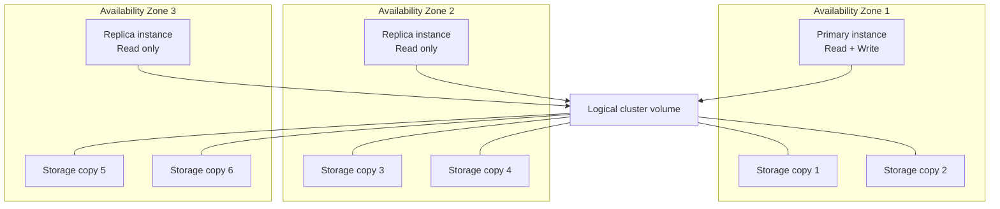
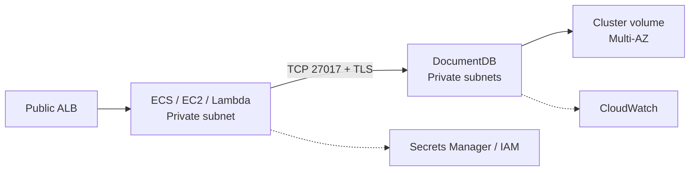

# Amazon DocumentDB và lưu ý tương thích MongoDB

> **Học phần:** CLOUD_PROVIDERS_AWS  
> **Chương:** Cache và dữ liệu chuyên dụng  
> **Bài học:** Amazon DocumentDB và lưu ý tương thích MongoDB  
> **Bối cảnh:** Thiết kế, phát triển và vận hành ứng dụng Java/Spring Boot dùng dữ liệu document trên AWS; đánh giá khả năng tương thích MongoDB, bảo mật, khả năng sẵn sàng, migration và chi phí.

## 1. Bài toán: chuyển ứng dụng MongoDB lên AWS

Nền tảng học trực tuyến lưu hồ sơ khóa học, nội dung bài học, metadata video, cấu hình giao diện và lịch sử hoạt động dưới dạng document. Nhóm phát triển đang dùng MongoDB với MongoDB Java Driver và Spring Data MongoDB. Khi chuyển workload lên AWS, nhóm cần dịch vụ database được quản lý, backup và phục hồi, read scaling, giảm vận hành replica/patching/storage, giữ lại phần lớn document model và ứng dụng hiện tại, đồng thời xác minh query, aggregation, indexes, transactions và change streams trước khi migrate.

**Amazon DocumentDB (with MongoDB compatibility)** là dịch vụ document database được AWS quản lý, cung cấp giao thức/API tương thích MongoDB cho nhiều ứng dụng, drivers và công cụ phổ biến.

Tuy nhiên, **tương thích MongoDB không đồng nghĩa thay endpoint là mọi tính năng MongoDB đều hoạt động giống hệt**. Amazon DocumentDB có kiến trúc, engine, query planner, transaction semantics, API support matrix và giới hạn riêng. Mọi quyết định migration phải dựa trên đúng engine compatibility version và danh sách operations được hỗ trợ.

Sau bài học, bạn có thể mô tả kiến trúc DocumentDB, chọn compatibility version, đánh giá commands/query/aggregation/indexes/transactions, kết nối Java qua TLS, thiết kế read preferences, migration, security, monitoring và cost.

## 2. Amazon DocumentDB là gì?

Amazon DocumentDB là **dịch vụ document database tương thích MongoDB API** do AWS quản lý. Ứng dụng giao tiếp với nó bằng MongoDB wire protocol và MongoDB-compatible drivers. DocumentDB lưu document dạng BSON và cung cấp collections, query, indexes, aggregation cùng các tính năng phù hợp theo engine version.

**Không phải MongoDB Community Server được AWS cài lên EC2.** DocumentDB có storage/compute architecture, engine implementation và lịch phát triển riêng. Cùng một driver hoặc câu lệnh MongoDB có thể hoạt động ở một compatibility version nhưng chưa được hỗ trợ hoặc có semantics khác ở version khác.

### 2.1. Thành phần chính

| Thành phần | Vai trò |
|---|---|
| Cluster | Đơn vị quản lý database, endpoints, backup, parameter groups và storage volume |
| Primary instance | Nhận thao tác ghi và có thể xử lý đọc |
| Replica instance | Nhận đọc; có thể được promote thành primary khi failover |
| Cluster volume | Logical storage volume được chia sẻ bởi các instances |
| Cluster endpoint | DNS endpoint trỏ tới primary hiện tại |
| Reader endpoint | Phân phối kết nối mới đến các replicas sẵn sàng |
| Instance endpoint | Kết nối trực tiếp một instance cụ thể |
| Subnet group | Các subnets/AZ nơi DocumentDB đặt compute instances |
| Cluster parameter group | Cấu hình engine ở cấp cluster |
| Snapshot/backup | Bảo vệ và khôi phục dữ liệu |

### 2.2. Storage tách khỏi compute

Với instance-based clusters, DocumentDB dùng cluster volume logic được **sao chép sáu bản trên ba Availability Zones** trong một Region. Primary và replicas truy cập cùng logical volume. Một cluster có một primary và tối đa **15 replica instances**.



Compute instances xử lý query và connection; cluster volume quản lý dữ liệu bền vững và replication. Thêm replica chủ yếu tăng **read capacity và failover options**, không tạo bản dữ liệu độc lập do ứng dụng tự đồng bộ. Storage redundancy cũng không tự thay thế việc tạo replica compute nếu ứng dụng cần primary failover nhanh.

### 2.3. Primary và replicas

| Khả năng | Primary | Replica |
|---|---|---|
| Read | Có | Có |
| Write | Có | Không |
| Có thể promote khi failover | Đang là primary | Có, tùy failover tier |
| Read consistency | Read-after-write theo primary | Eventually consistent |
| Mục tiêu | Ghi và truy vấn cần dữ liệu mới nhất | Scale reads và làm failover target |

Replica reads thường có replication lag thấp, nhưng độ trễ thay đổi theo write load. Không đọc từ replica để xác nhận thao tác vừa ghi nếu nghiệp vụ cần **read-your-writes** ngay lập tức.

## 3. MongoDB compatibility: hiểu đúng phạm vi

AWS mô tả DocumentDB là MongoDB-compatible vì phần lớn ứng dụng, drivers và tools phổ biến có thể dùng với ít thay đổi. Điều này **không phải cam kết mọi command, aggregation stage, index option, server behavior hay administrative API của MongoDB đều được hỗ trợ**.

Phân biệt ba lớp:

1. **Wire protocol/driver compatibility:** driver mở kết nối và trao đổi protocol với engine.
2. **API/operation compatibility:** command, CRUD methods, query operators, aggregation stages và data types cụ thể được engine hỗ trợ.
3. **Behavioral compatibility:** cùng câu lệnh nhưng thứ tự kết quả, transaction behavior, read preference, retry, index selection và lỗi có thể khác.

Ứng dụng kết nối thành công chỉ chứng minh lớp 1 đã hoạt động. Cần test đủ ba lớp.

### 3.1. Compatibility version không phải MongoDB server version

Tên compatibility version cho biết nhóm MongoDB API mà DocumentDB hướng tới; nó **không có nghĩa engine là MongoDB cùng phiên bản**.

| Amazon DocumentDB compatibility | Tình trạng theo AWS tại 20/11/2026 | Điểm cần lưu ý |
|---|---|---|
| **3.6** | Standard support kết thúc **30/03/2026**; Extended Support có phí đến **30/03/2029** | Không chọn cho triển khai mới; lập kế hoạch nâng cấp |
| **4.0** | Đang được hỗ trợ | Có explicit ACID transactions; nhiều khác biệt legacy vẫn cần kiểm thử |
| **5.0** | Đang được hỗ trợ; có bản **LTS 5.0.0** | Có nhiều tính năng mới như FLE/vector search theo feature matrix |
| **8.0** | GA từ **14/11/2025** | Hỗ trợ MongoDB 8.0 wire protocol, collation, views và aggregation capabilities mới |

Ngày hỗ trợ, minor releases và patch levels có thể thay đổi. Trước khi tạo cluster, kiểm tra engine version support dates, Region và release notes mới nhất.

### 3.2. Engine version và engine patch version

DocumentDB có hai định danh:

- **Engine version:** ví dụ `5.0.0` hoặc `8.0.0`; biểu thị compatibility level và minor engine release.
- **Engine patch version:** ví dụ `3.0.xxxxx` cho engine 5.0 hoặc `4.0.xxxxx` cho engine 8.0; xác định patch đã áp dụng.

Với các release phù hợp, lệnh sau có thể hiển thị engine và patch version:

```javascript
db.runCommand({ getEngineVersion: 1 })
```

Với cluster ở patch cũ, output có thể chỉ trả patch identifier. Xem release notes để hiểu cách ánh xạ. Tại thời điểm bài học, AWS release notes ghi nhận DocumentDB **8.0.3** phát hành ngày **11/11/2026**. Không hard-code patch này cho mọi Region; xác minh phiên bản thực tế và lịch maintenance.

### 3.3. Những điểm mới đáng chú ý ở 8.0

DocumentDB 8.0 có các cải tiến nổi bật: hỗ trợ MongoDB 8.0 API drivers và ứng dụng xây dựng theo API versions 6.0/7.0; query planner mới; collation và views; aggregation stages như `$replaceWith`, `$vectorSearch`, `$merge`, `$set`, `$unset`, `$bucket`; operators như `$pow`, `$rand`, `$dateTrunc`; text index v2; storage limit 256 TiB. TLS 1.0/1.1 không còn được hỗ trợ; **TLS 1.2 trở lên là bắt buộc**.

Không suy ra từ một tính năng 8.0 rằng mọi phiên bản 5.0/4.0 cũng có nó. Khi chọn engine, map từng tính năng ứng dụng vào version matrix.

## 4. Instance-based clusters, Serverless và Elastic Clusters

Amazon DocumentDB có các mô hình triển khai với giới hạn tính năng khác nhau. Không chọn chỉ dựa vào tên MongoDB compatibility.

| Mô hình | Đặc điểm | Cần kiểm tra |
|---|---|---|
| **Instance-based cluster** | Primary + replicas, chọn instance classes, shared cluster volume | Phù hợp ứng dụng cần điều khiển compute/read replicas |
| **Serverless instances** | Compute capacity tự điều chỉnh theo nhu cầu trong giới hạn cấu hình | Có trên một số engine versions; xem ACU range và workload |
| **Elastic Clusters** | Sharded document database để scale dữ liệu/throughput qua shards | Feature set khác instance-based; không giả định mọi transaction/stream/API đều hỗ trợ |

Theo feature matrix hiện hành, instance-based clusters có trên các compatibility versions được hỗ trợ như 4.0, 5.0 và 8.0; Serverless instances được hỗ trợ trên 5.0 và 8.0; Elastic Clusters dựa trên 5.0 và **không được hỗ trợ trên 8.0** theo matrix hiện tại. Elastic Clusters có các giới hạn riêng: một số tính năng như ACID transactions, change streams, IAM database authentication, point-in-time restore và một số shard operations không hỗ trợ như instance-based clusters.

### 4.1. Không nhầm Elastic Cluster với MongoDB sharded cluster

MongoDB sharding có cơ chế shard key và topology riêng. DocumentDB Elastic Clusters cũng phân phối collections qua shards, nhưng **quản lý, giới hạn shard key, API và vận hành theo AWS**.

Trước khi migrate MongoDB sharded deployment, inventory shard keys/chunk distribution/indexes, xác minh shard key operations được hỗ trợ, test scatter/gather queries và tính lại capacity, hot shards, throughput, cost. Không copy cấu hình sharding MongoDB rồi kỳ vọng DocumentDB tự hiểu.

## 5. Khi nào nên chọn Amazon DocumentDB?

| Nhu cầu | Mức độ phù hợp | Lý do |
|---|---|---|
| Ứng dụng đã dùng MongoDB drivers và document model | **Cao nếu API tương thích** | Có thể tái sử dụng phần lớn data access code |
| AWS-managed document database, giảm vận hành storage/replication | **Cao** | AWS quản lý cluster storage, backup và failover |
| Workload read-heavy cần replicas | **Cao** | Có read replicas và read preferences |
| Dữ liệu linh hoạt, cấu trúc document thay đổi | **Cao** | Document model phù hợp |
| Cần toàn bộ MongoDB server features/commands mới nhất | **Cần đánh giá kỹ** | Compatibility không bao phủ mọi API |
| Workload cần MongoDB-specific sharding/transactions behavior | **Cần kiểm chứng** | Elastic Cluster và instance-based có giới hạn riêng |
| Cần SQL joins, foreign keys, relational constraints phức tạp | **Thường không phù hợp** | RDS/Aurora PostgreSQL/MySQL có mô hình relational tự nhiên hơn |
| Cần key-value access cực nhanh, TTL/cache semantics | **So sánh DynamoDB/ElastiCache** | Có thể có dịch vụ AWS phù hợp hơn |
| Cần search engine, full-text relevance/analytics sâu | **So sánh OpenSearch** | DocumentDB không thay search cluster chuyên dụng |

**Chọn database theo access patterns và feature requirements**, không chỉ vì team đã biết MongoDB driver.

## 6. Document data modeling

DocumentDB phù hợp với dữ liệu có cấu trúc document và nested objects. Ví dụ một tài liệu khóa học:

```json
{
  "_id": "course-java-101",
  "tenantId": "school-01",
  "title": "Java Fundamentals",
  "status": "PUBLISHED",
  "instructor": {
    "id": "teacher-17",
    "displayName": "Nguyen An"
  },
  "modules": [
    {
      "moduleId": "module-01",
      "title": "Java Basics",
      "lessonCount": 8
    }
  ],
  "createdAt": "2026-11-18T09:30:00Z",
  "updatedAt": "2026-11-20T02:15:00Z"
}
```

### 6.1. Embed hay reference?

| Lựa chọn | Khi nào phù hợp | Đánh đổi |
|---|---|---|
| **Embed** nested document | Dữ liệu con thường được đọc cùng parent, kích thước giới hạn, vòng đời gắn parent | Document lớn hơn; update phần con có thể ghi document lớn |
| **Reference** bằng ID | Dữ liệu con lớn, được chia sẻ nhiều parent, query/ownership độc lập | Cần nhiều queries hoặc application-side joins |
| **Denormalize** một phần | Read path cần ít round trips, chấp nhận cập nhật bản sao | Phải duy trì consistency giữa các copies |

Ví dụ: thông tin instructor hiển thị trong trang khóa học có thể embed snapshot `displayName`; hồ sơ instructor đầy đủ có thể lưu collection riêng.

### 6.2. Tránh document và arrays tăng vô hạn

Không nhét toàn bộ event history, chat messages hoặc video progress vào một document duy nhất. Mảng tăng vô hạn làm document lớn, update tốn kém, tăng contention và có thể chạm giới hạn kích thước BSON/document.

Tách collections theo access pattern, ví dụ `CourseActivity` với index theo `tenantId + studentId + occurredAt`.

### 6.3. Schema validation và versioning

Document linh hoạt không có nghĩa không cần schema. Định nghĩa field bắt buộc/kiểu dữ liệu, enum cho status, timestamp UTC, `schemaVersion` để migration documents cũ, validation ở service và database nơi engine hỗ trợ. Khi rolling deployment, ứng dụng cần đọc được schema cũ và mới trong giai đoạn chuyển tiếp.

## 7. Query, sorting và indexes

MongoDB Java Driver cung cấp filter/sort builders quen thuộc. Tuy nhiên, index behavior và query planner của DocumentDB phải được xác minh trên **đúng engine version**.

### 7.1. Ví dụ query có sort rõ ràng

```javascript
db.courseActivity
  .find({
    tenantId: "school-01",
    studentId: "student-17",
    status: "ACTIVE"
  })
  .sort({ occurredAt: -1 })
  .limit(20)
```

**Luôn chỉ định sort khi nghiệp vụ yêu cầu thứ tự.** Amazon DocumentDB không bảo đảm thứ tự kết quả ngầm định; không dựa vào thứ tự tự nhiên hoặc thứ tự trả về ở lần chạy trước.

### 7.2. Compound index theo access pattern

```javascript
db.courseActivity.createIndex(
  {
    tenantId: 1,
    studentId: 1,
    status: 1,
    occurredAt: -1
  },
  {
    name: "tenant_student_status_time"
  }
)
```

Thứ tự field trong compound index có ý nghĩa. Index phải hỗ trợ filter/sort thực tế, không thêm mọi field để "phòng khi cần".

Quy trình: liệt kê query quan trọng; xác định equality/range/sort fields; tạo index candidate; chạy `explain()` với dữ liệu đại diện; so sánh execution plan, documents examined, latency và write overhead; theo dõi slow query log sau deploy.

### 7.3. Một số khác biệt về indexes

- DocumentDB chỉ cho phép **một index build trên một collection tại một thời điểm**.
- Index build có thể ảnh hưởng workload; không xóa/tạo lại index lớn tùy tiện trong giờ cao điểm.
- Sparse và partial indexes có quy tắc riêng; một số partial index predicates phải khớp chính xác về expression và data type với query predicate để planner sử dụng.
- Text indexes và vector indexes khác nhau theo engine version.
- Hỗ trợ index/operator cần đối chiếu compatibility matrix; không suy ra chỉ vì MongoDB hỗ trợ.
- Index làm tăng storage và write work; đo lợi ích read so với chi phí write.

### 7.4. Kiểm tra query plan

```javascript
db.courseActivity
  .find({ tenantId: "school-01", studentId: "student-17" })
  .sort({ occurredAt: -1 })
  .limit(20)
  .explain("executionStats")
```

Nếu query quét quá nhiều documents so với số kết quả, cần xem lại index, selectivity, projection và data model. Không đánh giá chỉ bằng một query trên collection rất nhỏ ở local.

## 8. Aggregation và functional differences

DocumentDB hỗ trợ nhiều aggregation pipeline stages, nhưng **danh sách được hỗ trợ phụ thuộc compatibility version**. Hãy dùng AWS Supported MongoDB APIs/operations matrix làm nguồn quyết định.

```javascript
db.enrollments.aggregate([
  { $match: { tenantId: "school-01", status: "ACTIVE" } },
  { $group: { _id: "$courseId", enrollmentCount: { $sum: 1 } } },
  { $sort: { enrollmentCount: -1 } },
  { $limit: 10 }
])
```

Một số behavior khác MongoDB cần test:

| Chủ đề | Lưu ý |
|---|---|
| Result ordering | Không có implicit sort; dùng sort/aggregation sort tường minh |
| Sort trong aggregation | Thứ tự có thể không được giữ sau stages tiếp theo theo quy tắc riêng; test group/push/first/last |
| writeConcern và journal | DocumentDB bỏ qua một số giá trị client gửi; engine dùng durability semantics của dịch vụ |
| Retryable writes | Chỉ hỗ trợ từ **8.0.2**; trước đó cần retryWrites=false |
| Sparse/partial indexes | Một số predicates/queries không dùng index giống MongoDB |
| Commands/admin APIs | Không phải mọi MongoDB server commands được hỗ trợ |
| Sharding | Elastic Clusters có model riêng, không giống toàn bộ MongoDB sharding |
| Causal consistency | Không hỗ trợ đầy đủ MongoDB causal consistency; đọc primary và replicas có semantics khác |

DocumentDB 8.0 có full wire protocol compatibility với MongoDB 8.0 và thêm nhiều capabilities, nhưng điều này **không phải bằng chứng mọi feature semantics đều giống MongoDB**. Tiếp tục kiểm tra API support matrix và functional differences.

## 9. Transactions và retryable writes

Explicit multi-statement/multi-collection ACID transactions được hỗ trợ trên **instance-based clusters từ compatibility version 4.0 trở lên**. Elastic Clusters có feature matrix khác và không hỗ trợ ACID transactions như instance-based clusters.

Ví dụ đăng ký khóa học: ghi enrollment, ghi ledger entry và cập nhật quota trong cùng transaction; commit nếu tất cả bước hợp lệ, rollback nếu có lỗi.

```java
try (ClientSession session = mongoClient.startSession()) {
    session.startTransaction();
    try {
        enrollments.insertOne(session,
            new Document("orderId", "order-001")
                .append("studentId", "student-17"));
        ledger.insertOne(session,
            new Document("orderId", "order-001")
                .append("event", "ENROLLMENT_CREATED"));
        session.commitTransaction();
    } catch (RuntimeException error) {
        session.abortTransaction();
        throw error;
    }
}
```

Transaction phải ngắn, commit/abort đầy đủ. AWS nêu các giới hạn: khoảng 1 phút thực thi, session timeout, không hỗ trợ cursor trong transaction, không tạo collection mới trong transaction, transaction log tối đa 32 MB và document-level write lock timeout. Bulk operations không mặc nhiên là một transaction ACID trên toàn bộ batch.

Retryable writes chỉ hỗ trợ từ engine 8.0.2 trở lên. Với 8.0.0/8.0.1, 5.0 và các versions cũ hơn, đặt `retryWrites=false`. Retryable writes không thay thế idempotency nghiệp vụ hoặc transaction design.

## 10. Change streams: theo dõi thay đổi document

**Change streams** cung cấp chuỗi change events theo thứ tự thời gian cho các thay đổi trong collections. Use cases: đồng bộ search index sang OpenSearch, phát event sang analytics pipeline, gửi thông báo khi enrollment thay đổi hoặc cập nhật read model/cache.

```javascript
const stream = db.enrollments.watch([
  {
    $match: {
      operationType: {
        $in: ["insert", "update", "replace"]
      }
    }
  }
]);

while (stream.hasNext()) {
  const event = stream.next();
  // Publish eventId/resume token to a durable consumer.
}
```

Change events được lưu mặc định **3 giờ**; retention có thể cấu hình từ 1 giờ đến tối đa **7 ngày**. Phải enable change streams trên collection phù hợp; sử dụng change streams làm phát sinh thêm read/write I/O và storage. DocumentDB không cung cấp MongoDB oplog tương đương để ứng dụng tự đọc.

Nếu consumer ngừng chạy lâu hơn retention, resume token cũ có thể không còn hợp lệ. Cần thiết kế bootstrap/reconciliation từ snapshot và tiếp tục stream từ mốc phù hợp.

- 3.6/4.0: change streams mở từ primary; đọc change stream trên replica không được hỗ trợ theo quy tắc version này.
- 5.0+: có hỗ trợ change streams trên secondary theo điều kiện và limitations riêng.
- Elastic Clusters không có cùng feature support với instance-based cluster; feature matrix hiện tại đánh dấu change streams không hỗ trợ trên Elastic Clusters.

**Không coi change stream là message queue bền vững vô hạn.** Consumer cần checkpoint resume token, idempotent processing, retry/backoff và recovery khi retention hết.

## 11. Read replicas, endpoints và consistency

Amazon DocumentDB có ba loại endpoints:

| Endpoint | Kết nối tới | Dùng khi |
|---|---|---|
| **Cluster endpoint** | Primary hiện tại | Writes và reads cần read-after-write |
| **Reader endpoint** | Một replica khả dụng cho mỗi kết nối mới | Phân phối read connections |
| **Instance endpoint** | Một instance cụ thể | Debug, monitoring hoặc workload cần chọn instance |

Khi dùng MongoDB driver, AWS khuyến nghị kết nối tới cluster endpoint với `replicaSet=rs0` để driver khám phá topology; kết hợp `readPreference=secondaryPreferred` để reads có thể đi tới replicas và writes vẫn về primary.

```text
mongodb://<user>:<password>@<cluster-endpoint>:27017/<database>
  ?tls=true
  &replicaSet=rs0
  &readPreference=secondaryPreferred
  &retryWrites=false
```

Nếu không bật replica set mode hoặc dùng `readPreference=primary`, driver có thể gửi cả reads và writes tới primary. Nếu dùng SSH tunnel, AWS lưu ý không thêm `replicaSet=rs0` theo cách kết nối replica set thông thường.

| Read preference | Ý nghĩa | Đánh đổi |
|---|---|---|
| primary | Đọc primary | Read-after-write; không scale reads sang replicas |
| secondary | Chỉ đọc replicas | Có thể lỗi nếu không có replica phù hợp |
| secondaryPreferred | Ưu tiên replica, fallback theo driver semantics | Có thể đọc dữ liệu chưa mới nhất |
| primaryPreferred | Ưu tiên primary, fallback khi phù hợp | Cần hiểu fallback behavior |
| nearest | Chọn node theo latency và suitability | Không đồng nghĩa strong consistency |

Read preference ảnh hưởng đến **định tuyến**, không tự làm dữ liệu replica nhất quán tức thì. Replica reads là eventually consistent; replication lag có thể tăng khi write throughput cao.

Để failover instance-based cluster có thể promote replica thành primary, cần tối thiểu **một primary và một replica**. AWS phát hiện sự cố và chuyển primary role sang replica phù hợp theo failover tier. Ứng dụng cần dùng cluster endpoint, driver có server selection/connect/socket timeouts phù hợp, giữ MongoClient sống lâu để topology monitor cập nhật, retry thao tác idempotent và xử lý exception khi transaction đang chạy bị gián đoạn.

**Failover không bảo đảm transaction đang chạy sẽ tự hoàn tất.** Replica promotion giúp giảm downtime, nhưng app vẫn phải xử lý connection errors và kết quả không xác định.
## 12. Kết nối Java bằng MongoDB Java Driver

Đối với CRUD document, ứng dụng dùng **MongoDB Java Driver**, không dùng AWS SDK DynamoDB hay JDBC/HikariCP. AWS SDK/CLI chủ yếu dùng cho management plane: tạo cluster, describe endpoints, quản lý snapshot, parameter groups và AWS resources khác.

Dependency Maven minh họa:

```xml
<dependency>
  <groupId>org.mongodb</groupId>
  <artifactId>mongodb-driver-sync</artifactId>
  <version>5.3.0</version>
</dependency>
```

Ví dụ phiên bản 5.3.0 theo hướng dẫn AWS; chọn driver tương thích với engine version và Spring Boot BOM của dự án. Không nâng driver major version mà bỏ qua compatibility test.

### 12.1. TLS và CA bundle

Amazon DocumentDB bật encryption in transit theo mặc định. Khi kết nối TLS, Java cần trust certificate chain của DocumentDB. AWS cung cấp bundle CA tên `global-bundle.pem`.

Với Java, có thể:

1. Tải bundle CA chính thức từ AWS trust store.
2. Import **tất cả certificates cần thiết** vào Java truststore theo hướng dẫn AWS.
3. Đặt truststore path/password qua secret mount hoặc runtime configuration.
4. Bật TLS và giữ hostname verification.
5. Không dùng cấu hình bỏ kiểm tra certificate để chữa lỗi kết nối.

DocumentDB 8.0 yêu cầu **TLS 1.2 trở lên**.

### 12.2. Java 17: tạo MongoClient dùng SCRAM và TLS

Đoạn dưới minh họa ứng dụng chạy trong ECS/EC2 có network route và security group phù hợp. Database user/password lấy từ Secrets Manager hoặc secret injection đã được kiểm soát.

```java
package example.course.docdb;

import com.mongodb.ConnectionString;
import com.mongodb.MongoClientSettings;
import com.mongodb.client.MongoClient;
import com.mongodb.client.MongoClients;
import com.mongodb.client.MongoCollection;
import com.mongodb.client.MongoCursor;
import com.mongodb.client.MongoCredential;
import com.mongodb.client.model.Filters;
import com.mongodb.client.model.Sorts;
import org.bson.Document;

import java.util.concurrent.TimeUnit;

public final class DocumentDbExample {
    public static void main(String[] args) {
        String host = System.getenv("DOCDB_CLUSTER_ENDPOINT");
        String username = System.getenv("DOCDB_USERNAME");
        String password = System.getenv("DOCDB_PASSWORD");
        String tenantId = "school-01";

        if (host == null || username == null || password == null) {
            throw new IllegalStateException("Missing DocumentDB configuration");
        }

        // Truststore được mount và cấu hình trước khi tạo MongoClient.
        System.setProperty(
            "javax.net.ssl.trustStore",
            System.getenv("DOCDB_TRUSTSTORE_PATH"));
        System.setProperty(
            "javax.net.ssl.trustStorePassword",
            System.getenv("DOCDB_TRUSTSTORE_PASSWORD"));

        String uri = "mongodb://" + host
            + ":27017/course"
            + "?tls=true"
            + "&replicaSet=rs0"
            + "&readPreference=secondaryPreferred"
            + "&retryWrites=false"
            + "&serverSelectionTimeoutMS=30000"
            + "&connectTimeoutMS=10000";

        MongoCredential credential =
            MongoCredential.createCredential(
                username, "admin", password.toCharArray());

        MongoClientSettings settings = MongoClientSettings.builder()
            .applyConnectionString(new ConnectionString(uri))
            .credential(credential)
            .applyToSslSettings(ssl -> {
                ssl.enabled(true);
                ssl.invalidHostNameAllowed(false);
            })
            .applyToConnectionPoolSettings(pool -> {
                pool.maxSize(20);
                pool.minSize(0);
                pool.maxWaitTime(5, TimeUnit.SECONDS);
                pool.maxConnectionIdleTime(60, TimeUnit.SECONDS);
            })
            .applyToSocketSettings(socket -> {
                socket.connectTimeout(10, TimeUnit.SECONDS);
                socket.readTimeout(30, TimeUnit.SECONDS);
            })
            .applyToClusterSettings(cluster ->
                cluster.serverSelectionTimeout(30, TimeUnit.SECONDS))
            .build();

        try (MongoClient client = MongoClients.create(settings)) {
            MongoCollection<Document> enrollments =
                client.getDatabase("course").getCollection("enrollments");

            try (MongoCursor<Document> cursor = enrollments.find(
                    Filters.and(
                        Filters.eq("tenantId", tenantId),
                        Filters.eq("studentId", "student-17")))
                    .sort(Sorts.descending("createdAt"))
                    .limit(20)
                    .iterator()) {

                while (cursor.hasNext()) {
                    Document item = cursor.next();
                    System.out.println(item.getString("_id"));
                }
            }
        }
    }
}
```

**Lưu ý:**

- Truststore cần chứa CA chain tương ứng; chỉ đặt path tới file PEM không tự biến PEM thành Java KeyStore.
- Trong production, tạo **một MongoClient dùng chung cho vòng đời application process**, không tạo/đóng client theo từng HTTP request.
- Không log password, connection string đầy đủ, PII hoặc document payload nhạy cảm.
- Đọc từ replica có thể stale; nếu cần read-after-write, dùng primary read preference cho thao tác đó.
- retryWrites=false phù hợp với các engine versions trước 8.0.2. Chỉ bật retryable writes khi engine từ 8.0.2 và driver hỗ trợ.
- tenantId trong ví dụ là dữ liệu minh họa; production phải lấy tenant/user từ identity đã xác thực và kiểm tra ownership.

### 12.3. Spring Boot và Spring Data MongoDB

Spring Boot có thể cấu hình MongoDB bằng starter tương ứng và Spring Data repositories/MongoTemplate. Cần xác minh driver version mà Spring Boot BOM kéo vào, sau đó cấu hình URI trỏ tới cluster endpoint, TLS/truststore, read preference/replica set options, connection pool, timeouts, authentication và secret rotation.

**Không dùng HikariCP để pool MongoDB connections.** MongoDB Java Driver quản lý connection pools nội bộ. HikariCP là JDBC pool cho relational database; DocumentDB CRUD sử dụng MongoDB driver.

## 13. Connection pooling, timeout và retry

MongoDB Java Driver có connection pool riêng. Theo tài liệu Java driver AWS, giá trị mặc định của maxPoolSize thường là **100 connections cho mỗi server pool**; minPoolSize mặc định là 0. Cấu hình mặc định có thể quá lớn khi ECS scale nhiều tasks hoặc client tạo pool tới nhiều cluster members.

### 13.1. Tính tổng connection budget

Ví dụ giả định:

```text
20 ECS tasks × maxPoolSize 20
= tối đa lý thuyết 400 connections cho mỗi server pool

Cộng thêm:
- Lambda execution environments
- background workers
- migration/ETL jobs
- admin tools và monitoring
```

Không đặt maxPoolSize=100 cho mọi task rồi quên nhân với số application replicas. Cần đo active connections, concurrent operations, server topology và giới hạn instance.

### 13.2. Timeout theo ngân sách request

| Setting | Ý nghĩa | Gợi ý |
|---|---|---|
| connectTimeoutMS | Chờ TCP/TLS connection | Đặt theo network và SLO |
| serverSelectionTimeoutMS | Chờ driver tìm server phù hợp | Cần đủ thời gian cho topology discovery/failover |
| socketTimeoutMS | Chờ response từ server | Không để mặc định vô hạn nếu API cần deadline |
| maxPoolSize | Trần pool cho mỗi server | Dựa trên concurrency và số app instances |
| minPoolSize | Pool tối thiểu giữ sẵn | Tránh giữ quá nhiều idle connections |
| maxIdleTimeMS | Đóng connection idle trong pool | Phối hợp với workload/cluster lifecycle |
| waitQueueTimeoutMS | Thời gian chờ connection trong pool | Đặt theo request deadline |

Timeout của HTTP/API Gateway, application, driver và database phải phối hợp. Nếu client timeout trước khi database trả lời, kết quả ghi có thể chưa rõ; dùng idempotency key hoặc kiểm tra trạng thái trước khi retry.

### 13.3. Không retry mọi lỗi

- Network reset/failover: retry có kiểm soát nếu operation an toàn.
- Duplicate key/business validation: không retry vô hạn.
- Authentication failure: sửa credentials/role, không retry storm.
- Query timeout: xem index, query plan, locks và server capacity.
- Transaction commit không rõ kết quả: xác minh trạng thái nghiệp vụ trước khi chạy lại.
- Throttle/connection saturation: giảm concurrency và backoff, không tăng pool một cách mù quáng.

## 14. Authentication và authorization

Có hai lớp khác nhau:

1. **AWS IAM control plane:** ai được tạo, sửa, xóa cluster, snapshots, parameter groups hoặc xem metadata AWS.
2. **Database data plane:** user/role nào được đọc/ghi database, collection và documents.

Có IAM quyền docdb:DescribeDBClusters không có nghĩa caller tự động được đọc mọi documents. Ứng dụng vẫn cần database authentication và database roles.

### 14.1. Password-based authentication (SCRAM)

DocumentDB hỗ trợ SCRAM-SHA-1 và SCRAM-SHA-256 theo engine version. Nên ưu tiên cơ chế mạnh hơn khi engine/driver hỗ trợ. Quản lý password trong AWS Secrets Manager, hạn chế quyền đọc secret và thiết kế rotation có kiểm thử.

Không đưa password thật vào application.yml được commit, source code, Docker image, build logs, shell history, CLI output chia sẻ hoặc error messages.

### 14.2. IAM database authentication

DocumentDB có cơ chế MONGODB-AWS để xác thực bằng IAM identity và temporary AWS credentials cho những cấu hình được hỗ trợ. IAM role của ECS task/EC2/Lambda có thể được driver sử dụng qua AWS credential chain; không cần nhúng IAM user access keys dài hạn.

Cơ chế này có yêu cầu riêng:

- Database user/role được tạo trong database $external.
- Connection URI dùng authSource=$external và authMechanism=MONGODB-AWS.
- IAM policy phải cho phép kết nối tới đúng database user/resource.
- Driver phải hỗ trợ cơ chế MONGODB-AWS.
- IAM auth phụ thuộc engine/cluster type; tài liệu chi tiết hiện mô tả instance-based DocumentDB 5.0, trong khi feature matrix có thể thay đổi theo version. Xác minh tài liệu của đúng Region/engine patch trước khi chọn.
- Elastic Clusters không hỗ trợ IAM database authentication theo feature matrix hiện tại.

Ví dụ URI minh họa:

```text
mongodb://<cluster-endpoint>:27017/course
  ?tls=true
  &tlsCAFile=global-bundle.pem
  &replicaSet=rs0
  &authSource=%24external
  &authMechanism=MONGODB-AWS
```

Không truyền secret/access key thủ công trong URI của ứng dụng. Dùng workload role và driver/SDK có khả năng lấy temporary credentials.

### 14.3. Database roles

Tạo user với quyền tối thiểu, ví dụ chỉ read/write collection thuộc database ứng dụng. Không dùng primary/master user cho ứng dụng runtime. Tách credentials của app, migration, reporting và administrator.

## 15. VPC, TLS và mã hóa dữ liệu

Amazon DocumentDB cluster được tạo trong **Amazon VPC**. VPC cần subnet group với subnets thuộc ít nhất hai Availability Zones để hỗ trợ bố trí instance/HA.



### 15.1. Security group

| Security group | Inbound | Outbound |
|---|---|---|
| Application SG | HTTP/app traffic từ ALB hoặc nguồn được duyệt | TCP 27017 tới DocumentDB SG |
| DocumentDB SG | TCP 27017 chỉ từ Application SG và admin sources đã duyệt | Theo network policy |
| Bastion/management SG | SSH/SSM/VPN theo policy tổ chức | TCP 27017 tới DocumentDB nếu được phép |

Không mở port 27017 ra 0.0.0.0/0. DocumentDB không phải public Internet database endpoint. Client ngoài VPC cần VPN, Direct Connect hoặc một phương thức truy cập private đã được phê duyệt.

### 15.2. TLS và encryption at rest

- Dùng TLS cho tất cả database connections.
- Kiểm tra CA bundle và hostname verification.
- DocumentDB 8.0 yêu cầu TLS 1.2 trở lên.
- Bật encryption at rest bằng AWS KMS key theo yêu cầu bảo mật.
- Quản lý quyền sử dụng KMS key, snapshot copies và backup restore.
- Không tắt TLS để chữa lỗi truststore/certificate; sửa đúng CA chain và driver settings.

Encryption at rest và TLS bảo vệ dữ liệu trên storage/network; chúng **không thay thế** database authorization, tenant checks, audit và secrets management.
## 16. AWS Console và CLI: tạo cluster sandbox

### 16.1. Điều kiện trước khi tạo

- AWS account sandbox và Region được cấp quyền.
- VPC có subnet group gồm subnets ở ít nhất hai AZ.
- Security group cho phép TCP 27017 từ application SG.
- Master credentials được quản lý an toàn.
- Chọn đúng compatibility version và instance class.
- Xác định backup retention, encryption KMS và tags.
- Dự toán instance, storage, I/O và backup costs.

### 16.2. Tạo cluster và primary instance

Ví dụ AWS CLI v2 cho shell POSIX. Các ID, tên và mật khẩu là placeholder:

```bash
aws sts get-caller-identity

aws docdb create-db-cluster \
  --db-cluster-identifier course-docdb-demo \
  --engine docdb \
  --engine-version 8.0.0 \
  --master-username docdbadmin \
  --master-user-password "$DOCDB_MASTER_PASSWORD" \
  --db-subnet-group-name course-docdb-subnets \
  --vpc-security-group-ids sg-0123456789abcdef0 \
  --storage-encrypted \
  --backup-retention-period 7 \
  --region ap-southeast-1

aws docdb create-db-instance \
  --db-instance-identifier course-docdb-primary \
  --db-cluster-identifier course-docdb-demo \
  --engine docdb \
  --db-instance-class db.r6g.large \
  --region ap-southeast-1
```

Khi dùng CLI, cluster resource và primary instance là các thao tác riêng; chờ trạng thái sẵn sàng trước khi kết nối. Engine version cần chỉ định rõ nếu muốn tạo 8.0; kiểm tra engine versions sẵn có trong Region. Không đưa mật khẩu thật vào script/repository hoặc shell history.

### 16.3. Xem cluster endpoint và engine version

```bash
aws docdb describe-db-clusters \
  --db-cluster-identifier course-docdb-demo \
  --region ap-southeast-1 \
  --query 'DBClusters[0].{Status:Status,EngineVersion:EngineVersion,Endpoint:Endpoint,ReaderEndpoint:ReaderEndpoint,Port:Port}'
```

Xem instance và trạng thái:

```bash
aws docdb describe-db-instances \
  --filters Name=db-cluster-id,Values=course-docdb-demo \
  --region ap-southeast-1
```

### 16.4. Kiểm tra kết nối bằng mongosh

Sau khi tải CA bundle và cài mongosh tương thích:

```bash
mongosh "mongodb://<cluster-endpoint>:27017/course?tls=true&tlsCAFile=global-bundle.pem&replicaSet=rs0&retryWrites=false" \
  --username course_app \
  --password
```

CLI sẽ yêu cầu password tương tác. Dùng database user giới hạn quyền thay vì master user. Khi kiểm thử read replica, cấu hình read preference phù hợp và xác nhận kết quả eventual consistency.

## 17. Migration từ MongoDB sang Amazon DocumentDB

Migration thành công cần kiểm tra **tính năng và dữ liệu**, không chỉ thời gian copy.

### 17.1. Assessment trước migration

Inventory tối thiểu:

- MongoDB server version và driver versions.
- Commands/API operations được gọi trong code.
- Query filters, sort, projection, aggregation pipelines.
- Indexes: compound, unique, sparse, partial, TTL, text, vector.
- Transactions, sessions, retryable writes, write concern.
- Change streams, resume tokens, consumer lag và oplog dependencies.
- Sharding, shard keys, collation, views và server-side scripts.
- Authentication, roles, users, TLS, network dependencies.
- Dataset size, peak read/write throughput, hot collections và index size.

Dùng AWS compatibility documentation/assessment tools và test trên target engine version. Đừng coi một bài test CRUD nhỏ là migration assessment hoàn chỉnh.

### 17.2. Công cụ migration

| Công cụ | Trường hợp |
|---|---|
| AWS Database Migration Service (DMS) | Full load và replication/CDC theo source/target support |
| mongodump / mongorestore | Dataset và migration path phù hợp với utilities |
| mongoexport / mongoimport | Export/import JSON/CSV theo use case; cần lưu ý data types và metadata |
| Application dual-write/replay | Chỉ dùng khi có thiết kế consistency, deduplication và cutover rõ ràng |

Kiểm tra giới hạn DMS/source version, index migration, change streams và feature parity trước khi chọn công cụ.

### 17.3. Cutover có kiểm soát

1. Tạo target cluster, users, roles, parameter groups, security groups và backups.
2. Load dữ liệu ban đầu.
3. Tạo indexes cần thiết và kiểm tra index status.
4. Đồng bộ phần thay đổi sau full load bằng CDC hoặc cơ chế đã được kiểm chứng.
5. So sánh document counts, checksums/aggregates và dữ liệu mẫu theo tenant.
6. Chạy application integration tests, query plan tests và load tests.
7. Kiểm tra failover, backup restore và connection pool behavior.
8. Chọn thời điểm cutover, giảm/đóng writes ở source theo runbook.
9. Đồng bộ phần cuối, chuyển application endpoint/secret.
10. Theo dõi error rates, latency, replication/connection metrics và business counters.
11. Giữ source trong cửa sổ rollback đã thống nhất; chỉ retire khi xác nhận dữ liệu và ứng dụng ổn định.

Không chạy dual-write hai database mà không có idempotency và conflict-resolution strategy. Khi cutover, xác định rõ nguồn dữ liệu nào là authoritative.

## 18. Backup, restore và vận hành

DocumentDB hỗ trợ automated backups và manual snapshots. Cần cấu hình retention phù hợp RPO/RTO, bảo vệ snapshot bằng IAM/KMS và định kỳ kiểm thử restore.

- Snapshot/restore có thể tạo cluster mới với endpoint mới.
- Sau restore, xác minh engine version, users, parameter groups, security groups, indexes và application connectivity.
- Kiểm tra backup retention và cross-Region snapshot copy nếu yêu cầu DR.
- Đánh giá global cluster/cross-Region strategy theo feature support của engine.
- Failover test cần có kế hoạch, thông báo và tiêu chí thành công.
- Không giả định storage replication thay thế backup chống xóa nhầm hoặc logic corruption.

## 19. Monitoring và troubleshooting

### 19.1. CloudWatch metrics quan trọng

| Metric | Ý nghĩa | Dấu hiệu cần xem |
|---|---|---|
| CPUUtilization | CPU của instance | CPU cao kéo dài, query saturation |
| FreeableMemory | Memory còn có thể dùng | Giảm thấp, áp lực cache/memory |
| DatabaseConnections | Connections hiện tại | Connection leaks/pool quá lớn |
| DBInstanceReplicaLag | Replica lag theo instance | Read staleness, replica overload |
| DBClusterReplicaLagMaximum | Lag lớn nhất trong cluster | Read scaling/failover readiness |
| VolumeBytesUsed | Storage volume usage | Growth, capacity/cost forecast |
| ReadIOPS / WriteIOPS | I/O operations | Workload shifts, I/O cost |
| ReadLatency / WriteLatency | Latency đọc/ghi | Query pressure hoặc I/O saturation |
| BufferCacheHitRatio | Tỷ lệ cache hit | Working set vượt memory |
| Opcounters và command metrics | Hoạt động database | Query/update/delete pattern |

Tên metric/dimensions có thể khác theo engine/cluster type; chọn đúng namespace và dimensions trong CloudWatch.

### 19.2. Logs và query analysis

- Bật audit logs khi cần theo dõi database access/administrative activity.
- Bật profiler/slow query logs theo policy và retention.
- Dùng explain cho các query chậm.
- Theo dõi query latency, documents examined, indexes used và connection counts.
- Không log password, IAM tokens, full connection URI hoặc documents có PII.
- Performance Insights/Database Insights và một số metrics phụ thuộc cluster type/version.

### 19.3. Bảng troubleshooting

| Triệu chứng | Nguyên nhân khả dĩ | Kiểm tra |
|---|---|---|
| Connection timeout | SG/subnet/route/DNS hoặc target chưa available | VPC path, port 27017, endpoint và instance status |
| TLS handshake/certificate error | Thiếu CA bundle, truststore sai hoặc hostname mismatch | CA chain, TLS version, hostname verification |
| Authentication failed | Password/secret sai, database user hoặc auth mechanism không đúng | SCRAM config, secret rotation, database users |
| Driver không kết nối sau engine upgrade | Driver/API version không tương thích | MongoDB Java Driver version và compatibility guide |
| Query trả thứ tự khác mong đợi | Không chỉ định sort | Thêm sort tường minh và index phù hợp |
| Aggregation command unsupported | Stage/operator không được hỗ trợ trên engine | Supported API matrix và pipeline rewrite |
| Retryable writes unsupported | Engine trước 8.0.2 nhưng driver bật retryWrites | Đặt retryWrites=false |
| Transaction timeout | Transaction dài, nhiều commands hoặc lock contention | Rút ngắn transaction, kiểm tra lock và transaction log |
| Replica đọc dữ liệu cũ | Eventual consistency/replication lag | Đọc primary khi cần read-after-write |
| Failover làm request lỗi | Connection đang dùng bị gián đoạn | Cluster endpoint, topology refresh, idempotent retry |
| Change stream resume token invalid | Consumer vượt retention | Bootstrap snapshot và resume từ checkpoint hợp lệ |
| IAM auth lỗi | Engine/cluster type/driver/IAM mapping không hỗ trợ | IAM guide, $external user, role policy, Region/version |
| CPU/latency tăng sau migration | Index thiếu, query planner khác, data distribution khác | Explain, profiler, workload replay |

### 19.4. Quy trình điều tra

1. Xác định lỗi ở network, TLS, authentication, API compatibility hay query execution.
2. Lấy engine version và patch version thực tế.
3. Kiểm tra driver version, URI options và endpoint type.
4. Kiểm tra cluster/instance status, CloudWatch metrics và database logs.
5. Chạy query tối giản, sau đó query thực tế có explain.
6. So sánh với source MongoDB trên cùng dataset.
7. Sửa đúng lớp lỗi, test lại trên sandbox và ghi nhận kết quả.

## 20. Chi phí và lựa chọn cấu hình

Chi phí DocumentDB phụ thuộc mô hình triển khai, Region và workload. Các thành phần cần tính:

| Thành phần | Mô hình tính phí cần kiểm tra |
|---|---|
| Instance-based compute | Instance-hours theo class và số primary/replicas |
| Serverless | ACU consumption và cấu hình capacity |
| Storage | Dung lượng cluster volume |
| I/O | Read/write I/O theo storage configuration |
| Backup/snapshots | Backup storage theo điều kiện pricing |
| Data transfer | Cross-AZ/cross-Region/outbound theo pricing |
| Global clusters | Compute/replication/data transfer bổ sung |
| Monitoring/logging | CloudWatch logs, metrics và retention |

DocumentDB 5.0/8.0 có các storage configurations như Standard và I/O-Optimized theo điều kiện engine. So sánh tổng chi phí theo read/write ratio, I/O volume và storage growth; không chỉ so giá instance.

### 20.1. Ví dụ ước lượng

Giả sử một cluster instance-based có một primary và hai replicas, mỗi instance class có 4 vCPU, cluster chạy 720 giờ trong tháng.

```text
3 instances × 4 vCPU × 720 hours
= 8.640 vCPU-hours
```

Đây chỉ là phép tính quy mô để hiểu workload; **không phải báo giá**. Đơn giá và mô hình tính thực tế phụ thuộc DocumentDB pricing của Region, instance class, storage, I/O và các khoản liên quan. Dùng AWS Pricing Calculator trước khi triển khai.

### 20.2. Tối ưu chi phí

- Chọn instance class theo CPU, memory, working set và latency target.
- Thêm replicas khi cần read scaling/HA; không thêm chỉ vì "càng nhiều càng tốt".
- Dùng indexes có chọn lọc; index dư thừa tăng storage và write overhead.
- Theo dõi storage growth, I/O và backup retention.
- Đánh giá Serverless nếu workload thay đổi mạnh và engine/use case được hỗ trợ.
- So sánh Standard với I/O-Optimized bằng workload thực.
- Dọn cluster sandbox không còn dùng; snapshot giữ lại cũng có thể phát sinh phí.

## 21. Lab: kiểm tra một ứng dụng Java với DocumentDB

**Tình huống:** Course API chạy trong ECS private subnet, dùng DocumentDB 8.0 instance-based cluster để lưu khóa học và enrollments. Mục tiêu là xác minh compatibility, TLS, read preference, index và failover.

### 21.1. Chuẩn bị

1. Tạo VPC/subnet group có subnets ở ít nhất hai AZ.
2. Tạo security group chỉ cho phép TCP 27017 từ application SG.
3. Tạo DocumentDB sandbox cluster và primary instance.
4. Tạo database user course_app với quyền tối thiểu.
5. Tải CA bundle và chuẩn bị Java truststore.
6. Cài MongoDB Java Driver tương thích.
7. Lưu credentials trong Secrets Manager hoặc secret injection được phê duyệt.
8. Ghi engine version, patch version, endpoint và Region.

### 21.2. Nhiệm vụ

- Kết nối TLS bằng Java MongoDB Driver.
- Tạo collections courses và enrollments.
- Insert một document có nested object và array.
- Query theo tenant/student, sort theo timestamp và limit 20.
- Tạo compound index hỗ trợ query.
- Chạy explain và ghi documents examined.
- Kết nối replica set mode, thử secondaryPreferred và so sánh với primary.
- Test transaction tạo enrollment + ledger trên instance-based engine phù hợp.
- Bật change streams trên collection sandbox, lưu resume token và thử resume.
- Thử failover theo runbook sandbox; quan sát driver reconnect.
- Chạy negative tests với TLS sai, user sai, unsupported operation và retryWrites theo engine version.

### 21.3. Negative tests

| Test | Input | Kết quả mong đợi |
|---|---|---|
| T1 | Kết nối qua SG không được phép | TCP timeout/refused |
| T2 | Thiếu CA trust | TLS handshake thất bại |
| T3 | Password sai | Authentication failure |
| T4 | App dùng API chưa được hỗ trợ | Compatibility error được ghi nhận |
| T5 | Query cần thứ tự nhưng không sort | Test phát hiện thứ tự không được bảo đảm |
| T6 | Engine trước 8.0.2, retryWrites bật | Driver/engine báo unsupported |
| T7 | Đọc replica ngay sau write | Có thể thấy replication lag |
| T8 | Consumer resume token đã hết retention | Phải bootstrap/reconcile |
| T9 | App role dùng quyền database quá rộng | Security review phát hiện |
| T10 | Failover khi transaction đang chạy | App xử lý lỗi và xác minh trạng thái nghiệp vụ |

Không thực hiện failover, xóa instance hoặc thay đổi parameter groups trên production để làm lab.

### 21.4. Kết quả cần nộp

Báo cáo lab gồm: engine version/patch, driver version, connection URI đã loại bỏ credentials, TLS evidence, query/index/explain, read preference behavior, transaction/change stream test, failover behavior, metrics và đề xuất production readiness.

## 22. Câu hỏi tự kiểm tra

**1. Amazon DocumentDB có phải MongoDB Community Server được AWS host nguyên bản không?**  
Không. Đây là dịch vụ document database managed, tương thích MongoDB APIs/wire protocol trong phạm vi được hỗ trợ và có engine/behavior riêng.

**2. Driver kết nối thành công có chứng minh mọi MongoDB commands hoạt động không?**  
Không. Cần kiểm tra API operations và behavioral compatibility.

**3. DocumentDB 3.6 còn Standard Support tại ngày 20/11/2026 không?**  
Không. Standard Support kết thúc 30/03/2026; Extended Support có phí đến 30/03/2029.

**4. Một instance-based cluster có bao nhiêu primary và tối đa bao nhiêu replicas?**  
Một primary và tối đa 15 replica instances.

**5. Cluster volume được sao chép như thế nào?**  
Sáu bản trên ba Availability Zones trong một Region.

**6. Replica reads có luôn read-after-write không?**  
Không. Replica instances eventually consistent; dùng primary khi cần dữ liệu mới nhất.

**7. Khi nào DocumentDB hỗ trợ explicit ACID transactions?**  
Instance-based clusters từ compatibility version 4.0 trở lên; Elastic Clusters có feature set khác.

**8. Retryable writes có từ engine version nào?**  
Từ 8.0.2; trước đó cần cấu hình driver tắt retryable writes.

**9. Change stream retention mặc định và tối đa là bao lâu?**  
Mặc định 3 giờ; có thể cấu hình tối đa 7 ngày.

**10. Vì sao cần chỉ định sort trong query?**  
DocumentDB không bảo đảm implicit result ordering.

**11. Có thể dùng HikariCP cho MongoDB CRUD không?**  
Không. MongoDB Java Driver có connection pool riêng; HikariCP dành cho JDBC.

**12. AWS IAM control-plane permission có tự cấp quyền đọc documents không?**  
Không. Database users/roles và authentication trong DocumentDB vẫn cần được cấu hình.

**13. DocumentDB 8.0 yêu cầu TLS tối thiểu nào?**  
TLS 1.2.

**14. Reader endpoint có đảm bảo read-after-write không?**  
Không. Nó hướng tới replica reads; replication lag có thể làm dữ liệu stale.

**15. Change streams có phải message queue bền vững vô hạn không?**  
Không. Có retention window và cần checkpoint/recovery.

**16. Vì sao migration không thể chỉ đổi MongoDB connection string?**  
Vì commands, aggregation, indexes, transactions, change streams, retry behavior và semantics có thể khác theo engine version.

## 23. Tổng kết và tài liệu tham khảo AWS chính thức

Amazon DocumentDB cung cấp document database managed với **MongoDB API compatibility**, primary/replica topology và cluster storage phân tán nhiều AZ. Nó có thể giảm công việc vận hành MongoDB-compatible workloads trên AWS, nhưng không phải bản thay thế có mọi feature semantics giống MongoDB.

Migration an toàn cần xác minh **engine compatibility version, driver, API support, query/aggregation/indexes, transactions, change streams, retryable writes và read preferences**. Ứng dụng cần TLS, VPC/security groups, database roles, backup/restore, idempotent retry và monitoring. Kiểm thử workload thật trên đúng engine version trước khi chuyển traffic.

### Tài liệu AWS chính thức

- [Amazon DocumentDB — Compatibility with MongoDB](https://docs.aws.amazon.com/documentdb/latest/devguide/compatibility.html)
- [Amazon DocumentDB — Supported features and engine versions](https://docs.aws.amazon.com/documentdb/latest/devguide/docdb-engine-version-supportability.html)
- [Amazon DocumentDB — Engine version support dates](https://docs.aws.amazon.com/documentdb/latest/devguide/docdb-version-support-dates.html)
- [Amazon DocumentDB — Functional differences with MongoDB](https://docs.aws.amazon.com/documentdb/latest/devguide/functional-differences.html)
- [Amazon DocumentDB — How it works](https://docs.aws.amazon.com/documentdb/latest/devguide/how-it-works.html)
- [Amazon DocumentDB — Creating a cluster](https://docs.aws.amazon.com/documentdb/latest/devguide/db-cluster-create.html)
- [Amazon DocumentDB — High availability and replication](https://docs.aws.amazon.com/documentdb/latest/devguide/replication.html)
- [Amazon DocumentDB — Failover](https://docs.aws.amazon.com/documentdb/latest/devguide/failover.html)
- [Amazon DocumentDB — Connect using Java MongoDB Driver](https://docs.aws.amazon.com/documentdb/latest/devguide/java-pg-connect-mongo-driver.html)
- [Amazon DocumentDB — Connect as a replica set](https://docs.aws.amazon.com/documentdb/latest/devguide/connect-to-replica-set.html)
- [Amazon DocumentDB — SCRAM-SHA-256 authentication](https://docs.aws.amazon.com/documentdb/latest/devguide/scram-sha-256-auth.html)
- [Amazon DocumentDB — IAM identity authentication](https://docs.aws.amazon.com/documentdb/latest/devguide/iam-identity-auth.html)
- [Amazon DocumentDB — Transactions](https://docs.aws.amazon.com/documentdb/latest/devguide/transactions.html)
- [Amazon DocumentDB — Change streams](https://docs.aws.amazon.com/documentdb/latest/devguide/change_streams.html)
- [Amazon DocumentDB — Release notes](https://docs.aws.amazon.com/documentdb/latest/devguide/release-notes.html)
- [Amazon DocumentDB — Migration runbook](https://docs.aws.amazon.com/documentdb/latest/devguide/docdb-migration-runbook.html)
- [Amazon DocumentDB — Monitoring with CloudWatch](https://docs.aws.amazon.com/documentdb/latest/devguide/cloud_watch.html)
- [Amazon DocumentDB — Pricing](https://aws.amazon.com/documentdb/pricing/)

> **Lưu ý thực hành:** Cluster IDs, endpoints, usernames, sample documents và connection settings trong bài là giả lập. Không commit passwords hoặc connection URIs có credentials. Kiểm tra engine version, Region, driver support, VPC, IAM/database roles, pricing và rollback plan trước khi dùng dữ liệu thật.
