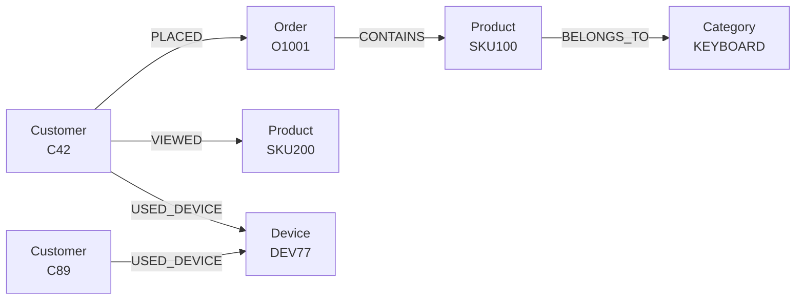
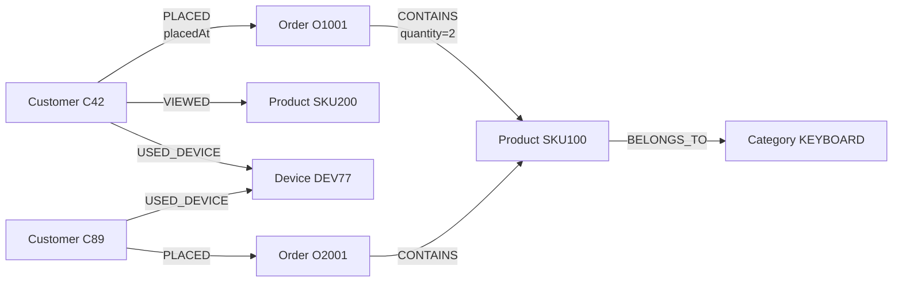
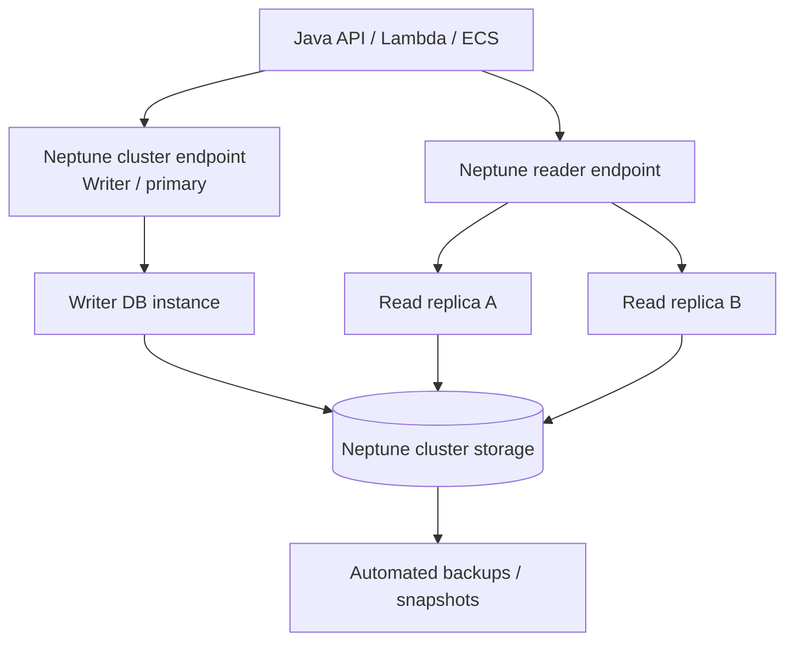
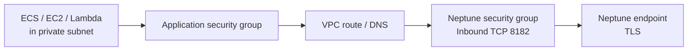
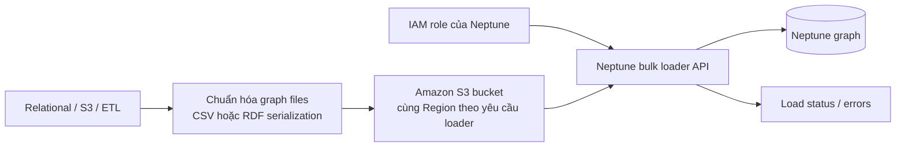

# Amazon Neptune và mô hình dữ liệu đồ thị

**Amazon Neptune** là dịch vụ cơ sở dữ liệu đồ thị được AWS quản lý. Nó phù hợp với ứng dụng mà dữ liệu có nhiều mối quan hệ và câu hỏi nghiệp vụ phụ thuộc vào việc đi qua các mối quan hệ đó: khách hàng nào có liên hệ với tài khoản đáng ngờ, sản phẩm nào thường được mua cùng nhau, dịch vụ nào phụ thuộc vào một thành phần hạ tầng, hoặc một thực thể có liên quan đến những thực thể nào trong nhiều bước.

Trong cơ sở dữ liệu quan hệ, các quan hệ thường được biểu diễn qua khóa ngoại và JOIN. Với graph database, **đỉnh (vertex/node)** và **cạnh (edge/relationship)** là thành phần cốt lõi; truy vấn đi theo các cạnh để tìm đường đi và lân cận. Neptune hỗ trợ hai mô hình đồ thị chính: **Property Graph** với Gremlin hoặc openCypher, và **RDF** với SPARQL. Chọn đúng mô hình giúp biểu diễn dữ liệu rõ ràng và viết truy vấn phù hợp.

Bài học thuộc chương **Cache và dữ liệu chuyên dụng** của module **CLOUD_PROVIDERS_AWS**. Khi xây dựng hệ thống trên AWS, người học cần biết lúc nào dùng DynamoDB/RDS, lúc nào cần graph database, và cách đặt Neptune trong kiến trúc gồm Region/AZ, VPC, IAM, EC2/ECS/Lambda, dịch vụ tích hợp, giám sát, backup và kiểm soát chi phí. Neptune là cơ sở dữ liệu chuyên dụng cho dữ liệu quan hệ phức tạp; nó không thay thế mọi database và cũng không phải cache.

Tình huống xuyên suốt là **Shop Recommendation & Fraud Detection**. Một khách hàng đặt đơn, xem sản phẩm và có thể dùng chung thiết bị hoặc phương thức thanh toán với tài khoản khác. Hệ thống muốn truy vấn chuỗi quan hệ Customer → Order → Product, tìm sản phẩm liên quan và phát hiện các cụm tài khoản có dấu hiệu gian lận.

## 1. Mục tiêu học tập

Sau bài học, bạn có thể:

1. Giải thích graph database, vertex, edge, label, property và traversal.
2. Phân biệt **Property Graph** với **RDF graph** và nhận biết lúc nào dùng Gremlin, openCypher hoặc SPARQL.
3. Thiết kế graph schema cho Customer, Order, Product, Device và các relationships trong Shop.
4. Chọn node ID, edge direction, labels, relationship properties và chiến lược tránh duplicate.
5. Viết truy vấn cơ bản để tìm lân cận, đường đi và các quan hệ nhiều bước.
6. Giải thích Amazon Neptune DB cluster, writer/reader endpoints, replicas, VPC networking, TLS và IAM authentication.
7. Đưa Neptune vào ứng dụng Java/Lambda/ECS với quyền truy cập và connection management phù hợp.
8. Phân biệt Neptune Database với Neptune Analytics, Neptune ML và các dịch vụ cache/database khác.
9. Nhận diện giới hạn, index/query performance, monitoring, backup, scaling và chi phí.
10. Xây một lab có thể kiểm tra dữ liệu, truy vấn và xử lý lỗi trong AWS sandbox.

## 2. Graph database là gì?

**Graph database** lưu dữ liệu dưới dạng các thực thể và quan hệ giữa chúng. Thay vì phải JOIN nhiều bảng để dựng lại một chuỗi quan hệ, ứng dụng có thể truy vấn trực tiếp từ node này sang node khác.

Ví dụ:



Chỉ nhìn vào đồ thị, ta có thể thấy:

- Customer C42 đã đặt Order O1001.
- Đơn hàng chứa Product SKU100.
- Customer C42 cũng xem Product SKU200.
- Product SKU100 thuộc Category KEYBOARD.
- Hai khách hàng có thể cùng liên quan đến một Device.

Những mối liên hệ này là dữ liệu hạng nhất của mô hình, không chỉ là một cột ID dùng để nối bảng.

### 2.1. Vì sao không chỉ dùng relational database?

RDBMS vẫn có thể lưu quan hệ và JOIN. Graph database trở nên hữu ích khi ứng dụng thường xuyên hỏi những câu như:

- Tìm tất cả người có quan hệ trong vòng 3 bước với một tài khoản.
- Tìm các sản phẩm liên quan đến sản phẩm đang xem thông qua hành vi mua/xem và danh mục.
- Tìm đường phụ thuộc từ một dịch vụ đến cơ sở dữ liệu hoặc tài nguyên hạ tầng.
- Tìm cụm tài khoản chia sẻ thiết bị, địa chỉ mạng hoặc phương thức thanh toán.

Khi số bước quan hệ thay đổi theo dữ liệu, SQL JOIN nhiều tầng hoặc recursive queries có thể khó đọc và khó tối ưu. Graph traversal diễn đạt tự nhiên hơn. Tuy nhiên, với truy vấn tổng hợp theo cột, báo cáo lớn hoặc CRUD đơn giản, RDS/DynamoDB/warehouse có thể phù hợp hơn.

### 2.2. Các thành phần cốt lõi

| Thành phần | Ý nghĩa | Ví dụ |
|---|---|---|
| **Vertex / Node** | Một thực thể trong graph | Customer C42 |
| **Edge / Relationship** | Quan hệ có hướng giữa hai vertices | C42 PLACED O1001 |
| **Label** | Loại node hoặc loại relationship | Customer, Order, PLACED |
| **Property** | Thuộc tính gắn vào node/edge | name, status, quantity |
| **ID** | Định danh node/edge theo mô hình | C42, O1001 |
| **Traversal** | Đi qua các nodes/edges theo điều kiện | Customer → Order → Product |
| **Path** | Chuỗi vertices và edges nối nhau | C42 → O1001 → SKU100 |

### 2.3. Directed edge và chiều quan hệ

Một edge trong property graph có **điểm đầu (out vertex)** và **điểm cuối (in vertex)**. Ví dụ:

```text
Customer C42 --PLACED--> Order O1001
```

Đọc theo chiều đi ra từ Customer: khách hàng đã đặt đơn. Đọc theo chiều đi vào Order: đơn hàng được đặt bởi khách hàng. Chiều cạnh là một phần của mô hình; nếu truy vấn cần đi hai chiều, ngôn ngữ graph có thể hỗ trợ bước đi incoming/outgoing/both theo cú pháp tương ứng.

Đừng tạo hai cạnh ngược chiều chỉ vì muốn đọc quan hệ từ cả hai phía, trừ khi domain cần hai quan hệ độc lập. Lưu cạnh trùng lặp làm tăng write/storage và có thể khiến traversal đếm hai lần.

## 3. Amazon Neptune là gì?

**Amazon Neptune Database** là dịch vụ graph database được quản lý, có thể lưu trữ và truy vấn dữ liệu theo Property Graph hoặc RDF. AWS quản lý hạ tầng database cluster, storage, backup và các hoạt động vận hành theo mô hình dịch vụ. Ứng dụng vẫn chịu trách nhiệm thiết kế schema, truy vấn, IAM/network security, dữ liệu, capacity và tính đúng của nghiệp vụ.

### 3.1. Neptune phù hợp với trường hợp nào?

| Bài toán | Graph model giúp gì? |
|---|---|
| **Fraud detection** | Phát hiện nhiều tài khoản cùng thiết bị/thẻ/địa chỉ hoặc đường quan hệ đáng ngờ |
| **Recommendation** | Tìm sản phẩm qua quan hệ mua chung, xem chung, cùng danh mục |
| **Knowledge graph** | Liên kết khái niệm, tài liệu, người, tổ chức và nguồn tri thức |
| **Identity resolution** | Hợp nhất các dấu hiệu định danh qua nhiều hệ thống |
| **Network & IT operations** | Truy vấn topology, dependency và ảnh hưởng dây chuyền |
| **Social graph** | Bạn bè, người theo dõi, nhóm và quan hệ nhiều bước |
| **Supply chain** | Nhà cung cấp, linh kiện, lô hàng và phụ thuộc nguồn cung |

### 3.2. Khi nào Neptune không phải lựa chọn đầu tiên?

- Lưu session/cache có TTL và truy cập key-value đơn giản: xem **Amazon ElastiCache** hoặc DynamoDB tùy yêu cầu.
- Lưu orders và truy vấn theo primary key/access patterns rõ: **DynamoDB** có thể phù hợp.
- Nghiệp vụ cần joins quan hệ, constraints và giao dịch SQL phong phú: cân nhắc **Amazon RDS/Aurora**.
- Phân tích hàng tỷ dòng dạng cột, BI và báo cáo: cân nhắc **S3 + Athena/Glue**, Redshift hoặc analytics platform.
- Graph analytics batch quy mô lớn, nhiều thuật toán chạy trên graph in-memory: xem **Amazon Neptune Analytics**.

Neptune có thể là một thành phần trong kiến trúc nhiều database. Không nên chuyển mọi dữ liệu vào graph nếu phần lớn ứng dụng không cần traversal.

### 3.3. Neptune Database và Neptune Analytics khác nhau

| Tiêu chí | Neptune Database | Neptune Analytics |
|---|---|---|
| Mục đích | Graph database vận hành cho ứng dụng, truy vấn và cập nhật | Phân tích graph, thuật toán và khám phá quan hệ trên graph được nạp |
| Workload | Online graph queries, application transactions | Phân tích sâu, graph algorithms, exploratory analytics |
| Mô hình | Property Graph và RDF với các query interfaces được hỗ trợ | Graph analytics engine với khả năng/phương thức truy vấn riêng |
| Vận hành | DB cluster, instances, storage và replicas | Analytics graph resource, capacity/lifecycle riêng |
| Lựa chọn | Khi ứng dụng cần graph database lâu dài | Khi cần phân tích cấu trúc graph ở quy mô lớn |

**Không đồng nhất Neptune Analytics với một read replica của Neptune Database.** Hai dịch vụ có mục tiêu, API, lifecycle và cách tính phí khác nhau. Hãy kiểm tra khả năng tương thích, import/ export và query languages trong tài liệu dịch vụ hiện hành trước khi thiết kế pipeline.

## 4. Hai mô hình dữ liệu: Property Graph và RDF

Neptune hỗ trợ hai mô hình graph quan trọng. Chúng đều biểu diễn quan hệ, nhưng cách mô tả dữ liệu và ngôn ngữ truy vấn khác nhau.

### 4.1. Property Graph

Property Graph có:

- **Vertices** với ID, một hoặc nhiều labels và properties.
- **Edges** có hướng với ID, label và properties.
- Properties là các cặp key/value gắn trên node hoặc edge.

Ví dụ:

```text
(:Customer {id: "C42", name: "An"})
  -[:PLACED {placedAt: "2026-11-20T08:00:00Z"}]->
(:Order {id: "O1001", status: "PLACED"})
  -[:CONTAINS {quantity: 2}]->
(:Product {id: "SKU100", name: "Keyboard"})
```

Trong Neptune, Property Graph có thể truy vấn bằng **Gremlin** hoặc **openCypher**. Đây là lựa chọn tự nhiên khi ứng dụng mô hình hóa entities và relationships có thuộc tính.

### 4.2. RDF graph

**RDF (Resource Description Framework)** biểu diễn tri thức bằng các bộ ba:

```text
Subject — Predicate — Object
```

Ví dụ:

```text
<urn:customer:C42> <https://shop.example/vocab/placed> <urn:order:O1001> .
<urn:order:O1001> <https://shop.example/vocab/contains> <urn:product:SKU100> .
<urn:product:SKU100> <https://shop.example/vocab/name> "Keyboard" .
```

- **Subject**: resource được mô tả.
- **Predicate**: quan hệ hoặc thuộc tính.
- **Object**: resource khác hoặc literal value.

RDF sử dụng URI/IRI để định danh resources và hỗ trợ vocabularies/ontologies. Neptune truy vấn RDF bằng **SPARQL 1.1**.

### 4.3. So sánh Property Graph và RDF

| Góc nhìn | Property Graph | RDF |
|---|---|---|
| Đơn vị cơ bản | Vertex, edge, property | Triple subject-predicate-object |
| Quan hệ | Edge có label và properties | Predicate là một URI |
| Thuộc tính | Gắn trực tiếp vào node/edge | Thường biểu diễn bằng triple có literal/resource object |
| Định danh | Graph element IDs và ứng dụng IDs | URI/IRI |
| Ngôn ngữ Neptune | Gremlin, openCypher | SPARQL |
| Thế mạnh | Operational app graph, traversal, domain relationships | Knowledge graph, linked data, ontology và dữ liệu liên kết |
| Tư duy mô hình | Entities và relationships | Facts và vocabularies |

**Chọn một mô hình theo domain và query patterns.** Không nên giả định Property Graph và RDF là cùng một cấu trúc chỉ đổi ngôn ngữ truy vấn. Cần xác định dữ liệu nào sẽ được nạp vào graph model nào và API nào sẽ sử dụng.

### 4.4. Khi nào dùng loại nào?

Chọn **Property Graph** khi:

- Domain có các thực thể như Customer, Order, Product, Device.
- Relationship có thuộc tính riêng như quantity, since, confidence, timestamp.
- Ứng dụng thường đi qua các quan hệ theo traversal.
- Team muốn dùng Gremlin hoặc cú pháp pattern matching của openCypher.

Chọn **RDF** khi:

- Dữ liệu là tập facts/knowledge được liên kết bằng URI.
- Cần vocabularies/ontologies, semantic web hoặc linked data.
- Cần truy vấn SPARQL và tích hợp các RDF datasets.
- Domain cần biểu diễn nhiều nguồn tri thức theo một ngữ nghĩa chung.

## 5. Thiết kế Property Graph cho Shop

Một graph tốt bắt đầu từ các câu hỏi nghiệp vụ, không phải từ việc chuyển từng bảng SQL thành một node.

### 5.1. Xác định entities

| Entity | Vertex label | ID ví dụ | Properties |
|---|---|---|---|
| Khách hàng | Customer | C42 | name, createdAt, tier |
| Đơn hàng | Order | O1001 | status, currency, totalMinorUnits |
| Sản phẩm | Product | SKU100 | name, brand, category |
| Danh mục | Category | KEYBOARD | title |
| Thiết bị | Device | DEV77 | deviceType, firstSeenAt |
| Phương thức thanh toán | PaymentInstrument | PI55 | instrumentType, tokenFingerprint |
| Địa chỉ giao hàng | Address | ADDR10 | countryCode, postalRegion |

Không nhất thiết biến mọi cột thành một vertex. Một thuộc tính nhỏ, chỉ được đọc cùng một thực thể và không cần liên kết độc lập, có thể phù hợp hơn khi là **property**.

### 5.2. Xác định relationships

| Relationship label | Từ node | Đến node | Edge properties ví dụ |
|---|---|---|---|
| PLACED | Customer | Order | placedAt, channel |
| CONTAINS | Order | Product | quantity, unitPriceMinorUnits |
| BELONGS_TO | Product | Category | — |
| VIEWED | Customer | Product | viewedAt, source |
| USED_DEVICE | Customer | Device | firstSeenAt, lastSeenAt |
| PAID_WITH | Order | PaymentInstrument | authorizedAt |
| SHIPPED_TO | Order | Address | deliveryType |
| SIMILAR_TO | Product | Product | score, modelVersion |

Edge properties có ý nghĩa khi dữ liệu thuộc về **mối quan hệ**, ví dụ quantity thuộc quan hệ Order–Product. Nếu quantity được đặt thành property trên Product, nó sẽ không còn rõ là số lượng của đơn nào.

### 5.3. Graph mẫu



Graph này cho phép các câu hỏi:

- Khách C42 đã mua những sản phẩm nào?
- Ai đã mua cùng SKU100?
- Những khách nào có chung thiết bị với C42?
- Sản phẩm nào có thể gợi ý cho khách dựa trên quan hệ gián tiếp?

### 5.4. Node ID nên ổn định và có namespace

Nên dùng IDs ổn định từ domain:

```text
Customer: customer:C42
Order: order:O1001
Product: product:SKU100
Device: device:DEV77
```

Namespace giúp tránh collision nếu các loại entity dùng chung một graph ID space hoặc cùng giá trị business ID. Không dùng tên người, email hoặc số điện thoại làm graph ID nếu có thể dùng opaque identifier. ID phải được tạo/validate ở application và không để client tự chọn ID của thực thể khác.

### 5.5. Tránh duplicate nodes và duplicate edges

Nếu mỗi lần nhận event lại thêm một vertex Customer C42, graph có thể có nhiều nodes biểu diễn cùng một khách. Khi truy vấn, kết quả sai và graph phình lên.

- Chọn ID ổn định, có quy tắc normalization.
- Dùng thao tác upsert/merge theo khả năng query language.
- Kiểm soát uniqueness ở application; không giả định Neptune có mọi uniqueness constraints như RDBMS.
- Đặt business idempotency key cho ingestion events.
- Với edges, xác định một quan hệ có thể xuất hiện nhiều lần hay chỉ một lần. Ví dụ VIEWED có thể là event lặp theo thời gian; có thể cần lưu mỗi lần xem như một event node/edge có ID thay vì overwrite quan hệ duy nhất.

## 6. Chọn granularity: property hay node/edge?

Một trong những quyết định quan trọng nhất là dữ liệu nào nên trở thành vertex, edge hay property.

| Câu hỏi | Nên cân nhắc |
|---|---|
| Có ID độc lập và được tham chiếu từ nhiều nơi? | Vertex |
| Là quan hệ giữa hai thực thể? | Edge |
| Có thuộc tính riêng của quan hệ? | Edge property |
| Chỉ mô tả một node, ít khi truy vấn độc lập? | Node property |
| Có lịch sử nhiều lần xảy ra theo thời gian? | Event vertex hoặc nhiều edges/events có ID |
| Là tài liệu/binary lớn? | S3/object storage, graph chỉ giữ reference |

### 6.1. Ví dụ: quantity thuộc đâu?

Một đơn hàng O1001 chứa hai SKU100:

```text
Order O1001 --CONTAINS {quantity: 2}--> Product SKU100
```

Nếu `quantity` là property trên Product, hệ thống sẽ không biết số lượng trong từng order. Nếu Product có `stockQuantity`, đó lại là property của Product/Inventory, mang ý nghĩa khác. Đặt đúng nơi giúp truy vấn và cập nhật không nhầm domain semantics.

### 6.2. Ví dụ: hành vi VIEWED có cần node riêng?

Nếu chỉ cần biết khách đã từng xem sản phẩm, một edge `VIEWED` có thể đủ. Nếu cần phân tích từng lần xem, timestamp, campaign, session, source và thời lượng, một relationship đơn có thể không biểu diễn được nhiều occurrences cùng lúc. Khi đó có thể:

```text
Customer C42 --PERFORMED--> ViewEvent V1001
ViewEvent V1001 --TARGETED--> Product SKU100
ViewEvent V1001 --IN_SESSION--> Session S77
```

Hoặc lưu các event occurrences ở một hệ thống event/stream rồi tạo graph projection phù hợp. Chọn theo query needs và lượng dữ liệu, vì tạo node cho mọi click có thể làm graph rất lớn.

### 6.3. Tránh supernodes

Một node như `Category=ALL` hoặc `Country=VN` có thể liên kết tới hàng triệu vertices. Truy vấn bắt đầu từ node có degree quá lớn sẽ phải duyệt rất nhiều edges. Hãy:

- Chọn traversal bắt đầu từ node có độ chọn lọc cao hơn.
- Giới hạn độ sâu và số kết quả.
- Dùng filter sớm và properties phù hợp.
- Phân tích degree distribution, tránh tạo hub không có ý nghĩa.
- Tách batch analytics khỏi interactive request nếu traversal quá rộng.

## 7. Ngôn ngữ truy vấn Property Graph: Gremlin và openCypher

Neptune hỗ trợ hai query languages cho Property Graph. Cả hai đều có thể đi qua quan hệ nhưng cách diễn đạt khác nhau.

### 7.1. Gremlin: traversal từng bước

**Gremlin** là graph traversal language thuộc Apache TinkerPop. Một truy vấn thường bắt đầu từ một tập vertices/edges, sau đó đi qua các bước như:

| Step | Ý nghĩa | Ví dụ |
|---|---|---|
| `V()` | Bắt đầu từ vertices | Tất cả nodes |
| `E()` | Bắt đầu từ edges | Tất cả relationships |
| `hasLabel()` | Lọc theo label | Customer |
| `has()` | Lọc theo property | customerId = C42 |
| `out()` | Đi theo outgoing edges | Customer → Order |
| `in()` | Đi theo incoming edges | Order ← Customer |
| `both()` | Đi cả hai hướng | Quan hệ hai chiều |
| `values()` | Lấy property values | name, status |
| `path()` | Trả về đường đi | Customer → Order → Product |
| `limit()` | Giới hạn kết quả | Tối đa 20 |

Ví dụ tìm products mà C42 đã mua:

```groovy
g.V().
  has('Customer', 'customerId', 'C42').
  out('PLACED').
  hasLabel('Order').
  out('CONTAINS').
  hasLabel('Product').
  values('name')
```

Đọc từ trái sang phải:

1. Tìm Customer có `customerId=C42`.
2. Đi theo cạnh `PLACED` tới các orders.
3. Từ các orders đi theo `CONTAINS` tới products.
4. Lấy tên sản phẩm.

Gremlin phù hợp khi developer muốn điều khiển traversal từng bước, đi incoming/outgoing, lọc, map, group và xây logic graph phức tạp.

### 7.2. openCypher: pattern matching khai báo

**openCypher** dùng cú pháp pattern matching để mô tả chuỗi nodes và relationships. Ví dụ cùng truy vấn trên:

```cypher
MATCH (c:Customer {customerId: 'C42'})
      -[:PLACED]->(o:Order)
      -[:CONTAINS]->(p:Product)
RETURN DISTINCT p.name AS productName
```

Pattern diễn tả trực quan: Customer → Order → Product. Developer có thể thấy cấu trúc graph ngay trong câu truy vấn.

### 7.3. Tạo dữ liệu bằng openCypher

```cypher
CREATE
  (c:Customer {
    customerId: 'C42',
    name: 'An'
  }),
  (o:Order {
    orderId: 'O1001',
    status: 'PLACED',
    totalMinorUnits: 125000
  }),
  (p:Product {
    sku: 'SKU100',
    name: 'Keyboard'
  }),
  (c)-[:PLACED {
    placedAt: '2026-11-20T08:00:00Z'
  }]->(o),
  (o)-[:CONTAINS {
    quantity: 2,
    unitPriceMinorUnits: 62500
  }]->(p)
RETURN c, o, p
```

Đây là dữ liệu mẫu để chạy trong **graph rỗng của lab**. Nếu chạy lại CREATE, có thể tạo các graph elements trùng logic. Với ingestion thực tế, hãy thiết kế upsert/idempotency và unique business IDs ở ứng dụng; không coi CREATE là lệnh chống trùng.

### 7.4. Truy vấn openCypher nhiều bước

Tìm khách hàng đã mua cùng một sản phẩm với C42:

```cypher
MATCH (source:Customer {customerId: 'C42'})
      -[:PLACED]->(:Order)
      -[:CONTAINS]->(p:Product)
      <-[:CONTAINS]-(:Order)
      <-[:PLACED]-(other:Customer)
WHERE other.customerId <> source.customerId
RETURN DISTINCT other.customerId AS customerId,
                p.sku AS sharedProduct
LIMIT 50
```

Đây là một pattern nhiều bước. Ở dữ liệu thật cần kiểm soát số lượng nodes/edges, đặt LIMIT, lọc sớm và xem query profile; một khách hàng mua hàng nghìn sản phẩm có thể tạo tập kết quả rất lớn.

### 7.5. Chọn Gremlin hay openCypher?

| Tiêu chí | Gremlin | openCypher |
|---|---|---|
| Cách diễn đạt | Từng bước traversal | Pattern matching |
| Phù hợp | Logic traversal linh hoạt, pipeline nhiều bước | Truy vấn domain theo pattern dễ đọc |
| Cú pháp | Step-based, fluent | Declarative |
| Hệ sinh thái | Apache TinkerPop | openCypher ecosystem |
| Neptune | Property Graph | Property Graph |

Chọn một ngôn ngữ chủ đạo theo năng lực team và truy vấn thực tế. Không cần dùng cả hai cho mọi API; duy trì hai query stacks có thể tăng chi phí đào tạo, debugging và kiểm thử.

## 8. RDF và SPARQL

RDF phù hợp khi dữ liệu được mô tả bằng các facts có URI và quan hệ theo vocabulary/ontology. Trong Neptune, SPARQL là ngôn ngữ truy vấn RDF.

### 8.1. URI/IRI và literal

Một RDF triple:

```text
<urn:customer:C42>
  <https://shop.example/vocab/placed>
  <urn:order:O1001> .
```

Các URI ví dụ:

- `urn:customer:C42` định danh Customer.
- `https://shop.example/vocab/placed` định nghĩa quan hệ placed.
- `urn:order:O1001` định danh Order.

Thuộc tính literal:

```text
<urn:order:O1001>
  <https://shop.example/vocab/status>
  "PLACED" .

<urn:order:O1001>
  <https://shop.example/vocab/total>
  "125000"^^<http://www.w3.org/2001/XMLSchema#integer> .
```

Literal có thể mang datatype hoặc language tag; điều này giúp dữ liệu có semantics rõ hơn một string tự do.

### 8.2. SPARQL SELECT

Tìm các orders do customer C42 đặt:

```sparql
PREFIX ex: <https://shop.example/vocab/>

SELECT ?order
WHERE {
  <urn:customer:C42> ex:placed ?order .
}
```

Tìm sản phẩm trong orders của customer:

```sparql
PREFIX ex: <https://shop.example/vocab/>

SELECT DISTINCT ?product ?name
WHERE {
  <urn:customer:C42> ex:placed ?order .
  ?order ex:contains ?product .
  ?product ex:name ?name .
}
```

### 8.3. RDF vocabulary và ontology

Một vocabulary định nghĩa các predicates như `placed`, `contains`, `belongsTo`. Ontology có thể mô tả class, subclass và quan hệ ngữ nghĩa ở mức phong phú hơn. Ví dụ:

```text
Customer rdfs:subClassOf Person
Order ex:placedBy Customer
Product ex:belongsTo Category
```

Neptune lưu và truy vấn RDF, nhưng không nên mặc định mọi suy luận ontology phức tạp sẽ tự chạy như một reasoner đầy đủ. Nếu ứng dụng cần entailment/rule reasoning, hãy xác định cơ chế inference/ETL phù hợp và kiểm tra những gì engine thực sự hỗ trợ.

### 8.4. Named graphs và nguồn dữ liệu

RDF có thể nhóm triples vào **named graphs**, giúp phân biệt dataset, nguồn hoặc phạm vi. Đây là cách biểu diễn hữu ích khi hợp nhất dữ liệu từ nhiều nguồn; tuy nhiên, named graph không tự thay IAM/resource authorization. Ứng dụng vẫn phải kiểm tra ai được đọc/ghi graph và dữ liệu nào được chia sẻ.

## 9. Đừng nhầm ba query languages

| Query language | Data model | Dùng khi | Ví dụ |
|---|---|---|---|
| **Gremlin** | Property Graph | Traversal từng bước | g.V().has(...).out(...) |
| **openCypher** | Property Graph | Pattern matching | MATCH (a)-[:KNOWS]->(b) |
| **SPARQL** | RDF | Triple patterns, semantic data | SELECT ?s WHERE { ?s ex:related ?o } |

Một lỗi thiết kế là chọn RDF nhưng team chỉ quen Cypher rồi viết một adapter tự chuyển mọi truy vấn. Hãy chọn model/query language phù hợp, thử bằng dữ liệu thật và định nghĩa contract cho API.

## 10. Kiến trúc Amazon Neptune DB cluster

Neptune Database sử dụng **DB cluster** với một primary/writer instance và có thể có read replicas. Storage layer được dịch vụ quản lý tách khỏi compute instances; cluster có thể mở rộng reads bằng replicas và hỗ trợ failover theo thiết kế dịch vụ.



### 10.1. Writer/cluster endpoint

Cluster endpoint trỏ tới primary instance hiện tại của DB cluster, phù hợp cho kết nối cần **ghi** và các truy vấn đọc cần consistency trên writer theo yêu cầu. Khi failover, endpoint được dịch vụ cập nhật để trỏ tới primary mới; ứng dụng vẫn cần reconnect/retry đúng cách.

### 10.2. Reader endpoint

Reader endpoint phân phối các kết nối đọc tới các read replicas theo cơ chế của dịch vụ. Nó hữu ích để tách read traffic khỏi writer. Nhưng:

- Không bảo đảm mỗi truy vấn đọc luôn thấy write vừa hoàn thành nếu đọc từ replica.
- Client có thể giữ connection lâu và không được cân bằng lại từng query như một HTTP load balancer thông thường.
- Ứng dụng phải quản lý retry, timeout và stale reads theo business needs.

### 10.3. Instance endpoint

Instance endpoint kết nối trực tiếp một DB instance cụ thể. Nó hữu ích cho troubleshooting/kiểm soát một instance, nhưng app production thường nên dùng cluster/reader endpoint để tận dụng failover và replica routing phù hợp.

### 10.4. Neptune storage và Availability Zones

Neptune quản lý storage layer có khả năng chịu lỗi qua nhiều Availability Zones theo kiến trúc dịch vụ. Người dùng không trực tiếp chọn physical disk hoặc đặt từng vertex vào AZ. Compute DB instances được đặt trong VPC/subnets theo cấu hình cluster; read replicas và failover góp phần tăng khả năng phục vụ.

**Không nhầm storage durability với application availability.** Nếu writer instance fail, app vẫn có thể thấy lỗi kết nối trong thời gian failover. Cần retry/backoff, connection pool refresh và timeout hợp lý.

## 11. Provisioned instances và Neptune Serverless

Neptune hỗ trợ mô hình compute được provision và **Neptune Serverless** cho workload có nhu cầu capacity biến động trong phạm vi dịch vụ hỗ trợ.

| Tiêu chí | Provisioned | Serverless |
|---|---|---|
| Capacity | Chọn instance class/size | Capacity tự điều chỉnh trong min/max được cấu hình |
| Phù hợp | Workload ổn định, có baseline rõ | Workload biến động, khó dự đoán hoặc bursty |
| Tối ưu | Rightsizing, replicas, scaling plan | Min/max capacity, scale behavior và latency |
| Vận hành | Quản lý instance topology | Vẫn quản lý cluster, network, data và query |
| Chi phí | Theo instance và tài nguyên đi kèm | Theo capacity consumed và các tài nguyên liên quan |

Serverless **không có nghĩa không cần thiết kế performance**. Query traversal quá rộng, supernodes, connection storms hoặc min capacity đặt không phù hợp vẫn ảnh hưởng latency/chi phí. Kiểm tra engine version, instance/serverless availability và giới hạn Region hiện hành trước khi chọn.

## 12. Kết nối Neptune trong VPC

Neptune DB cluster thường triển khai trong **Amazon VPC** và không nên phơi database endpoint công khai cho Internet. Application trong VPC hoặc network được kết nối có thể truy cập qua security groups, routes và DNS.

### 12.1. Luồng kết nối



### 12.2. Security group

Ví dụ nguyên tắc:

- App instances/Lambda có security group riêng.
- Neptune DB cluster security group chỉ cho phép **inbound TCP 8182 từ app security group**.
- Không mở inbound 8182 từ `0.0.0.0/0`.
- Kiểm tra subnet groups, route tables, NACLs, DNS resolution và network connectivity.

Security group tham chiếu security group khác thường dễ quản lý hơn hardcode IP của Lambda/EC2. Nếu app nằm ở VPC khác, cần thiết kế VPC peering, Transit Gateway hoặc connectivity phù hợp, và đánh giá DNS/route/security.

### 12.3. Port và endpoints

Neptune endpoint thường dùng **TCP port 8182** cho Gremlin/openCypher/SPARQL APIs. Endpoint cụ thể và path phụ thuộc query interface:

| Query interface | Ví dụ endpoint path |
|---|---|
| Gremlin | `wss://<cluster-endpoint>:8182/gremlin` hoặc HTTPS request path được hỗ trợ |
| openCypher | `https://<cluster-endpoint>:8182/openCypher` |
| SPARQL | `https://<cluster-endpoint>:8182/sparql` |

Đây là format minh họa. Dùng hostname writer/reader endpoint do AWS cấp và driver/API version được hỗ trợ; không tự đoán endpoint hostname hoặc bỏ TLS.

### 12.4. Lambda trong VPC

Nếu Lambda cần kết nối trực tiếp Neptune:

1. Đặt Lambda trong private subnets có network path tới Neptune.
2. Gắn security group cho Lambda và cho phép SG đó vào DB SG trên TCP 8182.
3. Tạo client/connection strategy phù hợp, tránh mở connection mới quá thường xuyên.
4. Giới hạn concurrency để không tạo connection storm.
5. Xử lý cold starts, timeout, retries và connection reset khi DB failover.

Không cần đặt Lambda trong public subnet để truy cập Neptune trong cùng VPC; route/subnet/SG đúng mới là yếu tố quyết định.

## 13. Bảo mật Neptune: network, TLS, IAM và dữ liệu

Database graph thường chứa quan hệ nhạy cảm: ai liên hệ với ai, thiết bị nào được dùng chung, khách hàng có hành vi nào. Nếu một truy vấn graph có thể đi qua nhiều quan hệ, rò rỉ dữ liệu có thể tiết lộ nhiều thông tin hơn một bản ghi đơn lẻ. Vì vậy, bảo mật phải bao gồm **network boundary, authentication, authorization, encryption và data governance**.

### 13.1. Network boundary

- Đặt Neptune trong private subnets của VPC theo kiến trúc phù hợp.
- Security group DB chỉ cho phép app security group kết nối vào TCP 8182.
- Không mở Neptune endpoint trực tiếp ra Internet.
- Nếu kết nối từ VPC khác/on-premises, thiết kế peering, Transit Gateway, VPN/Direct Connect, DNS và routing có kiểm soát.
- Kiểm tra NACL, route tables và DNS khi connection timeout.

### 13.2. TLS và encryption at rest

Neptune hỗ trợ TLS cho kết nối tới endpoint và encryption at rest cho dữ liệu trong cluster. Trong production:

- Dùng HTTPS/WSS với certificate validation.
- Không tắt kiểm tra chứng chỉ để sửa lỗi kết nối.
- Xác định KMS key theo yêu cầu bảo mật/ownership và policy.
- Quản lý key policy, rotation và quyền restore/snapshot.
- Không lưu password, token, PAN hoặc dữ liệu xác thực thô trong graph properties.

### 13.3. IAM database authentication

Neptune hỗ trợ **IAM database authentication** khi cluster được bật tính năng tương ứng. Với IAM auth, client gửi request được ký bằng **AWS Signature Version 4 (SigV4)**; IAM policy kiểm soát principal được phép thực hiện các thao tác data API theo cơ chế Neptune hỗ trợ.

IAM auth không tự động biến `Customer C42` thành principal của ứng dụng. Nó xác thực **AWS workload identity** (ví dụ ECS task role hoặc Lambda execution role) ở lớp truy cập database. Backend vẫn cần kiểm tra quyền nghiệp vụ của người dùng cuối trên Customer, Order, Device hoặc Tenant.

Các nguyên tắc:

- Dùng ECS task role/EC2 instance profile/Lambda execution role thay cho static access keys.
- Nếu bật IAM auth, dùng driver/integration có SigV4 signer tương thích với Neptune endpoint và engine version.
- Đồng bộ thời gian hệ thống vì SigV4 có timestamp.
- Hạn chế quyền theo cluster/resource và action cần thiết; kiểm tra policy theo tài liệu Neptune IAM.
- Không đặt IAM secret hoặc session token trong graph properties hay log.

### 13.4. Data authorization và tenant isolation

Giả sử Customer C42 chỉ được xem dữ liệu của mình. Một API không được chấp nhận query do browser tự gửi:

```text
MATCH (c:Customer {customerId: 'C89'})-[:PLACED]->(o)
RETURN o
```

chỉ vì AWS task role có quyền kết nối Neptune. Backend phải:

1. Xác thực người dùng qua Cognito/OIDC hoặc cơ chế identity của hệ thống.
2. Lấy customer/tenant identity từ verified claims và dữ liệu membership tin cậy.
3. Tạo query parameters từ authorization context server-side.
4. Giới hạn label/relationships/fields mà endpoint được phép trả.
5. Audit các truy vấn đặc quyền và phát hiện traversal bất thường.

Không cho người dùng cuối gửi raw Gremlin/openCypher/SPARQL tùy ý tới production Neptune endpoint trừ khi đó là một sản phẩm query console được sandbox và kiểm soát riêng.

## 14. Gửi truy vấn tới Neptune

Neptune cung cấp các query interfaces qua endpoint của cluster. Cú pháp HTTP/WebSocket, content type, authentication và engine compatibility phụ thuộc query language.

### 14.1. Gremlin endpoint

Gremlin có thể sử dụng WebSocket qua path:

```text
wss://<neptune-endpoint>:8182/gremlin
```

Một số cách gọi HTTP cũng được hỗ trợ theo Gremlin endpoint/API version. Java Gremlin Driver thường duy trì kết nối WebSocket/pool thay vì tạo TCP connection mới cho mỗi traversal.

### 14.2. openCypher endpoint

Ví dụ gửi HTTP POST tới:

```text
https://<neptune-endpoint>:8182/openCypher
```

Body minh họa:

```json
{
  "query": "MATCH (c:Customer {customerId: $customerId})-[:PLACED]->(o:Order) RETURN o",
  "parameters": {
    "customerId": "C42"
  }
}
```

Sử dụng query parameters khi được API/driver hỗ trợ, tránh nối chuỗi trực tiếp từ user input. Điều này giúp giảm nguy cơ injection và lỗi escaping.

### 14.3. SPARQL endpoint

RDF query thường gửi tới:

```text
https://<neptune-endpoint>:8182/sparql
```

SPARQL query cần được encode/gửi theo HTTP method và content type mà Neptune endpoint hỗ trợ. Với update requests, xác định rõ quyền ghi và không để endpoint query công khai.

### 14.4. Đừng trộn endpoint và query language

| Endpoint path | Ngôn ngữ | Mô hình |
|---|---|---|
| `/gremlin` | Gremlin | Property Graph |
| `/openCypher` | openCypher | Property Graph |
| `/sparql` | SPARQL | RDF |

Đường dẫn đúng không đủ để bảo đảm truy vấn hợp lệ: client phải tương thích engine version, protocol, authentication và request format.

## 15. Java: kết nối và truy vấn Gremlin

Với ứng dụng Java, **Apache TinkerPop Gremlin Driver** là một lựa chọn cho Property Graph. Phiên bản driver phải tương thích với Gremlin/TinkerPop version mà Neptune engine hỗ trợ.

### 15.1. Maven dependency

Ví dụ khai báo dependency (chọn version tương thích theo Neptune engine/documentation của môi trường):

```xml
<dependency>
  <groupId>org.apache.tinkerpop</groupId>
  <artifactId>gremlin-driver</artifactId>
  <version>compatible-version</version>
</dependency>
```

Không tự chọn phiên bản TinkerPop mới nhất mà không kiểm tra tương thích Neptune; engine có thể hỗ trợ một version cụ thể và không hỗ trợ mọi tính năng mới của TinkerPop.

### 15.2. Java Gremlin Driver minh họa

```java
package example.shop.graph;

import java.util.List;
import org.apache.tinkerpop.gremlin.driver.Client;
import org.apache.tinkerpop.gremlin.driver.Cluster;
import org.apache.tinkerpop.gremlin.driver.Result;
import org.apache.tinkerpop.gremlin.driver.ResultSet;

public final class NeptuneGremlinExample {
    public static void main(String[] args) throws Exception {
        String host = System.getenv("NEPTUNE_ENDPOINT");
        if (host == null || host.isBlank()) {
            throw new IllegalStateException("NEPTUNE_ENDPOINT is required");
        }

        Cluster cluster = Cluster.build(host)
                .port(8182)
                .enableSsl(true)
                .create();

        try (Client client = cluster.connect()) {
            ResultSet resultSet = client.submit(
                    "g.V().has('Customer','customerId',customerId)" +
                    ".out('PLACED').hasLabel('Order').values('orderId')",
                    java.util.Map.of("customerId", "C42"));

            List<Result> results = resultSet.all().get();
            for (Result result : results) {
                System.out.println(result.getObject());
            }
        } finally {
            cluster.close();
        }
    }
}
```

Đây là ví dụ minh họa kết nối Gremlin TLS và truyền binding cho truy vấn. Trước khi chạy:

- Cần endpoint hostname đúng từ Neptune cluster.
- Cần driver version tương thích.
- Network SG phải cho phép app tới Neptune TCP 8182.
- Ví dụ giả định cấu hình cluster cho phép kết nối theo phương thức authentication tương ứng với môi trường. Nếu bật IAM DB authentication, phải tích hợp SigV4 signing theo hướng dẫn AWS/driver; đoạn code đơn giản trên **chưa tự ký SigV4**.
- Trong production, cấu hình connection pool, max in-flight requests, timeout, reconnect và metrics thay vì dùng defaults không đánh giá.

### 15.3. Client lifecycle

Tạo Cluster/Client một lần theo vòng đời ứng dụng, tái sử dụng connection pool và đóng đúng lúc shutdown. Không tạo cluster mới cho từng HTTP request. Với Lambda, khởi tạo client ngoài handler để tận dụng execution environment reuse, nhưng phải xử lý socket stale, failover và giới hạn concurrency.

### 15.4. Query parameters và injection

Không tạo Gremlin query bằng cách nối trực tiếp:

```java
String query = "g.V().has('Customer','customerId','"
        + userInput + "')";
```

Input có thể chứa ký tự làm thay đổi câu truy vấn. Dùng bindings/parameters theo khả năng driver, allowlist labels/steps và chỉ cho API gọi traversal đã được định nghĩa trước. Đừng nhận raw query từ browser.

## 16. Tạo và truy vấn graph bằng Gremlin

Các lệnh dưới đây dùng Gremlin Console hoặc client tương thích. Chúng minh họa Property Graph, không phải cú pháp SPARQL.

### 16.1. Tạo Customer và Order

```groovy
g.addV('Customer').
  property('customerId', 'C42').
  property('name', 'An')

g.addV('Order').
  property('orderId', 'O1001').
  property('status', 'PLACED')
```

Hai traversals trên tạo hai vertices riêng. Để tạo relationship, cần tìm đúng vertices rồi nối bằng edge.

### 16.2. Tạo cạnh PLACED

```groovy
g.V().
  has('Customer', 'customerId', 'C42').
  as('c').
  V().
  has('Order', 'orderId', 'O1001').
  as('o').
  addE('PLACED').
  from('c').
  to('o').
  property('placedAt', '2026-11-20T08:00:00Z')
```

Đây là traversal minh họa; khi triển khai cần kiểm tra đúng cardinality và hành vi của Gremlin traversal theo engine version. Truy vấn tạo edge nên được bao quanh bằng quy trình chống duplicate ở ingestion layer.

### 16.3. Đi từ Customer tới Products

```groovy
g.V().
  has('Customer', 'customerId', 'C42').
  out('PLACED').
  out('CONTAINS').
  values('name')
```

Nếu một Customer có hàng nghìn orders và mỗi order có hàng trăm products, traversal có thể mở rộng rất nhanh. Thêm điều kiện lọc/giới hạn theo business pattern, kiểm tra query profile và tránh trả toàn bộ graph.

### 16.4. Lấy path để debug

```groovy
g.V().
  has('Customer', 'customerId', 'C42').
  out('PLACED').
  out('CONTAINS').
  path().
  limit(10)
```

Path giúp quan sát chuỗi elements traversal đã đi qua. Trong production, trả toàn bộ path có thể tốn memory và lộ thông tin nhiều thực thể; chỉ dùng khi cần và giới hạn kết quả.

## 17. openCypher thực hành cho Shop

### 17.1. Tìm đơn hàng của khách

```cypher
MATCH (c:Customer {customerId: $customerId})
      -[:PLACED]->(o:Order)
RETURN o.orderId AS orderId,
       o.status AS status
ORDER BY o.createdAt DESC
LIMIT 20
```

Ứng dụng nên truyền customerId qua query parameter và kiểm tra quyền của caller trước khi thực thi.

### 17.2. Tìm products mua cùng

```cypher
MATCH (c:Customer {customerId: $customerId})
      -[:PLACED]->(:Order)
      -[:CONTAINS]->(p:Product)
      <-[:CONTAINS]-(:Order)
      <-[:PLACED]-(other:Customer)
WHERE other.customerId <> c.customerId
RETURN p.sku AS sharedSku,
       collect(DISTINCT other.customerId) AS relatedCustomers
LIMIT 50
```

Đây là truy vấn gợi ý quan hệ cơ bản, chưa phải thuật toán recommendation hoàn chỉnh. Cần cân nhắc tần suất, thời gian, category, privacy, loại trừ sản phẩm đã mua và giới hạn kết quả.

### 17.3. Tìm các khách hàng dùng chung thiết bị

```cypher
MATCH (c:Customer {customerId: $customerId})
      -[:USED_DEVICE]->(d:Device)
      <-[:USED_DEVICE]-(other:Customer)
WHERE other.customerId <> c.customerId
RETURN DISTINCT other.customerId AS relatedCustomer,
                d.deviceType AS sharedDeviceType
LIMIT 100
```

Quan hệ dùng chung thiết bị chỉ là **tín hiệu điều tra**, không phải bằng chứng hai tài khoản thuộc cùng một người hay gian lận. Cần kết hợp nhiều signals, độ tin cậy, thời gian và chính sách bảo vệ người dùng.

### 17.4. Tránh query rộng

Một pattern như:

```cypher
MATCH (a)-[*1..10]-(b)
RETURN a, b
```

có thể tạo số đường đi rất lớn, đặc biệt trong graph có hub/high-degree nodes. Không đưa truy vấn độ sâu không giới hạn vào endpoint online. Giới hạn depth, start node, label, relationship types, output và timeout theo SLO.

## 18. RDF thực hành với SPARQL

### 18.1. Nạp triples minh họa

```text
<urn:customer:C42> <https://shop.example/vocab/name> "An" .
<urn:customer:C42> <https://shop.example/vocab/placed> <urn:order:O1001> .
<urn:order:O1001> <https://shop.example/vocab/status> "PLACED" .
<urn:order:O1001> <https://shop.example/vocab/contains> <urn:product:SKU100> .
<urn:product:SKU100> <https://shop.example/vocab/name> "Keyboard" .
```

Các URI vocabulary nên được định nghĩa và quản lý tập trung để các producers không tạo nhiều predicates đồng nghĩa như `placed`, `hasPlaced` và `madeOrder`.

### 18.2. Tìm product trong đơn của customer

```sparql
PREFIX ex: <https://shop.example/vocab/>

SELECT DISTINCT ?product ?name
WHERE {
  <urn:customer:C42> ex:placed ?order .
  ?order ex:contains ?product .
  ?product ex:name ?name .
}
LIMIT 50
```

### 18.3. Lọc theo literal và datatype

```sparql
PREFIX ex: <https://shop.example/vocab/>
PREFIX xsd: <http://www.w3.org/2001/XMLSchema#>

SELECT ?order ?amount
WHERE {
  ?order ex:total ?amount .
  FILTER(xsd:integer(?amount) > 100000)
}
```

Trong RDF production, hãy dùng datatype phù hợp ngay khi ghi dữ liệu, tránh cast lặp và xử lý literal thiếu datatype không nhất quán.

## 19. Nạp dữ liệu vào Neptune

Có hai hướng phổ biến: **ghi dữ liệu qua query APIs** cho luồng online và **bulk loader từ Amazon S3** cho lần nạp lớn/migration. Chọn đúng cách giúp tránh gửi hàng triệu requests nhỏ từ ứng dụng.

### 19.1. Online writes

Online writes phù hợp với sự kiện nghiệp vụ phát sinh liên tục, khi ứng dụng cần cập nhật graph sau mỗi hành động. Ví dụ:

- Customer được tạo.
- Order được đặt.
- Product được thêm vào danh mục.
- Device được liên kết với một customer sau khi xác minh.

Luồng ingestion nên:

1. Xác thực producer và kiểm tra business data.
2. Chuẩn hóa IDs/labels/relationship types.
3. Kiểm tra idempotency và duplicate policy.
4. Ghi node/edge bằng query parameters/bindings.
5. Ghi nhận event ID, result và retry state.
6. Có cơ chế reconciliation khi source DB và graph projection lệch nhau.

Không nên biến mỗi API request thành hàng chục traversal không giới hạn mà không đo throughput và latency.

### 19.2. Bulk loader từ S3

Neptune hỗ trợ **bulk loading** dữ liệu từ Amazon S3 theo format được hỗ trợ cho Property Graph hoặc RDF. Đây là hướng phù hợp cho:

- Initial data load.
- Migration từ database cũ.
- Nạp snapshot hoặc dataset lớn.
- Rebuild graph projection.

Quy trình khái quát:



### 19.3. IAM role cho bulk loader

Neptune cần role được cấu hình để đọc các objects từ S3 theo quy trình bulk loader. Role phải:

- Cho phép Neptune assume role theo trust policy của dịch vụ.
- Chỉ được đọc đúng bucket/prefix dùng cho graph load.
- Có quyền KMS decrypt nếu objects được mã hóa bằng customer-managed key và policy yêu cầu.
- Không cấp quyền ghi/xóa bucket nếu loader chỉ cần đọc.

S3 bucket, Neptune cluster và IAM role phải được cấu hình đúng Region/trust boundary theo tài liệu loader. Không dùng role admin rộng chỉ để chạy một lần import.

### 19.4. Payload bulk loader minh họa

Request body ví dụ cho Property Graph CSV:

```json
{
  "source": "s3://shop-graph-import/property-graph/",
  "format": "csv",
  "iamRoleArn": "arn:aws:iam::111122223333:role/NeptuneLoadFromS3",
  "region": "ap-southeast-1",
  "failOnError": "FALSE",
  "parallelism": "MEDIUM",
  "queueRequest": "TRUE"
}
```

Đây là cấu hình minh họa. Format/parameters được hỗ trợ phụ thuộc loại graph và engine version; kiểm tra API reference trước khi chạy. Property Graph loader yêu cầu CSV files theo **định dạng Neptune loader**, không phải CSV tùy ý từ Excel. RDF loader sử dụng RDF serializations được hỗ trợ.

### 19.5. Gọi loader endpoint

Neptune cung cấp loader API tại endpoint path:

```text
POST https://<neptune-endpoint>:8182/loader
```

Request phải dùng phương thức authentication phù hợp (ví dụ SigV4 khi IAM DB authentication bật), network access từ client và body hợp lệ. Loader trả về một load job ID để theo dõi trạng thái. Có thể truy vấn trạng thái job qua loader status API; không coi HTTP response khởi tạo là bằng chứng mọi records đã được nạp.

### 19.6. Kiểm tra kết quả bulk load

Sau khi job chạy:

- Kiểm tra overall status, records loaded/skipped và error counts.
- Đọc error details cho malformed rows, missing IDs, duplicate IDs hoặc invalid relationships.
- So sánh số nodes/edges với nguồn dữ liệu dự kiến.
- Chạy truy vấn smoke test trên các access patterns quan trọng.
- Chỉ chuyển traffic sau khi dữ liệu và permissions được xác minh.

Nếu loader có lỗi một phần, xác định rõ records nào đã được nạp để thiết kế retry/idempotency. Không chạy lại toàn bộ dataset theo kiểu mù nếu thao tác có thể tạo duplicates hoặc overwrite properties.

## 20. Tối ưu truy vấn graph

Graph query có thể tăng chi phí nhanh khi traversal bắt đầu từ quá nhiều vertices hoặc đi qua relationships có degree cao. Tối ưu bắt đầu từ **điểm xuất phát chọn lọc**, **giới hạn traversal** và **chỉ trả dữ liệu cần thiết**.

### 20.1. Bắt đầu từ một node cụ thể

Truy vấn yếu:

```groovy
g.V().out('PLACED').out('CONTAINS').hasLabel('Product')
```

Nó bắt đầu từ mọi vertices trong graph. Truy vấn tốt hơn nếu use case chỉ hỏi cho một customer:

```groovy
g.V().
  has('Customer', 'customerId', 'C42').
  out('PLACED').
  out('CONTAINS').
  hasLabel('Product').
  limit(50)
```

Điểm bắt đầu có label và business key cụ thể giúp engine thu hẹp phạm vi cần duyệt.

### 20.2. Filter sớm, tránh mở rộng graph quá sớm

- Chọn node có key/property có tính chọn lọc.
- Giới hạn relationship labels thay vì đi qua mọi edge.
- Lọc theo thời gian/trạng thái trước khi tiếp tục traversal nếu query language/engine có thể áp dụng sớm.
- Hạn chế variable-length paths hoặc độ sâu lớn.
- Không trả toàn bộ vertices/edges nếu chỉ cần IDs/tên/tổng hợp.

### 20.3. Giới hạn kết quả và phân trang

`LIMIT` giúp giới hạn số records trả về, nhưng **không phải lúc nào cũng giới hạn đầy đủ lượng công việc nội bộ của query**. Một traversal có thể phải khám phá rất nhiều paths trước khi chọn ra 10 kết quả. Hãy tối ưu pattern và query plan, không chỉ thêm LIMIT.

Với API online:

- Đặt giới hạn page size.
- Dùng cursor/pagination theo khả năng query language và API.
- Không trả graph path không giới hạn.
- Thêm request timeout/cancellation phù hợp.
- Áp dụng rate limit và concurrency controls.

### 20.4. Profile và explain

Neptune cung cấp các cơ chế **explain/profile** cho query interfaces được hỗ trợ để xem kế hoạch thực thi, operator, số records và thời gian. Dùng chúng để:

1. Xác định traversal bắt đầu từ đâu.
2. Xem step nào tạo nhiều records trung gian.
3. Tìm scan/expansion không mong muốn.
4. So sánh query trước và sau thay đổi.
5. Kiểm tra bằng dataset có kích thước tương đương production.

Không tối ưu theo số nodes trong sample nhỏ rồi triển khai vào graph thật có degree distribution khác xa.

### 20.5. Data model ảnh hưởng performance

| Quyết định | Ảnh hưởng |
|---|---|
| Node IDs ổn định | Lookup và upsert dễ kiểm soát |
| Labels có ngữ nghĩa | Traversal lọc đúng entity types |
| Edge labels rõ | Hạn chế duyệt quan hệ không liên quan |
| Properties đặt đúng node/edge | Giảm joins/traversals bổ sung |
| Tránh supernodes | Giảm expansion cực lớn |
| Không lưu blob trong properties | Giảm storage và response payload |
| Event history được tách hợp lý | Tránh một node/edge phình không giới hạn |

### 20.6. Connection pool và concurrency

Một ứng dụng mở quá nhiều WebSocket connections hoặc gửi quá nhiều traversals đồng thời có thể gây connection pressure, queueing và CPU/memory contention. Cần:

- Tái sử dụng Gremlin driver cluster/pool.
- Cấu hình pool size và max in-flight requests theo workload.
- Có timeout và cancellation.
- Giới hạn Lambda reserved concurrency hoặc worker concurrency nếu cần.
- Retry transient failures có backoff/jitter; không retry query validation errors.
- Theo dõi connection churn và pending requests.

## 21. Transactions, consistency và idempotency

Neptune hỗ trợ transaction semantics cho thao tác graph theo query interface/engine capabilities. Tuy nhiên, cách transaction được mở/commit và phạm vi request phụ thuộc protocol/driver. Không giả định một chuỗi HTTP requests độc lập sẽ tự trở thành một transaction chung.

### 21.1. Atomicity và business operation

Ví dụ một nghiệp vụ đặt hàng cần:

1. Tạo Customer → Order.
2. Tạo Order → Product relationships.
3. Ghi metadata tổng hợp.

Nếu các writes cần thành công/thất bại cùng nhau, kiểm tra transaction support của query language/driver và giới hạn engine. Nếu thao tác trải qua **Neptune + DynamoDB + SQS/EventBridge**, không có một transaction ACID tự động bao phủ mọi dịch vụ; dùng outbox/saga/compensation và reconciliation.

### 21.2. Idempotent ingestion

Producer có thể gửi cùng event nhiều lần do retry hoặc stream redelivery. Nếu mỗi lần xử lý đều tạo node/edge mới, graph bị duplicate. Cần:

- Business event ID ổn định.
- Node IDs được tạo deterministic từ domain IDs.
- Kiểm tra/upsert theo IDs và uniqueness policy ở application.
- Quy định edge identity: quan hệ duy nhất hay mỗi occurrence là một event riêng.
- Lưu ingestion state hoặc inbox record nếu side effect quan trọng.

### 21.3. Không dựa vào query kiểu CREATE để chống duplicate

Một lệnh tạo node/edge không tự có nghĩa “nếu tồn tại thì không tạo”. Với query language và engine version hỗ trợ MERGE/upsert semantics, vẫn cần hiểu chính xác match criteria và concurrency behavior. Nếu không, dùng IDs/conditional logic và ingestion serialization phù hợp.

### 21.4. Consistency khi đọc sau ghi

Nếu ứng dụng ghi graph rồi ngay lập tức đọc từ endpoint/replica khác, cần kiểm tra consistency guarantees của Neptune query path và cluster configuration. Đừng mặc định reader endpoint sẽ luôn thấy mọi write ngay lập tức theo đúng thứ tự ứng dụng vừa thực hiện. Các luồng cần read-after-write có thể đọc qua writer/primary path hoặc dùng cơ chế đồng bộ ứng dụng phù hợp.

## 22. Scaling, availability và failover

Neptune cluster có thể tăng khả năng phục vụ read workloads bằng read replicas, chọn instance sizes phù hợp và dùng Serverless trong trường hợp phù hợp. Nhưng scale compute không tự sửa một query traversal kém hoặc một graph schema có supernodes.

### 22.1. Tách read/write traffic

| Workload | Endpoint gợi ý | Lưu ý |
|---|---|---|
| Tạo/cập nhật graph | Writer/cluster endpoint | Cần quyền ghi, transaction và idempotency |
| Read cần thấy write ngay theo yêu cầu | Writer endpoint/đường đọc phù hợp | Xem consistency semantics |
| Read-heavy recommendations | Reader endpoint/replicas | Chấp nhận stale/replica behavior theo workload |
| Troubleshooting instance cụ thể | Instance endpoint | Không nên hardcode vào app failover-sensitive |

### 22.2. Failover

Khi writer instance gặp sự cố, Neptune có thể thực hiện failover theo cluster configuration. Application nên:

- Xử lý connection reset/timeouts.
- Reconnect bằng cluster endpoint thay vì IP instance cũ.
- Retry thao tác idempotent với giới hạn.
- Với write có kết quả không rõ do connection bị ngắt, kiểm tra trạng thái/ID trước khi tạo lại.
- Theo dõi failover events và thời gian phục hồi.

### 22.3. Read replicas

Read replicas giúp tăng năng lực đọc và có thể hỗ trợ availability. Tuy nhiên, replicas không thay thế backup và không giải quyết mọi write bottlenecks. Nếu workload chủ yếu ghi vào một phần graph rất nóng, cần xem lại ingestion patterns, transaction contention và data model.

### 22.4. Capacity planning

Đo workload thực:

- Số Gremlin/openCypher/SPARQL requests mỗi giây.
- Read/write ratio.
- Query latency p50/p95/p99.
- Số nodes/edges và tốc độ tăng graph.
- Degree distribution và traversal depth.
- Concurrent connections/in-flight requests.
- Import/bulk-load frequency và size.

Chọn instance class/replica count/serverless min-max từ kết quả benchmark, không chỉ từ tổng dung lượng graph.

## 23. Monitoring và vận hành Neptune

Giám sát cần nhìn thấy **database health**, **query performance** và **business outcomes**.

### 23.1. Nhóm chỉ số quan trọng

| Nhóm | Chỉ số cần theo dõi | Ý nghĩa |
|---|---|---|
| Compute | CPUUtilization, FreeableMemory | CPU/memory pressure |
| Connections | DatabaseConnections | Pool/concurrency behavior |
| Latency | Query latency, successful request latency | User-facing performance |
| Requests | Request rate theo Gremlin/openCypher/SPARQL | Workload mix |
| Queueing | Pending requests/queue depth theo metric hỗ trợ | Query backlog |
| Storage | VolumeBytesUsed | Graph growth |
| Cache | BufferCacheHitRatio nếu metric có | Buffer/cache effectiveness |
| Errors | Server errors, client errors, throttling | Failure trends |
| Availability | Failover events, engine uptime | Cluster health |

Tên metric và dimensions cụ thể có thể thay đổi theo Neptune engine/version. Kiểm tra CloudWatch namespace/metrics của cluster trước khi tạo alarm; không sao chép dimension từ một dashboard khác mà không xác minh.

### 23.2. Query logs và slow query investigation

Khi cần điều tra query chậm:

1. Thu thập query type, duration, endpoint/instance và request correlation ID.
2. Bật các query logs/slow query logs theo tính năng và engine version hỗ trợ.
3. Redact literals chứa PII hoặc secrets trước khi gửi vào logging pipeline.
4. Dùng explain/profile để xác định expansion và operators.
5. So sánh trên dataset có quy mô thực.
6. Đặt alarm theo latency/error rate, không chỉ CPU.

Không log toàn bộ query parameters nếu chúng chứa customer identifiers, email, token hoặc thông tin nhạy cảm.

### 23.3. Neptune Streams

**Neptune Streams** cung cấp change log cho những thay đổi trên graph theo cơ chế dịch vụ. Nó có thể hỗ trợ:

- Đồng bộ graph changes sang downstream systems.
- Xây search/index projections.
- Phát events sang Lambda/SQS/EventBridge.
- Theo dõi thay đổi để audit/reconciliation.

Streams không tự đảm bảo consumer đã hoàn tất business workflow và không thay thế backup. Consumer cần checkpoint, xử lý retries/duplicates, theo dõi lag và quản lý retention theo tính năng được hỗ trợ.

### 23.4. CloudTrail và application audit

CloudTrail hữu ích để theo dõi các thao tác AWS control plane như tạo/sửa cluster, security groups, IAM policies và cấu hình. Nhưng CloudTrail không phải audit log đầy đủ cho mọi business traversal của ứng dụng. Nếu cần biết ai truy vấn node/edge nào, thiết kế application audit/query logging có redaction và quyền truy cập phù hợp.

## 24. Backup, restore và disaster recovery

Neptune hỗ trợ automated backups và manual snapshots theo tính năng/cấu hình dịch vụ. Hãy chọn retention và diễn tập restore theo RPO/RTO của ứng dụng.

### 24.1. Automated backups và snapshots

- Automated backups được Neptune quản lý theo retention đã cấu hình.
- Manual snapshots phù hợp các mốc release/migration hoặc checkpoint quan trọng.
- Snapshot/backup không thay đổi IAM/network/security design khi restore.
- Restore thường tạo một cluster mới; cần kiểm tra endpoint, parameter groups, subnet/security groups và client config.

### 24.2. Restore drill

Quy trình diễn tập:

1. Chọn một backup/snapshot đã được xác nhận.
2. Restore vào môi trường sandbox.
3. Kiểm tra cluster status và endpoints.
4. Chạy smoke tests: tìm customer, order, product và traversals chính.
5. So sánh số nodes/edges và dữ liệu mẫu với nguồn.
6. Kiểm tra IAM auth, TLS, SG và connection pool.
7. Đo thời gian phục hồi và ghi lại RTO/RPO thực tế.

Không coi backup là hợp lệ chỉ vì cấu hình hiển thị Enabled; phải thử restore và query.

### 24.3. Multi-Region DR

Nếu yêu cầu phục hồi khi cả Region gặp sự cố, cần kiến trúc DR riêng: data replication/export/import hoặc phương thức hỗ trợ của Neptune/analytics pipeline, DNS/application failover, IAM/KMS, secrets và network. Không giả định Neptune DB cluster tự có bản sao multi-Region chỉ vì storage được quản lý trên nhiều AZ.

Đánh giá data residency, replication lag, conflict resolution, cost và khả năng chuyển traffic về Region dự phòng.

## 25. Neptune ML và machine learning trên graph

Graph structure chứa thông tin mà bảng dữ liệu phẳng có thể khó thể hiện: một customer liên hệ với nhiều devices, orders và payment instruments; một product có quan hệ với những products khác qua hành vi mua chung. **Neptune ML** hỗ trợ quy trình sử dụng graph data cho các bài toán machine learning thông qua tích hợp với Amazon SageMaker và các thành phần liên quan theo khả năng dịch vụ.

### 25.1. Những bài toán thường gặp

| Bài toán | Câu hỏi | Ví dụ |
|---|---|---|
| Node classification | Node thuộc nhóm nào? | Tài khoản có nguy cơ gian lận hay không |
| Link prediction | Hai nodes có khả năng liên kết không? | Khách hàng có khả năng mua sản phẩm nào |
| Node regression | Một giá trị của node có thể dự đoán là bao nhiêu? | Điểm rủi ro hoặc propensity score |
| Recommendation | Nên gợi ý node/sản phẩm nào? | Product recommendations dựa trên graph context |

### 25.2. Quy trình khái quát

1. Xác định graph task và target label/relationship.
2. Chuẩn hóa graph data, features và tập training/evaluation.
3. Tạo graph representation/features phù hợp với workflow Neptune ML.
4. Dùng SageMaker workflow/model training theo cơ chế tích hợp.
5. Đánh giá model bằng metrics phù hợp, tránh data leakage.
6. Deploy prediction endpoint hoặc nạp prediction results trở lại ứng dụng theo kiến trúc.
7. Theo dõi model drift, chất lượng dữ liệu và fairness.

Neptune ML **không tự biến mọi graph thành model chính xác**. Kết quả phụ thuộc label quality, feature engineering, sampling, class imbalance và dữ liệu huấn luyện. Đối với fraud detection, một shared device chỉ là signal; không dùng một quan hệ đơn lẻ để kết luận người dùng gian lận.

## 26. Phân biệt Neptune Database, Neptune Analytics và cache

Vì chương học nằm trong nhóm **Cache và dữ liệu chuyên dụng**, cần biết ranh giới của từng dịch vụ:

| Dịch vụ | Mô hình dữ liệu | Phù hợp | Không nên dùng làm |
|---|---|---|---|
| **Amazon ElastiCache** | In-memory key-value/cache structures (Redis OSS/Valkey/Memcached theo engine hỗ trợ) | Cache, session, leaderboard, ephemeral data | Persistent graph relationship database |
| **Amazon MemoryDB** | In-memory database tương thích Redis OSS/Valkey theo dịch vụ | Durable in-memory data structure workload | Graph database chuyên dụng |
| **Amazon DynamoDB** | Key-value/document | Lookup theo key, access patterns rõ, serverless NoSQL | Graph traversal nhiều bước không có index/model phù hợp |
| **Amazon RDS/Aurora** | Relational | SQL, joins, transactions, constraints | Mọi graph workload có traversal sâu |
| **Amazon Neptune Database** | Property Graph hoặc RDF | Operational graph applications, relationship queries | General-purpose cache hoặc data warehouse |
| **Amazon Neptune Analytics** | Graph analytics resource/model | Graph algorithms, exploration và phân tích quan hệ | Thay thế trực tiếp OLTP DB trong mọi trường hợp |
| **Amazon S3 + Athena/Glue** | Object data lake/SQL analytics | Lưu file, historical datasets, batch analytics | Low-latency graph traversal online |

### 26.1. Ví dụ kết hợp nhiều dịch vụ

Một Shop có thể dùng:

- **DynamoDB** lưu order state và idempotency records.
- **Neptune Database** lưu customer-product-device relationships.
- **ElastiCache** cache kết quả recommendation đã tính.
- **S3** lưu raw events, bulk import files và historical datasets.
- **EventBridge/SQS** truyền domain events tới graph projector.
- **Neptune Analytics** chạy graph analysis theo lịch hoặc theo use case chuyên sâu.

Neptune không cần trở thành nguồn sự thật cho mọi dữ liệu. Có thể coi graph là **projection chuyên dụng** được dựng từ các nguồn nghiệp vụ; cần quy trình đồng bộ, đối soát và rebuild.

### 26.2. Khi nào cache kết quả graph?

Nếu cùng một truy vấn recommendation được gọi nhiều lần và dữ liệu không cần cập nhật tức thì, có thể cache response theo key:

```text
recommendation:C42:catalog-v3
TTL = 60 seconds (example)
```

Cache phải có invalidation/TTL policy, tenant boundary và tránh chứa PII không cần thiết. Cache **không thay Neptune graph**: khi cache miss, hệ thống vẫn cần truy vấn nguồn graph hoặc prediction store.

### 26.3. Tránh hai nguồn dữ liệu không đồng bộ

Nếu order state nằm ở DynamoDB nhưng graph projection nằm ở Neptune, phải định nghĩa:

- Dịch vụ nào là source of truth.
- Event/stream nào cập nhật graph.
- Retry và DLQ khi Neptune unavailable.
- Cách replay/rebuild graph sau incident.
- Độ trễ tối đa chấp nhận được của recommendation/fraud graph.
- Quy trình xóa/ẩn dữ liệu khi user yêu cầu theo privacy policy.

Không ghi cùng một business fact độc lập vào hai database mà không có owner và synchronization mechanism.

## 27. Lab thực hành: tạo graph Shop và truy vấn các quan hệ

Lab dùng **Neptune cluster trong AWS sandbox** đã được cấp bởi người hướng dẫn hoặc đội platform. Việc tạo cluster thật có thể tốn phí và cần VPC/IAM/KMS setup; không tạo hoặc xóa production cluster để thực hành.

### 27.1. Chuẩn bị

| Thành phần | Giá trị minh họa |
|---|---|
| Region | ap-southeast-1 |
| Graph model | Property Graph |
| Query language | openCypher hoặc Gremlin |
| DB endpoint | Hostname lấy từ Neptune console/API |
| Port | TCP 8182 |
| App runtime | Java/Gremlin client hoặc công cụ lab |
| Security | Private VPC path, SG, TLS, auth theo cấu hình |

Kiểm tra:

1. Caller/app role đúng account sandbox.
2. Neptune cluster ở trạng thái sẵn sàng.
3. Client có route/DNS tới endpoint.
4. SG cho phép nguồn lab kết nối TCP 8182.
5. TLS và authentication được cấu hình đúng.

### 27.2. Bước 1 — Tạo graph mẫu bằng openCypher

Chạy trong graph lab trống:

```cypher
CREATE
  (c:Customer {customerId: 'C42', name: 'An'}),
  (o:Order {
    orderId: 'O1001',
    status: 'PLACED',
    createdAt: '2026-11-20T08:00:00Z'
  }),
  (p:Product {sku: 'SKU100', name: 'Keyboard'}),
  (cat:Category {categoryId: 'KEYBOARD', title: 'Keyboard'}),
  (c)-[:PLACED {placedAt: '2026-11-20T08:00:00Z'}]->(o),
  (o)-[:CONTAINS {quantity: 2}]->(p),
  (p)-[:BELONGS_TO]->(cat)
RETURN c, o, p, cat
```

Nếu lab không trống, hãy kiểm tra nodes hiện có trước khi chạy lại; CREATE có thể sinh duplicate graph elements.

### 27.3. Bước 2 — Kiểm tra node và edge counts

```cypher
MATCH (n)
RETURN labels(n) AS nodeLabels, count(*) AS total
```

```cypher
MATCH ()-[r]->()
RETURN type(r) AS relationshipType, count(*) AS total
```

Kết quả cần đối chiếu với dataset lab, không giả định graph chỉ có các elements do chính bạn tạo nếu cluster được dùng chung.

### 27.4. Bước 3 — Truy vấn Order và Product

```cypher
MATCH (c:Customer {customerId: 'C42'})
      -[:PLACED]->(o:Order)
      -[r:CONTAINS]->(p:Product)
RETURN c.customerId,
       o.orderId,
       o.status,
       p.sku,
       r.quantity
```

Kỳ vọng: một dòng biểu diễn customer C42, order O1001, product SKU100 và quantity 2.

### 27.5. Bước 4 — Đi từ Product tới Category

```cypher
MATCH (p:Product {sku: 'SKU100'})
      -[:BELONGS_TO]->(cat:Category)
RETURN p.name, cat.title
```

Kỳ vọng: Keyboard thuộc category Keyboard.

### 27.6. Bước 5 — Thử truy vấn không tìm thấy

```cypher
MATCH (c:Customer {customerId: 'C999'})
RETURN c
```

Kết quả không có row là tình huống hợp lệ khi node không tồn tại. API phải xử lý empty result như not found, không trả 500.

### 27.7. Bước 6 — Dùng Gremlin traversal tương đương

```groovy
g.V().
  has('Customer', 'customerId', 'C42').
  out('PLACED').
  out('CONTAINS').
  values('name')
```

Kỳ vọng nhận tên Product tương ứng. So sánh cú pháp Gremlin với openCypher và mô tả sự khác nhau trong cách thể hiện traversal.

### 27.8. Bước 7 — Thử dữ liệu trùng và idempotency

Chạy lại bước CREATE và quan sát duplicate. Sau đó thiết kế upsert/unique business ID theo engine/query capabilities và application policy. Nộp giải thích:

- Vì sao CREATE không chống trùng?
- Node ID nào phải ổn định?
- Relationship nào có thể lặp hợp lệ?
- Event replay nên dedupe theo khóa nào?

### 27.9. Bước 8 — Profile truy vấn

Chạy explain/profile theo endpoint và query interface được hỗ trợ trong Neptune engine của lab. Ghi lại:

- Starting point của traversal.
- Số records trung gian.
- Query latency.
- Có expansion không cần thiết hay không.
- Thay đổi nào giúp giảm số bước/records.

Không so sánh performance từ graph chỉ có bốn nodes để suy ra throughput production.

### 27.10. Bước 9 — Kiểm tra bảo mật và cleanup

- Thử từ workload không có route/SG permission; kết nối cần bị chặn.
- Thử role không được phép; xác nhận IAM auth policy nếu bật.
- Xác minh TLS certificate.
- Không gửi raw query hoặc customer identifiers thật trong bài nộp.
- Nếu cluster là tài nguyên lab cá nhân, cleanup theo quy trình owner/IaC. Không xóa cluster chia sẻ.

### 27.11. Bằng chứng lab

| Bằng chứng | Điều cần chứng minh |
|---|---|
| Graph model diagram | Node/edge labels và hướng quan hệ |
| openCypher CREATE result | Đã tạo graph elements |
| MATCH query result | Traversal Customer → Order → Product đúng |
| Gremlin query result | Cùng access pattern qua traversal language |
| Missing-node query | Xử lý empty result |
| Explain/profile notes | Hiểu query plan và traversal expansion |
| IAM/SG/TLS configuration summary | Bảo vệ kết nối |
| Duplicate/idempotency design | Không tạo graph elements trùng ngoài ý muốn |

## 28. Bài tập tự kiểm tra và đáp án gợi ý

### Bài tập A — Vertex, edge hay property?

Phân loại:

| Dữ liệu | Thành phần phù hợp | Giải thích |
|---|---|---|
| Customer C42 | Vertex | Thực thể có ID độc lập |
| Order O1001 | Vertex | Có trạng thái, tổng tiền, tham chiếu |
| PLACED | Edge label | Quan hệ Customer → Order |
| placedAt | Edge property | Thời điểm đặt đơn thuộc quan hệ |
| quantity | CONTAINS edge property | Số lượng của sản phẩm trong order |
| Product name | Vertex property | Thuộc tính sản phẩm |
| Một lần click cụ thể | Event vertex hoặc occurrence edge | Tùy nhu cầu lưu lịch sử và metadata |

### Bài tập B — Property Graph hay RDF?

Một hệ thống recommendation có Customer, Product, Order và quan hệ mua/xem có properties như quantity, viewedAt, score.

**Gợi ý:** Property Graph thường diễn đạt tự nhiên vì relationships có properties và app cần traversal. Nếu hệ thống tích hợp nhiều nguồn tri thức theo URI/vocabulary/ontology và SPARQL, RDF có thể phù hợp hơn.

### Bài tập C — Chọn query language

| Nhu cầu | Lựa chọn gợi ý |
|---|---|
| Traversal từng bước, pipeline linh hoạt | Gremlin |
| Pattern Customer → Order → Product dễ đọc | openCypher |
| Triple patterns và RDF vocabulary | SPARQL |

### Bài tập D — Tại sao không lưu quantity trên Product?

Order O1001 có 2 SKU100, Order O1002 có 5 SKU100.

**Đáp án:** quantity thuộc quan hệ Order–Product trong từng order, nên là property của CONTAINS edge hoặc một line-item vertex. Nếu đặt trên Product, hai orders sẽ ghi đè/nhầm quantity của nhau.

### Bài tập E — Tìm tài khoản dùng chung device

Viết pattern tìm Customer A và các Customer khác có edge USED_DEVICE tới cùng Device.

**Đáp án gợi ý:** openCypher:

```cypher
MATCH (a:Customer {customerId: $id})
      -[:USED_DEVICE]->(d:Device)
      <-[:USED_DEVICE]-(b:Customer)
WHERE b.customerId <> a.customerId
RETURN DISTINCT b
```

Kết quả chỉ là signal liên quan, không đủ để kết luận fraud.

### Bài tập F — Vì sao graph traversal chậm?

Một truy vấn bắt đầu từ mọi vertices, đi 8 bước qua cả hai hướng và trả mọi paths.

**Đáp án:** starting set quá lớn, edge fan-out cao, số paths tăng nhanh. Hãy bắt đầu từ ID/label có chọn lọc, giới hạn labels/depth, filter sớm, LIMIT và profile.

### Bài tập G — Node trùng sau event replay

Một SQS message được giao hai lần, mỗi lần worker CREATE Customer C42.

**Đáp án:** cần deterministic node ID/upsert/duplicate policy, business event ID và idempotency state. Không dựa vào SQS messageId vì transport retry có thể khác message ID.

### Bài tập H — Reader endpoint không thấy write mới

App vừa tạo relationship qua writer rồi query reader endpoint, kết quả tạm thời chưa có.

**Đáp án:** xem consistency/replica behavior; nếu cần read-after-write, dùng writer/đường đọc thích hợp và kiểm tra cluster status. Không tạo relationship lần nữa chỉ vì reader chưa thấy.

### Bài tập I — IAM auth và customer authorization

ECS task role có quyền kết nối Neptune. Customer C42 gọi API yêu cầu graph của C89.

**Đáp án:** IAM auth xác thực workload role ở AWS boundary; backend phải kiểm tra customer/tenant authorization dựa trên verified identity. Không để caller tự chọn arbitrary starting node.

### Bài tập J — Neptune hay ElastiCache?

Session cache cần đọc theo key, TTL 5 phút, không traversal quan hệ.

**Đáp án:** ElastiCache hoặc DynamoDB tùy persistence/latency/feature needs; Neptune không phù hợp chỉ để lưu key-value cache.

### Bài tập K — Neptune Database hay Analytics?

Ứng dụng online cần trả recommendation trong request, đồng thời team data chạy graph algorithms batch hàng đêm.

**Gợi ý:** Neptune Database có thể phục vụ operational graph query; Neptune Analytics có thể phù hợp cho graph analytics workload. Thiết kế pipeline đồng bộ/ingest và kiểm soát cost, không coi Analytics là read replica.

### Bài tập L — RDF vocabulary drift

Ba producer phát predicates `placed`, `hasPlaced` và `madeOrder` cho cùng một nghĩa.

**Đáp án:** quản lý vocabulary/ontology, chuẩn hóa URI predicates và contract tests. Nếu không, SPARQL query cần biết nhiều aliases và graph semantics bị phân mảnh.

### Bài tập M — Restore cluster

Một snapshot đã tạo nhưng sau restore app không kết nối.

**Đáp án:** restore có endpoint/cluster mới; kiểm tra VPC subnet group, security groups, DNS, IAM auth, TLS, credentials/signing, app endpoint configuration và query smoke tests.

### Bài tập N — Graph model cho dependency

Thiết kế graph cho Service, Host, Database và quan hệ DEPENDS_ON/DEPLOYED_ON.

**Bài làm cần có:** labels, stable IDs, directed edges, edge properties như since/criticality, query tìm impact path, chống supernodes, access control và monitoring.

## 29. Checklist production cho Amazon Neptune

### Graph data model

- [ ] Access patterns và graph questions được định nghĩa trước.
- [ ] Chọn Property Graph hay RDF theo domain và query languages.
- [ ] Node/edge labels có naming convention và owner.
- [ ] Node IDs ổn định, có namespace và không chứa PII không cần thiết.
- [ ] Edge direction và relationship cardinality được document.
- [ ] Properties đặt đúng node/edge; edge properties mang ý nghĩa quan hệ.
- [ ] Event occurrences/historical relationships được model phù hợp.
- [ ] Tránh duplicate nodes/edges và supernodes không kiểm soát.
- [ ] Query language và engine version compatibility đã được kiểm tra.

### Query và ingestion

- [ ] Query bắt đầu từ node/ID có chọn lọc.
- [ ] Có giới hạn depth, output, concurrency và timeout.
- [ ] Dùng bindings/parameters, không nối query từ untrusted input.
- [ ] Có explain/profile và benchmark trên dataset tương đương production.
- [ ] Bulk load dùng S3 format/role/Region đúng yêu cầu.
- [ ] Load errors và partial failures được kiểm tra.
- [ ] Online ingestion có idempotency, stable IDs và retry policy.
- [ ] Có reconciliation/rebuild path từ source of truth.
- [ ] Transactions được dùng đúng phạm vi; không giả định transaction xuyên dịch vụ.

### Networking và security

- [ ] Neptune nằm trong VPC/subnets theo thiết kế bảo mật.
- [ ] SG chỉ cho app security groups vào TCP 8182.
- [ ] Không mở DB endpoint công khai cho Internet.
- [ ] TLS certificate validation bật.
- [ ] IAM database authentication và SigV4 được cấu hình đúng nếu sử dụng.
- [ ] IAM role least privilege, không hardcode AWS keys.
- [ ] App kiểm tra tenant/customer authorization độc lập với IAM workload identity.
- [ ] Query/API không cho browser gửi raw traversal tùy ý.
- [ ] PII/secrets không được lưu/log ngoài policy.
- [ ] KMS key policy, backups và cross-account access được review.

### Availability và operations

- [ ] Writer/reader/instance endpoints được dùng đúng mục đích.
- [ ] App xử lý connection reset/failover/reconnect và ambiguous writes.
- [ ] Connection pools/concurrency/timeout được benchmark.
- [ ] Instance sizing/Serverless min-max phù hợp workload.
- [ ] CloudWatch metrics/alarms cho CPU, memory, connections, latency, requests, errors và storage.
- [ ] Query logs được redacted và có retention.
- [ ] Streams consumers có checkpoint/retry/duplicate handling.
- [ ] Automated backups/PITR/manual snapshots theo RPO/RTO.
- [ ] Restore drill đã thực hiện, không chỉ bật backup.
- [ ] Multi-Region DR, data residency và replication được thiết kế riêng nếu cần.
- [ ] Neptune Database, Neptune Analytics và cache được tách đúng vai trò.
- [ ] Cost model gồm compute, storage, backup, I/O/features, analytics, network và logging.

## 30. Tổng kết

Amazon Neptune phù hợp khi **quan hệ giữa dữ liệu quan trọng ngang với chính dữ liệu**. Graph model cho phép biểu diễn entities, relationships và traversal nhiều bước theo cách trực quan:

```text
Customer C42
    │ PLACED
    ▼
Order O1001
    │ CONTAINS {quantity: 2}
    ▼
Product SKU100
    │ BELONGS_TO
    ▼
Category KEYBOARD
```

**Năm nguyên tắc quan trọng:**

1. **Chọn đúng graph model:** Property Graph cho entities/relationships có properties; RDF cho facts, URIs và semantic vocabularies.
2. **Chọn đúng query language:** Gremlin/openCypher cho Property Graph, SPARQL cho RDF.
3. **Thiết kế theo câu hỏi nghiệp vụ:** IDs ổn định, edge direction rõ, properties đúng vị trí và traversal có giới hạn.
4. **Bảo vệ cả network lẫn business data:** VPC, SG, TLS, IAM/SigV4 và tenant authorization ở application.
5. **Vận hành có khả năng phục hồi:** connection pools, retries/idempotency, read replicas, monitoring, backups và restore drills.

Trong module **CLOUD_PROVIDERS_AWS**, hiểu Amazon Neptune và graph data model giúp người học nhận biết khi nào dữ liệu quan hệ phức tạp cần một graph database chuyên dụng, cách tích hợp nó với DynamoDB/RDS/S3/EventBridge/Lambda, và cách xây ứng dụng an toàn, có khả năng giám sát, phục hồi và kiểm soát chi phí.

### Tài liệu AWS và chuẩn tham khảo

- [Amazon Neptune User Guide](https://docs.aws.amazon.com/neptune/latest/userguide/intro.html)
- [Amazon Neptune — Data models](https://docs.aws.amazon.com/neptune/latest/userguide/feature-overview-data-models.html)
- [Amazon Neptune — Gremlin](https://docs.aws.amazon.com/neptune/latest/userguide/access-graph-gremlin.html)
- [Amazon Neptune — openCypher](https://docs.aws.amazon.com/neptune/latest/userguide/access-graph-opencypher.html)
- [Amazon Neptune — SPARQL](https://docs.aws.amazon.com/neptune/latest/userguide/access-graph-sparql.html)
- [Amazon Neptune — DB clusters and instances](https://docs.aws.amazon.com/neptune/latest/userguide/feature-overview-db-clusters.html)
- [Amazon Neptune — Endpoints](https://docs.aws.amazon.com/neptune/latest/userguide/feature-overview-endpoints.html)
- [Amazon Neptune — IAM database authentication](https://docs.aws.amazon.com/neptune/latest/userguide/iam-auth.html)
- [Amazon Neptune — Bulk loading](https://docs.aws.amazon.com/neptune/latest/userguide/bulk-load.html)
- [Amazon Neptune — Query tuning](https://docs.aws.amazon.com/neptune/latest/userguide/gremlin-traversal-tuning.html)
- [Amazon Neptune — Monitoring with CloudWatch](https://docs.aws.amazon.com/neptune/latest/userguide/cloudwatch.html)
- [Amazon Neptune — Backups and restore](https://docs.aws.amazon.com/neptune/latest/userguide/backup-restore.html)
- [Amazon Neptune — Neptune Streams](https://docs.aws.amazon.com/neptune/latest/userguide/streams.html)
- [Amazon Neptune — Neptune ML](https://docs.aws.amazon.com/neptune/latest/userguide/machine-learning.html)
- [Amazon Neptune Analytics](https://docs.aws.amazon.com/neptune-analytics/latest/userguide/what-is-neptune-analytics.html)
- [Apache TinkerPop — Gremlin documentation](https://tinkerpop.apache.org/docs/current/reference/)
- [openCypher documentation](https://opencypher.org/)
- [W3C — RDF 1.1 Concepts](https://www.w3.org/TR/rdf11-concepts/)
- [W3C — SPARQL 1.1 Query Language](https://www.w3.org/TR/sparql11-query/)
- [Amazon Neptune pricing](https://aws.amazon.com/neptune/pricing/)
