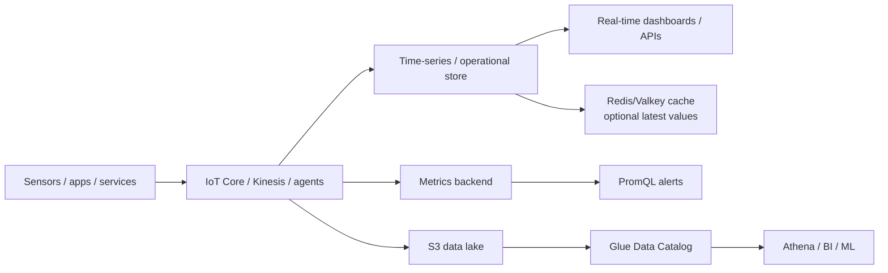
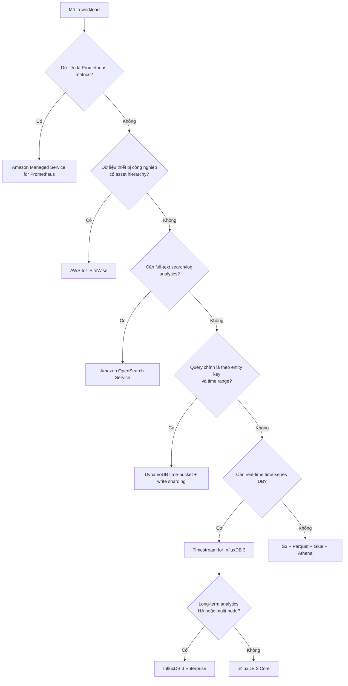
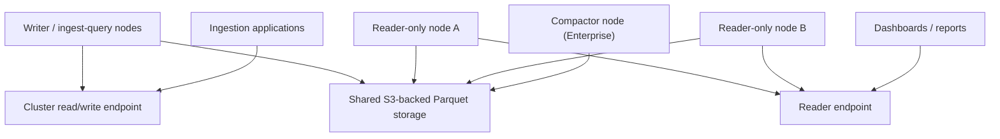
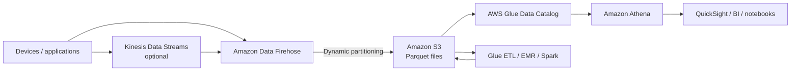
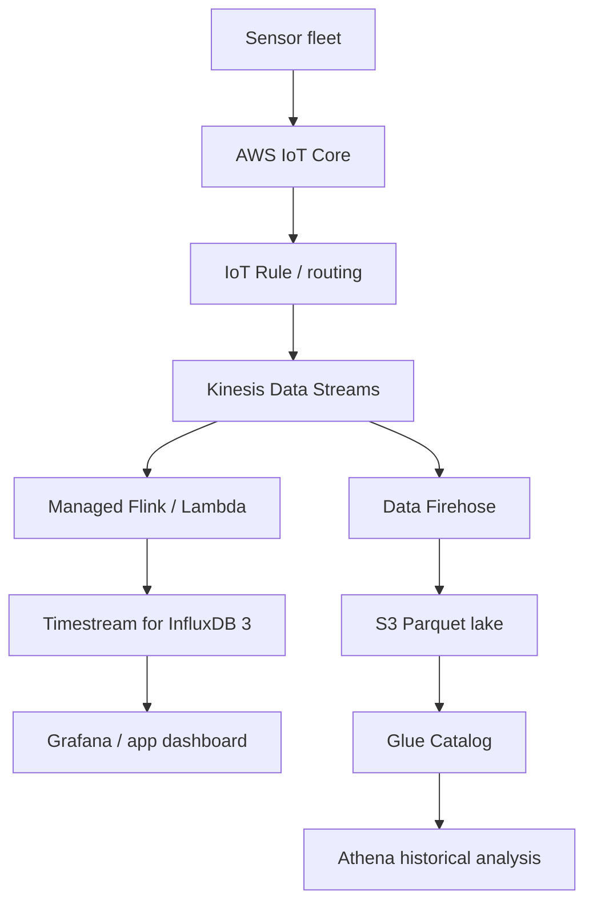
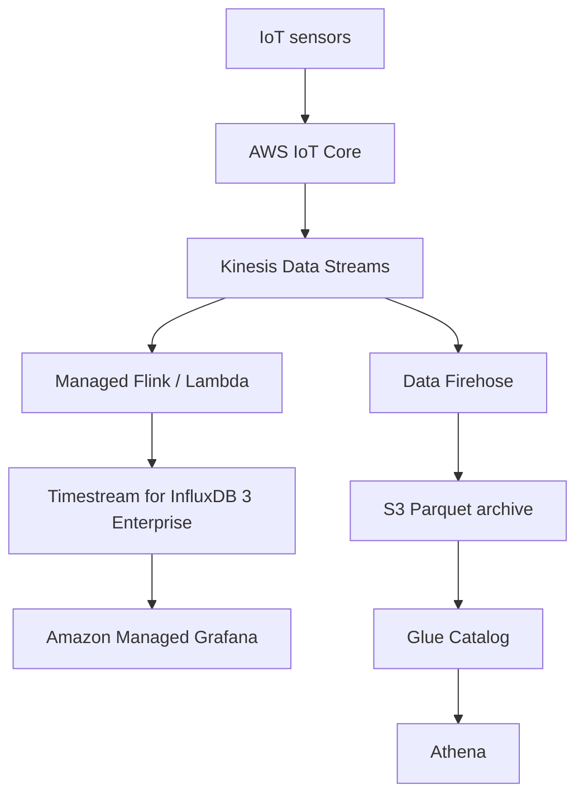
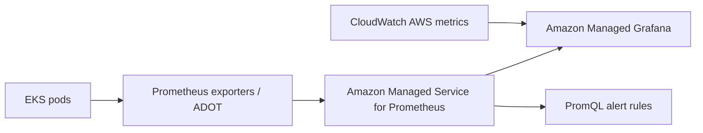
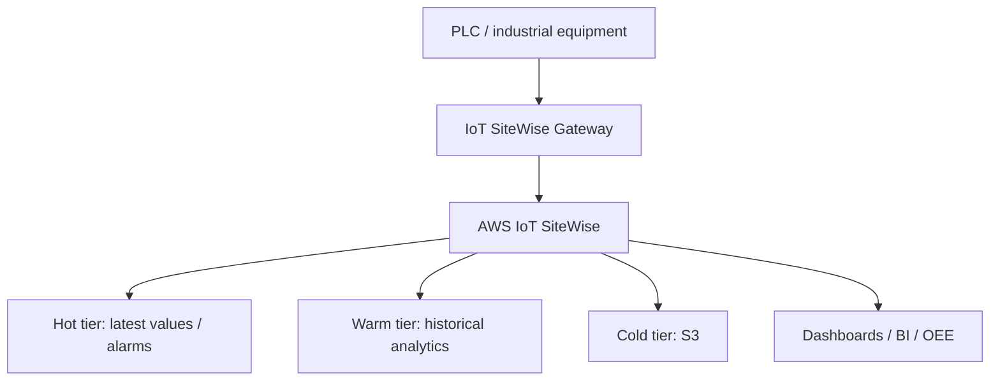
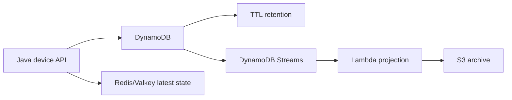
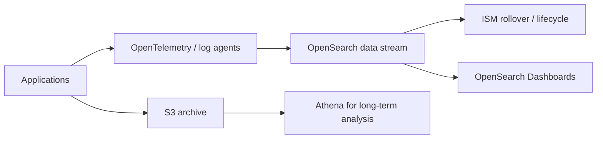

# Đánh giá giải pháp time-series trên AWS theo yêu cầu workload

> **Chương:** Cache và dữ liệu chuyên dụng  
> **Module:** CLOUD_PROVIDERS_AWS  
> **Bối cảnh:** Đánh giá cách thu thập, lưu trữ, truy vấn và phân tích dữ liệu có dấu thời gian trong hệ sinh thái AWS. Người học chọn dịch vụ theo ingestion rate, cardinality, độ trễ, query pattern, retention, availability, security và cost; kết hợp Timestream for InfluxDB, DynamoDB, Amazon Managed Service for Prometheus, AWS IoT SiteWise, OpenSearch, S3, Athena, Glue và các dịch vụ streaming.  
> **Thời điểm tham chiếu:** Nội dung phản ánh tài liệu AWS hiện hành tại ngày 20-11-2026. Availability, feature và giá có thể thay đổi theo Region, engine version và edition; cần xác minh trước khi triển khai.

## Mục tiêu học tập

Sau bài này, người học có thể:

1. Nhận diện workload time-series và phân biệt metric, event, log, sensor measurement, trạng thái hiện tại và dữ liệu giao dịch.
2. Phân tích ingestion rate, burst, series cardinality, late-arriving data, query shape, freshness, retention, consistency, HA và data residency.
3. Đánh giá Amazon Timestream for InfluxDB 3 Core/Enterprise, InfluxDB 2.x managed instance và Timestream for LiveAnalytics theo trạng thái dịch vụ hiện tại.
4. Chọn DynamoDB cho lịch sử theo entity/key access pattern; thiết kế time bucket, write sharding, sort key và TTL để tránh hot partition.
5. Chọn Amazon Managed Service for Prometheus cho metric theo Prometheus model/PromQL và AWS IoT SiteWise cho dữ liệu tài sản công nghiệp.
6. Dùng Amazon OpenSearch Service khi cần full-text search, log exploration và time-based data streams.
7. Dùng Amazon S3 + Data Firehose + Glue + Athena làm data lake cho lịch sử dài hạn, truy vấn phân tích và chi phí lưu trữ thấp.
8. Thiết kế pipeline streaming qua AWS IoT Core, Kinesis Data Streams, Data Firehose, Lambda và lựa chọn đích lưu trữ phù hợp.
9. Xây dựng schema time-series, phân biệt tags/dimensions với fields/measures, tránh cardinality và partition design kém.
10. Viết ví dụ Java gửi line protocol đến Timestream for InfluxDB 3, truy vấn SQL và dùng AWS CLI/IaC để kiểm kê tài nguyên.
11. Thiết kế bảo mật VPC/IAM/KMS, backup/recovery, monitoring, retention, migration và cost model.
12. Đưa ra quyết định có thể kiểm chứng bằng benchmark với dữ liệu, tốc độ ghi và truy vấn gần production.

## 1. Time-series là loại dữ liệu nào?

**Time-series data** là chuỗi điểm dữ liệu gắn với thời điểm hoặc khoảng thời gian. Một điểm thường có:

- **Timestamp:** lúc phép đo hoặc sự kiện xảy ra.
- **Identity/dimensions/tags:** thiết bị, máy chủ, cảm biến, khu vực, tenant, loại tài sản.
- **Measure/fields:** giá trị đo như nhiệt độ, CPU, độ ẩm, áp suất, số request.
- **Context:** nguồn thu thập, schema version, trạng thái chất lượng, sequence hoặc correlation ID.

Ví dụ:

```json
{
  "timestamp": "2026-11-20T03:30:00.125Z",
  "site": "plant-a",
  "deviceId": "sensor-17",
  "sensorType": "temperature",
  "temperatureC": 23.7,
  "humidityPct": 62.1,
  "quality": "GOOD"
}
```

Đây là một sample. Một hệ thống hàng nghìn thiết bị gửi hàng triệu samples mỗi ngày có yêu cầu khác hẳn một ứng dụng chỉ ghi vài nghìn events đơn hàng.

### 1.1 Phân biệt các nhóm dữ liệu gần nhau

| Nhóm dữ liệu | Ví dụ | Đặc điểm chính | Câu hỏi truy vấn điển hình |
|---|---|---|---|
| **Metrics** | CPU, memory, latency, request rate | Thường tổng hợp theo time window, nhiều series | p95 latency trong 5 phút vừa qua? |
| **Sensor measurements** | Nhiệt độ, áp suất, rung động | Có device/asset identity, sample rate và đơn vị đo | Nhiệt độ máy M trong 24 giờ? |
| **Events** | Login, order placed, device state changed | Mỗi record có business meaning; có thể cần exact history | Điều gì xảy ra trước khi thiết bị dừng? |
| **Logs** | Application log, audit log | Text/search/filter, payload không đồng nhất | Tìm mọi lỗi chứa exception X? |
| **Trạng thái hiện tại** | Nhiệt độ mới nhất, trạng thái relay | Chỉ cần last-known value | Giá trị hiện tại của sensor? |
| **Giao dịch** | Order, invoice, payment | ACID/relationship/transaction là trung tâm | Đơn hàng và thanh toán đã commit chưa? |

Một hệ thống có thể cần nhiều mô hình lưu trữ. Ví dụ sensor telemetry lưu ở time-series database, current device status cache trong Redis, business asset metadata ở Aurora, và lịch sử thô dài hạn ở S3.

### 1.2 Một chuỗi dữ liệu không đồng nghĩa một database



Các tầng giải quyết những truy vấn khác nhau:

- **Operational time-series store:** đọc điểm mới, chuỗi ngắn và aggregation gần real-time.
- **Metrics backend:** query và alert theo metric labels/PromQL.
- **Search/log store:** full-text và filter theo field.
- **Data lake/warehouse:** lịch sử dài hạn, joins và phân tích theo nhiều chiều.
- **Cache:** tăng tốc các giá trị thường đọc; không thay thế source of truth.

## 2. Đánh giá workload trước khi chọn dịch vụ

Không bắt đầu bằng câu hỏi “AWS có database time-series nào?”. Hãy mô tả dữ liệu và truy vấn cần chạy.

### 2.1 Ingestion: dữ liệu vào nhanh đến đâu?

Các chỉ số cần ước lượng:

- Số nguồn gửi dữ liệu: devices, servers, tenants.
- Số points mỗi nguồn mỗi giây.
- Kích thước trung bình của một point/batch.
- Write rate bình quân, peak và burst duration.
- Số lần retry, duplicate và late arrivals.
- Có thể batch hay phải ghi từng point ngay lập tức?

Ví dụ: 20.000 thiết bị, mỗi thiết bị gửi 1 point/giây tạo khoảng **20.000 points/giây**. Nếu một thiết bị gửi 100 measurements cùng timestamp, multi-measure/batch write có thể giảm request overhead tùy engine.

### 2.2 Cardinality: có bao nhiêu chuỗi khác nhau?

**Cardinality** phụ thuộc tổ hợp identifying attributes. Ví dụ:

```text
site × deviceId × sensorType × firmwareVersion
  = số tổ hợp tag/dimension có thể tạo series
```

Cardinality tăng nhanh khi đưa vào dimension những giá trị gần như duy nhất:

- request ID,
- session ID,
- random UUID,
- hash theo từng event,
- timestamp được biến thành tag,
- user ID nếu mỗi user chỉ xuất hiện một lần.

Với InfluxDB 2.x, high series cardinality có thể làm tăng index/memory và giảm ingestion/query performance. InfluxDB 3 được thiết kế tốt hơn cho high-cardinality analytical workloads nhờ columnar storage, nhưng vẫn nên giữ schema gọn và tags có ý nghĩa. Với Prometheus, label cardinality cao làm tăng số time series, ingestion/storage cost và độ phức tạp truy vấn.

### 2.3 Query pattern: người dùng cần hỏi gì?

| Query pattern | Ví dụ | Ảnh hưởng tới lựa chọn |
|---|---|---|
| **Last value** | Nhiệt độ mới nhất của sensor-17 | Cache/index cho latest value hoặc time-series last-value query |
| **Time range** | Samples của sensor trong 6 giờ | Time partition/index và timestamp filtering |
| **Aggregation** | Trung bình mỗi 5 phút theo site | Time-series SQL/PromQL/rollup |
| **Group by dimensions** | CPU theo service, AZ, cluster | Cardinality và indexing |
| **High-cardinality analytics** | Phân tích hàng triệu device IDs trong nhiều tháng | Engine columnar/analytical hoặc data lake |
| **Full-text search** | Tìm log có “connection reset” | OpenSearch |
| **Relational joins** | Ghép telemetry với order/customer/asset metadata | Data warehouse/lake/relational DB |
| **Exact point lookup** | Đọc trạng thái thiết bị theo key | DynamoDB/Redis/relational lookup |
| **Alerting** | CPU > 90% liên tục 5 phút | Prometheus/CloudWatch/IoT SiteWise alarms |

### 2.4 Freshness, late data và ordering

Cần trả lời:

- Dữ liệu mới phải query được trong milliseconds, seconds hay minutes?
- Sensor mất mạng 3 giờ rồi gửi bù; hệ thống có nhận late data không?
- Timestamp do device gửi có đáng tin không? Có clock skew?
- Cùng một point có thể gửi trùng? Có sequence/version?
- Có cần thứ tự tuyệt đối không, hay chấp nhận event đến trễ?
- Dashboard có cần latest sample chính xác hay chấp nhận eventual consistency?

Không dùng ingestion time thay event time nếu phân tích dựa trên lúc sự kiện thực sự xảy ra. Nên lưu cả hai khi cần audit/late-arrival analysis.

### 2.5 Retention và data lifecycle

Phân chia dữ liệu theo giá trị sử dụng:

- **Hot:** vài phút/ngày gần nhất, truy vấn thường xuyên, độ trễ thấp.
- **Warm:** tuần/tháng, dashboard lịch sử và điều tra.
- **Cold/archive:** nhiều tháng/năm, hiếm truy vấn, tối ưu chi phí.
- **Derived/rollup:** dữ liệu tổng hợp theo phút/giờ/ngày để dashboard không phải scan toàn bộ raw samples.

Retention phải gắn với yêu cầu compliance, dữ liệu cá nhân, khả năng replay và chi phí. TTL hay lifecycle expiration không thay thế policy kiểm tra quyền truy cập ngay lập tức; data đã hết hạn về nghiệp vụ có thể vẫn còn tồn tại trước khi background deletion hoàn tất.

### 2.6 Availability, security và data residency

- Workload có cần Multi-AZ/automatic failover?
- Có cần query reader tách khỏi ingestion writer?
- Có yêu cầu private networking, KMS customer-managed key, TLS?
- Có được phép đưa dữ liệu ra khỏi Region không?
- Khi service hoặc Region gặp sự cố, RPO/RTO là bao nhiêu?
- Có cần audit trail bất biến hay chỉ cần dữ liệu vận hành?

### 2.7 Workload profile mẫu

| Profile | Ingestion | Query | Retention | Gợi ý ban đầu |
|---|---:|---|---|---|
| 5.000 sensors, last-value dashboard | Trung bình | Latest + 1h | 7 ngày hot | InfluxDB 3 Core hoặc Enterprise theo HA |
| Hàng triệu metrics từ EKS | Cao | PromQL, alert, group by labels | 150 ngày–3 năm | Amazon Managed Service for Prometheus |
| Dây chuyền công nghiệp | Trung bình/cao | Theo asset hierarchy, transform, aggregate | Nhiều tier | AWS IoT SiteWise |
| Application logs + text search | Cao | Full-text + filters + time range | Theo index lifecycle | OpenSearch data streams |
| Event history theo từng device | Thấp/trung bình | Query theo device + time range | 30–365 ngày | DynamoDB với time bucket/sharding |
| Raw telemetry hàng năm, phân tích batch | Rất cao | Scan theo ngày/tenant, BI | Nhiều năm | S3 + Parquet + Glue + Athena |
| Metrics mới và historical analytics | Cao | Real-time + multi-month queries | Nhiều tháng/năm | InfluxDB 3 Enterprise + S3 lake/rollups |

## 3. Bản đồ lựa chọn các dịch vụ AWS

### 3.1 Decision matrix

| Dịch vụ | Điểm mạnh | Chọn khi | Không phải lựa chọn chính khi |
|---|---|---|---|
| **Amazon Timestream for InfluxDB 3 Core** | Managed InfluxDB 3, S3-backed Parquet, SQL/InfluxQL, near-real-time queries | Dev/test hoặc monitoring gần real-time với dữ liệu gần đây và single-node đáp ứng HA | Cần multi-node, compaction hoặc phân tích lịch sử dài hạn |
| **Amazon Timestream for InfluxDB 3 Enterprise** | Compaction, multi-node, read-only nodes, HA, long-term analytics | High-cardinality telemetry, dashboard + historical query, production | Workload chỉ là Prometheus metrics hoặc full-text log search |
| **Amazon Timestream for InfluxDB 2.x** | Tương thích InfluxDB 2.7 APIs/clients/Flux, managed instance | Đang có ứng dụng v2 cần tương thích, migration ít thay đổi | Thiết kế mới cần kiến trúc InfluxDB 3 hoặc analytical storage decoupled |
| **Timestream for LiveAnalytics** | Serverless, memory/magnetic tiers, SQL time-series analytics | Chỉ tài khoản khách hàng hiện hữu đủ điều kiện | Khách hàng mới không thể đăng ký service này |
| **DynamoDB** | Key-value access, predictable low-latency lookup, TTL, Streams | Lịch sử theo device/entity với query theo key và time range | Ad-hoc analytical scan, complex time-window aggregations |
| **Amazon Managed Service for Prometheus** | Prometheus data model, PromQL, serverless ingestion/query, alerting | Metrics từ EKS/Kubernetes và Prometheus exporters | Raw business events, arbitrary sensor documents hoặc full-text logs |
| **AWS IoT SiteWise** | Asset model, measurements, transforms, metrics, storage tiers | Industrial equipment, plant/factory asset hierarchy | Generic logs/metrics không cần industrial asset model |
| **Amazon OpenSearch Service** | Full-text search, filters, aggregations, data streams, ISM | Logs, traces, searchable telemetry documents | Nơi lưu mọi raw sample dài hạn với chi phí thấp nhất |
| **Amazon S3 + Glue + Athena** | Durable data lake, Parquet, SQL analytics, lifecycle | Lịch sử dài hạn, batch analytics, data science | Last-value API cần phản hồi milliseconds |
| **Amazon Redshift** | Warehouse analytics, joins, BI và large-scale aggregations | Time-series kết hợp sales/customer/finance dimensions | Primary high-frequency write path của từng sensor |
| **Aurora/RDS** | Relational transactions, SQL joins, constraints | Time-series volume vừa phải và relational/business transaction là trung tâm | High-ingestion telemetry có retention rất dài |
| **ElastiCache Redis/Valkey** | In-memory latest value/cache | Giữ last-known sample hoặc aggregate đọc thường xuyên | Durable time-series source of truth |

### 3.2 Decision tree



Sơ đồ là cách sàng lọc ban đầu. Một workload lớn có thể cần hai đích lưu trữ: database hot để phục vụ API/dashboard và S3 data lake để giữ raw history.

## 4. Timestream for InfluxDB 3: lựa chọn time-series managed hiện hành

Amazon Timestream for InfluxDB 3 là dịch vụ managed chạy InfluxDB 3 trên AWS, phù hợp ứng dụng/devops cần thu thập và phân tích time-series, high-cardinality data và các truy vấn phân tích phức tạp.

Kiến trúc InfluxDB 3 khác InfluxDB 1.x/2.x:

- **Apache Arrow** cho xử lý dữ liệu trong bộ nhớ.
- **Apache DataFusion** cho query execution.
- **Apache Parquet** làm columnar storage format.
- **Amazon S3** lưu dữ liệu bền, tách compute khỏi storage.
- Có thể scale compute nodes theo ingestion/query workload.

AWS công bố InfluxDB 3 trên Timestream ngày **16-10-2025**. Đây là nhánh sản phẩm cần đánh giá cho thiết kế mới; không nhầm với Timestream for LiveAnalytics hoặc engine InfluxDB 2.x.

### 4.1 Core và Enterprise

| Đặc điểm | InfluxDB 3 Core | InfluxDB 3 Enterprise |
|---|---|---|
| Deployment | Single-node | Single-node hoặc multi-node |
| Compaction | Không có | Có |
| Multi-node/reader-only nodes | Không | Có |
| High availability | Một node; không có multi-node failover topology | Multi-node phân bố qua AZ theo cấu hình |
| Historical analytics | Chủ yếu dữ liệu gần đây, thường vài ngày | Hỗ trợ lịch sử dài hạn với compaction/indexing |
| Phù hợp | Dev/test, POC, recent monitoring, cost-sensitive | Production, HA, high ingest/query concurrency, long-term analytics |
| Scale | Vertical/single-node limits | Vertical và horizontal tới 15 nodes theo giới hạn hiện hành |

**Core không có compaction**. Các Parquet files nhỏ tích lũy theo thời gian có thể khiến truy vấn dữ liệu cũ chậm dần. Không chọn Core làm kho phân tích nhiều tháng/năm chỉ vì nó có S3 storage.

Enterprise có các khả năng bổ sung:

- Compaction để tối ưu tổ chức Parquet files.
- Writer/reader nodes cho ingestion và query.
- Reader-only nodes để tách tải dashboard/reporting.
- Multi-node deployment phân bố qua nhiều Availability Zones.
- Hỗ trợ phân tích lịch sử dài hạn.

Với multi-node Enterprise hiện hành, cluster có tối đa **15 nodes**; cấu hình có 1–4 writer/reader nodes, 0–13 reader-only nodes và compactor node theo topology hỗ trợ. Không cộng tối đa từng loại một cách độc lập nếu tổng nodes vượt 15.

### 4.2 Tách compute khỏi storage



Lợi ích:

- Tăng compute/query capacity không phải nhân bản toàn bộ data volume như kiến trúc database instance storage truyền thống.
- S3 cung cấp durable object storage cho Parquet.
- Reader nodes có thể tăng khi dashboard/reporting concurrency tăng.
- Compactor làm việc nền để tổ chức files, giữ query performance trên lịch sử.

Tuy vậy, storage “virtually unlimited” không đồng nghĩa miễn phí hoặc không có giới hạn dịch vụ. Bạn vẫn trả chi phí S3 storage, compute nodes, data transfer và những tài nguyên phụ trợ theo bảng giá.

### 4.3 Cluster endpoint và reader endpoint

| Endpoint | Quyền thao tác | Dùng cho |
|---|---|---|
| **Cluster read/write endpoint** | Read + write, định tuyến tới writer nodes | Ingestion, admin và query cần endpoint chính |
| **Reader endpoint** | Read-only, phân phối truy vấn tới reader nodes | Dashboard, reporting, ad-hoc queries |
| **Node-specific endpoint** | Truy cập trực tiếp một node | Diagnostics/workload đặc biệt, không khuyến nghị production |

Không gửi write request tới reader endpoint. Dùng cluster-level endpoints để được định tuyến/failover theo thiết kế dịch vụ; tránh hardcode node-specific endpoint trong application.

### 4.4 Khu vực và networking

Timestream for InfluxDB 3 được cung cấp ở các Regions nơi Timestream for InfluxDB hỗ trợ. Danh sách endpoint hiện hành bao gồm **Asia Pacific (Singapore) — ap-southeast-1**. Luôn kiểm tra lại bảng Region trước khi provisioning.

Đối với private cluster:

- Chọn VPC/subnets và security groups theo yêu cầu dịch vụ.
- Cho phép app kết nối đúng port InfluxDB (mặc định **8086**) từ application security group.
- Private cluster cần cấu hình S3 access/network policies được dịch vụ yêu cầu.
- Không mở database port ra toàn Internet.
- Sử dụng TLS và token authentication; AWS control-plane IAM permissions không thay thế token permissions của InfluxDB data plane.

### 4.5 InfluxDB 3 line protocol

Một point có cấu trúc:

```text
table_name,tag1=value1,tag2=value2 field1=23.7,field2=62.1 timestamp
```

Ví dụ:

```text
sensor_metrics,site=plant-a,device_id=sensor-17 temperature_c=23.7,humidity_pct=62.1 1795140000
```

Giải thích:

- sensor_metrics: table/measurement name.
- site, device_id: **tags**, lưu metadata dạng string, dùng filter/grouping.
- temperature_c, humidity_pct: **fields**, chứa measured values.
- 1795140000: timestamp Unix epoch seconds vì ví dụ write API sẽ chỉ định precision s.

Trong InfluxDB 3, database chứa các tables; tags và fields là columns của table. Primary key của row là tổ hợp timestamp và tag set (các tags null không nằm trong key).

### 4.6 Tags và fields: mô hình đúng

| Thuộc tính | Tags | Fields |
|---|---|---|
| Dùng để | Mô tả/nhận diện nguồn dữ liệu, filter và group | Giá trị đo hoặc thuộc tính biến thiên |
| Kiểu dữ liệu | String | Integer, unsigned integer, float, string, boolean |
| Index/query | Được dùng làm metadata keys | Không được index giống tags |
| Ví dụ | site, device_id, sensor_type, az | temperature_c, pressure_kpa, cpu_pct |

Quy tắc:

- Đặt tags cho thuộc tính thường dùng trong WHERE/GROUP BY.
- Đặt fields cho giá trị đo, payload biến thiên hoặc giá trị không cần index.
- Không dùng cùng một tên cho tag và field trong cùng table.
- Giữ schema đồng nhất; tránh mỗi thiết bị tự tạo bộ fields không liên quan làm table quá rộng/sparse.
- Sắp xếp tags theo mức ưu tiên truy vấn khi thiết kế schema ban đầu; thứ tự cột vật lý có thể được xác định từ lần ghi đầu tiên.
- Chọn timestamp precision thô nhất vẫn đáp ứng yêu cầu để giảm độ phức tạp và dữ liệu không cần thiết.

InfluxDB 3 cải thiện xử lý high-cardinality, nhưng không có nghĩa nên biến mọi request ID/hash/random UUID thành tags. Tag cardinality vẫn tác động đến kích thước index, cache, memory và query planning.

### 4.7 Batch writes và durability

AWS hướng dẫn các best practices cho InfluxDB 3:

- Batch khoảng **5.000–10.000 lines** hoặc tới khoảng **10 MB/request** theo workload.
- Dùng gzip khi payload lớn.
- Sort tags theo key lexicographic.
- Dùng timestamp precision nhất quán.
- Retry các lỗi tạm thời với backoff/jitter.
- Theo dõi partial write errors và metrics.
- no_sync=false đợi dữ liệu được ghi vào WAL trước khi acknowledge, phù hợp dữ liệu quan trọng.
- no_sync=true acknowledge sớm hơn nhưng có rủi ro mất dữ liệu nếu hệ thống lỗi trước khi WAL persistence hoàn tất.

Với accept_partial=true, batch có thể ghi những lines hợp lệ và trả lỗi cho lines không hợp lệ. Producer phải parse response/failed lines và có cơ chế retry riêng cho phần lỗi; không đánh dấu cả batch thành công chỉ vì một phần được ghi.

## 5. InfluxDB 2.x managed và Timestream for LiveAnalytics: phân biệt trạng thái sản phẩm

### 5.1 Timestream for InfluxDB 2.x

Dịch vụ managed instance hỗ trợ InfluxDB **2.7**, phù hợp khi đang có ứng dụng InfluxDB 2.x cần giữ APIs/client libraries/Flux/Telegraf integration.

Đặc điểm đáng chú ý:

- Managed DB instance với compute class và storage provisioned.
- Instance class memory-optimized cho InfluxDB workloads.
- Hỗ trợ một số lựa chọn Influx IOPS Included storage.
- Storage instance tối đa theo docs hiện hành khoảng **16 TiB**.
- Multi-AZ deployment tạo primary và standby ở AZ khác để failover.
- Backup tự động, cập nhật phần mềm, VPC security group và TLS.
- Port mặc định 8086.

Khi thiết kế mới, so sánh InfluxDB 2.x với InfluxDB 3 thay vì mặc định chọn engine 2.x. InfluxDB 3 có kiến trúc storage/query mới; code cũ có thể dùng compatibility APIs, nhưng phải kiểm tra khác biệt về schema, data types, query language và behavior trước migration.

### 5.2 Timestream for LiveAnalytics

Amazon Timestream for LiveAnalytics là database time-series serverless cũ với:

- **Memory store:** tối ưu ingest và point-in-time queries trên dữ liệu gần đây.
- **Magnetic store:** tối ưu dữ liệu lịch sử và analytical queries.
- SQL có extension cho time-series.
- Retention policy riêng cho memory/magnetic store.
- Scheduled queries để tạo rollups/derived tables.

**Thay đổi availability:** AWS đóng quyền truy cập khách hàng mới vào Timestream for LiveAnalytics từ **20-06-2025**. Workloads hiện hữu trong payer account đủ điều kiện vẫn tiếp tục sử dụng và có thể thêm users/linked accounts theo quy định AWS. Khách hàng mới cần đánh giá Timestream for InfluxDB thay thế.

Không thiết kế kiến trúc mới cho một Account chưa có quyền LiveAnalytics bằng cách giả định có thể tạo service. Nếu vận hành hệ thống cũ, cần có migration/exit strategy và theo dõi thay đổi AWS.

### 5.3 So sánh ba lựa chọn Timestream

| Tiêu chí | InfluxDB 3 | InfluxDB 2.x | LiveAnalytics |
|---|---|---|---|
| Customer onboarding mới | Có | Managed service theo Region hỗ trợ | Đã đóng khách hàng mới từ 2025-06-20 |
| Data architecture | Parquet trên S3, compute tách storage | Instance + provisioned storage | Serverless, memory/magnetic tiers |
| Query | SQL, InfluxQL; APIs/Flight | Flux/Influx APIs theo engine | SQL time-series |
| Scale | Core single-node; Enterprise multi-node | Vertical DB instance/Multi-AZ | Ingestion/storage/query serverless |
| Best fit | High cardinality + analytics + time-series production | Tương thích workload InfluxDB 2.7 | Workloads hiện hữu, large-scale serverless analytics |

## 6. DynamoDB cho time-series theo entity access pattern

DynamoDB không phải time-series engine chuyên dụng như InfluxDB, nhưng phù hợp nếu câu hỏi chủ yếu là **lấy lịch sử của một entity/device trong khoảng thời gian**.

Ví dụ:

- API đọc 100 samples gần nhất của một sensor.
- Lấy trạng thái gần nhất của từng device.
- Query lịch sử theo customer/device và time range.
- Ghi events với throughput lớn, cần key-based access và TTL.

### 6.1 Thiết kế partition key và sort key

Một mô hình đơn giản:

```text
PK = DEVICE#sensor-17#DAY#2026-11-20
SK = 2026-11-20T03:30:00.125Z#event-001
expiresAt = 1796000000
```

- PK nhóm samples của cùng thiết bị theo ngày.
- SK sắp xếp theo timestamp và event ID để phân biệt records cùng thời điểm.
- expiresAt là Unix epoch seconds nếu dùng TTL.

DynamoDB Query yêu cầu partition key equality và có thể giới hạn sort key theo range. Đây là mô hình phù hợp với truy vấn theo device/day.

### 6.2 Hot partition và write sharding

Nếu một device gửi hàng chục nghìn events/giây, mọi writes vào một partition key duy nhất có thể tạo hot partition. Có thể thêm shard suffix:

```text
PK = DEVICE#sensor-17#DAY#2026-11-20#SHARD#03
SK = 2026-11-20T03:30:00.125Z#event-001
```

Producer xác định shard bằng hash của event ID hoặc routing key ổn định:

```java
int shard = Math.floorMod(eventId.hashCode(), SHARD_COUNT);
String partitionKey = "DEVICE#" + deviceId
    + "#DAY#" + utcDate
    + "#SHARD#" + String.format("%02d", shard);
```

Khi query lịch sử, ứng dụng phải query các shards liên quan rồi merge/sort theo timestamp. Đây là trade-off giữa write throughput và read complexity.

Nếu một entity không có write rate cao, đừng thêm shard chỉ vì nghĩ sharding luôn tốt hơn. Nó làm tăng số Query requests, merge work và chi phí.

### 6.3 Time bucketing

Không nên giữ toàn bộ lịch sử nhiều năm của một thiết bị trong một partition key. Dùng time buckets:

- Theo giờ nếu write rate rất cao và query thường ngắn.
- Theo ngày cho telemetry thông thường.
- Theo tháng nếu volume thấp và query dài.
- Theo tenant/device group nếu access pattern phù hợp.

Time bucket giúp giới hạn kích thước item collection và tránh partition key nóng kéo dài.

### 6.4 TTL và retention

DynamoDB TTL cần một attribute kiểu **Number** chứa Unix epoch seconds. Ví dụ:

```json
{
  "PK": {"S": "DEVICE#sensor-17#DAY#2026-11-20#SHARD#03"},
  "SK": {"S": "2026-11-20T03:30:00.125Z#event-001"},
  "temperatureC": {"N": "23.7"},
  "expiresAt": {"N": "1796000000"}
}
```

TTL xóa bất đồng bộ; item hết hạn có thể vẫn được trả về trong lúc chờ background deletion. Nếu API không được phép trả dữ liệu đã hết hạn, phải kiểm tra expiresAt trong application. TTL không phải scheduler và không thay backup/archival.

### 6.5 Khi nào DynamoDB không phù hợp?

- Phải query nhiều thiết bị theo một khoảng thời gian rộng mà không có partition keys phù hợp.
- Cần ad-hoc group-by nhiều dimensions.
- Cần quét nhiều TB raw data để phân tích.
- Cần full-text search hoặc SQL joins phức tạp.
- Mỗi lần query phải fan-out hàng trăm shards và merge lớn.

Trong các trường hợp này, xem InfluxDB 3, OpenSearch, Prometheus hoặc S3/Athena tùy mục tiêu.

## 7. Amazon Managed Service for Prometheus cho metrics

Amazon Managed Service for Prometheus (AMP) là dịch vụ monitoring tương thích Prometheus, phù hợp cho metrics từ:

- Amazon EKS.
- Self-managed Kubernetes.
- Prometheus exporters và OpenTelemetry collectors.
- Application/service metrics theo Prometheus data model.

### 7.1 Khi nào chọn AMP?

Chọn AMP khi đội vận hành đã dùng:

- Prometheus scrape/remote write.
- PromQL cho filtering, aggregation và alerting.
- Metric labels như cluster, namespace, pod, service, region.
- Grafana dashboards và alert rules.

AMP tự scale ingestion/storage/query và triển khai Multi-AZ. Theo tài liệu hiện hành, metrics retention mặc định **150 ngày**, có thể cấu hình tối đa **1.095 ngày (3 năm)**.

### 7.2 Cardinality trong Prometheus

Một metric có labels:

```text
http_requests_total{
  service="orders",
  method="POST",
  status="200",
  route="/orders"
}
```

Nếu thêm label request_id hoặc user_id duy nhất cho mỗi request, số time series có thể tăng theo lượng request. Điều này làm tăng ingestion, storage và query cost.

Không đưa các giá trị thay đổi liên tục/unique vào labels chỉ vì muốn filter. Dùng logs/traces hoặc event store cho dữ liệu có độ phân giải cao theo từng request.

### 7.3 Ví dụ PromQL

```promql
sum by (service) (
  rate(http_requests_total[5m])
)
```

Tính request rate theo service trong cửa sổ 5 phút.

```promql
histogram_quantile(
  0.95,
  sum by (le, service) (
    rate(http_request_duration_seconds_bucket[5m])
  )
)
```

Ước lượng p95 latency theo service từ histogram buckets.

### 7.4 AMP không phải log search database

AMP tập trung vào metric samples và PromQL. Nếu cần tìm một log line, stack trace, message text hoặc event document theo full-text, dùng OpenSearch hoặc log analytics. Không ép logs vào Prometheus labels.

## 8. AWS IoT SiteWise cho dữ liệu tài sản công nghiệp

AWS IoT SiteWise phù hợp khi dữ liệu không chỉ là sensor samples rời rạc mà còn có **asset hierarchy**:

```text
Plant
  └── Production line
       └── Machine
            ├── Motor
            │    ├── temperature measurement
            │    └── vibration measurement
            └── Pump
                 ├── pressure measurement
                 └── flow measurement
```

### 8.1 Các loại asset properties

| Property type | Ý nghĩa | Ví dụ |
|---|---|---|
| **Attribute** | Thuộc tính tương đối tĩnh | Manufacturer, serial number, rated power |
| **Measurement** | Dữ liệu thô từ thiết bị | RPM, temperature, pressure |
| **Transform** | Giá trị được tính từ measurements | °F từ °C, normalized vibration |
| **Metric** | Aggregates theo khoảng thời gian | Average temperature mỗi giờ, OEE |

### 8.2 Storage tiers

AWS IoT SiteWise hỗ trợ nhiều tầng:

- **Hot tier:** low-latency, frequently accessed measurements và latest values.
- **Warm tier:** lịch sử có chi phí hiệu quả hơn, phục vụ analytics/BI và báo cáo.
- **Cold tier:** dữ liệu ít truy cập lưu trong Amazon S3; replication theo chu kỳ (tài liệu mô tả khoảng mỗi 6 giờ).

Cần thiết kế retention cho từng tier. Khi giảm retention, dữ liệu có thể bị chuyển/xóa theo policy; tăng retention không tự kéo ngược dữ liệu từ cold/warm về hot.

### 8.3 Aggregates tự động

SiteWise có thể tính các aggregate cơ bản theo khoảng thời gian phút/giờ/ngày cho asset properties numeric:

- average,
- count,
- minimum,
- maximum,
- standard deviation,
- sum.

Chọn SiteWise khi mô hình asset/industrial operations là trung tâm. Nếu chỉ cần metrics server/CPU cho EKS, AMP phù hợp hơn.

## 9. Amazon OpenSearch Service cho time-based search

OpenSearch là search/analytics engine, không phải lựa chọn mặc định cho mọi time-series sample.

Nó phù hợp khi mỗi record là document có timestamp và bạn cần:

- Full-text search.
- Filter theo nhiều fields.
- Aggregations theo time buckets.
- Log/trace exploration.
- Dashboard và điều tra sự cố.

### 9.1 Data streams

OpenSearch data stream gồm nhiều backing indices:

- Indexing requests ghi vào write index mới nhất.
- Search requests truy vấn qua các backing indices.
- Mỗi document cần trường timestamp, mặc định @timestamp hoặc field đã cấu hình.
- Index template định nghĩa mappings/settings.
- Index State Management (ISM) có thể tự động rollover backing indices.

Ví dụ template:

```json
PUT _index_template/telemetry-logs-template
{
  "index_patterns": ["telemetry-logs-*"],
  "data_stream": {},
  "priority": 100,
  "template": {
    "mappings": {
      "properties": {
        "@timestamp": {"type": "date"},
        "service": {"type": "keyword"},
        "device_id": {"type": "keyword"},
        "message": {"type": "text"},
        "temperature_c": {"type": "float"}
      }
    }
  }
}
```

Sau khi tạo template phù hợp, có thể index document vào data stream:

```json
POST telemetry-logs-prod/_doc
{
  "@timestamp": "2026-11-20T03:30:00Z",
  "service": "sensor-ingestor",
  "device_id": "sensor-17",
  "message": "temperature threshold warning",
  "temperature_c": 84.2
}
```

### 9.2 Khi nào OpenSearch tốn kém?

- Indexing mọi raw sample với rất nhiều fields.
- Giữ mọi indices ở hot storage lâu dài.
- Không rollover, không lifecycle, không shard sizing.
- Tạo mappings động quá rộng.
- Dùng text index cho dữ liệu chỉ cần aggregate số học.

Dùng ISM, rollover, replicas, hot/warm/cold tiers và retention theo nhu cầu. Trước khi chọn OpenSearch làm primary time-series store, benchmark indexing throughput, search latency, shard count, heap, storage và query concurrency.

## 10. S3 + Data Firehose + Glue + Athena cho lịch sử dài hạn

Khi mục tiêu là giữ hàng tháng/năm dữ liệu và chạy phân tích theo batch, **S3 data lake** thường có economics tốt hơn việc giữ mọi raw points trong một database hot.

### 10.1 Kiến trúc data lake



Vai trò:

- **Kinesis Data Streams:** stream ingestion, multiple consumers, buffering/replay theo retention cấu hình.
- **Amazon Data Firehose:** managed delivery/buffering/transform tới destinations như S3; dynamic partitioning hỗ trợ S3 destination.
- **S3:** durable data lake, lifecycle, versioning, access control.
- **Glue Data Catalog:** metadata/schema.
- **Athena:** serverless SQL query trên dữ liệu S3.
- **Glue/EMR:** ETL, compaction, convert JSON/CSV sang Parquet.

### 10.2 Partition strategy

Một cấu trúc hợp lý:

```text
s3://company-telemetry/
  source=iot/
    region=ap-southeast-1/
      year=2026/
        month=11/
          day=20/
            hour=03/
              part-0001.parquet
```

Partition theo các keys thường được dùng để filter và có cardinality vừa phải:

- date/time buckets,
- region,
- source type,
- site/tenant nếu số lượng vừa phải và query thường filter theo đó.

Tránh partition trực tiếp theo device_id nếu có hàng triệu devices, vì có thể tạo quá nhiều prefixes/partitions và file nhỏ.

### 10.3 Parquet và file sizing

- Dùng Parquet/columnar format thay vì giữ toàn bộ JSON nếu query phân tích cột.
- Compress để giảm storage và scan bytes.
- Compaction để tránh hàng triệu small files.
- Tổ chức schema ổn định và schema evolution có version.
- Dùng partition pruning để Athena scan ít dữ liệu hơn.
- Với partition paths dự đoán được và nhiều partitions, cân nhắc Athena partition projection; hiểu rằng projected partitions không tồn tại trong S3 vẫn có thể được query planner xét.

### 10.4 Firehose dynamic partitioning

Firehose có thể dùng keys trong records để phân phối dữ liệu vào S3 prefixes. Ví dụ:

```text
!{timestamp:yyyy/MM/dd/HH}/site=!{partitionKeyFromQuery:site}/
```

Dynamic partitioning chỉ hỗ trợ S3 destinations; phải bật khi tạo Firehose stream, không thể bật lại cho stream đã tạo mà chưa bật feature. Nó có buffering theo partition nên end-to-end latency không phải zero.

**Không dùng quá nhiều partition keys high-cardinality**: active partitions/buffering có giới hạn và dễ tạo nhiều small objects.

### 10.5 Athena query ví dụ

```sql
SELECT
    site,
    device_id,
    AVG(temperature_c) AS avg_temperature,
    MAX(temperature_c) AS max_temperature
FROM telemetry_samples
WHERE year = '2026'
  AND month = '11'
  AND day = '20'
  AND site = 'plant-a'
GROUP BY site, device_id
ORDER BY max_temperature DESC;
```

Partition predicates giúp giảm scan nếu Glue/Athena table được cấu hình đúng. Luôn xem query execution statistics và data scanned; một câu SQL đơn giản vẫn có thể tốn kém nếu quét nhiều TB.

## 11. Ingestion pipeline: chọn cách đưa dữ liệu vào

| Nguồn | Ingestion option | Khi phù hợp |
|---|---|---|
| IoT devices | AWS IoT Core rules | Device identity, MQTT topics, routing theo rule |
| High-throughput event streams | Kinesis Data Streams | Nhiều consumers, stream processing, replay |
| Managed delivery to S3 | Data Firehose | Buffer/transform/dynamic partitioning, giảm vận hành |
| Kubernetes metrics | Prometheus scraper / ADOT | Remote write đến AMP |
| Industrial equipment | IoT SiteWise gateways | OPC-UA/industrial protocol và asset model |
| Java application | AWS SDK / HTTP API | Gửi events trực tiếp tới database/API |
| Batch historical import | S3 + batch load/ETL | Backfill, migration, replay |

### 11.1 Decouple ingestion khỏi query workloads

Một pipeline:



Không phải mọi workload cần cả Kinesis, Lambda, Firehose và Flink. Mỗi tầng thêm latency, retries, failure modes và cost. Dùng direct ingestion nếu đơn giản và đủ capacity; thêm stream bus khi cần buffering, multiple consumers, replay hoặc stream transformations.

### 11.2 Duplicate và idempotency

Producer có thể retry khi không biết server đã nhận request hay chưa. Với time-series, hai writes cùng timestamp + tag set có thể có semantics overwrite/upsert theo engine, không nên mặc định mỗi retry tạo một sample mới.

Thiết kế:

- event_id hoặc sequence_number ổn định trong fields/metadata khi cần audit.
- Dùng deterministic timestamp và tags.
- Có deduplication ở ingestion layer nếu downstream side effects không idempotent.
- Xử lý late-arriving data theo policy.
- Theo dõi write rejects, partial failures và retry queue.

## 12. Thiết kế schema và data lifecycle

### 12.1 Đặt timestamp đúng nghĩa

Lưu timestamp theo **event time** (khi sample xảy ra) nếu cần phân tích vận hành. Có thể bổ sung ingested_at làm field để đo delay/late arrival.

Ví dụ:

```json
{
  "event_time": "2026-11-20T03:30:00Z",
  "ingested_at": "2026-11-20T03:30:03Z",
  "device_id": "sensor-17",
  "temperature_c": 23.7
}
```

Nếu chỉ có một timestamp, xác định rõ đó là event time hay ingestion time trong schema contract.

### 12.2 Tags/dimensions không phải fields

Ví dụ InfluxDB:

```text
sensor_metrics,site=plant-a,device_id=sensor-17,sensor_type=temperature temperature_c=23.7 1795140000
```

- Tags: site, device_id, sensor_type.
- Field: temperature_c.
- Timestamp: 1795140000.

Không đưa temperature_c vào tag vì nó thay đổi liên tục và cần numeric aggregation. Không đưa random event UUID vào tag nếu không cần filter/index theo nó.

### 12.3 Units và schema version

Tên field nên thể hiện đơn vị:

- temperature_c,
- pressure_kpa,
- humidity_pct,
- latency_ms,
- energy_kwh.

Không đổi ý nghĩa temperature từ °C sang °F mà vẫn giữ schema cũ. Nếu cần thay đổi, version schema hoặc field name và migrate dashboards/queries có kế hoạch.

### 12.4 Rollups và downsampling

Giả sử raw samples 1 giây/lần, giữ 7 ngày hot. Có thể tạo aggregate theo phút/giờ:

```text
Raw:     1 sample/second/device
Rollup:  avg/min/max/count per 1 minute
Archive: daily aggregates + selected raw samples
```

Rollups giảm scan/query cost và giữ lịch sử dài hơn. Nhưng cần xác định:

- Aggregate có giữ min/max để không bỏ mất spikes không?
- Có cần percentiles/histograms thay vì average?
- Late-arriving points có cập nhật rollup cũ không?
- Reprocessing/reconciliation có idempotent không?
- Raw data có cần giữ lâu để audit/model retraining?

Không dùng average để thay thế toàn bộ dữ liệu nếu cần điều tra sự cố ngắn, spike hoặc anomaly.

## 13. Java: ghi time-series vào Timestream for InfluxDB 3

Ví dụ dưới đây dùng Java HttpClient và InfluxDB 3 native write API. Trong production, token lấy từ AWS Secrets Manager hoặc secret injection an toàn; **không hardcode token** trong source/config.

### 13.1 Line protocol

```text
sensor_metrics,site=plant-a,device_id=sensor-17 temperature_c=23.7,humidity_pct=62.1 1795140000
```

Timestamp ở đây dùng Unix seconds; request sẽ đặt precision=s.

### 13.2 Java writer

```java
package example.timeseries;

import java.net.URI;
import java.net.http.HttpClient;
import java.net.http.HttpRequest;
import java.net.http.HttpResponse;
import java.nio.charset.StandardCharsets;
import java.time.Duration;

public final class InfluxDb3Writer {
    private final HttpClient http;
    private final URI writeEndpoint;
    private final String token;

    public InfluxDb3Writer(
            String clusterEndpoint,
            String database,
            String token) {
        this.http = HttpClient.newBuilder()
            .connectTimeout(Duration.ofSeconds(3))
            .build();

        String base = clusterEndpoint.endsWith("/")
            ? clusterEndpoint.substring(0, clusterEndpoint.length() - 1)
            : clusterEndpoint;

        this.writeEndpoint = URI.create(
            base + "/api/v3/write_lp?db=" + database
                + "&precision=s&accept_partial=false");

        this.token = token;
    }

    public void write(String lineProtocol) throws Exception {
        HttpRequest request = HttpRequest.newBuilder(writeEndpoint)
            .timeout(Duration.ofSeconds(10))
            .header("Authorization", "Bearer " + token)
            .header("Content-Type", "text/plain; charset=utf-8")
            .POST(HttpRequest.BodyPublishers.ofString(
                lineProtocol, StandardCharsets.UTF_8))
            .build();

        HttpResponse<String> response = http.send(
            request, HttpResponse.BodyHandlers.ofString());

        if (response.statusCode() < 200
                || response.statusCode() >= 300) {
            throw new IllegalStateException(
                "InfluxDB write failed: HTTP "
                    + response.statusCode());
        }
    }
}
```

Khởi tạo và dùng writer:

```java
import java.time.Instant;

String endpoint = System.getenv("INFLUXDB_CLUSTER_ENDPOINT");
String database = "telemetry";
String token = System.getenv("INFLUXDB_TOKEN");

InfluxDb3Writer writer =
    new InfluxDb3Writer(endpoint, database, token);

long eventTimeSeconds = Instant.now().getEpochSecond();

String line =
    "sensor_metrics,site=plant-a,device_id=sensor-17 "
    + "temperature_c=23.7,humidity_pct=62.1 "
    + eventTimeSeconds;

writer.write(line);
```

### 13.3 Những điểm phải hoàn thiện trước production

- Tạo HttpClient/writer dùng lại, không khởi tạo cho từng sample.
- Escape đúng dấu cách, dấu phẩy, dấu bằng và backslash trong dynamic tag values.
- Serialize numeric values theo đúng data type, không dùng locale có dấu phẩy thập phân.
- Batch lines theo kích thước/throughput benchmark; tránh request quá nhỏ.
- Dùng writer/cluster endpoint cho writes.
- Retry 429/5xx/network transient errors bằng exponential backoff + jitter; không retry 400 schema errors vô hạn.
- Với accept_partial=true, parse lỗi từng line và retry riêng phần thất bại.
- Chỉ dùng no_sync=true khi business chấp nhận durability trade-off.
- Không log bearer token hoặc toàn bộ payload có PII.

### 13.4 SQL query ví dụ

```sql
SELECT
    time,
    device_id,
    temperature_c,
    humidity_pct
FROM sensor_metrics
WHERE site = 'plant-a'
  AND time >= now() - INTERVAL '1 hour'
ORDER BY time DESC
LIMIT 100;
```

Query này giới hạn time range và site để tránh scan dữ liệu không cần. Dashboard có thể dùng reader endpoint; ingestion dùng writer endpoint.

## 14. AWS CLI và IaC: kiểm kê trước khi tạo

### 14.1 Kiểm tra Account và Region

```bash
aws sts get-caller-identity

aws timestream-influxdb list-db-clusters \
  --region ap-southeast-1 \
  --output table

aws timestream-influxdb list-db-instances \
  --region ap-southeast-1 \
  --output table
```

Lệnh list chỉ đọc metadata. list-db-clusters dùng cho InfluxDB 3 clusters; list-db-instances dùng cho InfluxDB DB instances. Không nhầm CLI namespace timestream-influxdb với timestream-write của Timestream for LiveAnalytics.

### 14.2 Tạo cluster InfluxDB 3 (có phát sinh phí)

Ví dụ CLI rút gọn:

```bash
aws timestream-influxdb create-db-cluster \
  --name telemetry-prod-demo \
  --db-instance-type db.influx.2xlarge \
  --vpc-subnet-ids subnet-11111111 subnet-22222222 \
  --vpc-security-group-ids sg-0123456789abcdef0 \
  --region ap-southeast-1
```

**Cảnh báo:** Đây là lệnh tạo tài nguyên có thể phát sinh phí. Ví dụ không đại diện sizing production hoàn chỉnh; Enterprise edition, parameter group, node topology, VPC/S3 endpoint policies, tags và backup configuration phải được chọn theo nhu cầu. Không chạy trên production chỉ để thử CLI.

### 14.3 CloudFormation/IaC

AWS CloudFormation và Terraform hỗ trợ quản lý Timestream for InfluxDB. Với InfluxDB 3, cần quản lý:

- Cluster/edition/engine version.
- Instance class và deployment topology.
- VPC subnet group/security groups/public accessibility.
- Parameter group.
- Backup settings và KMS/customer-managed keys theo hỗ trợ.
- IAM permissions, S3 access cho private cluster.
- Tags, CloudWatch alarms, EventBridge notifications.

Một số thay đổi topology có thể restart cluster. Dùng change review, maintenance window và verify trạng thái sau deploy.

## 15. Security: control plane và data plane là hai lớp

### 15.1 Timestream for InfluxDB 3

| Lớp | Cơ chế | Ví dụ |
|---|---|---|
| AWS resource management | IAM | Create/describe/update/delete cluster, tags, parameter groups |
| Network | VPC/subnets/security groups | Chỉ application SG được kết nối port 8086 |
| Data API | InfluxDB token authentication | Read/write permissions theo database |
| Transport | TLS | HTTPS/TLS 1.2+ |
| Encryption at rest | AWS managed hoặc customer-managed KMS theo cấu hình | Quản lý key policy/lifecycle |
| Secrets | Secrets Manager/secret injection | Lưu InfluxDB token |

**IAM permission tạo cluster không tự cấp quyền query dữ liệu**. Ứng dụng cần token có quyền phù hợp trên database; IAM control-plane role của DBA khác token data-plane của application.

### 15.2 Amazon Managed Service for Prometheus

- Dùng IAM/SigV4 cho control-plane và remote write/query integrations theo cơ chế được hỗ trợ.
- Giới hạn workspace access theo role/team.
- Tránh label chứa PII/secrets.
- Giới hạn remote write sources và alert rule permissions.
- Kiểm soát retention và ingestion costs.

### 15.3 DynamoDB/S3/OpenSearch/SiteWise

- DynamoDB: IAM table/index resource scope, encryption at rest, TTL policy.
- S3: Block Public Access, bucket policy, KMS, lifecycle và access logs phù hợp.
- OpenSearch: VPC access, fine-grained access control, TLS, domain policies, encryption.
- IoT SiteWise: IAM, asset access, gateway/device identity và storage tier policy.

### 15.4 Không để dữ liệu nhạy cảm trong tags

Tags/dimensions thường được index, query và xuất hiện trong dashboards/logs. Không đưa password, access token, email, phone hoặc raw identifiers nhạy cảm vào tags nếu không có lý do và kiểm soát truy cập rõ ràng.

## 16. Availability, backup và recovery

### 16.1 InfluxDB 3 Core vs Enterprise

- Core là single-node, không có multi-node HA topology.
- Enterprise multi-node có thể phân bố nodes qua AZ; reader-only nodes giúp scale query.
- Enterprise compaction duy trì hiệu quả query trên lịch sử.
- Cluster-level endpoints giúp định tuyến tới nodes khỏe mạnh; tránh node-specific endpoint cho application production.

### 16.2 Backup

Timestream for InfluxDB 3 có service-managed backups và customer-managed backup/restore options theo cấu hình hiện hành. Với customer-managed backups:

- Có thể tạo backup theo yêu cầu hoặc lịch.
- Có incremental backups sau bản full đầu tiên.
- Có thể bật continuous backups cho point-in-time restore.
- Restore sang **new cluster** là lựa chọn ít rủi ro hơn khi thử nghiệm.
- Restore REPLACE_EXISTING thay dữ liệu cluster hiện tại và có thể làm cluster unavailable; đây là thao tác destructive.

Lưu ý dữ liệu được ghi trong khoảng **15 phút gần nhất** có thể chưa nằm trong backup snapshot; PITR cần chọn thời điểm theo quy tắc dịch vụ.

### 16.3 S3 data lake recovery

- Bật versioning nếu cần phục hồi object bị overwrite/delete.
- Lifecycle chuyển storage classes theo retention.
- Cross-Region replication nếu RPO/RTO yêu cầu và dữ liệu được phép rời Region.
- Glue Catalog và ETL jobs cũng cần version/recovery strategy.
- Kiểm thử Athena queries sau restore; không chỉ xác nhận bucket còn objects.

### 16.4 DynamoDB recovery

- PITR/backup theo yêu cầu RPO.
- TTL không phải backup.
- Streams chỉ giữ records 24 giờ, không phải durable event archive.
- Nếu dùng Global Tables, hiểu replication/conflict semantics và write costs.
- Test restore sang table mới và validate data access patterns.

## 17. Monitoring và SLO

### 17.1 Metrics cần theo dõi theo tầng

| Tầng | Chỉ số | Ý nghĩa |
|---|---|---|
| Producer | Publish success/error, queue backlog, retry count | Ingestion có mất/đọng không? |
| InfluxDB | Write throughput, write errors, query latency, CPU/memory | Database có theo kịp workload? |
| InfluxDB 3 Enterprise | Node health, reader utilization, compaction lag/status | Query/ingest/compaction có tranh tài nguyên? |
| AMP | Ingestion samples, rejected samples, active series/cardinality, query latency | Metrics pipeline có bị cardinality/cost tăng? |
| DynamoDB | Throttles, consumed capacity, hot keys, storage, TTL deletes | Partition key có skew/throttling? |
| OpenSearch | Cluster health, indexing pressure, JVM/memory, search latency, shard count | Indexing/search có quá tải? |
| Firehose/S3 | Delivery failures, buffering, active partitions, object size | Data lake có bị trễ/small files? |
| Athena | Data scanned, query duration, failed queries | Partition pruning/cost có hiệu quả? |
| Business | Samples expected vs received, device last-seen, missing intervals | Có missing data ở cấp nghiệp vụ? |

### 17.2 SLO phải đo end-to-end

Ví dụ:

- **Ingestion freshness:** 99% samples được query trong vòng 5 giây sau khi producer gửi.
- **Dashboard latency:** p95 query dưới 1 giây trên time range 1 giờ.
- **Data completeness:** 99.99% samples expected được lưu sau retry/reconciliation.
- **Historical analytics:** query ngày/tháng hoàn thành trong giới hạn đã thống nhất.
- **Recovery:** có thể khôi phục raw history và derived data theo RPO/RTO.

Các giá trị trên là ví dụ mục tiêu để thiết kế SLO, không phải SLA của AWS service.

### 17.3 Data completeness và reconciliation

1. Tính expected samples theo device và sampling interval.
2. Đếm received samples theo time bucket.
3. Phát hiện missing intervals.
4. Đối chiếu nguồn ingestion/stream offsets.
5. Reprocess hoặc backfill từ buffer/archive.
6. Ghi nhận late-arrival và duplicates.

Một database báo healthy không chứng minh tất cả devices đều gửi data.

## 18. Cost model: không chỉ tính storage GB

| Dịch vụ | Thành phần chi phí cần xét |
|---|---|
| Timestream for InfluxDB 3 | Compute node-hours, S3 object storage, data transfer; I/O bundled trong db.influxIOIncluded |
| Timestream for InfluxDB 2.x | DB instance-hours, provisioned storage, data transfer, Multi-AZ standby |
| Timestream LiveAnalytics | Writes, memory/magnetic storage, bytes scanned by queries (existing customers) |
| AMP | Samples ingestion, compressed storage, query/alert-related usage theo pricing |
| DynamoDB | WCU/RCU hoặc on-demand requests, storage, Streams, Global Tables replicated writes |
| IoT SiteWise | Ingestion, storage tiers, query/asset usage theo pricing |
| OpenSearch | Data/manager nodes, storage, replicas, UltraWarm/Cold, data transfer |
| S3 + Athena | S3 storage/requests, Firehose ingestion, Glue/ETL, Athena bytes scanned |
| Kinesis Data Streams | Shards/on-demand throughput, retention, enhanced fan-out theo cấu hình |
| ElastiCache | Node-hours, memory capacity, replication/backup/data transfer |

### 18.1 Tối ưu cost theo workload

- **Giảm query scan:** time filters, dimension predicates, partition pruning, Parquet columnar format.
- **Giảm request overhead:** batch writes và multi-measure records khi engine hỗ trợ.
- **Rollups:** tạo minute/hour/day aggregates cho dashboard lịch sử.
- **Tiered storage:** giữ recent data hot, historical data warm/cold/S3.
- **Giảm cardinality:** tránh tags/labels unique không cần thiết.
- **Tách read khỏi write:** InfluxDB 3 Enterprise reader nodes, OpenSearch read scaling hoặc AMP query patterns.
- **Giảm small files:** batch/compact S3 objects, tune Firehose buffers.
- **TTL/retention:** xóa data không cần nhưng phải đảm bảo legal/compliance và recovery.

### 18.2 Chi phí của high cardinality

High cardinality có thể làm tăng:

- Index/metadata memory.
- Number of active series/labels.
- Query planning và aggregation work.
- Ingestion/retention footprint.
- Dashboard query concurrency.

Không chỉ so sánh giá mỗi GB. Benchmark với số unique tags/labels gần production, vì dataset nhỏ có thể cho kết quả tốt nhưng không đại diện khi cardinality tăng.

## 19. Các kiến trúc tham khảo theo workload

### 19.1 IoT telemetry gần real-time, cần historical analytics



- InfluxDB 3 Enterprise phục vụ real-time + historical query.
- S3 lake giữ raw history/analytics independent.
- Firehose partition theo date/site/region.
- Grafana dùng read endpoint cho dashboards.
- Kinesis giúp buffer/replay và tách nhiều consumers.

### 19.2 EKS service metrics



Dùng AMP cho Prometheus metrics, CloudWatch cho AWS resource metrics và Grafana để hiển thị hợp nhất. Tránh đưa logs full-text vào metric labels.

### 19.3 Industrial equipment monitoring



Dùng asset model cho nhà máy, measurement, transforms và metrics. SiteWise phù hợp nếu cần liên kết dữ liệu với cấu trúc tài sản và vận hành công nghiệp.

### 19.4 Event history theo từng thiết bị



DynamoDB phục vụ query theo device/time bucket; Redis/Valkey cache latest value; S3 archive lịch sử dài. Không dùng TTL để quyết định chính xác thời điểm session/event hết hạn.

### 19.5 Logs cần tìm kiếm và điều tra



OpenSearch xử lý full-text/time filters, còn S3 giữ archive dài hạn. Có thể giữ một phần dữ liệu ở hot indices và chuyển/xóa theo ISM.

## 20. Migration và interoperability

### 20.1 InfluxDB 2.x sang InfluxDB 3

Trước migration:

1. Kiểm kê organizations, buckets, retention, tokens và Flux queries.
2. Kiểm tra schema: measurements, tags, fields, timestamp precision.
3. Xác định APIs v1/v2 compatibility có đáp ứng application cũ không.
4. Chuyển thử dữ liệu sample và kiểm tra field types/tag immutability.
5. Chuyển Flux queries sang SQL/InfluxQL nếu cần; không giả định Flux query tương thích hoàn toàn.
6. Benchmark high-cardinality và historical queries.
7. Chạy dual-write/CDC hoặc migration cutover theo RPO.
8. Đối chiếu row counts, time ranges, aggregates và data gaps.
9. Chuyển dashboard/alert/query clients.
10. Giữ rollback window và backup trước khi dừng hệ thống cũ.

### 20.2 LiveAnalytics sang InfluxDB 3

AWS hướng dẫn có thể export dữ liệu từ Timestream for LiveAnalytics sang S3, chỉnh CSV khi cần và load vào Timestream for InfluxDB. Cần map:

| LiveAnalytics | InfluxDB 3 |
|---|---|
| Database/table | Database/table theo target schema |
| Dimensions | Tags |
| Measures | Fields |
| Time | Timestamp |
| Measure name | Có thể thành table/field theo query model |
| Memory/magnetic retention | Target retention/data lifecycle policy |

Không chuyển đổi máy móc dimension thành tag nếu dimension cardinality quá lớn hoặc không được dùng để filter. Cần xác định tag/field dựa trên query patterns.

### 20.3 S3 data lake backfill

- Export theo time partitions để tránh một job quá lớn.
- Chuyển CSV/JSON sang Parquet nếu phù hợp.
- Chuẩn hóa timezone và timestamp precision.
- Validate schema version và units.
- Backfill theo batch có checkpoint/retry.
- Không chạy backfill cùng peak ingestion nếu compute cluster chưa được sizing.
- Đối chiếu tổng counts và aggregates theo time buckets.

## 21. Troubleshooting theo triệu chứng

| Triệu chứng | Nguyên nhân có thể | Hướng kiểm tra |
|---|---|---|
| InfluxDB write latency tăng | Batch quá nhỏ, network, CPU/memory, cardinality | Write batch size, node utilization, write errors |
| Query mới nhanh nhưng lịch sử chậm ở Core | Core không có compaction, nhiều Parquet files cũ | Edition, data age, compaction requirement |
| InfluxDB 3 Enterprise reader quá tải | Dashboard concurrency, reader nodes thiếu | Reader endpoint, node metrics, query plan |
| Write bị 401/403 | Token scope, endpoint, network/TLS | Token permissions, cluster endpoint, SG |
| InfluxDB 3 query scan nhiều dữ liệu | Thiếu time predicate/tag filters | Query plan, selected columns, time range |
| InfluxDB 2.x memory tăng | High series cardinality, unique tags | Tag values, series cardinality, schema |
| AMP ingestion cost tăng | Label cardinality/sample rate tăng | Active series, scrape interval, labels |
| PromQL query chậm | Range quá rộng, aggregation nhiều series | Query range, labels, recording rules |
| DynamoDB throttling | Hot partition key hoặc shard skew | Partition key distribution, write sharding |
| DynamoDB Query trả thiếu dữ liệu | Chỉ query một shard/time bucket | Fan-out queries, pagination, merge |
| SiteWise latest values chậm | Storage tier, ingestion pipeline, asset mapping | Hot tier, gateway, data quality |
| OpenSearch cluster yellow/red | Shard allocation, node capacity, storage | Cluster health, shards, disk, JVM |
| OpenSearch indexing rejected | Mapping conflict, queue/heap pressure | Field types, indexing pressure, bulk errors |
| Athena scan quá lớn | Partition predicate thiếu, Parquet không tối ưu | Data scanned, Glue schema, partitions |
| Firehose tạo nhiều small files | Buffer nhỏ, partition cardinality cao | Buffer hints, active partitions |
| Historical data bị thiếu | Producer gaps, retry loss, retention | Stream offsets, S3 archive, reconciliation |
| Query kết quả khác nhau | Event time vs ingestion time, timezone, late data | Timestamp source, UTC, schema/version |
| Cost tăng bất thường | Cardinality, retention, query scans, nodes | Cost Explorer, usage metrics, data volume |

### 21.1 Runbook điều tra

1. Xác định loại dữ liệu và business query đang lỗi.
2. Xác định service/Region/edition và endpoint đang sử dụng.
3. Kiểm tra producer success rate, retries, queue/stream backlog.
4. Kiểm tra schema/tags/labels/cardinality và timestamp precision.
5. Kiểm tra database ingestion/query latency, CPU/memory/nodes.
6. Kiểm tra retention, rollups, data tier và late-arriving data.
7. Kiểm tra IAM, token, VPC/security group, TLS/KMS.
8. Kiểm tra S3/Glue/Athena partitions và data scanned nếu là lake.
9. So sánh raw events với business aggregates để tìm data gaps.
10. Thay đổi cấu hình sau staging benchmark và theo dõi p95/p99/cost.

## 22. Bài tập tự kiểm tra

**Bài 1 — Phân loại workload.** Một ứng dụng nhận nhiệt độ mỗi giây từ 50.000 thiết bị. Dashboard cần latest values, nhóm theo nhà máy và xem lịch sử 90 ngày. Những thông số workload nào phải đo trước khi chọn InfluxDB 3 Core hay Enterprise?

**Bài 2 — InfluxDB edition.** Tại sao Core single-node không phải lựa chọn phù hợp cho lịch sử nhiều tháng dù dữ liệu được lưu trên S3? Vai trò của compaction là gì?

**Bài 3 — Timestream LiveAnalytics.** Một AWS account mới muốn tạo LiveAnalytics table. Tại sao kiến trúc này không thể được chọn mặc định? Dịch vụ nào cần đánh giá thay thế?

**Bài 4 — Tags vs fields.** Với device_id, site, temperature_c, request_id, trường nào phù hợp làm tag và trường nào nên là field? Điều gì xảy ra nếu đưa request_id duy nhất cho từng event vào tag?

**Bài 5 — Write batch.** Một Java producer gửi mỗi point một HTTP request. Vì sao batch 5.000 lines có thể giảm overhead? Rủi ro khi bật accept_partial=true là gì?

**Bài 6 — Durability.** no_sync=true giảm latency nhưng đánh đổi điều gì? Với dữ liệu giao dịch/điều khiển quan trọng nên chọn chế độ nào?

**Bài 7 — Reader endpoint.** Dashboard và ingestion cùng query writer endpoint. Tại sao Enterprise reader-only nodes và reader endpoint có thể cải thiện workload?

**Bài 8 — DynamoDB.** Một sensor gửi 20.000 events/giây nhưng mọi item có cùng partition key DEVICE#sensor-17. Rủi ro gì? Thiết kế sharding thế nào và query phải thay đổi ra sao?

**Bài 9 — TTL.** Một event hết hạn 10 phút nhưng vẫn đọc được từ DynamoDB. Backend phải làm gì? Vì sao TTL không phải scheduler?

**Bài 10 — AMP.** Vì sao label request_id là lựa chọn xấu cho Prometheus metrics? Khi nào dùng OpenSearch logs/traces thay vì AMP?

**Bài 11 — IoT SiteWise.** Một nhà máy cần asset hierarchy, transforms và OEE hourly. Vì sao SiteWise phù hợp hơn một Prometheus workspace?

**Bài 12 — OpenSearch.** Một ứng dụng cần tìm log theo full-text, service và time range. Data streams và ISM giải quyết những vấn đề nào?

**Bài 13 — Data lake.** Một team muốn query 2 năm raw telemetry với chi phí thấp. Vì sao S3 + Parquet + Glue + Athena hợp lý? Partition theo device ID có rủi ro gì?

**Bài 14 — Firehose.** Dynamic partitioning hỗ trợ destination nào? Tại sao không nên dùng một partition key có hàng triệu giá trị unique?

**Bài 15 — Data freshness.** Một dashboard cần dữ liệu mới trong dưới 1 giây, còn báo cáo tháng có thể chạy 10 phút. Có nên ép cả hai query cùng một S3/Athena path không?

**Bài 16 — Late arrivals.** Thiết bị offline 6 giờ rồi gửi bù dữ liệu. Cần lưu event time và ingestion time ra sao? Query/rollup cần xử lý gì?

**Bài 17 — Cost.** Timestream for InfluxDB 3 tính chi phí theo các thành phần nào? AMP, OpenSearch và Athena có cost drivers khác nhau ra sao?

**Bài 18 — Migration.** Một ứng dụng đang dùng InfluxDB 2.7 và Flux. Vì sao chuyển sang InfluxDB 3 không chỉ là đổi endpoint?

**Bài 19 — Security.** Vì sao IAM permission quản lý cluster không thay token permission của InfluxDB data API? Cần kiểm soát network nào?

**Bài 20 — Architecture.** Thiết kế một pipeline cho sensor telemetry: near-real-time dashboard, historical SQL analytics 3 năm, và alerts. Chọn ingestion, hot store, metrics/alerts, lake và retention.

<details>
<summary>Gợi ý đáp án</summary>

1. Ingest rate/peak, batch size, cardinality, query concurrency, retention, late data, HA, Region và budget; 90 ngày historical + HA gợi ý Enterprise.
2. Core không có compaction nên nhiều Parquet files nhỏ tích lũy làm query dữ liệu cũ chậm; Enterprise compaction tối ưu layout.
3. LiveAnalytics đóng new customer access từ 20-06-2025; đánh giá Timestream for InfluxDB 3 hoặc các dịch vụ khác theo access pattern.
4. device_id, site thường là tags nếu filter/group; temperature_c là field; request_id unique thường không nên là tag.
5. Giảm request overhead/network/CPU; partial writes có thể ghi một phần batch nên phải parse và retry failed lines.
6. Có thể acknowledge trước khi WAL persistence hoàn tất, tăng rủi ro mất dữ liệu khi crash; chọn standard durable mode cho dữ liệu quan trọng.
7. Reader-only nodes tách dashboard/query load khỏi writer/ingest, tăng concurrency và bảo vệ write latency.
8. Hot partition; thêm shard suffix/hash, query fan-out nhiều shards rồi merge/sort.
9. API tự kiểm tra expiry và reject; TTL deletion bất đồng bộ, không cam kết đúng giây.
10. request_id làm cardinality bùng nổ; logs/traces có thể giữ per-request IDs và text.
11. SiteWise có asset models, measurements, transforms, metrics và storage tiers cho industrial equipment.
12. Data streams quản lý backing indices và write index; ISM rollover/lifecycle giảm vận hành.
13. S3/Parquet giảm storage/query scan; partition theo device ID tạo quá nhiều partitions/files.
14. S3 destination; high-cardinality partitions làm tăng active partitions/small files/buffering overhead.
15. Không. Dùng hot operational store cho dashboard và lake cho historical analytics.
16. Lưu event_time và ingested_at; xử lý late data, cập nhật rollups/reconciliation.
17. InfluxDB3 compute nodes + S3 storage + transfer; AMP ingestion/storage; OpenSearch nodes/storage/tiers; Athena bytes scanned + S3.
18. Schema, APIs, query language, tags/fields, type constraints và query semantics có thể khác.
19. IAM quản lý AWS resource; InfluxDB token kiểm soát data operations; VPC SG/TLS giới hạn network.
20. IoT Core/Kinesis ingestion → InfluxDB 3 Enterprise hot analytics; AMP hoặc service-specific alerts; Firehose → S3 Parquet → Glue/Athena long-term; retention/rollups/monitoring theo SLO.

</details>

## 23. Checklist production

- [ ] Đã mô tả ingestion rate, burst, cardinality, late-arriving data và query concurrency.
- [ ] Đã phân loại metrics, sensor measurements, events, logs và current state.
- [ ] Đã xác định last-value, time-range, aggregation, full-text, relational joins và historical analytics.
- [ ] Đã xác định event time vs ingestion time, timestamp precision và timezone UTC.
- [ ] Đã đánh giá Timestream for InfluxDB 3 Core vs Enterprise; không dùng Core cho long-term history khi thiếu compaction.
- [ ] Đã phân biệt InfluxDB 3, InfluxDB 2.x managed instance và LiveAnalytics legacy availability.
- [ ] Đã xác minh AWS Region/service edition hỗ trợ, endpoint và limits hiện hành.
- [ ] InfluxDB schema phân biệt tags/fields, có naming/units/schema version rõ ràng.
- [ ] Batch size, retries, partial-write handling, token scope và writer/reader endpoints đã được kiểm thử.
- [ ] DynamoDB time-series có partition/time bucket hợp lý, write sharding khi cần và pagination/merge logic.
- [ ] TTL chỉ dùng dọn dữ liệu; application tự kiểm tra expiry theo nghiệp vụ.
- [ ] AMP labels/cardinality và PromQL queries đã được kiểm soát.
- [ ] IoT SiteWise asset models, hot/warm/cold retention phù hợp thiết bị công nghiệp.
- [ ] OpenSearch mappings, data streams, shard sizing và ISM rollover/retention được cấu hình.
- [ ] S3 partition scheme tránh quá nhiều partitions; Parquet/compaction và Athena partition pruning được kiểm tra.
- [ ] Firehose buffer/dynamic partitioning phù hợp freshness, destination và cardinality.
- [ ] Có ingestion buffering/replay/backfill và idempotency strategy.
- [ ] VPC/private networking, IAM, token/Secrets Manager, KMS và TLS được áp dụng least privilege.
- [ ] Backup/PITR/restore và S3 lifecycle/recovery được diễn tập.
- [ ] Monitoring có write errors, query p95/p99, Iterator/backlog, cardinality, data completeness và cost.
- [ ] Có rollups/downsampling nhưng vẫn giữ raw data theo retention/compliance.
- [ ] Benchmark bằng dataset có cardinality, batch size, time range và concurrency gần production.
- [ ] Có migration/cutover/rollback strategy và data reconciliation.
- [ ] Cost model tính compute, storage, ingestion, query scans, data transfer, backup, nodes và monitoring.

## Tài liệu AWS chính thức

### Timestream for InfluxDB 3 và InfluxDB 2.x

- [Amazon Timestream for InfluxDB 3 — Overview](https://docs.aws.amazon.com/timestream/latest/developerguide/influxdb3.html)
- [Core and Enterprise versions](https://docs.aws.amazon.com/timestream/latest/developerguide/core-and-enterprise-versions.html)
- [Create a cluster in Timestream for InfluxDB 3](https://docs.aws.amazon.com/timestream/latest/developerguide/creating-a-cluster.html)
- [Deployment models](https://docs.aws.amazon.com/timestream/latest/developerguide/deployment-models.html)
- [Writing data to InfluxDB 3](https://docs.aws.amazon.com/timestream/latest/developerguide/writing-data-to-your-influxdb-3-cluster.html)
- [Querying data from InfluxDB 3](https://docs.aws.amazon.com/timestream/latest/developerguide/querying-data-from-influxdb-3.html)
- [InfluxDB 3 schema design best practices](https://docs.aws.amazon.com/timestream/latest/developerguide/schema-design-best-practices.html)
- [InfluxDB 3 storage and billing FAQ](https://docs.aws.amazon.com/timestream/latest/developerguide/faq-storage-billing.html)
- [InfluxDB 3 endpoints and connectivity](https://docs.aws.amazon.com/timestream/latest/developerguide/endpoints-and-connectivity.html)
- [InfluxDB 3 Region endpoints](https://docs.aws.amazon.com/general/latest/gr/timestream.html)
- [Timestream for InfluxDB 2.x](https://docs.aws.amazon.com/timestream/latest/developerguide/timestream-for-influxdb.html)
- [Timestream for LiveAnalytics availability change](https://docs.aws.amazon.com/timestream/latest/developerguide/AmazonTimestreamForLiveAnalytics-availability-change.html)
- [AWS announcement: Timestream now supports InfluxDB 3](https://aws.amazon.com/about-aws/whats-new/2025/10/amazon-timestream-influxdb-3/)

### Các lựa chọn time-series và analytics khác

- [Amazon Managed Service for Prometheus — Overview](https://docs.aws.amazon.com/prometheus/latest/userguide/what-is-Amazon-Managed-Service-Prometheus.html)
- [Amazon Managed Service for Prometheus — Ingestion](https://docs.aws.amazon.com/prometheus/latest/userguide/AMP-ingest-methods.html)
- [AWS IoT SiteWise — Asset properties](https://docs.aws.amazon.com/iot-sitewise/latest/userguide/asset-properties.html)
- [AWS IoT SiteWise — Data storage tiers](https://docs.aws.amazon.com/iot-sitewise/latest/userguide/manage-data-storage.html)
- [AWS IoT SiteWise — Query industrial data](https://docs.aws.amazon.com/iot-sitewise/latest/userguide/query-industrial-data.html)
- [Amazon OpenSearch Service — Data streams](https://docs.aws.amazon.com/opensearch-service/latest/developerguide/data-streams.html)
- [Amazon OpenSearch Service — Index management](https://docs.aws.amazon.com/opensearch-service/latest/developerguide/managing-indices.html)
- [Amazon Data Firehose — Dynamic partitioning](https://docs.aws.amazon.com/firehose/latest/dev/dynamic-partitioning.html)
- [Amazon Data Firehose — Buffering](https://docs.aws.amazon.com/firehose/latest/dev/buffering.html)
- [Amazon Athena — Partition projection](https://docs.aws.amazon.com/athena/latest/ug/partition-projection.html)
- [Amazon Athena — Partitioning](https://docs.aws.amazon.com/athena/latest/ug/ctas-partitioning-and-bucketing-what-is-partitioning.html)
- [Amazon DynamoDB — Data modeling building blocks](https://docs.aws.amazon.com/amazondynamodb/latest/developerguide/data-modeling-blocks.html)
- [Amazon DynamoDB — Time to live](https://docs.aws.amazon.com/amazondynamodb/latest/developerguide/TTL.html)
- [AWS CLI — Timestream for InfluxDB](https://docs.aws.amazon.com/cli/latest/reference/timestream-influxdb/index.html)
- [AWS CLI — Amazon Timestream](https://docs.aws.amazon.com/cli/latest/reference/timestream/index.html)

**Điểm cần ghi nhớ:** Chọn giải pháp time-series theo **workload và query pattern**, không chỉ theo tên dịch vụ. Với thiết kế mới trên AWS, **Timestream for InfluxDB 3** là lựa chọn time-series managed cần đánh giá đầu tiên: **Core** phù hợp dữ liệu gần đây và single-node; **Enterprise** có compaction, multi-node và lịch sử dài hạn. Dùng **AMP** cho Prometheus metrics, **IoT SiteWise** cho asset công nghiệp, **DynamoDB** cho query theo entity key, **OpenSearch** cho full-text/time-based search và **S3 + Athena** cho historical analytics. Thiết kế tốt cần kết hợp hot/cold lifecycle, ingestion buffering, schema/cardinality, IAM/KMS/VPC, backup/recovery, monitoring và cost model; **Timestream for LiveAnalytics chỉ dành cho khách hàng hiện hữu đủ điều kiện**.

