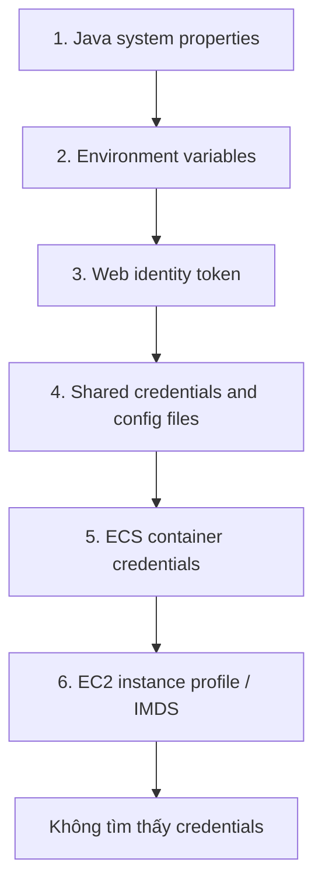

# Default credential provider chain và cấu hình profile

## 1. Vì sao AWS SDK cần một cơ chế tìm credentials?

Một ứng dụng Java Spring Boot chạy trên máy lập trình viên, GitHub Actions, Amazon ECS, AWS Lambda hoặc Amazon EC2 đều có thể gọi cùng một AWS API, ví dụ **S3 GetObject**, **DynamoDB UpdateItem** hay **STS GetCallerIdentity**. Mã ứng dụng không nên phải chứa access key của từng môi trường, bởi credentials cần được cấp, xoay vòng và thu hồi độc lập với bản build.

**AWS SDK for Java 2.x** sử dụng một **credentials provider** để lấy danh tính AWS. Khi bạn không chỉ định provider cụ thể, SDK dùng **Default Credentials Provider Chain**: thử lần lượt các nguồn credentials theo thứ tự ưu tiên, dừng ở provider đầu tiên lấy được credentials hợp lệ. Credentials có thể là key tĩnh dành cho môi trường thử nghiệm, temporary credentials, IAM Identity Center/SSO, role được assume qua STS, ECS task role hoặc EC2 instance profile.

Bài này thuộc chương **AWS SDK cho Java** trong module **CLOUD_PROVIDERS_AWS**. Lộ trình giúp người học khám phá Region/AZ, IAM, VPC, compute, storage, database, integration và serverless; mục tiêu là chọn dịch vụ, triển khai ứng dụng an toàn, có khả năng giám sát, phục hồi và kiểm soát chi phí. Quản lý credentials đúng là nền tảng bảo mật cho mọi lời gọi SDK trong các môi trường đó.

Sau bài học, bạn sẽ có thể:

- Mô tả đúng **thứ tự sáu nhóm providers** của Java SDK v2.
- Phân biệt **credentials provider chain** với **AWS Region provider chain**.
- Tạo và chọn profile từ `~/.aws/credentials`, `~/.aws/config`, `AWS_PROFILE` và Java system properties.
- Cấu hình IAM Identity Center/SSO, `source_profile`, `role_arn`, `credential_process` và web identity.
- Chọn credentials phù hợp cho local development, ECS, EKS, Lambda, EC2 và CI/CD.
- Dùng Java SDK 2.x và AWS CLI để kiểm tra **identity thực tế** mà ứng dụng đang sử dụng.
- Chẩn đoán lỗi credentials, region, expired session, IAM permission và profile selection mà không làm lộ secret.

## 2. Credentials là gì và SDK dùng chúng ra sao?

Một AWS request thường được ký bằng **AWS Signature Version 4 (SigV4)**. SDK cần credentials để tạo chữ ký, bao gồm:

| Thành phần | Ý nghĩa |
| --- | --- |
| **Access key ID** | Định danh phần access key được dùng để ký |
| **Secret access key** | Secret dùng tạo chữ ký; không được công khai |
| **Session token** | Token đi kèm **temporary credentials** do STS/runtime cấp |

Một bộ temporary credentials có cả ba thành phần trên và **thời hạn hết hạn**. Khi sử dụng IAM role, SDK provider có trách nhiệm lấy credentials mới khi cần. Đừng lưu một bộ temporary credentials vào biến toàn cục rồi sử dụng sau khi token đã hết hạn.

### 2.1. Credentials provider khác với IAM policy

Credentials trả lời câu hỏi **“request đang được ký bởi principal nào?”**. IAM policies trả lời **“principal đó được phép làm hành động gì trên tài nguyên nào?”**. Có credentials hợp lệ không có nghĩa có quyền `s3:GetObject` hoặc `dynamodb:PutItem`.

Ví dụ:

- `GetCallerIdentity` thành công: chứng minh SDK đã xác thực được một danh tính STS.
- `s3:ListBucket` trả `AccessDenied`: danh tính có thể hợp lệ nhưng thiếu quyền đọc bucket.
- `Unable to load credentials`: SDK chưa tìm được bộ credentials để ký request; đây là lỗi trước bước authorization của S3/DynamoDB.

### 2.2. Không đưa credentials vào source code

Tránh:

- Hardcode access key/secret trong Java class, YAML, `application.properties`, Dockerfile hoặc Git.
- Gửi credentials qua query string, URL, log, exception message hoặc frontend.
- Dùng root account access keys cho ứng dụng.
- Chia sẻ một IAM user key cho developer, CI/CD và production runtime.

Ưu tiên **IAM Identity Center/SSO cho con người**, **IAM roles/federation cho workloads**, temporary credentials và least privilege. Profile có static key chỉ nên dùng khi có lý do cụ thể và quy trình bảo vệ/rotation phù hợp.

## 3. Default Credentials Provider Chain của Java SDK 2.x

Khi tạo client như sau:

```java
S3Client s3 = S3Client.builder()
    .region(Region.AP_SOUTHEAST_1)
    .build();
```

và không gọi `credentialsProvider(...)`, SDK sử dụng **Default Credentials Provider Chain**. Trong Java SDK 2.x, thứ tự ưu tiên là:



| Thứ tự | Provider | Ví dụ nguồn |
| ---: | --- | --- |
| 1 | **Java system properties** | `aws.accessKeyId`, `aws.secretAccessKey`, `aws.sessionToken` |
| 2 | **Environment variables** | `AWS_ACCESS_KEY_ID`, `AWS_SECRET_ACCESS_KEY`, `AWS_SESSION_TOKEN` |
| 3 | **Web identity token credentials** | `AWS_ROLE_ARN`, `AWS_WEB_IDENTITY_TOKEN_FILE` và STS |
| 4 | **Shared credentials/config files** | Profile trong `~/.aws/credentials` và `~/.aws/config` |
| 5 | **ECS container credentials** | Container credential endpoint/task role |
| 6 | **EC2 instance profile credentials** | Instance metadata service (IMDS) |

SDK thử theo thứ tự này và dùng **provider đầu tiên trả credentials hợp lệ**. Nếu provider được chọn hết hạn hoặc không refresh được, request có thể lỗi; không nên kỳ vọng SDK luôn quay xuống provider thấp hơn để che một cấu hình ưu tiên bị sai.

### 3.1. System properties

Java system properties có thể được truyền khi chạy JVM:

```bash
java \
  -Daws.accessKeyId=EXAMPLE_ACCESS_KEY \
  -Daws.secretAccessKey=EXAMPLE_SECRET_KEY \
  -jar app.jar
```

Đây chỉ là ví dụ cú pháp, **không phải cách khuyến nghị để triển khai production**. Giá trị có thể xuất hiện trong process arguments, diagnostics hoặc hệ thống quản lý deployment. Temporary credentials còn cần session token (`aws.sessionToken`). Nếu system properties đã chứa một bộ credentials, provider này có ưu tiên cao hơn environment variables và profile.

### 3.2. Environment variables

Java SDK v2 nhận:

| Biến | Nội dung |
| --- | --- |
| `AWS_ACCESS_KEY_ID` | Access key ID |
| `AWS_SECRET_ACCESS_KEY` | Secret access key |
| `AWS_SESSION_TOKEN` | Session token khi dùng temporary credentials |

Trong PowerShell có thể kiểm tra **biến nào đang được đặt** mà không in giá trị secret:

```powershell
Get-ChildItem Env:AWS_ACCESS_KEY_ID,Env:AWS_SECRET_ACCESS_KEY,Env:AWS_SESSION_TOKEN -ErrorAction SilentlyContinue | Select-Object -ExpandProperty Name
```

Nếu dùng temporary credentials mà thiếu `AWS_SESSION_TOKEN`, request ký bằng cặp key có thể bị từ chối. Môi trường local có thể vô tình giữ access key cũ; vì environment provider đứng trước profile, SDK có thể dùng key đó thay vì profile SSO mà bạn vừa chọn.

### 3.3. Web identity token credentials

Provider này đọc **role ARN** và **token file**, sau đó gọi STS `AssumeRoleWithWebIdentity` để nhận temporary credentials. Các giá trị thường gặp:

- `AWS_ROLE_ARN`
- `AWS_WEB_IDENTITY_TOKEN_FILE`
- `AWS_ROLE_SESSION_NAME` (tùy chọn)

Đây là cơ chế quan trọng của **Amazon EKS IRSA (IAM Roles for Service Accounts)** và các workload dùng OpenID Connect federation. SDK cần dependency STS phù hợp trong ứng dụng Java. Token file do nền tảng/workload identity cung cấp; ứng dụng không tự tạo token giả.

### 3.4. Shared credentials và config files

Nếu ba nhóm provider trước đó không cung cấp credentials, SDK đọc **profile** từ shared credentials/config files. Đây là cách thường dùng khi lập trình trên laptop, chuyển giữa các AWS accounts hoặc assume role từ profile nền.

### 3.5. ECS container credentials

Trong Amazon ECS, **task role** được cấp cho container qua credential endpoint mà runtime thiết lập, ví dụ:

- `AWS_CONTAINER_CREDENTIALS_RELATIVE_URI`
- `AWS_CONTAINER_CREDENTIALS_FULL_URI`
- Token authorization tương ứng nếu endpoint yêu cầu.

SDK tự lấy và refresh credentials từ endpoint. Không nhúng access key vào image hoặc task definition. Phân biệt **task role** (quyền của code trong container) với **task execution role** (quyền ECS agent dùng để pull image, ghi logs và các hoạt động khởi chạy).

### 3.6. EC2 instance profile credentials

Trên EC2, gắn một **IAM role thông qua instance profile**. SDK lấy temporary credentials qua **Instance Metadata Service (IMDS)**, ưu tiên bảo vệ bằng IMDSv2 theo cấu hình instance. Không lưu IAM user keys trong file trên EC2 nếu workload đã có thể dùng instance profile.

## 4. Hai file profile: credentials và config

Trên macOS/Linux, thư mục mặc định là `~/.aws/`; trên Windows thường nằm tại `%USERPROFILE%\.aws\`.

| File | Nội dung thường gặp |
| --- | --- |
| `~/.aws/credentials` | Access key, secret key, session token hoặc credential material của profile |
| `~/.aws/config` | Region, output, role settings, SSO, credential process và các cấu hình profile |

Ví dụ cấu trúc:

```text
~/.aws/
  credentials
  config
  sso/
    cache/
```

Không tự tạo thư mục SSO cache hoặc chép token cache giữa máy. AWS CLI/SDK quản lý cache theo cơ chế của chúng.

### 4.1. Shared credentials file

Ví dụ `~/.aws/credentials`:

```ini
[default]
aws_access_key_id = EXAMPLE_DEFAULT_ACCESS_KEY
aws_secret_access_key = EXAMPLE_DEFAULT_SECRET

[sandbox]
aws_access_key_id = EXAMPLE_SANDBOX_ACCESS_KEY
aws_secret_access_key = EXAMPLE_SANDBOX_SECRET
```

Các giá trị trên chỉ là **placeholder**. Không commit file credentials vào Git, không gửi file qua chat và không sử dụng những key minh họa để gọi AWS.

### 4.2. Shared config file

Ví dụ `~/.aws/config`:

```ini
[default]
region = ap-southeast-1
output = json

[profile sandbox]
region = ap-southeast-1
output = json
```

Quy tắc tên section khác nhau:

- Profile mặc định: `[default]`.
- Profile có tên trong **config file**: `[profile sandbox]`.
- Profile có tên trong **credentials file**: `[sandbox]` (không có từ `profile`).

Đây là một nguyên nhân phổ biến khiến SDK/CLI không tìm thấy profile: viết `[sandbox]` trong config thay vì `[profile sandbox]`.

### 4.3. Profile name được chọn như thế nào?

Mặc định, SDK dùng profile tên `default`. Có thể chọn profile bằng:

- Environment variable `AWS_PROFILE`.
- Java system property `aws.profile`.
- Chỉ định profile tường minh trong `ProfileCredentialsProvider`.

Ví dụ PowerShell:

```powershell
$env:AWS_PROFILE = "sandbox"
```

hoặc:

```bash
export AWS_PROFILE=sandbox
```

**Quan trọng về precedence:** `AWS_PROFILE=sandbox` chọn profile được dùng tại **bước profile provider** của default chain. Nó **không vượt qua** Java system properties hoặc static environment credentials đứng trước profile. Nếu `AWS_ACCESS_KEY_ID`/`AWS_SECRET_ACCESS_KEY` đang có giá trị, SDK có thể dùng chúng thay vì profile sandbox.

### 4.4. Đổi đường dẫn hai file

Có thể đặt:

- `AWS_SHARED_CREDENTIALS_FILE`: đường dẫn credentials file.
- `AWS_CONFIG_FILE`: đường dẫn config file.

Ví dụ PowerShell:

```powershell
$env:AWS_SHARED_CREDENTIALS_FILE = "C:\work\aws\credentials"
$env:AWS_CONFIG_FILE = "C:\work\aws\config"
```

Chỉ đặt biến đường dẫn không tạo file hay cấp quyền đọc. Đảm bảo user chạy JVM có quyền truy cập file và đường dẫn không trỏ tới bản credentials cũ ngoài ý muốn.

## 5. IAM Identity Center (SSO) profile cho developer

Đối với người dùng nội bộ, **IAM Identity Center** cho phép đăng nhập qua identity provider của tổ chức, chọn AWS account và permission set/role được cấp. AWS CLI tạo profile SSO trong `~/.aws/config`; Java SDK 2.x có thể dùng profile đó để lấy temporary credentials và refresh theo cơ chế SSO.

### 5.1. Tạo profile bằng AWS CLI

Chạy trên máy lập trình viên:

```bash
aws configure sso --profile developer
```

CLI sẽ yêu cầu những thông tin như **SSO start URL hoặc issuer URL**, SSO Region, AWS account, permission set/role, default AWS Region và output format. Sau khi cấu hình, đăng nhập:

```bash
aws sso login --profile developer
aws sts get-caller-identity --profile developer
```

`get-caller-identity` cho biết account/ARN thực tế mà CLI đang sử dụng. Đây là phép kiểm tra identity; nó không chứng minh role có quyền đọc mọi S3 bucket hay DynamoDB table.

### 5.2. Cấu hình profile SSO minh họa

Ví dụ `~/.aws/config`:

```ini
[sso-session company]
sso_start_url = https://example.awsapps.com/start
sso_region = ap-southeast-1
sso_registration_scopes = sso:account:access

[profile developer]
sso_session = company
sso_account_id = 111122223333
sso_role_name = DeveloperAccess
region = ap-southeast-1
output = json
```

`example.awsapps.com`, account ID và permission set trong ví dụ chỉ là placeholder; dùng giá trị tổ chức cấp. SSO profile không cần lưu IAM user access key/secret trong credentials file.

### 5.3. SDK dependencies cho SSO

Với Java SDK 2.x, ứng dụng dùng SSO-backed profile cần những module SSO tương ứng. Ví dụ Maven dùng **AWS SDK BOM** để đồng bộ version:

```xml
<dependencyManagement>
  <dependencies>
    <dependency>
      <groupId>software.amazon.awssdk</groupId>
      <artifactId>bom</artifactId>
      <version>AWS_SDK_VERSION</version>
      <type>pom</type>
      <scope>import</scope>
    </dependency>
  </dependencies>
</dependencyManagement>

<dependencies>
  <dependency>
    <groupId>software.amazon.awssdk</groupId>
    <artifactId>s3</artifactId>
  </dependency>
  <dependency>
    <groupId>software.amazon.awssdk</groupId>
    <artifactId>sso</artifactId>
  </dependency>
  <dependency>
    <groupId>software.amazon.awssdk</groupId>
    <artifactId>ssooidc</artifactId>
  </dependency>
</dependencies>
```

`AWS_SDK_VERSION` là Maven property do dự án quản lý, không phải giá trị Maven tự có. Nếu profile dùng assume-role/web identity và ứng dụng trực tiếp gọi STS, thêm dependency `software.amazon.awssdk:sts` cùng BOM. Chỉ khai báo những service modules mà ứng dụng thật sự sử dụng.

### 5.4. Token cache và phiên đăng nhập

AWS CLI lưu token cache SSO cục bộ. Java SDK có thể sử dụng cache/token provider tương ứng khi profile được cấu hình đúng và dependency tương thích. Nếu phiên SSO hết hạn hoặc cần xác thực lại, người dùng chạy:

```bash
aws sso login --profile developer
```

Không chép token cache sang máy khác, không đưa cache vào Docker image hoặc Git. Khi chạy trong production, **không dựa vào profile SSO của developer**; workload nên dùng IAM role/federation riêng.

## 6. Assume role bằng profile và source_profile

Một developer có thể đăng nhập vào account công cụ bằng SSO, sau đó assume một role **read-only ở account production**. Profile role mô tả đích đến, còn `source_profile` chỉ ra profile cung cấp credentials ban đầu để gọi STS `AssumeRole`.

### 6.1. Ví dụ cross-account role

`~/.aws/config`:

```ini
[profile developer]
sso_session = company
sso_account_id = 111122223333
sso_role_name = DeveloperAccess
region = ap-southeast-1

[profile production-readonly]
role_arn = arn:aws:iam::444455556666:role/ProductionReadOnly
source_profile = developer
role_session_name = java-sdk-inspection
region = ap-southeast-1
```

Luồng:

1. SDK chọn profile `production-readonly`.
2. Profile provider lấy credentials từ `developer` (SSO).
3. SDK gọi STS `AssumeRole` tới role ARN ở account production.
4. STS trả temporary credentials cho role đích.
5. Java client ký request bằng credentials của `ProductionReadOnly`.

Trust policy của role đích phải cho phép principal nguồn assume role; permission policy nguồn phải cho phép `sts:AssumeRole` trên đúng role ARN. **Cả hai phía đều cần phù hợp**.

### 6.2. External ID và session name

Với mô hình third-party/cross-account phù hợp, profile có thể khai báo:

```ini
[profile vendor-audit]
role_arn = arn:aws:iam::444455556666:role/VendorAudit
source_profile = developer
external_id = EXTERNAL_ID_PROVIDED_BY_TARGET_ACCOUNT
role_session_name = audit-read-session
region = ap-southeast-1
```

`external_id` hỗ trợ giảm rủi ro confused deputy trong những mô hình ủy quyền phù hợp; không tự thay thế trust policy hoặc least privilege. Không tự tạo external ID rồi giả định account đích sẽ chấp nhận.

### 6.3. source_profile và credential_source

Khi chạy workload trên AWS, không nhất thiết cần một source profile chứa static key. Có thể dùng `credential_source` để lấy credentials từ môi trường runtime:

```ini
[profile production-from-ec2]
role_arn = arn:aws:iam::444455556666:role/ProductionReadOnly
credential_source = Ec2InstanceMetadata
region = ap-southeast-1
```

Các nguồn thường dùng gồm:

| Giá trị `credential_source` | Nguồn |
| --- | --- |
| `Environment` | Credentials từ environment variables |
| `Ec2InstanceMetadata` | EC2 instance profile |
| `EcsContainer` | ECS container credentials |

`source_profile` và `credential_source` là hai cách xác định nguồn credentials cho assume role; không cấu hình cả hai trong cùng một role profile. Với ECS/EC2, thường có thể gắn trực tiếp task/instance role cho workload và không cần thêm một assume-role profile trung gian nếu không có yêu cầu cross-account.

## 7. credential_process: tích hợp credential helper bên ngoài

Profile có thể dùng `credential_process` để gọi một chương trình ngoài và nhận credentials theo JSON contract. Cách này hữu ích khi tổ chức có credential broker hoặc công cụ xác thực riêng, nhưng nó cũng mở rộng trust boundary: **SDK sẽ chạy chương trình được cấu hình trong profile**.

Ví dụ:

```ini
[profile corporate]
credential_process = /usr/local/bin/company-aws-credential-helper --profile engineering
region = ap-southeast-1
```

Helper phải ghi JSON credentials ra **stdout** theo schema hỗ trợ, ví dụ:

```json
{
  "Version": 1,
  "AccessKeyId": "TEMPORARY_ACCESS_KEY",
  "SecretAccessKey": "TEMPORARY_SECRET_KEY",
  "SessionToken": "TEMPORARY_SESSION_TOKEN",
  "Expiration": "2026-11-20T12:00:00Z"
}
```

Giá trị là placeholder. Khi dùng temporary credentials, `Expiration` phải là timestamp hợp lệ theo contract của credential process. Helper không được ghi credentials vào stderr/logs, không được trả key hết hạn và không được yêu cầu user nhập secret mỗi lần SDK refresh nếu có thể thiết kế flow không tương tác.

**Bảo mật:** chỉ dùng helper do tổ chức tin cậy quản lý; giới hạn quyền file thực thi và config; kiểm tra đường dẫn tuyệt đối; tránh executable/script có thể bị thay thế bởi người dùng khác; không để helper in secret vào log. Một profile không rõ nguồn gốc có thể khiến JVM chạy chương trình không mong muốn.

## 8. Web identity và workload identity trên AWS

### 8.1. EKS IRSA

**IAM Roles for Service Accounts (IRSA)** liên kết Kubernetes service account với IAM role qua OIDC. Pod nhận token web identity và thông tin role; Java SDK v2 default chain dùng web identity provider để gọi STS, lấy temporary credentials.

Một profile/config minh họa (trong môi trường được cấu hình đúng):

```ini
[profile eks-orders]
role_arn = arn:aws:iam::111122223333:role/EksOrdersRole
web_identity_token_file = /var/run/secrets/eks.amazonaws.com/serviceaccount/token
role_session_name = orders-pod
region = ap-southeast-1
```

Trong EKS IRSA, các biến môi trường và token file thường được admission webhook/runtime cung cấp; ứng dụng không nên tự chép token vào image. Trust policy IAM role cần giới hạn OIDC provider, namespace và service account đúng yêu cầu.

### 8.2. EKS Pod Identity

Amazon EKS Pod Identity cung cấp credentials cho pod thông qua cơ chế agent/container credentials được nền tảng cấu hình. Dùng phiên bản Java SDK hỗ trợ provider và cấu hình tương ứng theo hướng dẫn EKS; không giả định mọi SDK cũ đều tự nhận dạng mọi biến/endpoint mới.

### 8.3. ECS task role

Trong ECS, cấu hình **taskRoleArn** cho ứng dụng. ECS cung cấp endpoint credentials tới container; Java SDK tự nhận qua container credentials provider. `executionRoleArn` dùng cho ECS agent/runtime, không nên cấp cho application container quyền thay cho task role.

### 8.4. Lambda execution role

Trong AWS Lambda, gắn execution role cho function. Runtime cung cấp temporary credentials; Java SDK default provider chain lấy credentials từ runtime mà không cần profile hay access key trong code. Mỗi function nên có role riêng hoặc role theo nhóm chức năng với least privilege.

### 8.5. EC2 instance profile

Trên EC2, gắn instance profile vào instance và cấp role chỉ đủ cho ứng dụng. Java SDK truy cập IMDS theo provider chain. Bảo vệ IMDSv2, giới hạn quyền network/host, không expose metadata endpoint tới untrusted containers hoặc ứng dụng không cần quyền đó.

## 9. Cấu hình credentials provider tường minh trong Java

Mặc định nên để SDK sử dụng default chain để cùng một artifact chạy được trên laptop, ECS và EC2 với cơ chế credentials riêng từng môi trường. Tuy nhiên, trong công cụ developer hoặc test, có thể chỉ định **profile cụ thể** để tránh phụ thuộc vào `AWS_PROFILE` của shell.

### 9.1. S3 client dùng default provider chain

```java
import software.amazon.awssdk.regions.Region;
import software.amazon.awssdk.services.s3.S3Client;

public class S3ClientFactory {
    public static S3Client create() {
        return S3Client.builder()
                .region(Region.AP_SOUTHEAST_1)
                // Không chỉ định credentialsProvider:
                // SDK sử dụng Default Credentials Provider Chain.
                .build();
    }
}
```

Ứng dụng nên **tái sử dụng service client** thay vì tạo client mới cho từng HTTP request. Đóng client khi application context dừng; SDK quản lý connection pool và credentials provider trong vòng đời client.

### 9.2. Chỉ định profile tường minh

```java
import software.amazon.awssdk.auth.credentials.ProfileCredentialsProvider;
import software.amazon.awssdk.regions.Region;
import software.amazon.awssdk.services.s3.S3Client;

public class LocalS3Client {
    public static void main(String[] args) {
        try (ProfileCredentialsProvider credentials =
                     ProfileCredentialsProvider.builder()
                             .profileName("developer")
                             .build();
             S3Client s3 = S3Client.builder()
                     .region(Region.AP_SOUTHEAST_1)
                     .credentialsProvider(credentials)
                     .build()) {

            System.out.println("S3 client configured for developer profile");
        }
    }
}
```

Ví dụ này phù hợp **local tooling/test**, không phải cấu hình production chung. Khi gọi `ProfileCredentialsProvider` tường minh, bạn chọn trực tiếp profile đó thay vì để default chain chọn provider đầu tiên. Nếu profile là SSO, cần đăng nhập trước bằng AWS CLI và khai báo SDK dependencies phù hợp.

### 9.3. Kiểm tra danh tính mà Java SDK thực sự sử dụng

Thêm dependency `software.amazon.awssdk:sts` theo cùng AWS SDK BOM, sau đó:

```java
import software.amazon.awssdk.regions.Region;
import software.amazon.awssdk.services.sts.StsClient;
import software.amazon.awssdk.services.sts.model.GetCallerIdentityResponse;

public class AwsIdentityCheck {
    public static void main(String[] args) {
        try (StsClient sts = StsClient.builder()
                .region(Region.AP_SOUTHEAST_1)
                .build()) {

            GetCallerIdentityResponse identity = sts.getCallerIdentity();
            System.out.println("Account: " + identity.account());
            System.out.println("ARN: " + identity.arn());
            System.out.println("UserId: " + identity.userId());
        }
    }
}
```

Đây là một phép kiểm tra an toàn hơn so với in credentials. ARN cho biết account và principal/assumed role đang dùng; **không in access key, secret key hay session token**. `GetCallerIdentity` không cần quyền IAM allow đặc biệt trong hầu hết trường hợp theo hành vi STS của AWS.

### 9.4. Không đọc credentials một lần rồi tự quản lý expiration

Tránh lấy `AwsCredentials` từ provider rồi cache vô thời hạn trong static field. Hãy để SDK provider lấy/refresh temporary credentials theo lifecycle của nó. Với STS assume role, SSO, web identity, ECS và EC2, cơ chế refresh có thể khác nhau; provider là abstraction giúp ứng dụng không phải tự xử lý token rotation.

## 10. Region provider chain là một cơ chế riêng

**Credentials provider chain chọn danh tính; Region provider chain chọn AWS Region.** Một client cần cả hai để ký request và gửi request đến endpoint phù hợp.

Khi không gọi `.region(...)`, Java SDK v2 tìm Region theo thứ tự phổ biến:

1. Java system property `aws.region`.
2. Environment variable `AWS_REGION`.
3. Region trong profile của shared config file.
4. EC2 instance metadata service (IMDS).

| Nguồn | Ví dụ |
| --- | --- |
| Java system property | `-Daws.region=ap-southeast-1` |
| Environment | `AWS_REGION=ap-southeast-1` |
| Shared config profile | `region = ap-southeast-1` |
| EC2 IMDS | Region của EC2 instance |

Nếu SDK không tìm được Region, có thể gặp lỗi `Unable to load region from any of the providers in the chain`, dù credentials đã được tìm thấy.

### 10.1. Chọn Region tường minh trong service client

```java
DynamoDbClient dynamo = DynamoDbClient.builder()
        .region(Region.AP_SOUTHEAST_1)
        .build();
```

Trong ứng dụng production, chọn Region từ cấu hình ứng dụng/environment đã được quản lý thường dễ review hơn việc phụ thuộc ngầm vào profile của user chạy JVM. Không hardcode Region nếu một artifact cần deploy đa Region; truyền cấu hình qua environment hoặc deployment config.

### 10.2. AWS_REGION và AWS_DEFAULT_REGION

Java SDK v2 region provider chain dùng `AWS_REGION`. `AWS_DEFAULT_REGION` thường gặp trong AWS CLI và một số công cụ khác; **đừng giả định Java SDK đọc biến đó như một alias**. Nếu CLI chạy được nhưng Java báo thiếu Region, kiểm tra `AWS_REGION`, `aws.region`, profile config và `.region(...)` của client.

### 10.3. Chọn profile không tự động chọn credentials nếu nguồn ưu tiên cao hơn đã có

Ví dụ:

```text
AWS_PROFILE=developer
AWS_ACCESS_KEY_ID=OLD_ACCESS_KEY
AWS_SECRET_ACCESS_KEY=OLD_SECRET
```

Trong default credentials chain, environment credentials đứng trước profile. Vì vậy, Java có thể ký bằng access key cũ dù `AWS_PROFILE` trỏ tới SSO profile. Cách chẩn đoán đúng là kiểm tra identity bằng **chính Java process đang chạy**, không chỉ dựa vào kết quả của một terminal AWS CLI khác.

## 11. Chọn nguồn credentials theo môi trường

| Môi trường | Cách ưu tiên | Lý do |
| --- | --- | --- |
| **Developer laptop** | IAM Identity Center/SSO profile | Đăng nhập cá nhân, temporary credentials, chuyển role/account |
| **Local integration test** | SSO profile hoặc test credentials cô lập | Không chia sẻ key production |
| **GitHub Actions/CI** | OIDC federation và STS AssumeRoleWithWebIdentity | Không lưu long-lived secrets trong CI |
| **Amazon ECS** | ECS task role | Runtime tự cung cấp/refresh credentials |
| **Amazon EKS** | IRSA hoặc EKS Pod Identity theo kiến trúc | Danh tính theo Kubernetes workload |
| **AWS Lambda** | Lambda execution role | Credentials runtime do AWS quản lý |
| **Amazon EC2** | EC2 instance profile | Temporary role credentials qua IMDS |
| **Cross-account tooling** | Assume-role profile/STS | Phân quyền và audit theo account/role đích |

### 11.1. Local development

Luồng gợi ý:

1. Cài AWS CLI v2 và cấu hình IAM Identity Center profile.
2. Chạy `aws sso login --profile developer`.
3. Chọn `AWS_PROFILE=developer` hoặc dùng `ProfileCredentialsProvider` tường minh trong công cụ local.
4. Chạy STS `GetCallerIdentity` từ Java để xác minh account/role.
5. Không export static access keys vào shell khi đang muốn thử SSO.

### 11.2. CI/CD bằng OIDC

Trong GitHub Actions hoặc CI provider hỗ trợ OpenID Connect, cấu hình trust relationship giữa identity provider và IAM role. Pipeline nhận OIDC token, gọi STS assume role để lấy temporary credentials. Role trust policy nên giới hạn **repository/project, branch/environment, audience và subject claim** đúng nhu cầu; không cho mọi workflow công khai assume role production.

Khi CI chạy Java SDK v2, web identity provider có thể dùng các biến môi trường/token file mà action/runtime thiết lập. Không lưu access key production trong repository secrets nếu OIDC federation có thể đáp ứng.

### 11.3. ECS: task role và execution role

Ví dụ task definition có hai vai trò:

```json
{
  "executionRoleArn": "arn:aws:iam::111122223333:role/EcsExecutionRole",
  "taskRoleArn": "arn:aws:iam::111122223333:role/OrdersTaskRole"
}
```

`EcsExecutionRole` dành cho ECS agent thực hiện hoạt động khởi chạy như pull image/ghi log theo cấu hình. `OrdersTaskRole` là danh tính của application code. Nếu ứng dụng cần đọc S3 và ghi DynamoDB, đặt các quyền đó trên **task role**, không tự động mở rộng execution role.

### 11.4. Lambda: một role theo chức năng

Một Lambda xử lý đơn hàng có thể chỉ cần `dynamodb:GetItem`, `dynamodb:UpdateItem` trên bảng order và `sqs:SendMessage` tới queue cụ thể. Gắn role này vào function; không đưa profile file hoặc IAM user key vào ZIP/container image. Nếu một function khác chỉ đọc S3, cấp role riêng phù hợp với tác vụ đó.

## 12. AWS CLI: kiểm tra profile và identity mà không lộ secret

AWS CLI là công cụ hữu ích để xác minh profile, nhưng **CLI và Java SDK là hai chương trình có thể dùng môi trường, phiên bản và provider behavior khác nhau**. Hãy chạy lệnh trong cùng user/shell/container context khi có thể.

### 12.1. Liệt kê profiles

```bash
aws configure list-profiles
```

Kết quả liệt kê tên profile, không phải danh sách quyền IAM.

### 12.2. Kiểm tra nguồn cấu hình

```bash
aws configure list --profile developer
```

Lệnh cho biết nguồn credential/region theo cách CLI nhận diện. Cần cẩn thận khi chia sẻ output: dù key thường được che bớt, không gửi thông tin môi trường nhạy cảm ra kênh công khai.

### 12.3. Xác minh account và role

```bash
aws sts get-caller-identity --profile developer
aws sts get-caller-identity --profile production-readonly
```

Đối chiếu `Account` và `Arn` với account/role dự kiến. Nếu profile là SSO và chưa đăng nhập, chạy `aws sso login --profile developer` rồi thử lại.

### 12.4. Chạy Java với profile cụ thể

PowerShell:

```powershell
$env:AWS_PROFILE = "developer"
java -jar app.jar
```

Hoặc Java system property:

```bash
java -Daws.profile=developer -jar app.jar
```

Nhắc lại: system properties và environment static credentials có thứ tự cao hơn profile provider. Khi muốn kiểm tra SSO profile, loại bỏ static credentials không cần thiết khỏi JVM environment.

### 12.5. Không dùng lệnh in credentials để debug

Tránh in:

- `AWS_ACCESS_KEY_ID` và `AWS_SECRET_ACCESS_KEY`.
- `AWS_SESSION_TOKEN`.
- JSON trả về từ credential process.
- Nội dung token cache SSO hoặc web identity token file.

Thay vào đó, dùng **STS GetCallerIdentity**, provider source đã chọn, tên profile, Region và ARN. Khi báo lỗi, che account ID nếu cần theo chính sách tổ chức và không đính kèm secrets.

## 13. Troubleshooting: lỗi phổ biến và cách xử lý

| Triệu chứng | Nguyên nhân thường gặp | Hướng kiểm tra |
| --- | --- | --- |
| `Unable to load credentials from any of the providers in the chain` | Không có nguồn credentials hợp lệ | Kiểm tra profile, SSO login, role/runtime endpoint, env presence |
| Java dùng sai AWS account | System property hoặc env credentials cũ đứng trước profile | Gọi STS GetCallerIdentity từ chính Java process |
| `The security token included in the request is invalid` | Key sai, session token thiếu/sai, credentials hết hạn | Kiểm tra nguồn và refresh; không copy một phần temporary credentials |
| `ExpiredToken` | Temporary credentials hết hạn, provider không refresh được | Đăng nhập SSO lại, kiểm tra STS/profile/clock và SDK version |
| `Unable to load region from any of the providers` | Chưa cấu hình Region | `.region(...)`, `AWS_REGION`, `aws.region`, profile region |
| `Profile file contained no credentials` | Chọn sai profile hoặc profile chỉ có region | Kiểm tra section names và credentials/SSO/role source |
| SSO profile không hoạt động trong Java | Chưa `aws sso login`, thiếu SDK SSO modules hoặc profile sai | Kiểm tra cache/session, `sso`/`ssooidc` dependencies và SDK BOM |
| `AccessDenied` sau khi STS identity thành công | Principal hợp lệ nhưng thiếu permission/trust/resource policy | Xem IAM identity/resource policy, SCP, permission boundary |
| AssumeRole bị AccessDenied | Trust policy nguồn/đích không khớp hoặc thiếu `sts:AssumeRole` | Kiểm tra principal, role ARN, external ID, claims |
| `credential_process` exit code khác 0 | Helper lỗi, không chạy được hoặc stdout không đúng schema | Kiểm tra executable, quyền, stderr an toàn và JSON contract |
| ECS không tìm được credentials | Thiếu task role hoặc container endpoint/config | Kiểm tra task definition `taskRoleArn`, runtime, SDK version |
| EC2 không lấy được instance profile | Instance chưa gắn profile, IMDS/network/IMDSv2 policy | Kiểm tra IAM instance profile và metadata options |
| EKS pod dùng role sai | Service account annotation/trust/Pod Identity association sai | Kiểm tra OIDC claims, role ARN, SDK provider support |
| CLI chạy nhưng Java không chạy | User/home/env khác, SDK thiếu modules, Region/chain khác | So sánh trong cùng runtime và gọi STS từ Java |

### 13.1. Quy trình chẩn đoán theo thứ tự

1. **Identity:** Java STS `GetCallerIdentity` có thành công không? ARN/account là gì?
2. **Credentials source:** provider nào được chọn? Có system properties hoặc env static keys cũ không?
3. **Profile:** profile name đúng chưa? Config section có `[profile name]` không? File path có đúng user JVM không?
4. **SSO/STS:** session còn hạn? Role trust và `sts:AssumeRole` có đúng?
5. **Region:** client có Region đúng không? Endpoint/partition có khớp resource không?
6. **Authorization:** IAM identity policy, resource policy, SCP, permission boundary, VPC endpoint policy và KMS policy có cho phép?
7. **Runtime:** ECS task role, Lambda execution role, EKS identity hoặc EC2 instance profile có được gắn đúng?

### 13.2. Phân biệt authentication và authorization

```text
Unable to load credentials
  -> SDK chưa có credentials để ký request

Invalid/Expired token
  -> Có credentials nhưng token không hợp lệ/hết hạn

AccessDenied
  -> Request đã tới AWS; principal không được phép hành động

ResourceNotFound / wrong Region
  -> Identity có thể đúng, nhưng endpoint/resource/config không khớp
```

Không sửa `AccessDenied` bằng cách cấp `AdministratorAccess` ngay lập tức. Trước tiên xác định **principal thực tế, action, resource ARN và policy evaluation**; chỉ cấp quyền tối thiểu cần thiết.

## 14. Bảo mật profile và vận hành credentials

### 14.1. File permissions và secret hygiene

Trên Linux/macOS, nếu profile có static credentials, giới hạn quyền đọc file cho user sở hữu (ví dụ `chmod 600 ~/.aws/credentials`). Trên Windows, dùng ACL để chỉ user/nhóm cần thiết truy cập. SSO profile vẫn có token cache nhạy cảm; không đồng bộ toàn bộ `.aws` folder lên nơi lưu trữ công khai.

### 14.2. Rotation và temporary credentials

- Ưu tiên role/temporary credentials có thời hạn thay cho long-lived IAM user keys.
- Nếu tổ chức vẫn cần access keys, có quy trình rotation, owner, expiration review và revoke key cũ.
- Không lưu key trong source code, Git history, Docker image, log hoặc crash dump.
- Dùng SDK provider để refresh credentials; không tự đặt thời hạn cố định trong Java code.
- Khi credential bị nghi lộ, revoke/rotate theo incident procedure và kiểm tra CloudTrail.

### 14.3. Không trộn credentials của nhiều môi trường

Một artifact Java có thể được triển khai ở dev, staging và production. Mỗi môi trường cung cấp role/identity riêng. Đừng để `AWS_PROFILE=developer` trong Docker image rồi hy vọng ECS tự thay bằng task role; nếu environment static keys/profile có ưu tiên cao hơn runtime provider, ứng dụng có thể dùng nhầm identity.

### 14.4. Profile file là cấu hình thực thi, không chỉ là dữ liệu

Profile có thể chỉ định `credential_process`, role assumption và file token. Hãy xem file profile như một phần của **security configuration**:

- Chỉ đọc profile từ đường dẫn được quản lý.
- Review thay đổi role ARN, executable và token file paths.
- Không cho user không tin cậy sửa file mà service production sử dụng.
- Không dùng `credential_process` trỏ tới script nằm trong thư mục tạm có thể bị thay thế.
- Audit ai có quyền sửa profile, task definition, environment và instance profile.

## 15. Case study: một Java service từ laptop đến production

Một dịch vụ `orders-api` dùng S3 lưu hóa đơn và DynamoDB lưu đơn hàng. Cùng một bản JAR được chạy trên laptop developer, CI pipeline và ECS Fargate production.

### 15.1. Local development

Developer đăng nhập IAM Identity Center bằng profile `developer`. Trong shell, `AWS_PROFILE=developer`; Java client dùng default chain. Trước khi debug một lỗi S3, developer chạy STS `GetCallerIdentity` từ ứng dụng để xác nhận đúng account và role.

### 15.2. CI pipeline

CI dùng OIDC để assume role `OrdersBuildDeployRole` trong account deploy. Role chỉ được phép upload artifact vào bucket pipeline và cập nhật những resources cần thiết. CI không dùng profile laptop hoặc key tĩnh của developer.

### 15.3. ECS production

Task definition gắn `OrdersTaskRole`. Container không mang credentials file; SDK lấy temporary credentials từ ECS container endpoint. Role chỉ cho phép đọc/ghi đúng DynamoDB table và S3 prefix cần thiết. `OrdersTaskExecutionRole` chỉ có quyền pull ECR image và ghi logs theo yêu cầu ECS.

### 15.4. Chẩn đoán một lỗi sai account

Sau deployment, CloudTrail cho thấy request tới bucket test. Đội vận hành:

1. Chạy STS `GetCallerIdentity` **bên trong cùng ECS task** bằng diagnostic code được phê duyệt.
2. Xác nhận ARN là assumed role của account dev.
3. Kiểm tra task environment có `AWS_ACCESS_KEY_ID`/`AWS_SECRET_ACCESS_KEY` cũ không.
4. Xác định một static environment credential được inject vào task definition/deployment.
5. Loại bỏ nguồn credentials không cần, giữ task role, redeploy và xác minh identity lại.

**Bài học:** `AWS_PROFILE` hay task role không đảm bảo được chọn nếu một provider ưu tiên cao hơn đã cung cấp credentials. Kiểm tra danh tính thật của process quan trọng hơn việc nhìn tên profile trong file.

### 15.5. Kết quả kiến trúc

| Runtime | Credential source | Quyền |
| --- | --- | --- |
| Developer laptop | IAM Identity Center profile | Developer sandbox |
| CI | OIDC + STS role | Build/deploy |
| ECS production | ECS task role | Runtime orders API |
| EKS batch worker | IRSA hoặc Pod Identity | Batch-specific role |
| EC2 maintenance host | Instance profile | Maintenance-only permissions |

Mỗi workload có danh tính và quyền riêng; source code không đổi theo môi trường.

## 16. Checklist production

1. **Không hardcode keys:** dùng IAM roles, SSO hoặc federation; tránh long-lived secrets.
2. **Biết chain order:** system properties → environment → web identity → profile → ECS → EC2.
3. **Kiểm tra precedence:** xóa env/system properties cũ khi muốn profile hoặc runtime role được chọn.
4. **Phân biệt profile files:** section `[profile name]` trong config, `[name]` trong credentials.
5. **Quản lý SSO đúng cách:** login, SDK modules, token cache và session lifecycle.
6. **Assume role an toàn:** trust policy, source permission, external ID/claims và role session được giới hạn.
7. **Runtime identity:** ECS task role, Lambda execution role, EKS workload identity hoặc EC2 instance profile.
8. **Region riêng biệt:** cấu hình `.region(...)`, `AWS_REGION` hoặc profile; không suy ra Region từ credentials.
9. **Xác minh identity:** dùng STS `GetCallerIdentity` từ đúng Java process/runtime.
10. **Least privilege:** tách quyền build/deploy/runtime; không chữa AccessDenied bằng quyền admin rộng.
11. **Credential refresh:** không cache temporary credentials vô thời hạn; tái sử dụng SDK clients.
12. **Profile security:** bảo vệ file, credential helper, token file và quyền sửa cấu hình.
13. **Observability:** không log secrets; ghi request ID, role ARN phù hợp chính sách và error class.
14. **Kiểm thử:** local SSO, assume role, ECS/EC2 metadata, web identity, session expiry và Region mismatch.

## 17. Câu hỏi tự kiểm tra

**Câu 1.** Thứ tự default credentials provider chain của Java SDK 2.x là gì?

**Gợi ý:** Java system properties → environment variables → web identity → shared credentials/config profile → ECS container credentials → EC2 instance profile.

**Câu 2.** Đặt `AWS_PROFILE=developer` nhưng Java vẫn dùng account khác. Vì sao?

**Gợi ý:** System properties hoặc static environment credentials đứng trước profile trong chain; gọi STS GetCallerIdentity từ Java để xác minh.

**Câu 3.** Khác nhau giữa `~/.aws/credentials` và `~/.aws/config`?

**Gợi ý:** Credentials file thường chứa key/session token; config file chứa Region, SSO, role settings và cấu hình profile. Cả hai cùng tham gia profile provider.

**Câu 4.** Section profile tên `developer` được viết thế nào trong hai file?

**Gợi ý:** Config dùng `[profile developer]`; credentials dùng `[developer]`.

**Câu 5.** Temporary credentials gồm những trường nào?

**Gợi ý:** Access key ID, secret access key và session token; chúng có expiration.

**Câu 6.** SSO profile có cần lưu access key dài hạn trong credentials file không?

**Gợi ý:** Không. IAM Identity Center/CLI cung cấp token/session flow và temporary credentials.

**Câu 7.** Khi dùng profile SSO trong Java SDK v2, cần làm gì trước khi chạy local?

**Gợi ý:** Cấu hình profile, `aws sso login --profile ...`, thêm SDK SSO modules tương thích và kiểm tra STS identity.

**Câu 8.** `source_profile` và `credential_source` khác nhau thế nào?

**Gợi ý:** `source_profile` lấy credentials từ profile khác; `credential_source` lấy từ Environment, EC2 instance metadata hoặc ECS container.

**Câu 9.** `credential_process` có rủi ro gì?

**Gợi ý:** SDK thực thi chương trình được cấu hình; chỉ tin executable/path, bảo vệ quyền sửa và không log secrets.

**Câu 10.** ECS task role và execution role có giống nhau không?

**Gợi ý:** Không. Task role là danh tính application container; execution role phục vụ ECS agent/runtime như pull image và ghi logs.

**Câu 11.** Java SDK Region provider chain có giống credentials chain không?

**Gợi ý:** Không. Region chain dùng `aws.region`, `AWS_REGION`, profile Region và EC2 metadata; credentials chain tìm danh tính ký request.

**Câu 12.** AWS CLI chạy thành công với `--profile developer` có chứng minh Java SDK đang dùng profile đó không?

**Gợi ý:** Không. Runtime/user/environment/dependencies có thể khác; gọi STS GetCallerIdentity từ chính Java process.

**Câu 13.** `GetCallerIdentity` thành công nhưng S3 trả AccessDenied. Lỗi nằm ở đâu?

**Gợi ý:** Credentials đã xác thực được principal; kiểm tra IAM identity/resource policy, SCP, permission boundary, KMS và endpoint policies.

**Câu 14.** Có nên cache access key/secret/session token vào static fields để tránh gọi provider?

**Gợi ý:** Không. Temporary credentials hết hạn; để SDK provider quản lý refresh và tái sử dụng service clients.

**Câu 15.** Khi production ECS có task role, có nên đưa profile SSO của developer vào Docker image?

**Gợi ý:** Không. Dùng task role và temporary credentials do ECS cấp; profile developer không thuộc runtime production.

## 18. Ghi nhớ

**Default Credentials Provider Chain của AWS SDK for Java 2.x** thử sáu nhóm nguồn theo thứ tự: **Java system properties → environment variables → web identity → shared credentials/config profiles → ECS container credentials → EC2 instance profile**. Provider đầu tiên có credentials hợp lệ được chọn. Vì vậy, một biến environment cũ có thể làm ứng dụng dùng nhầm identity dù `AWS_PROFILE` đã trỏ sang profile mới.

**Profile** được đọc từ `~/.aws/credentials` và `~/.aws/config`; config dùng `[profile name]`, credentials dùng `[name]`. Developer nên ưu tiên **IAM Identity Center/SSO**, cross-account dùng **assume role**, workload trên AWS dùng **ECS task role, EKS workload identity, Lambda execution role hoặc EC2 instance profile**. `credential_process` chỉ dùng khi tin cậy chương trình helper và bảo vệ cấu hình.

**Region provider chain là cơ chế riêng**: Java system property `aws.region`, environment `AWS_REGION`, profile Region và EC2 metadata. Cấu hình credentials đúng không tự chọn Region đúng; cấu hình Region đúng cũng không cấp IAM permission. Dùng **STS GetCallerIdentity từ chính Java runtime** để xác minh account/role, phân biệt authentication với authorization, không log secrets và để SDK quản lý refresh temporary credentials. Đây là nền tảng để ứng dụng AWS an toàn từ local development đến production.

### Tài liệu AWS tham khảo

- [AWS SDK for Java 2.x — Default credentials provider chain](https://docs.aws.amazon.com/sdk-for-java/latest/developer-guide/credentials-chain.html)
- [AWS SDK for Java 2.x — Set credentials](https://docs.aws.amazon.com/sdk-for-java/latest/developer-guide/credentials.html)
- [AWS SDK for Java 2.x — Profile credentials provider](https://docs.aws.amazon.com/sdk-for-java/latest/developer-guide/credentials-profiles.html)
- [AWS SDK for Java 2.x — Region selection](https://docs.aws.amazon.com/sdk-for-java/latest/developer-guide/region-selection.html)
- [AWS SDK for Java 2.x — IAM Identity Center credentials](https://docs.aws.amazon.com/sdk-for-java/latest/developer-guide/credentials-login.html)
- [AWS SDK for Java 2.x — Web identity token credentials](https://docs.aws.amazon.com/sdk-for-java/latest/developer-guide/credentials-web-identity.html)
- [AWS SDK for Java 2.x — Container credentials](https://docs.aws.amazon.com/sdk-for-java/latest/developer-guide/credentials-chain.html#credentials-chain-container)
- [AWS SDK for Java 2.x — Instance profile credentials](https://docs.aws.amazon.com/sdk-for-java/latest/developer-guide/credentials-chain.html#credentials-chain-instance-profile)
- [AWS CLI — Configuration and credential file settings](https://docs.aws.amazon.com/cli/latest/userguide/cli-configure-files.html)
- [AWS CLI — Configure IAM Identity Center](https://docs.aws.amazon.com/cli/latest/userguide/cli-configure-sso.html)
- [AWS STS — GetCallerIdentity](https://docs.aws.amazon.com/STS/latest/APIReference/API_GetCallerIdentity.html)
- [AWS STS — AssumeRole](https://docs.aws.amazon.com/STS/latest/APIReference/API_AssumeRole.html)
- [Amazon ECS — Task IAM roles](https://docs.aws.amazon.com/AmazonECS/latest/developerguide/task-iam-roles.html)
- [Amazon EKS — IAM roles for service accounts](https://docs.aws.amazon.com/eks/latest/userguide/iam-roles-for-service-accounts.html)
- [Amazon EKS — EKS Pod Identity](https://docs.aws.amazon.com/eks/latest/userguide/pod-identities.html)
- [Amazon EC2 — IAM roles for EC2](https://docs.aws.amazon.com/AWSEC2/latest/UserGuide/iam-roles-for-amazon-ec2.html)
- [AWS Lambda — Execution role](https://docs.aws.amazon.com/lambda/latest/dg/lambda-intro-execution-role.html)
- [AWS IAM — Best practices for security credentials](https://docs.aws.amazon.com/IAM/latest/UserGuide/security-creds.html)
