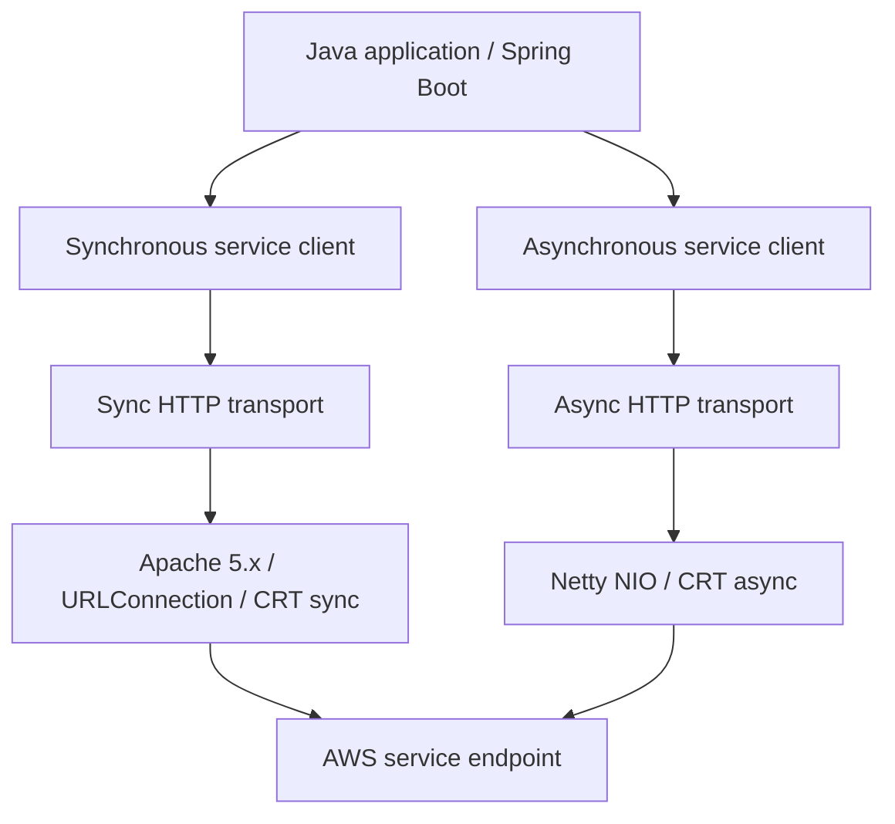
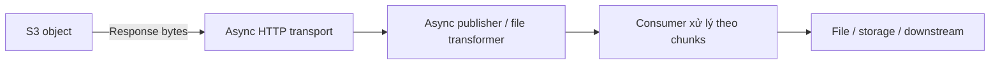
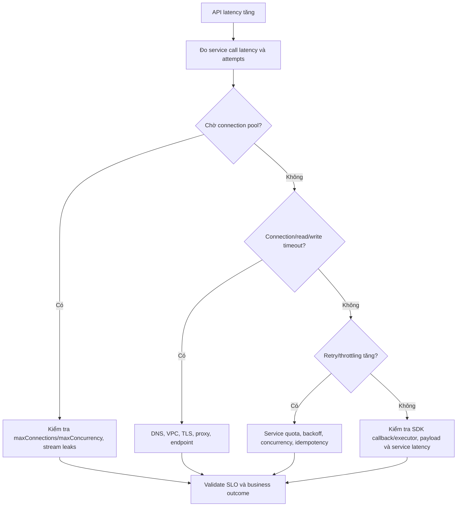

# Synchronous client, asynchronous client và HTTP transport

> **Chương:** AWS SDK cho Java · **Mô-đun:** `CLOUD_PROVIDERS_AWS`

## 1. Bài toán: gọi AWS hiệu quả từ ứng dụng Java

Một ứng dụng Spring Boot chạy trên Amazon ECS cần gọi Amazon DynamoDB để đọc đơn hàng, Amazon S3 để tải hóa đơn và Amazon SQS để gửi tác vụ nền. Một số request cần kết quả ngay để trả HTTP response; một số tác vụ xử lý hàng loạt có thể chạy đồng thời và tiếp tục khi service trả kết quả.

AWS SDK for Java 2.x cung cấp **service clients đồng bộ (synchronous)** và **bất đồng bộ (asynchronous)**. Hai loại client dùng API khác nhau và cần loại HTTP transport tương ứng:

- **Synchronous service client** gọi method và chờ response hoàn tất trên thread hiện tại.
- **Asynchronous service client** trả về `CompletableFuture` hoặc API streaming, cho phép thread gọi tiếp tục làm việc khi request đang chạy.
- **HTTP transport** thực hiện kết nối mạng, TLS, connection pooling, đọc/ghi bytes và quản lý I/O.



**Không nhầm API async với HTTP transport async.** Một `S3AsyncClient` dùng async service API và cần async transport. Một `S3Client` là sync service API, kể cả khi bên dưới dùng `AwsCrtHttpClient` có I/O implementation tối ưu. Chọn đúng cặp client/transport là điều kiện đầu tiên để code hoạt động đúng.

Trong mô-đun `CLOUD_PROVIDERS_AWS`, bài học kết nối **IAM credentials, Region, VPC, ECS/Lambda, S3, DynamoDB, SQS, retries, timeouts và observability**.

**Mục tiêu sau bài học:**

1. Phân biệt synchronous và asynchronous service clients của AWS SDK for Java 2.x.
2. Chọn đúng synchronous hoặc asynchronous HTTP client cho từng service client.
3. So sánh **Apache5HttpClient, UrlConnectionHttpClient, AwsCrtHttpClient, NettyNioAsyncHttpClient và AwsCrtAsyncHttpClient**.
4. Quản lý Maven BOM/dependencies, client lifecycle, thread safety và connection pools.
5. Cấu hình connection timeout, read/write timeout, API call timeout, retries và concurrency.
6. Dùng `CompletableFuture`, exception handling, cancellation và streaming APIs đúng cách.
7. Tích hợp SDK client trong Spring Boot, ECS và Lambda mà không tạo client theo từng request.
8. Đo latency, throughput, connection saturation, retries và chi phí vận hành.

## 2. Bốn khái niệm cần tách biệt

### 2.1. Service client

Service client là lớp API hướng tới một AWS service, ví dụ:

| Client | Service | API |
| --- | --- | --- |
| `DynamoDbClient` | Amazon DynamoDB | Synchronous |
| `DynamoDbAsyncClient` | Amazon DynamoDB | Asynchronous |
| `S3Client` | Amazon S3 | Synchronous |
| `S3AsyncClient` | Amazon S3 | Asynchronous |
| `SqsClient` | Amazon SQS | Synchronous |
| `SqsAsyncClient` | Amazon SQS | Asynchronous |

Service client đóng gói API operations, request/response models, signing, retries, endpoint/Region và các cơ chế chung của SDK.

### 2.2. HTTP client / transport

HTTP client là implementation xử lý mạng bên dưới service client. SDK 2.x tách cấu hình HTTP ra khỏi cấu hình service operation:

- `SdkHttpClient` dành cho synchronous HTTP transport.
- `SdkAsyncHttpClient` dành cho asynchronous HTTP transport.

Ví dụ, `DynamoDbClient` cần synchronous transport; `DynamoDbAsyncClient` cần asynchronous transport. Không truyền `NettyNioAsyncHttpClient` vào `DynamoDbClient` hoặc `Apache5HttpClient` vào `DynamoDbAsyncClient`.

### 2.3. Threading model

**Synchronous**:

```text
Thread-1
  |
  | dynamoDbClient.getItem(...)
  v
  Gửi request -> chờ network -> chờ AWS response
  |
  v
  Nhận response / throw exception -> tiếp tục
```

Thread gọi bị block trong thời gian chờ operation. Với workload có nhiều request đồng thời, ứng dụng thường cần đủ request threads hoặc Java virtual threads phù hợp.

**Asynchronous**:

```text
Thread-1
  |
  | dynamoDbAsyncClient.getItem(...)
  v
  Nhận CompletableFuture -> tiếp tục làm việc khác
                              |
                         I/O event loop
                              |
                         AWS response
                              |
                         Complete future
                              |
                         Callback / compose
```

Async client có thể xử lý nhiều request đồng thời bằng non-blocking I/O với ít threads hơn. Nhưng **không bảo đảm toàn bộ SDK pipeline không bao giờ block**: credential retrieval, SigV4 signing hoặc endpoint discovery trong một số trường hợp có thể thực hiện công việc blocking.

### 2.4. Credentials, Region và endpoint không phải HTTP transport

Ba thành phần thường bị nhầm:

- **Credentials provider** xác định AWS identity để ký request, ví dụ ECS task role, EC2 instance profile, Lambda execution role hoặc web identity.
- **Region** xác định Region/service endpoint và signing scope.
- **HTTP transport** quản lý network connection tới endpoint.

Đổi từ Apache sang Netty không cấp thêm IAM permission; dùng async client không bỏ qua SigV4; cấu hình endpoint URL không tự sửa route/VPC security group.

## 3. Synchronous và asynchronous: chọn theo luồng nghiệp vụ

### 3.1. Synchronous service client

Ví dụ đọc một item từ DynamoDB:

```java
import software.amazon.awssdk.regions.Region;
import software.amazon.awssdk.services.dynamodb.DynamoDbClient;
import software.amazon.awssdk.services.dynamodb.model.AttributeValue;
import software.amazon.awssdk.services.dynamodb.model.GetItemRequest;
import software.amazon.awssdk.services.dynamodb.model.GetItemResponse;
import java.util.Map;

public class OrderLookup {
    public static void main(String[] args) {
        try (DynamoDbClient dynamo = DynamoDbClient.builder()
                .region(Region.AP_SOUTHEAST_1)
                .build()) {

            GetItemResponse response = dynamo.getItem(
                    GetItemRequest.builder()
                            .tableName("orders")
                            .key(Map.of(
                                    "orderId",
                                    AttributeValue.builder().s("ord-1001").build()))
                            .consistentRead(true)
                            .build());

            System.out.println(response.item());
        }
    }
}
```

Đoạn code đã import `Map` và `AttributeValue`; bảng `orders` phải tồn tại và IAM role có `dynamodb:GetItem`. `try-with-resources` đóng service client khi chương trình hoàn tất. Trong ứng dụng server, không tạo client mới cho từng HTTP request; tạo client dùng lại trong suốt vòng đời ứng dụng.

**Ưu điểm:**

- Luồng code tuần tự, dễ đọc và dễ debug.
- Dễ tích hợp với JDBC, transaction orchestration và thư viện đồng bộ.
- Hợp với command/query có latency thấp hoặc lượng concurrency vừa phải.
- Với Java 21+, có thể cân nhắc **virtual threads** cho blocking I/O; vẫn cần giới hạn concurrency, pool và downstream load.

**Hạn chế:** Thread gọi bị giữ trong lúc chờ. Tạo quá nhiều platform threads hoặc để request thread chờ vô hạn có thể làm cạn thread pool.

### 3.2. Asynchronous service client

Ví dụ cùng thao tác DynamoDB:

```java
import java.util.Map;
import java.util.concurrent.CompletableFuture;
import software.amazon.awssdk.regions.Region;
import software.amazon.awssdk.services.dynamodb.DynamoDbAsyncClient;
import software.amazon.awssdk.services.dynamodb.model.AttributeValue;
import software.amazon.awssdk.services.dynamodb.model.GetItemRequest;

public class AsyncOrderLookup {
    public static void main(String[] args) {
        try (DynamoDbAsyncClient dynamo = DynamoDbAsyncClient.builder()
                .region(Region.AP_SOUTHEAST_1)
                .build()) {

            GetItemRequest request = GetItemRequest.builder()
                    .tableName("orders")
                    .key(Map.of("orderId",
                            AttributeValue.builder().s("ord-1001").build()))
                    .consistentRead(true)
                    .build();

            CompletableFuture<?> future = dynamo.getItem(request)
                    .thenApply(response -> response.item())
                    .thenAccept(System.out::println);

            future.join(); // Chỉ để demo CLI chờ chương trình hoàn tất.
        }
    }
}
```

Trong web application, **không gọi `join()`/`get()` ngay trên event-loop thread** chỉ để lấy kết quả, vì sẽ block thread và triệt tiêu lợi ích async. Thay vào đó, trả `CompletionStage/CompletableFuture` từ service layer, compose các operation hoặc dùng framework reactive theo đúng execution model.

**Ưu điểm:**

- Non-blocking network I/O, tăng concurrency trên một số lượng threads nhỏ hơn.
- Ghép nhiều AWS calls độc lập để giảm wall-clock latency.
- Streaming upload/download có thể xử lý dữ liệu theo luồng, không cần giữ toàn bộ payload trong memory.

**Hạn chế:**

- Cần quản lý concurrency, future chains, callback exceptions và backpressure.
- Blocking code trong callbacks có thể chiếm executor/event-loop resources.
- Debug stack traces và cancellation phức tạp hơn.
- Không phải operation/service nào cũng có async client hoặc async streaming API tương đương hoàn toàn.

### 3.3. Ví dụ ghép hai call độc lập

Một trang order cần lấy thông tin đơn từ DynamoDB và metadata hóa đơn từ S3. Nếu hai call độc lập, có thể chạy đồng thời:

```java
CompletableFuture<Order> orderFuture = loadOrderAsync(orderId);
CompletableFuture<InvoiceMetadata> invoiceFuture = loadInvoiceMetadataAsync(orderId);

CompletableFuture<OrderPage> pageFuture =
        orderFuture.thenCombine(invoiceFuture, OrderPage::new);
```

Nếu chạy tuần tự, latency tổng gần bằng **thời gian call A + call B**; nếu song song, latency gần với **max(A, B)** cộng overhead. Nhưng không ghép song song khi call B phụ thuộc kết quả call A, hoặc khi cần transaction/ordering giữa hai service.

### 3.4. Quy tắc chọn nhanh

| Bối cảnh | Lựa chọn thường hợp lý | Lý do |
| --- | --- | --- |
| CLI job hoặc scheduled job đơn giản | Sync | Code tuần tự, dễ vận hành. |
| Spring MVC service đang dùng blocking JDBC | Sync hoặc Java virtual threads | Giữ execution model nhất quán; benchmark concurrency. |
| Spring WebFlux/reactive pipeline | Async | Tránh block event loop, compose future/Publisher. |
| Gọi nhiều AWS services độc lập đồng thời | Async | Giảm thời gian chờ tổng và tăng I/O concurrency. |
| Upload/download S3 file lớn | Async + streaming/Transfer Manager phù hợp | Giảm buffering toàn bộ payload. |
| Lambda workload ngắn, ít concurrent requests | Sync hoặc CRT sync/async theo benchmark | Đơn giản hoặc tối ưu startup/throughput theo use case. |
| CPU-heavy transformations | Sync/async đều cần executor riêng | Async HTTP không làm CPU-bound work tự nhanh hơn. |

**Async không tự động nhanh hơn sync.** Nếu application có concurrency thấp, sync client có thể đơn giản và đủ hiệu năng. Hãy benchmark end-to-end với latency, CPU, thread usage, connection pools và chi phí trước khi chuyển toàn bộ code.

## 4. HTTP transports có trong AWS SDK for Java 2.x

### 4.1. Bảng tổng quan

| HTTP transport | Service client tương thích | Đặc điểm | Dùng khi |
| --- | --- | --- | --- |
| **Apache5HttpClient** | Synchronous | Apache HttpClient 5.x, connection pooling, cấu hình phong phú; **default sync từ SDK 2.46.0**. | Workload blocking, cần tuning connection pool, Java 21 virtual threads. |
| **UrlConnectionHttpClient** | Synchronous | Dựa trên JDK `HttpURLConnection`, dependency nhẹ, startup nhanh. | Muốn giảm third-party dependencies và API không cần các tính năng thiếu. |
| **AwsCrtHttpClient** | Synchronous | AWS Common Runtime (CRT), I/O implementation hiệu năng cao, có thể tăng throughput. | Cần sync API nhưng muốn CRT, Lambda hoặc benchmark cho tải cao. |
| **NettyNioAsyncHttpClient** | Asynchronous | Netty NIO event-driven, **default async transport**. | Async APIs, high concurrency và non-blocking I/O. |
| **AwsCrtAsyncHttpClient** | Asynchronous | AWS CRT native async HTTP implementation. | Async workload, Lambda hoặc high-throughput sau benchmark. |

**Mốc version:** Từ **AWS SDK for Java 2.46.0**, `Apache5HttpClient` (Apache 5.x) thay `ApacheHttpClient` (Apache 4.x) làm default synchronous HTTP client. `ApacheHttpClient` cũ bị deprecated vì Apache HttpClient 4.x đang ở maintenance mode; dự án mới nên ưu tiên Apache5. Các tutorial cũ có thể vẫn dùng `apache-client`/`ApacheHttpClient`, nên kiểm tra version SDK trước khi copy.

### 4.2. Apache5HttpClient

Đây là lựa chọn sync mặc định hiện nay cho nhiều service clients. Nó dùng Apache HttpClient 5.x, có connection pooling, proxy configuration, connection acquisition timeout và các giới hạn socket/network rõ ràng.

Ví dụ:

```java
import java.time.Duration;
import software.amazon.awssdk.http.apache5.Apache5HttpClient;
import software.amazon.awssdk.regions.Region;
import software.amazon.awssdk.services.dynamodb.DynamoDbClient;

DynamoDbClient dynamo = DynamoDbClient.builder()
        .region(Region.AP_SOUTHEAST_1)
        .httpClientBuilder(Apache5HttpClient.builder()
                .maxConnections(100)
                .connectionTimeout(Duration.ofSeconds(3))
                .connectionAcquisitionTimeout(Duration.ofSeconds(5))
                .socketTimeout(Duration.ofSeconds(20))
                .connectionMaxIdleTime(Duration.ofSeconds(60)))
        .build();
```

Các giá trị chỉ là **ví dụ để bắt đầu benchmark**, không phải cấu hình production chung. Nếu dùng service client theo mô hình singleton, pool 100 connections có thể đủ hoặc quá lớn tùy request rate, service quotas, số ECS tasks và downstream capacity.

**Điểm mạnh:** phù hợp với synchronous APIs và nhiều ứng dụng Java truyền thống; Apache 5.x cải thiện tương thích hệ sinh thái Java hiện đại, bao gồm hỗ trợ virtual threads tốt hơn trong Java 21.

**Điểm cần cân nhắc:** là blocking transport; không dùng nó cho async service client. Startup và dependency footprint có thể lớn hơn URLConnection/CRT ở một số môi trường.

### 4.3. UrlConnectionHttpClient

Dựa trên JDK HTTP connection API, phù hợp khi muốn giảm dependency bên ngoài và một transport sync đơn giản. Tuy nhiên có những hạn chế:

- Chỉ dùng với **synchronous service clients**.
- **Không hỗ trợ HTTP PATCH**, có thể khiến một số service operations yêu cầu PATCH không chạy được.
- Không có cấu hình **idle connection timeout** tương đương các HTTP clients khác.
- Ít lựa chọn tuning pool/connection behavior hơn Apache5/CRT.

JDK có system property `http.keepAlive.time.server` để thay đổi idle timeout cho `HttpURLConnection`, nhưng đây là **JVM-wide setting**, ảnh hưởng mọi `HttpURLConnection` trong process chứ không phải per-client setting. Nếu cần kiểm soát idle time theo từng SDK client, dùng Apache5.

Ví dụ:

```java
import java.time.Duration;
import software.amazon.awssdk.http.urlconnection.UrlConnectionHttpClient;
import software.amazon.awssdk.regions.Region;
import software.amazon.awssdk.services.s3.S3Client;

S3Client s3 = S3Client.builder()
        .region(Region.AP_SOUTHEAST_1)
        .httpClientBuilder(UrlConnectionHttpClient.builder()
                .connectionTimeout(Duration.ofSeconds(3))
                .socketTimeout(Duration.ofSeconds(30)))
        .build();
```

Chỉ chọn URLConnection sau khi xác minh API operations của service không cần PATCH và workload chấp nhận giới hạn idle connection. Nếu ứng dụng dùng cả sync và async clients, vẫn phải có async transport như Netty hoặc CRT.

### 4.4. AWS CRT-based HTTP clients

**AWS Common Runtime (CRT)** là bộ native libraries của AWS tập trung vào network/performance. SDK 2.x cung cấp hai classes:

- `AwsCrtHttpClient`: dùng với synchronous service clients.
- `AwsCrtAsyncHttpClient`: dùng với asynchronous service clients.

AWS khuyến nghị đánh giá CRT khi cần throughput cao hoặc chạy trên Lambda; CRT cũng có thể cải thiện startup/CPU/memory trong một số workloads. Tuy nhiên kết quả phụ thuộc service, payload, runtime, platform và packaging.

Ví dụ sync:

```java
import java.time.Duration;
import software.amazon.awssdk.http.crt.AwsCrtHttpClient;
import software.amazon.awssdk.regions.Region;
import software.amazon.awssdk.services.s3.S3Client;

S3Client s3 = S3Client.builder()
        .region(Region.AP_SOUTHEAST_1)
        .httpClientBuilder(AwsCrtHttpClient.builder()
                .connectionTimeout(Duration.ofSeconds(3))
                .maxConcurrency(100))
        .build();
```

Ví dụ async:

```java
import java.time.Duration;
import software.amazon.awssdk.http.crt.AwsCrtAsyncHttpClient;
import software.amazon.awssdk.regions.Region;
import software.amazon.awssdk.services.s3.S3AsyncClient;

S3AsyncClient s3Async = S3AsyncClient.builder()
        .region(Region.AP_SOUTHEAST_1)
        .httpClientBuilder(AwsCrtAsyncHttpClient.builder()
                .connectionTimeout(Duration.ofSeconds(3))
                .maxConcurrency(200))
        .build();
```

**Lưu ý quan trọng về TLS:** CRT HTTP clients không hỗ trợ các Java system properties `javax.net.ssl.keyStore`, `javax.net.ssl.keyStorePassword`, `javax.net.ssl.trustStore` và `javax.net.ssl.trustStorePassword` theo cùng cách JSSE-based clients dùng chúng. Nếu ứng dụng dựa vào Java keystore/truststore properties, hãy đánh giá Netty/Apache5 hoặc cấu hình TLS riêng được CRT hỗ trợ. CRT có native runtime libraries; kiểm tra packaging, CPU architecture và container image khi deploy.

### 4.5. NettyNioAsyncHttpClient

Đây là async transport mặc định cho async service clients. Netty dùng event loop và non-blocking I/O để quản lý nhiều kết nối/request đồng thời. SDK tự cấu hình các giá trị mặc định nếu bạn chỉ khai báo service client dependency; chỉ cần dependency Netty ở compile time khi muốn **tự cấu hình class** hoặc tạo shared transport.

Ví dụ:

```java
import java.time.Duration;
import software.amazon.awssdk.http.nio.netty.NettyNioAsyncHttpClient;
import software.amazon.awssdk.regions.Region;
import software.amazon.awssdk.services.dynamodb.DynamoDbAsyncClient;

DynamoDbAsyncClient dynamo = DynamoDbAsyncClient.builder()
        .region(Region.AP_SOUTHEAST_1)
        .httpClientBuilder(NettyNioAsyncHttpClient.builder()
                .maxConcurrency(200)
                .maxPendingConnectionAcquires(1000)
                .connectionTimeout(Duration.ofSeconds(3))
                .connectionAcquisitionTimeout(Duration.ofSeconds(5))
                .readTimeout(Duration.ofSeconds(20))
                .writeTimeout(Duration.ofSeconds(20)))
        .build();
```

`maxConcurrency` là giới hạn concurrent HTTP requests; với HTTP/1.1 nó tương ứng giới hạn connections, còn HTTP/2 phụ thuộc số streams được phép trên connection. `maxPendingConnectionAcquires` giới hạn hàng đợi chờ connection; nếu đầy, request có thể bị reject hoặc timeout. Đặt giới hạn để **backpressure** thay vì tạo queue không giới hạn.

### 4.6. Ma trận chọn nhanh

| Yêu cầu | Nên benchmark trước |
| --- | --- |
| Sync service client mặc định | **Apache5HttpClient** |
| Sync, giảm dependency bên ngoài | **UrlConnectionHttpClient** |
| Sync, throughput cao/Lambda | **AwsCrtHttpClient** |
| Async service client mặc định | **NettyNioAsyncHttpClient** |
| Async, throughput cao/Lambda | **AwsCrtAsyncHttpClient** |
| Ứng dụng phụ thuộc JSSE keystore/truststore system properties | **Apache5/Netty**, kiểm tra đúng cấu hình TLS |

Không có transport tốt nhất cho mọi workload. Hãy benchmark **request size, payload, connection reuse, concurrency, TLS, startup/cold start và CPU** trong môi trường gần production.

## 5. Dependency và Maven BOM

### 5.1. Vì sao cần AWS SDK BOM?

AWS SDK for Java 2.x gồm nhiều artifacts: `s3`, `dynamodb`, `sqs`, `sts`, `apache5-client`, `netty-nio-client` và `aws-crt-client`. Các modules phải tương thích cùng phiên bản. **Bill of Materials (BOM)** giúp quản lý version đồng bộ, tránh vô tình trộn SDK modules khác version.

Ví dụ Maven:

```xml
<properties>
    <maven.compiler.release>17</maven.compiler.release>
    <aws.sdk.version>2.x.y</aws.sdk.version>
</properties>

<dependencyManagement>
    <dependencies>
        <dependency>
            <groupId>software.amazon.awssdk</groupId>
            <artifactId>bom</artifactId>
            <version>${aws.sdk.version}</version>
            <type>pom</type>
            <scope>import</scope>
        </dependency>
    </dependencies>
</dependencyManagement>

<dependencies>
    <dependency>
        <groupId>software.amazon.awssdk</groupId>
        <artifactId>dynamodb</artifactId>
    </dependency>
    <dependency>
        <groupId>software.amazon.awssdk</groupId>
        <artifactId>s3</artifactId>
    </dependency>
</dependencies>
```

`2.x.y` là placeholder: chọn **một SDK 2.x release đang được tổ chức hỗ trợ**, pin trong dependency management và nâng cấp có kiểm thử. Không copy version minh họa của một tutorial cũ nếu các HTTP client defaults/engine compatibility đã đổi.

### 5.2. Khi nào cần khai báo HTTP transport dependency?

Service client artifacts thường mang các HTTP implementations mặc định như runtime dependencies. Nếu chỉ dùng default transport, bạn thường **không cần import class HTTP client để cấu hình**.

Khi muốn **tự cấu hình** HTTP client trong code, cần artifact tương ứng ở compile classpath:

| Class cần dùng trong code | Maven artifact |
| --- | --- |
| `Apache5HttpClient` | `apache5-client` |
| `ApacheHttpClient` (legacy/deprecated) | `apache-client` |
| `UrlConnectionHttpClient` | `url-connection-client` |
| `NettyNioAsyncHttpClient` | `netty-nio-client` |
| `AwsCrtHttpClient` / `AwsCrtAsyncHttpClient` | `aws-crt-client` |

Nếu dùng **S3 Transfer Manager**, thêm artifact `s3-transfer-manager`. Nếu dùng S3-specific CRT client (`S3AsyncClient.crtBuilder`), kiểm tra dependency `software.amazon.awssdk.crt:aws-crt` theo guide S3 Transfer Manager; dependency này khác `software.amazon.awssdk:aws-crt-client` dùng cho generic CRT HTTP transports.

Ví dụ nếu muốn cấu hình Apache5:

```xml
<dependency>
    <groupId>software.amazon.awssdk</groupId>
    <artifactId>apache5-client</artifactId>
</dependency>
```

Muốn cấu hình Netty:

```xml
<dependency>
    <groupId>software.amazon.awssdk</groupId>
    <artifactId>netty-nio-client</artifactId>
</dependency>
```

Và nếu dùng CRT:

```xml
<dependency>
    <groupId>software.amazon.awssdk</groupId>
    <artifactId>aws-crt-client</artifactId>
</dependency>
```

### 5.3. Giảm dependency footprint

Mỗi service module có thể kéo theo HTTP client runtime dependencies. Nếu ứng dụng chỉ dùng URLConnection, có thể exclude Apache5/Netty artifacts từ **từng service dependencies** rồi khai báo `url-connection-client`. Nếu ứng dụng còn dùng async clients, phải giữ/thêm một async transport như Netty hoặc CRT.

**Không loại bỏ dependency theo cảm tính.** Sau khi exclude, chạy dependency tree/build/test trong đúng profile deploy để bảo đảm:

- Mọi sync clients đều có synchronous transport.
- Mọi async clients đều có asynchronous transport.
- Client custom được cấu hình explicit, không phụ thuộc lựa chọn classpath priority.
- Native CRT binaries tương thích runtime/container architecture.

Nếu có nhiều HTTP implementations trên classpath và service client không chỉ định rõ transport, SDK chọn implementation theo priority; `Apache5HttpClient` có priority cao nhất trong các sync implementations hiện hành. Vì vậy, nếu muốn một service client dùng URLConnection còn client khác dùng Apache5, hãy chỉ định `httpClientBuilder(...)` tường minh cho từng client.

### 5.4. Gradle Kotlin DSL tương đương

```kotlin
dependencies {
    val awsSdkVersion = "2.x.y"
    implementation(platform("software.amazon.awssdk:bom:${awsSdkVersion}"))

    implementation("software.amazon.awssdk:dynamodb")
    implementation("software.amazon.awssdk:s3")

    // Chỉ thêm nếu code cấu hình transport trực tiếp.
    implementation("software.amazon.awssdk:apache5-client")
    implementation("software.amazon.awssdk:netty-nio-client")
}
```

Giữ `awsSdkVersion` ở một nơi quản lý version; không đặt một version khác nhau cho mỗi module AWS SDK.

## 6. Quản lý vòng đời service client và HTTP client

### 6.1. Service clients thread-safe, hãy tái sử dụng

AWS SDK service clients là **thread-safe** và nên được tạo một lần rồi dùng chung trong ứng dụng. Mỗi service client duy trì connection pool riêng (trừ khi bạn chủ động chia sẻ HTTP transport). Nếu tạo một `S3Client`/`DynamoDbClient` cho mỗi HTTP request:

- Connection pools bị tạo/hủy liên tục, mất lợi ích connection reuse.
- TLS handshake, DNS và TCP connection overhead tăng.
- Tạo nhiều threads/sockets, gây memory pressure.
- Dễ gặp socket exhaustion hoặc quá tải service quotas.

**Nguyên tắc:** Một singleton service client cho mỗi cấu hình service/Region/credentials/endpoint cần thiết; chỉ tạo nhiều clients khi có lý do rõ như tách Region, endpoint, credentials hoặc retry policy.

### 6.2. Dùng `httpClientBuilder`: SDK quản lý transport lifecycle

Khi truyền builder:

```java
S3Client s3 = S3Client.builder()
        .region(Region.AP_SOUTHEAST_1)
        .httpClientBuilder(Apache5HttpClient.builder()
                .maxConnections(100))
        .build();

// Dùng client cho nhiều requests...

s3.close(); // SDK đóng service client và transport riêng được tạo qua builder.
```

Đây thường là cách đơn giản nhất khi một transport được dành riêng cho service client đó. Đóng service client khi ứng dụng shutdown hoặc resource scope kết thúc.

### 6.3. Dùng `httpClient`: transport được chia sẻ

Nếu muốn nhiều service clients dùng chung một connection pool:

```java
SdkHttpClient sharedHttp = Apache5HttpClient.builder()
        .maxConnections(200)
        .build();

DynamoDbClient dynamo = DynamoDbClient.builder()
        .region(Region.AP_SOUTHEAST_1)
        .httpClient(sharedHttp)
        .build();

S3Client s3 = S3Client.builder()
        .region(Region.AP_SOUTHEAST_1)
        .httpClient(sharedHttp)
        .build();

// Khi shutdown: đóng service clients trước.
dynamo.close();
s3.close();

// Transport được chia sẻ phải do ứng dụng đóng.
sharedHttp.close();
```

Khi truyền **instance** qua `httpClient(sharedHttp)`, service client không tự đóng shared transport khi gọi `close()`. Ứng dụng sở hữu lifecycle và phải đóng sau khi tất cả clients đã ngừng sử dụng. Với async transport, dùng `SdkAsyncHttpClient` và quản lý tương tự.

**Không dùng chung một HTTP client giữa sync và async service clients**: loại interface và I/O model khác nhau.

### 6.4. Lifecycle trong Spring Boot

Một cấu hình Spring tạo beans ở application context:

```java
@Configuration
public class AwsClientsConfiguration {

    @Bean(destroyMethod = "close")
    DynamoDbClient dynamoDbClient() {
        return DynamoDbClient.builder()
                .region(Region.AP_SOUTHEAST_1)
                .build();
    }

    @Bean(destroyMethod = "close")
    S3AsyncClient s3AsyncClient() {
        return S3AsyncClient.builder()
                .region(Region.AP_SOUTHEAST_1)
                .build();
    }
}
```

Spring quản lý singleton beans và gọi destroy method khi context đóng. Các service inject client qua constructor; không gọi `DynamoDbClient.create()` trong mỗi controller method.

### 6.5. Lifecycle trong AWS Lambda

Với Lambda Java, tạo SDK clients **ngoài handler** để tái sử dụng trong warm execution environments:

```java
public class Handler implements RequestHandler<Request, Response> {
    private static final DynamoDbClient DYNAMO =
            DynamoDbClient.builder()
                    .region(Region.AP_SOUTHEAST_1)
                    .build();

    @Override
    public Response handleRequest(Request request, Context context) {
        // Dùng lại DYNAMO; không tạo/đóng client ở mỗi invocation.
        return process(request, DYNAMO);
    }
}
```

Lambda có thể freeze/thaw execution environment; connections idle có thể bị server/network đóng. SDK/HTTP client sẽ quản lý reconnect theo cơ chế của nó, nhưng ứng dụng vẫn cần timeout/retry hợp lý. **Không lưu AWS credentials tĩnh trong static fields**; để provider chain lấy credentials tạm thời của execution role.

## 7. Connection pools, concurrency và timeouts

### 7.1. Connection pool bảo vệ tài nguyên mạng

Một service client giữ các kết nối HTTP đã thiết lập để request tiếp theo có thể tái sử dụng, giảm TCP/TLS handshake. Hai giới hạn quan trọng:

- **Synchronous Apache5:** `maxConnections` giới hạn connections trong pool.
- **Asynchronous Netty:** `maxConcurrency` giới hạn concurrent requests; `maxPendingConnectionAcquires` giới hạn số request chờ lấy connection.

Nếu app gửi 5.000 requests đồng thời nhưng pool chỉ có 100 connections, phần còn lại phải chờ. Đây là backpressure hữu ích nếu được thiết kế; nếu hàng đợi quá dài, latency tăng và request timeout.

Không tăng pool lên hàng nghìn chỉ để che vấn đề. Một ECS service có 20 tasks và mỗi task có pool 500 connections có thể tạo khả năng **10.000 connections** tới AWS service; điều đó có thể vượt downstream quotas, NAT capacity hoặc giới hạn network.

### 7.2. Các loại timeout khác nhau

| Timeout | Tầng | Ý nghĩa |
| --- | --- | --- |
| **Connection timeout** | HTTP/network | Thời gian tối đa thiết lập TCP/TLS connection mới. |
| **Connection acquisition timeout** | Pool | Thời gian chờ connection/slot rảnh trong pool. |
| **Socket timeout** | Apache/URLConnection | Thời gian chờ dữ liệu trên connection đã thiết lập. |
| **Read timeout** | Netty/async | Thời gian tối đa chờ đọc response data. |
| **Write timeout** | Netty/async | Thời gian tối đa ghi request data. |
| **API call attempt timeout** | Service client | Giới hạn một attempt, gồm thời gian thực hiện attempt theo SDK. |
| **API call timeout** | Service client | Giới hạn toàn operation, bao gồm retries và thời gian backoff. |

Ví dụ:

```java
S3Client s3 = S3Client.builder()
        .region(Region.AP_SOUTHEAST_1)
        .httpClientBuilder(Apache5HttpClient.builder()
                .connectionTimeout(Duration.ofSeconds(3))
                .connectionAcquisitionTimeout(Duration.ofSeconds(5))
                .socketTimeout(Duration.ofSeconds(20)))
        .overrideConfiguration(o -> o
                .apiCallAttemptTimeout(Duration.ofSeconds(25))
                .apiCallTimeout(Duration.ofSeconds(60)))
        .build();
```

Giá trị minh họa: tổng API call timeout 60s bao trùm một hay nhiều attempts và backoff; mỗi attempt không được vượt 25s; network connection/socket có giới hạn thấp hơn. Chọn timeout theo **SLO, request payload, downstream service và retry budget**, không copy 3/20/60s cho mọi operation.

### 7.3. Netty async timeouts và concurrency

```java
S3AsyncClient s3 = S3AsyncClient.builder()
        .region(Region.AP_SOUTHEAST_1)
        .httpClientBuilder(NettyNioAsyncHttpClient.builder()
                .maxConcurrency(200)
                .maxPendingConnectionAcquires(500)
                .connectionTimeout(Duration.ofSeconds(3))
                .connectionAcquisitionTimeout(Duration.ofSeconds(5))
                .readTimeout(Duration.ofSeconds(30))
                .writeTimeout(Duration.ofSeconds(30)))
        .overrideConfiguration(o -> o
                .apiCallAttemptTimeout(Duration.ofSeconds(40))
                .apiCallTimeout(Duration.ofMinutes(2)))
        .build();
```

Nếu `maxPendingConnectionAcquires` quá thấp, requests burst có thể bị reject sớm; nếu quá cao, app giữ hàng đợi lớn, memory tăng và response có thể hết hạn trước khi được gửi. Chọn concurrency dựa vào load test và capacity của downstream service.

### 7.4. Timeout không phải retry

Timeout kết thúc một attempt hoặc operation; retry strategy quyết định có thử lại hay không. Ví dụ:

- TCP connect timeout do route/SG sai: retry nhiều lần thường không sửa được cấu hình mạng.
- Throttling: retry có backoff/jitter có thể thành công sau khi tải giảm.
- Invalid credentials/AccessDenied: retry không làm policy tự thay đổi.
- API call timeout: giới hạn tổng thời gian, không có nghĩa operation phía AWS chắc chắn đã rollback.

Nếu timeout xảy ra sau khi service đã xử lý request nhưng response bị mất, client không biết kết quả cuối. **Retry có thể gửi lại cùng ý định nghiệp vụ**; dùng idempotency tokens/conditional writes hoặc đọc lại trạng thái trước khi thực hiện side effects.

### 7.5. Adaptive retry và giới hạn theo resource

SDK có các retry strategies:

- **Standard:** lựa chọn mặc định được khuyến nghị cho đa số workloads; exponential backoff, retry quota/circuit breaker để giảm retry storms.
- **Legacy:** giữ hành vi cũ cho hệ thống cần tương thích.
- **Adaptive:** thêm client-side rate limiter phản ứng với throttling; phù hợp workload có một resource/downstream bị giới hạn.

**Adaptive retry không phù hợp khi dùng một client chung cho nhiều resources độc lập**: throttling ở resource A có thể làm chậm requests tới resource B. Nếu chọn adaptive, tách client theo resource hoặc phạm vi mà rate limiter nên điều khiển.

### 7.6. Thay đổi mặc định retry theo SDK version

**Từ AWS SDK for Java 2.58.0**, standard retry strategy trở thành default:

| Client/workload | Standard mặc định | Legacy mặc định cũ |
| --- | --- | --- |
| Phần lớn AWS service clients | **3 attempts** (1 lần đầu + 2 retries). | 4 attempts (1 + 3 retries). |
| DynamoDB/DynamoDB Streams | **4 attempts** theo tuning mặc định riêng. | 9 attempts (1 + 8 retries). |

Standard retry phân loại transient/throttling errors, exponential backoff, retry token bucket và circuit breaker. Điều này có thể khiến ứng dụng nhận lỗi nhanh hơn so với những version SDK cũ. Khi nâng SDK, kiểm tra **latency, error rate, request attempts, throttling và application retry loops**; đừng giả định số attempts không đổi.

Có thể đặt mode/max attempts qua:

```bash
export AWS_RETRY_MODE=standard
export AWS_MAX_ATTEMPTS=4
```

`AWS_MAX_ATTEMPTS` tính cả attempt đầu tiên. Giá trị 4 nghĩa là tối đa 1 lần đầu + 3 retries. Hoặc cấu hình trong AWS shared config profile, JVM system properties hay client override configuration. Nên quản lý policy tập trung, không để từng service tự chọn attempts khác nhau mà không có SLO.

### 7.7. Retry không tạo exactly-once

Một request `CreateOrder` hoặc `SendMessage` timeout có thể đã được AWS xử lý. Nếu app retry mà không có idempotency, có thể tạo hai orders hoặc hai messages. Với operations hỗ trợ idempotency token, dùng **stable token cho cùng một business intent**; không tạo token mới mỗi retry. Với database writes, dùng conditional expression/unique key/transaction phù hợp.

Không lồng nhiều lớp retry quá mức:

```text
SDK retry: 3 attempts
Application retry: 3 attempts
HTTP gateway retry: 3 attempts
=> Có thể thành nhiều attempts hơn mong đợi và kéo dài latency.
```

Đặt một nơi chịu trách nhiệm retry chính, tính tổng retry budget và đảm bảo operation idempotent.

## 8. Asynchronous programming với CompletableFuture

### 8.1. Xử lý success và failure

Async API trả `CompletableFuture<T>`. Dùng `thenApply` để biến đổi kết quả, `thenCompose` để ghép một async call tiếp theo, `thenCombine` để ghép hai futures độc lập và `whenComplete`/`handle` để quan sát hoặc xử lý lỗi.

```java
CompletableFuture<GetItemResponse> future = dynamo.getItem(request);

CompletableFuture<Order> orderFuture = future
        .thenApply(this::toOrder)
        .whenComplete((order, error) -> {
            if (error != null) {
                log.warn("DynamoDB request failed", unwrap(error));
            }
        });
```

SDK có thể hoàn thành future exceptionally với `CompletionException` bọc nguyên nhân. Khi log/branch theo lỗi, inspect `getCause()` hoặc dùng helper để tìm exception gốc. Không log toàn bộ request/response có thể chứa PII hoặc credentials.

### 8.2. `thenApply` khác `thenCompose`

```java
// thenApply: map T -> U
CompletableFuture<String> orderIdFuture =
        dynamo.getItem(request)
                .thenApply(response -> response.item().get("orderId").s());

// thenCompose: map T -> CompletableFuture<U>, flatten nested future
CompletableFuture<Invoice> invoiceFuture =
        dynamo.getItem(request)
                .thenCompose(response -> {
                    String orderId = response.item().get("orderId").s();
                    return loadInvoiceAsync(orderId);
                });
```

Nếu dùng `thenApply` với method trả future, kết quả thành `CompletableFuture<CompletableFuture<Invoice>>`. `thenCompose` làm phẳng thành một future.

### 8.3. Chọn executor cho công việc tiếp theo

Non-async callbacks như `thenApply` có thể chạy trên thread hoàn tất future; không giả định callback được chạy trong thread pool riêng. Nếu callback làm CPU-heavy hoặc blocking work, chuyển sang executor chuyên dụng:

```java
ExecutorService cpuExecutor = Executors.newFixedThreadPool(8);

CompletableFuture<Report> reportFuture =
        s3Async.getObject(getRequest, AsyncResponseTransformer.toBytes())
                .thenApplyAsync(response -> buildReport(response.asByteArray()),
                        cpuExecutor);
```

**Không chạy blocking JDBC, file I/O nặng hoặc `Thread.sleep` trong Netty event loop.** Nếu cần gọi một API sync, đưa operation đó vào bounded worker executor; đặt queue size và rejection policy để tạo backpressure.

### 8.4. Kết hợp nhiều futures

```java
CompletableFuture<Order> order = loadOrderAsync(orderId);
CompletableFuture<Customer> customer = loadCustomerAsync(customerId);

CompletableFuture<OrderView> view =
        order.thenCombine(customer, OrderView::new);
```

`allOf` chờ nhiều futures:

```java
CompletableFuture<Void> all = CompletableFuture.allOf(
        loadOrderAsync("ord-1"),
        loadOrderAsync("ord-2"),
        loadOrderAsync("ord-3"));

CompletableFuture<List<Order>> orders = all.thenApply(ignored ->
        List.of(
                loadOrderAsync("ord-1").join(),
                loadOrderAsync("ord-2").join(),
                loadOrderAsync("ord-3").join()));
```

Ví dụ trên minh họa API nhưng gọi lại futures là sai về hiệu quả. Trong code thật, giữ references và đọc kết quả đã hoàn tất:

```java
List<CompletableFuture<Order>> futures = List.of(
        loadOrderAsync("ord-1"),
        loadOrderAsync("ord-2"),
        loadOrderAsync("ord-3"));

CompletableFuture<List<Order>> ordersFuture =
        CompletableFuture.allOf(futures.toArray(CompletableFuture[]::new))
                .thenApply(ignored ->
                        futures.stream().map(CompletableFuture::join).toList());
```

`join` ở đây chỉ đọc futures sau khi `allOf` đã hoàn tất; nó không khởi chạy thêm network calls. Nếu một future fail, `allOf` cũng hoàn tất exceptionally; xử lý partial success riêng nếu business cho phép.

### 8.5. Cancellation và timeout

Có thể dùng `orTimeout`/`completeOnTimeout` để giới hạn thời gian chờ ở application layer, nhưng:

- Hoàn tất future với timeout không đồng nghĩa request phía AWS chắc chắn đã bị hủy.
- `cancel(true)` không phải cơ chế rollback transaction nghiệp vụ.
- Service có thể đã thực hiện write trước khi client nhận timeout/cancel.
- Dùng SDK API call timeouts để kiểm soát operation và idempotency/reconciliation để xác định kết quả.

Ví dụ:

```java
CompletableFuture<GetItemResponse> future = dynamo.getItem(request)
        .orTimeout(2, TimeUnit.SECONDS);
```

Đây là **giới hạn chờ của CompletableFuture**, không thay thế timeout cấu hình trong SDK. Nếu dùng cả hai, hiểu rõ timeout nào xảy ra trước và metrics nào ghi nhận request đã được gửi.

## 9. Streaming với S3 và các asynchronous APIs

### 9.1. Vì sao streaming quan trọng?

Với object S3 dung lượng 2 GiB, đọc toàn bộ vào byte array có thể tạo áp lực heap rất lớn, gây GC pause hoặc OutOfMemoryError. Streaming cho phép ứng dụng xử lý dữ liệu theo chunks:



### 9.2. Upload file với S3AsyncClient

```java
import java.nio.file.Path;
import java.util.concurrent.CompletableFuture;
import software.amazon.awssdk.core.async.AsyncRequestBody;
import software.amazon.awssdk.services.s3.S3AsyncClient;
import software.amazon.awssdk.services.s3.model.PutObjectRequest;
import software.amazon.awssdk.services.s3.model.PutObjectResponse;

CompletableFuture<PutObjectResponse> upload =
        s3Async.putObject(
                PutObjectRequest.builder()
                        .bucket("training-documents")
                        .key("reports/2026/report.pdf")
                        .contentType("application/pdf")
                        .build(),
                AsyncRequestBody.fromFile(Path.of("/tmp/report.pdf")));

upload.whenComplete((response, error) -> {
    if (error != null) {
        log.error("S3 upload failed", error);
    } else {
        log.info("S3 upload completed: {}", response.eTag());
    }
});
```

`AsyncRequestBody.fromFile` cho phép SDK đọc file theo cơ chế async body. File phải tồn tại và process có quyền đọc. Không xóa hoặc sửa file nguồn trước khi future hoàn tất.

### 9.3. Download file với AsyncResponseTransformer

```java
import java.nio.file.Path;
import java.util.concurrent.CompletableFuture;
import software.amazon.awssdk.core.async.AsyncResponseTransformer;
import software.amazon.awssdk.services.s3.model.GetObjectRequest;
import software.amazon.awssdk.services.s3.model.GetObjectResponse;

CompletableFuture<GetObjectResponse> download =
        s3Async.getObject(
                GetObjectRequest.builder()
                        .bucket("training-documents")
                        .key("reports/2026/report.pdf")
                        .build(),
                AsyncResponseTransformer.toFile(
                        Path.of("/tmp/report-downloaded.pdf")));
```

`AsyncResponseTransformer.toFile` ghi nội dung response vào file, không buộc ứng dụng giữ toàn object trong heap. Đảm bảo đường dẫn đích an toàn, có đủ disk space và kiểm tra kết quả trước khi xử lý file.

### 9.4. Sync streaming và connection pool

Với `S3Client.getObject`, SDK có thể trả `ResponseInputStream`. Nếu đọc stream nhưng **không đóng**, connection có thể không quay lại pool và cuối cùng pool bị cạn:

```java
import java.io.OutputStream;
import java.nio.file.Files;
import java.nio.file.Path;
import software.amazon.awssdk.core.ResponseInputStream;
import software.amazon.awssdk.services.s3.model.GetObjectRequest;
import software.amazon.awssdk.services.s3.model.GetObjectResponse;

try (ResponseInputStream<GetObjectResponse> stream =
             s3.getObject(GetObjectRequest.builder()
                     .bucket("training-documents")
                     .key("reports/2026/report.pdf")
                     .build());
     OutputStream output = Files.newOutputStream(Path.of("/tmp/report.pdf"))) {
    stream.transferTo(output);
}
```

Đóng stream là bắt buộc kể cả khi xử lý lỗi. Với object lớn, không dùng `readAllBytes()` nếu không có heap budget rõ ràng.

### 9.5. Backpressure và streaming consumers

Async streaming APIs thường dựa trên Reactive Streams/`Flow.Publisher` semantics: consumer yêu cầu dữ liệu theo demand. Nếu consumer xử lý chậm mà application buffer không giới hạn, memory vẫn có thể tăng dù network non-blocking.

- Chọn chunk/buffer size phù hợp.
- Không gọi blocking DB/file APIs trong callback event-loop.
- Dùng bounded queues và executor cho CPU/blocking work.
- Xử lý error/cancel và đóng tài nguyên.
- Đo bytes/sec, queue depth, heap, GC và downstream latency.

**Non-blocking I/O không đồng nghĩa memory-free**; streaming cần backpressure ở cả producer, transport và consumer.

## 10. Credentials, Region, endpoint và proxy

### 10.1. Credentials provider chain

Service clients có thể tự dùng **default credentials provider chain** nếu không chỉ định provider:

- Java system properties / environment variables theo thứ tự provider chain.
- Web identity token credentials, phù hợp workload dùng OIDC/IRSA hoặc ECS/EKS integrations theo môi trường.
- Shared AWS profiles/config.
- ECS container credentials endpoint / EC2 instance profile credentials.

Trong AWS production, ưu tiên **IAM roles và temporary credentials**:

| Runtime | Identity khuyến nghị |
| --- | --- |
| Amazon ECS | Task role |
| Amazon EKS | IAM Roles for Service Accounts (IRSA) hoặc EKS Pod Identity theo cấu hình |
| AWS Lambda | Execution role |
| Amazon EC2 | Instance profile |
| Local development | Named profile/SSO phù hợp |

Không hard-code access key/secret trong source, Docker image hoặc `application.yaml`. Credentials provider có thể refresh credentials; đừng tự cache temporary credentials vô thời hạn.

### 10.2. Region

Chỉ định Region rõ ràng khi ứng dụng phải hoạt động ổn định theo deployment:

```java
DynamoDbClient dynamo = DynamoDbClient.builder()
        .region(Region.AP_SOUTHEAST_1)
        .build();
```

Nếu không chỉ định, SDK tìm Region qua provider chain/shared config/environment theo thứ tự. Với multi-Region workloads, cân nhắc **một client cho mỗi Region** và quản lý lifecycle/endpoint riêng. Region phải tương thích với service/resource ARN và signing scope; sai Region thường dẫn tới resource not found hoặc signature/endpoint errors.

### 10.3. Custom endpoint và local development

LocalStack hoặc endpoint riêng có thể dùng `endpointOverride`:

```java
DynamoDbClient localDynamo = DynamoDbClient.builder()
        .region(Region.US_EAST_1) // Region vẫn cần cho signing.
        .endpointOverride(URI.create("http://localhost:4566"))
        .credentialsProvider(
                StaticCredentialsProvider.create(
                        AwsBasicCredentials.create("test", "test")))
        .build();
```

Credentials `test/test` và HTTP endpoint chỉ dành cho môi trường local/test được cô lập; **không dùng trong production**. Khi endpointOverride, SDK không tự bảo đảm service resource thực sự tồn tại hoặc VPC network đã đúng.

### 10.4. Proxy configuration

SDK hỗ trợ proxy theo HTTP transport. Cấu hình proxy ảnh hưởng kết nối, DNS, TLS, connection pooling và authentication. Proxy có thể được cung cấp qua builder, system properties hoặc environment variables như `HTTP_PROXY`, `HTTPS_PROXY` và `NO_PROXY` theo transport support.

Ví dụ Apache5:

```java
import software.amazon.awssdk.http.apache5.Apache5HttpClient;
import software.amazon.awssdk.http.apache5.ProxyConfiguration;

Apache5HttpClient.Builder http = Apache5HttpClient.builder()
        .proxyConfiguration(ProxyConfiguration.builder()
                .endpoint(URI.create("http://proxy.internal.example:8080"))
                .build());
```

Không đưa proxy password vào logs hoặc source code. Kiểm tra transport-specific proxy settings: không phải mọi client đọc cùng system properties hay hỗ trợ mọi kiểu proxy giống nhau.

### 10.5. TLS và trust stores

- **Apache5/Netty** tích hợp với Java TLS/JSSE settings theo cấu hình.
- **CRT** có TLS configuration riêng và không sử dụng một số JSSE keystore/truststore system properties đã nêu ở mục 4.4.
- Với corporate proxy/TLS inspection, trust chain phải được cấu hình an toàn; không tắt certificate verification.
- Với AWS endpoints, ưu tiên certificate validation mặc định và CA bundle phù hợp.

Lỗi TLS có thể biểu hiện thành handshake timeout, certificate path errors hoặc hostname mismatch. Không sửa bằng `trustAllCertificates`; xác định CA/hostname/proxy/transport trước.

## 11. Tích hợp Spring Boot và thiết kế client theo workload

### 11.1. Cấu hình beans dùng chung

Một ứng dụng Spring Boot có thể khai báo một sync client và một async client:

```java
@Configuration
public class AwsSdkConfiguration {

    @Bean(destroyMethod = "close")
    DynamoDbClient dynamoDbClient() {
        return DynamoDbClient.builder()
                .region(Region.AP_SOUTHEAST_1)
                .overrideConfiguration(o -> o
                        .apiCallTimeout(Duration.ofSeconds(30))
                        .apiCallAttemptTimeout(Duration.ofSeconds(10)))
                .build();
    }

    @Bean(destroyMethod = "close")
    S3AsyncClient s3AsyncClient() {
        return S3AsyncClient.builder()
                .region(Region.AP_SOUTHEAST_1)
                .build();
    }
}
```

Các clients được inject qua constructor:

```java
@Service
public class OrderRepository {
    private final DynamoDbClient dynamo;

    public OrderRepository(DynamoDbClient dynamo) {
        this.dynamo = dynamo;
    }

    public Map<String, AttributeValue> find(String orderId) {
        return dynamo.getItem(r -> r
                .tableName("orders")
                .key(Map.of("orderId",
                        AttributeValue.builder().s(orderId).build())))
                .item();
    }
}
```

Trong môi trường production, Region/endpoint/timeouts nên lấy từ configuration/environment phù hợp; đừng nhân bản bean nếu chỉ khác request parameters. Nếu có nhiều AWS accounts/Regions, tạo client beans riêng với **credentials provider và Region tường minh**, đặt tên qualifier rõ ràng.

### 11.2. Không block reactive event loop

Với Spring MVC (servlet/blocking), synchronous SDK client thường hợp mô hình thread-per-request hoặc virtual threads. Với Spring WebFlux, tránh gọi synchronous SDK trực tiếp trên event-loop:

```java
// WebFlux: trả Mono từ async SDK thay vì gọi .join() trên event loop.
public Mono<Order> findOrder(String id) {
    return Mono.fromFuture(orderService.findOrderAsync(id));
}
```

Nếu chỉ có synchronous SDK client nhưng cần tích hợp WebFlux, có thể chuyển sang bounded worker scheduler:

```java
return Mono.fromCallable(() -> blockingRepository.findOrder(id))
        .subscribeOn(Schedulers.boundedElastic());
```

Đây là fallback cho blocking I/O; với workload có thể dùng async client, tránh dùng một worker pool không giới hạn hoặc biến mọi operation thành `boundedElastic` mà không theo dõi saturation.

### 11.3. Executor cho future completion

Với **Netty async transport mặc định**, Netty xử lý network I/O và SDK có executor để hoàn tất futures. Nếu chọn CRT async transport, implementation I/O là CRT. Có thể cấu hình executor riêng để kiểm soát future-completion threads hoặc gắn instrumentation:

```java
import java.util.concurrent.ExecutorService;
import java.util.concurrent.Executors;
import software.amazon.awssdk.core.client.config.SdkAdvancedAsyncClientOption;
import software.amazon.awssdk.regions.Region;
import software.amazon.awssdk.services.dynamodb.DynamoDbAsyncClient;

ExecutorService completionExecutor = Executors.newFixedThreadPool(8);

DynamoDbAsyncClient dynamo = DynamoDbAsyncClient.builder()
        .region(Region.AP_SOUTHEAST_1)
        .asyncConfiguration(c -> c.advancedOption(
                SdkAdvancedAsyncClientOption.FUTURE_COMPLETION_EXECUTOR,
                completionExecutor))
        .build();

// Khi shutdown:
dynamo.close();
completionExecutor.shutdown();
```

Executor này thuộc application nếu bạn tự tạo; phải shutdown khi application kết thúc. Giữ callback completion ngắn và không blocking; với CPU-heavy processing, dùng `thenApplyAsync` với một bounded executor riêng. Không dùng pool không giới hạn; cấu hình thread count/queue/rejection theo capacity và latency budget. **Không chạy blocking work trên Netty event loop**.

### 11.4. S3 Transfer Manager cho file lớn

Nếu upload/download nhiều file hoặc file lớn, xem **S3 Transfer Manager** thay vì tự quản lý mọi multipart chunks. Transfer Manager có thể sử dụng async S3 client và AWS CRT S3 client để hỗ trợ multipart/concurrency; cần kiểm tra version, dependencies, multipart threshold, buffer/memory và shutdown lifecycle.

Nếu dùng **Java-based S3AsyncClient** thay cho CRT S3 client, bật `multipartEnabled(true)` để Transfer Manager tận dụng multipart/parallel transfer. Khi tạo Transfer Manager mặc định, SDK có thể chọn CRT client nếu dependency CRT phù hợp có trên classpath; hãy chỉ định client tường minh nếu muốn kiểm soát transport và lifecycle.

```java
import java.nio.file.Path;
import software.amazon.awssdk.services.s3.S3AsyncClient;
import software.amazon.awssdk.transfer.s3.S3TransferManager;
import software.amazon.awssdk.transfer.s3.model.FileUpload;

S3AsyncClient s3Async = S3AsyncClient.crtBuilder()
        .region(Region.AP_SOUTHEAST_1)
        .build();

try (S3TransferManager transferManager = S3TransferManager.builder()
        .s3Client(s3Async)
        .build()) {
    FileUpload upload = transferManager.uploadFile(r -> r
            .source(Path.of("/data/archive.zip"))
            .putObjectRequest(p -> p
                    .bucket("training-documents")
                    .key("archive/archive.zip")));

    upload.completionFuture().join(); // Chỉ minh họa cho batch/CLI flow.
} finally {
    // Transfer Manager không đóng client được truyền vào builder.
    s3Async.close();
}
```

Code trên minh họa hướng sử dụng CRT-backed async S3 client; để dùng `S3AsyncClient.crtBuilder()`/Transfer Manager, khai báo artifact `s3-transfer-manager` và AWS CRT dependency phù hợp (`software.amazon.awssdk.crt:aws-crt`) theo [S3 Transfer Manager guide](https://docs.aws.amazon.com/sdk-for-java/latest/developer-guide/transfer-manager.html). Đây là S3-specific CRT client, khác generic `AwsCrtAsyncHttpClient` dùng cho các service clients khác. Transfer Manager không đóng `S3AsyncClient` được truyền vào builder, nên application phải quản lý lifecycle của client. Trong server request path, không gọi `join()`; compose completion future và trả kết quả async.

## 12. Smart defaults, retries và cách cấu hình theo môi trường

### 12.1. Smart configuration

AWS SDK for Java 2.x có các **smart configuration defaults** để áp dụng một nhóm settings phù hợp với environment/traffic profile. Các defaults có thể ảnh hưởng retry, timeouts và HTTP behavior. Khi dùng:

- Hiểu profile/default mode đang được chọn (ví dụ standard, in-region, cross-region theo SDK support).
- Ghi rõ cấu hình được áp dụng và override trong code khi SLO yêu cầu.
- Không giả định cùng một cấu hình có kết quả giống nhau giữa Lambda, ECS, EC2 và local development.
- Kiểm tra SDK version vì default behavior có thể đổi theo release.

Smart defaults giúp có baseline, **không thay benchmark và SLO-specific tuning**.

Có thể đặt mode qua shared config:

```ini
[default]
region = ap-southeast-1
defaults_mode = in-region
```

Hoặc qua environment variable `AWS_DEFAULTS_MODE` / JVM property `aws.defaultsMode`. Khi dùng `auto`, SDK có thể dò runtime metadata để chọn mode; điều đó có thể ảnh hưởng startup latency.

### 12.2. Cấu hình retry trong code

Ví dụ đặt tối đa 4 attempts (một lần đầu và tối đa ba retries):

```java
DynamoDbClient dynamo = DynamoDbClient.builder()
        .region(Region.AP_SOUTHEAST_1)
        .overrideConfiguration(o -> o.retryStrategy(
                retry -> retry.maxAttempts(4)))
        .build();
```

Hoặc qua shared config/environment:

```ini
[profile app-prod]
region = ap-southeast-1
retry_mode = standard
max_attempts = 4
```

`max_attempts` là tổng số attempts, bao gồm attempt đầu tiên. Hãy tránh cấu hình retry cao cho operation có side effects mà không có idempotency token.

### 12.3. Retry standard và legacy theo version

| SDK release | Default strategy | Attempts mặc định thông thường |
| --- | --- | --- |
| Trước 2.58.0 | Legacy | 4 tổng (DynamoDB 9 tổng). |
| Từ 2.58.0 | Standard | 3 tổng (DynamoDB 4 tổng). |

Standard strategy retry các lỗi transient/throttling được phân loại, dùng exponential backoff và retry quota. Điều này có thể khiến ứng dụng nhận lỗi nhanh hơn so với những version SDK cũ. Khi nâng SDK, kiểm tra **latency, error rate, request attempts, throttling và application retry loops**; đừng giả định số attempts không đổi.

Có thể giữ hành vi cũ trong giai đoạn migration bằng `AWS_RETRY_MODE=legacy`; sau đó đánh giá và chuyển sang standard.

### 12.4. Adaptive retry và giới hạn theo resource

Adaptive retry có client-side rate limiter dựa trên throttling. Nó có thể hữu ích cho workload latency-tolerant, tập trung vào **một resource** bị giới hạn. Không dùng một adaptive client chia sẻ cho nhiều bảng/queues/buckets không liên quan, vì throttling của một resource có thể làm chậm tất cả requests của client đó.

### 12.5. Đặt timeout theo budget end-to-end

Ví dụ một API gateway có timeout 3 giây, application có 2 AWS calls song song và còn 500ms cho serialize/response. Không thể đặt mỗi AWS call timeout 10 giây rồi mong endpoint luôn trả trong 3 giây.

Phân bổ:

```text
API budget:                     3,000 ms
AWS call A total budget:        1,800 ms
AWS call B total budget:        1,800 ms
Join/wait budget:               1,900 ms
Serialize + response:             300 ms
Safety margin:                   800 ms
```

Đây là sơ đồ phân bổ minh họa. Vì A/B chạy song song, thời gian chờ tổng gần max(A,B), không phải tổng hai timeout. Phải tính thêm retry/backoff, network connect, pool acquisition và client-side executor queues. Dùng **API call timeout** để giới hạn operation toàn phần và timeout tầng HTTP để ngăn các network waits không mong muốn.

## 13. Logging, metrics và kiểm thử hiệu năng

### 13.1. Ghi request ID và lỗi theo service operation

Khi AWS trả lỗi, SDK cung cấp exception có service metadata, status code, AWS error code và request ID trong những trường hợp có response. Ghi lại các thông tin hữu ích:

- Service name và operation (ví dụ `DynamoDB.GetItem`).
- Region, client profile hoặc endpoint alias (không ghi credentials).
- HTTP status, AWS error code, request ID và attempt count nếu có.
- Latency tổng, retries/backoff và timeout layer.
- Business correlation ID đã được ứng dụng tạo.

Không ghi toàn bộ payload, access key, session token, authorization header hoặc dữ liệu PII. Request ID giúp AWS Support/service logs tra cứu, nhưng không thay business correlation ID.

### 13.2. SDK logging và wire logging

AWS SDK for Java 2.x dùng logging facade SLF4J. Có thể cấu hình log level để quan sát request lifecycle, retry hoặc HTTP internals trong môi trường test. **Wire logging** có thể ghi headers/body của request và response, nên có nguy cơ lộ thông tin nhạy cảm:

- Chỉ bật tạm thời để chẩn đoán trong môi trường có kiểm soát.
- Redact credentials, customer data, signed headers và payload.
- Không bật DEBUG/wire logging toàn thời gian trên production traffic.
- Tắt sau khi điều tra và giới hạn quyền truy cập log.

### 13.3. Metrics cần theo dõi

| Metric | Ý nghĩa | Chẩn đoán |
| --- | --- | --- |
| API call latency p50/p95/p99 | Thời gian operation tổng. | Timeout/retry/response latency. |
| HTTP connection acquisition wait | Chờ pool slot. | Pool nhỏ, burst hoặc connections không được trả lại. |
| Connection timeout/read/write timeout | Network-level failures. | VPC, proxy, endpoint, service latency. |
| Requests in flight / max concurrency | Số requests đang chạy. | Netty concurrency hoặc downstream saturation. |
| Pending connection acquires | Hàng đợi chờ connection. | Backpressure và pool saturation. |
| Retry attempts by error class | Số lần thử lại. | Throttling, transient errors hoặc retry storm. |
| HTTP 4xx/5xx và AWS error codes | Lỗi service/auth/request. | IAM, resource, validation, quotas. |
| Async future completion errors | Futures thất bại. | Exception chain, executor saturation. |
| Thread count/queue depth/heap/GC | Tài nguyên JVM. | Callback blocking, oversized queues, buffering. |
| S3 bytes/sec, multipart parts, memory | Streaming throughput. | Payload, backpressure, disk/network. |

Không phải tất cả transports/service clients tự phát mọi metric thành CloudWatch theo mặc định. Có thể dùng application metrics/Micrometer, SDK metric publishers hoặc tracing/observability platform. **Đừng tạo metric label theo request ID/object key/user ID**, vì cardinality và dữ liệu nhạy cảm.

### 13.4. Tracing và correlation

```text
HTTP request
  -> Spring service span
      -> AWS SDK DynamoDB operation span
      -> AWS SDK S3 operation span
  -> response / business outcome
```

Dùng OpenTelemetry/X-Ray hoặc tracing stack được tổ chức hỗ trợ. Nếu bật SDK instrumentation, kiểm tra phiên bản agent/SDK compatibility và tránh tạo spans quá chi tiết cho hàng triệu low-level operations nếu không cần. Gắn correlation ID nghiệp vụ và AWS request ID để đối chiếu.

### 13.5. Benchmark sync và async công bằng

Một benchmark có ý nghĩa phải cố định:

1. Cùng Region, AWS service/resource, IAM role và network placement.
2. Cùng operation mix, payload size, data distribution và consistency requirements.
3. Cùng concurrency target và request rate; tách cold-start khỏi steady-state.
4. Đo p50/p95/p99, throughput, CPU, heap, thread count, connection count, retry/throttle.
5. Chạy đủ lâu để connection pool warm, GC ổn định và network không còn chỉ ở trạng thái cold.
6. Đo **total cost**: task CPU/memory, NAT/data transfer, service charges và engineering overhead.

So sánh sync một thread với async 1.000 requests in-flight không phải benchmark công bằng. So sánh theo **cùng SLO và cùng mức concurrency**.

### 13.6. Kiểm thử lỗi và resilience

Tối thiểu nên thử:

- AWS service throttling và transient 5xx.
- DNS/connection failure, proxy unavailable, TLS certificate error.
- Pool exhaustion và max pending acquire reached.
- Credentials expired/role permission denied.
- Async callback throw exception, executor saturated, future timeout/cancel.
- S3 stream bị consumer đọc chậm hoặc client không đóng stream.
- ECS task restart/Lambda cold start và network connection reset.

Không dùng production throttling hoặc cố ý làm hỏng IAM để test nếu không có change approval. Có thể mock transport/local endpoint hoặc dùng test environment với quota an toàn.

## 14. Lỗi thường gặp khi chọn service client và HTTP transport

### 14.1. Bảng chẩn đoán

| Triệu chứng | Nguyên nhân thường gặp | Cách xử lý |
| --- | --- | --- |
| Compile không tìm thấy `Apache5HttpClient`. | Thiếu `apache5-client` compile dependency hoặc BOM không đồng bộ. | Khai báo artifact đúng version qua BOM. |
| Runtime không tìm thấy HTTP implementation. | Exclude nhầm transport hoặc thiếu dependency trong packaged artifact. | Kiểm tra dependency tree, fat JAR/container image. |
| `DynamoDbAsyncClient` báo sai HTTP client type. | Truyền sync transport như Apache5 vào async client. | Dùng Netty hoặc CRT async transport. |
| `DynamoDbClient` không nhận Netty. | Async transport không tương thích sync service client. | Dùng Apache5, URLConnection hoặc CRT sync. |
| API yêu cầu PATCH nhưng URLConnection lỗi. | URLConnection transport không hỗ trợ HTTP PATCH. | Chuyển Apache5/CRT sync và kiểm thử. |
| Pool acquisition timeout. | Pool hết connections hoặc streams không được đóng. | Tăng pool có kiểm soát, đóng S3 streams, giảm concurrency. |
| Connection timeout. | DNS/VPC/route/SG/proxy/endpoint hoặc network issue. | Kiểm tra Region, endpoint, security groups, VPC routes, proxy. |
| Socket/read timeout. | Service chậm, payload lớn, timeout quá thấp hoặc network instability. | Phân tích latency, payload và read/write timeout. |
| Async API nhưng thread vẫn bị block. | Callback dùng JDBC/sleep/CPU work trên executor/event-loop hoặc code gọi `join()`. | Compose futures; chuyển blocking/CPU work sang bounded executor. |
| `CompletionException` khó đọc. | Exception gốc được bọc trong future. | Inspect cause chain và log AWS error metadata. |
| Quá nhiều requests sau timeout. | Retry lồng nhiều tầng hoặc retry non-idempotent operations. | Tổng hợp retry budget, idempotency token và backoff. |
| Lambda cold start tăng sau thêm transport. | CRT native dependency/package, class initialization hoặc client tạo trong handler. | Tạo client ngoài handler, kiểm tra packaging/architecture, benchmark. |
| TLS handshake thất bại sau chuyển CRT. | Ứng dụng phụ thuộc JSSE keystore/truststore system properties. | Cấu hình TLS theo CRT hoặc dùng Apache5/Netty phù hợp. |
| Proxy hoạt động với Apache5 nhưng không với CRT. | Khác biệt proxy configuration/environment variable support. | Kiểm tra transport-specific proxy docs và scheme. |
| Async throughput thấp dù nhiều futures. | `maxConcurrency` thấp, pending queue, downstream throttling hoặc executor saturation. | Đo từng tầng, tuning concurrency và backpressure. |
| SDK call trả success nhưng nghiệp vụ bị duplicate. | Retry sau timeout với operation không idempotent. | Client token, conditional write và reconcile trạng thái. |

### 14.2. Runbook khi API call bị chậm



1. Xác định service, operation, Region và thời điểm bắt đầu.
2. Đọc latency/attempt count, AWS request ID và error codes.
3. Kiểm tra thread dump, connection pool/pending queue và stream lifecycle.
4. Kiểm tra network path, TLS, DNS, proxy và VPC endpoint/route.
5. Kiểm tra IAM/credentials provider và service throttling/quota.
6. Xác định retries có khuếch đại tải hay gây side effects trùng.
7. Mitigate bằng bounded concurrency, timeout hợp lý, retry strategy và scale theo downstream capacity.
8. Chạy smoke test và business reconciliation sau khắc phục.

### 14.3. Lỗi do không đóng S3 stream

Nếu code gọi `s3.getObject()` rồi trả `ResponseInputStream` ra ngoài mà không đóng, HTTP connection có thể bị giữ lâu. Khi nhiều requests như vậy, Apache pool không còn connection rảnh và API bắt đầu báo connection acquisition timeout. Dùng **try-with-resources**, hoặc stream lifecycle rõ ràng trong abstraction. Với async transformer, chờ future hoàn tất và quản lý file/consumer resource tương ứng.

### 14.4. Lỗi do dùng async client như sync client

Đoạn code:

```java
GetItemResponse response = dynamoAsync.getItem(request).join();
```

về mặt kiểu dữ liệu có thể chạy, nhưng nó block caller. Nếu nằm trên WebFlux/Netty event-loop, nhiều calls như vậy có thể làm nghẽn event loop và giảm throughput. Hãy trả future/Mono, compose các async calls hoặc chuyển sang bounded worker scheduler khi cần gọi code blocking.

## 15. Bài tập thực hành và tình huống đánh giá

> **Quy tắc lab:** Chỉ dùng AWS account, Region và IAM role được cấp phép. Các lệnh gọi AWS thật có thể tạo chi phí hoặc thay đổi dữ liệu. Nếu không có lab, hãy viết cấu hình, code và expected behavior; không cần chạy trên production.

### Bài tập 1 — Chọn sync hay async cho từng use case

Một hệ thống có:

1. Spring MVC endpoint gọi DynamoDB đọc một order rồi trả HTTP response.
2. Spring WebFlux endpoint gọi S3 và DynamoDB độc lập, ghép hai kết quả.
3. Batch job upload 10.000 files lên S3.
4. Lambda function xử lý một message SQS, đọc một record rồi ghi trạng thái.
5. Một service Java dùng JDBC blocking và gọi SQS 2 lần trong một request.

Với từng use case:

- Chọn synchronous hay asynchronous service client.
- Chọn HTTP transport cụ thể và giải thích lý do.
- Nêu chỗ nào thread bị block hoặc future được compose.
- Đề xuất connection/timeouts/retry budgets.
- Nêu các test latency, concurrency, memory và error handling.

**Tiêu chí đạt:** Không chọn async chỉ vì “nhanh hơn”; không block WebFlux event-loop bằng `join()`.

### Bài tập 2 — Dependency và transport compatibility

Một Maven project có `dynamodb` và `s3`, SDK version 2.x. Nhóm muốn:

- DynamoDB dùng Apache5 sync custom pool.
- S3 dùng Netty async.
- Một thử nghiệm khác dùng URLConnection sync để giảm dependency.

Hãy:

1. Viết BOM dependency management.
2. Thêm `apache5-client` và `netty-nio-client` khi cần cấu hình class.
3. Giải thích vì sao URLConnection chỉ dùng cho sync clients.
4. Nếu exclude Netty nhưng vẫn tạo `S3AsyncClient`, lỗi có thể xảy ra ở đâu?
5. Nếu có nhiều HTTP implementations trên classpath, tại sao nên chọn explicit builder?
6. Ghi chú thay đổi default Apache4 → Apache5 từ SDK 2.46.0.

### Bài tập 3 — Cấu hình Apache5 và Netty

Với một workload đọc DynamoDB:

```text
Peak requests in flight:  300
P95 service response:     120 ms
Target API p99:            500 ms
Network connect budget:   100 ms
```

Hãy đề xuất:

- `maxConnections` hoặc `maxConcurrency`.
- `maxPendingConnectionAcquires` (nếu dùng Netty).
- Connection acquisition timeout, connection timeout, socket/read timeout.
- `apiCallAttemptTimeout` và `apiCallTimeout`.
- Backpressure/rejection behavior khi vượt concurrency.

Giải thích vì sao các giá trị chỉ là điểm bắt đầu và cần load test.

### Bài tập 4 — Async futures và exception handling

Một endpoint cần gọi:

- `GetItem` DynamoDB lấy order.
- `GetObject` S3 lấy invoice metadata sau khi có orderId.
- Gọi `SendMessage` SQS sau khi cả hai kết quả hợp lệ.

Hãy:

1. Dùng `thenCompose` để chain thao tác phụ thuộc.
2. Dùng `thenCombine`/`allOf` cho những thao tác độc lập.
3. Xử lý `CompletionException` và AWS request ID.
4. Chuyển CPU-heavy processing sang bounded executor.
5. Giới hạn API call timeout và ứng xử khi client timeout.
6. Không dùng `join()` trên WebFlux event loop.

**Tiêu chí đạt:** Future chain không tạo nested futures ngoài ý muốn, exception được quan sát và không làm rơi lỗi.

### Bài tập 5 — Streaming S3 và connection pool

Một service tải file 1.5 GiB từ S3:

1. So sánh `S3Client.getObject` + `ResponseInputStream` với `S3AsyncClient` + `AsyncResponseTransformer.toFile`.
2. Viết code download không giữ toàn file trong heap.
3. Nếu sync stream không được đóng, điều gì xảy ra với Apache connection pool?
4. Khi dùng Transfer Manager, vì sao cần multipart-enabled async client hoặc CRT?
5. Đo heap, GC, bytes/sec, part concurrency và disk throughput.
6. Thiết kế cleanup/cancellation khi user disconnect.

### Bài tập 6 — Retry và idempotency khi timeout

Một service gửi lệnh tạo shipment tới AWS service hoặc ghi dữ liệu order. Request timeout sau 2 giây nhưng service có thể đã xử lý thành công.

1. Giải thích tại sao retry có thể tạo duplicate side effect.
2. Phân biệt retryable throttling/transient errors với AccessDenied/validation.
3. Dùng client token/conditional write/stable business key ra sao?
4. So sánh standard retry mặc định từ 2.58.0 với legacy behavior trước đó.
5. Đề xuất tổng retry budget giữa SDK, application và API gateway.
6. Khi nào adaptive retry có thể ảnh hưởng tới resources không liên quan?

### Bài tập 7 — Spring Boot lifecycle và Lambda reuse

Một nhóm tạo `DynamoDbClient.builder().build()` trong mỗi controller method và tạo `S3AsyncClient` bên trong Lambda handler.

1. Nêu vấn đề connection pools, threads, TLS handshake và cold starts.
2. Refactor thành Spring singleton beans với destroy method.
3. Refactor Lambda client thành static/final field ngoài handler.
4. Nêu khi nào nên dùng nhiều clients theo Region/credentials.
5. Nếu dùng shared HTTP client instance, ai chịu trách nhiệm close?
6. Nếu custom future completion executor, ai shutdown executor?

### Bài tập 8 — Benchmark sync/async và transport

Thiết kế benchmark cho cùng một operation S3/DynamoDB:

- Sync Apache5.
- Sync CRT.
- Async Netty.
- Async CRT.

Hãy cố định Region, IAM, payload, request mix, concurrency và warm-up. Thu thập p50/p95/p99, throughput, CPU, heap, threads, pool waits, retries, network và cost. Giải thích khi nào một transport có throughput cao nhưng p99 latency hoặc startup time không tốt.

### Bài tập 9 — Debug TLS/proxy/endpoint

Ứng dụng Java chạy trong private subnet:

- Sync Apache5 kết nối được AWS endpoint.
- Sau khi đổi sang CRT, TLS handshake lỗi.
- Sau khi chuyển sang WebFlux, request async timeout.

Điều tra:

1. Ứng dụng có dựa vào JSSE keystore/truststore system properties không?
2. Proxy settings có được transport mới hỗ trợ không?
3. VPC route, NAT/VPC endpoint, DNS và SG có đúng không?
4. Async future completion executor có đang chạy blocking code không?
5. Có connection acquisition queue/concurrency limit nào bị chạm không?
6. Cách khôi phục tạm thời mà không tắt TLS verification?

### Bài tập 10 — Incident tabletop: pool exhaustion

Một ECS service có 40 tasks. Mỗi task tạo một DynamoDB client cho từng HTTP request. Sau chiến dịch marketing:

- TCP connections tăng nhanh.
- p99 API latency vượt 5 giây.
- `Connection acquisition timeout` xuất hiện.
- DynamoDB throttling cũng tăng.

Lập runbook:

1. Xác định số clients/pools đang tạo trên mỗi task.
2. Refactor singleton client và đo connections sau deploy.
3. Cấu hình bounded pool/concurrency, API call timeout và retry standard.
4. Giới hạn application concurrency và bảo vệ DynamoDB.
5. Đo retries/attempts, pool wait, p99 và business success.
6. Xác định rollback nếu deploy mới làm tăng lỗi.

### Câu hỏi tự kiểm tra

1. Service client khác HTTP transport như thế nào?
2. `DynamoDbClient` và `DynamoDbAsyncClient` khác nhau về return type/threading ra sao?
3. Vì sao async SDK không bảo đảm toàn bộ pipeline luôn non-blocking?
4. Sync service client cần loại HTTP client nào?
5. Async service client cần loại HTTP client nào?
6. Apache5 trở thành default sync HTTP client từ SDK version nào?
7. Vì sao `ApacheHttpClient` cũ được deprecated?
8. Khi nào URLConnection phù hợp và hai hạn chế chính của nó?
9. CRT có những sync/async HTTP client classes nào?
10. Vì sao CRT không dùng một số JSSE keystore/truststore system properties?
11. Netty dùng event loop để giải quyết điều gì?
12. `maxConnections` khác `maxConcurrency` như thế nào?
13. `maxPendingConnectionAcquires` bảo vệ resource nào?
14. `connectionTimeout` khác `apiCallTimeout` ra sao?
15. `apiCallTimeout` có bao gồm retry/backoff không?
16. Vì sao phải đóng `ResponseInputStream`?
17. `thenApply` khác `thenCompose` như thế nào?
18. Khi nào dùng `thenCombine` thay vì chain tuần tự?
19. Vì sao không gọi `join()` trên WebFlux event loop?
20. `CompletionException` thường bọc loại lỗi nào?
21. Cancellation của future có rollback AWS operation không?
22. Ai đóng shared HTTP client được truyền qua `httpClient(instance)`?
23. Vì sao service clients nên được tái sử dụng?
24. Vì sao SDK retry không bảo đảm exactly-once?
25. Standard retry có default attempts bao nhiêu từ SDK 2.58.0?
26. DynamoDB có default attempts riêng như thế nào?
27. Khi nào adaptive retry không phù hợp với một client dùng chung?
28. Vì sao async streaming vẫn cần backpressure?
29. Tại sao Lambda nên tạo service clients ngoài handler?
30. Benchmark sync/async cần giữ những điều kiện nào giống nhau?

## 16. Tài liệu AWS chính thức và checklist triển khai

AWS SDK for Java 2.x thay đổi defaults và HTTP implementations theo release. Khi nâng version hoặc triển khai transport mới, ưu tiên tài liệu Developer Guide và API reference hiện hành thay vì tutorial cũ.

### 16.1. Tổng quan, client và async programming

- [AWS SDK for Java 2.x — Developer Guide](https://docs.aws.amazon.com/sdk-for-java/latest/developer-guide/home.html)
- [Migrate from AWS SDK for Java 1.x to 2.x](https://docs.aws.amazon.com/sdk-for-java/latest/developer-guide/migration.html)
- [Asynchronous programming with the SDK for Java 2.x](https://docs.aws.amazon.com/sdk-for-java/latest/developer-guide/asynchronous.html)
- [Best practices for using the SDK for Java 2.x](https://docs.aws.amazon.com/sdk-for-java/latest/developer-guide/best-practices.html)
- [Client configuration](https://docs.aws.amazon.com/sdk-for-java/latest/developer-guide/client-configuration.html)
- [Smart configuration defaults](https://docs.aws.amazon.com/sdkref/latest/guide/feature-smart-config-defaults.html)
- [Credentials provider chain](https://docs.aws.amazon.com/sdk-for-java/latest/developer-guide/credentials-chain.html)
- [Region selection](https://docs.aws.amazon.com/sdk-for-java/latest/developer-guide/region-selection.html)

### 16.2. HTTP clients và transports

- [Configure HTTP clients in the SDK for Java 2.x](https://docs.aws.amazon.com/sdk-for-java/latest/developer-guide/http-configuration.html)
- [Configure Apache 5.x HTTP client](https://docs.aws.amazon.com/sdk-for-java/latest/developer-guide/http-configuration-apache5.html)
- [Configure URLConnection HTTP client](https://docs.aws.amazon.com/sdk-for-java/latest/developer-guide/http-configuration-url.html)
- [Configure Netty NIO asynchronous HTTP client](https://docs.aws.amazon.com/sdk-for-java/latest/developer-guide/http-configuration-netty.html)
- [Configure AWS CRT-based HTTP clients](https://docs.aws.amazon.com/sdk-for-java/latest/developer-guide/http-configuration-crt.html)
- [Configure HTTP proxies](https://docs.aws.amazon.com/sdk-for-java/latest/developer-guide/http-configuration-proxy-support.html)
- [AWS SDK for Java 2.x — Timeout configuration](https://docs.aws.amazon.com/sdk-for-java/latest/developer-guide/timeouts.html)
- [Apache5HttpClient API reference](https://docs.aws.amazon.com/java/api/latest/software/amazon/awssdk/http/apache5/Apache5HttpClient.html)
- [NettyNioAsyncHttpClient API reference](https://docs.aws.amazon.com/java/api/latest/software/amazon/awssdk/http/nio/netty/NettyNioAsyncHttpClient.html)
- [SdkAdvancedAsyncClientOption API reference](https://docs.aws.amazon.com/java/api/latest/software/amazon/awssdk/core/client/config/SdkAdvancedAsyncClientOption.html)

### 16.3. Retries, logging, S3 streaming

- [Retry strategies in AWS SDK for Java 2.x](https://docs.aws.amazon.com/sdk-for-java/latest/developer-guide/retry-strategy.html)
- [Logging with the SDK for Java 2.x](https://docs.aws.amazon.com/sdk-for-java/latest/developer-guide/logging-slf4j.html)
- [S3 Transfer Manager](https://docs.aws.amazon.com/sdk-for-java/latest/developer-guide/transfer-manager.html)
- [AWS CRT-based S3 client](https://docs.aws.amazon.com/sdk-for-java/latest/developer-guide/crt-based-s3-client.html)
- [Amazon S3 examples for SDK for Java 2.x](https://docs.aws.amazon.com/sdk-for-java/latest/developer-guide/examples-s3.html)
- [AWS SDK for Java 2.x API reference](https://sdk.amazonaws.com/java/api/latest/)
- [Maven Central — software.amazon.awssdk](https://central.sonatype.com/namespace/software.amazon.awssdk)

### 16.4. Checklist trước production

| Hạng mục | Bằng chứng cần có |
| --- | --- |
| **Service client phù hợp** | Sync/async theo execution model, không block reactive event loop. |
| **Transport tương thích** | Sync dùng Apache5/URLConnection/CRT sync; async dùng Netty/CRT async. |
| **SDK version thống nhất** | BOM pin version, Apache5/Netty/CRT artifacts tương thích. |
| **Client lifecycle** | Clients singleton/thread-safe, shutdown đúng; shared transport do owner đóng. |
| **Credentials/Region** | IAM role và temporary credentials, Region rõ, không hard-code keys. |
| **Network/TLS/proxy** | VPC route/SG/DNS, certificate validation, proxy support theo transport. |
| **Connection pool/concurrency** | Pool size, max concurrency và pending queue đã load test. |
| **Timeouts** | Connection/pool/read/write/API attempt/API call timeout phù hợp SLO. |
| **Retry/idempotency** | Standard/legacy/adaptive có chủ đích, total attempts rõ, writes có idempotency. |
| **Async execution** | Future chains, executor, blocking work, cancellation và backpressure đã kiểm tra. |
| **Streaming** | S3 streams được đóng, async body/transformer không giữ toàn object trong heap. |
| **Observability** | Request IDs, errors, latency, retries, pool wait, thread/heap và business metrics. |
| **Resilience tests** | Throttling, TLS/network failure, pool exhaustion, timeout và Lambda cold start. |
| **Cost** | CPU/memory, network/NAT, task scale, retries và service charges được dự toán. |

**Ghi nhớ:** **Service client quyết định API sync hay async; HTTP transport quyết định cách SDK thực hiện I/O.** Sync clients mặc định dùng **Apache5** từ SDK 2.46.0; async clients mặc định dùng **Netty**. **CRT** có cả sync và async transport, còn **URLConnection** chỉ dành cho sync và có giới hạn tính năng. Tái sử dụng clients, chọn đúng transport, đặt pool/timeouts/retries theo SLO và làm future/streaming không block là nền tảng để AWS SDK for Java hoạt động ổn định trong Spring Boot, ECS và Lambda.
