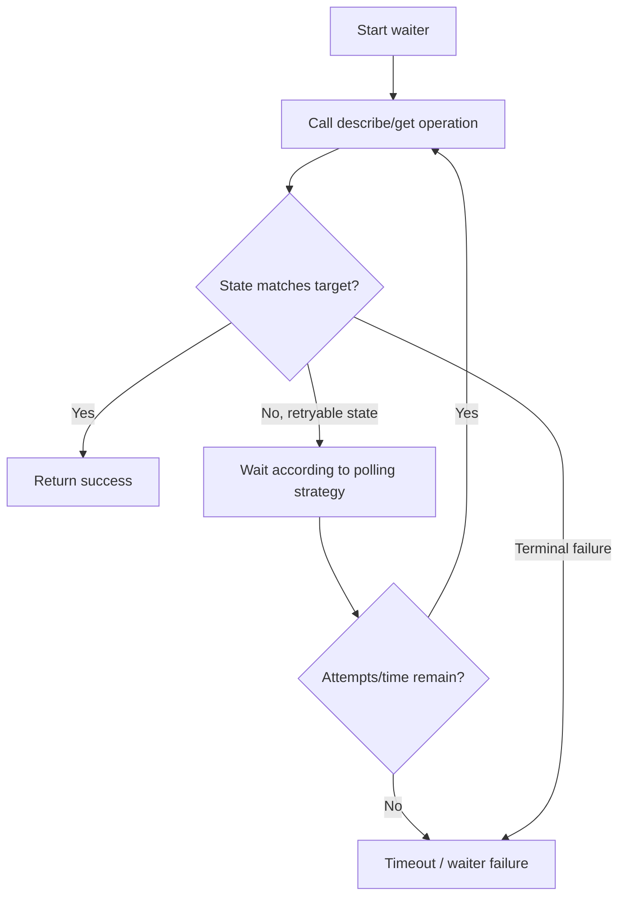

# Paginator, waiter và xử lý kết quả nhiều trang trong AWS SDK for Java v2

Khi ứng dụng gọi AWS APIs, **một response không phải lúc nào cũng chứa toàn bộ kết quả**. Dịch vụ có thể giới hạn số records trả về trong một lần gọi, rồi cung cấp token để lấy trang tiếp theo. Ví dụ S3 trả `NextContinuationToken`, DynamoDB trả `LastEvaluatedKey`, còn EC2 có `NextToken`. Nếu chỉ đọc response đầu tiên, ứng dụng có thể âm thầm bỏ sót dữ liệu.

**Paginator** trong AWS SDK for Java v2 giúp lặp qua nhiều trang bằng cách tự gửi các request tiếp theo và cung cấp kết quả theo từng page hoặc từng item. **Waiter** giải quyết một vấn đề khác: sau khi tạo table, khởi động instance hoặc gửi một thao tác bất đồng bộ, ứng dụng cần chờ tài nguyên chuyển sang trạng thái mong muốn. Waiter tự polling API theo chiến lược retry và dừng khi thành công, thất bại hoặc hết thời gian.

Bài học thuộc chương **AWS SDK cho Java** của module **CLOUD_PROVIDERS_AWS**. Người học sẽ thực hành paginator, waiter và cách xử lý kết quả nhiều trang bằng AWS SDK for Java v2, trong bối cảnh các ứng dụng Java tích hợp S3, DynamoDB, EC2 và các dịch vụ AWS. Mục tiêu là xây dựng client **đọc đủ dữ liệu, dùng bộ nhớ có kiểm soát, chờ tài nguyên đúng cách, xử lý lỗi và kiểm soát chi phí**.

Ví dụ xuyên suốt là một ứng dụng Shop: liệt kê object báo cáo trong S3, truy vấn nhiều orders trong DynamoDB và chờ EC2 instance chuyển sang trạng thái running. Các tên bucket, table, Region và IDs là dữ liệu minh họa; cần thay bằng tài nguyên sandbox của bạn khi thực hành.

## 1. Mục tiêu học tập

Sau bài học, bạn có thể:

1. Giải thích vì sao AWS APIs phân trang và vì sao response đầu tiên có thể chưa chứa toàn bộ kết quả.
2. Phân biệt page, item, page size, continuation token và pagination cursor.
3. Dùng paginator đồng bộ của AWS SDK for Java v2 để duyệt pages hoặc items.
4. Dùng async paginator với `S3AsyncClient` và Reactive Streams.
5. Tự phân trang khi cần kiểm soát token, dừng sớm hoặc lưu checkpoint.
6. Phân biệt `NextContinuationToken`, `NextToken` và `LastEvaluatedKey`.
7. Hiểu `Limit`, `MaxKeys`, `MaxResults`, 1 MB page limit và `FilterExpression` trong DynamoDB.
8. Dùng service waiters để chờ DynamoDB table, EC2 instance hoặc tài nguyên đạt trạng thái sẵn sàng.
9. Tùy chỉnh `WaiterOverrideConfiguration`, timeout và số lần polling.
10. Phân biệt waiter polling với SDK retry, application retry và fixed sleep.
11. Xử lý lỗi, pagination trong API backend, concurrency, backpressure và memory.
12. Thiết kế lab và checklist production cho paginator/waiter.

## 2. Vì sao cần pagination?

Một dịch vụ AWS có thể lưu hàng nghìn, hàng triệu hoặc nhiều hơn tài nguyên. Trả toàn bộ trong một response sẽ làm tăng payload, memory, latency và nguy cơ timeout. Vì vậy, nhiều APIs giới hạn kết quả mỗi lần gọi.

Ví dụ S3 bucket có 2.500 objects:

```text
Request 1  ──► Page 1: 1.000 objects + token A
Request 2  ──► Page 2: 1.000 objects + token B
Request 3  ──► Page 3:   500 objects + no next token

Total: 2.500 objects
```

Nếu ứng dụng chỉ đọc page 1, nó chỉ xử lý 1.000 objects và không nhất thiết nhận được lỗi. Đây là lỗi logic nguy hiểm vì chương trình có thể chạy thành công nhưng dữ liệu không đầy đủ.

### 2.1. Các khái niệm cần phân biệt

| Thuật ngữ | Ý nghĩa |
|---|---|
| **Page** | Một phần kết quả do service trả trong một request |
| **Page size** | Số records tối đa hoặc mục tiêu mỗi page theo API |
| **Pagination token** | Giá trị service trả để request trang tiếp |
| **Paginator** | Cơ chế SDK tự gửi request tiếp theo và lặp kết quả |
| **Item-level iteration** | Duyệt từng record bên trong các pages |
| **Page-level iteration** | Duyệt từng response page, giữ metadata của page |
| **Checkpoint** | Trạng thái lưu để tiếp tục công việc sau interruption |
| **Cursor** | Token API/backend trả client để tiếp tục đọc trang sau |

### 2.2. Pagination không phải chia dữ liệu ở client

Pagination là **hợp đồng giữa client và AWS service**:

1. Client gửi request ban đầu.
2. Service trả một page và có thể kèm continuation token.
3. Client gửi token trong request kế tiếp.
4. Service trả page tiếp theo theo semantics của API.
5. Quy trình kết thúc khi không còn token/trang tiếp.

Không được tự tăng offset như SQL `OFFSET 1000` nếu API AWS không hỗ trợ offset. Token thường đại diện cho vị trí tiếp tục do service quản lý.

### 2.3. Không phải API nào cũng có paginator

SDK sinh paginator cho những operations được service model đánh dấu là paginated. Một số API trả toàn bộ kết quả trong một response, một số có token nhưng SDK/operation cụ thể không có generated paginator. Hãy kiểm tra method của client và API reference trước khi viết code.

## 3. AWS SDK for Java v2 cung cấp paginator như thế nào?

AWS SDK for Java v2 sinh paginator cho nhiều service operations. Paginator thường là một đối tượng iterable/publisher **lazy**:

- Tạo paginator chưa nhất thiết gọi tất cả các pages ngay.
- Khi ứng dụng bắt đầu iterate, SDK gửi request đầu tiên.
- Khi iterator cần page kế tiếp, SDK tự dùng token của page trước để gọi tiếp.
- Có thể iterate theo **response pages** hoặc flatten sang **items** nếu paginator hỗ trợ.

### 3.1. Hai loại paginator

| Loại | Client | Cách tiêu thụ |
|---|---|---|
| **Synchronous paginator** | `S3Client`, `DynamoDbClient`, `Ec2Client` | `Iterable`, `SdkIterable`, `for` loop hoặc stream |
| **Asynchronous paginator** | `S3AsyncClient`, `DynamoDbAsyncClient`, `Ec2AsyncClient` | Reactive Streams publisher và subscriber |

Synchronous paginator dễ đọc, phù hợp batch/worker có luồng xử lý tuần tự. Async paginator phù hợp hệ thống reactive/non-blocking khi cần phối hợp I/O và backpressure.

### 3.2. Paginator không tải toàn bộ dữ liệu trước

Ví dụ:

```java
var pages = s3.listObjectsV2Paginator(request);

for (var page : pages) {
    // Mỗi page được yêu cầu khi vòng lặp cần đến nó.
    process(page);
}
```

Đây là cách xử lý tuần tự theo page. Nếu code chuyển toàn bộ kết quả sang `List` hoặc gọi `toList()`/collect toàn bộ stream, ứng dụng vẫn có thể dùng rất nhiều heap. Paginator giúp lấy dữ liệu từng page; **cách bạn tiêu thụ kết quả quyết định memory usage**.

## 4. Paginator với Amazon S3: ListObjectsV2

S3 `ListObjectsV2` sử dụng:

- Request field `continuationToken`.
- Response field `nextContinuationToken`.
- Response flag `isTruncated`.
- `maxKeys` để giới hạn số keys tối đa trong response (tối đa 1.000 cho ListObjectsV2).

SDK v2 cung cấp `listObjectsV2Paginator(...)`.

### 4.1. Maven dependency

Project Java cần module S3 của AWS SDK for Java v2 và Region/credentials provider phù hợp. Dùng một version SDK thống nhất qua BOM trong Maven:

```xml
<dependencyManagement>
  <dependencies>
    <dependency>
      <groupId>software.amazon.awssdk</groupId>
      <artifactId>bom</artifactId>
      <version>2.x.y</version>
      <type>pom</type>
      <scope>import</scope>
    </dependency>
  </dependencies>
</dependencyManagement>

<dependencies>
  <dependency>
    <groupId>software.amazon.awssdk</groupId>
    <artifactId>s3</artifactId>
  </dependency>
</dependencies>
```

`2.x.y` là placeholder: thay bằng một SDK v2 release cụ thể được dự án chọn, không copy nguyên literal này vào dependency thật. Trong dự án thực tế, BOM giúp các module SDK sử dụng cùng một phiên bản.

### 4.2. Duyệt từng page

```java
import software.amazon.awssdk.regions.Region;
import software.amazon.awssdk.services.s3.S3Client;
import software.amazon.awssdk.services.s3.model.ListObjectsV2Request;
import software.amazon.awssdk.services.s3.model.ListObjectsV2Response;

public final class S3PageExample {
    public static void main(String[] args) {
        String bucket = System.getenv("SHOP_REPORT_BUCKET");
        if (bucket == null || bucket.isBlank()) {
            throw new IllegalStateException("SHOP_REPORT_BUCKET is required");
        }

        try (S3Client s3 = S3Client.builder()
                .region(Region.AP_SOUTHEAST_1)
                .build()) {

            ListObjectsV2Request request = ListObjectsV2Request.builder()
                    .bucket(bucket)
                    .prefix("reports/")
                    .maxKeys(500)
                    .build();

            for (ListObjectsV2Response page :
                    s3.listObjectsV2Paginator(request)) {
                System.out.printf(
                        "Page objects=%d truncated=%s%n",
                        page.contents().size(),
                        page.isTruncated());

                page.contents().forEach(object ->
                        System.out.printf("%s %d bytes%n",
                                object.key(), object.size()));
            }
        }
    }
}
```

Paginator tự lấy trang tiếp theo khi vòng lặp tiếp tục. `maxKeys(500)` là giới hạn mỗi request page; nó không phải giới hạn tổng số objects của toàn bộ paginator.

### 4.3. Duyệt từng object qua flattened iterable

Nếu chỉ cần objects, có thể dùng method `contents()` của generated paginator:

```java
var request = ListObjectsV2Request.builder()
        .bucket(bucket)
        .prefix("reports/")
        .maxKeys(500)
        .build();

s3.listObjectsV2Paginator(request)
        .contents()
        .forEach(object -> processObject(object.key(), object.size()));
```

Cách này tiện khi không cần page metadata như `isTruncated`, response headers hoặc request ID. Khi cần kiểm soát theo page, hãy iterate `ListObjectsV2Response` như phần trước.

### 4.4. Lấy số lượng object mà không gom vào List

Nếu chỉ cần đếm:

```java
long count = 0;

for (var page : s3.listObjectsV2Paginator(request)) {
    count += page.contents().size();
}

System.out.println("Total objects = " + count);
```

Không dùng `collect(toList())` chỉ để gọi `.size()` vì sẽ giữ mọi object metadata trong memory. Với bucket rất lớn, đếm streaming theo page là cách dùng bộ nhớ ổn định hơn.

### 4.5. Prefix và delimiter

S3 object keys là flat key namespace; “folder” chỉ là quy ước prefix. Ví dụ:

```text
reports/2026/01/a.csv
reports/2026/01/b.csv
reports/2026/02/c.csv
images/logo.png
```

- `prefix("reports/")` chỉ liệt kê keys bắt đầu bằng `reports/`.
- `delimiter("/")` nhóm các common prefixes như một cách mô phỏng thư mục.
- Pagination vẫn có thể cần thiết dù dùng prefix/delimiter.

Đừng nhầm `commonPrefixes()` với objects; khi delimiter được sử dụng, response có thể chứa cả `contents` và `commonPrefixes`.

## 5. Paginator với DynamoDB Query

DynamoDB `Query` trả kết quả theo page. Một Query response có thể bị giới hạn bởi:

- `Limit`: số items tối đa được **đánh giá** trong request.
- Giới hạn tối đa **1 MB dữ liệu được đánh giá** cho một Query page.
- `FilterExpression`: lọc items sau khi đọc/đánh giá.

Nếu còn dữ liệu để tiếp tục, response có `LastEvaluatedKey`. Request kế tiếp truyền key đó vào `ExclusiveStartKey`.

### 5.1. Generated Query paginator

```java
import java.util.Map;

import software.amazon.awssdk.services.dynamodb.model.AttributeValue;
import software.amazon.awssdk.services.dynamodb.model.QueryRequest;

var request = QueryRequest.builder()
        .tableName("ShopOrders")
        .keyConditionExpression("PK = :pk")
        .expressionAttributeValues(Map.of(
                ":pk", AttributeValue.builder()
                        .s("CUSTOMER#C42")
                        .build()))
        .limit(100)
        .build();

for (var page : dynamoDb.queryPaginator(request)) {
    System.out.printf(
            "Returned=%d evaluated=%d%n",
            page.count(),
            page.scannedCount());

    page.items().forEach(this::processOrder);
}
```

Paginator sẽ lấy các pages cho đến khi hết `LastEvaluatedKey`. `limit(100)` áp dụng cho mỗi Query request/page theo API semantics; nó **không có nghĩa toàn bộ paginator chỉ trả 100 items**.

### 5.2. Flatten items khi không cần page metadata

Generated DynamoDB Query paginator có thể flatten kết quả qua `items()`:

```java
dynamoDb.queryPaginator(request)
        .items()
        .forEach(this::processOrder);
```

Nếu cần quan sát `Count`, `ScannedCount`, `ConsumedCapacity` hoặc `LastEvaluatedKey`, iterate từng page thay vì chỉ dùng flattened items.

### 5.3. Limit không phải số item cuối cùng sau filter

Giả sử:

```text
Limit = 100
Items evaluated = 100
FilterExpression giữ lại = 7

Page có thể trả:
  Count = 7
  ScannedCount = 100
  LastEvaluatedKey = có thể có
```

FilterExpression không làm DynamoDB chỉ đọc 7 items. Nó được áp dụng sau khi service đánh giá các items trong phạm vi Query page. Nếu filter quá chọn lọc, ứng dụng có thể nhận page ít kết quả hoặc rỗng nhưng vẫn còn `LastEvaluatedKey`.

### 5.4. Page rỗng không nhất thiết là đã hết

Một Query page có thể:

- Trả `Count = 0`.
- Có `ScannedCount > 0`.
- Vẫn có `LastEvaluatedKey`.

Vì vậy, khi tự phân trang, **đừng dừng chỉ vì `items().isEmpty()`**. Hãy dựa vào `LastEvaluatedKey` để quyết định còn page tiếp hay không.

## 6. Paginator với EC2 DescribeInstances

EC2 `DescribeInstances` có thể trả nhiều reservations/instances và sử dụng `NextToken` để phân trang. SDK v2 có generated paginator:

```java
import software.amazon.awssdk.services.ec2.Ec2Client;
import software.amazon.awssdk.services.ec2.model.DescribeInstancesRequest;

var request = DescribeInstancesRequest.builder()
        .maxResults(100)
        .build();

for (var page : ec2.describeInstancesPaginator(request)) {
    page.reservations().forEach(reservation ->
            reservation.instances().forEach(instance ->
                    System.out.printf("%s %s%n",
                            instance.instanceId(),
                            instance.state().nameAsString())));
}
```

Paginator sẽ truyền `NextToken` từ response trước vào request sau. `maxResults(100)` là giới hạn theo semantics của EC2 API, không nhất thiết là 100 instances vì response còn có thể nhóm instances thành reservations.

## 7. Paginator đồng bộ: chọn page hay item?

Khi dùng paginator, trước hết hãy xác định logic nghiệp vụ cần:

| Nhu cầu | Cách duyệt |
|---|---|
| In từng record, xử lý từng record | Flattened items như `contents()`/`items()` |
| Log metadata theo từng response | Iterate page objects |
| Check `ScannedCount`/`Count` | Iterate page objects |
| Lưu checkpoint theo token mỗi page | Iterate page objects |
| Dừng khi gặp record thỏa điều kiện | Item iteration và break nếu iterator hỗ trợ |
| Xử lý page theo batch | Page iteration |

### 7.1. Dừng sớm

Ví dụ tìm object đầu tiên có suffix `.csv`:

```java
String foundKey = null;

for (var object : s3.listObjectsV2Paginator(request).contents()) {
    if (object.key().endsWith(".csv")) {
        foundKey = object.key();
        break;
    }
}
```

Vòng lặp dừng khi tìm thấy object; paginator không cần yêu cầu tất cả các trang còn lại. Tuy nhiên, nếu page đầu không có object phù hợp, SDK có thể tiếp tục gọi nhiều trang cho đến khi tìm thấy hoặc hết dữ liệu.

### 7.2. Không gọi paginator hai lần để đếm rồi xử lý

Paginator là lazy nhưng mỗi lần iterate có thể gửi lại requests. Ví dụ:

```java
long count = paginator.contents().stream().count();
paginator.contents().forEach(this::process);
```

Đoạn code có thể thực hiện hai lượt truy cập service. Nếu muốn đếm và xử lý trong một lượt, tăng counter trong cùng vòng lặp. Cũng không giữ `Iterable` rồi giả định dữ liệu page đã được cache.

### 7.3. Không chạy nhiều iterators trên cùng paginator một cách tùy tiện

Mỗi iterator có thể bắt đầu từ request đầu và thực hiện một chuỗi requests riêng. Nếu tạo nhiều iterators đồng thời, bạn có thể tăng API calls, tải database và tạo kết quả trùng. Hãy tạo một traversal có kiểm soát cho từng job hoặc chủ động phân vùng công việc bằng các key/prefix/range.

## 8. Asynchronous paginator với S3AsyncClient

Async paginator trả publisher theo mô hình Reactive Streams. Nó không chặn thread gọi như synchronous paginator; subscriber nhận pages khi chúng sẵn sàng.

### 8.1. Cách dùng cơ bản

```java
import software.amazon.awssdk.services.s3.S3AsyncClient;
import software.amazon.awssdk.services.s3.model.ListObjectsV2Request;

var request = ListObjectsV2Request.builder()
        .bucket(bucket)
        .prefix("reports/")
        .maxKeys(500)
        .build();

s3Async.listObjectsV2Paginator(request)
        .subscribe(page -> page.contents().forEach(object ->
                processObjectAsync(object.key())));
```

Ví dụ minh họa consumer callback; trong production cần xác định rõ cách nhận lỗi, hoàn tất và quản lý lifecycle. Nếu chỉ dùng Consumer callback, hãy kiểm tra cách SDK publisher xử lý error cho phiên bản đang dùng hoặc dùng `Subscriber` đầy đủ khi cần điều khiển backpressure và error signals.

### 8.2. Reactive Streams subscriber với backpressure

```java
import org.reactivestreams.Subscriber;
import org.reactivestreams.Subscription;

import software.amazon.awssdk.services.s3.model.ListObjectsV2Response;

s3Async.listObjectsV2Paginator(request)
        .subscribe(new Subscriber<ListObjectsV2Response>() {
            private Subscription subscription;

            @Override
            public void onSubscribe(Subscription value) {
                this.subscription = value;
                this.subscription.request(1);
            }

            @Override
            public void onNext(ListObjectsV2Response page) {
                try {
                    page.contents().forEach(object ->
                            processObjectAsync(object.key()));
                    subscription.request(1);
                } catch (RuntimeException error) {
                    subscription.cancel();
                    logPaginationFailure(error);
                }
            }

            @Override
            public void onError(Throwable error) {
                logPaginationFailure(error);
            }

            @Override
            public void onComplete() {
                logPaginationCompleted();
            }
        });
```

Subscriber yêu cầu một page tại một thời điểm (`request(1)`), đây là backpressure ở cấp publisher. Nếu `processObjectAsync` chỉ enqueue công việc rồi trả về ngay, nó vẫn có thể tạo hàng nghìn tác vụ downstream. Khi đó cần giới hạn concurrency ở worker queue hoặc chỉ yêu cầu page tiếp khi xử lý page hiện tại hoàn tất.

### 8.3. Không chặn event-loop bằng công việc nặng

Trong `onNext`, tránh thực hiện blocking I/O, CPU-heavy parsing hoặc `Thread.sleep()`. Đưa công việc nặng sang executor/worker pool có giới hạn. Nếu downstream xử lý thất bại, quyết định có hủy subscription, retry page hay ghi checkpoint để tiếp tục.

## 9. Tự phân trang thủ công với S3 continuation token

Generated paginator phù hợp đa số trường hợp. Manual pagination hữu ích khi bạn cần:

- Lưu continuation token sau mỗi page.
- Dừng tại một checkpoint đã xác định.
- Tích hợp với API trả cursor cho client.
- Điều khiển page size và retry theo từng page.
- Không cần generated paginator hoặc cần logic đặc biệt.

### 9.1. Manual loop

```java
String token = null;

while (true) {
    var builder = ListObjectsV2Request.builder()
            .bucket(bucket)
            .prefix("reports/")
            .maxKeys(500);

    if (token != null) {
        builder.continuationToken(token);
    }

    var response = s3.listObjectsV2(builder.build());

    response.contents().forEach(object ->
            processObject(object.key()));

    if (!Boolean.TRUE.equals(response.isTruncated())) {
        break;
    }

    token = response.nextContinuationToken();
    if (token == null || token.isBlank()) {
        throw new IllegalStateException(
                "S3 response is truncated but has no continuation token");
    }
}
```

Trong S3 ListObjectsV2, response có `isTruncated()` và `nextContinuationToken()`. Production code có thể dùng `isTruncated()` để quyết định còn trang hay không và xác minh token được cung cấp theo response contract. Đoạn loop trên minh họa luồng thông thường khi không còn token ở page cuối.

### 9.2. Lưu checkpoint an toàn

Nếu job xử lý nhiều giờ, có thể lưu:

```text
jobId
bucket
prefix
continuationToken
lastProcessedKey
updatedAt
status
```

Checkpoint nên được cập nhật **sau khi page đã được xử lý bền vững**. Nếu lưu token trước khi xử lý xong rồi process crash, job có thể bỏ sót objects. Nếu xử lý xong nhưng crash trước khi lưu checkpoint, page có thể được xử lý lại; vì vậy side effects cần idempotent.

### 9.3. Token không phải object key

Continuation token là opaque service token. Không tự decode, sửa hoặc dựng token từ key cuối cùng trừ khi API định nghĩa rõ cách đó. Chỉ lưu và gửi lại nguyên giá trị do service trả.

## 10. Tự phân trang DynamoDB với LastEvaluatedKey

DynamoDB sử dụng cơ chế khác S3:

- Response trả `LastEvaluatedKey`.
- Request tiếp theo đặt `ExclusiveStartKey` bằng key đó.
- Kết thúc khi `LastEvaluatedKey` rỗng.

### 10.1. Manual Query loop

```java
import java.util.Map;

import software.amazon.awssdk.services.dynamodb.model.AttributeValue;
import software.amazon.awssdk.services.dynamodb.model.QueryRequest;

Map<String, AttributeValue> startKey = Map.of();
long totalReturned = 0;

do {
    var builder = QueryRequest.builder()
            .tableName("ShopOrders")
            .keyConditionExpression("PK = :pk")
            .expressionAttributeValues(Map.of(
                    ":pk", AttributeValue.builder()
                            .s("CUSTOMER#C42")
                            .build()))
            .limit(100);

    if (!startKey.isEmpty()) {
        builder.exclusiveStartKey(startKey);
    }

    var response = dynamoDb.query(builder.build());

    for (var item : response.items()) {
        processOrder(item);
        totalReturned++;
    }

    startKey = response.lastEvaluatedKey();
} while (!startKey.isEmpty());

System.out.println("Returned items = " + totalReturned);
```

Đoạn code giả định `lastEvaluatedKey()` được SDK trả dưới dạng map rỗng khi không còn trang. Đây là cách dùng thông thường của collection accessors trong SDK v2. Nếu xây wrapper riêng, hãy chuẩn hóa trường hợp `null`/empty theo API contract của wrapper.

### 10.2. Vì sao không dừng khi page rỗng?

Khi dùng FilterExpression, DynamoDB có thể đánh giá items nhưng loại hết trong page. Khi đó `items()` rỗng mà `LastEvaluatedKey` vẫn có giá trị. Nếu dừng theo `items().isEmpty()`, bạn sẽ không lấy được những pages tiếp theo có items phù hợp.

### 10.3. LastEvaluatedKey phải giữ đủ các key attributes

Với table composite key hoặc khi Query qua index, key map có thể chứa nhiều attributes cần thiết để tiếp tục. Hãy lưu **toàn bộ map** mà SDK trả, không chỉ `PK` hoặc `SK` theo suy đoán.

## 11. Phân biệt token giữa các dịch vụ

Không có một token chung cho tất cả AWS APIs:

| Service/API | Response token | Request token | Kết thúc khi |
|---|---|---|---|
| S3 `ListObjectsV2` | `NextContinuationToken` | `ContinuationToken` | Không còn trang/token (`IsTruncated=false`) |
| DynamoDB `Query`/`Scan` | `LastEvaluatedKey` | `ExclusiveStartKey` | Key rỗng |
| EC2 `DescribeInstances` | `NextToken` | `NextToken` | Không còn token |
| CloudWatch Logs APIs | `nextToken` | `nextToken` | Không còn token theo API |

Đừng đưa token S3 vào DynamoDB request hoặc dùng `LastEvaluatedKey` như một offset số nguyên. Token thuộc API cụ thể và cần được giữ nguyên.

## 12. Page size, Limit và MaxResults

Page size có thể ảnh hưởng số requests, latency, memory và chi phí. Nhưng ý nghĩa của `Limit`, `MaxKeys`, `MaxResults` tùy API:

| API | Field | Ý nghĩa |
|---|---|---|
| S3 ListObjectsV2 | `maxKeys` | Số object keys tối đa trong một response |
| DynamoDB Query | `limit` | Số items tối đa được đánh giá trong một request, trước filter |
| DynamoDB Scan | `limit` | Số items tối đa được đánh giá trong một request |
| EC2 DescribeInstances | `maxResults` | Số lượng kết quả tối đa theo semantics của API; có thể nhóm theo reservation |

**Đừng áp cùng một cách hiểu `limit=100` cho mọi dịch vụ.** Đọc API docs của từng operation và kiểm tra `Count`, `ScannedCount`, `IsTruncated`, `NextToken` hoặc `LastEvaluatedKey`.

### 12.1. Page size nhỏ

Ưu điểm:

- Response nhỏ hơn.
- Giảm memory spike.
- Có thể bắt đầu xử lý sớm.
- Hữu ích khi downstream chậm hoặc giới hạn concurrency.

Nhược điểm:

- Nhiều API requests hơn.
- Tăng network round trips và tổng thời gian.
- Có thể làm tăng overhead và throttling nếu không kiểm soát.

### 12.2. Page size lớn

Ưu điểm:

- Ít requests hơn trong một số workload.
- Giảm round trips khi downstream xử lý nhanh.

Nhược điểm:

- Response lớn hơn và memory pressure tăng.
- Một page xử lý lâu hơn, checkpoint chậm hơn.
- Dễ tạo burst downstream nếu mỗi page sinh nhiều công việc.

### 12.3. Không có page size tối ưu cho mọi workload

Benchmark bằng dữ liệu và concurrency thực tế. Đo:

- Request count.
- Page size thực tế.
- Latency p50/p95/p99.
- Heap usage và garbage collection.
- Throttling/retries.
- Downstream processing lag.
- Cost theo số API calls và dung lượng xử lý.

## 13. Waiter là gì?

Một số thao tác AWS hoàn tất **bất đồng bộ**. Ví dụ:

- Gửi `CreateTable` không có nghĩa table đã ở trạng thái `ACTIVE` ngay lập tức.
- Gửi `RunInstances` không có nghĩa EC2 instance đã sẵn sàng chạy ứng dụng.
- Gửi thao tác tạo bucket/object có thể cần kiểm tra trạng thái/khả năng nhìn thấy trước khi bước tiếp theo chạy.

**Waiter** là cơ chế polling có kiểm soát. Nó gọi một operation mô tả trạng thái (ví dụ `DescribeTable` hoặc `DescribeInstances`) theo một chiến lược, rồi kiểm tra response có thỏa điều kiện mong muốn hay chưa.

### 13.1. Vòng đời waiter



Waiter không tạo tài nguyên, không thay thế API create/update và không đảm bảo nghiệp vụ phía sau đã hoàn tất. Nó chỉ chờ một trạng thái mà waiter được định nghĩa để quan sát.

### 13.2. Waiter khác paginator ở đâu?

| Tiêu chí | Paginator | Waiter |
|---|---|---|
| Mục đích | Đọc hết nhiều pages | Chờ tài nguyên đạt trạng thái |
| Request pattern | Token của page trước dẫn đến page sau | Gọi lại operation kiểm tra trạng thái |
| Điều kiện dừng | Không còn pagination token | Acceptor success/failure hoặc hết attempts/time |
| Kết quả | Nhiều pages/items | Một trạng thái kết thúc và response tương ứng |
| Ví dụ | Liệt kê 20.000 S3 objects | Chờ EC2 instance running |

### 13.3. Không thay waiter bằng Thread.sleep()

Code dễ gặp:

```java
Thread.sleep(30_000);
var table = dynamoDb.describeTable(request);
```

Đoạn này giả định table luôn sẵn sàng sau 30 giây:

- Nếu table sẵn sàng sau 2 giây, ứng dụng chờ dư 28 giây.
- Nếu table cần 45 giây, code vẫn chạy quá sớm.
- Nếu thao tác thất bại vĩnh viễn, sleep không phát hiện điều đó.

Waiter kiểm tra trạng thái thực tế, có timeout và xử lý failure state theo waiter model.

## 14. Waiter với DynamoDB: chờ table ACTIVE

Sau khi tạo DynamoDB table, ứng dụng có thể dùng generated `DynamoDbWaiter`.

### 14.1. Ví dụ đầy đủ

```java
import software.amazon.awssdk.regions.Region;
import software.amazon.awssdk.services.dynamodb.DynamoDbClient;
import software.amazon.awssdk.services.dynamodb.model.CreateTableRequest;
import software.amazon.awssdk.services.dynamodb.model.BillingMode;
import software.amazon.awssdk.services.dynamodb.model.DescribeTableRequest;
import software.amazon.awssdk.services.dynamodb.model.KeySchemaElement;
import software.amazon.awssdk.services.dynamodb.model.KeyType;
import software.amazon.awssdk.services.dynamodb.model.ScalarAttributeType;
import software.amazon.awssdk.services.dynamodb.model.AttributeDefinition;

public final class DynamoDbWaiterExample {
    public static void main(String[] args) {
        try (DynamoDbClient dynamoDb = DynamoDbClient.builder()
                .region(Region.AP_SOUTHEAST_1)
                .build()) {

            String tableName = "ShopOrdersLab";

            dynamoDb.createTable(CreateTableRequest.builder()
                    .tableName(tableName)
                    .attributeDefinitions(
                            AttributeDefinition.builder()
                                    .attributeName("PK")
                                    .attributeType(ScalarAttributeType.S)
                                    .build())
                    .keySchema(
                            KeySchemaElement.builder()
                                    .attributeName("PK")
                                    .keyType(KeyType.HASH)
                                    .build())
                    .billingMode(BillingMode.PAY_PER_REQUEST)
                    .build());

            var waiter = dynamoDb.waiter();
            var describeRequest = DescribeTableRequest.builder()
                    .tableName(tableName)
                    .build();

            var response = waiter.waitUntilTableExists(describeRequest);
            response.matched().response().ifPresent(result ->
                    System.out.println("Table status = "
                            + result.table().tableStatus()));
        }
    }
}
```

`waitUntilTableExists` chờ cho đến khi table tồn tại theo điều kiện waiter. Sau đó ứng dụng có thể tiếp tục kiểm tra `TableStatus`/cấu hình cần thiết. Ví dụ tạo table ở trên là minh họa trong sandbox; nếu table đã tồn tại, `CreateTable` sẽ trả lỗi resource-in-use và waiter không biến lỗi create thành thành công.

### 14.2. Chờ table không còn tồn tại

Trong cleanup workflow, có thể dùng waiter tương ứng nếu service client cung cấp:

```java
var waiter = dynamoDb.waiter();
waiter.waitUntilTableNotExists(
        DescribeTableRequest.builder()
                .tableName("ShopOrdersLab")
                .build());
```

Chỉ xóa tài nguyên lab do bạn sở hữu và đã xác nhận đúng account/Region. Waiter chờ trạng thái sau delete; nó không xác minh dữ liệu đã được backup hoặc người dùng khác không còn phụ thuộc table.

## 15. Waiter với EC2: chờ instance running

Sau khi gọi `RunInstances`, EC2 instance chuyển qua nhiều trạng thái. Ứng dụng cần chờ `running` trước khi chạy bước tiếp theo; tuy nhiên `running` **không đồng nghĩa ứng dụng bên trong OS đã healthy**.

### 15.1. Ví dụ Ec2Waiter

```java
import java.time.Duration;
import java.util.List;

import software.amazon.awssdk.regions.Region;
import software.amazon.awssdk.services.ec2.Ec2Client;
import software.amazon.awssdk.services.ec2.model.DescribeInstancesRequest;
import software.amazon.awssdk.services.ec2.model.Instance;
import software.amazon.awssdk.services.ec2.model.Reservation;
import software.amazon.awssdk.core.waiters.WaiterOverrideConfiguration;

public final class Ec2WaiterExample {
    public static void main(String[] args) {
        String instanceId = System.getenv("EC2_INSTANCE_ID");
        if (instanceId == null || instanceId.isBlank()) {
            throw new IllegalStateException("EC2_INSTANCE_ID is required");
        }

        try (Ec2Client ec2 = Ec2Client.builder()
                .region(Region.AP_SOUTHEAST_1)
                .build()) {

            var request = DescribeInstancesRequest.builder()
                    .instanceIds(instanceId)
                    .build();

            var override = WaiterOverrideConfiguration.builder()
                    .maxAttempts(30)
                    .waitTimeout(Duration.ofMinutes(10))
                    .build();

            var waiter = ec2.waiter();
            var result = waiter.waitUntilInstanceRunning(request, override);

            result.matched().response().ifPresent(response ->
                    response.reservations().stream()
                            .map(Reservation::instances)
                            .flatMap(List::stream)
                            .map(Instance::instanceId)
                            .forEach(id ->
                                    System.out.println("Running: " + id)));
        }
    }
}
```

`maxAttempts` và `waitTimeout` giới hạn việc chờ; waiter dừng khi điều kiện thành công hoặc giới hạn được đáp ứng. Giá trị thực tế nên theo thời gian provisioning và SLO của hệ thống, không tăng vô hạn để che lỗi.

### 15.2. Instance running khác ứng dụng healthy

`waitUntilInstanceRunning` chỉ chờ EC2 state là `running`. Nó không kiểm tra:

- OS đã boot xong chưa.
- User data/cloud-init đã chạy xong chưa.
- Java process đã bind port chưa.
- Health check của load balancer đã healthy chưa.
- Ứng dụng đã kết nối database và dependencies chưa.

Nếu workflow cần application-ready, kết hợp waiter EC2 với **SSM/health endpoint/ALB target health/application readiness check**. Định nghĩa rõ điều kiện readiness cho từng tầng.

## 16. Waiter với S3

S3 client v2 có generated waiters cho một số trạng thái như bucket/object tồn tại hoặc không tồn tại (tùy service API/SDK version). Ví dụ chờ object xuất hiện sau upload:

```java
import software.amazon.awssdk.services.s3.S3Client;
import software.amazon.awssdk.services.s3.model.HeadObjectRequest;

var waiter = s3.waiter();
var request = HeadObjectRequest.builder()
        .bucket(bucket)
        .key("reports/daily.csv")
        .build();

var result = waiter.waitUntilObjectExists(request);
result.matched().response().ifPresent(head ->
        System.out.println("Object size = " + head.contentLength()));
```

Waiter dùng API kiểm tra trạng thái phù hợp (ví dụ `HeadObject`) và polling đến khi object được nhìn thấy hoặc timeout/failure. Cần kiểm tra waiter method có sẵn trong phiên bản SDK/service client đang dùng.

## 17. Tùy chỉnh waiter

SDK v2 cung cấp `WaiterOverrideConfiguration` để điều chỉnh cách chờ cho một waiter call.

### 17.1. maxAttempts và waitTimeout

```java
import java.time.Duration;

import software.amazon.awssdk.core.waiters.WaiterOverrideConfiguration;

var override = WaiterOverrideConfiguration.builder()
        .maxAttempts(20)
        .waitTimeout(Duration.ofMinutes(5))
        .build();

var result = dynamoDb.waiter().waitUntilTableExists(
        describeRequest,
        override);
```

- `maxAttempts`: số lần kiểm tra tối đa theo waiter configuration.
- `waitTimeout`: giới hạn tổng thời gian chờ.
- Khi giới hạn attempts hoặc timeout đạt trước, waiter kết thúc theo kết quả failure/timeout.

### 17.2. Chọn timeout theo workflow

| Tác vụ | Cách đặt timeout |
|---|---|
| Chờ table mới ACTIVE trong lab | Dựa vào provisioning time, có giới hạn rõ |
| Chờ EC2 running | Theo loại instance/boot behavior và workflow deadline |
| Chờ object xuất hiện sau upload | Theo SLA của pipeline, thường ngắn hơn provisioning |
| Chờ cluster/database readiness | Theo thời gian tạo resource và deployment window |

Không đặt timeout 30 phút cho mọi thao tác chỉ để giảm lỗi. Timeout quá dài khiến job/HTTP request giữ tài nguyên, che dấu trạng thái thất bại và làm pipeline chậm.

### 17.3. Default polling strategy

Generated waiters dùng polling strategy và acceptors được định nghĩa theo service model/SDK. Không giả định tất cả waiter đều polling với cùng một khoảng cố định hoặc cùng số lần thử. Khi cần kiểm soát, dùng override được hỗ trợ, quan sát thời gian thực tế và xem tài liệu của service waiter.

### 17.4. Waiter failure và exception handling

Waiter có thể kết thúc vì:

- Đạt trạng thái mong muốn.
- Tài nguyên chuyển sang trạng thái terminal không phù hợp.
- Hết max attempts.
- Hết wait timeout.
- Lỗi service/API không thể retry hoặc lỗi client/configuration.

Ứng dụng nên ghi log resource ID, Region, waiter name, elapsed time, attempt context nếu có và exception type. Phân biệt timeout có thể retry theo business workflow với trạng thái terminal cần người vận hành xử lý.

## 18. Waiter, SDK retry và application retry là ba lớp khác nhau

| Cơ chế | Mục tiêu | Ví dụ |
|---|---|---|
| **SDK retry** | Gửi lại một API request bị lỗi transient như throttling/5xx theo retry strategy | `DescribeTable` request lỗi tạm thời |
| **Waiter polling** | Gọi lại API kiểm tra trạng thái cho đến khi acceptor match | Table chưa ACTIVE nên tiếp tục chờ |
| **Application retry** | Thử lại business operation theo idempotency và policy của ứng dụng | Job tạo report được retry sau crash |

Một waiter call có thể chứa nhiều lần polling; mỗi polling request lại đi qua SDK retry logic nếu API call lỗi transient. Vì vậy tổng số request có thể lớn hơn số waiter attempts trong một số tình huống. Đặt timeout, retry mode và logging sao cho dễ dự đoán.

### 18.1. Không retry lỗi validation vô hạn

- `ValidationException`: request/schema sai, sửa input.
- `AccessDeniedException`: kiểm tra IAM/SCP/endpoint policy, không retry liên tục.
- `ResourceNotFoundException`: xác minh resource name/account/Region và expected state.
- Throttling/temporary service errors: dùng SDK retry/backoff phù hợp.
- Waiter timeout: kiểm tra resource status, events và provisioning logs trước khi quyết định thử lại.

### 18.2. Tránh nhân đôi side effects

Waiter chỉ quan sát trạng thái, nhưng application retry có thể chạy lại create/update operations. Nếu operation không idempotent hoặc không kiểm tra resource hiện có, retry có thể tạo duplicate resource hoặc gây conflict. Dùng deterministic resource names/IDs, conditional operations và reconciliation trước khi lặp lại.

## 19. Pagination trong REST API của backend Java

Backend thường không muốn trả một response chứa hàng chục nghìn records. Thay vào đó, API có thể trả:

```json
{
  "items": [
    {"key": "reports/2026/01/a.csv"},
    {"key": "reports/2026/01/b.csv"}
  ],
  "nextCursor": "opaque-cursor-value"
}
```

Client gửi cursor trong request tiếp theo:

```text
GET /api/reports?limit=100&cursor=opaque-cursor-value
```

Backend giải mã/kiểm tra cursor, gọi AWS API bằng token gốc và trả page tiếp theo.

### 19.1. Cursor cần gắn với query context

Một cursor nên ràng buộc với:

- Service/table/bucket/index được truy vấn.
- Tenant/customer đã được xác thực.
- Filter, prefix, sort order và các tham số ảnh hưởng kết quả.
- Pagination token do AWS trả.
- Page size policy và phiên bản cursor format.
- Thời điểm hết hạn nếu API cần giới hạn tuổi cursor.

Nếu client đổi filter hoặc tenant nhưng vẫn dùng cursor cũ, backend nên từ chối cursor không phù hợp. Không để client tự gửi `ExclusiveStartKey` hoặc continuation token tùy ý để truy cập ngoài phạm vi được phép.

### 19.2. Không công khai raw token như một quyền truy cập

AWS pagination token không phải authorization credential. Dù token thường opaque, backend vẫn phải kiểm tra IAM và business authorization mỗi request. Có thể mã hóa/ký cursor để ngăn sửa nội dung và gắn cursor với tenant/query context.

### 19.3. Giới hạn page size ở server

Không tin `limit` do browser gửi. Ví dụ:

```java
int pageSize = Math.max(1, Math.min(requestedLimit, 100));
```

Server đặt min/max theo workload. Nếu client gửi `limit=1000000`, không chuyển nguyên giá trị đó xuống service API hoặc tự thu thập hàng triệu records vào heap.

### 19.4. Cursor không thay thế authorization

Giả sử user C42 lấy được cursor của request customer C42. Không được cho phép user C89 dùng cursor đó để đọc dữ liệu C42 hoặc ngược lại. Mỗi page request phải xác thực caller và kiểm tra cursor tenant context với verified identity.

## 20. Pagination không phải snapshot transaction

Paginator gửi nhiều requests theo thời gian. Trong lúc đó dữ liệu nguồn có thể thay đổi:

- S3 objects được thêm/xóa/ghi đè giữa các page requests.
- DynamoDB items được thêm/xóa/cập nhật trong khi Query tiếp tục.
- EC2 instances có thể chuyển trạng thái hoặc bị terminate giữa các lần Describe.

Vì vậy, **một lượt pagination thông thường không mặc nhiên là snapshot nhất quán tại một thời điểm duy nhất**.

### 20.1. Ví dụ bỏ sót hoặc xử lý lặp

```text
T0: Page 1 đã đọc keys A ... J
T1: Object mới được thêm vào vị trí sắp xếp trước cursor
T2: Page 2 tiếp tục bằng token cũ
T3: Kết quả phụ thuộc semantics của service/listing
```

Đối với các công việc yêu cầu chính xác tập dữ liệu tại một mốc:

- Dùng immutable dataset hoặc manifest/versioned input.
- Ghi nhận thời điểm/snapshot và query scope.
- Với DynamoDB, cân nhắc export-to-S3 từ point-in-time khi phù hợp với use case.
- Dùng event/change log để bắt các thay đổi phát sinh trong lúc batch chạy.
- Thiết kế xử lý idempotent và reconciliation.

### 20.2. Không giả định paginator trả đúng một lần

Nếu job crash sau khi xử lý side effect nhưng trước khi lưu checkpoint, page có thể được đọc lại. Nếu checkpoint được lưu trước khi xử lý xong, dữ liệu có thể bị bỏ qua. Cần chọn thứ tự:

1. Đọc page.
2. Xử lý records idempotent.
3. Ghi kết quả bền vững.
4. Chỉ sau đó commit checkpoint/token.

Đây là nguyên tắc phổ biến cho batch jobs; transaction boundary cụ thể phụ thuộc nơi lưu checkpoint và nơi ghi business result.

## 21. Error handling cho paginator

Paginator tự quản lý việc gửi request tiếp theo, nhưng không làm mọi page request thành công vô điều kiện. Một page giữa chừng vẫn có thể lỗi do network, throttling, credentials, resource changes hoặc service failure.

### 21.1. Nhóm lỗi

| Lỗi | Cách xử lý |
|---|---|
| Throttling/5xx transient | Để SDK retry theo retry strategy; nếu vẫn thất bại, resume từ checkpoint |
| AccessDenied | Kiểm tra IAM/resource policy/SCP/endpoint policy; không retry vô hạn |
| ValidationException | Sửa request/schema/key/token format |
| ResourceNotFound | Xác minh table/bucket/Region và lifecycle |
| Expired/invalid application cursor | Yêu cầu client bắt đầu pagination mới |
| Downstream processing failure | Dừng/giới hạn concurrency, retry idempotent hoặc ghi failed record |
| Waiter timeout | Kiểm tra trạng thái resource và provisioning events |

### 21.2. Retry page hay restart từ đầu?

Nếu job có checkpoint, lưu token của **page kế tiếp sau khi page hiện tại xử lý thành công**. Khi request page kế tiếp lỗi transient quá số lần SDK retry, có thể tiếp tục từ token đã commit.

Không lưu checkpoint mới trước khi page được xử lý bền vững. Nếu job không có checkpoint, restart từ đầu có thể lặp side effects; hãy bảo đảm xử lý idempotent.

### 21.3. Retry không được thay token

Khi retry một request page do network error, giữ nguyên request context/token của page đó. Không tự lấy token mới từ page khác hoặc tạo offset mới. Nếu response bị mất sau khi service đã xử lý request, paginator/client có thể không biết kết quả; idempotent processing và checkpoint là lớp bảo vệ quan trọng.

## 22. Hiệu năng, memory và chi phí

Mỗi page tiếp theo là một API request bổ sung. Pagination tránh response khổng lồ nhưng không làm tổng số records hoặc tổng chi phí biến mất.

### 22.1. Ước lượng request count

Giả sử S3 có 25.000 objects và `maxKeys=1.000`:

```text
Số pages xấp xỉ = ceil(25.000 / 1.000) = 25

Mỗi page cần một ListObjectsV2 request.
Nếu job chạy lại từ đầu, requests có thể phát sinh lại.
```

Đây là ước lượng theo page size tối đa; response thực tế có thể ít hơn do delimiter, prefix, service behavior hoặc dữ liệu thay đổi.

### 22.2. Không collect mọi thứ

Không làm:

```java
List<S3Object> allObjects =
        s3.listObjectsV2Paginator(request)
                .contents()
                .stream()
                .toList();
```

nếu bucket có thể chứa hàng triệu objects. Cách này giữ toàn bộ metadata trong heap. Thay vào đó, xử lý từng object/page và chỉ lưu dữ liệu cần thiết.

### 22.3. Đặt giới hạn concurrency

Nếu mỗi object tạo một asynchronous task:

```text
1 page = 1.000 objects
1.000 objects -> 1.000 downstream tasks
10 pages -> 10.000 tasks nếu enqueue không giới hạn
```

Paginator có backpressure ở publisher không có nghĩa downstream queue của ứng dụng tự được giới hạn. Cần bounded executor, semaphore, reactive operator với concurrency cap hoặc page-at-a-time processing.

### 22.4. Theo dõi metrics

Nên ghi:

- Pages requested/succeeded/failed.
- Items evaluated/returned/processed.
- API latency và retry count.
- Checkpoint age và job progress.
- Waiter elapsed time/attempts/timeout.
- Heap, GC, worker queue depth và downstream error rate.
- S3/DynamoDB/EC2 request cost theo workload.

Không log raw credentials hoặc customer data trong cursor/token. Log job ID, page sequence và resource identifiers đã được phân loại/redact.

## 23. Các lỗi triển khai phổ biến

| Sai lầm | Hậu quả | Cách sửa |
|---|---|---|
| Chỉ đọc response đầu tiên | Bỏ sót dữ liệu | Dùng paginator hoặc manual token loop |
| Dừng DynamoDB khi page rỗng | Bỏ sót pages sau filter | Kiểm tra `LastEvaluatedKey` |
| Hiểu DynamoDB Limit là số kết quả sau filter | API trả ít records hơn mong đợi | Phân biệt evaluated/returned và pagination |
| Dùng S3 key làm continuation token | Request tiếp theo sai | Dùng `NextContinuationToken` nguyên vẹn |
| Collect mọi items thành List | Heap tăng, GC/OutOfMemory | Stream/process theo page |
| Iterate paginator hai lần | Gọi AWS APIs lặp lại | Đếm và xử lý trong một lượt |
| `Thread.sleep()` cố định để chờ resource | Chờ dư hoặc chạy quá sớm | Generated waiter |
| Waiter timeout vô hạn | Job treo, giữ tài nguyên | `maxAttempts`/`waitTimeout` |
| Nghĩ EC2 running là app healthy | Workflow chạy trước readiness | Health check ở application layer |
| Retry condition/validation errors liên tục | Tốn request và che lỗi | Phân loại exception |
| Lưu checkpoint trước khi xử lý page | Có thể mất records | Commit sau khi side effects bền vững |
| Trả raw cursor không ràng buộc tenant | Có nguy cơ truy cập chéo tenant | Ký/bind cursor và authorize mỗi request |
| Dùng waiter để kiểm tra nghiệp vụ | Kết luận sai trạng thái hệ thống | Định nghĩa application health checks |

## 24. Lab: S3 paginator và DynamoDB waiter

Lab này dùng **AWS account sandbox** và dữ liệu giả. Các thao tác tạo bucket/table có thể phát sinh chi phí và yêu cầu IAM permissions. Không chạy trên production hoặc tài nguyên dùng chung nếu chưa được owner cho phép.

### 24.1. Chuẩn bị

| Thành phần | Giá trị minh họa |
|---|---|
| Region | `ap-southeast-1` |
| S3 bucket | `shop-sdk-pagination-lab-<unique-suffix>` |
| S3 prefix | `reports/` |
| DynamoDB table | `ShopOrdersLab` |
| DynamoDB key | `PK` (String) |
| Java | JDK 17+ cho các ví dụ `var` |
| SDK | AWS SDK for Java v2, version thống nhất qua BOM |
| Credentials | IAM Identity Center/profile hoặc sandbox role |

Trước khi làm:

1. Chạy `aws sts get-caller-identity`.
2. Xác nhận account là sandbox.
3. Kiểm tra Region và quyền S3/DynamoDB cần thiết.
4. Tạo Maven project với dependencies S3 và DynamoDB.
5. Dùng environment variables hoặc profile, không hardcode credentials.

### 24.2. Bước 1 — Chuẩn bị S3 objects

Tạo một bucket lab duy nhất và upload hơn 1.000 object nhỏ vào prefix `reports/`. Có thể tạo files test bằng shell/script riêng; dùng tên có thứ tự để đối chiếu:

```text
reports/0001.json
reports/0002.json
...
reports/1200.json
```

Không cần lưu nội dung lớn; mục tiêu là có nhiều keys hơn một page nhỏ.

### 24.3. Bước 2 — Chạy paginator với page size nhỏ

Dùng code S3 paginator ở phần 4.2 với `maxKeys(100)`. Ghi lại:

- Số pages đã duyệt.
- Tổng objects.
- Page đầu/cuối.
- Tổng request count theo logs/metrics nếu có.

Kỳ vọng: paginator tiếp tục cho đến khi hết object keys trong prefix.

### 24.4. Bước 3 — So sánh flattened items

Dùng `contents()` ở phần 4.3 để xử lý từng object. So sánh kết quả với page-level iteration. Đảm bảo chỉ iterate một lượt nếu không muốn gửi lại toàn bộ requests.

### 24.5. Bước 4 — Tự phân trang S3

Chạy manual loop ở phần 9.1. Ghi lại `nextContinuationToken` sau mỗi page (không ghi raw token vào tài liệu chia sẻ nếu policy không cho phép). So sánh tổng objects với generated paginator.

### 24.6. Bước 5 — Tạo DynamoDB table và waiter

Dùng `CreateTableRequest` ở phần 14.1 với tên table lab riêng. Sau khi gửi create request, gọi `waitUntilTableExists`. Ghi lại:

- Thời gian từ lúc gửi CreateTable tới waiter success.
- Response `TableStatus`.
- Hành vi khi table đã tồn tại và CreateTable trả lỗi.

Không xóa table trước khi xác nhận dữ liệu không còn cần thiết.

### 24.7. Bước 6 — Nạp nhiều DynamoDB items

Tạo một tập items giả có cùng partition key hoặc nhiều partition keys theo schema lab. Dùng `PutItem`/`BatchWriteItem` phù hợp; nếu dùng BatchWrite, xử lý `UnprocessedItems` bằng retry/backoff.

### 24.8. Bước 7 — Query nhiều pages

Chạy `queryPaginator` ở phần 5.1 với `limit(10)` và ghi:

- Số pages.
- Tổng `Count`.
- Tổng `ScannedCount`.
- Số items xử lý.
- `LastEvaluatedKey` có xuất hiện ở page nào.

Sau đó thử FilterExpression chọn lọc mạnh và quan sát page có thể ít hoặc không có items nhưng vẫn còn `LastEvaluatedKey`.

### 24.9. Bước 8 — Thử waiter timeout trong sandbox

Đặt `maxAttempts` nhỏ trong một kịch bản có trạng thái chưa thể match hoặc dùng tài nguyên test có kiểm soát. Quan sát exception/result và log elapsed time. Không cố tình làm hỏng production resources để tạo timeout.

### 24.10. Bước 9 — Dọn tài nguyên

Sau khi xác nhận đúng account/Region và tài nguyên do bạn tạo:

- Xóa các S3 objects thuộc prefix lab.
- Xóa bucket lab nếu không còn cần.
- Xóa DynamoDB table lab nếu không còn cần.
- Thu hồi các IAM policies/roles tạm nếu được tạo riêng cho lab.

Không xóa bucket/table dùng chung hoặc resources không thuộc quyền sở hữu của bạn.

### 24.11. Bằng chứng lab

| Bằng chứng | Điều cần chứng minh |
|---|---|
| S3 page logs | Paginator đọc hết nhiều pages |
| Generated vs manual pagination | Hai cách trả cùng tập kết quả |
| DynamoDB page counts | Hiểu Count/ScannedCount |
| Empty filtered page có token | Không dừng chỉ vì page rỗng |
| Waiter result | Table đã đạt điều kiện tồn tại |
| Waiter timeout case | Biết giới hạn và failure handling |
| Checkpoint/cursor design | Resume và bảo vệ pagination state |

## 25. Bài tập tự kiểm tra và đáp án gợi ý

### Bài tập A — Vì sao paginator cần thiết?

S3 bucket có 4.500 objects. Request đầu trả 1.000 keys và `IsTruncated=true`. Developer chỉ xử lý response đầu.

**Đáp án:** ứng dụng chỉ xử lý 1.000/4.500 objects và bỏ sót 3.500 objects. Dùng `listObjectsV2Paginator` hoặc manual continuation-token loop.

### Bài tập B — Token nào thuộc service nào?

| Token | API |
|---|---|
| `NextContinuationToken` | S3 ListObjectsV2 |
| `LastEvaluatedKey` | DynamoDB Query/Scan |
| `NextToken` | EC2 DescribeInstances |

**Đáp án:** token là một phần contract của từng API; không hoán đổi hoặc tự tạo từ offset.

### Bài tập C — DynamoDB Limit=100 có nghĩa gì?

Query có `Limit=100`, FilterExpression chỉ giữ lại 4 items.

**Đáp án:** Limit là số items tối đa được đánh giá trong request; `Count` có thể là 4 và `ScannedCount` có thể là 100. Response vẫn có thể chứa LastEvaluatedKey.

### Bài tập D — Page rỗng có phải kết thúc?

Một Query page trả `items=[]` và `LastEvaluatedKey` vẫn có giá trị.

**Đáp án:** chưa kết thúc. Tiếp tục request bằng `ExclusiveStartKey`; FilterExpression có thể đã loại mọi items của page đó.

### Bài tập E — Tại sao không collect toàn bộ objects?

Một bucket có 5 triệu objects. Code dùng `contents().stream().toList()`.

**Đáp án:** giữ toàn bộ object metadata trong heap, tăng GC và có nguy cơ OutOfMemory. Xử lý theo page/item và lưu kết quả bền vững theo batch.

### Bài tập F — Waiter khác Thread.sleep?

Developer gọi CreateTable rồi sleep 30 giây trước khi ghi dữ liệu.

**Đáp án:** thời gian tạo table không cố định; sleep có thể chờ dư hoặc chạy quá sớm. Dùng `DynamoDbWaiter.waitUntilTableExists` với timeout/attempt limits.

### Bài tập G — EC2 running có đủ chưa?

Waiter báo EC2 instance `running`, nhưng API Java trên instance chưa phản hồi.

**Đáp án:** `running` là trạng thái EC2, không chứng minh OS/user data/application đã healthy. Cần thêm readiness check qua SSM, health endpoint hoặc load balancer target health.

### Bài tập H — Waiter timeout có hủy CreateTable không?

Waiter hết timeout sau khi CreateTable đã được chấp nhận.

**Đáp án:** waiter timeout chỉ có nghĩa ứng dụng ngừng chờ theo policy. Nó không tự hủy tài nguyên hoặc rollback CreateTable. Kiểm tra trạng thái table trước khi quyết định hành động tiếp.

### Bài tập I — SDK retry hay waiter?

`DescribeTable` trả throttling một lần, sau đó trả `CREATING` nhiều lần rồi `ACTIVE`.

**Đáp án:** SDK retry xử lý lỗi throttling transient của từng request; waiter tiếp tục polling vì table vẫn ở trạng thái CREATING cho đến ACTIVE.

### Bài tập J — Checkpoint đặt lúc nào?

Batch job lưu continuation token mới trước khi ghi kết quả page vào database, rồi process crash.

**Đáp án:** job có thể bỏ qua records chưa được ghi. Xử lý page idempotent và commit checkpoint sau khi side effects đã bền vững.

### Bài tập K — Cursor có phải authorization?

Client C89 gửi cursor được cấp cho C42.

**Đáp án:** backend phải xác thực user và bind cursor với tenant/query context. Token không thay thế IAM hoặc business authorization.

### Bài tập L — Async paginator có tự giới hạn worker queue?

Publisher phát một page 1.000 objects; mỗi object enqueue một task vào unbounded executor.

**Đáp án:** không. Backpressure của publisher chỉ điều khiển demand ở publisher; downstream queue vẫn có thể phình. Dùng bounded executor/concurrency cap và chỉ request page tiếp khi phù hợp.

### Bài tập M — Vì sao nhiều pages không phải snapshot?

Trong lúc Query paginator đang chạy, items được thêm và xóa.

**Đáp án:** các request pages xảy ra ở các thời điểm khác nhau; pagination không mặc nhiên là snapshot transaction. Nếu cần tập dữ liệu tại mốc, dùng snapshot/export/manifest hoặc cơ chế versioning phù hợp.

### Bài tập N — Tính số page

S3 có 12.500 keys, `maxKeys=500`.

**Đáp án ước lượng:** `ceil(12.500 / 500) = 25` pages nếu mỗi response trả đủ 500 keys. Thực tế có thể nhiều hơn nếu service trả ít hơn do điều kiện/request behavior.

## 26. Checklist production cho paginator và waiter

### Pagination

- [ ] Kiểm tra operation có generated paginator trong SDK version đang dùng.
- [ ] Phân biệt page-level và item-level iteration.
- [ ] Không giả định một response chứa toàn bộ kết quả.
- [ ] Dùng đúng token field theo service API.
- [ ] DynamoDB tiếp tục theo `LastEvaluatedKey`, kể cả page rỗng sau filter.
- [ ] Hiểu `Limit`/`MaxKeys`/`MaxResults` theo từng API.
- [ ] Có pagination cursor cho REST APIs và ràng buộc với query/tenant context.
- [ ] Không cho client sửa raw token hoặc key map tùy ý.
- [ ] Không collect dataset lớn vào heap.
- [ ] Có bounded concurrency/backpressure cho async processing.
- [ ] Có checkpoint sau khi page đã được xử lý bền vững.
- [ ] Side effects idempotent khi page được đọc lại.
- [ ] Đánh giá dữ liệu thay đổi giữa các page; không giả định snapshot.
- [ ] Có metrics page count, item count, retries, latency và job progress.

### Waiters

- [ ] Dùng generated waiter khi service SDK cung cấp đúng trạng thái cần chờ.
- [ ] Không dùng fixed `Thread.sleep()` làm readiness mechanism.
- [ ] Đặt `maxAttempts` và `waitTimeout` theo workflow/SLO.
- [ ] Phân biệt waiter success với application readiness.
- [ ] Xử lý terminal state, waiter timeout và API exceptions.
- [ ] Ghi resource ID, Region, elapsed time và error type.
- [ ] Không retry validation/access-denied errors vô hạn.
- [ ] Hiểu waiter timeout không hủy resource operation đã được chấp nhận.
- [ ] Idempotency/reconciliation được dùng cho create/update retry.
- [ ] Async waiters chỉ dùng khi service client/SDK version có hỗ trợ phù hợp.

### SDK và vận hành

- [ ] Dùng AWS SDK for Java v2 BOM để đồng bộ module versions.
- [ ] Dùng IAM roles/temporary credentials thay vì hardcoded keys.
- [ ] Client lifecycle và connection pooling được quản lý đúng.
- [ ] Retry strategy và waiter strategy được cấu hình riêng, có chủ đích.
- [ ] API page size có min/max và được benchmark.
- [ ] S3/DynamoDB/EC2 API calls và chi phí được theo dõi.
- [ ] Có lab/test cho page cuối, page rỗng, token invalid, throttling và timeout.
- [ ] Có runbook resume/restart khi job pagination thất bại.

## 27. Tổng kết

Trong AWS SDK for Java v2, **Paginator** và **Waiter** là hai công cụ giúp xử lý vòng đời API theo cách có kiểm soát:

```text
Paginator:
  Request page 1
       │
       ▼
  Read page + token
       │
       ▼
  Request next page
       │
       ▼
  Repeat until no token

Waiter:
  Call describe/get
       │
       ▼
  Check expected state
       │
       ├─ Match -> success
       ├─ Retryable state -> poll again
       └─ Timeout/terminal failure -> handle error
```

**Năm nguyên tắc quan trọng nhất:**

1. **Đừng chỉ đọc page đầu.** Dùng paginator hoặc manual token loop để xử lý đủ dữ liệu.
2. **Hiểu token và page size theo từng API.** S3 continuation token, DynamoDB LastEvaluatedKey và EC2 NextToken có semantics riêng.
3. **Xử lý streaming và checkpoint có chủ đích.** Không collect dataset lớn vào heap, không commit checkpoint trước side effects.
4. **Waiter chờ trạng thái, không thay thế health check.** EC2 running không có nghĩa ứng dụng healthy; timeout không tự hủy thao tác resource.
5. **Retry, pagination và waiter cần idempotency/observability.** Theo dõi request count, page progress, timeout, retries, downstream lag và chi phí.

Trong module **CLOUD_PROVIDERS_AWS**, thành thạo paginator và waiter giúp ứng dụng Java đọc đủ dữ liệu từ S3/DynamoDB/EC2, chờ tài nguyên sẵn sàng đúng cách, phục hồi batch jobs sau lỗi và vận hành AWS workloads an toàn, dễ giám sát, kiểm soát chi phí.

### Tài liệu AWS tham khảo

- [AWS SDK for Java 2.x — Paginators](https://docs.aws.amazon.com/sdk-for-java/latest/developer-guide/pagination.html)
- [AWS SDK for Java 2.x — Waiters](https://docs.aws.amazon.com/sdk-for-java/latest/developer-guide/waiters.html)
- [AWS SDK for Java 2.x — Retry strategies](https://docs.aws.amazon.com/sdk-for-java/latest/developer-guide/retry-strategy.html)
- [AWS SDK for Java 2.x — Service clients](https://docs.aws.amazon.com/sdk-for-java/latest/developer-guide/using.html)
- [Amazon S3 — Listing object keys programmatically](https://docs.aws.amazon.com/AmazonS3/latest/API/API_ListObjectsV2.html)
- [Amazon DynamoDB — Query pagination](https://docs.aws.amazon.com/amazondynamodb/latest/developerguide/Query.Pagination.html)
- [Amazon DynamoDB — Query API](https://docs.aws.amazon.com/amazondynamodb/latest/APIReference/API_Query.html)
- [Amazon EC2 — DescribeInstances API](https://docs.aws.amazon.com/AWSEC2/latest/APIReference/API_DescribeInstances.html)
- [Amazon EC2 — Instance lifecycle](https://docs.aws.amazon.com/AWSEC2/latest/UserGuide/ec2-instance-lifecycle.html)
- [Reactive Streams specification](https://www.reactive-streams.org/)

