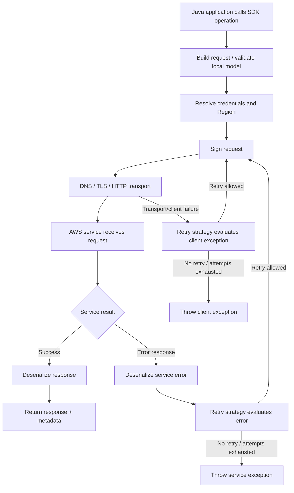
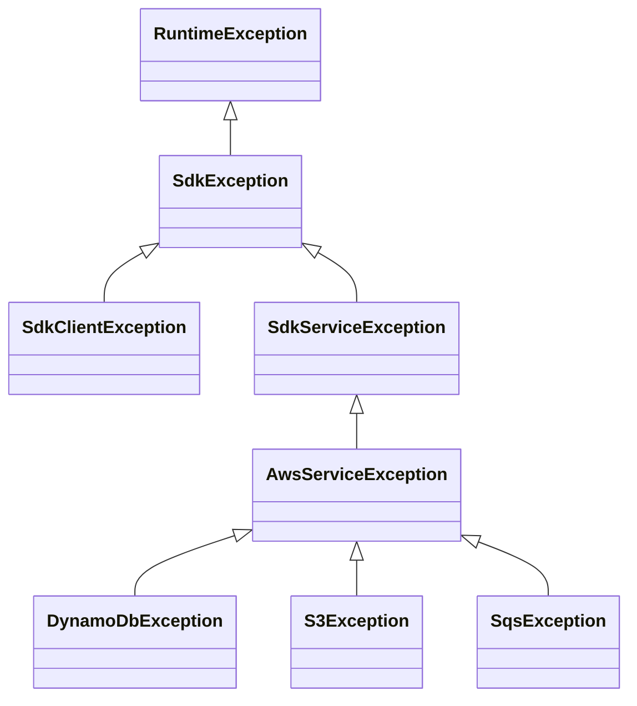
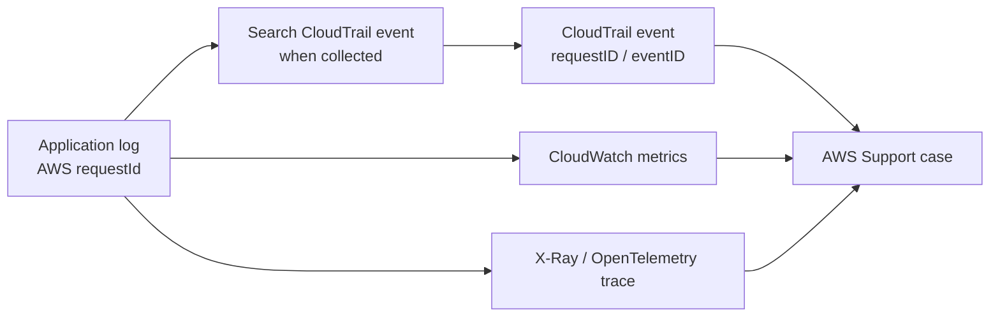

# Exception, request ID và chẩn đoán lỗi từ SDK

Khi một ứng dụng Java gọi AWS, một request thất bại có thể xuất phát từ nhiều lớp: dữ liệu đầu vào, quyền IAM, cấu hình Region/endpoint, DNS/TLS/network, giới hạn throughput của service hoặc sự cố tạm thời phía AWS. Nếu chỉ log exception message rồi retry mọi lỗi, đội vận hành sẽ khó tìm nguyên nhân và có thể tạo thêm tải trong lúc service đang bị throttling.

AWS SDK for Java 2.x cung cấp hệ thống exception có cấu trúc và response metadata để phân biệt **lỗi phía client** với **lỗi được AWS service trả về**. Với service errors, **AWS request ID**, error code và HTTP status là các dữ kiện quan trọng để tra cứu. Bài này hướng dẫn cách bắt exception đúng lớp, đọc request ID ở cả response thành công và thất bại, cấu hình retry, ghi log có thể truy vết và chẩn đoán theo từng lớp.

Bài thuộc chương **AWS SDK cho Java** của mô-đun **CLOUD_PROVIDERS_AWS**. Nội dung gắn với IAM, Region/AZ, VPC, EC2/ECS/EKS/Lambda, DynamoDB, S3, SQS, CloudWatch, CloudTrail, X-Ray và vận hành ứng dụng Java trên AWS.

> **Nguyên tắc vận hành:** Trước tiên phân loại exception. Nếu AWS trả lỗi, ghi **service + operation + Region + request ID + error code + HTTP status**. Nếu SDK không gửi được request hoặc không đọc được response, thường sẽ **không có AWS request ID**; khi đó cần điều tra cause chain, credentials, DNS, TLS và network. Chỉ retry những lỗi có khả năng phục hồi và có semantics an toàn.

## 1. Mục tiêu học tập

Sau bài học, bạn có thể:

1. Mô tả exception hierarchy của AWS SDK for Java 2.x.
2. Phân biệt SdkException, SdkClientException, SdkServiceException và AwsServiceException.
3. Bắt exception theo thứ tự cụ thể đến tổng quát và tránh che mất nguyên nhân.
4. Đọc AWS error code, HTTP status, service name, request ID và extended request ID.
5. Lấy request ID từ response thành công thông qua response metadata.
6. Giải thích request ID khác application correlation ID, X-Ray trace ID và CloudTrail event ID thế nào.
7. Phân biệt lỗi input/IAM/network/throttling/transient service và lỗi nghiệp vụ.
8. Hiểu automatic retry, standard/legacy/adaptive retry strategy và backoff.
9. Thiết kế idempotency cho các write operations có kết quả không chắc chắn.
10. Cấu hình timeout cho từng attempt và toàn API call.
11. Ghi log có cấu trúc, không làm lộ credentials, tokens hoặc dữ liệu nhạy cảm.
12. Xử lý exception của synchronous và asynchronous clients.
13. Kết hợp request ID với CloudTrail, CloudWatch, X-Ray và log của ứng dụng.
14. Xây dựng quy trình chẩn đoán từ một lỗi production có request ID.
15. Kiểm thử các tình huống lỗi trong sandbox mà không gây ảnh hưởng production.

## 2. Vòng đời một AWS SDK request

Một lời gọi SDK thường trải qua các bước:



Từ sơ đồ này có hai nhóm lỗi quan trọng:

- **Lỗi client-side:** request không được gửi thành công, không thể kết nối, credentials không tải được, timeout, TLS/DNS hoặc response không deserialize được.
- **Lỗi service-side:** AWS đã nhận request và trả error response, ví dụ AccessDeniedException, ValidationException hoặc ThrottlingException.

Một request thành công cũng có thể mang metadata gồm request ID. Vì vậy, **request ID không chỉ hữu ích khi có exception**.

## 3. Exception hierarchy trong SDK for Java 2.x

Các exception chính của SDK là unchecked exceptions, tức kế thừa RuntimeException. Ứng dụng không bắt buộc khai báo throws cho mỗi SDK operation.



| Exception | Ý nghĩa | Có AWS error response? |
| --- | --- | --- |
| SdkException | Lớp cơ sở chung cho SDK exceptions | Không nhất thiết |
| SdkClientException | Lỗi xảy ra trong SDK/client khi gửi request hoặc xử lý response | Thường không |
| SdkServiceException | Lỗi do service trả về ở mức khái quát | Có |
| AwsServiceException | AWS service error, có AWS-specific details | Có |
| DynamoDbException | Exception cụ thể của DynamoDB | Có |
| S3Exception | Exception cụ thể của Amazon S3 | Có |
| SqsException | Exception cụ thể của Amazon SQS | Có |

### 3.1. SdkClientException

SdkClientException cho biết SDK gặp vấn đề ở phía client trong lúc chuẩn bị, gửi hoặc xử lý response. Ví dụ:

- Không tải được AWS credentials từ provider chain.
- Không phân giải được hostname.
- Không có kết nối mạng, connection reset hoặc socket timeout.
- TLS handshake thất bại vì certificate/truststore.
- Endpoint/HTTP client configuration không phù hợp.
- SDK không thể parse response từ transport/service.

Thông thường, service chưa trả một error response có cấu trúc, vì vậy **không có AWS request ID để tra cứu**. Hãy kiểm tra getCause() và toàn bộ cause chain.

### 3.2. AwsServiceException

AwsServiceException đại diện cho một error response từ AWS service. Request đã tới service, nhưng service không thể xử lý thành công.

Thông tin quan trọng gồm:

- HTTP status code.
- AWS error code.
- Error message do service trả về.
- AWS request ID của request thất bại.
- Extended request ID ở các service hỗ trợ.
- HTTP response details thông qua AwsErrorDetails.

Thông thường, SDK ném subclass cụ thể như DynamoDbException, ConditionalCheckFailedException, NoSuchKeyException hoặc QueueDoesNotExistException. Ưu tiên catch subclass nếu ứng dụng cần xử lý riêng.

### 3.3. Vì sao cần phân biệt hai nhóm?

Giả sử cùng một API GetItem thất bại:

- SdkClientException: Unable to execute HTTP request: kiểm tra DNS, route, proxy, TLS, timeout hoặc credentials.
- DynamoDbException với AccessDeniedException: kiểm tra IAM, permission boundary, SCP, resource policy hoặc endpoint policy.
- DynamoDbException với ProvisionedThroughputExceededException: kiểm tra capacity, partition key, GSI và throttling.
- DynamoDbException với ValidationException: sửa request hoặc expression.

Nếu chỉ bắt RuntimeException, các nguyên nhân này sẽ bị trộn thành một nhóm và không thể chọn hành động đúng.

## 4. AWS request ID là gì?

**AWS request ID** là định danh do AWS service gắn với một API request đã được service xử lý. ID này giúp AWS và đội vận hành tìm request trong hệ thống log/tracing nội bộ của service.

Một số điểm cần nhớ:

1. Request ID được tạo phía service, không phải application tự sinh.
2. Mỗi lần retry có thể là một request mới và có request ID riêng.
3. Exception cuối cùng thường cung cấp request ID của **attempt cuối cùng trả service error**.
4. Request ID không chứa thông tin đủ để client tự biết root cause.
5. Request ID không phải access key, session token hay password, nhưng nên giữ trong log nội bộ có kiểm soát.
6. Không phải lỗi client-side nào cũng có request ID.
7. Một số service trả thêm extendedRequestId; không phải service nào cũng có.

### 4.1. Request ID và các ID khác

| ID | Được tạo bởi | Mục đích |
| --- | --- | --- |
| **AWS request ID** | AWS service | Tra cứu một API request ở phía AWS |
| **Extended request ID** | Một số AWS services | Bổ sung định danh/chẩn đoán theo service |
| **Application correlation ID** | Ứng dụng/API gateway | Liên kết các log trong cùng nghiệp vụ |
| **X-Ray trace ID** | AWS X-Ray tracing | Theo dõi request xuyên nhiều services |
| **CloudTrail event ID** | CloudTrail | Định danh một event trong CloudTrail |
| **Idempotency token** | Ứng dụng/API request | Nhận diện lần thực hiện nghiệp vụ để tránh side effects lặp |

Không sử dụng AWS request ID làm business order ID, idempotency token hoặc trace ID xuyên suốt hệ thống. Hãy log các ID này ở những field riêng.

### 4.2. Request ID trên response thành công

Các AWS service responses thường cung cấp response metadata. Ví dụ với DynamoDB:

```java
GetItemResponse response = dynamoDb.getItem(request);

String requestId = response.responseMetadata() == null
    ? null
    : response.responseMetadata().requestId();

log.info("DynamoDB GetItem completed requestId={}", requestId);
```

requestId() thuộc response metadata của SDK. Một số service-specific response metadata có thêm fields riêng. Không tự parse raw HTTP response nếu SDK đã cung cấp API metadata.

### 4.3. Request ID trên service exception

Trong SDK v2, dùng requestId() trên SdkServiceException/AwsServiceException:

```java
try {
    dynamoDb.getItem(request);
} catch (DynamoDbException e) {
    String requestId = e.requestId();
    log.error("DynamoDB request failed requestId={}", requestId);
}
```

Với service hỗ trợ extended request ID, có thể đọc extendedRequestId() từ service exception. Kiểm tra API reference của service/client version đang dùng.

### 4.4. Request ID trên lỗi client-side

Với SdkClientException, thường không có service request ID:

```java
try {
    dynamoDb.getItem(request);
} catch (SdkClientException e) {
    log.error("SDK client failure; no AWS service request ID is expected", e);
}
```

Không tạo một chuỗi giả rồi ghi nhãn là AWS request ID. Hãy dùng application correlation ID hoặc trace ID để nối log của client.

## 5. Đọc error details từ AwsServiceException

AwsServiceException cung cấp awsErrorDetails() để truy xuất thông tin service error.

Các accessor thường dùng:

| Accessor | Nội dung |
| --- | --- |
| requestId() | AWS request ID |
| extendedRequestId() | Extended ID nếu service trả |
| awsErrorDetails().serviceName() | Tên AWS service |
| awsErrorDetails().errorCode() | Mã lỗi do service trả |
| awsErrorDetails().errorMessage() | Thông báo lỗi từ service |
| awsErrorDetails().sdkHttpResponse().statusCode() | HTTP status |
| awsErrorDetails().sdkHttpResponse().headers() | HTTP response headers |

Ví dụ:

```java
import software.amazon.awssdk.awscore.exception.AwsErrorDetails;
import software.amazon.awssdk.services.dynamodb.model.DynamoDbException;

void inspect(DynamoDbException e) {
    AwsErrorDetails details = e.awsErrorDetails();

    String requestId = e.requestId();
    String errorCode = details == null ? null : details.errorCode();
    String serviceName = details == null ? null : details.serviceName();

    Integer statusCode = null;
    if (details != null && details.sdkHttpResponse() != null) {
        statusCode = details.sdkHttpResponse().statusCode();
    }

    log.error(
        "AWS service error service={} requestId={} status={} errorCode={}",
        serviceName, requestId, statusCode, errorCode
    );
}
```

Không giả định mọi field đều có giá trị trong mọi lỗi. Viết code null-safe và không phụ thuộc vào cách trình bày toString() của exception.

### 5.1. Đừng chỉ parse message

Tránh code kiểu:

```java
if (e.getMessage().contains("AccessDenied")) {
    // ...
}
```

Message có thể thay đổi, chứa dữ liệu đầu vào và không phải contract ổn định. Dùng exception type, errorCode() và status code. Message chỉ là dữ kiện bổ sung cho người vận hành.

### 5.2. HTTP status không đủ để phân loại

AWS service error codes mới là dấu hiệu chính xác hơn cho hành động. Không áp dụng máy móc quy tắc “400 không retry, 500 retry”:

- DynamoDB có thể trả một số lỗi throttling dưới HTTP 400.
- Một HTTP 400 với error code RequestTimeout có thể được phân loại transient.
- Một HTTP 5xx thường có tính transient, nhưng cần xem error code cụ thể.
- AccessDeniedException và ValidationException thường không thể khắc phục bằng retry.

**Hãy đọc error code trước, sau đó dùng HTTP status để bổ sung ngữ cảnh.**

## 6. Các lỗi phổ biến khi gọi AWS

### 6.1. Lỗi request và dữ liệu

| Error code / exception | Nguyên nhân thường gặp | Hành động |
| --- | --- | --- |
| ValidationException | Sai field, kiểu dữ liệu, key schema hoặc expression | Sửa request; không retry y nguyên |
| ResourceNotFoundException | Sai resource name/ARN, Region hoặc account | Xác minh resource và endpoint |
| ConditionalCheckFailedException | Điều kiện nghiệp vụ không còn đúng | Xử lý conflict/business flow |
| IdempotentParameterMismatchException | Dùng lại idempotency token với tham số khác | Sửa logic token/request |
| TransactionCanceledException | Một hoặc nhiều hành động trong transaction bị hủy | Đọc cancellation reasons nếu có |

### 6.2. Lỗi quyền và danh tính

| Error code / exception | Kiểm tra |
| --- | --- |
| AccessDeniedException | IAM identity policy, resource policy, permission boundary, SCP, VPC endpoint policy |
| UnrecognizedClientException | Credentials, session token, chữ ký, thời gian hệ thống |
| InvalidSignatureException / SignatureDoesNotMatch | Region, service signing name, clock skew, proxy sửa request |
| ExpiredTokenException | STS session hết hạn, credential refresh |
| KMSAccessDeniedException | KMS key policy, IAM và encryption context |

Đừng kết luận AccessDenied chỉ vì role thiếu một action. Quyền hiệu lực có thể bị giới hạn bởi SCP, permissions boundary, session policy, resource policy hoặc endpoint policy.

### 6.3. Lỗi throttling và giới hạn

| Error code / exception | Hướng điều tra |
| --- | --- |
| ThrottlingException | Service rate limit, account quota hoặc resource limit |
| ProvisionedThroughputExceededException | DynamoDB table/index capacity hoặc hot partition |
| RequestLimitExceeded | API/account rate limit |
| TooManyRequestsException | Request rate cao hoặc concurrency vượt giới hạn |
| SlowDown | Một số service như S3 yêu cầu giảm tốc độ |

Hành động có thể gồm exponential backoff, jitter, giảm concurrency, phân phối key, tăng capacity hoặc xin quota phù hợp. Retry không sửa được một workload bị dồn vào một hot partition.

### 6.4. Lỗi service tạm thời

| Error | Hành động |
| --- | --- |
| InternalServerError / InternalServerErrorException | SDK retry theo strategy; nếu kéo dài, thu request IDs và thời gian UTC |
| HTTP 500/502/503/504 | Kiểm tra error code, retry behavior và service health |
| RequestTimeout | Kiểm tra timeout phía client/service, retry nếu strategy cho phép |
| Connection reset/socket timeout | Kiểm tra network, client timeout và endpoint |

## 7. Lỗi phía client: kiểm tra cause chain

SdkClientException thường bao ngoài một exception cụ thể từ Java hoặc HTTP client. Ví dụ:

```text
SdkClientException
  └── SdkClientException: Unable to execute HTTP request
       └── UnknownHostException
```

Hoặc:

```text
SdkClientException
  └── SSLHandshakeException
       └── CertificateException
```

Một số nguyên nhân thường gặp:

| Cause | Kiểm tra |
| --- | --- |
| UnknownHostException | DNS resolver, VPC DNS, endpoint hostname, proxy |
| ConnectException | Route, firewall, SG/NACL, endpoint và port |
| SocketTimeoutException | Service latency, network path, attempt timeout |
| SSLHandshakeException | Truststore, CA, hostname verification, TLS version |
| Credential provider errors | Credentials chain, profile, role, SSO login |
| SdkClientException khi parse response | Proxy/WAF response, content type, malformed response |
| ApiCallTimeoutException | Tổng thời gian API call đã vượt deadline |
| ApiCallAttemptTimeoutException | Một lần gửi request đã vượt attempt timeout |

### 7.1. Duyệt cause chain

```java
static Throwable rootCause(Throwable error) {
    Throwable current = error;
    while (current.getCause() != null && current.getCause() != current) {
        current = current.getCause();
    }
    return current;
}
```

Không chỉ log root cause rồi bỏ exception ban đầu. Exception ngoài thường chứa context SDK; root cause giúp nhận diện lỗi Java/HTTP cụ thể.

## 8. Bắt exception đúng thứ tự

Một pattern phổ biến:

1. Catch business/model exception cụ thể trước.
2. Catch service exception cụ thể.
3. Catch AwsServiceException hoặc service-specific base exception.
4. Catch SdkClientException.
5. Catch SdkException như lớp fallback ở boundary.

Ví dụ với DynamoDB:

```java
try {
    dynamoDb.putItem(request);
} catch (ConditionalCheckFailedException e) {
    // Business conflict: không retry cùng điều kiện một cách mù quáng.
    handleConditionConflict(e);
} catch (TransactionCanceledException e) {
    // Phân tích cancellation reasons và transaction state.
    handleTransactionCanceled(e);
} catch (DynamoDbException e) {
    // AWS đã trả service error response.
    logDynamoDbServiceError(e);
} catch (SdkClientException e) {
    // Client không hoàn tất request/response path.
    logSdkClientError(e);
} catch (SdkException e) {
    // Fallback cho các lỗi SDK khác.
    logUnexpectedSdkError(e);
}
```

Nếu catch SdkException trước DynamoDbException, các catch block phía sau sẽ không thể chạy. Java yêu cầu catch subclass trước superclass.

**Không nên catch rồi trả kết quả mặc định như null hoặc empty list** nếu điều đó làm ứng dụng báo thành công giả. Hãy chuyển lỗi thành domain error phù hợp hoặc để boundary xử lý theo chính sách.

## 9. Mẫu logging service error trong Java

Một log hữu ích nên có:

- Service và operation.
- Region.
- Application correlation ID/trace ID.
- AWS request ID và extended request ID nếu có.
- HTTP status và error code.
- Attempt count nếu có dữ liệu từ instrumentation.
- SDK version và client name nếu phục vụ điều tra.
- Resource identifier đã được phép ghi log, ví dụ table name đã kiểm soát.

Ví dụ với SLF4J:

```java
package example.aws;

import org.slf4j.Logger;
import org.slf4j.LoggerFactory;
import software.amazon.awssdk.awscore.exception.AwsErrorDetails;
import software.amazon.awssdk.core.exception.SdkClientException;
import software.amazon.awssdk.services.dynamodb.model.DynamoDbException;

public final class AwsErrorLogger {
    private static final Logger log =
        LoggerFactory.getLogger(AwsErrorLogger.class);

    private AwsErrorLogger() {}

    public static void logDynamoDbFailure(
            String operation,
            String region,
            String correlationId,
            DynamoDbException error) {

        AwsErrorDetails details = error.awsErrorDetails();
        String service = details == null ? "DynamoDB" : details.serviceName();
        String errorCode = details == null ? null : details.errorCode();

        Integer statusCode = null;
        if (details != null && details.sdkHttpResponse() != null) {
            statusCode = details.sdkHttpResponse().statusCode();
        }

        log.error(
            "AWS service call failed service={} operation={} region={} " +
            "correlationId={} requestId={} extendedRequestId={} " +
            "statusCode={} errorCode={}",
            service,
            operation,
            region,
            correlationId,
            error.requestId(),
            error.extendedRequestId(),
            statusCode,
            errorCode
        );
    }

    public static void logClientFailure(
            String operation,
            String region,
            String correlationId,
            SdkClientException error) {

        Throwable root = rootCause(error);

        log.error(
            "AWS SDK client failure operation={} region={} correlationId={} " +
            "rootCauseType={}",
            operation,
            region,
            correlationId,
            root.getClass().getName()
        );

        // Stack trace chỉ ghi ở log nội bộ có kiểm soát.
        log.debug("AWS SDK client exception details", error);
    }

    private static Throwable rootCause(Throwable error) {
        Throwable current = error;
        while (current.getCause() != null && current.getCause() != current) {
            current = current.getCause();
        }
        return current;
    }
}
```

Đây là ví dụ minh họa. Trong ứng dụng thực tế, thêm structured logging/MDC và quy tắc redaction theo chuẩn của tổ chức. Không log toàn bộ request/response body chỉ để lấy request ID.

## 10. Lấy request ID ở cả thành công và thất bại

Ví dụ với DynamoDB GetItem:

```java
import org.slf4j.Logger;
import org.slf4j.LoggerFactory;
import software.amazon.awssdk.core.exception.SdkClientException;
import software.amazon.awssdk.services.dynamodb.DynamoDbClient;
import software.amazon.awssdk.services.dynamodb.model.AttributeValue;
import software.amazon.awssdk.services.dynamodb.model.DynamoDbException;
import software.amazon.awssdk.services.dynamodb.model.GetItemRequest;
import software.amazon.awssdk.services.dynamodb.model.GetItemResponse;

import java.util.Map;

public final class GetItemWithRequestId {
    private static final Logger log =
        LoggerFactory.getLogger(GetItemWithRequestId.class);

    public static void main(String[] args) {
        String table = System.getenv().getOrDefault("DDB_TABLE", "OrdersDemo");

        GetItemRequest request = GetItemRequest.builder()
            .tableName(table)
            .key(Map.of(
                "pk", AttributeValue.builder().s("ORDER#1001").build(),
                "sk", AttributeValue.builder().s("META").build()))
            .consistentRead(false)
            .build();

        try (DynamoDbClient dynamoDb = DynamoDbClient.create()) {
            GetItemResponse response = dynamoDb.getItem(request);

            String requestId = response.responseMetadata() == null
                ? null
                : response.responseMetadata().requestId();

            log.info(
                "GetItem completed table={} requestId={} itemFound={}",
                table,
                requestId,
                response.hasItem()
            );

        } catch (DynamoDbException e) {
            AwsErrorLogger.logDynamoDbFailure(
                "GetItem", "configured-region", "application-correlation-id", e
            );

        } catch (SdkClientException e) {
            AwsErrorLogger.logClientFailure(
                "GetItem", "configured-region", "application-correlation-id", e
            );
        }
    }
}
```

Kết quả:

- Khi thành công, request ID lấy từ response.responseMetadata().requestId().
- Khi service trả lỗi, request ID lấy từ e.requestId().
- Khi client không nhận được service response, request ID thường không có.

Không ghi cứng Region hoặc correlation ID như ví dụ vào production. Lấy Region từ client configuration và correlation ID từ request context.

## 11. Xử lý lỗi với asynchronous client

Với DynamoDbAsyncClient, SDK trả CompletableFuture. Exception có thể được bọc trong CompletionException khi ứng dụng gọi join()/get().

```java
import software.amazon.awssdk.core.exception.SdkClientException;
import software.amazon.awssdk.services.dynamodb.DynamoDbAsyncClient;
import software.amazon.awssdk.services.dynamodb.model.DynamoDbException;
import software.amazon.awssdk.services.dynamodb.model.GetItemRequest;

import java.util.concurrent.CompletionException;

static Throwable unwrap(Throwable error) {
    Throwable current = error;
    while ((current instanceof CompletionException)
            && current.getCause() != null) {
        current = current.getCause();
    }
    return current;
}

void readAsync(DynamoDbAsyncClient client, GetItemRequest request) {
    client.getItem(request).whenComplete((response, failure) -> {
        if (failure != null) {
            Throwable cause = unwrap(failure);

            if (cause instanceof DynamoDbException serviceError) {
                logDynamoDbServiceError(serviceError);
            } else if (cause instanceof SdkClientException clientError) {
                logSdkClientError(clientError);
            } else {
                log.error("Unexpected asynchronous failure", cause);
            }
            return;
        }

        String requestId = response.responseMetadata() == null
            ? null
            : response.responseMetadata().requestId();

        log.info("Async GetItem success requestId={}", requestId);
    });
}
```

Nếu gọi join() sau đó, lỗi có thể được ném lại dưới dạng CompletionException. Hãy unwrap cause trước khi phân loại. Với reactive frameworks, xử lý error signal tương ứng; không chặn event loop bằng join() trong request thread không phù hợp.

## 12. Retry strategy trong SDK for Java 2.x

SDK có cơ chế retry tự động. Khi request gặp lỗi có khả năng phục hồi, SDK có thể đợi theo backoff rồi gửi lại. Ứng dụng thường chỉ nhận response thành công hoặc exception cuối cùng sau khi retry không còn được thực hiện.

Các nhóm lỗi thường được xem xét retry:

- Throttling/rate exceeded.
- Một số lỗi transient từ service.
- Một số lỗi mạng như socket timeout hoặc connection reset.
- Một số concurrency/optimistic lock failures theo service semantics.

Những lỗi thường không nên retry y nguyên:

- AccessDeniedException.
- ValidationException.
- ResourceNotFoundException.
- ConditionalCheckFailedException khi điều kiện nghiệp vụ không thay đổi.
- Request sai Region/account/resource.

### 12.1. Ba retry strategies

| Strategy | Đặc điểm | Khi dùng |
| --- | --- | --- |
| **Standard** | Exponential backoff, phân loại throttling/transient và retry quota/circuit breaking | Khuyến nghị cho phần lớn workload |
| **Legacy** | Hành vi tương thích các phiên bản cũ | Khi cần giữ behavior cũ trong migration |
| **Adaptive** | Thêm client-side rate limiter dựa trên throttling feedback | Workload bị giới hạn tài nguyên, một client tập trung vào một resource |

**Standard** là lựa chọn khuyến nghị cho đa số ứng dụng. Retry defaults thay đổi theo SDK release và service client; không dựa vào một số lần retry ghi trong blog cũ. Hãy pin SDK version, đọc retry guide của version đó và cấu hình rõ khi số attempts ảnh hưởng SLO.

### 12.2. maxAttempts gồm cả lần gọi đầu

Nếu đặt maxAttempts(5), con số này gồm:

- 1 initial attempt.
- Tối đa 4 retry attempts.

Không hiểu nhầm thành 5 retries cộng thêm một lần đầu. Tổng thời gian còn phụ thuộc request timeout và backoff delay.

### 12.3. Cấu hình Standard retry strategy

```java
import software.amazon.awssdk.core.retry.RetryMode;
import software.amazon.awssdk.services.dynamodb.DynamoDbClient;

DynamoDbClient client = DynamoDbClient.builder()
    .overrideConfiguration(config ->
        config.retryStrategy(RetryMode.STANDARD))
    .build();
```

Có thể cấu hình max attempts theo SLO:

```java
DynamoDbClient client = DynamoDbClient.builder()
    .overrideConfiguration(config ->
        config.retryStrategy(strategy ->
            strategy.maxAttempts(5)))
    .build();
```

Đây là ví dụ API cho các SDK releases hỗ trợ RetryStrategy. RetryStrategy được giới thiệu từ SDK 2.26.0; code cũ có thể dùng RetryPolicy. Hãy đồng bộ phiên bản dependencies và theo dõi migration guide.

### 12.4. Adaptive retry có thể ảnh hưởng nhiều resource

Adaptive strategy giả định một client làm việc với một resource. Nếu dùng chung một client cho nhiều DynamoDB tables, throttling của một bảng có thể khiến client-side rate limiter làm chậm các bảng khác.

Chỉ dùng adaptive khi hiểu rõ phạm vi resource và có cách tách client phù hợp. Không bật adaptive toàn hệ thống chỉ vì thấy throttling.

## 13. Retry và idempotency

Retry giúp tăng khả năng thành công, nhưng **không tự biến mọi thao tác thành idempotent**.

Tình huống nguy hiểm:

1. Ứng dụng gửi lệnh tạo payment/order.
2. AWS service hoặc downstream đã xử lý request.
3. Response bị mất trên network.
4. Client nhận timeout và không biết thao tác đã thành công hay chưa.
5. Client gửi lại request và tạo side effect lần hai.

Cách xử lý:

- Dùng idempotency key cho nghiệp vụ có side effect.
- Dùng DynamoDB conditional writes để tránh tạo trùng record.
- Dùng ClientRequestToken của TransactWriteItems khi phù hợp.
- Với SQS FIFO, dùng deduplication ID theo yêu cầu.
- Với SQS Standard, thiết kế consumer idempotent vì message có thể được giao nhiều lần.
- Sau timeout mơ hồ, đọc trạng thái theo idempotency key trước khi quyết định thực hiện lại.
- Đặt deadline tổng thể để retry không vượt quá thời gian API/transaction cho phép.

### 13.1. Không retry business conflict như lỗi mạng

Ví dụ ConditionalCheckFailedException có thể có nghĩa order đã tồn tại hoặc version đã thay đổi. Gửi lại cùng request mà không đọc lại trạng thái thường chỉ lặp lại lỗi.

| Lỗi | Cách xử lý |
| --- | --- |
| Throttling | SDK backoff/retry; đồng thời điều chỉnh capacity/rate |
| Timeout với write có kết quả không rõ | Kiểm tra idempotency/state trước khi gửi lại |
| Conditional check failed | Xử lý conflict nghiệp vụ |
| Validation error | Sửa request |
| Access denied | Sửa quyền hoặc policy |
| Temporary 5xx | SDK retry; sau cùng log request ID và thời gian UTC |

## 14. Timeout: attempt và toàn bộ API call

SDK có thể cấu hình hai loại timeout quan trọng:

- **API call attempt timeout:** giới hạn cho một lần gửi request.
- **API call timeout:** giới hạn tổng thời gian cho toàn bộ operation, bao gồm retry/backoff.

Ví dụ:

```java
import java.time.Duration;
import software.amazon.awssdk.services.dynamodb.DynamoDbClient;

DynamoDbClient client = DynamoDbClient.builder()
    .overrideConfiguration(config -> config
        .apiCallAttemptTimeout(Duration.ofSeconds(2))
        .apiCallTimeout(Duration.ofSeconds(8)))
    .build();
```

Với cấu hình này, một attempt bị giới hạn 2 giây và toàn operation bị giới hạn 8 giây. Nếu API call timeout hết trước khi retry strategy hoàn thành, ứng dụng nhận lỗi timeout tổng thể.

### 14.1. Chọn timeout theo SLO

- Không đặt attempt timeout quá ngắn khiến network bình thường bị coi là lỗi.
- Tổng API timeout phải phù hợp với deadline của HTTP request, queue visibility timeout hoặc Lambda timeout.
- Dành thời gian cho retry/backoff nếu nghiệp vụ cho phép.
- Đảm bảo timeout ở upstream không ngắn hơn mức cần thiết của downstream.
- Theo dõi p95/p99, không chỉ average latency.

### 14.2. Timeout không chứng minh service chưa thực hiện thao tác

Nếu client timeout sau khi gửi request, service có thể đã hoàn tất nhưng response không đến kịp. Với write operations, luôn xem xét trạng thái ambiguous và idempotency.

## 15. Chẩn đoán lỗi DynamoDB

DynamoDB là ví dụ tốt để thực hành vì có nhiều modeled exceptions:

| Exception | Nguyên nhân | Chẩn đoán |
| --- | --- | --- |
| ConditionalCheckFailedException | Condition expression không đúng tại thời điểm xử lý | Kiểm tra version/status và business state |
| ProvisionedThroughputExceededException | Không đủ throughput cho table/index/partition | CloudWatch consumed/throttle metrics, GSI, key distribution |
| ThrottlingException | Rate/partition/account limit | Error details, table/index ARN, quota |
| ResourceNotFoundException | Sai table/index hoặc Region | DescribeTable, account/Region |
| ValidationException | Sai key/expression/type | Request model, expression attribute names/values |
| TransactionCanceledException | Một action trong transaction bị cancel | Cancellation reasons, conflicts, conditions |
| InternalServerErrorException | Lỗi service tạm thời | Retry strategy, request ID, thời gian UTC |

### 15.1. TransactionCanceledException

Transaction có thể bị hủy vì condition không đạt, transaction conflict, capacity hoặc lỗi khác. Nếu SDK/service trả cancellation reasons, hãy xem từng action index tương ứng với item nào trong transaction.

Không kết luận mọi TransactionCanceledException đều là throttling. Có thể đây là business condition thất bại và cần trả conflict cho caller.

### 15.2. Kiểm tra bảng và Region

Dùng AWS CLI với đúng profile/Region:

```bash
aws sts get-caller-identity --profile training

aws dynamodb describe-table \
  --table-name OrdersDemo \
  --region ap-southeast-1 \
  --profile training
```

Nếu lệnh CLI thành công nhưng ứng dụng thất bại, so sánh identity, credential source, Region, endpoint override, VPC route và client config. CLI và Java SDK có thể dùng profile/role khác nhau.

## 16. Chẩn đoán lỗi S3 và SQS

### 16.1. S3

| Error | Hướng kiểm tra |
| --- | --- |
| NoSuchBucket | Bucket name, partition, account và Region |
| NoSuchKey | Object key, encoding, prefix, version |
| AccessDenied | IAM, bucket policy, KMS key, access point, VPC endpoint |
| SlowDown | Request rate, prefix distribution, SDK backoff |
| InvalidAccessKeyId | Credentials provider và account |
| SignatureDoesNotMatch | Region, endpoint, clock skew, proxy/header mutation |

S3 có thể cung cấp **extended request ID**. Khi làm việc với AWS Support, giữ cả request ID và extended request ID nếu có.

### 16.2. SQS

| Error | Hướng kiểm tra |
| --- | --- |
| QueueDoesNotExist | Queue URL, account và Region |
| AccessDenied | sqs:SendMessage, ReceiveMessage, queue policy |
| ReceiptHandleIsInvalid | Dùng receipt handle mới nhất từ lần receive |
| ThrottlingException | API rate/concurrency, retry/backoff |
| Timeout khi SendMessage | Kết quả có thể không rõ; thiết kế consumer/deduplication |

Đặc biệt, SQS Standard có at-least-once delivery. Ứng dụng phải xử lý duplicate messages ngay cả khi SDK không ném exception.

## 17. Request ID và CloudTrail

CloudTrail ghi lại các AWS API events được cấu hình để thu thập. Một số event records có trường requestID để đối chiếu với request ID mà SDK trả.

Tuy nhiên:

- **Management events** và **data events** là hai nhóm khác nhau.
- DynamoDB data-plane operations như GetItem/PutItem cần được bật data event collection phù hợp nếu muốn ghi nhận.
- CloudTrail Event history không mặc định là kho lưu mọi data-plane requests.
- Không phải mọi lỗi client-side đều tạo CloudTrail event.
- CloudTrail eventID khác requestID.

Ví dụ luồng điều tra:



Khi tìm event, lọc theo thời gian UTC, event source/name, account và Region; sau đó so sánh requestID nếu event có trường này. Nếu không có event, kiểm tra data selectors, trail/event data store, retention và quyền đọc.

## 18. Request ID, CloudWatch và tracing

### 18.1. CloudWatch metrics không phải request log

CloudWatch service metrics thường là số liệu tổng hợp theo thời gian và dimensions. Bạn có thể thấy:

- ThrottledRequests.
- SuccessfulRequestLatency.
- ConsumedReadCapacityUnits.
- ConsumedWriteCapacityUnits.
- 5xxError.
- 4xxError nếu service cung cấp metric tương ứng.

Những metric này giúp xác định thời điểm và mức độ lỗi, nhưng thường **không tra cứu trực tiếp theo AWS request ID**. Hãy dùng request ID cho service-side investigation, CloudTrail/logs cho event context và metrics để thấy phạm vi ảnh hưởng.

### 18.2. X-Ray và OpenTelemetry

Dùng trace ID để nối một user request qua API Gateway, Lambda/ECS, SDK calls và downstream services. Trong log, lưu riêng:

```json
{
  "timestamp": "2026-11-20T03:15:42.120Z",
  "level": "ERROR",
  "service": "orders-api",
  "operation": "DynamoDb.GetItem",
  "region": "ap-southeast-1",
  "correlationId": "app-generated-id",
  "traceId": "1-xxxxxxxx-xxxxxxxxxxxxxxxxxxxxxxxx",
  "awsRequestId": "service-returned-request-id",
  "errorCode": "ProvisionedThroughputExceededException",
  "httpStatus": 400
}
```

Đây là JSON minh họa, không phải giá trị request/trace ID thật.

### 18.3. Gắn correlation ID xuyên ứng dụng

- API Gateway/Lambda có request ID riêng.
- Java service có thể nhận hoặc tạo correlation ID.
- SDK trả AWS request ID ở từng service call.
- X-Ray/OpenTelemetry tạo trace ID.
- CloudTrail có event ID và request ID khi event được ghi.

Giữ từng định danh ở field riêng để không mất quan hệ giữa user request và nhiều AWS API calls.

## 19. Logging an toàn

Một log tốt giúp debug nhưng không làm lộ dữ liệu.

### 19.1. Nên ghi

- Timestamp UTC.
- Application/service name và environment.
- Operation name, Region và resource identifier đã được phê duyệt.
- Exception class.
- AWS error code và HTTP status.
- AWS request ID/extended request ID.
- Application correlation ID/trace ID.
- Retry/attempt information nếu có dữ liệu từ instrumentation.
- SDK version và HTTP client type khi cần.

### 19.2. Không nên ghi

- AWS secret access key, session token, access token.
- Authorization header, SigV4 signature hoặc cookie.
- Raw request/response payload có PII.
- Password, API keys, database credentials.
- Full S3 presigned URL nếu có chữ ký/token.
- Nội dung message/record nhạy cảm.
- Raw exception response body chưa được lọc.

### 19.3. Message có thể chứa dữ liệu đầu vào

Một số validation/service errors phản hồi lại tên field, expression hoặc giá trị đầu vào. Không đưa nguyên văn error message lên log công khai hoặc API response cho end user. Log error code/request ID và một thông báo đã lọc; lưu chi tiết ở hệ thống nội bộ có access control.

## 20. Timeout, retries và latency end-to-end

Một API call có thể mất nhiều thời gian hơn một request attempt vì SDK thực hiện retry/backoff.

\[
T_{\mathrm{total}} \approx
\sum_{i=1}^{n} T_{\mathrm{attempt},i}
+\sum_{i=1}^{n-1} T_{\mathrm{backoff},i}
\]

Trong đó:

- \(n\) là số attempts đã thực hiện.
- \(T_{\mathrm{attempt}}\) gồm thời gian network/service/deserialize của một attempt.
- \(T_{\mathrm{backoff}}\) là thời gian SDK chờ trước retry.

Ví dụ minh họa: 3 attempts, mỗi attempt mất 500 ms, backoff lần lượt 100 ms và 300 ms:

\[
T_{\mathrm{total}} = 3(500) + 100 + 300 = 1.900\ \mathrm{ms}
\]

Do đó một lỗi xuất hiện sau 1,9 giây có thể bắt nguồn từ nhiều attempts, không chỉ request cuối cùng.

### 20.1. Phân biệt các lớp latency

| Đoạn | Dữ liệu cần quan sát |
| --- | --- |
| Application queue/thread pool | Wait time, saturation |
| Credentials/Region resolution | Credential refresh, profile/SSO |
| DNS/TLS/connection pool | Connection creation, handshake, reuse |
| AWS service response | Service latency, request ID |
| SDK retry/backoff | Attempts, retry delays |
| Serialization/business logic | CPU, payload size, mapping |
| Upstream caller | End-to-end deadline |

Không chỉ tăng timeout để che một connection pool bị cạn hoặc service bị throttling.

## 21. Instrumentation: biết SDK đã retry bao nhiêu lần

Exception cuối cùng không nhất thiết chứa toàn bộ lịch sử attempts. Nếu cần biết từng attempt:

- Dùng SDK metrics publisher phù hợp với SDK version.
- Dùng ExecutionInterceptor/instrumentation theo lifecycle của SDK để ghi operation và attempt events.
- Ghi tổng thời gian API call, attempt duration và retry counts.
- Không tự viết một vòng retry bên ngoài mà không biết SDK đã retry bao nhiêu lần.
- Khi instrument, tránh ghi raw request headers hoặc payload.

Tùy SDK version, một số retry metrics/attribute có thể khác tên hoặc cần thêm module. Kiểm tra Developer Guide/API Reference của release đang pin.

### 21.1. Retry quota và circuit breaking

Standard strategy sử dụng retry quota/token bucket để hạn chế retry liên tục khi downstream đang lỗi nhiều. Khi quota không còn, SDK có thể trả lỗi sớm thay vì tiếp tục tạo retry storm. Circuit breaking cũng có thể tắt retries trong giai đoạn lỗi cao; lần attempt đầu vẫn được gửi.

Đây là cơ chế bảo vệ downstream. Ứng dụng không nên cố vượt qua bằng cách bọc thêm vòng lặp retry vô hạn.

## 22. AWS CLI và Java SDK: cùng request, khác cấu hình

Khi CLI thành công mà Java SDK thất bại, không kết luận service có vấn đề. Hai công cụ có thể dùng:

- Credentials provider khác nhau.
- Region khác nhau.
- Profile/assumed role khác nhau.
- Endpoint override/proxy khác nhau.
- Retry strategy và timeout khác nhau.
- VPC/network path khác nhau.

Runbook so sánh:

1. aws sts get-caller-identity với profile dùng trong CLI.
2. Kiểm tra Region CLI và Region trong Java client.
3. Xác nhận Java dùng đúng profile, SSO session, instance/task role hoặc web identity.
4. Xác nhận policy hiệu lực và resource ARN.
5. So sánh endpoint override, proxy, CA truststore.
6. Ghi SDK version và retry strategy.
7. Chạy cùng request với cùng resource và key.

Ví dụ lệnh CLI:

```bash
aws sts get-caller-identity --profile training

aws dynamodb describe-table \
  --table-name OrdersDemo \
  --region ap-southeast-1 \
  --profile training
```

aws --debug có thể hữu ích trong sandbox để xem HTTP request/response flow, nhưng output rất chi tiết. Trước khi chia sẻ, phải loại bỏ Authorization headers, credentials, tokens, payload và URL có chữ ký.

## 23. Runbook: từ lỗi production đến nguyên nhân

Khi nhận được một lỗi AWS SDK, làm theo thứ tự:

### Bước 1 — Ghi nhận context

- Thời điểm UTC chính xác.
- Application/service/version/environment.
- AWS account/role đã được xác minh.
- Region và endpoint.
- Operation/resource liên quan.
- Application correlation ID và trace ID.

### Bước 2 — Phân loại exception

- AwsServiceException: service đã trả error response.
- SdkClientException: client không hoàn thành send/receive/parse path.
- Domain exception: business rule thất bại.
- Exception khác: kiểm tra cause chain và wrapper.

### Bước 3 — Nếu là service error

Ghi:

- requestId().
- extendedRequestId() nếu có.
- awsErrorDetails().serviceName().
- awsErrorDetails().errorCode().
- awsErrorDetails().sdkHttpResponse().statusCode().

Không chỉ gửi message; request ID và error code là các trường tra cứu hữu ích.

### Bước 4 — Nếu là client error

Kiểm tra:

- Cause chain.
- Credentials provider và token refresh.
- Region/endpoint.
- DNS/TLS/proxy/route.
- Attempt timeout và API timeout.
- Connection pool/HTTP client.

Không chờ AWS request ID nếu request chưa đến service.

### Bước 5 — Xem retry behavior

- SDK có retry không?
- Đã hết maxAttempts hay retry quota chưa?
- Có duplicate side effect không?
- Tổng thời gian có vượt deadline upstream không?
- Lỗi có phải non-retryable business/authorization error?

### Bước 6 — Đối chiếu observability

- CloudWatch metrics: lỗi/throttling/latency có tăng cùng thời điểm?
- CloudTrail: event có được ghi và requestID có khớp?
- X-Ray/OpenTelemetry: service nào tạo latency/error?
- AWS Health/service events: có sự cố/maintenance liên quan?
- Application logs: nhiều requests hay chỉ một key/resource?

### Bước 7 — Chọn hành động và xác nhận

- Fix request/IAM/Region/network nếu lỗi cấu hình.
- Điều chỉnh rate/capacity/key distribution nếu throttling.
- Retry có giới hạn nếu transient.
- Xử lý idempotency nếu write result ambiguous.
- Mở AWS Support case khi cần, cung cấp request ID, Region, service, operation và timestamp UTC.

## 24. Những lỗi xử lý exception thường gặp

| Anti-pattern | Hậu quả | Cách sửa |
| --- | --- | --- |
| Catch Exception rồi chỉ log message | Mất type, request ID, cause | Catch service/client/domain errors riêng |
| Retry mọi exception | Retry validation/access denied và tạo tải | Dựa error code/retry strategy |
| Retry vô hạn | Retry storm và vượt deadline | Giới hạn attempts + total timeout |
| Chỉ log HTTP status | Bỏ qua service error code | Log cả error code và request ID |
| Dùng request ID như trace ID | Không liên kết được nhiều calls | Giữ correlation ID/trace ID riêng |
| Cho rằng mọi lỗi đều có request ID | Tốn thời gian tìm ID không tồn tại | Phân biệt client và service error |
| Log toàn bộ request/response | Rò rỉ PII/secrets | Structured fields và redaction |
| Bỏ qua CompletionException | Không bắt được exception thực | Unwrap cause trong async flow |
| Tự retry non-idempotent writes | Tạo duplicate side effects | Idempotency token/conditional write |
| Tăng timeout để che connection leak | Latency và resource usage tăng | Đo pool/transport/attempt metrics |
| Tắt retry toàn cục | Làm giảm khả năng phục hồi transient errors | Chỉnh strategy theo workload |
| Dùng một adaptive client cho nhiều resource | Throttling một resource ảnh hưởng resource khác | Tách client theo resource hoặc dùng standard |

## 25. Bài thực hành: điều tra lỗi Orders API

### 25.1. Bối cảnh

Một Spring Boot service trên ECS Fargate gọi DynamoDB bảng Orders. Một số request trả 500, log hiện SdkException, nhưng không có request ID. Một số request khác trả ProvisionedThroughputExceededException.

### 25.2. Nhiệm vụ A — Phân loại exception

Cho các tình huống:

| Tình huống | Exception gợi ý |
| --- | --- |
| DNS hostname không resolve | SdkClientException với UnknownHostException cause |
| Role thiếu dynamodb:GetItem | DynamoDbException/AwsServiceException với AccessDeniedException |
| Sai key type | DynamoDbException với ValidationException |
| Table không tồn tại ở Region đã chọn | ResourceNotFoundException |
| Provisioned capacity bị vượt | ProvisionedThroughputExceededException |
| Condition expression không đạt | ConditionalCheckFailedException |
| Service trả lỗi nội bộ tạm thời | InternalServerErrorException hoặc service error tương ứng |

Giải thích tình huống nào có AWS request ID và tại sao.

### 25.3. Nhiệm vụ B — Hoàn thiện log schema

Dùng schema:

```json
{
  "timestamp": "...",
  "application": "orders-api",
  "operation": "DynamoDb.GetItem",
  "region": "...",
  "correlationId": "...",
  "traceId": "...",
  "awsRequestId": "...",
  "extendedRequestId": null,
  "exceptionClass": "...",
  "errorCode": "...",
  "httpStatus": null,
  "attemptCount": null
}
```

Giải thích trường nào lấy từ exception, response metadata, app context và SDK metrics. Không tự gán AWS request ID cho client-side failures.

### 25.4. Nhiệm vụ C — Chọn retry

Với từng lỗi, quyết định:

- Retry tự động?
- Sửa cấu hình?
- Trả conflict nghiệp vụ?
- Cần idempotency?
- Cần điều tra request ID?

Không retry AccessDeniedException, ValidationException hoặc ConditionalCheckFailedException theo cùng một cách với throttling/transient errors.

### 25.5. Nhiệm vụ D — Đối chiếu CloudTrail

Một service error có request ID và timestamp UTC. Kiểm tra:

1. Data events cho DynamoDB đã được bật chưa?
2. Event source/name, account và Region có đúng không?
3. CloudTrail event có trường requestID không?
4. eventID có bị nhầm với requestID không?
5. Nếu không có event, có thể do data event selector/retention hay client-side failure không?

### 25.6. Nhiệm vụ E — Async failure

Một DynamoDbAsyncClient future hoàn tất exceptionally bằng CompletionException. Viết code unwrap cause và phân loại DynamoDbException với SdkClientException. Log request ID khi có service exception.

### 25.7. Nhiệm vụ F — Read-only audit

Nếu có AWS sandbox được cấp, thu thập:

```text
AWS account / role (redacted): ...
Region / endpoint: ...
SDK artifact version: ...
Retry mode / maxAttempts: ...
HTTP client / proxy: ...
API timeout / attempt timeout: ...
Operation and resource: ...
Exception class: ...
Root cause class (if client-side): ...
AWS error code: ...
HTTP status: ...
AWS request ID: ...
Extended request ID: ...
Application correlation ID / trace ID: ...
CloudWatch metrics around failure: ...
CloudTrail event collected? requestID matched? ...
IAM/network/config changes: ...
Retry/idempotency behavior: ...
Owner / next action: ...
```

**Tiêu chí đạt:** phân biệt đúng service/client errors, lấy request ID đúng nơi, không dùng request ID như trace ID, chọn retry theo error semantics, bảo vệ dữ liệu trong log và lập được runbook có thể chuyển cho đội vận hành.

## 26. Câu hỏi tự kiểm tra

1. AWS SDK for Java 2.x dùng checked hay unchecked exceptions?
2. SdkException là lớp cơ sở nào?
3. SdkClientException cho biết lỗi xảy ra ở phía nào?
4. AwsServiceException cho biết request đã tới AWS service chưa?
5. Vì sao SdkClientException thường không có AWS request ID?
6. SdkServiceException.requestId() trả về gì?
7. AwsErrorDetails.errorCode() khác errorMessage() thế nào?
8. Lấy HTTP status từ SDK v2 bằng accessor nào?
9. Lấy request ID của response thành công từ đâu?
10. Extended request ID có phải mọi service đều trả không?
11. AWS request ID khác X-Ray trace ID thế nào?
12. AWS request ID khác CloudTrail event ID thế nào?
13. Vì sao mỗi retry attempt có thể có request ID khác?
14. Vì sao exception cuối cùng không đại diện đầy đủ mọi attempt?
15. Vì sao không nên phân loại lỗi chỉ bằng HTTP 400/500?
16. ValidationException có nên retry y nguyên không?
17. ProvisionedThroughputExceededException cần kiểm tra những yếu tố nào?
18. ConditionalCheckFailedException thường phản ánh loại lỗi gì?
19. Standard retry strategy phù hợp loại workload nào?
20. Adaptive retry có rủi ro gì nếu một client gọi nhiều resources?
21. maxAttempts=5 gồm bao nhiêu lần gọi đầu và retry tối đa?
22. API call timeout khác attempt timeout thế nào?
23. Vì sao retry write sau timeout có thể tạo duplicate side effects?
24. Làm thế nào xử lý CompletionException của async SDK?
25. CloudWatch metrics có thể tìm trực tiếp một request theo AWS request ID không?
26. Khi nào DynamoDB data events xuất hiện trong CloudTrail?
27. Vì sao không nên log Authorization header hoặc raw response body?
28. Nếu CLI thành công nhưng Java SDK lỗi, cần so sánh những cấu hình nào?
29. Khi nào nên mở AWS Support case với request ID?
30. Một runbook chẩn đoán service error cần những trường log nào?

## 27. Tài liệu AWS chính thức

1. [Handling errors in the AWS SDK for Java 2.x](https://docs.aws.amazon.com/sdk-for-java/latest/developer-guide/handling-exceptions.html).
2. [Exception changes from SDK for Java 1.x to 2.x](https://docs.aws.amazon.com/sdk-for-java/latest/developer-guide/migration-exception-changes.html).
3. [Configure retry behavior in the AWS SDK for Java 2.x](https://docs.aws.amazon.com/sdk-for-java/latest/developer-guide/retry-strategy.html).
4. [AWS SDK for Java 2.x API — AwsServiceException](https://sdk.amazonaws.com/java/api/latest/software/amazon/awssdk/awscore/exception/AwsServiceException.html).
5. [AWS SDK for Java 2.x API — SdkServiceException](https://sdk.amazonaws.com/java/api/latest/software/amazon/awssdk/core/exception/SdkServiceException.html).
6. [AWS SDK for Java 2.x API — SdkClientException](https://sdk.amazonaws.com/java/api/latest/software/amazon/awssdk/core/exception/SdkClientException.html).
7. [AWS SDK for Java 2.x API — AwsErrorDetails](https://sdk.amazonaws.com/java/api/latest/software/amazon/awssdk/awscore/exception/AwsErrorDetails.html).
8. [AWS SDK for Java 2.x API — AwsResponseMetadata](https://sdk.amazonaws.com/java/api/latest/software/amazon/awssdk/awscore/AwsResponseMetadata.html).
9. [Configure timeouts in the AWS SDK for Java 2.x](https://docs.aws.amazon.com/sdk-for-java/latest/developer-guide/timeouts.html).
10. [AWS SDK for Java 2.x metrics](https://docs.aws.amazon.com/sdk-for-java/latest/developer-guide/metrics.html).
11. [AWS CloudTrail event record contents](https://docs.aws.amazon.com/awscloudtrail/latest/userguide/cloudtrail-event-reference-record-contents.html).
12. [Logging data events with CloudTrail](https://docs.aws.amazon.com/awscloudtrail/latest/userguide/logging-data-events-with-cloudtrail.html).
13. [CloudWatch metrics for AWS services](https://docs.aws.amazon.com/AmazonCloudWatch/latest/monitoring/aws-services-cloudwatch-metrics.html).
14. [AWS X-Ray concepts](https://docs.aws.amazon.com/xray/latest/devguide/xray-concepts.html).
15. [DynamoDB error handling](https://docs.aws.amazon.com/amazondynamodb/latest/developerguide/Programming.Errors.html).
16. [DynamoDB throttling diagnosis](https://docs.aws.amazon.com/amazondynamodb/latest/developerguide/TroubleshootingThrottling.html).
17. [Amazon S3 error responses](https://docs.aws.amazon.com/AmazonS3/latest/API/ErrorResponses.html).
18. [Amazon SQS error handling](https://docs.aws.amazon.com/AWSSimpleQueueService/latest/SQSDeveloperGuide/troubleshooting-api-errors.html).

> **Ghi nhớ:** AwsServiceException cho biết AWS service đã trả lỗi và thường cung cấp **request ID + error code + HTTP status**. SdkClientException thường yêu cầu điều tra cause chain, credentials, DNS, TLS và network. Hãy dùng retry strategy có giới hạn, bảo vệ idempotency, log correlation ID/trace ID/request ID riêng biệt và đối chiếu CloudTrail/CloudWatch/X-Ray theo đúng loại dữ liệu mà từng công cụ thu thập.
