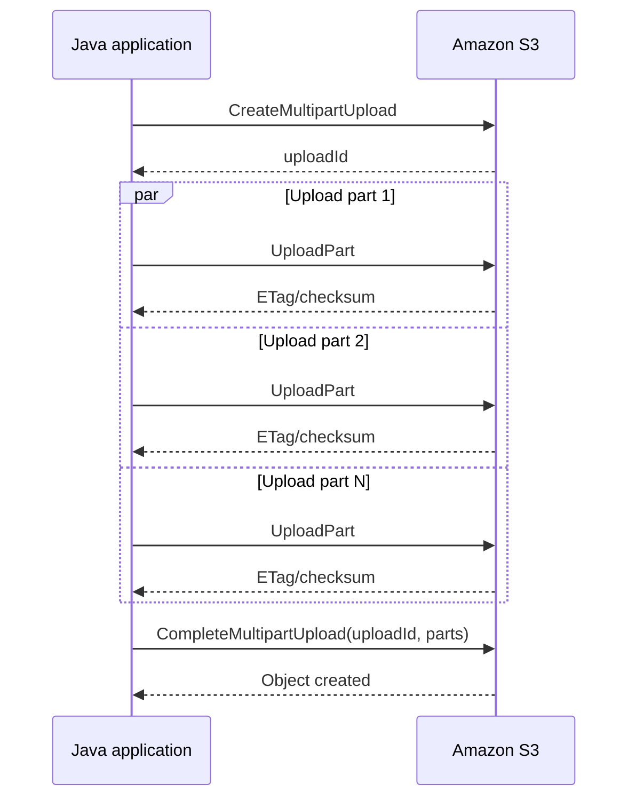
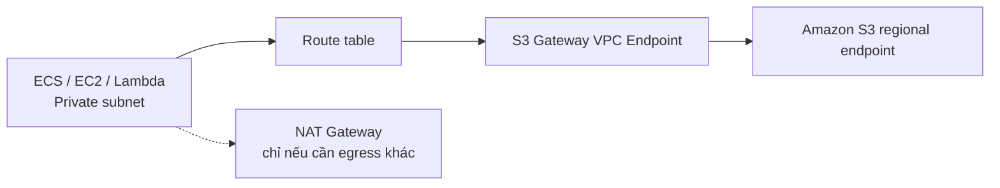

# S3 client, Transfer Manager và truyền tệp lớn

> **Học phần:** CLOUD_PROVIDERS_AWS  
> **Chương:** AWS SDK cho Java  
> **Bài học:** S3 client, Transfer Manager và truyền tệp lớn  
> **Bối cảnh:** Ứng dụng Java/Spring Boot, ECS, Lambda và các dịch vụ AWS cần tải lên, tải xuống hoặc sao chép object dung lượng lớn bằng Amazon S3.

## 1. Bài toán: truyền tệp lớn một cách an toàn và có kiểm soát

Một nền tảng học trực tuyến nhận video bài giảng, file PDF, bản ghi buổi học và gói dữ liệu học tập. Một file video có thể lớn vài GB; nhiều học viên tải tài liệu cùng lúc; worker nền cần sao chép dữ liệu giữa các bucket. Ứng dụng phải:

- Upload/download tệp lớn mà không đọc toàn bộ file vào heap.
- Tận dụng parallelism để tăng throughput trên mạng phù hợp.
- Tự retry phần truyền bị lỗi khi có network interruption.
- Theo dõi tiến độ, nhận biết transfer thất bại và tiếp tục một số transfer bị tạm dừng.
- Xác minh integrity bằng checksum.
- Dùng IAM least privilege, TLS, mã hóa và private network.
- Quản lý multipart uploads bị bỏ dở để tránh lưu trữ các parts không cần thiết.
- Tính đúng request, storage, I/O, data transfer và KMS costs.

AWS SDK for Java 2.x cung cấp nhiều lớp API cho S3. **S3TransferManager** là tiện ích cấp cao cho file/directory transfers; bên dưới nó có thể sử dụng AWS CRT-based S3 client hoặc Java-based asynchronous S3 client có multipart enabled.

### Mục tiêu học tập

Sau bài học, bạn có thể:

1. Chọn giữa S3Client, S3AsyncClient và S3TransferManager.
2. Phân biệt single-request upload với multipart upload.
3. Nắm giới hạn S3: kích thước object, số parts, part size và các ngưỡng mặc định của SDK.
4. Cấu hình Maven BOM và dependencies cho AWS SDK for Java 2.x.
5. Upload/download file bằng S3TransferManager, theo dõi progress và xử lý lỗi.
6. Chọn CRT-based hay Java-based multipart async client theo workload.
7. Xử lý InputStream biết/không biết content length.
8. Pause/resume transfer, quản lý multipart upload và checksum.
9. Bảo vệ object bằng IAM, bucket policy, TLS, SSE-S3/SSE-KMS và VPC endpoints.
10. Tối ưu concurrency, memory, retries, observability và chi phí.

## 2. Amazon S3 lưu object, không lưu file system thực

Amazon S3 là object storage. Một object gồm:

- **Bucket:** vùng chứa object trong một AWS Region.
- **Key:** tên định danh object trong bucket, ví dụ courses/java-101/lesson-01.mp4.
- **Body:** bytes của object.
- **Metadata:** system metadata như Content-Type, Content-Length và user metadata.
- **Tags:** cặp key/value phục vụ policy, lifecycle và phân loại.
- **Version ID:** định danh version nếu bucket bật versioning.

S3 có namespace key phẳng. Dấu / trong key tạo cảm giác có thư mục, nhưng đó là prefix trong tên object. Directory Transfer Manager ánh xạ file path tương đối thành object keys dưới prefix đã chọn.

Ví dụ:

```text
Bucket: learning-assets-prod

Object key:
courses/java-101/lesson-01.mp4
courses/java-101/slides/week-01.pdf
students/student-17/avatar.png
```

Không đưa đường dẫn local như C:\Users\... trực tiếp vào key nếu chưa chuẩn hóa. Key nên có quy ước tenant, loại nội dung, ngày hoặc ID nghiệp vụ; không chứa dữ liệu bí mật.

## 3. Single PUT và multipart upload

Với file nhỏ hoặc vừa, một request PutObject thường đơn giản nhất. Khi file lớn, multipart upload chia một object thành các parts độc lập:

1. Gọi CreateMultipartUpload để khởi tạo upload và nhận uploadId.
2. Chia file thành các phần có partNumber riêng.
3. Upload các parts, có thể song song và theo thứ tự bất kỳ.
4. Thu lại ETag/checksum của từng part.
5. Gọi CompleteMultipartUpload để S3 ghép parts thành object.
6. Nếu không thể hoàn tất, gọi AbortMultipartUpload để xóa parts chưa hoàn tất.



Nếu một part lỗi, có thể retry part đó mà không cần gửi lại toàn bộ object. Object chỉ trở thành object hoàn chỉnh sau CompleteMultipartUpload.

### 3.1. Giới hạn multipart upload hiện hành

| Giới hạn | Giá trị |
|---|---:|
| Kích thước object tối đa | **48.8 TiB** (xấp xỉ 50 TB thập phân) |
| Số parts tối đa mỗi upload | **10.000** |
| Part number | 1–10.000 |
| Kích thước mỗi part | **5 MiB–5 GiB** |
| Part cuối cùng | Không có giới hạn tối thiểu 5 MiB |
| ListParts tối đa mỗi response | 1.000 parts |
| ListMultipartUploads tối đa mỗi response | 1.000 uploads |

Một PutObject đơn lẻ qua SDK/REST/CLI có giới hạn object **5 GB**. Khi file lớn hơn giới hạn single PUT, cần multipart upload. AWS khuyến nghị cân nhắc multipart khi object từ khoảng **100 MB** trở lên; đây là khuyến nghị chung của S3, không phải threshold bắt buộc.

### 3.2. Hai threshold khác nhau: S3 recommendation và SDK default

- S3 khuyến nghị cân nhắc multipart từ khoảng **100 MB** vì lợi ích retry/parallelism.
- S3 Transfer Manager và Java async multipart client có mặc định threshold/part size khoảng **8 MiB** trong cấu hình được tài liệu SDK mô tả.
- Threshold là kích thước bắt đầu dùng multipart; part size là kích thước từng phần. Đây là hai thông số khác nhau.
- Có thể thay đổi threshold/part size để cân bằng request overhead, memory, concurrency và throughput.

### 3.3. Chọn part size và số parts

```text
numberOfParts = ceil(objectSize / partSize)
numberOfParts <= 10,000

5 MiB <= partSize <= 5 GiB
objectSize <= 48.8 TiB
```

Ví dụ file 200 GiB:

- Part size 16 MiB tạo quá nhiều parts, vượt giới hạn 10.000.
- Part size 64 MiB tạo khoảng 3.200 parts, nằm trong giới hạn.
- Part size 256 MiB tạo ít requests hơn nhưng mỗi part lớn hơn và cần cân nhắc memory/buffer/concurrency.

Không chọn part size chỉ dựa trên một file mẫu. Test với kích thước lớn nhất dự kiến, băng thông, memory limit và retry behavior.

## 4. Chọn S3 client nào trong AWS SDK for Java 2.x?

| Client | API | Khi nào phù hợp | Đánh đổi |
|---|---|---|---|
| S3Client | Đồng bộ, blocking | CRUD object đơn giản, thao tác ít, code dễ đọc | Không tự cung cấp high-level parallel multipart file transfer |
| Java-based S3AsyncClient | Async, CompletableFuture | Workload non-blocking, cần Java async client và có thể bật multipart | Cần quản lý async lifecycle, backpressure và multipart configuration |
| CRT-based S3AsyncClient | Async qua AWS Common Runtime | Tệp lớn, throughput cao, stream không biết trước kích thước, retry từng part | Cần aws-crt; một số builder options khác Java-based client |
| S3TransferManager | API cấp cao, async | File/directory upload/download, progress, pause/resume, parallel transfer | Cần hiểu client nền, lifecycle và kết quả transfer |

**Không nhầm hai thành phần CRT:**

- CRT-based S3 client dùng aws-c-s3, hỗ trợ S3 multipart upload API và byte-range downloads.
- CRT-based HTTP client là HTTP transport dùng chung; nó không tự cung cấp S3 multipart API.

### 4.1. CRT-based S3 client

CRT-based S3 client có thể:

- Tự dùng multipart upload và byte-range fetches.
- Retry từng failed part thay vì restart cả file.
- Tăng hiệu quả connection pooling và DNS load balancing.
- Xử lý InputStream không biết trước content length hiệu quả hơn.
- Phù hợp transfer throughput cao khi ứng dụng có đủ network bandwidth và tài nguyên.

Đổi lại, một số cấu hình trong Java-based S3 async builder không có tương đương trực tiếp trong CRT builder. Hãy kiểm tra API reference của SDK version đang dùng.

### 4.2. Java-based async client với multipart enabled

Nếu không dùng CRT, vẫn có thể dùng S3TransferManager trên Java-based S3AsyncClient:

```java
S3AsyncClient s3AsyncClient = S3AsyncClient.builder()
    .region(Region.AP_SOUTHEAST_1)
    .credentialsProvider(DefaultCredentialsProvider.create())
    .multipartEnabled(true)
    .build();

S3TransferManager transferManager = S3TransferManager.builder()
    .s3Client(s3AsyncClient)
    .build();
```

Multipart parallel transfers chỉ được bật khi client nền là CRT-based S3 client hoặc Java-based S3 async client có multipart enabled. Một S3AsyncClient.builder().build() mặc định không tương đương client multipart-enabled.

### 4.3. Khác biệt khi chuyển từ AWS SDK for Java 1.x

Transfer Manager v2 không phải bản đổi tên trực tiếp của v1:

| Nội dung | SDK for Java 1.x | SDK for Java 2.x |
|---|---|---|
| Package | `com.amazonaws.services.s3.transfer` | `software.amazon.awssdk.transfer.s3` |
| Class chính | `TransferManager` | `S3TransferManager` |
| Client nền | S3 client đồng bộ | `S3AsyncClient` |
| Mô hình | Blocking transfer API | Async API và `CompletableFuture` |
| Multipart/parallel | Transfer Manager v1 quản lý qua builder | CRT-based hoặc Java async multipart client |

Khi migrate, rà soát cách tạo client, ownership/shutdown, executor, callback/progress listeners, multipart thresholds và cách xử lý exception. Không chỉ đổi package/class rồi giả định behavior cũ được giữ nguyên.

## 5. Maven dependencies và version alignment

Nên dùng **AWS SDK BOM** để các modules SDK v2 dùng cùng một version. Ví dụ sau dùng một version minh họa; trước khi build, cập nhật version BOM theo release đã được dự án kiểm thử.

```xml
<properties>
    <maven.compiler.release>17</maven.compiler.release>
    <aws.sdk.version>2.59.4</aws.sdk.version>
</properties>

<dependencyManagement>
    <dependencies>
        <dependency>
            <groupId>software.amazon.awssdk</groupId>
            <artifactId>bom</artifactId>
            <version>${aws.sdk.version}</version>
            <type>pom</type>
            <scope>import</scope>
        </dependency>
    </dependencies>
</dependencyManagement>

<dependencies>
    <dependency>
        <groupId>software.amazon.awssdk</groupId>
        <artifactId>s3</artifactId>
    </dependency>

    <dependency>
        <groupId>software.amazon.awssdk</groupId>
        <artifactId>s3-transfer-manager</artifactId>
    </dependency>
</dependencies>
```

Đây là cấu hình dùng Java-based async multipart client mặc định của Transfer Manager khi không có aws-crt trên classpath.

### 5.1. Thêm CRT tùy chọn

Để dùng CRT-based S3 client, thêm dependency software.amazon.awssdk.crt:aws-crt với phiên bản tương thích đã được kiểm thử trên Maven Central và nền tảng triển khai. CRT là artifact riêng; không tự giả định AWS SDK BOM quản lý version của nó.

```xml
<dependency>
    <groupId>software.amazon.awssdk.crt</groupId>
    <artifactId>aws-crt</artifactId>
    <version>${aws.crt.version}</version>
</dependency>
```

Không dùng wildcard hoặc version không cố định trong production. Ghim SDK BOM và CRT version, chạy integration tests trên OS/architecture thực tế, sau đó nâng version theo quy trình dependency management.

## 6. Tạo S3TransferManager và quản lý lifecycle

Cách ngắn nhất:

```java
try (S3TransferManager transferManager = S3TransferManager.create()) {
    // upload/download/copy
}
```

S3TransferManager.create() tự chọn client mặc định:

- Nếu software.amazon.awssdk.crt:aws-crt có trên classpath, SDK có thể tạo CRT-based S3 client.
- Nếu không, SDK dùng Java-based S3 async client với multipart enabled.

Nếu tự tạo client và truyền vào builder, ứng dụng phải quản lý lifecycle của client nền theo ownership của API. Đóng transfer manager và các clients do ứng dụng tự tạo khi không còn sử dụng. Không tạo client mới cho mỗi request HTTP.

### 6.1. CRT-based custom builder

```java
S3AsyncClient s3AsyncClient = S3AsyncClient.crtBuilder()
    .region(Region.AP_SOUTHEAST_1)
    .credentialsProvider(DefaultCredentialsProvider.create())
    .targetThroughputInGbps(10.0)
    .minimumPartSizeInBytes(16L * 1024 * 1024)
    .build();

S3TransferManager transferManager = S3TransferManager.builder()
    .s3Client(s3AsyncClient)
    .build();
```

targetThroughputInGbps là mục tiêu cấu hình cho client, không phải cam kết băng thông thực tế. minimumPartSizeInBytes ảnh hưởng cách chia parts. Chỉ tăng các giá trị sau khi đo memory, throughput và số parts; part size không được vượt giới hạn S3.

### 6.2. Java-based async builder

```java
S3AsyncClient s3AsyncClient = S3AsyncClient.builder()
    .region(Region.AP_SOUTHEAST_1)
    .credentialsProvider(DefaultCredentialsProvider.create())
    .multipartEnabled(true)
    .multipartConfiguration(config -> config
        .thresholdInBytes(16L * 1024 * 1024)
        .minimumPartSizeInBytes(16L * 1024 * 1024))
    .build();

S3TransferManager transferManager = S3TransferManager.builder()
    .s3Client(s3AsyncClient)
    .build();
```

Tên method và các option có thể khác giữa SDK versions; dùng API reference của BOM đang ghim. Không copy builder options từ CRT sang Java-based client hoặc ngược lại mà chưa kiểm tra compile.

## 7. Upload file bằng Transfer Manager

Với file đã có trên disk, uploadFile là lựa chọn trực tiếp. SDK có thể chia file thành parts, chạy song song và trả về object transfer để theo dõi tiến độ.

```java
import java.nio.file.Path;
import java.nio.file.Paths;
import java.util.Map;

import software.amazon.awssdk.transfer.s3.S3TransferManager;
import software.amazon.awssdk.transfer.s3.model.FileUpload;
import software.amazon.awssdk.transfer.s3.model.UploadFileRequest;
import software.amazon.awssdk.transfer.s3.model.CompletedFileUpload;
import software.amazon.awssdk.transfer.s3.progress.LoggingTransferListener;
import software.amazon.awssdk.services.s3.model.ServerSideEncryption;

public final class CourseAssetUploader {
    public static void upload(Path source, String bucket, String key,
                              String kmsKeyArn) {
        try (S3TransferManager manager = S3TransferManager.create()) {
            UploadFileRequest request = UploadFileRequest.builder()
                .source(source)
                .putObjectRequest(put -> put
                    .bucket(bucket)
                    .key(key)
                    .contentType("video/mp4")
                    .metadata(Map.of("asset-type", "lesson-video"))
                    .serverSideEncryption(ServerSideEncryption.AWS_KMS)
                    .ssekmsKeyId(kmsKeyArn))
                .addTransferListener(LoggingTransferListener.create())
                .build();

            FileUpload upload = manager.uploadFile(request);
            CompletedFileUpload completed =
                upload.completionFuture().join();

            System.out.println("Upload completed: " +
                completed.response().eTag());
        }
    }

    public static void main(String[] args) {
        upload(
            Paths.get("/data/lesson-01.mp4"),
            "learning-assets-prod",
            "courses/java-101/lesson-01.mp4",
            System.getenv("S3_KMS_KEY_ARN"));
    }
}
```

### 7.1. Đọc kết quả đúng cách

- uploadFile trả về FileUpload đại diện transfer đang chạy.
- completionFuture hoàn tất khi transfer kết thúc.
- join chờ hoàn tất và ném CompletionException nếu transfer thất bại.
- CompletedFileUpload cung cấp response của thao tác cuối.
- LoggingTransferListener ghi tiến độ cơ bản; có thể viết TransferListener riêng để phát metrics/event.
- Với upload directory, kiểm tra failedTransfers(); không giả định toàn bộ directory upload là atomic.

Không log presigned URL, credentials, thông tin cá nhân hoặc metadata nhạy cảm trong listener.

## 8. Download file và tránh giữ object lớn trong heap

Đối với file lớn, ưu tiên downloadFile để ghi thẳng ra filesystem thay vì dùng AsyncResponseTransformer.toBytes().

```java
import java.nio.file.Path;
import java.nio.file.Paths;

import software.amazon.awssdk.transfer.s3.S3TransferManager;
import software.amazon.awssdk.transfer.s3.model.DownloadFileRequest;
import software.amazon.awssdk.transfer.s3.model.FileDownload;
import software.amazon.awssdk.transfer.s3.model.CompletedFileDownload;
import software.amazon.awssdk.transfer.s3.progress.LoggingTransferListener;

public final class CourseAssetDownloader {
    public static void download(String bucket, String key, Path destination) {
        try (S3TransferManager manager = S3TransferManager.create()) {
            DownloadFileRequest request = DownloadFileRequest.builder()
                .getObjectRequest(get -> get
                    .bucket(bucket)
                    .key(key))
                .destination(destination)
                .addTransferListener(LoggingTransferListener.create())
                .build();

            FileDownload download = manager.downloadFile(request);
            CompletedFileDownload completed =
                download.completionFuture().join();

            System.out.println("Downloaded: " +
                completed.response().contentLength());
        }
    }

    public static void main(String[] args) {
        download(
            "learning-assets-prod",
            "courses/java-101/lesson-01.mp4",
            Paths.get("/data/downloads/lesson-01.mp4"));
    }
}
```

downloadFile có thể tận dụng byte-range fetches và tải các phần song song với client hỗ trợ. Đảm bảo destination directory tồn tại hoặc có quyền ghi; kiểm tra dung lượng đĩa và xử lý file đích đã tồn tại theo yêu cầu nghiệp vụ.

### 8.1. Không tải tệp lớn vào byte array

Mẫu sau có thể giữ toàn bộ object trong memory:

```java
ResponseBytes<GetObjectResponse> bytes = s3Client.getObject(
    request,
    ResponseTransformer.toBytes());
```

Chỉ dùng cách này khi object nhỏ và có giới hạn kích thước rõ ràng. Với file lớn, dùng ResponseTransformer.toFile, S3AsyncClient với AsyncResponseTransformer.toFile, hoặc S3TransferManager.downloadFile.

## 9. Upload từ InputStream và content length

Khi upload từ InputStream, SDK cần biết body dài bao nhiêu hoặc cần một cơ chế stream phù hợp.

### 9.1. Biết chính xác content length

```java
long contentLength = Files.size(path);

s3Client.putObject(
    request,
    RequestBody.fromInputStream(inputStream, contentLength));
```

Content length phải đúng với số bytes thực tế:

- Nếu khai báo nhỏ hơn dữ liệu thật, object có thể bị truncate.
- Nếu khai báo lớn hơn, request có thể fail hoặc chờ stream không kết thúc.
- Không lấy số ký tự UTF-16 của String để làm byte length; encoding có thể tạo số bytes khác.

### 9.2. Không biết trước content length

Với synchronous S3Client, RequestBody.fromContentProvider(...) có thể buffer toàn bộ stream trong memory để xác định content length. Điều này nguy hiểm với stream lớn hoặc không giới hạn.

Với async client, có thể dùng AsyncRequestBody.fromInputStream(inputStream, null, executor) để báo kích thước chưa biết. CRT-based S3 client và Java-based async client có multipart enabled hỗ trợ luồng này.

```java
ExecutorService executor = Executors.newSingleThreadExecutor();

try (S3AsyncClient s3 = S3AsyncClient.crtCreate()) {
    AsyncRequestBody body =
        AsyncRequestBody.fromInputStream(inputStream, null, executor);

    PutObjectResponse response = s3.putObject(
        request,
        body).join();
} finally {
    executor.shutdown();
}
```

Đoạn này minh họa luồng không biết trước kích thước. Trong production, phải định nghĩa rõ ai sở hữu/đóng InputStream, executor và client; quản lý cancellation, timeout và exception. Không tự tạo thread pool không giới hạn theo số requests.

### 9.3. Khi nào dùng TransferManager.upload thay uploadFile?

- uploadFile dành cho Path/file có sẵn trên filesystem.
- upload nhận AsyncRequestBody, phù hợp khi dữ liệu đến từ producer, stream hoặc pipeline.
- Với stream có kích thước lớn/không xác định, dùng async multipart-capable client để tránh buffer toàn bộ body.
- Nếu nguồn stream chỉ đọc được một lần, retry cần một cơ chế tái tạo/đọc lại stream hoặc multipart client phù hợp.

## 10. Pause, resume và xử lý transfer gián đoạn

Transfer Manager hỗ trợ pause/resume cho một số file transfers khi client nền có multipart support. FileUpload.pause() trả về ResumableFileUpload; thông tin này có thể serialize để lưu và resume sau.

```java
FileUpload upload = transferManager.uploadFile(uploadRequest);

// Khi ứng dụng cần tạm dừng:
ResumableFileUpload resumable = upload.pause();
resumable.serializeToFile(Paths.get("/var/lib/course/upload-state.json"));

// Khi worker khởi động lại:
ResumableFileUpload saved =
    ResumableFileUpload.fromFile(
        Paths.get("/var/lib/course/upload-state.json"));

FileUpload resumed = transferManager.resumeUploadFile(saved);
resumed.completionFuture().join();
```

Điều kiện và giới hạn:

- Pause/resume yêu cầu CRT-based S3 client hoặc Java-based S3 async client đã bật multipart.
- Nếu file nguồn bị thay đổi kể từ khi pause, SDK có thể upload lại từ đầu.
- Thông tin resume cần được lưu an toàn; không để lộ thông tin nhạy cảm.
- Với SSE-C, customer-provided key không được serialize cùng resumable state; cần cung cấp lại key khi resume.
- Presigned URL download có giới hạn riêng: URL có thể hết hạn khi transfer bị pause; API download bằng presigned URL không hỗ trợ pause/resume.
- Resume state không thay thế job state, idempotency, ownership và cleanup trong hệ thống orchestration.

Không dùng pause/resume như cam kết rằng transfer có thể tiếp tục vô thời hạn. Lưu state, thời hạn, file identity, source version/size và trạng thái nghiệp vụ.
## 11. Manual multipart upload bằng low-level API

S3TransferManager thường là lựa chọn phù hợp cho file-based transfers. Dùng low-level multipart API khi cần kiểm soát chính xác từng bước, chẳng hạn:

- Tự chia dữ liệu theo record/block.
- Upload từ nguồn không có file local.
- Quản lý upload ID và checkpoints riêng.
- Tích hợp với workflow hoặc storage pipeline đặc thù.

Các API chính:

| Bước | API | Dữ liệu cần lưu |
|---|---|---|
| Khởi tạo | CreateMultipartUpload | uploadId, bucket, key |
| Upload part | UploadPart | partNumber, ETag/checksum |
| Liệt kê parts | ListParts | Các parts đã nhận, phân trang |
| Hoàn tất | CompleteMultipartUpload | Danh sách parts theo số thứ tự |
| Hủy | AbortMultipartUpload | uploadId |
| Liệt kê uploads dở dang | ListMultipartUploads | upload IDs, key và thời điểm khởi tạo |

### 11.1. Pseudocode vòng đời

```text
createResponse = CreateMultipartUpload(bucket, key)
uploadId = createResponse.uploadId

parts = []
for each chunk:
    response = UploadPart(uploadId, partNumber, chunk)
    parts.add(partNumber, response.eTag)

try:
    CompleteMultipartUpload(uploadId, sortByPartNumber(parts))
catch error:
    AbortMultipartUpload(uploadId)
    throw error
```

Khi resume low-level upload, phải xác định upload ID còn tồn tại, đối chiếu parts đã upload, tiếp tục với part numbers còn thiếu và hoàn tất đúng danh sách. ListParts và ListMultipartUploads có giới hạn số kết quả mỗi response; cần phân trang.

### 11.2. Abort là một phần của error handling

Nếu upload không thể tiếp tục, gọi AbortMultipartUpload. Nếu không, S3 giữ các uploaded parts và tính phí storage cho đến khi hoàn tất hoặc bị abort/lifecycle cleanup.

Không chỉ catch exception rồi bỏ qua upload ID. Lưu upload ID/checkpoint đủ để có thể abort hoặc resume có kiểm soát.

## 12. Checksum, ETag và data integrity

Amazon S3 hỗ trợ checksum để kiểm tra dữ liệu không bị thay đổi trong quá trình truyền. Các thuật toán gồm CRC64/NVME, CRC32, CRC32C, SHA-1, SHA-256, MD5 và một số biến thể XXHash/SHA-512 theo support matrix.

### 12.1. ETag không luôn là MD5

- Với một số single-part PutObject và SSE-S3, ETag có thể là MD5 của object.
- Với SSE-KMS/SSE-C, ETag không phải MD5 của dữ liệu.
- Với multipart upload, ETag của object **không phải MD5 digest của toàn bộ object**.
- ETag multipart thường phản ánh tổng hợp digest của parts và số parts; không dùng nó như checksum toàn file.

Nếu cần integrity verification, sử dụng checksum API/metadata tương ứng hoặc tự tính SHA-256/CRC trên nguồn và đích. Không so sánh ETag của multipart object với MD5 của file rồi kết luận dữ liệu hỏng.

### 12.2. Full-object và composite checksum

- **Full-object checksum:** checksum được tính trên toàn bộ byte stream.
- **Composite checksum:** được tổng hợp từ checksums của từng part.
- Không phải thuật toán nào cũng hỗ trợ cả hai loại. Ví dụ CRC64/NVME hỗ trợ full-object; SHA-256 chỉ hỗ trợ composite trong multipart theo bảng S3 hiện hành.
- AWS SDK có thể tự tính checksum; có thể chỉ định ChecksumAlgorithm phù hợp theo API/SDK version.

### 12.3. Ví dụ đặt checksum algorithm

```java
PutObjectRequest request = PutObjectRequest.builder()
    .bucket(bucket)
    .key(key)
    .checksumAlgorithm(ChecksumAlgorithm.CRC32C)
    .build();

PutObjectResponse response =
    s3Client.putObject(request, RequestBody.fromFile(path));
```

Đây là ví dụ cho PutObject. Với multipart, chọn checksum algorithm/type tương thích và bảo đảm thuật toán được khai báo ở bước khởi tạo multipart theo yêu cầu S3. Đọc lại checksum metadata khi cần kiểm chứng.

## 13. Encryption, metadata và object ownership

### 13.1. Server-side encryption

| Cơ chế | Ý nghĩa | Khi nào |
|---|---|---|
| SSE-S3 | S3 quản lý encryption keys | Phù hợp nhiều workload thông thường |
| SSE-KMS | Dùng AWS KMS key | Cần key policy, audit và kiểm soát key |
| SSE-C | Khách hàng cung cấp key mỗi request | Chỉ dùng khi có quy trình quản lý customer keys nghiêm ngặt |

Không đưa SSE-C key vào log hoặc resumable state. Với SSE-KMS multipart upload, IAM principal cần quyền KMS phù hợp, bao gồm các thao tác encrypt/decrypt theo luồng upload và complete; key policy cũng phải cho phép.

### 13.2. Metadata và tags

Dùng contentType đúng để browser/CDN xử lý file đúng. User metadata phù hợp cho thông tin ngắn, không nhạy cảm; tags phù hợp policy/lifecycle/classification.

Không nhét toàn bộ application record vào metadata. Metadata không phải nơi lưu cấu trúc quan hệ hay dữ liệu cần query phức tạp.

### 13.3. Object Ownership và ACL

Với bucket mới, ưu tiên **Bucket owner enforced Object Ownership** để bucket owner sở hữu object và ACL bị vô hiệu hóa. Thiết kế truy cập bằng IAM policies, bucket policies và access points; không bật ACL chỉ để chữa lỗi AccessDenied nếu bucket policy chưa đúng.

## 14. IAM least privilege cho Transfer Manager

Một ứng dụng upload/download cần các quyền object-level phù hợp. Ví dụ policy minh họa chỉ cho phép thao tác trong prefix incoming/course-assets/:

```json
{
  "Version": "2012-10-17",
  "Statement": [
    {
      "Sid": "ListTargetPrefix",
      "Effect": "Allow",
      "Action": [
        "s3:ListBucket",
        "s3:ListBucketMultipartUploads"
      ],
      "Resource": "arn:aws:s3:::learning-assets-prod",
      "Condition": {
        "StringLike": {
          "s3:prefix": [
            "incoming/course-assets/*"
          ]
        }
      }
    },
    {
      "Sid": "TransferObjects",
      "Effect": "Allow",
      "Action": [
        "s3:PutObject",
        "s3:GetObject",
        "s3:AbortMultipartUpload",
        "s3:ListMultipartUploadParts"
      ],
      "Resource": "arn:aws:s3:::learning-assets-prod/incoming/course-assets/*"
    }
  ]
}
```

Đây là policy mẫu để hiểu resource scoping, cần điều chỉnh theo đúng APIs thực tế và bucket policy. Một số thao tác như copy, directory listing, tagging, versioning hoặc KMS yêu cầu quyền bổ sung.

### 14.1. Multipart-specific permissions

| API | IAM action |
|---|---|
| CreateMultipartUpload | s3:PutObject |
| UploadPart | s3:PutObject |
| CompleteMultipartUpload | s3:PutObject |
| AbortMultipartUpload | s3:AbortMultipartUpload |
| ListParts | s3:ListMultipartUploadParts |
| ListMultipartUploads | s3:ListBucketMultipartUploads |

Nếu bucket dùng SSE-KMS customer managed key, thêm quyền KMS cần thiết cho key. Không cấp s3:* hoặc kms:* trên mọi resource chỉ để transfer chạy.

Với multipart upload được mã hóa bằng customer managed KMS key, caller thường cần ít nhất các quyền KMS phù hợp như `kms:GenerateDataKey` và `kms:Decrypt` trên đúng key; key policy cũng phải cho phép. Điều kiện cụ thể phụ thuộc encryption mode, bucket key và API operation. Không cấp quyền KMS trên `Resource: "*"` nếu có thể giới hạn ARN key.

## 15. Network: VPC endpoint và đường truyền

S3 là dịch vụ public regional endpoint nhưng ứng dụng trong VPC có thể truy cập private qua **S3 Gateway VPC Endpoint** hoặc Interface Endpoint phù hợp.



Gateway endpoint giúp traffic từ subnet tới S3 đi qua AWS network mà không cần NAT cho S3. Kiểm tra:

- Route table gắn đúng gateway endpoint.
- Endpoint policy cho phép bucket/actions cần thiết.
- Bucket policy không vô tình deny traffic qua endpoint/VPC condition.
- Security groups/NACL không chặn đường cần thiết.
- DNS và Region của bucket/client chính xác.
- Cross-Region transfer có thể phát sinh data transfer charges và latency.

Không giả định có VPC endpoint nghĩa là mọi bucket đều truy cập được; IAM, endpoint policy và bucket policy cùng quyết định.

## 16. Directory upload/download và object copy

### 16.1. Upload directory

uploadDirectory duyệt thư mục local và upload từng file thành object. Có thể chỉ định bucket, prefix và delimiter.

```java
UploadDirectoryRequest request = UploadDirectoryRequest.builder()
    .source(Paths.get("/data/course-assets"))
    .bucket("learning-assets-prod")
    .s3Prefix("courses/java-101/")
    .build();

DirectoryUpload upload = transferManager.uploadDirectory(request);
CompletedDirectoryUpload result = upload.completionFuture().join();

result.failedTransfers().forEach(failure ->
    logger.warn("Transfer failed: {}", failure));
```

Directory upload không phải một transaction. Một số files có thể thành công trong khi files khác thất bại. Kiểm tra failedTransfers(), lưu manifest và có cơ chế retry riêng.

### 16.2. Download directory

downloadDirectory liệt kê objects theo bucket/prefix rồi tải về local directory. Cần xử lý số lượng objects lớn, pagination, quyền s3:ListBucket, disk capacity và key-to-path mapping. Không dùng prefix từ input người dùng mà chưa validate.

### 16.3. Copy object lớn hoặc cross-Region

Transfer Manager có API copy để sao chép object; với cross-Region copy trên CRT-based S3 client, cần bật crossRegionAccessEnabled(true) theo hướng dẫn SDK. Copy có thể phát sinh request và data transfer charges; object metadata/encryption ở đích phải được thiết kế rõ.

## 17. Presigned URLs và upload trực tiếp từ client

Với browser/mobile clients, một pattern thường tốt là backend xác thực user rồi tạo **presigned URL**; client upload trực tiếp lên S3. File bytes không phải đi qua Java API server, giúp giảm memory/network load trên backend.

Quy trình:

1. Client gửi metadata/ý định upload tới API.
2. Backend xác thực user, tenant, file type/size policy.
3. Backend tạo object key an toàn và presigned request có thời hạn.
4. Client upload trực tiếp tới S3.
5. Backend xác minh object metadata/checksum và cập nhật trạng thái nghiệp vụ.
6. S3 event/EventBridge có thể kích hoạt scan/processing pipeline.

Presigned URL là bearer capability: ai có URL có thể thực hiện thao tác trong thời hạn và phạm vi được ký. Không log URL, đặt expiration ngắn hợp lý và không dùng key do client tự chọn nếu có nguy cơ overwrite/cross-tenant.

S3 Transfer Manager có hỗ trợ một số presigned URL download APIs trong SDK mới; tài liệu hiện hành nêu tính năng từ SDK 2.48.0. **Presigned URL downloads yêu cầu Java-based S3AsyncClient; CRT-based S3 client hiện chưa hỗ trợ luồng này.** Presigned downloads cũng không hỗ trợ pause/resume vì URL có thể hết hạn khi transfer bị tạm dừng.

## 18. Retry, timeout và concurrency

Large transfer có nhiều requests/parts, nên cấu hình retry và concurrency có ảnh hưởng trực tiếp tới throughput và cost.

### 18.1. Retry theo cấp part

- CRT-based client có thể retry từng part bị lỗi mạng.
- Multipart upload thủ công phải tự retry đúng part number và quản lý ETag/checksum.
- Retry không làm một business operation tự động idempotent; tránh tạo nhiều object keys khác nhau cho cùng một job nếu không chủ đích.
- Nếu CompleteMultipartUpload trả lỗi không rõ kết quả, kiểm tra object/upload state trước khi bắt đầu upload mới.

### 18.2. Concurrency và memory

Thông lượng cao hơn thường cần nhiều parts in-flight, nhưng mỗi part cần buffer và network resources. Ước tính memory pressure:

```text
Approximate in-flight payload memory
≈ concurrent parts × buffered bytes per part
  + HTTP/TLS buffers
  + application buffers
```

Đây là ước tính thô; implementation CRT/Java async khác nhau. Giới hạn concurrent transfers, part size, executor pools và upload jobs theo container memory/CPU/network.

Không chạy join trên event-loop thread hoặc servlet request thread trong một ứng dụng reactive mà không hiểu tác động. Có thể compose CompletableFuture hoặc chuyển blocking wait sang worker pool.

### 18.3. Timeout hierarchy

| Timeout | Mục đích |
|---|---|
| HTTP request deadline | Giới hạn thời gian caller chờ API |
| SDK API call timeout | Giới hạn toàn bộ API operation |
| API attempt timeout | Giới hạn từng HTTP attempt |
| Connect/socket timeout | Giới hạn thiết lập và chờ network |
| Job deadline | Giới hạn toàn bộ file transfer workflow |

Đối với file nhiều GB, không giữ một HTTP request mở đến khi transfer kết thúc. Tạo background job, trả jobId, lưu trạng thái/progress và cho client poll/subscribe.

## 19. Multipart cleanup, lifecycle và chi phí

S3 giữ các parts đã upload cho tới khi multipart upload hoàn tất hoặc bị abort. Những parts chưa hoàn tất vẫn được tính phí storage theo quy tắc S3.

### 19.1. Lifecycle rule cho incomplete multipart uploads

Nên cấu hình AbortIncompleteMultipartUpload để tự dọn các multipart uploads bị bỏ quên, ví dụ sau 7 ngày theo prefix phù hợp.

```xml
<LifecycleConfiguration>
  <Rule>
    <ID>abort-stale-multipart-uploads</ID>
    <Status>Enabled</Status>
    <Filter>
      <Prefix>incoming/course-assets/</Prefix>
    </Filter>
    <AbortIncompleteMultipartUpload>
      <DaysAfterInitiation>7</DaysAfterInitiation>
    </AbortIncompleteMultipartUpload>
  </Rule>
</LifecycleConfiguration>
```

Lifecycle action này xóa parts của **incomplete uploads**, không xóa object đã hoàn tất. Chọn thời gian đủ dài cho các transfer hợp lệ; không đặt quá ngắn với workload có thể tạm dừng nhiều ngày.

### 19.2. Những khoản chi phí cần tính

| Thành phần | Chi phí phát sinh |
|---|---|
| PUT/UploadPart/Complete requests | Request charges; multipart tạo nhiều requests |
| GET/byte-range downloads | Request charges và data transfer |
| Storage | Object sau hoàn tất và parts chưa hoàn tất |
| Cross-Region / Internet egress | Data transfer theo đường truyền |
| KMS | KMS request charges và key usage |
| CloudWatch | Logs/metrics/alarms và retention |
| Compute | ECS/Lambda/EC2 workers và network resources |
| Retrieval/transition | Theo storage class và lifecycle policy |

Multipart có thể tăng request count nhưng giảm thời gian upload, giảm chi phí retry toàn bộ file và tăng độ tin cậy. Đánh giá tổng chi phí theo workload thật, không chỉ số PUT requests.

## 20. Observability và troubleshooting

### 20.1. Theo dõi transfer

Ghi nhận các trường không nhạy cảm:

```text
jobId
bucket
objectKey (redacted/normalized nếu cần)
sourceSizeBytes
bytesTransferred
partCount
durationMs
retryCount
transferStatus
checksumAlgorithm
failureCode
```

Có thể dùng TransferListener để ghi progress và phát metrics. Không log credentials, presigned URLs, customer encryption keys hoặc document content.

### 20.2. Các lỗi thường gặp

| Triệu chứng | Nguyên nhân khả dĩ | Cách xử lý |
|---|---|---|
| AccessDenied khi upload | Thiếu s3:PutObject, bucket policy deny, endpoint policy | Kiểm tra IAM identity, bucket và VPC endpoint policies |
| AccessDenied khi abort | Thiếu s3:AbortMultipartUpload | Cấp đúng action trên object ARN |
| KMS AccessDenied | Thiếu KMS key policy hoặc GenerateDataKey/Decrypt phù hợp | Kiểm tra key policy và IAM role |
| Upload bị truncate | InputStream content length khai báo nhỏ hơn thực tế | Truyền chính xác byte length |
| Request treo | Content length lớn hơn bytes thực tế hoặc stream không kết thúc | Kiểm tra producer/length và timeouts |
| Too many parts | Part size quá nhỏ so với object | Tăng part size để <=10.000 parts |
| EntityTooSmall | Part không phải part cuối nhỏ hơn 5 MiB | Điều chỉnh chunk size; part cuối được miễn min |
| Upload dở dang còn storage | Không abort hoặc lifecycle chưa cấu hình | Abort upload và thêm lifecycle cleanup |
| ETag không khớp MD5 | Multipart hoặc SSE-KMS/SSE-C | Dùng S3 checksum API, không coi ETag là MD5 |
| Transfer Manager không parallel | Client nền không phải CRT hoặc multipart chưa bật | Dùng CRT hoặc multipartEnabled(true) |
| UnsupportedOperationException khi pause | Client không hỗ trợ multipart pause/resume | Chọn client có multipart support |
| Download chậm | Dùng single range/heap buffering hoặc network bottleneck | downloadFile, byte-range fetch, đo throughput |
| OOM khi upload stream | Synchronous unknown-length stream bị buffer toàn bộ | Dùng async multipart client hoặc file-based upload |
| Directory upload báo lỗi một số files | Transfer không atomic, một số requests thất bại | Xử lý failedTransfers() và retry từng object |
| Presigned download không chạy với CRT | CRT-based S3 client chưa hỗ trợ API đó | Dùng Java-based multipart S3AsyncClient |
| Upload hoàn tất nhưng app ghi job failed | App timeout sau khi S3 đã complete | Kiểm tra object/version/checksum trước khi retry |

### 20.3. Quy trình điều tra

1. Xác định bucket, key, Region, upload ID và job ID.
2. Kiểm tra exception gốc và request ID từ S3.
3. Kiểm tra credentials provider, IAM role và bucket/KMS policies.
4. Kiểm tra client type, multipart enabled, part size và content length.
5. Kiểm tra incomplete multipart uploads và lifecycle.
6. Đối chiếu checksum thay vì chỉ ETag.
7. Kiểm tra CloudWatch/application metrics, retry count, memory và network.
8. Chạy lại trên sandbox với file có kích thước tương tự, sau đó mới thay đổi production configuration.

## 21. Lab: upload video nhiều GB từ Java lên S3

**Tình huống:** Course API nhận video từ worker, upload vào bucket learning-assets-sandbox, ghi metadata và phát trạng thái UPLOADED sau khi S3 xác nhận hoàn tất.

### 21.1. Chuẩn bị

1. Tạo bucket sandbox ở Region được cấp quyền.
2. Bật Block Public Access và Bucket owner enforced Object Ownership.
3. Bật default encryption (SSE-S3 hoặc SSE-KMS theo yêu cầu lab).
4. Tạo IAM role cho worker chỉ có quyền cần thiết trên prefix lab.
5. Cấu hình lifecycle abort incomplete multipart uploads sau một khoảng thời gian phù hợp.
6. Thêm AWS SDK BOM, s3 và s3-transfer-manager; chọn CRT nếu cần benchmark.
7. Chuẩn bị file test có kích thước nhỏ, 100 MB và vài GB.
8. Không sử dụng dữ liệu cá nhân thật trong bucket sandbox.

### 21.2. Nhiệm vụ

- Upload file nhỏ bằng S3Client.putObject.
- Upload file lớn bằng S3TransferManager.uploadFile.
- Ghi progress qua LoggingTransferListener.
- So sánh Java-based async multipart với CRT-based client.
- Thay đổi threshold và part size trong sandbox.
- Download file về disk bằng downloadFile.
- Tính checksum local, lấy checksum object và so sánh.
- Thử pause/resume upload khi client hỗ trợ.
- Thử upload một directory và kiểm tra failedTransfers.
- Thử InputStream biết và không biết content length.
- Thử IAM role thiếu s3:AbortMultipartUpload rồi quan sát lỗi cleanup.
- Kiểm tra incomplete uploads và lifecycle rule.
- Đo elapsed time, peak memory, part count, retry count và request usage.

### 21.3. Bảng ghi số liệu

| Thử nghiệm | Client | File size | Part size | Concurrency | Duration | Peak memory | Retry count | Kết quả |
|---|---|---:|---:|---:|---:|---:|---:|---|
| Small object | S3Client | Đo | N/A | N/A | Đo | Đo | Đo | Pass/Fail |
| Large file | Java multipart | Đo | Đo | Đo | Đo | Đo | Đo | Pass/Fail |
| Large file | CRT S3 client | Đo | Đo | Đo | Đo | Đo | Đo | Pass/Fail |
| Unknown stream | CRT/async multipart | Đo | Đo | Đo | Đo | Đo | Đo | Pass/Fail |
| Resume | Multipart-capable client | Đo | Đo | Đo | Đo | Đo | Đo | Pass/Fail |

Không điền benchmark giả. Chạy cùng file, cùng Region, cùng network conditions và ghi rõ client config để so sánh công bằng.

### 21.4. Negative tests

| Test | Điều kiện | Kết quả mong đợi |
|---|---|---|
| T1 | Worker thiếu `s3:PutObject` | Upload bị AccessDenied |
| T2 | Worker thiếu `s3:AbortMultipartUpload` | Cleanup abort bị AccessDenied; cảnh báo multipart còn dở |
| T3 | InputStream khai báo content length nhỏ hơn bytes thực | Object có thể bị truncate; test phải phát hiện bằng checksum/size |
| T4 | Part size khiến số parts vượt 10.000 | Upload không hợp lệ; tăng part size |
| T5 | So ETag multipart với MD5 toàn file | Test phải không coi hai giá trị là cùng checksum |
| T6 | Pause với client không có multipart support | API có thể ném UnsupportedOperationException |
| T7 | Presigned URL hết hạn giữa transfer | Request thất bại; backend cần cấp URL mới theo policy |
| T8 | VPC endpoint policy hoặc bucket policy deny | AccessDenied dù IAM role có Allow |
| T9 | SSE-KMS role thiếu quyền KMS | Upload multipart thất bại ở bước cần KMS |

Không chạy negative tests trên bucket production hoặc dùng dữ liệu thật.

### 21.5. Cleanup

- Xóa objects test không cần giữ.
- Abort multipart uploads còn dở.
- Xóa lifecycle test/policy nếu lab yêu cầu.
- Xóa bucket và KMS test key chỉ khi không còn phụ thuộc; kiểm tra versioning trước khi xóa bucket.
- Xác nhận không còn parts hoặc snapshots test gây chi phí.

## 22. Câu hỏi tự kiểm tra

**1. S3Client và S3TransferManager khác nhau thế nào?**  
S3Client là API đồng bộ cấp thấp cho thao tác S3; Transfer Manager là API cấp cao quản lý file/directory transfer, multipart, progress và pause/resume.

**2. S3 multipart upload tối đa bao nhiêu parts?**  
10.000 parts cho một upload.

**3. Part size multipart nằm trong khoảng nào?**  
5 MiB tới 5 GiB; part cuối không có giới hạn tối thiểu 5 MiB.

**4. S3 object tối đa bao nhiêu?**  
48.8 TiB theo bảng multipart limits hiện hành.

**5. S3 khuyến nghị cân nhắc multipart từ khoảng kích thước nào?**  
Khoảng 100 MB; threshold mặc định của SDK Transfer Manager/Java async multipart có thể là 8 MiB.

**6. Để Transfer Manager parallel transfer cần gì?**  
CRT-based S3 client hoặc Java-based S3 async client có multipart enabled.

**7. CRT-based S3 client có phải CRT HTTP client không?**  
Không. CRT-based S3 client dùng S3 multipart APIs; CRT HTTP client là HTTP transport dùng chung.

**8. Vì sao không upload file nhiều GB bằng ResponseTransformer.toBytes() hoặc đọc hết vào byte array?**  
Vì có thể làm heap tăng đột biến/OOM; nên stream ra file hoặc dùng Transfer Manager.

**9. Vì sao phải truyền đúng content length cho RequestBody.fromInputStream?**  
Length sai có thể gây truncate, fail hoặc connection chờ không kết thúc.

**10. Multipart ETag có phải MD5 của toàn object không?**  
Không. Dùng checksum APIs để xác minh integrity.

**11. CompleteMultipartUpload có vai trò gì?**  
Ghép các uploaded parts thành object hoàn chỉnh.

**12. Nếu upload thất bại và không cần resume, nên làm gì?**  
Gọi AbortMultipartUpload hoặc dùng lifecycle AbortIncompleteMultipartUpload để cleanup.

**13. S3TransferManager.uploadDirectory có atomic không?**  
Không. Một số files có thể thành công, một số thất bại; kiểm tra failedTransfers().

**14. Có thể dùng HikariCP để pool S3 clients không?**  
Không. Dùng AWS SDK client lifecycle và connection management; HikariCP là JDBC connection pool.

**15. Presigned URL có phải secret vô hại không?**  
Không. Nó là bearer capability; không log hoặc chia sẻ ngoài đối tượng được cấp quyền.

**16. Khi nào nên dùng CRT-based S3 client?**  
Khi workload chuyển nhiều file lớn, cần multipart, unknown-length streams, throughput và retry per-part; đo thực tế trước khi chọn.

## 23. Tổng kết và tài liệu AWS chính thức

S3Client phù hợp thao tác S3 đồng bộ và object nhỏ/vừa. S3AsyncClient cung cấp asynchronous API; khi bật multipart, Java-based client có thể chạy parallel transfers. **AWS CRT-based S3 client** cung cấp hiệu năng và khả năng phục hồi tốt cho file lớn. **S3TransferManager** là abstraction cấp cao giúp upload/download file và directory, theo dõi tiến độ, pause/resume và tận dụng multipart/byte-range transfers.

Để truyền file lớn an toàn, hãy chọn đúng client, thiết lập threshold/part size theo giới hạn 10.000 parts, truyền stream đúng content length, xác minh checksum, xử lý abort/cleanup, giới hạn concurrency và áp dụng IAM/KMS/TLS least privilege. Đo throughput, memory, retries, request count và cost trên workload đại diện trước khi triển khai.

### Tài liệu AWS chính thức

- [AWS SDK for Java 2.x — Transfer Manager](https://docs.aws.amazon.com/sdk-for-java/latest/developer-guide/transfer-manager.html)
- [AWS SDK for Java 2.x — S3 clients and examples](https://docs.aws.amazon.com/sdk-for-java/latest/developer-guide/examples-s3.html)
- [AWS SDK for Java 2.x — CRT-based S3 client](https://docs.aws.amazon.com/sdk-for-java/latest/developer-guide/crt-based-s3-client.html)
- [AWS SDK for Java 2.x — Java async client multipart configuration](https://docs.aws.amazon.com/sdk-for-java/latest/developer-guide/s3-async-client-multipart.html)
- [AWS SDK for Java 2.x — Uploading streams and content length](https://docs.aws.amazon.com/sdk-for-java/latest/developer-guide/best-practices-s3-uploads.html)
- [AWS SDK for Java 2.x — Transfer Manager API reference](https://docs.aws.amazon.com/java/api/latest/software/amazon/awssdk/transfer/s3/S3TransferManager.html)
- [AWS SDK for Java 2.x — Migration from Transfer Manager v1 to v2](https://docs.aws.amazon.com/sdk-for-java/latest/developer-guide/migration-s3-transfer-manager.html)
- [Amazon S3 — Multipart upload limits](https://docs.aws.amazon.com/AmazonS3/latest/userguide/qfacts.html)
- [Amazon S3 — Multipart upload overview](https://docs.aws.amazon.com/AmazonS3/latest/userguide/mpuoverview.html)
- [Amazon S3 — Check object integrity with checksums](https://docs.aws.amazon.com/AmazonS3/latest/userguide/checking-object-integrity-upload.html)
- [Amazon S3 — Required permissions for API operations](https://docs.aws.amazon.com/AmazonS3/latest/userguide/using-with-s3-policy-actions.html)
- [Amazon S3 — Abort incomplete multipart uploads with lifecycle](https://docs.aws.amazon.com/AmazonS3/latest/userguide/mpu-abort-incomplete-mpu-lifecycle-config.html)
- [Amazon S3 — Upload objects](https://docs.aws.amazon.com/AmazonS3/latest/userguide/upload-objects.html)
- [Amazon S3 — Pricing](https://aws.amazon.com/s3/pricing/)

> **Lưu ý thực hành:** Bucket names, ARNs, paths, KMS keys, credentials và file sizes trong bài là ví dụ. Không commit access keys hoặc presigned URLs. Kiểm tra Region, bucket policies, endpoint policies, multipart limits, checksum support, pricing và cleanup lifecycle trước khi truyền dữ liệu production.
