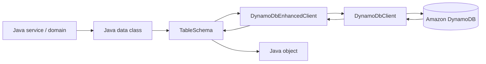

# DynamoDB Enhanced Client và ánh xạ đối tượng Java

## 1. Từ DynamoDB AttributeValue đến Java object

Một ứng dụng Java Spring Boot lưu đơn hàng trong **Amazon DynamoDB**. Ở tầng DynamoDB, mỗi item là một tập attributes như `PK`, `SK`, `status`, `total` và `createdAt`; ở tầng Java, đội phát triển muốn thao tác với `Order`, `OrderLine` hoặc `Customer` thay vì tự xây dựng `Map<String, AttributeValue>` trong mọi hàm.

**DynamoDB Enhanced Client** là thư viện cấp cao thuộc **AWS SDK for Java 2.x**, giúp ánh xạ Java data classes sang DynamoDB items và ngược lại. Bạn định nghĩa `TableSchema` một lần, tạo `DynamoDbTable<T>`, sau đó gọi các phương thức CRUD, query, scan, batch và transaction bằng đối tượng Java.

Bài học thuộc chương **AWS SDK cho Java** của module **CLOUD_PROVIDERS_AWS**. Lộ trình khám phá Region/AZ, IAM, VPC, compute, storage, database, integration và serverless; người học rèn khả năng chọn dịch vụ, triển khai an toàn, giám sát, phục hồi và kiểm soát chi phí. Enhanced Client là cầu nối quan trọng giữa domain Java và DynamoDB trong những hệ thống đó.

Sau bài, bạn sẽ có thể:

- Phân biệt **DynamoDbClient**, **DynamoDbEnhancedClient**, **DynamoDbTable** và **TableSchema**.
- Ánh xạ JavaBean bằng `@DynamoDbBean` và lớp immutable bằng `@DynamoDbImmutable`.
- Khai báo partition key, sort key, secondary indexes và tên attributes.
- Chọn annotated schema, static schema hoặc document schema theo mô hình dữ liệu.
- Xử lý null, nested objects, collections và custom `AttributeConverter`.
- Dùng CRUD, query, scan, pagination và async publisher đúng cách.
- Hiểu `VersionedRecordExtension`, `AtomicCounterExtension` và điều kiện cập nhật.
- Dùng batch/transaction, kiểm soát IAM, test mapping và chẩn đoán lỗi.

## 2. Enhanced Client nằm ở đâu trong AWS SDK for Java 2.x?

SDK v2 cung cấp **low-level DynamoDB client** và **Enhanced Client**:

| Thành phần | Trách nhiệm | Khi nào dùng |
| --- | --- | --- |
| `DynamoDbClient` | API gần với DynamoDB service: `AttributeValue`, expressions, keys, request/response chi tiết | Cần toàn quyền kiểm soát API, schema động hoặc thao tác đặc thù |
| `DynamoDbEnhancedClient` | Lớp mapping cấp cao, quản lý schema và extension | Java data classes có cấu trúc ổn định, CRUD/query theo kiểu đối tượng |
| `DynamoDbTable<T>` | Đại diện cho một DynamoDB table ánh xạ với kiểu `T` | Gọi `putItem`, `getItem`, `updateItem`, `query`, `scan` |
| `TableSchema<T>` | Định nghĩa cách chuyển Java object ↔ DynamoDB item | Khai báo key, attributes, converters, getters/setters |
| `DynamoDbIndex<T>` | Đại diện một secondary index của table | Query GSI/LSI bằng cùng data model |
| `DynamoDbEnhancedAsyncClient` | Enhanced Client API bất đồng bộ | Reactive/async applications và xử lý pagination không chặn thread |

Enhanced Client không phải một database mới, cũng không thay đổi giới hạn hay mô hình dữ liệu của DynamoDB. Nó xây dựng request low-level từ Java model và ánh xạ response thành object.

### 2.1. Luồng ánh xạ



### 2.2. Enhanced Client và DynamoDBMapper v1

Đừng nhầm Enhanced Client v2 với `DynamoDBMapper` của AWS SDK for Java 1.x. SDK v2 dùng package `software.amazon.awssdk.enhanced.dynamodb`, annotation có cách viết `DynamoDb...` (chữ b thường), và bạn tạo `DynamoDbTable` bằng tên table cùng `TableSchema`.

| AWS SDK v1 | AWS SDK v2 Enhanced Client |
| --- | --- |
| `DynamoDBMapper` | `DynamoDbEnhancedClient` |
| `@DynamoDBTable` | Table name truyền vào `.table(name, schema)` |
| `@DynamoDBHashKey` | `@DynamoDbPartitionKey` |
| `@DynamoDBRangeKey` | `@DynamoDbSortKey` |
| `mapper.load()` | `table.getItem()` |
| `mapper.save()` | `table.putItem()` hoặc `table.updateItem()` |
| `@DynamoDBVersionAttribute` | `@DynamoDbVersionAttribute` |

Không trộn annotation/import của v1 với v2 trong cùng một data model.

## 3. Dependencies và khởi tạo client

### 3.1. Maven với AWS SDK BOM

Ví dụ `pom.xml`:

```xml
<dependencyManagement>
  <dependencies>
    <dependency>
      <groupId>software.amazon.awssdk</groupId>
      <artifactId>bom</artifactId>
      <version>AWS_SDK_VERSION</version>
      <type>pom</type>
      <scope>import</scope>
    </dependency>
  </dependencies>
</dependencyManagement>

<dependencies>
  <dependency>
    <groupId>software.amazon.awssdk</groupId>
    <artifactId>dynamodb</artifactId>
  </dependency>
  <dependency>
    <groupId>software.amazon.awssdk</groupId>
    <artifactId>dynamodb-enhanced</artifactId>
  </dependency>
</dependencies>
```

`AWS_SDK_VERSION` là property/placeholder do dự án chọn và quản lý tập trung. Dùng BOM để các module AWS SDK có version tương thích; không tùy tiện ghép `dynamodb` 2.x với `dynamodb-enhanced` của một version khác.

Nếu dùng Enhanced Client asynchronous với Netty hoặc HTTP client cụ thể, cấu hình các dependencies/client transport tương ứng theo runtime của ứng dụng. Nếu dùng SSO, STS hoặc service khác, thêm module tương ứng nhưng vẫn đồng bộ bằng BOM.

### 3.2. Tạo low-level và enhanced clients

```java
import software.amazon.awssdk.regions.Region;
import software.amazon.awssdk.services.dynamodb.DynamoDbClient;
import software.amazon.awssdk.enhanced.dynamodb.DynamoDbEnhancedClient;

public final class DynamoDbFactory {
    public static DynamoDbEnhancedClient createEnhancedClient() {
        DynamoDbClient lowLevel = DynamoDbClient.builder()
                .region(Region.AP_SOUTHEAST_1)
                .build();

        return DynamoDbEnhancedClient.builder()
                .dynamoDbClient(lowLevel)
                .build();
    }
}
```

Ví dụ trên minh họa quan hệ client; ứng dụng production nên quản lý lifecycle của cả hai client trong DI container (ví dụ Spring bean) và đóng low-level client khi ứng dụng dừng. `DynamoDbEnhancedClient` sử dụng low-level client được cung cấp, không tự thay thế credentials/Region configuration.

### 3.3. Credentials và Region vẫn theo AWS SDK

Enhanced Client không có credential system riêng. `DynamoDbClient` dùng credentials provider chain và Region configuration của Java SDK v2. Local có thể dùng IAM Identity Center profile; ECS dùng task role; Lambda dùng execution role; EC2 dùng instance profile. Kiểm tra danh tính bằng STS `GetCallerIdentity` khi cần xác minh account/role.

## 4. TableSchema: hợp đồng ánh xạ giữa Java và DynamoDB

`TableSchema<T>` mô tả:

- Java type nào được ánh xạ.
- Getter/setter hoặc builder nào đọc/ghi giá trị.
- Java property nào tương ứng với DynamoDB attribute.
- Primary key và secondary index key attributes.
- Converter nào biến Java type thành DynamoDB `AttributeValue`.
- Metadata cần cho Enhanced Client thực hiện CRUD, query và table operations.

**Tạo schema là thao tác tương đối tốn chi phí introspection**, nên xây dựng schema một lần lúc khởi động ứng dụng, không gọi `TableSchema.fromBean()` trong mỗi request.

### 4.1. Các loại schema

| Loại | Cách tạo | Phù hợp |
| --- | --- | --- |
| `BeanTableSchema` | `TableSchema.fromBean(MyBean.class)` | Mutable JavaBean có annotation |
| `ImmutableTableSchema` | `TableSchema.fromImmutableClass(MyType.class)` | Class immutable có builder |
| `StaticTableSchema` | `TableSchema.builder(MyType.class)...build()` | Khai báo schema tường minh, không cần annotation/JavaBean conventions |
| `StaticImmutableTableSchema` | Builder cho immutable type | Immutable model với schema định nghĩa bằng code |
| `DocumentTableSchema` | `TableSchema.documentSchemaBuilder()` | Attributes linh hoạt, không có schema đầy đủ cố định |

Chọn schema theo cách tổ chức model. Không cần ép mọi domain class thành JavaBean nếu static schema hoặc immutable class phù hợp hơn.

## 5. Ánh xạ JavaBean bằng @DynamoDbBean

JavaBean cần:

1. Annotation cấp lớp `@DynamoDbBean`.
2. Public no-argument constructor để schema tạo object.
3. Getter/setter phù hợp cho các thuộc tính cần lưu.
4. Ít nhất một thuộc tính được đánh dấu partition key.

Ví dụ bảng `ShopTable` có composite key `PK` và `SK` kiểu String:

```java
import software.amazon.awssdk.enhanced.dynamodb.mapper.annotations.DynamoDbBean;
import software.amazon.awssdk.enhanced.dynamodb.mapper.annotations.DynamoDbPartitionKey;
import software.amazon.awssdk.enhanced.dynamodb.mapper.annotations.DynamoDbSortKey;
import software.amazon.awssdk.enhanced.dynamodb.mapper.annotations.DynamoDbAttribute;
import java.math.BigDecimal;
import java.time.Instant;

@DynamoDbBean
public class OrderRecord {
    private String pk;
    private String sk;
    private String status;
    private BigDecimal total;
    private Instant createdAt;

    public OrderRecord() {
    }

    @DynamoDbPartitionKey
    @DynamoDbAttribute("PK")
    public String getPk() {
        return pk;
    }
    public void setPk(String pk) {
        this.pk = pk;
    }

    @DynamoDbSortKey
    @DynamoDbAttribute("SK")
    public String getSk() {
        return sk;
    }
    public void setSk(String sk) {
        this.sk = sk;
    }

    public String getStatus() {
        return status;
    }
    public void setStatus(String status) {
        this.status = status;
    }

    public BigDecimal getTotal() {
        return total;
    }
    public void setTotal(BigDecimal total) {
        this.total = total;
    }

    public Instant getCreatedAt() {
        return createdAt;
    }
    public void setCreatedAt(Instant createdAt) {
        this.createdAt = createdAt;
    }
}
```

**Annotation được đặt trên getter hoặc setter, không đặt đồng thời trên cả hai** cho cùng một attribute. Mẫu trên đặt annotation trên getter, giúp schema đọc metadata từ accessor.

### 5.1. Tạo schema và table resource

```java
import software.amazon.awssdk.enhanced.dynamodb.DynamoDbEnhancedClient;
import software.amazon.awssdk.enhanced.dynamodb.DynamoDbTable;
import software.amazon.awssdk.enhanced.dynamodb.TableSchema;

TableSchema<OrderRecord> orderSchema =
        TableSchema.fromBean(OrderRecord.class);

DynamoDbTable<OrderRecord> orders =
        enhancedClient.table("ShopTable", orderSchema);
```

Lời gọi `table()` tạo **resource mapping trong bộ nhớ**, không tự tạo bảng trên AWS. Nếu table đã tồn tại, có thể sử dụng ngay. Nếu muốn tạo table mới, gọi `createTable()` hoặc dùng IaC/low-level API với key/index/throughput đã định nghĩa; phải kiểm tra resource thật và không tạo trùng production table.

### 5.2. Đổi tên attribute

`@DynamoDbAttribute("PK")` ánh xạ getter `getPk()` sang attribute DynamoDB tên `PK`. Nếu không khai báo, Enhanced Client suy ra tên theo JavaBean property, ví dụ `getStatus()` thành `status`.

Tên key trong `TableSchema` phải khớp **chính xác** với key schema của bảng thật. Nếu table dùng partition key `pk` nhưng model gán `PK`, thao tác có thể thất bại vì key attribute mismatch.

### 5.3. Bỏ qua thuộc tính không lưu

`@DynamoDbIgnore` đánh dấu getter không được ánh xạ vào DynamoDB. Ví dụ `getDisplayLabel()` chỉ được tính từ các field khác, không phải persisted attribute. Không đặt getter tiện ích tùy ý vào immutable class nếu chưa đánh dấu ignore: các getter không được ignore có thể bị xem là thuộc tính cần ánh xạ.

## 6. Khai báo primary key và secondary indexes

### 6.1. Partition key và sort key

| Annotation | Ý nghĩa |
| --- | --- |
| `@DynamoDbPartitionKey` | Partition key của table |
| `@DynamoDbSortKey` | Sort key của table |
| `@DynamoDbSecondaryPartitionKey(indexNames = "...")` | Partition key cho một hoặc nhiều secondary indexes |
| `@DynamoDbSecondarySortKey(indexNames = "...")` | Sort key cho một hoặc nhiều secondary indexes |

Ví dụ GSI `orders_by_customer` có partition key `customerId`, sort key `createdAt`:

```java
@DynamoDbSecondaryPartitionKey(indexNames = "orders_by_customer")
public String getCustomerId() {
    return customerId;
}

@DynamoDbSecondarySortKey(indexNames = "orders_by_customer")
public Instant getCreatedAt() {
    return createdAt;
}
```

Annotations chỉ mô tả cách Enhanced Client hiểu item và index key. Chúng **không tự tạo GSI** trong table hiện hữu. GSI phải tồn tại trên DynamoDB table (được tạo qua IaC, console hoặc API) và tên index phải khớp chính xác khi query.

### 6.2. Key design vẫn là trách nhiệm ứng dụng

Enhanced Client không thay đổi nguyên tắc thiết kế DynamoDB:

- Partition key phân phối dữ liệu và quyết định phạm vi query.
- Sort key hỗ trợ tổ chức items, range queries và access patterns.
- GSI tạo access pattern bổ sung nhưng có chi phí storage/write và consistency riêng.
- LSI có giới hạn và phải được khai báo khi tạo table.

Không tạo một GSI chỉ vì model có getter `email`; phải xác định query nào cần index, projection nào đủ và write amplification có chấp nhận được không.

## 7. Ánh xạ lớp immutable bằng @DynamoDbImmutable

Java record/domain object immutable giúp tránh thay đổi trạng thái ngoài ý muốn. Enhanced Client hỗ trợ immutable class thông qua `@DynamoDbImmutable(builder = ...)`, với các quy tắc:

- Class có getters (có thể là method dạng `id()` thay vì `getId()`).
- Builder có setter tương ứng cho từng getter, tên và kiểu khớp.
- Có public `build()` trả về immutable class.
- Builder có public no-arg constructor hoặc class có public static `builder()` trả builder.
- Mọi getter không override Object và không `@DynamoDbIgnore` phải được schema hiểu là attribute.

Ví dụ rút gọn:

```java
import software.amazon.awssdk.enhanced.dynamodb.mapper.annotations.DynamoDbImmutable;
import software.amazon.awssdk.enhanced.dynamodb.mapper.annotations.DynamoDbPartitionKey;
import software.amazon.awssdk.enhanced.dynamodb.mapper.annotations.DynamoDbSortKey;

@DynamoDbImmutable(builder = Customer.Builder.class)
public final class Customer {
    private final String id;
    private final String email;
    private final String displayName;

    private Customer(Builder builder) {
        this.id = builder.id;
        this.email = builder.email;
        this.displayName = builder.displayName;
    }

    public static Builder builder() {
        return new Builder();
    }

    @DynamoDbPartitionKey
    public String id() { return id; }

    @DynamoDbSortKey
    public String email() { return email; }

    public String displayName() { return displayName; }

    public static final class Builder {
        private String id;
        private String email;
        private String displayName;

        public Builder id(String value) {
            this.id = value;
            return this;
        }
        public Builder email(String value) {
            this.email = value;
            return this;
        }
        public Builder displayName(String value) {
            this.displayName = value;
            return this;
        }
        public Customer build() {
            return new Customer(this);
        }
    }
}
```

Schema:

```java
TableSchema<Customer> customerSchema =
        TableSchema.fromImmutableClass(Customer.class);
```

### 7.1. Khi dùng Lombok

Lombok `@Value` và `@Builder` có thể giảm boilerplate, nhưng phải bảo đảm annotation DynamoDB được đặt lên **getter được generate**, và builder đáp ứng conventions. Với boolean property, cần chú ý naming convention getter mà ImmutableTableSchema yêu cầu; không mặc định mọi Lombok-generated method đều phù hợp.

### 7.2. Chọn Bean hay Immutable?

| Tiêu chí | Bean | Immutable |
| --- | --- | --- |
| Khởi tạo | Public no-arg constructor | Builder và build method |
| Mutation | Getter/setter | Chỉ getters |
| Mapping | `TableSchema.fromBean()` | `TableSchema.fromImmutableClass()` |
| Phù hợp | DTO/persistence bean đơn giản | Domain/value objects không muốn mutation |
| Boilerplate | Nhiều getter/setter | Nhiều builder code nếu không dùng Lombok |

Không cần ép domain model và persistence model là cùng một class. Có thể map DynamoDB sang persistence bean rồi chuyển sang domain object để giữ ranh giới giữa storage schema và business rules.

## 8. Static TableSchema: định nghĩa mapping bằng code

Nếu không muốn đặt annotation lên class hoặc model không theo JavaBean conventions, có thể tạo schema bằng builder. Static schema thường ít tốn chi phí introspection hơn schema sinh từ annotation và cho phép định nghĩa mapping rõ ràng tại một nơi.

Ví dụ `Product` là một JavaBean có getter/setter:

```java
public class Product {
    private String productId;
    private String name;

    public Product() {
    }

    public String getProductId() {
        return productId;
    }
    public void setProductId(String productId) {
        this.productId = productId;
    }

    public String getName() {
        return name;
    }
    public void setName(String name) {
        this.name = name;
    }
}
```

Schema minh họa:

```java
import software.amazon.awssdk.enhanced.dynamodb.TableSchema;
import software.amazon.awssdk.enhanced.dynamodb.mapper.StaticAttributeTags;

static final TableSchema<Product> PRODUCT_SCHEMA =
    TableSchema.builder(Product.class)
        .newItemSupplier(Product::new)
        .addAttribute(String.class, a -> a.name("PK")
            .getter(Product::getProductId)
            .setter(Product::setProductId)
            .tags(StaticAttributeTags.primaryPartitionKey()))
        .addAttribute(String.class, a -> a.name("name")
            .getter(Product::getName)
            .setter(Product::setName))
        .build();
```

Builder trên định nghĩa cả getter và setter, nên Enhanced Client có thể tạo và điền một bean khi đọc item. Với immutable object, dùng `StaticImmutableTableSchema` hoặc builder immutable tương ứng để schema có thể dựng object hoàn chỉnh.

### 8.1. Khi nào static schema hữu ích?

- Model được tạo bởi thư viện bên thứ ba, không thể thêm annotation.
- Muốn tách storage schema khỏi domain class.
- Muốn tránh reflection/introspection ở startup.
- Cần cấu hình converter, attribute names và tags tại một điểm.
- Muốn kiểm soát chặt schema trong module persistence.

## 9. Nested objects, maps, lists và sets

DynamoDB hỗ trợ các kiểu dữ liệu attribute như **String (S), Number (N), Binary (B), Boolean (BOOL), Null (NULL), List (L), Map (M), String Set (SS), Number Set (NS), Binary Set (BS)**. Enhanced Client có converter cho nhiều kiểu Java phổ biến và collection.

Một item đơn hàng có thể chứa:

```json
{
  "PK": "ORDER#O301",
  "SK": "META",
  "customer": {
    "id": "C001",
    "name": "An"
  },
  "lines": [
    {
      "productId": "P100",
      "quantity": 2
    }
  ],
  "tags": ["priority", "web"]
}
```

Nếu nested class được định nghĩa và annotate đúng, Enhanced Client có thể ánh xạ nó thành Map/List.

### 9.1. Nested bean

```java
@DynamoDbBean
public class Address {
    private String city;
    private String country;

    public Address() {}

    public String getCity() { return city; }
    public void setCity(String city) { this.city = city; }

    public String getCountry() { return country; }
    public void setCountry(String country) { this.country = country; }
}

@DynamoDbBean
public class CustomerProfile {
    private String customerId;
    private Address address;

    public CustomerProfile() {}

    @DynamoDbPartitionKey
    public String getCustomerId() { return customerId; }
    public void setCustomerId(String customerId) {
        this.customerId = customerId;
    }

    public Address getAddress() { return address; }
    public void setAddress(Address address) {
        this.address = address;
    }
}
```

Khi `TableSchema.fromBean(CustomerProfile.class)` xây schema, nó có thể phát hiện nested bean `Address` và ánh xạ thành document map. Nếu dùng class không annotate hoặc class không theo JavaBean, có thể xây nested schema bằng builder và lồng vào schema cha.

### 9.2. Nested class dạng immutable

Nested immutable classes cũng cần `@DynamoDbImmutable` và builder conventions. Nếu nested object được flatten thành các top-level attributes, dùng annotation `@DynamoDbFlatten` theo tài liệu thay vì giả định object map tự flatten.

### 9.3. Map, List và Set

Các collection Java như `List<String>`, `Set<String>` và `Map<String, String>` có thể được map bởi converter mặc định khi kiểu phần tử được hỗ trợ. Lưu ý:

- DynamoDB **String Set/Number Set/Binary Set không cho phép empty set**.
- List giữ thứ tự; Set không cam kết thứ tự.
- Map key trong DynamoDB phải là String.
- Item tổng thể vẫn chịu giới hạn **400 KB**.
- Nested documents không tạo quan hệ join hay transaction tự động với items khác.

Không lưu một danh sách không giới hạn trong một item nếu nó có thể vượt 400 KB hoặc gây write contention; cân nhắc tách thành items có sort key.

## 10. Attribute converters: biến Java type thành DynamoDB type

Enhanced Client dùng `AttributeConverter<T>` để chuyển giữa Java type và DynamoDB `AttributeValue`. SDK v2 đã cung cấp converter mặc định cho nhiều kiểu phổ biến như `String`, `Integer`, `Long`, `BigDecimal`, `Instant`, map, list và set.

### 10.1. Dùng converter mặc định

| Java type | DynamoDB representation thường dùng |
| --- | --- |
| `String` | `S` |
| `Integer`, `Long`, `BigDecimal` | `N` |
| `Boolean` | `BOOL` |
| `byte[]`/binary type hỗ trợ | `B` |
| `List<T>` | `L` |
| `Map<String,T>` | `M` |
| `Set<String>` | `SS` |
| `Instant` | Converter có sẵn của SDK |

Nên dùng wrapper types (`Long`, `Integer`) thay vì primitives (`long`, `int`) cho data class attributes nếu cần phân biệt **không có attribute** với **giá trị 0**. Primitive mặc định là 0, làm mất thông tin “không được set”.

### 10.2. Custom AttributeConverter cho Money

Giả sử domain có kiểu `Money`:

```java
import java.math.BigDecimal;

public record Money(BigDecimal amount, String currency) {}
```

Ta có thể lưu Money dưới dạng Map:

```java
import java.math.BigDecimal;
import java.util.Map;
import software.amazon.awssdk.enhanced.dynamodb.AttributeConverter;
import software.amazon.awssdk.enhanced.dynamodb.EnhancedType;
import software.amazon.awssdk.enhanced.dynamodb.AttributeValueType;
import software.amazon.awssdk.services.dynamodb.model.AttributeValue;

public final class MoneyConverter implements AttributeConverter<Money> {
    @Override
    public AttributeValue transformFrom(Money money) {
        return AttributeValue.builder()
                .m(Map.of(
                        "amount", AttributeValue.builder()
                                .n(money.amount().toPlainString()).build(),
                        "currency", AttributeValue.builder()
                                .s(money.currency()).build()))
                .build();
    }

    @Override
    public Money transformTo(AttributeValue value) {
        Map<String, AttributeValue> map = value.m();
        return new Money(
                new BigDecimal(map.get("amount").n()),
                map.get("currency").s());
    }

    @Override
    public EnhancedType<Money> type() {
        return EnhancedType.of(Money.class);
    }

    @Override
    public AttributeValueType attributeValueType() {
        return AttributeValueType.M;
    }
}
```

Áp converter vào getter:

```java
@DynamoDbConvertedBy(MoneyConverter.class)
public Money getTotal() {
    return total;
}
```

Ví dụ lược bỏ validation; converter production phải xử lý null, dữ liệu cũ/malformed, currency code và quy tắc làm tròn. Không dùng `double` cho tiền vì sai số floating point có thể làm lệch giá trị.

### 10.3. Custom AttributeConverterProvider

Nếu muốn áp dụng converter theo type trên toàn schema thay vì gắn annotation từng field, có thể cấu hình `AttributeConverterProvider`. Provider trả converter phù hợp với `EnhancedType<T>`. Khi cung cấp provider custom, cần quyết định có thêm `DefaultAttributeConverterProvider` làm fallback hay không; một danh sách provider tự khai báo có thể thay thế mặc định nếu cấu hình không đúng.

## 11. Null semantics: điểm dễ gây mất dữ liệu khi updateItem

Đây là hành vi cần hiểu rõ trước khi dùng Enhanced Client trong production:

- Với **`putItem`**, thuộc tính Java có giá trị null sẽ **không được gửi** trong item mới.
- Với **`updateItem` mặc định**, thuộc tính Java có giá trị null có thể được dùng để **xóa attribute tương ứng** khỏi item đang lưu.

Ví dụ item DynamoDB đang có `name`, `email`, `phone`. Bạn tạo Java object chỉ set `id` và `name`, còn `email`/`phone` để null rồi gọi `updateItem`. Theo default behavior, những attribute null có thể bị xóa khỏi item.

### 11.1. Ví dụ rủi ro

```java
Customer customer = new Customer();
customer.setCustomerId("C001");
customer.setName("New Name");
// email và phone để null

customerTable.updateItem(customer);
```

Nếu mục đích chỉ sửa `name`, cách gọi trên có thể xóa `email` và `phone`.

### 11.2. IgnoreNullsMode

Enhanced Client có `IgnoreNullsMode` cho update:

| Mode | Hành vi khái quát |
| --- | --- |
| `IgnoreNullsMode.DEFAULT` | Null không được ignore; null scalar/map/list/set có thể xóa attribute tương ứng |
| `IgnoreNullsMode.SCALAR_ONLY` | Ignore null scalar attributes ở các cấp; map/bean cần có cấu trúc phù hợp đã tồn tại để update field bên trong |
| `IgnoreNullsMode.MAPS_ONLY` | Ignore map/bean null; map/bean có giá trị được thêm/thay thế theo semantics của mode |

Ví dụ giữ lại các scalar attributes chưa set:

```java
Customer partial = new Customer();
partial.setCustomerId("C001");
partial.setName("New Name");

Customer updated = customerTable.updateItem(r -> r
        .item(partial)
        .ignoreNullsMode(IgnoreNullsMode.SCALAR_ONLY));
```

Với nested maps/beans, chọn mode phải dựa trên cấu trúc đã tồn tại. `SCALAR_ONLY` không thể thêm một map/bean mới bằng cách update một nested path nếu parent map chưa có; có thể gặp lỗi invalid document path. `MAPS_ONLY` có thể thêm/thay thế map/bean được cung cấp, trong khi bỏ qua map/bean null. Non-null list/set được cung cấp vẫn có thể thay thế collection tương ứng.

### 11.3. Khi nào nên đọc trước rồi update?

Một cách an toàn là `getItem`, sửa object đã đọc, sau đó `updateItem`. Cách này giữ các thuộc tính khác trong object và giảm nguy cơ xóa ngoài ý muốn; đổi lại phát sinh một lần đọc và có thể cần optimistic locking nếu có concurrent writers.

Nếu chỉ cập nhật một vài fields và không muốn đọc item trước, dùng update request có `IgnoreNullsMode` phù hợp hoặc low-level `UpdateExpression` để mô tả chính xác thao tác. **Null không tự đồng nghĩa “không đổi”** trong mọi mode.

## 12. CRUD với DynamoDbTable

Sau khi có `DynamoDbTable<OrderRecord>`, các thao tác CRUD dùng kiểu Java thay vì tự tạo `AttributeValue` maps.

### 12.1. PutItem

```java
OrderRecord order = new OrderRecord();
order.setPk("ORDER#O301");
order.setSk("META");
order.setStatus("CREATED");
order.setTotal(new BigDecimal("250000.00"));
order.setCreatedAt(Instant.now());

orders.putItem(order);
```

`putItem` ghi item theo primary key. Nếu key đã tồn tại, PutItem mặc định **thay thế item** theo semantics của DynamoDB. Nếu muốn chỉ tạo khi chưa tồn tại, dùng `PutItemEnhancedRequest` với condition expression hoặc low-level API; đừng giả định Enhanced Client tự biến put thành insert-only.

### 12.2. GetItem

```java
OrderRecord order = orders.getItem(r -> r
        .key(k -> k
                .partitionValue("ORDER#O301")
                .sortValue("META")));
```

Key builder phải cung cấp đủ partition key và sort key nếu table có composite key. Nếu không có item, kết quả thường là `null`; xử lý trường hợp không tìm thấy trước khi dereference. Enhanced Client request có thể cấu hình consistent read khi API hỗ trợ.

### 12.3. UpdateItem

```java
OrderRecord order = orders.getItem(r -> r
        .key(k -> k.partitionValue("ORDER#O301").sortValue("META")));

if (order != null) {
    order.setStatus("PAID");
    orders.updateItem(order);
}
```

Ví dụ minh họa read-modify-write; nếu nhiều requests có thể cùng cập nhật item, thêm `@DynamoDbVersionAttribute` hoặc `ConditionExpression` để tránh lost updates. Không phải cứ gọi `updateItem` là có optimistic locking nếu schema không bật version extension.

### 12.4. DeleteItem

```java
OrderRecord deleted = orders.deleteItem(r -> r
        .key(k -> k
                .partitionValue("ORDER#O301")
                .sortValue("META")));
```

`deleteItem` xóa item theo key. Nếu cần xóa có điều kiện (ví dụ chỉ xóa khi status còn `CANCELLED` và version khớp), truyền condition expression trong enhanced request. `@DynamoDbVersionAttribute` không tự bảo vệ mọi delete operation; xem phần extensions.

### 12.5. Enhanced Client không tự tạo table mỗi khi gọi table()

`enhancedClient.table("ShopTable", schema)` chỉ tạo object đại diện table. Để tạo table mới có thể gọi:

```java
orders.createTable(r -> r
        .provisionedThroughput(t -> t
                .readCapacityUnits(5L)
                .writeCapacityUnits(5L)));
```

Đây là ví dụ table mới dùng provisioned capacity, không phải lệnh phù hợp cho mọi production table. GSI, projection, billing mode, encryption, PITR, tags, deletion protection và streams cần được khai báo theo yêu cầu; hạ tầng production thường nên được quản lý bằng CDK/CloudFormation/Terraform.

## 13. ConditionExpression và UpdateExpression với Enhanced Client

Enhanced Client vẫn hỗ trợ điều kiện và biểu thức DynamoDB; request builder giúp gắn `Expression` vào thao tác kiểu đối tượng.

### 13.1. PutItem chỉ tạo nếu chưa có

```java
import software.amazon.awssdk.enhanced.dynamodb.Expression;
import software.amazon.awssdk.enhanced.dynamodb.model.PutItemEnhancedRequest;

Expression onlyIfMissing = Expression.builder()
        .expression("attribute_not_exists(#pk)")
        .putExpressionName("#pk", "PK")
        .build();

PutItemEnhancedRequest<OrderRecord> request =
        PutItemEnhancedRequest.builder(OrderRecord.class)
                .item(order)
                .conditionExpression(onlyIfMissing)
                .build();

orders.putItem(request);
```

Điều kiện được kiểm tra tại DynamoDB trong cùng thao tác PutItem. Nếu item đã tồn tại, request thất bại với conditional check exception; ứng dụng nên phân loại thành duplicate/conflict thay vì retry vô hạn.

### 13.2. UpdateItem với status condition

```java
import software.amazon.awssdk.enhanced.dynamodb.Expression;
import software.amazon.awssdk.enhanced.dynamodb.model.UpdateItemEnhancedRequest;
import software.amazon.awssdk.services.dynamodb.model.AttributeValue;

Expression canPay = Expression.builder()
        .expression("#status = :created")
        .putExpressionName("#status", "status")
        .putExpressionValue(":created",
                AttributeValue.builder().s("CREATED").build())
        .build();

order.setStatus("PAID");

UpdateItemEnhancedRequest<OrderRecord> updateRequest =
        UpdateItemEnhancedRequest.builder(OrderRecord.class)
                .item(order)
                .conditionExpression(canPay)
                .build();

orders.updateItem(updateRequest);
```

Đoạn minh họa expression sử dụng low-level `AttributeValue` cho expression value. Trong code production, nên tách rõ model object, state transition và request builder; kiểm thử các trường hợp item không tồn tại, status sai và concurrent updates.

### 13.3. UpdateExpression phức tạp

Enhanced Client có thể dùng update behavior annotations hoặc extension để thay đổi thao tác ghi; với những update expression phức tạp (atomic increments, list/map paths, `if_not_exists`, `REMOVE`) low-level `DynamoDbClient.updateItem` vẫn là lựa chọn hợp lệ. **Không bắt buộc mọi thao tác DynamoDB phải đi qua Enhanced Client**; dùng đúng abstraction phù hợp.

## 14. Query, sort key conditions và secondary indexes

### 14.1. Query theo partition key

Query là lựa chọn chính khi biết partition key:

```java
import software.amazon.awssdk.enhanced.dynamodb.model.QueryConditional;

PageIterable<OrderRecord> pages = orders.query(r -> r
        .queryConditional(QueryConditional.keyEqualTo(k -> k
                .partitionValue("ORDER#O301"))));

pages.items().forEach(order -> {
    System.out.println(order.getStatus());
});
```

Nếu table có sort key, có thể bổ sung điều kiện như `sortBeginsWith`, `sortGreaterThanOrEqualTo`, `sortBetween` theo access pattern. Query luôn cần partition key equality; không thể dùng Query như SQL query tự do trên mọi attributes.

### 14.2. Query GSI

Giả sử GSI tên `orders_by_customer` có partition key `customerId` và sort key `createdAt`:

```java
DynamoDbIndex<OrderRecord> byCustomer =
        orders.index("orders_by_customer");

PageIterable<OrderRecord> customerOrders = byCustomer.query(r -> r
        .queryConditional(QueryConditional.keyEqualTo(k -> k
                .partitionValue("C001"))));
```

GSI phải tồn tại trên DynamoDB table; Enhanced Client không tạo index chỉ từ annotation. GSI reads là **eventually consistent**, vì vậy không dùng nó làm nguồn kiểm tra read-after-write bắt buộc phải thấy ngay dữ liệu mới.

### 14.3. Filter expression không thay thế key condition

Filter expression được áp dụng sau khi DynamoDB đọc items trong phạm vi key condition; nó không làm cho một Query không có partition key trở thành truy vấn hiệu quả. Filter không giảm read capacity đã tiêu thụ cho items được đọc trước khi lọc. Thiết kế partition/sort keys và index theo access pattern trước khi thêm filter.

## 15. Pagination: PageIterable và PagePublisher

Query, scan và batch methods có thể trả nhiều pages. Một request DynamoDB không nhất thiết trả toàn bộ kết quả; Enhanced Client quản lý việc tiếp tục đọc trang kế tiếp khi bạn duyệt `PageIterable`/`PagePublisher`.

### 15.1. Synchronous PageIterable

```java
PageIterable<OrderRecord> pages = byCustomer.query(r -> r
        .queryConditional(QueryConditional.keyEqualTo(k -> k
                .partitionValue("CUSTOMER#C001"))));

// Xử lý từng item; SDK tự lấy trang tiếp theo khi cần.
pages.items().forEach(order -> process(order));

// Hoặc xử lý theo page để quan sát số items/consumed capacity.
pages.stream().forEach(page -> {
    System.out.println("Items in page: " + page.items().size());
});
```

`PageIterable.items()` cung cấp iterable/stream qua tất cả items của mọi trang. Đừng gọi `stream().count()` rồi lại duyệt toàn bộ pages nếu không cần; thao tác đầu có thể đã thực hiện toàn bộ network requests.

### 15.2. Async PagePublisher

`DynamoDbEnhancedAsyncClient` trả `PagePublisher<T>` cho query/scan. Có thể subscribe bằng Reactive Streams `Subscriber` hoặc consumer API của SDK. Async publisher hỗ trợ backpressure; consumer nên xử lý từng page/item theo năng lực thay vì thu thập vô hạn vào một `List`.

```java
PagePublisher<OrderRecord> publisher =
        asyncOrders.query(r -> r
                .queryConditional(QueryConditional.keyEqualTo(k -> k
                        .partitionValue("CUSTOMER#C001"))));

publisher.items()
        .subscribe(order -> process(order))
        .join();
```

Ví dụ dùng `join()` để chờ hoàn tất trong một chương trình minh họa. Trong server async/reactive, tránh block event loop bằng `.join()`; nối publisher vào pipeline phù hợp và xử lý exception/backpressure.

### 15.3. Scan khác Query

| Query | Scan |
| --- | --- |
| Bắt đầu từ partition key | Duyệt dữ liệu theo scan operation |
| Có thể giới hạn bằng sort key condition | Có thể filter nhưng vẫn đọc items trước lọc |
| Thường phù hợp access pattern production | Thường dùng admin/report/batch hoặc data set nhỏ |
| Dùng GSI/LSI nếu query theo index | Không biến thành query có hiệu quả chỉ nhờ filter |

Không dùng `scan()` cho endpoint user-facing cần độ trễ thấp trên table lớn. Nếu nghiệp vụ thường xuyên cần tìm theo attribute, thiết kế GSI/LSI hoặc mô hình dữ liệu phù hợp.

## 16. Enhanced Client extensions: version, atomic counter và timestamp

Enhanced Client có **extensions** để biến đổi dữ liệu trước khi ghi hoặc sau khi đọc. Chúng cung cấp hành vi bổ sung mà model annotation có thể kích hoạt.

Theo cấu hình mặc định của Enhanced Client, hai extensions được nạp:

1. `VersionedRecordExtension`: optimistic locking với version attribute.
2. `AtomicCounterExtension`: tự tăng các attributes được đánh dấu counter.

Nếu bạn tự cấu hình `.extensions(...)`, Enhanced Client **không tự nạp lại các default extensions**. Muốn tiếp tục dùng version/counter, phải thêm chúng rõ ràng vào danh sách cùng custom extensions.

### 16.1. VersionedRecordExtension

Đánh dấu thuộc tính số bằng `@DynamoDbVersionAttribute`:

```java
@DynamoDbVersionAttribute
public Long getVersion() {
    return version;
}
public void setVersion(Long version) {
    this.version = version;
}
```

Khi dùng `putItem` cho item mới, extension khởi tạo version theo cấu hình mặc định của SDK. Với `updateItem`, SDK thêm điều kiện để chỉ ghi nếu version persisted khớp version client đã đọc; nếu thành công, version tự tăng. Có thể cấu hình `startAt` và `incrementBy` theo annotation/extension API.

**Lưu ý quan trọng:**

- Version extension có hiệu lực với `putItem`, `updateItem` và các thao tác transaction tương ứng.
- `deleteItem` **không tự áp dụng** version condition chỉ vì model có `@DynamoDbVersionAttribute`; cần truyền condition expression thủ công nếu muốn xóa đúng version.
- Nếu một service dùng Enhanced Client có extension nhưng service khác ghi bằng low-level client mà bỏ qua version, OCC không còn bảo vệ mọi đường ghi.
- Với DynamoDB Global Tables, concurrent updates được reconcile theo consistency mode của Global Tables; version locking ở một Region không tự trở thành distributed lock xuyên Regions.

### 16.2. AtomicCounterExtension

Đánh dấu counter bằng `@DynamoDbAtomicCounter` trên thuộc tính số kiểu `Long`:

```java
@DynamoDbAtomicCounter
public Long getAccessCount() {
    return accessCount;
}
public void setAccessCount(Long accessCount) {
    this.accessCount = accessCount;
}
```

Extension tạo thao tác atomic counter khi record được ghi; có thể cấu hình giá trị bắt đầu và bước tăng. Vì extension tác động trên **mỗi lần ghi phù hợp**, hãy kiểm tra kỹ việc kết hợp với `putItem`, `updateItem`, retries và transaction. Không dùng annotation counter nếu nghiệp vụ chỉ muốn tăng khi một event duy nhất được xử lý mà chưa có idempotency guard.

### 16.3. Auto-generated timestamp và UUID

SDK có các extension khác như:

- `AutoGeneratedTimestampRecordExtension`: cập nhật `Instant` được đánh dấu bằng `@DynamoDbAutoGeneratedTimestampAttribute` khi ghi thành công; **không được nạp mặc định**.
- `AutoGeneratedUuidExtension`: tạo UUID cho attribute String được đánh dấu bằng `@DynamoDbAutoGeneratedUuid` khi tạo record mới; **không được nạp mặc định**.

Các extension này cần được cấu hình tường minh và có thể kết hợp `@DynamoDbUpdateBehavior` để giới hạn hành vi. Không giả định một annotation tự hoạt động nếu extension tương ứng chưa được thêm.

### 16.4. Custom extension thay đổi request

Custom extension triển khai `DynamoDbEnhancedClientExtension` với hook như `beforeWrite()` và `afterRead()`. Chẳng hạn, extension có thể bổ sung một update expression để ghi `updatedAt` hoặc kiểm tra metadata. Extension chạy ở tầng mapping, nên phải:

- Xác định chính xác table/operation được áp dụng.
- Không phá điều kiện/version expressions do extension khác thêm.
- Đặt thứ tự extension có chủ đích.
- Viết tests cho cả Put/Update/Delete/transaction paths.
- Không dùng extension để che giấu business rules quan trọng khỏi application layer.

### 16.5. Nạp custom extensions mà vẫn giữ defaults

Ví dụ cấu hình có version và một custom extension:

```java
DynamoDbEnhancedClientExtension versioned =
        VersionedRecordExtension.builder().build();

DynamoDbEnhancedClientExtension counter =
        AtomicCounterExtension.builder().build();

DynamoDbEnhancedClient enhanced = DynamoDbEnhancedClient.builder()
        .dynamoDbClient(lowLevelClient)
        .extensions(versioned, counter, auditExtension)
        .build();
```

`auditExtension` là implementation do ứng dụng cung cấp. Khi chỉ truyền extension này mà bỏ version/counter, hai default behaviors sẽ không còn được nạp tự động.

## 17. Batch operations và transaction operations

Enhanced Client hỗ trợ các thao tác batch và transaction qua client-level methods. Chúng không đồng nghĩa:

| API | Atomicity | Dùng khi |
| --- | --- | --- |
| `batchGetItem` | Không phải một transaction read snapshot | Đọc nhiều keys hiệu quả hơn nhiều request đơn lẻ |
| `batchWriteItem` | Không all-or-nothing; có thể còn unprocessed items | Bulk put/delete không cần conditions/atomic multi-item |
| `transactGetItems` | Transactional read semantics | Cần đọc nhiều items trong cùng transaction |
| `transactWriteItems` | All-or-nothing cho actions trong transaction | Nhiều items phải thay đổi cùng nhau |

### 17.1. BatchGetItem

Ví dụ khái niệm:

```java
BatchGetResultPageIterable result = enhancedClient.batchGetItem(r ->
        r.addReadBatch(ReadBatch.builder(OrderRecord.class)
                .mappedTableResource(orders)
                .addGetItem(orderKey1)
                .addGetItem(orderKey2)
                .build()));

result.resultsForTable(orders).forEach(order -> process(order));
```

BatchGet giúp gom nhiều keys nhưng không bảo đảm transactional snapshot. DynamoDB có thể trả `UnprocessedKeys`; Enhanced Client quản lý các pages/retries theo API behavior, nhưng ứng dụng vẫn phải quan sát lỗi và throughput.

### 17.2. BatchWriteItem

Ví dụ:

```java
enhancedClient.batchWriteItem(r -> r.addWriteBatch(
        WriteBatch.builder(OrderRecord.class)
                .mappedTableResource(orders)
                .addPutItem(order1)
                .addPutItem(order2)
                .addDeleteItem(orderKey3)
                .build()));
```

BatchWrite chỉ hỗ trợ Put/Delete, không hỗ trợ condition expressions như conditional `PutItem`/`UpdateItem`; một phần batch có thể chưa được xử lý. Nó không phù hợp khi phải bảo đảm order và inventory thay đổi cùng nhau.

### 17.3. TransactWriteItems với Enhanced Client

Ví dụ gom condition check, update và delete:

```java
enhancedClient.transactWriteItems(r -> r
        .addConditionCheck(customerTable, c -> c
                .key(customerKey)
                .conditionExpression(customerMustBeActive))
        .addUpdateItem(orderTable, paidOrder)
        .addDeleteItem(cartTable, cartKey));
```

Đây là một transaction trên các DynamoDB items được khai báo. Điều kiện trong `ConditionCheck` kiểm tra item khác; không thêm một `ConditionCheck` và `Update` riêng trên cùng một item trong cùng transaction. Nếu cần kiểm tra và sửa cùng item, đặt condition trực tiếp trong Update action.

### 17.4. Transaction limits vẫn áp dụng

Enhanced Client không mở rộng giới hạn DynamoDB transaction:

- Tối đa **100 actions/items duy nhất**.
- Tổng kích thước transaction tối đa **4 MB**.
- Không hai actions tác động cùng một item trong cùng transaction.
- Transaction chỉ trong cùng AWS account và Region.
- External APIs, SQS, email, payment provider không nằm trong ACID transaction DynamoDB.

Khi transaction conflict/throttling, phân loại cancellation reason và retry có giới hạn với idempotency key ổn định. `ClientRequestToken` của `TransactWriteItems` có cửa sổ idempotency 10 phút; business idempotency lâu hơn cần record riêng.

## 18. Enhanced Document API cho dữ liệu schema linh hoạt

Nếu item có cấu trúc thay đổi giữa các loại record, không nhất thiết phải tạo một Java class lớn chứa hàng chục thuộc tính nullable. **Enhanced Document API** dùng `EnhancedDocument` và `DocumentTableSchema`, cho phép khai báo primary key cố định trong khi attributes còn lại linh hoạt.

Phù hợp khi:

- Một table chứa nhiều loại documents có cấu trúc khác nhau.
- Thuộc tính mở rộng do khách hàng/plugin cung cấp.
- Ứng dụng cần đọc/ghi JSON-like maps mà chưa biết toàn bộ schema lúc compile time.

Không nên dùng schemaless document để né việc thiết kế key/index hoặc validation. Ứng dụng vẫn cần kiểm soát kiểu dữ liệu, access patterns, size 400 KB và compatibility giữa các phiên bản payload.

Ví dụ khái niệm:

```java
import software.amazon.awssdk.enhanced.dynamodb.AttributeConverterProvider;
import software.amazon.awssdk.enhanced.dynamodb.DynamoDbTable;
import software.amazon.awssdk.enhanced.dynamodb.TableMetadata;
import software.amazon.awssdk.enhanced.dynamodb.TableSchema;
import software.amazon.awssdk.enhanced.dynamodb.document.EnhancedDocument;
import software.amazon.awssdk.enhanced.dynamodb.mapper.AttributeValueType;

DynamoDbTable<EnhancedDocument> configTable =
        enhancedClient.table("ShopConfig",
                TableSchema.documentSchemaBuilder()
                        .addIndexPartitionKey(
                                TableMetadata.primaryIndexName(),
                                "PK",
                                AttributeValueType.S)
                        .addIndexSortKey(
                                TableMetadata.primaryIndexName(),
                                "SK",
                                AttributeValueType.S)
                        .attributeConverterProviders(
                                AttributeConverterProvider.defaultProvider())
                        .build());

EnhancedDocument document = EnhancedDocument.builder()
        .putString("PK", "CONFIG#shop")
        .putString("SK", "META")
        .putString("theme", "dark")
        .putNumber("revision", 3)
        .putBoolean("enabled", true)
        .build();

configTable.putItem(document);

EnhancedDocument loaded = configTable.getItem(r -> r
        .key(k -> k.partitionValue("CONFIG#shop").sortValue("META")));
String theme = loaded.getString("theme");
```

Enhanced Document API được giới thiệu từ AWS SDK for Java 2.x **2.20.3 trở lên**. `DocumentTableSchema` cần định nghĩa primary index keys và converter providers (tối thiểu có default provider nếu cần các kiểu mặc định). Không truyền `TableSchema.fromBean()` của một POJO thông thường cho document object. Với JSON string, kiểm tra/validate nội dung trước khi lưu và tránh giữ những payload lớn không cần thiết trong một item.

## 19. Bảo mật và IAM khi dùng Enhanced Client

Enhanced Client gọi DynamoDB thông qua low-level SDK client, vì vậy quyền IAM được đánh giá ở DynamoDB API level. Mapping Java object không tạo quyền truy cập mới.

### 19.1. Least privilege

| Use case | API actions thường cần |
| --- | --- |
| Đọc một item | `dynamodb:GetItem` |
| Tạo item | `dynamodb:PutItem` |
| Sửa item | `dynamodb:UpdateItem` |
| Xóa item | `dynamodb:DeleteItem` |
| Query table/index | `dynamodb:Query` |
| Scan | `dynamodb:Scan` |
| Batch | Các actions tương ứng như `dynamodb:BatchGetItem`, `dynamodb:BatchWriteItem` |
| Transaction | `dynamodb:TransactGetItems`, `dynamodb:TransactWriteItems` |
| Đọc streams | Các quyền stream/shard cần thiết cho consumer |

Chỉ cấp những actions và table/index ARNs mà service thực sự sử dụng. Một API chỉ đọc đơn hàng không nên có `DeleteTable`, `UpdateTable` hoặc `dynamodb:*`.

### 19.2. Tenant isolation và authorization

`ConditionExpression`/version annotation bảo vệ dữ liệu khỏi một số race conditions; chúng **không xác thực người dùng** và không chứng minh caller có quyền truy cập order. Ứng dụng phải:

1. Xác thực principal (JWT, IAM, authorizer hoặc identity provider).
2. Lấy tenant/customer ID từ trusted identity, không tin trực tiếp ID trong request body.
3. Kiểm tra quyền truy cập business object.
4. Tạo partition key từ context đã xác thực.
5. Cấp IAM least privilege; có thể xem condition key `dynamodb:LeadingKeys` khi mô hình partition key phù hợp.

### 19.3. VPC endpoint, TLS và KMS

- DynamoDB API được gọi qua HTTPS/TLS; Enhanced Client không cần mở inbound database port như RDS.
- Workload trong private subnet có thể dùng **DynamoDB gateway VPC endpoint** và endpoint policy để kiểm soát truy cập.
- DynamoDB mã hóa dữ liệu at rest; customer-managed KMS key có thể tăng quyền kiểm soát nhưng cần key policy/grants đúng.
- Không log toàn bộ item, custom converter payload, PII hoặc token.
- PITR/backups và table deletion protection phải được cấu hình theo policy; Enhanced Client không tự bật chúng.

## 20. Hiệu năng, pagination và chi phí

Enhanced Client làm code gọn hơn, nhưng request capacity, partition behavior và giới hạn DynamoDB vẫn giữ nguyên.

### 20.1. Tối ưu schema và client lifecycle

- Khởi tạo `TableSchema` một lần ở startup.
- Tái sử dụng `DynamoDbClient`, `DynamoDbEnhancedClient` và `DynamoDbTable`; không tạo mới cho mỗi request.
- Chọn `Query` theo partition key; hạn chế `Scan` trên bảng lớn.
- Dùng `attributesToProject` nếu không cần toàn bộ item.
- Tránh tải hết mọi trang vào memory khi kết quả có thể rất lớn.
- Đặt retry/backoff, timeouts và concurrency phù hợp với workload.

### 20.2. Mapping không giảm kích thước item

Một Java object có 30 properties không có nghĩa phải lưu tất cả 30 attributes. Chỉ đưa vào schema/persisted model những dữ liệu cần thiết. DynamoDB tính capacity theo kích thước item/request và access pattern, không theo số dòng Java code.

Các chi phí có thể gồm:

- Read/write request units hoặc provisioned capacity.
- Transactional read/write units cao hơn nontransactional tương ứng.
- Storage, backups/PITR, Streams và Global Tables replication.
- GSI storage và writes do index maintenance.
- CloudWatch logs/metrics và data transfer khi phù hợp.

### 20.3. Query pagination và backpressure

Một query lớn có thể tạo nhiều pages và nhiều network requests. Dùng `PageIterable`/`PagePublisher` để xử lý từng page. Với async publisher, tôn trọng backpressure; đừng thu thập hàng triệu objects vào `ArrayList` nếu có thể xử lý streaming.

### 20.4. Consistency và index

- Base table/LSI có thể dùng strongly consistent read khi API hỗ trợ.
- GSI chỉ hỗ trợ eventually consistent reads.
- Enhanced Client không tự làm GSI read-after-write consistent.
- `TransactGetItems` dành cho transactional multi-item read, không phải lựa chọn mặc định cho mọi query.

### 20.5. Batch hay transaction?

Chọn batch khi mục tiêu là hiệu quả cho nhiều items nhưng **không cần atomicity**. Chọn transaction khi business invariant yêu cầu nhiều items commit cùng nhau. Không dùng batch để né giới hạn transaction rồi giả định cả batch all-or-nothing.

## 21. Kiểm thử mapping và tích hợp

Mapping lỗi có thể xuất hiện trước khi request tới AWS (schema invalid), hoặc chỉ bộc lộ khi serialize một kiểu dữ liệu hiếm. Nên kiểm thử cả mapping và behavior của DynamoDB.

### 21.1. Unit test TableSchema

Với `TableSchema`, có thể kiểm tra chuyển đổi object ↔ attribute map mà không cần gửi request tới AWS:

```java
TableSchema<OrderRecord> schema =
        TableSchema.fromBean(OrderRecord.class);

OrderRecord order = new OrderRecord();
order.setPk("ORDER#O301");
order.setSk("META");
order.setStatus("CREATED");

Map<String, AttributeValue> attributes = schema.itemToMap(order, true);
OrderRecord restored = schema.mapToItem(attributes);

assertEquals("ORDER#O301", restored.getPk());
assertEquals("CREATED", restored.getStatus());
```

API/helper cụ thể cần import từ Enhanced Client SDK version đang dùng. Unit test này xác minh mapping, không chứng minh IAM, table key schema, GSI, conditional writes hay transaction trên DynamoDB thật.

### 21.2. Integration test

Kiểm thử với DynamoDB Local, test container hoặc AWS sandbox theo chiến lược của dự án:

- Table có đúng partition/sort keys.
- Put/Get round-trip giữ đúng kiểu `BigDecimal`, `Instant`, nested maps/lists.
- `updateItem` với null/default/IgnoreNullsMode không xóa nhầm attributes.
- GSI/LSI tồn tại và query đúng.
- Version extension từ chối stale update.
- Batch operation xử lý unprocessed items.
- Transaction rollback khi một condition fail.
- IAM role runtime có đúng actions.

DynamoDB Local hữu ích cho nhiều tests nhưng không thay thế hoàn toàn AWS service behavior, IAM, KMS, Global Tables hoặc performance/load testing.

### 21.3. Contract test cho converter

Với custom converter, kiểm tra:

1. `transformFrom` tạo đúng DynamoDB `AttributeValue` type.
2. `transformTo` đọc lại đúng giá trị.
3. Null/empty/malformed values được xử lý theo contract.
4. Precision tiền tệ và timestamp timezone không bị mất.
5. Item cũ được tạo bởi phiên bản converter trước vẫn đọc được hoặc có migration path.

## 22. Troubleshooting

| Triệu chứng | Nguyên nhân có thể | Hướng kiểm tra |
| --- | --- | --- |
| `TableSchema.fromBean` báo lỗi introspection | Thiếu no-arg constructor, getter/setter không khớp, annotation sai | Kiểm tra JavaBean conventions và debug logs của mapper |
| `NoSuchMethodException` hoặc builder lỗi với immutable | Getter không có builder setter tương ứng, thiếu builder/build method | Kiểm tra tên, kiểu, access và constructor/static builder |
| `DynamoDbException: The provided key element does not match the schema` | Sai tên/type partition hoặc sort key | So sánh TableSchema với key schema table thật |
| `ValidationException: One or more parameter values were invalid` | Sai attribute type, empty set, key thiếu hoặc expression không hợp lệ | Kiểm tra converter và request |
| PutItem ghi đè item cũ | PutItem mặc định replace item cùng key | Thêm condition attribute_not_exists nếu chỉ tạo mới |
| UpdateItem xóa attribute ngoài ý muốn | Null mặc định được dùng để remove attributes | Xem object nulls và IgnoreNullsMode |
| Nested update báo invalid document path | Parent map/bean chưa tồn tại khi dùng SCALAR_ONLY | Dùng MAPS_ONLY hoặc đọc item trước |
| `ConditionalCheckFailedException` khi update version | Item đã được cập nhật bởi request khác | Đọc lại, merge theo business rules, trả conflict phù hợp |
| Version không tự tăng | Version annotation/tag không có trong schema hoặc custom extension đã thay default | Kiểm tra VersionedRecordExtension có được nạp |
| Counter tăng mỗi lần ghi ngoài dự kiến | AtomicCounterExtension tác động mỗi write phù hợp | Kiểm tra annotation, write paths và idempotency |
| GSI query trả thiếu item vừa ghi | GSI eventually consistent hoặc sai index name/key | Kiểm tra index status và consistency expectation |
| Query trả một page rồi dừng | Code chỉ xử lý page đầu thay vì PageIterable/PagePublisher | Duyệt toàn bộ pages/items |
| Scan tốn capacity cao | Scan đọc rộng trước filter | Đổi access pattern sang Query/index, project ít attributes |
| Transaction canceled | Condition fail, conflict, limit hoặc throttling | Xem cancellation reasons, keys và transaction size |
| `AccessDeniedException` | IAM/resource/endpoint/KMS policy thiếu quyền | Kiểm tra role runtime và action/resource ARN |
| `ResourceNotFoundException` | Sai Region, account, table/index name hoặc table chưa ACTIVE | STS identity, Region, DescribeTable |
| Enhanced Document không map được | Dùng schema POJO thay DocumentTableSchema hoặc thiếu key definitions | Kiểm tra document schema và converter providers |

### 22.1. Quy trình chẩn đoán

1. Xác minh account/Region và table/index tồn tại.
2. Xác minh IAM principal và DynamoDB action được phép.
3. Kiểm tra key names/types trong table schema và Java model.
4. Kiểm tra converter, null handling, nested types và schema initialization.
5. Phân biệt conditional conflict với throttling/5xx/validation.
6. Kiểm tra pagination, consumed capacity, hot partition và retry behavior.
7. Nếu dùng extensions, kiểm tra extension defaults có còn được nạp sau custom configuration.

## 23. Case study: Orders API trên ECS Fargate

Một dịch vụ Java Spring Boot lưu orders trong `ShopTable`. Mỗi order có partition key `PK=ORDER#<id>`, sort key `SK=META`; GSI `orders_by_customer` hỗ trợ truy vấn lịch sử đơn hàng theo customer.

### 23.1. Data model

- `OrderRecord`: persistence bean, có PK/SK, customerId, status, total, createdAt, version.
- `OrderLine`: nested bean trong list nếu item size và access pattern phù hợp.
- `MoneyConverter`: quy định representation tiền tệ rõ ràng.
- `@DynamoDbVersionAttribute`: tránh stale writes khi nhiều API/worker sửa cùng order.

### 23.2. API flows

**Create order:**

1. API xác thực caller và tenant.
2. Tạo OrderRecord với key và status hợp lệ.
3. `putItem` có condition nếu order ID phải unique.
4. Ghi outbox/idempotency record trong transaction nếu cần nhiều items cùng commit.

**Read order:**

1. Dùng `getItem` khi biết PK/SK.
2. Dùng `query` trên GSI khi cần orders theo customer.
3. Không dùng `scan` cho endpoint lịch sử đơn hàng.

**Update status:**

1. Đọc item và version.
2. Kiểm tra transition `CREATED → PAID`.
3. Gọi `updateItem`; VersionedRecordExtension thêm version condition.
4. Nếu conflict, đọc lại và quyết định theo business rules; không ghi đè mù.

**Fulfillment events:**

1. Transaction ghi order state và outbox event.
2. DynamoDB Streams/outbox publisher phát event.
3. Consumer downstream idempotent theo event ID.
4. Không giả định DynamoDB transaction bao gồm email/shipping provider.

### 23.3. Runtime và observability

ECS task role chỉ có DynamoDB permissions cho bảng/index cần thiết. Metrics/logs nên theo dõi request latency, consumed capacity, throttling, conditional failures, transaction conflicts và business success. Không log full customer/order items hoặc secrets.

## 24. Checklist triển khai production

1. **Chọn model/schema:** JavaBean, immutable, static hoặc document schema theo use case.
2. **Khởi tạo TableSchema một lần:** không introspect trong từng request.
3. **Khớp key schema:** partition/sort key name, type và index names đúng với table thật.
4. **Tách domain và persistence:** không để storage annotations làm rò rỉ vào business rules nếu không phù hợp.
5. **Converter có contract:** BigDecimal/Money, Instant, nested objects và legacy data được kiểm thử.
6. **Null semantics:** review `updateItem` default và `IgnoreNullsMode` để tránh xóa attributes.
7. **Concurrency:** bật version extension hoặc condition expressions cho read-modify-write.
8. **Extensions:** khi tự cấu hình extensions, nạp lại VersionedRecordExtension/AtomicCounterExtension nếu cần.
9. **Pagination:** Query/Scan xử lý hết pages; async consumer có backpressure.
10. **Access patterns:** Query/index thay Scan cho workloads thường xuyên.
11. **Batch/transaction:** hiểu atomicity, unprocessed items, limits 100 actions/4 MB.
12. **IAM:** least privilege cho table/index, runtime role và VPC endpoint policy.
13. **Client lifecycle:** tái sử dụng clients, đóng đúng lúc, cấu hình timeouts/retries.
14. **Testing:** unit mapping, converter contract, integration tests, failure cases và IAM.
15. **Observability/cost:** consumed capacity, latency, throttles, conflicts, GSI/Streams/backup costs.

## 25. Câu hỏi tự kiểm tra

**Câu 1.** DynamoDB Enhanced Client là một database riêng hay là lớp mapping trong AWS SDK for Java 2.x?

**Gợi ý:** Là lớp mapping cấp cao trên DynamoDB low-level client, không thay đổi service semantics/limits.

**Câu 2.** `DynamoDbEnhancedClient.table(name, schema)` có tự tạo table trên AWS không?

**Gợi ý:** Không. Nó tạo resource mapping trong bộ nhớ; `createTable()` hoặc IaC mới tạo resource.

**Câu 3.** JavaBean cần những gì để `TableSchema.fromBean()` ánh xạ?

**Gợi ý:** `@DynamoDbBean`, public no-arg constructor, getter/setter hợp lệ và key annotations.

**Câu 4.** `@DynamoDbPartitionKey` và `@DynamoDbSecondaryPartitionKey` khác nhau thế nào?

**Gợi ý:** Một annotation đánh dấu partition key table; annotation còn lại đánh dấu key của secondary index.

**Câu 5.** Vì sao annotation GSI trên Java getter không tự tạo GSI?

**Gợi ý:** Annotation chỉ mô tả mapping; index phải tồn tại trên DynamoDB table.

**Câu 6.** Khi nào dùng `@DynamoDbImmutable`?

**Gợi ý:** Khi class không mutable, có getters và builder tương ứng với setter/build conventions.

**Câu 7.** Tại sao nên dùng `Long` thay `long` cho attribute tùy chọn?

**Gợi ý:** `Long` có thể null để biểu diễn attribute chưa được set; `long` mặc định là 0.

**Câu 8.** `updateItem` mặc định xử lý Java null như thế nào?

**Gợi ý:** Null có thể được dùng để xóa attribute hiện có; dùng IgnoreNullsMode hoặc đọc item trước.

**Câu 9.** `IgnoreNullsMode.SCALAR_ONLY` có thể thêm nested map chưa tồn tại không?

**Gợi ý:** Không trong trường hợp update nested path; dùng MAPS_ONLY hoặc tạo parent map trước.

**Câu 10.** `AttributeConverter` làm nhiệm vụ gì?

**Gợi ý:** Chuyển Java type sang DynamoDB AttributeValue và chuyển ngược lại.

**Câu 11.** Vì sao không dùng Scan cho endpoint lịch sử order theo customer?

**Gợi ý:** Query theo partition key/GSI hiệu quả hơn; Scan đọc rộng rồi filter.

**Câu 12.** `PageIterable` khác `PagePublisher` ở đâu?

**Gợi ý:** API sync trả PageIterable; API async trả PagePublisher, hỗ trợ Reactive Streams/backpressure.

**Câu 13.** Enhanced Client mặc định nạp extensions nào?

**Gợi ý:** VersionedRecordExtension và AtomicCounterExtension; custom extension list thay thế defaults nếu không thêm lại.

**Câu 14.** `@DynamoDbVersionAttribute` có tự thêm version condition khi deleteItem không?

**Gợi ý:** Không; cần condition expression thủ công cho delete.

**Câu 15.** BatchWriteItem có all-or-nothing không?

**Gợi ý:** Không. Có thể có unprocessed items; dùng transaction khi cần atomic multi-item.

**Câu 16.** DynamoDB transaction có giới hạn gì?

**Gợi ý:** Tối đa 100 actions/items, tổng 4 MB, không hai actions trên cùng item và chỉ trong một account/Region.

**Câu 17.** Enhanced Client có bao gồm email/SQS trong DynamoDB transaction không?

**Gợi ý:** Không. External side effects cần outbox, Streams, idempotent consumers hoặc saga.

**Câu 18.** GSI query vừa ghi xong có luôn thấy item mới ngay không?

**Gợi ý:** Không. GSI eventually consistent.

**Câu 19.** Khi custom extension được thêm vào builder, default extensions có tự được giữ không?

**Gợi ý:** Không. Cần thêm lại VersionedRecordExtension/AtomicCounterExtension nếu muốn behavior mặc định.

**Câu 20.** Khi nào dùng Enhanced Document API?

**Gợi ý:** Item có attributes linh hoạt/không có schema cố định; vẫn phải định nghĩa key, validate payload và kiểm soát access patterns.

## 26. Ghi nhớ

**DynamoDB Enhanced Client** là lớp mapping cấp cao của **AWS SDK for Java 2.x**. Bạn khai báo `TableSchema<T>` để chuyển Java objects ↔ DynamoDB items, rồi dùng `DynamoDbTable<T>` cho CRUD, Query, Scan, Batch và Transactions. Table name được truyền khi tạo resource mapping; schema có thể đến từ annotated JavaBean, immutable class, static builder hoặc document schema.

**Chất lượng mapping phụ thuộc vào key/index design, converter, nested types và null semantics.** Đặc biệt, `putItem` bỏ qua null properties khi tạo item mới, còn `updateItem` mặc định có thể xóa attributes tương ứng với null; chọn `IgnoreNullsMode` đúng hoặc đọc item trước. `VersionedRecordExtension` và `AtomicCounterExtension` được nạp mặc định, nhưng cấu hình custom extensions có thể thay thế defaults. Version annotation không tự bảo vệ mọi delete.

Enhanced Client không làm DynamoDB thành relational database: Query vẫn cần partition key, GSI eventual consistency, Scan có thể tốn capacity, batch không atomic, transaction vẫn có giới hạn 100 actions/4 MB. Bảo mật IAM, pagination, retries, idempotency, testing và monitoring vẫn là trách nhiệm của ứng dụng. Chọn schema/operation phù hợp access pattern sẽ giúp code Java rõ ràng mà vẫn giữ được hiệu năng và tính toàn vẹn dữ liệu.

### Tài liệu AWS tham khảo

- [DynamoDB Enhanced Client — Overview](https://docs.aws.amazon.com/sdk-for-java/latest/developer-guide/dynamodb-enhanced-client.html)
- [Learn the basics of the DynamoDB Enhanced Client API](https://docs.aws.amazon.com/sdk-for-java/latest/developer-guide/ddb-en-client-use.html)
- [Get started with the DynamoDB Enhanced Client](https://docs.aws.amazon.com/sdk-for-java/latest/developer-guide/ddb-en-client-gs.html)
- [Generate a TableSchema from a data class](https://docs.aws.amazon.com/sdk-for-java/latest/developer-guide/ddb-en-client-gs-tableschema.html)
- [Work with immutable data classes](https://docs.aws.amazon.com/sdk-for-java/latest/developer-guide/ddb-en-client-use-immut.html)
- [Use advanced mapping features](https://docs.aws.amazon.com/sdk-for-java/latest/developer-guide/ddb-en-client-adv-features.html)
- [Data class annotations](https://docs.aws.amazon.com/sdk-for-java/latest/developer-guide/ddb-en-client-anno-index.html)
- [Work with attributes that are beans, maps, lists and sets](https://docs.aws.amazon.com/sdk-for-java/latest/developer-guide/ddb-en-client-adv-features-nested.html)
- [Control attribute conversion](https://docs.aws.amazon.com/sdk-for-java/latest/developer-guide/ddb-en-client-adv-features-conversion.html)
- [Update items that contain complex types](https://docs.aws.amazon.com/sdk-for-java/latest/developer-guide/ddb-en-client-adv-features-nested.html)
- [Use extensions to customize DynamoDB Enhanced Client operations](https://docs.aws.amazon.com/sdk-for-java/latest/developer-guide/ddb-en-client-extensions.html)
- [Change update behavior of attributes](https://docs.aws.amazon.com/sdk-for-java/latest/developer-guide/ddb-en-client-adv-features-upd-behavior.html)
- [Work with paginated results: scans and queries](https://docs.aws.amazon.com/sdk-for-java/latest/developer-guide/ddb-en-client-use-multirecord.html)
- [DynamoDB Enhanced Client asynchronous programming](https://docs.aws.amazon.com/sdk-for-java/latest/developer-guide/ddb-en-client-async.html)
- [Work with JSON documents with the Enhanced Document API](https://docs.aws.amazon.com/sdk-for-java/latest/developer-guide/ddb-en-client-doc-api.html)
- [DynamoDB transactions](https://docs.aws.amazon.com/amazondynamodb/latest/developerguide/transaction-apis.html)
- [DynamoDB read consistency](https://docs.aws.amazon.com/amazondynamodb/latest/developerguide/HowItWorks.ReadConsistency.html)
- [DynamoDB IAM authorization](https://docs.aws.amazon.com/amazondynamodb/latest/developerguide/security-iam.html)
- [DynamoDB CloudWatch metrics](https://docs.aws.amazon.com/amazondynamodb/latest/developerguide/metrics-dimensions.html)
- [DynamoDB pricing](https://aws.amazon.com/dynamodb/pricing/)

