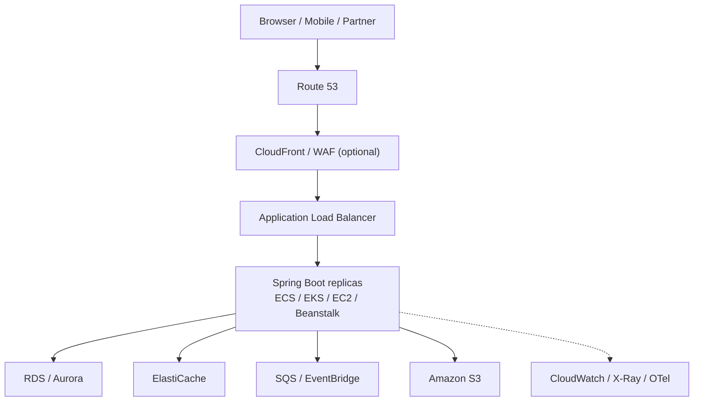
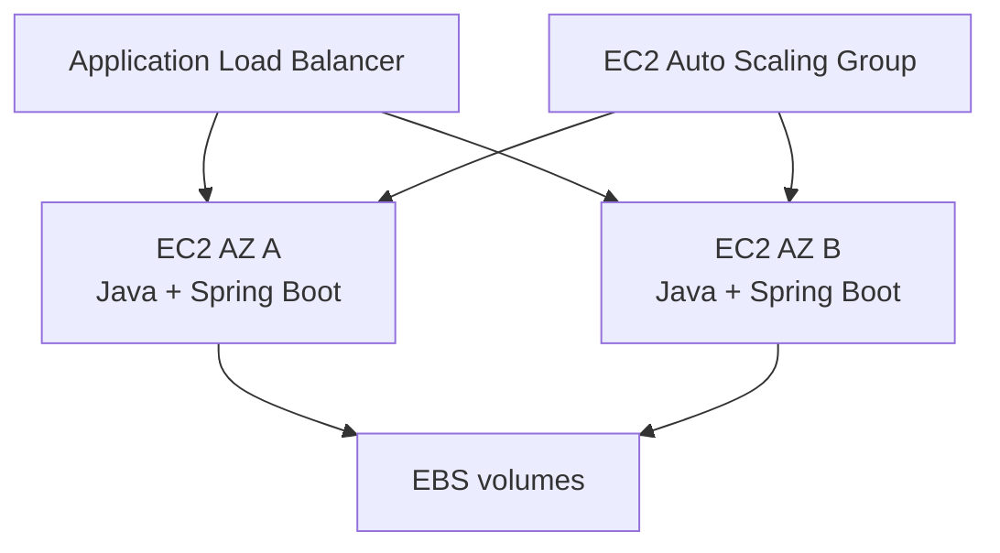
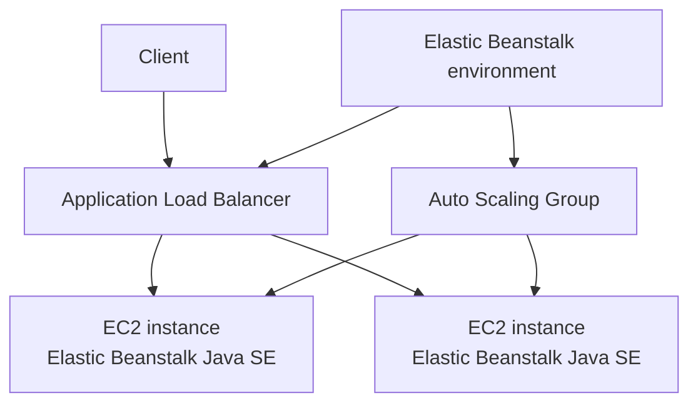
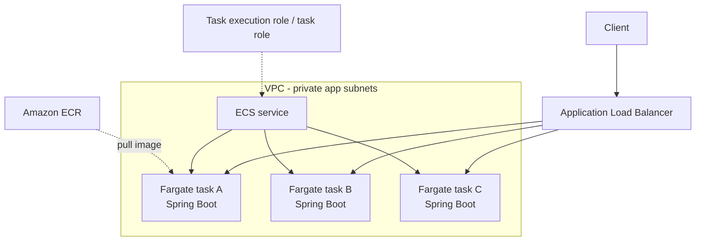
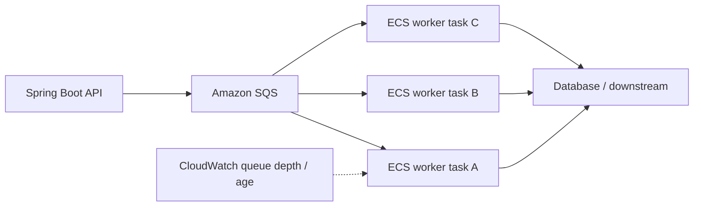
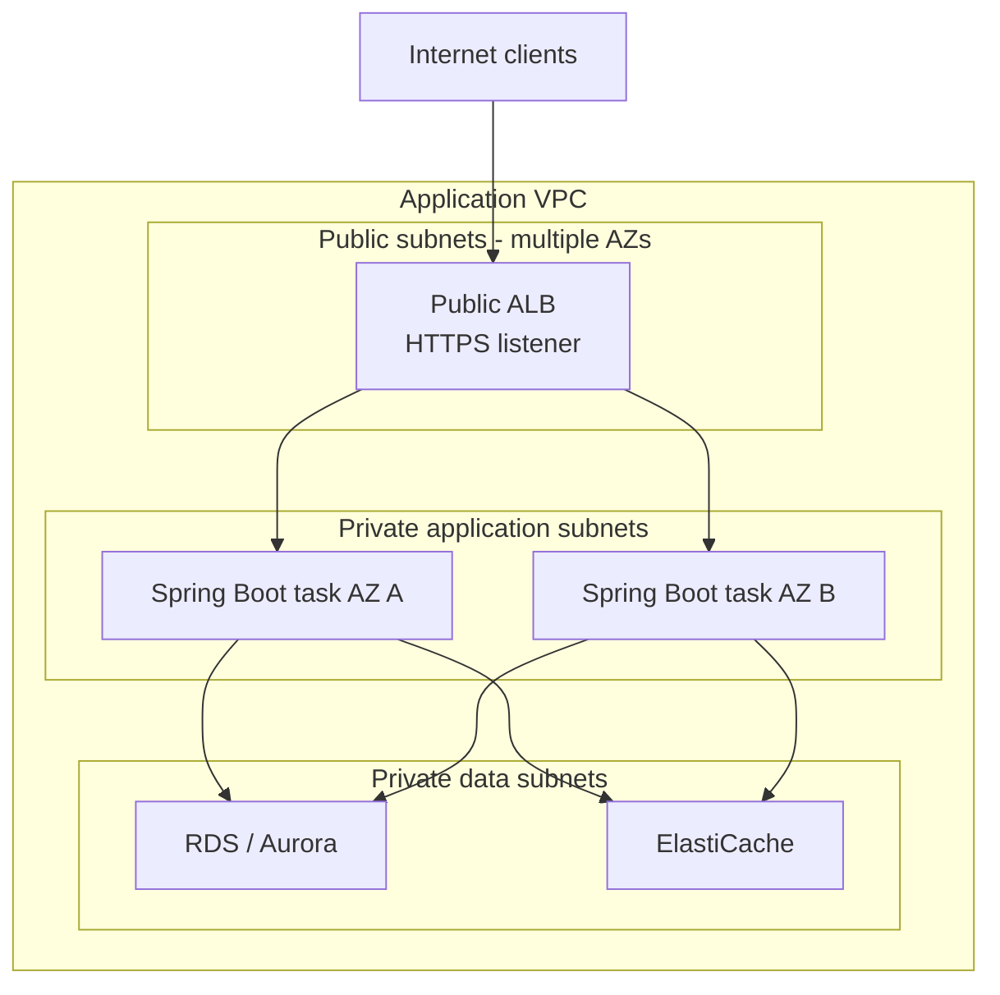
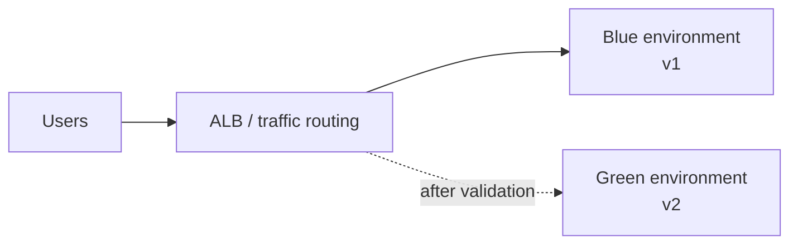
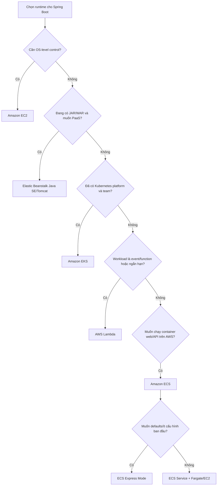

# Lựa chọn môi trường chạy Spring Boot trên AWS

> **Chương:** Ứng dụng Java và Spring Boot  
> **Module:** CLOUD_PROVIDERS_AWS  
> **Mục tiêu:** chọn môi trường compute phù hợp để triển khai ứng dụng Java/Spring Boot trên AWS; hiểu trade-off giữa quyền kiểm soát, mức độ quản lý hạ tầng, khả năng mở rộng, độ sẵn sàng, bảo mật, quy trình phát hành và tổng chi phí.
>
> **Phạm vi:** Amazon EC2, AWS Elastic Beanstalk, Amazon ECS với AWS Fargate hoặc EC2 capacity, Amazon ECS Express Mode, Amazon EKS, AWS Lambda và AWS App Runner đối với khách hàng hiện hữu. Dịch vụ, platform versions, quotas, giá và tính năng thay đổi theo Region/thời điểm; kiểm tra tài liệu AWS trước khi quyết định production.

## 1. Bài toán: một ứng dụng Spring Boot có thể chạy ở nhiều nơi

Một công ty xây dựng hệ thống quản lý đơn hàng bằng Java 21 và Spring Boot 3. Ứng dụng cung cấp REST API, xử lý thanh toán, gửi thông báo, truy cập PostgreSQL và phát sinh báo cáo nền.

Các yêu cầu:

- HTTP API chạy liên tục, p95 latency dưới 250 ms trong giờ cao điểm.
- Traffic trung bình 150 requests/giây, chiến dịch có thể lên 1.500 requests/giây.
- Cần triển khai nhiều bản sao ứng dụng ở nhiều Availability Zones.
- Không lưu session hoặc file upload trên ổ đĩa local của một instance.
- Mỗi service chỉ được truy cập đúng AWS resources mà nó cần.
- Có rolling/blue-green deployment và rollback khi health check thất bại.
- Có CloudWatch logs/metrics, tracing và cảnh báo.
- Database connections không được tăng vô hạn khi số app replicas scale out.
- Đội ngũ hiện có Java/Spring Boot experience; Kubernetes experience còn hạn chế.

Có nhiều cách đưa cùng một JAR hoặc container image lên AWS:

- Chạy trực tiếp trên **Amazon EC2**.
- Đưa JAR lên **AWS Elastic Beanstalk**.
- Đóng gói Docker và chạy trên **Amazon ECS + AWS Fargate**.
- Chạy ECS tasks trên **EC2 capacity** hoặc ECS Managed Instances.
- Chạy Kubernetes trên **Amazon EKS**.
- Dùng **Amazon ECS Express Mode** để giảm cấu hình hạ tầng cho container web/API.
- Chạy function trên **AWS Lambda** khi workload phù hợp mô hình invocation.
- **AWS App Runner** chỉ dành cho khách hàng đã có quyền sử dụng từ trước; dịch vụ đã đóng với khách hàng mới.

Không có một lựa chọn tốt nhất cho mọi Spring Boot app. Câu hỏi đúng là: **đội ngũ cần kiểm soát phần nào, workload có hình dạng ra sao, và ai sẽ vận hành những lớp hạ tầng còn lại?**

## 2. Tách ba quyết định: packaging, orchestration và compute

Các khái niệm thường bị trộn lẫn:

1. **Packaging:** ứng dụng được giao dưới dạng JAR/WAR hay container image.
2. **Orchestration/runtime:** ai quản lý vòng đời, desired count, health checks, deployment và scaling của application instances.
3. **Compute capacity:** process/container chạy trên VM do mình quản lý, EC2 do AWS quản lý theo capacity model, hay serverless compute.

Ví dụ:

```text
Spring Boot source code
        |
        v
Maven/Gradle build
        |
        +--> executable JAR
        |
        +--> Docker image
                  |
                  v
              Amazon ECR
                  |
          +-------+--------+
          |                |
          v                v
       Amazon ECS       Amazon EKS
          |                |
       Fargate / EC2    EC2 / Auto Mode /
       Express Mode     Fargate (where supported)
```

- JAR là **artifact của ứng dụng**.
- Docker image là **artifact đóng gói ứng dụng cùng runtime/dependencies**.
- ECS/EKS là **container orchestrators**.
- Fargate là **serverless compute engine cho containers**, không phải orchestrator độc lập.
- EC2 là **virtual machine compute**; có thể chạy JAR trực tiếp hoặc chạy container.
- Lambda là **event/invocation runtime**; không phải một EC2 nhỏ luôn chạy cùng Spring Boot web server.

### 2.1. Không nhất thiết phải container hóa mọi ứng dụng

Một Spring Boot executable JAR có thể chạy trên:

- EC2 với systemd/service manager.
- Elastic Beanstalk Java SE platform.
- Lambda thông qua adapter/function model phù hợp.
- Container image trên ECS/EKS.

Container hữu ích khi muốn build một artifact nhất quán giữa laptop, CI và production; muốn tách runtime/dependencies khỏi host; hoặc muốn tận dụng ECS/EKS. Tuy nhiên, container hóa kéo theo image build, registry, vulnerability scanning, task definitions/manifests và vận hành container platform.

### 2.2. Một ứng dụng web thường cần nhiều thành phần hơn compute



Compute chỉ là một lớp. Production design còn phải giải quyết database, cache, queue, object storage, DNS, load balancing, secrets, identity, logs và alerting.

## 3. Tổng quan các lựa chọn

| Môi trường | Giao artifact | Hạ tầng được quản lý | Quyền kiểm soát | Khi thường phù hợp |
|---|---|---|---|---|
| **EC2 trực tiếp** | JAR/WAR hoặc container | VM, EBS, networking ở mức AWS; OS/app do team quản lý | Cao | Legacy app, OS/custom agent, workload đặc biệt |
| **Elastic Beanstalk** | JAR/WAR hoặc container tùy platform | Provision EC2, load balancer, Auto Scaling, health reporting | Trung bình | Java web app cần PaaS tương đối đơn giản |
| **ECS + Fargate** | Container image | ECS control plane và compute host do AWS quản lý | Trung bình | Containerized APIs/workers, không muốn quản lý EC2 hosts |
| **ECS + EC2** | Container image | ECS orchestration; team quản lý EC2 capacity trừ khi dùng managed option | Trung bình–cao | Workload ổn định, cần tối ưu packing/GPU/instance customization |
| **ECS Managed Instances** | Container image | ECS quản lý EC2 instances của capacity option này | Trung bình | Muốn instance family/performance control nhưng giảm host operations |
| **ECS Express Mode** | Container image | Tự cấu hình ECS/Fargate, ALB HTTPS, autoscaling, networking và monitoring | Thấp–trung bình lúc khởi đầu; có thể customize sâu | Stateless web/API muốn deploy nhanh với production defaults |
| **EKS** | Container image + Kubernetes manifests/Helm | EKS quản lý control plane; data plane tùy Auto Mode/managed/self-managed nodes | Cao ở Kubernetes layer | Đã có Kubernetes platform/team/tooling |
| **Lambda** | ZIP/JAR hoặc container image theo Lambda runtime contract | Runtime, invocation scaling, execution environments do AWS quản lý | Thấp ở host, cao ở function code | Event-driven, bursty, short-lived request/processing |
| **App Runner** | Source code hoặc image | Managed web app service | Thấp | Chỉ account/customer đã được App Runner cho phép từ trước |

**Lưu ý quan trọng về App Runner:** AWS đã đóng App Runner đối với **khách hàng mới từ 30/04/2026**. Khách hàng hiện hữu tiếp tục dùng được và có thể tạo resources theo thông báo. Với account mới, AWS khuyến nghị **Amazon ECS Express Mode** cho trải nghiệm triển khai container web/API đơn giản tương tự.

## 4. Amazon EC2: chạy JAR trực tiếp hoặc container

### 4.1. Cách hoạt động

Bạn tạo EC2 instance, chọn AMI, instance type, VPC/subnet, security group, IAM instance profile và EBS volume. Sau đó cài Java runtime, tải JAR và chạy process bằng service manager.



Ví dụ service Linux dùng systemd:

```ini
[Unit]
Description=Spring Boot Orders API
After=network.target

[Service]
User=spring
WorkingDirectory=/opt/orders
EnvironmentFile=/etc/orders/orders.env
ExecStart=/usr/bin/java -jar /opt/orders/orders-api.jar
Restart=on-failure
RestartSec=5
SuccessExitStatus=143
TimeoutStopSec=45

[Install]
WantedBy=multi-user.target
```

Systemd giữ process chạy sau khi SSH session kết thúc, khởi động lại khi process lỗi theo policy và hỗ trợ service lifecycle.

### 4.2. Ưu điểm

- Kiểm soát OS, filesystem, JVM, native libraries và system agents.
- Dễ tích hợp phần mềm legacy cần host-level customization.
- Có thể chọn memory-optimized, compute-optimized, Graviton hoặc instance family chuyên biệt.
- Dễ hiểu với team đã có kinh nghiệm Linux/Windows server.
- Có thể dùng EC2 Auto Scaling Group, ALB, EBS và nhiều AWS services khác để tạo HA.

### 4.3. Trách nhiệm vận hành

Team phải quản lý:

- OS patching, Java updates, package vulnerabilities.
- Process supervision, startup scripts và log rotation.
- Deployment/rollback và đồng bộ artifact giữa instances.
- Scaling policy, instance replacement và capacity planning.
- EBS usage, filesystem permissions và backup nếu dữ liệu local được lưu.
- Security hardening, SSM access, IAM instance profile và host monitoring.
- Health checks, draining connections và graceful shutdown.

**EC2 không tự tạo HA chỉ vì chạy trên AWS.** Một instance đơn lẻ vẫn là single point of failure. Production thường cần ít nhất hai instances ở nhiều AZ, load balancer, Auto Scaling Group, health checks và externalized state.

### 4.4. Khi nên chọn EC2

Chọn EC2 khi:

- Ứng dụng phụ thuộc OS packages, kernel tuning, filesystem hoặc agent đặc biệt.
- Cần host-level observability/security tooling.
- Có workload rất ổn định và team tối ưu được utilization/capacity.
- Có lý do rõ ràng để tự vận hành VM lifecycle.

Nếu chỉ cần chạy một Spring Boot JAR, không cần OS customization và không muốn vận hành server, hãy so sánh Elastic Beanstalk hoặc ECS trước khi chọn EC2 trực tiếp.

## 5. AWS Elastic Beanstalk: managed platform cho Java web app

### 5.1. Mô hình

Elastic Beanstalk nhận source bundle/artifact, tạo và quản lý các AWS resources để chạy ứng dụng. Với Java, các lựa chọn platform quan trọng gồm:

- **Java SE:** chạy executable JAR của ứng dụng Java web; phù hợp Spring Boot executable JAR.
- **Tomcat:** cho WAR/Servlet/JSP deployments cần Tomcat platform.

Java SE platform có nginx reverse proxy phía trước app trong các platform tương ứng; platform versions dựa trên Amazon Linux và AWS Corretto theo tài liệu hiện hành.



### 5.2. Các environment tiers

- **Web server tier:** nhận HTTP requests từ load balancer/client.
- **Worker tier:** xử lý background tasks, thường tích hợp SQS daemon/queue pattern theo cấu hình.

Một ứng dụng Spring Boot REST API thường bắt đầu ở web server tier. Nếu workload cần background jobs độc lập, cân nhắc tách worker process/service thay vì để web request threads xử lý mọi tác vụ dài.

### 5.3. Ưu điểm và giới hạn

Ưu điểm:

- Không phải tự lắp toàn bộ EC2/ASG/ALB và deployment mechanism.
- Có environment health reporting, logs và platform updates.
- Có thể chọn single-instance cho dev hoặc load-balanced environment cho production.
- Dùng được JAR trực tiếp, không bắt buộc Docker.

Giới hạn:

- Vẫn chạy trên EC2; team cần hiểu instance type, VPC, scaling và security groups.
- Một số customization nâng cao cần `.ebextensions`, platform hooks hoặc configuration files.
- Platform branches có lifecycle; cần theo dõi deprecation/retirement và Java runtime compatibility.
- Không phải Kubernetes/container orchestration platform tổng quát.
- Thay đổi cấu hình có thể làm environment update/replacement; cần kiểm thử deployment policy và rollback.

### 5.4. Khi nên chọn Beanstalk

Beanstalk phù hợp khi:

- Có Spring Boot JAR/WAR hiện hữu và muốn PaaS tương đối đơn giản.
- Đội chưa cần Kubernetes hoặc ECS-specific capabilities.
- Muốn AWS quản lý nhiều phần provisioning/deployment nhưng vẫn dùng EC2 platform.
- Ứng dụng có mô hình web/worker rõ ràng.

Nếu tổ chức đã tiêu chuẩn hóa container images, ECS services và deployment pipelines, ECS thường tạo một mô hình nhất quán hơn cho nhiều microservices.

## 6. Amazon ECS: orchestrator AWS-native cho containers

### 6.1. ECS quản lý gì?

Amazon ECS là managed container orchestration service. Các khái niệm:

| Khái niệm | Ý nghĩa |
|---|---|
| **Cluster** | Logical grouping cho ECS services/tasks và capacity |
| **Task definition** | Blueprint mô tả image, CPU/memory, ports, IAM roles, env/secrets, logging |
| **Task** | Một lần chạy task definition; có thể chứa một hoặc nhiều containers |
| **Service** | Duy trì desired count của tasks, tích hợp load balancing/deployment/scaling |
| **Capacity provider** | Cách ECS có compute capacity, ví dụ Fargate hoặc EC2 capacity |
| **Task execution role** | Quyền ECS/Fargate cần để pull image, lấy secrets theo cơ chế hỗ trợ và ghi logs |
| **Task role** | Quyền của application code trong container gọi AWS APIs |

ECS không yêu cầu team vận hành Kubernetes control plane. Đây là lợi thế nếu team muốn AWS-native orchestration với mức vận hành thấp hơn Kubernetes.

### 6.2. Task hay Service?

- **RunTask:** chạy một task độc lập, phù hợp migration job, scheduled job, one-off task hoặc batch processing.
- **ECS Service:** duy trì số lượng tasks chạy liên tục, phù hợp Spring Boot HTTP API và long-running worker.
- **Scheduled task:** dùng EventBridge Scheduler/rules để kích hoạt ECS task theo lịch.
- **SQS worker service:** ECS service có thể scale theo queue backlog hoặc custom metric.

Một Spring Boot web API thường chạy như ECS service với ít nhất hai tasks ở các AZ khác nhau khi cần HA.

### 6.3. ECS + Fargate

Fargate cho phép chạy containers mà không phải provision/patch EC2 container instances.



Đặc điểm:

- Mỗi Fargate task có capacity isolation riêng cho CPU, memory, network interface và ephemeral storage theo mô hình Fargate.
- Task dùng network mode **awsvpc**, có Elastic Network Interface và security groups riêng.
- CPU/memory khai báo ở task level theo các combination được hỗ trợ.
- Team không quản lý host OS, Docker daemon hoặc EC2 capacity.
- Phù hợp stateless web APIs, workers và services chạy liên tục.

### 6.4. ECS + EC2 capacity

Với EC2 launch type/capacity providers:

- ECS scheduler đặt tasks lên container instances.
- Team quản lý instance fleet, AMI, patching, scale-out, draining và capacity reservation.
- Có thể tận dụng Savings Plans/Reserved Instances/Spot và bin packing.
- Có quyền chọn instance family, GPU, local NVMe, memory/network features và host agents.
- Nhiều tasks có thể share host; cần hiểu isolation, task placement và noisy neighbor.

Chọn EC2 capacity khi workload đủ ổn định/đặc thù để lợi ích chi phí và quyền kiểm soát bù phần vận hành host.

### 6.5. ECS Managed Instances

Amazon ECS Managed Instances là một capacity option cho phép AWS provision, scale, patch và duy trì EC2 instances chạy ECS tasks trong khi workload vẫn chạy trên EC2 instance families. Nó hữu ích khi cần compute options như memory-optimized, GPU hoặc Graviton nhưng muốn giảm trách nhiệm quản lý hosts.

Phân biệt:

- **Fargate:** AWS quản lý underlying compute; task không gắn với EC2 instance do bạn quản lý.
- **ECS Managed Instances:** AWS quản lý lifecycle của EC2 capacity; bạn vẫn chọn/thiết kế instance profile và capacity behavior theo mô hình hỗ trợ.
- **ECS self-managed EC2 capacity:** team sở hữu AMI, Auto Scaling/capacity providers và host maintenance.

Kiểm tra Region, capacity type, instance family và feature support trước khi chọn.

## 7. ECS Express Mode: đường đi đơn giản cho container web/API

### 7.1. Vì sao có Express Mode?

Một Spring Boot team có thể muốn container deployment nhưng không muốn tự cấu hình ban đầu nhiều resources như:

- ECS cluster/service/task definition.
- Fargate capacity.
- Application Load Balancer và HTTPS listener.
- Target groups, health checks và security groups.
- Application Auto Scaling.
- CloudWatch logging/monitoring.

**Amazon ECS Express Mode** tự cấu hình các phần này với production-oriented defaults.

### 7.2. Ba đầu vào chính

Để tạo Express Mode service, các đầu vào cốt lõi gồm:

1. **Container image** (thường nằm trên Amazon ECR hoặc private registry đã cấu hình secret).
2. **Task execution role** để ECS pull image và ghi logs/hoạt động thay mặt task.
3. **Infrastructure role** để ECS provision/manage supporting infrastructure như load balancing, security groups, certificates và autoscaling.

Application **task role** là quyền riêng của code chạy trong container khi gọi S3, DynamoDB, SQS hoặc AWS APIs; cấu hình khi ứng dụng cần.

### 7.3. Resources Express Mode tạo

Theo tài liệu AWS, Express Mode có thể tạo:

- ECS default cluster (nếu chưa tồn tại) với Fargate capacity provider.
- Task definition và ECS service.
- Application Load Balancer với HTTPS listener, listener rules và target groups.
- Auto Scaling policy.
- Networking và security configuration.
- Monitoring/logging configuration.
- URL truy cập duy nhất cho service.

Default target tracking có thể dùng CPU utilization 60%, min tasks 1 và max tasks 20; đây là **defaults có thể cấu hình**, không phải capacity/SLO mặc định phù hợp production. Đặt min tasks ít nhất đủ chịu lỗi và traffic; cân nhắc hai AZ, warm capacity và dependency limits.

### 7.4. Express Mode phù hợp khi nào?

- Spring Boot app đã đóng gói thành container image.
- Workload là stateless HTTP API/web application.
- Muốn deploy nhanh với HTTPS, ALB và autoscaling được thiết lập sẵn.
- Team cần khả năng customize sâu hơn sau khi có baseline.

Express Mode **không phải orchestrator thứ tư**; nó là một cách tạo/quản lý ECS service với defaults, underlying resources vẫn hiển thị và có thể quản lý trực tiếp qua ECS/ELB/CloudWatch/IAM APIs.

### 7.5. Pricing

Không có khoản phí riêng cho Express Mode. Bạn trả chi phí underlying resources được tạo, ví dụ Fargate compute, ALB, CloudWatch logs/metrics và data transfer. Một số Express Mode services có thể chia sẻ ALB khi dùng cùng networking configuration, giúp giảm chi phí so với tạo một ALB cho mỗi service.

### 7.6. Khi cần ECS service tùy biến sâu

Dùng ECS service/task definitions trực tiếp khi cần:

- Custom deployment strategy hoặc service discovery.
- Sidecars/volumes/task roles/networking phức tạp.
- Placement/capacity provider strategy.
- Traffic routing và ALB listener rules đặc thù.
- Fine-grained autoscaling, deployment alarms, blue/green/canary.
- Service Connect hoặc các networking integrations cụ thể.

Bắt đầu từ Express Mode không khóa bạn khỏi underlying ECS resources; nhưng cần hiểu resource ownership và thay đổi ngoài Express Mode có thể ảnh hưởng cách service được quản lý.

## 8. Amazon EKS: chạy Spring Boot trong Kubernetes

### 8.1. EKS quản lý control plane

Amazon EKS là managed Kubernetes service:

- AWS quản lý Kubernetes control plane, API server và etcd availability.
- Team triển khai Pods, Deployments, Services, Ingress/Gateway, ConfigMaps, Secrets integrations, autoscaling và observability.
- Compute/data plane có thể dùng managed node groups, self-managed nodes, Fargate (nơi hỗ trợ) hoặc **EKS Auto Mode**.
- Có thể dùng Helm, Argo CD, Flux, Kustomize, service mesh, policy controllers và ecosystem Kubernetes.

### 8.2. EKS Standard và EKS Auto Mode

| Khía cạnh | EKS Standard | EKS Auto Mode |
|---|---|---|
| Control plane | AWS quản lý | AWS quản lý |
| Compute nodes | Team chọn/quản lý managed/self-managed nodes hoặc Fargate | AWS tự động provision/manage nodes theo workload |
| OS patching/capacity | Team quản lý phần lớn với managed/self-managed nodes | AWS tự động hóa nhiều phần node lifecycle |
| Networking/storage | Team chọn/add-ons/CSI/CNI theo kiến trúc | Auto Mode quản lý nhiều thành phần compute/storage/network |
| Quyền kiểm soát | Cao | Ít host operations hơn, vẫn dùng Kubernetes APIs |
| Operational overhead | Cao hơn | Thấp hơn so với EKS Standard tự quản lý data plane |

EKS Auto Mode không loại bỏ Kubernetes complexity của Deployments, Services, namespaces, RBAC, policies, resource requests/limits và cluster lifecycle.

### 8.3. Khi nào nên chọn EKS?

Chọn EKS khi:

- Tổ chức đã có Kubernetes platform, GitOps, Helm và cluster operations.
- Cần Kubernetes APIs, portability hoặc ecosystem/tooling hiện có.
- Nhiều workloads chia sẻ cluster/platform layer.
- Có yêu cầu advanced scheduling, operators, CRDs, network policies hoặc service mesh.
- Team có năng lực vận hành Kubernetes và chịu được chi phí control plane/data plane.

**Không chọn EKS chỉ vì Spring Boot được đóng gói trong Docker.** ECS cũng chạy Docker images; EKS cần một lý do về platform/ecosystem/portability đủ mạnh để bù operational complexity.

## 9. AWS Lambda: Spring Boot theo mô hình function

### 9.1. Lambda khác web server liên tục

Lambda chạy code trong execution environment khi có invocation. AWS tạo thêm environments khi concurrency tăng và tái sử dụng environment khi có thể.

Phù hợp với:

- Event-driven processing.
- SQS/SNS/EventBridge handlers.
- File processing từ S3.
- Scheduled jobs.
- API endpoints có request/response và thời gian xử lý nằm trong giới hạn Lambda.
- Functions tách từ một Spring application thành bounded capabilities.

Không nên tự động chuyển một Spring Boot MVC monolith sang Lambda mà không xem startup, request concurrency, DB connections, payload/timeout limits, background threads và state assumptions.

### 9.2. Tích hợp Spring

Các hướng phổ biến:

- **Spring Cloud Function** để viết function-oriented code và adapter.
- **AWS Serverless Java Container** để adapter một số Java web frameworks như Spring Boot sang API Gateway/Lambda.
- Tách logic nghiệp vụ khỏi servlet container để function handler gọi lại domain/service layer.
- Dùng managed Java runtime hoặc Lambda container image theo runtime contract.

Không phải mọi Spring Boot feature (embedded server, background scheduler, WebSocket, long-lived connections) đều tự chuyển nguyên vẹn sang Lambda.

### 9.3. Java cold starts và SnapStart

Lambda SnapStart hỗ trợ Java 11 trở lên theo runtime/deployment support hiện hành:

- Lambda khởi tạo function khi publish version và tạo snapshot execution environment.
- Invocation mới có thể resume từ snapshot để giảm initialization latency.
- SnapStart chỉ áp dụng cho **published versions** và aliases trỏ đến version, không áp dụng cho `$LATEST`.
- SnapStart không dùng chung với Provisioned Concurrency.
- Với state cần uniqueness (random seeds, UUIDs, sockets, temporary credentials, connection pools), cần xử lý snapshot/restore hooks và refresh state phù hợp.
- Không giả định SnapStart loại bỏ mọi cold-start/latency; đo p95/p99 thực tế.

Nếu latency requirement rất chặt, Provisioned Concurrency có thể giữ environments sẵn sàng nhưng có chi phí capacity provisioned.

### 9.4. Khi nên chọn Lambda

- Workload event-driven, bursty hoặc request duration ngắn.
- Traffic có thể về gần zero trong thời gian dài.
- Không cần giữ process/thread/background server liên tục.
- Có thể thiết kế stateless handler và connection lifecycle phù hợp.
- Tách được function responsibilities và có thể quan sát retries/idempotency.

Nếu ứng dụng cần long-lived HTTP server, nhiều WebSocket connections, streaming hoặc process luôn hoạt động, ECS/EC2/EKS thường phù hợp hơn.

## 10. AWS App Runner: lưu ý trạng thái dành cho khách hàng hiện hữu

App Runner từng là một managed service đơn giản để deploy source code/container image thành web app/API mà không phải tự cấu hình ECS/ALB.

Tuy nhiên, AWS đã thông báo:

- **App Runner đóng với khách hàng mới từ 30/04/2026.**
- Khách hàng hiện hữu có thể tiếp tục sử dụng service và tạo resources theo thông báo.
- AWS không có kế hoạch phát triển feature mới cho App Runner.
- AWS khuyến nghị khách hàng mới dùng **Amazon ECS Express Mode** để có trải nghiệm đơn giản tương tự với ECS/Fargate, ALB, HTTPS, autoscaling và networking.

Do đó:

- Nếu account/tổ chức đã có quyền sử dụng App Runner từ trước, có thể tiếp tục vận hành hoặc lập kế hoạch migration.
- Nếu bắt đầu dự án mới/account mới, không lấy App Runner làm default choice.
- Khi migration từ App Runner, inventory environment variables, secrets, health checks, scaling config, VPC connectors, custom domains, certificates, observability và deployment pipeline trước khi chuyển ECS Express Mode/ECS.

## 11. So sánh ECS và EKS: quyết định ở cấp platform

| Tiêu chí | Amazon ECS | Amazon EKS |
|---|---|---|
| API orchestration | ECS task/service APIs | Kubernetes APIs |
| Operational model | AWS-native, ít lớp platform hơn | Kubernetes ecosystem |
| Control plane | AWS quản lý, không phải vận hành Kubernetes control plane | AWS quản lý Kubernetes control plane |
| Data plane | Fargate, EC2, ECS Managed Instances | Auto Mode, managed/self-managed nodes, Fargate nơi hỗ trợ |
| Workload definition | Task definitions, services | Pods, Deployments, StatefulSets, Services |
| Scaling | ECS Service Auto Scaling, capacity providers | HPA/VPA (tooling), Cluster Autoscaler/Karpenter/Auto Mode |
| Deployment | Rolling, blue/green, linear, canary tùy strategy/controller | Rolling updates, rollout controllers và ecosystem |
| Service networking | awsvpc, Service Connect, Cloud Map, ALB/NLB | VPC CNI, Services, Ingress/Gateway, add-ons |
| Team skills | AWS ECS operations | Kubernetes operations |
| Portability | AWS-centric | Kubernetes APIs portable hơn, vẫn có AWS integrations |
| Chi phí | Underlying Fargate/EC2/ALB/logs/network | EKS cluster fee + compute + networking/storage/add-ons/logs |

**ECS thường là lựa chọn đơn giản hơn cho ứng dụng Spring Boot AWS-native. EKS thường đáng giá khi tổ chức thực sự cần Kubernetes platform.** Cả hai đều có thể chạy cùng container image; khác biệt lớn nhất là operational model và ecosystem.

## 12. Quyết định theo workload: web API, worker, batch hay event function?

| Workload | Lựa chọn thường đáng đánh giá đầu tiên | Vì sao |
|---|---|---|
| Spring Boot REST API stateless, chạy liên tục | ECS Fargate hoặc ECS Express Mode | Container lifecycle, ALB, autoscaling |
| Java monolith JAR, muốn PaaS ít thay đổi | Elastic Beanstalk Java SE | Có thể deploy executable JAR trực tiếp |
| Legacy app cần host customization | EC2 | Kiểm soát OS/JVM/filesystem |
| Nhiều services, Kubernetes platform sẵn có | EKS | Dùng platform/API/tooling chung |
| SQS background worker chạy liên tục | ECS service | Scale theo queue backlog và giữ worker process |
| Batch job chạy theo lịch, thời gian hữu hạn | ECS RunTask/Batch hoặc Lambda tùy duration | Không cần web server luôn chạy |
| Event processing ngắn, bursty | Lambda | Invocation-based scaling |
| Web/API container cần deploy nhanh với defaults | ECS Express Mode | Provision ECS/Fargate + HTTPS + scaling |
| App Runner hiện hữu | Tiếp tục có kế hoạch hoặc migrate ECS | App Runner đã đóng cho khách hàng mới |

### 12.1. Stateless API

Một REST API nên:

- Không giữ session trong memory local của task.
- Đưa session/distributed state vào ElastiCache/DynamoDB hoặc cơ chế phù hợp.
- Lưu file upload trên S3, không lưu ở container filesystem.
- Dùng RDS/Aurora/DynamoDB làm source of truth.
- Dùng external secrets/config.
- Có health checks và graceful shutdown.
- Có ít nhất hai tasks/instances ở nhiều AZ nếu cần HA.

### 12.2. Background worker

Một worker xử lý SQS không cần ALB. Có thể dùng ECS service với desired count và scaling dựa trên queue backlog:



Chú ý visibility timeout, idempotency, retry policy, DLQ, concurrency và downstream rate limits. Không scale worker chỉ theo CPU nếu queue backlog mới là chỉ số thể hiện công việc còn tồn.

### 12.3. Scheduled job

Một Spring Boot batch task có thể chạy như ECS RunTask do EventBridge Scheduler gọi, hoặc AWS Batch nếu cần job queue/compute scheduling chuyên biệt. Tránh chạy cùng scheduled job trên mọi web replicas mà không có distributed lock/leader election, vì scale out có thể làm job chạy lặp.

### 12.4. Lambda và long-running work

Lambda có giới hạn execution duration (tối đa 15 phút cho invocation thông thường) và execution environments không phải process daemon được đảm bảo sống liên tục. Nếu công việc vượt thời gian/CPU/memory phù hợp, cân nhắc ECS task, AWS Batch hoặc Step Functions orchestration.
## 13. Container image cho Spring Boot

### 13.1. Multi-stage Dockerfile

Một container image nên chứa đúng runtime và application artifact cần thiết, chạy bằng non-root user, và không mang theo build tool không cần thiết.

```dockerfile
# Stage 1: build application
FROM maven:3.9-eclipse-temurin-21 AS build
WORKDIR /workspace
COPY pom.xml .
COPY src ./src
RUN mvn -B -DskipTests package

# Stage 2: runtime
FROM eclipse-temurin:21-jre
WORKDIR /app
RUN useradd --system --uid 10001 spring
COPY --from=build /workspace/target/orders-api.jar /app/app.jar
USER 10001
EXPOSE 8080
ENTRYPOINT ["java", "-jar", "/app/app.jar"]
```

Đây là mẫu tối giản; production build nên pin base image bằng digest, bật dependency/image scanning, tạo SBOM và không dùng tag latest. Có thể build artifact ở CI rồi copy JAR vào runtime image để không cần Maven stage trong production pipeline.

### 13.2. Vì sao dùng exec form cho ENTRYPOINT?

Dạng:

```dockerfile
ENTRYPOINT ["java", "-jar", "/app/app.jar"]
```

chạy Java process trực tiếp làm PID 1 trong container. Dạng shell form có thể thêm shell parent, làm tín hiệu SIGTERM không tới process như mong đợi nếu không dùng exec. ECS/EKS cần process nhận SIGTERM để shutdown graceful.

### 13.3. Container memory và JVM

Container có CPU/memory limit. JVM hiện đại nhận biết container limits, nhưng vẫn cần cấu hình và đo:

- Cờ JVM **-XX:MaxRAMPercentage** giới hạn heap theo memory mà JVM nhìn thấy.
- Tổng container memory còn cần Metaspace, thread stacks, direct buffers, code cache, native libraries và agent overhead.
- Không đặt Xmx bằng 100% container memory.
- Đo heap, non-heap, GC pause, allocation rate, thread count và RSS.
- Khi ECS task/EKS pod bị OOMKilled, xem container exit reason và memory metrics; không kết luận ngay database có vấn đề.

Ví dụ cấu hình JVM:

```text
JAVA_TOOL_OPTIONS:
  -XX:MaxRAMPercentage=65
  -XX:+ExitOnOutOfMemoryError
```

Mức 65% chỉ là điểm bắt đầu minh họa, không phải tỷ lệ chuẩn. Với app dùng nhiều direct buffers, TLS, Netty hoặc agents, cần benchmark và để headroom lớn hơn.

### 13.4. Không lưu dữ liệu bền vững trong container filesystem

Fargate task/container có ephemeral storage; EC2/EKS nodes có local disks nhưng task/pod có thể bị thay thế bất cứ lúc nào. Không dùng local disk làm nơi duy nhất lưu:

- User uploads.
- Session state.
- Payment/order records.
- Files cần dùng chung giữa replicas.
- Job progress hoặc idempotency records.

Dùng S3, EFS khi phù hợp, RDS/Aurora, DynamoDB, ElastiCache hoặc queue/event store tùy semantics. Container filesystem chỉ nên chứa dữ liệu tạm có thể tái tạo.

## 14. Health checks, readiness và graceful shutdown

### 14.1. Ba loại health signals khác nhau

| Check | Câu hỏi | Ví dụ |
|---|---|---|
| **Liveness** | Process có còn hoạt động và cần restart không? | JVM deadlock, application không thể phục hồi |
| **Readiness** | Instance có sẵn sàng nhận traffic không? | App khởi tạo xong, dependency cần thiết sẵn sàng |
| **Load balancer health check** | ALB có nên gửi request tới target này không? | HTTP /actuator/health/readiness trả 200 |

Không đưa mọi dependency vào liveness check. Nếu database tạm mất kết nối, liveness fail có thể làm orchestrator restart toàn bộ replicas cùng lúc và tạo thêm connection storm. Readiness có thể phản ánh khả năng nhận traffic theo policy; liveness nên tập trung vào trạng thái process.

### 14.2. Spring Boot Actuator

Thêm Actuator dependency và cấu hình health groups theo Spring Boot version. Ví dụ:

```yaml
management:
  endpoints:
    web:
      exposure:
        include: health,info,prometheus
  endpoint:
    health:
      probes:
        enabled: true
      show-details: never
  health:
    livenessstate:
      enabled: true
    readinessstate:
      enabled: true
```

Các endpoint có thể là:

- /actuator/health/liveness
- /actuator/health/readiness
- /actuator/prometheus nếu cấu hình Micrometer Prometheus registry.

Không expose mọi Actuator endpoint công khai. Chỉ mở endpoint cần thiết trong internal network hoặc management interface; bảo vệ thông tin chi tiết và các endpoints có khả năng thay đổi runtime.

### 14.3. Graceful shutdown

Khi ECS/EKS/EC2 deployment dừng task/instance:

1. Load balancer ngừng gửi request mới tới target đang draining.
2. Orchestrator gửi SIGTERM tới container/process.
3. Spring Boot ngừng nhận request mới và chờ requests đang xử lý hoàn tất trong shutdown timeout.
4. Connection pools, message listeners và executors đóng đúng thứ tự.
5. Process kết thúc trước khi grace period hết.

Ví dụ Spring Boot:

```yaml
server:
  shutdown: graceful

spring:
  lifecycle:
    timeout-per-shutdown-phase: 25s
```

Cần phối hợp:

- ECS container stop timeout.
- ALB deregistration delay và target group health checks.
- EKS terminationGracePeriodSeconds, readiness probe và preStop nếu cần.
- systemd TimeoutStopSec.
- Lambda không dùng cùng lifecycle của process server dài hạn.

Timeout ở orchestrator phải đủ lớn cho thời gian shutdown app, nhưng không nên quá dài làm rollout treo. Kiểm thử request đang chạy khi deploy/failover, không chỉ thử app startup.

### 14.4. Health checks không thay load test

Một endpoint trả 200 không chứng minh app có đủ capacity. Health checks chỉ báo trạng thái cơ bản; load test phải đo p95/p99, error rate, saturation, DB connection usage, queue backlog và scale-out behavior.

## 15. Networking và load balancing

### 15.1. Public ingress, private application tasks

Một web/API service thường đặt ALB ở public subnets và app tasks/instances ở private subnets:



- ALB security group cho phép inbound HTTPS từ client sources cần thiết.
- App security group chỉ cho phép inbound từ ALB security group trên application port.
- Database/cache security groups chỉ cho phép từ application security group trên DB/cache ports.
- Không gán public IP cho app tasks nếu không cần.
- Nếu tasks cần outbound Internet, cân nhắc NAT Gateway cost hoặc VPC endpoints cho AWS services.
- Dùng ACM để quản lý TLS certificate cho ALB; app thường nhận traffic nội bộ qua target group protocol đã chọn.

### 15.2. Health check và target draining

ALB target group health check phải trỏ đúng path/port. Khi deploy:

- Task mới cần đủ thời gian startup trước khi được đánh healthy.
- Task cũ cần deregistration delay để request đang xử lý kết thúc.
- Spring Boot readiness phải phản ánh khả năng nhận traffic.
- Health check interval, timeout, healthy/unhealthy thresholds phải phù hợp thời gian startup.
- Không để target health check phụ thuộc một downstream chập chờn theo cách khiến toàn bộ service bị đánh unhealthy.

### 15.3. Service-to-service communication

- ECS có thể dùng Cloud Map hoặc Service Connect cho service discovery/communication.
- EKS dùng Kubernetes Services/DNS, Ingress/Gateway và network policies.
- EC2/Beanstalk có thể dùng private DNS, Cloud Map hoặc internal ALB.
- Không hard-code private IP của task/instance vì autoscaling và deployments thay đổi địa chỉ.
- Dùng TLS/mTLS ở application layer nếu yêu cầu trust boundary cần thiết; không mặc định service trong cùng VPC là đáng tin cậy.

## 16. IAM, secrets và configuration

### 16.1. ECS execution role khác task role

| Role | Ai sử dụng? | Ví dụ quyền |
|---|---|---|
| **Task execution role** | ECS/Fargate agent thay mặt task | Pull ECR image, ghi CloudWatch Logs, lấy secret được khai báo trong task definition |
| **Task role** | Application code trong container | Đọc S3 bucket cụ thể, gửi SQS message, đọc DynamoDB table |

Không cấp quyền ứng dụng vào execution role theo thói quen. Nếu Spring Boot code gọi S3, quyền s3:GetObject nên nằm trên task role, không phải task execution role.

### 16.2. EC2 instance profile và EKS workload identity

- EC2 app dùng IAM instance profile; không tải access key dài hạn xuống filesystem.
- ECS task dùng task role với credentials tạm thời.
- EKS dùng EKS Pod Identity hoặc IAM Roles for Service Accounts (IRSA) tùy mô hình; không để mọi pods dùng chung node instance role rộng quyền.
- Lambda dùng execution role riêng cho function.
- Beanstalk instance profile và service role có vai trò khác nhau; không gán quyền application rộng vào service role chỉ vì dễ cấu hình.

### 16.3. Secrets Manager và Parameter Store

Dùng AWS Secrets Manager cho database passwords, API credentials và secret rotation. Dùng Systems Manager Parameter Store cho cấu hình/secure string theo nhu cầu.

- Không commit secrets vào Git hoặc Docker image layers.
- Không đưa secret vào command-line arguments có thể lộ qua process inspection/logs.
- Hạn chế IAM GetSecretValue tới đúng secret ARN.
- Bật KMS encryption theo policy.
- Log secret metadata/version khi cần audit, không log secret value.
- Xác định secret refresh behavior của ứng dụng và deployment platform.

Một secret được inject thành environment variable lúc task start thường **không tự cập nhật trong process đang chạy** khi secret rotate. Có thể cần refresh qua SDK/cache hoặc replace tasks theo rollout.

### 16.4. Externalized configuration

Cấu hình theo môi trường:

```yaml
spring:
  datasource:
    url: ${DB_URL}
    username: ${DB_USERNAME}
    password: ${DB_PASSWORD}
    hikari:
      maximum-pool-size: 12
      connection-timeout: 2000

server:
  port: 8080
```

Ví dụ này minh họa placeholder Spring; trong production, các values được cấp qua platform config/secret integration. Không lưu password thật trong file YAML, Docker image hoặc source control.

## 17. Database connections và scaling

### 17.1. Scale app có thể làm DB quá tải

Giả sử ECS service chạy 40 tasks và mỗi task có HikariCP maximum pool size 15:

\[
40 \times 15 = 600 \text{ connections}
\]

Khi autoscaling tăng lên 80 tasks, mức tối đa lý thuyết có thể thành 1.200 connections. Nếu database chỉ chịu được vài trăm connections, scale app có thể làm DB nghẽn dù CPU app còn thấp.

### 17.2. Tính pool size theo toàn hệ thống

- Xác định DB max connections và headroom cho admin, migration, monitoring, jobs.
- Chia connection budget cho từng service và từng replica.
- Giới hạn task/pod maximum count để bảo vệ DB.
- Không đặt HikariCP pool size quá lớn nếu mỗi request chỉ giữ connection trong thời gian ngắn.
- Dùng RDS Proxy khi phù hợp để pool/multiplex connections và giảm connection storm.
- Theo dõi active/idle/pending connections, connection acquisition latency và DB CPU/memory.

### 17.3. Scale theo bottleneck thật

Nếu API p95 tăng vì DB connection acquisition hoặc slow SQL, thêm app replicas có thể làm tình hình tệ hơn. Autoscaling signals nên kết hợp:

- CPU/memory utilization của app.
- ALB RequestCountPerTarget.
- Request latency/error rate.
- Queue backlog/age cho workers.
- DB connection count/CPU/latency.
- Downstream rate limits.

**Autoscaling không tạo thêm capacity cho dependency đã bão hòa.** Cần đặt concurrency limits và backpressure để bảo vệ database/payment provider.

## 18. Autoscaling: mỗi môi trường có cơ chế riêng

| Môi trường | Scaling mechanism | Signals thường dùng |
|---|---|---|
| EC2 | Auto Scaling Group | CPU, ALB requests, custom CloudWatch metrics |
| Beanstalk | Environment Auto Scaling | CPU, request count, custom metrics |
| ECS | Service Auto Scaling / capacity providers | CPU, memory, ALB request count, custom metric |
| ECS Express Mode | Express service autoscaling settings | CPU/target tracking và các tùy chọn được expose |
| EKS | HPA, KEDA, node autoscaling/Auto Mode | CPU/memory, custom metrics, queue backlog |
| Lambda | Concurrency scaling, reserved/provisioned concurrency | Invocation rate, concurrency, duration, throttles |

### 18.1. ECS service autoscaling

Một service có:

- Minimum tasks: 2.
- Desired tasks: 2.
- Maximum tasks: 20.
- Target CPU utilization: 60%.

Đây chỉ là ví dụ. Cần load test để xác định CPU target, scale-out cooldown, scale-in cooldown, task startup time và minimum warm capacity.

### 18.2. EKS HPA

HPA có thể tăng replicas theo CPU/memory requests hoặc custom metrics. Nếu dùng CPU utilization percentage, phải đặt resources.requests.cpu hợp lý; thiếu requests khiến scaling calculation không đáng tin cậy. Pod replicas tăng cần cluster capacity; node autoscaler/Auto Mode phải có khả năng cung cấp compute.

EKS Fargate phù hợp một số pod workloads nhưng có constraints: không dùng DaemonSets/privileged containers và không phải lựa chọn cho mọi Kubernetes add-on/host-level agent. Xác minh workload compatibility trước.

### 18.3. Lambda concurrency

Lambda scale theo invocation concurrency nhưng có thể bị throttled bởi account/function concurrency limits. Dùng reserved concurrency để bảo vệ downstream systems; dùng Provisioned Concurrency khi cần giảm cold-start latency và chấp nhận chi phí.

### 18.4. Scale-to-zero có trade-off

- ECS service thường cần ít nhất một task nếu muốn API luôn sẵn sàng.
- Lambda có thể không tính compute khi không có invocation, nhưng cold start và concurrency behavior cần đo.
- Scale-to-zero container platforms có thể giảm compute cost nhưng request đầu có startup delay và dependency warm-up.
- Database, ALB, logs, NAT, cache và storage có thể vẫn tính phí khi app scale về zero.

## 19. Deployment strategies và rollback

### 19.1. Rolling deployment

Thay từng phần replicas bằng version mới:

- Đơn giản và tiết kiệm capacity hơn blue/green.
- Có thể chạy đồng thời hai app versions trong thời gian rollout.
- Cần schema changes backward-compatible.
- Rollback nhanh nếu old image/task definition còn sẵn và database schema vẫn tương thích.

### 19.2. Blue/green deployment

Chạy môi trường/version mới song song với version cũ, test rồi chuyển traffic:



Lợi ích:

- Có thể kiểm thử version mới trước khi chuyển traffic.
- Rollback traffic nhanh nếu phát hiện lỗi.
- Có thể dùng CodeDeploy/ECS blue-green hoặc cơ chế routing tương ứng.

Đánh đổi:

- Cần capacity song song trong giai đoạn rollout.
- Database schema và message contracts phải tương thích giữa hai versions.
- Background workers có thể xử lý cùng một message; cần idempotency.
- Chuyển traffic không tự rollback các side effects đã ghi vào DB.

### 19.3. Cơ chế theo platform

| Platform | Deployment/rollback |
|---|---|
| EC2 | CodeDeploy, ASG Instance Refresh, immutable AMI hoặc blue/green ASGs |
| Elastic Beanstalk | All at once, rolling, rolling with additional batch, immutable, traffic splitting/blue-green tùy platform |
| ECS | Rolling deployment, deployment circuit breaker, CloudWatch alarms; blue/green/linear/canary theo controller/strategy support |
| EKS | Kubernetes rolling updates, Helm/GitOps, Argo Rollouts/Flagger cho canary/blue-green |
| Lambda | Published versions, aliases, weighted routing và CodeDeploy traffic shifting |

### 19.4. ECS deployment circuit breaker

ECS deployment circuit breaker có thể đánh giá deployment không đạt trạng thái ổn định và rollback về deployment trước đó khi có cấu hình phù hợp. Kết hợp CloudWatch alarms để rollback khi metric vượt ngưỡng. Không dựa duy nhất vào container process start: app có thể start thành công nhưng trả 500 hoặc không kết nối được database.

### 19.5. Database migrations: expand and contract

Nếu version v1 chỉ biết column cũ và v2 yêu cầu column mới:

1. Thêm column/index theo cách tương thích v1.
2. Deploy code đọc được cả old/new format.
3. Backfill dữ liệu.
4. Chuyển writes/reads sang schema mới.
5. Chờ old replicas/jobs không còn chạy.
6. Xóa schema cũ ở release sau.

Không drop/rename column ngay trong cùng deployment khi blue/green còn version cũ đang phục vụ traffic.

## 20. Observability cho Spring Boot trên AWS

### 20.1. Ba lớp telemetry

- **Logs:** sự kiện, lỗi, request context, business identifiers đã được mask.
- **Metrics:** throughput, latency, errors, saturation, JVM, pool usage và queue backlog.
- **Traces:** đường đi của request qua API, cache, database, queue và downstream services.

### 20.2. Spring Boot Actuator và Micrometer

Actuator cung cấp health/info/metrics endpoints. Micrometer hỗ trợ xuất metrics tới CloudWatch, Prometheus hoặc OpenTelemetry pipeline theo cấu hình.

Theo dõi tối thiểu:

| Nhóm | Metrics gợi ý |
|---|---|
| HTTP | request rate, p50/p95/p99 latency, 4xx/5xx |
| JVM | heap/non-heap, GC pause, allocation, thread count |
| Database | active/idle/pending connections, acquisition time, query latency |
| Cache | hits/misses, command latency, connection errors |
| Messaging | queue depth, oldest message age, processing time, retry/DLQ |
| Container | CPU, memory, restart count, OOMKilled |
| Platform | desired/running task count, deployment failures, target health |
| Business | orders accepted, payments failed, checkout conversion |

Không dùng customer ID/order ID làm metric dimensions có cardinality rất cao. Dùng structured logs/traces với access control phù hợp để tra cứu request cụ thể.

### 20.3. CloudWatch logs

- ECS: awslogs driver hoặc FireLens để gửi stdout/stderr.
- EC2/Beanstalk: CloudWatch agent/platform log streaming.
- EKS: Fluent Bit/CloudWatch Observability add-on hoặc OTel pipeline.
- Lambda: function logs tự động vào CloudWatch Logs theo execution role/configuration.

Dùng JSON structured logs có timestamp, level, service, environment, traceId và requestId. Redact Authorization headers, passwords, access tokens, payment data và PII.

### 20.4. Distributed tracing

AWS X-Ray hoặc OpenTelemetry giúp theo dõi latency xuyên service boundaries. Instrument:

- HTTP server/client.
- JDBC/database calls.
- AWS SDK clients.
- Messaging producers/consumers.
- Cache client nếu instrumentation hỗ trợ.

Traces cần sampling phù hợp để không tạo chi phí hoặc lưu quá nhiều dữ liệu nhạy cảm. Tránh ghi raw SQL parameters, session tokens hoặc request payload chứa PII.

### 20.5. Alarm theo SLO

Một service production nên có alarms cho:

- p95/p99 latency vượt SLO.
- 5xx/error rate tăng.
- Running tasks/pods thấp hơn desired count.
- ALB targets unhealthy.
- ECS/EKS deployment rollback.
- JVM/container memory gần limit, OOMKilled/restarts.
- DB connections gần budget.
- Queue age/backlog tăng.
- Lambda throttles/errors/duration.
- Dependency failures.

Đặt alarm theo baseline và SLO; một CPU spike ngắn không nhất thiết là incident nếu latency/error vẫn trong giới hạn.

## 21. Bảo mật ứng dụng và supply chain

### 21.1. Image security

- Build image trong CI từ base image được duy trì.
- Pin version/digest thay vì dùng tag thay đổi.
- Scan image và dependency vulnerabilities.
- Tạo SBOM và ký image nếu supply chain policy yêu cầu.
- Chạy non-root, read-only root filesystem nếu app hỗ trợ.
- Giới hạn Linux capabilities và không chạy privileged container.
- Không bake secrets vào image layers.

### 21.2. Network và IAM least privilege

- ALB public, app tasks/private nodes private theo kiến trúc.
- Security groups chỉ mở port giữa các lớp cần thiết.
- Task/pod/function dùng IAM identity riêng.
- Tách deployment role khỏi runtime role.
- Dùng SSM Session Manager thay SSH public khi quản trị EC2.
- Mã hóa EBS, RDS, S3 và secrets theo data classification.
- Dùng TLS cho database/cache/API connections.

### 21.3. Runtime protection

- Patch Java runtime và OS/base image.
- Hạn chế Actuator endpoints và management ports.
- Dùng WAF/rate limiting khi API public cần.
- Cấu hình request size, timeout, thread pool và connection limits.
- Không tin forwarded headers từ mọi nguồn; chỉ tin proxy/load balancer được kiểm soát.
- Có audit logs cho IAM/control-plane changes và ứng dụng.

## 22. Chi phí: nhìn toàn bộ service, không chỉ giá compute

| Môi trường | Thành phần chi phí thường gặp |
|---|---|
| EC2 | Instance-hours, EBS, snapshots, ALB, data transfer, NAT, CloudWatch, licenses |
| Elastic Beanstalk | Underlying EC2, ALB, EBS, Auto Scaling, logs, data transfer; Beanstalk không thay thế bill tài nguyên |
| ECS Fargate | vCPU/memory task duration, ephemeral storage vượt mức miễn phí nếu có, ALB, logs, data transfer, NAT |
| ECS EC2 | EC2 instances/EBS, capacity headroom, ALB, logs, data transfer; thêm chi phí vận hành hosts |
| ECS Managed Instances | Managed EC2 capacity và resources đi kèm theo pricing option |
| ECS Express Mode | Không có phí Express Mode riêng; trả underlying Fargate, ALB, logs, networking và transfer |
| EKS | EKS cluster fee, EC2/Fargate/Auto Mode compute, EBS/EFS, load balancers, networking, logs/add-ons |
| Lambda | Requests, duration, memory/architecture, provisioned concurrency nếu dùng, logs, data transfer |
| App Runner | Chỉ account hiện hữu; tính underlying service resources theo pricing của App Runner |

### 22.1. Chi phí ẩn

- NAT Gateway cho private tasks tải dependencies hoặc gọi public endpoints.
- ALB cho mỗi service nếu không chia sẻ hợp lý.
- CloudWatch logs retention và high-volume debug logs.
- Cross-AZ data transfer và cross-Region traffic.
- Idle minimum capacity để giữ latency/HA.
- Database/cache tăng theo app autoscaling.
- ECR storage, image scanning và artifact retention.
- EKS add-ons, control plane và platform engineering effort.

### 22.2. Ví dụ capacity cost reasoning

Giả sử một service cần 4 replicas, mỗi replica 1 vCPU và 2 GiB memory, chạy liên tục:

- ECS Fargate tính theo vCPU/memory task duration.
- ECS on EC2 tính theo instance capacity; nếu host còn nhiều headroom, chi phí marginal của task có thể thấp hơn, nhưng team trả cả instance fleet và vận hành.
- EKS thêm cluster fee và các add-ons/compute/networking.
- Lambda tính theo requests và execution duration, nhưng cần quy đổi concurrency, cold starts, retries và DB connections.

Không so sánh bằng một con số “giá mỗi vCPU” duy nhất. So sánh cùng workload, peak capacity, HA topology, idle hours, data transfer, logging, licenses và vận hành.

### 22.3. Tối ưu chi phí có kiểm soát

- Dùng Graviton nếu Java dependencies/native libraries tương thích và benchmark đạt yêu cầu.
- Dùng Savings Plans/Reserved Instances cho baseline ổn định; Spot cho workload có thể retry/interrupt.
- Scale down ngoài giờ cho non-production.
- Giảm log retention và sampling có chủ đích.
- Dùng Fargate cho workload biến động; EC2 capacity khi utilization ổn định và team tối ưu được packing.
- Giới hạn autoscaling max để bảo vệ DB và ngân sách.
- Tính NAT/ALB/network costs trước khi tách quá nhiều services.

## 23. Ma trận quyết định cho Spring Boot

### 23.1. Decision tree



### 23.2. Bảng gợi ý

| Nếu ưu tiên... | Bắt đầu đánh giá... | Vì sao |
|---|---|---|
| Host customization | EC2 | Toàn quyền OS/JVM/process |
| Deploy JAR nhanh, ít đổi code | Elastic Beanstalk | Managed Java platform |
| Container web/API, không quản lý hosts | ECS Fargate | AWS-native container orchestration |
| Container web/API với defaults | ECS Express Mode | Tự tạo supporting infrastructure |
| EC2 capacity control, GPU hoặc bin packing | ECS EC2 / Managed Instances | Tối ưu instance family/capacity |
| Kubernetes ecosystem | EKS | Kubernetes APIs/operators/GitOps |
| Event-driven, scale theo invocation | Lambda | Không cần server liên tục |
| App Runner account hiện hữu | App Runner hoặc migration | Service không nhận khách hàng mới |

### 23.3. Đánh giá theo câu hỏi

Trước khi chốt, trả lời:

1. App cần chạy liên tục hay chỉ xử lý events?
2. Có cần OS-level packages, native libraries hoặc filesystem đặc biệt?
3. Đội có kinh nghiệm Kubernetes và chịu trách nhiệm cluster platform không?
4. JAR hiện tại có thể đóng gói thành container image không?
5. Cần ALB/HTTPS/service discovery hay API Gateway/event triggers?
6. Traffic pattern ổn định hay bursty?
7. p95/p99 startup/latency budget là bao nhiêu?
8. App có state local/session/background threads không?
9. DB/cache connection budget là bao nhiêu khi scale tối đa?
10. Cần rolling, blue/green, canary hay weighted traffic shifting?
11. Runtime role cần gọi AWS services nào?
12. Tổng chi phí gồm compute, network, logs, database và vận hành là bao nhiêu?
## 24. Cấu hình Spring Boot cho môi trường cloud

### 24.1. Port và binding

Trong container hoặc EC2, ứng dụng cần lắng nghe trên interface phù hợp, không chỉ loopback. Spring Boot mặc định thường dùng port 8080; có thể cấu hình:

```yaml
server:
  port: 8080
  address: 0.0.0.0
```

Nếu ứng dụng chỉ bind vào 127.0.0.1 trong container, ALB/task network có thể không truy cập được. Không mở port public trực tiếp nếu kiến trúc đã dùng ALB hoặc API Gateway.

### 24.2. Timeouts theo chuỗi request

Một HTTP request có thể đi qua:

```text
Client
  -> CloudFront/WAF
  -> ALB
  -> Spring Boot
  -> RDS / ElastiCache / downstream API
```

Timeout cần được phối hợp:

- Client timeout phải đủ lớn cho SLA nhưng có giới hạn.
- ALB idle timeout phải tương thích với request/streaming pattern.
- Spring MVC/WebFlux request timeout và async timeout cần được cấu hình.
- JDBC connection timeout, socket timeout và transaction timeout phải hữu hạn.
- Downstream HTTP client connect/read timeout không được vô hạn.
- Retry phải có budget, backoff và idempotency.

Không để mọi layer cùng retry một request nhiều lần. Retry ở API, service, SDK và database có thể nhân số lần gọi, gây retry storm khi dependency đang lỗi.

### 24.3. Thread pools và concurrency

Spring MVC dùng servlet thread pool; WebFlux dùng event-loop model. Không chọn WebFlux chỉ vì nghe “non-blocking” nếu code vẫn gọi blocking JDBC trên event loop. Với JDBC, cân nhắc bounded worker pools và connection pool size.

Các giới hạn cần phối hợp:

- Tomcat/Jetty max threads.
- HikariCP max pool size.
- ECS task CPU/memory.
- ALB request concurrency.
- Downstream API quotas.
- ECS desired/max tasks hoặc Lambda reserved concurrency.

**Concurrency app không nên vượt quá capacity mà database và downstream systems chịu được.**

### 24.4. Java runtime và architecture

- Chọn Java runtime version được platform hỗ trợ và còn security updates.
- Kiểm tra thư viện JNI/native dependencies nếu chuyển x86_64 sang ARM64/Graviton.
- Build multi-architecture image khi cần chạy nhiều architectures.
- Benchmark startup, GC, CPU và memory trên đúng instance/task size.
- Pin Maven/Gradle plugin và dependency versions để build reproducible.
- Theo dõi end-of-support của Java runtime, Amazon Linux, Beanstalk platform branch và container base image.

## 25. AWS CLI: kiểm tra runtime đang triển khai

> Các lệnh dưới đây chủ yếu là **read-only**. Dùng AWS CLI v2, Region đúng và IAM permissions tương ứng. Thay resource IDs bằng tài nguyên lab/được phép kiểm tra. Output có thể chứa endpoint, account IDs hoặc tags nội bộ; không đưa nguyên output lên public issue.

### 25.1. Xem ECS services

```bash
aws ecs describe-services \
  --region ap-southeast-1 \
  --cluster orders-prod \
  --services orders-api \
  --query 'services[0].{Status:status,Desired:desiredCount,Running:runningCount,Pending:pendingCount,LaunchType:launchType,CapacityProviders:capacityProviderStrategy,Deployments:deployments[*].{Status:status,Desired:desiredCount,Running:runningCount,Failed:failedTasks}}' \
  --output json
```

Dùng để kiểm tra desired/running/pending tasks và deployment state. Service ở trạng thái ACTIVE chưa chứng minh API đang trả đúng business responses.

### 25.2. Xem ECS task definition

```bash
aws ecs describe-task-definition \
  --region ap-southeast-1 \
  --task-definition orders-api:12 \
  --query 'taskDefinition.{Family:family,Revision:revision,CPU:cpu,Memory:memory,NetworkMode:networkMode,ExecutionRole:executionRoleArn,TaskRole:taskRoleArn,Containers:containerDefinitions[*].{Name:name,Image:image,PortMappings:portMappings,LogConfiguration:logConfiguration}}' \
  --output json
```

Không in environment variables chứa secrets. Với secrets được khai báo qua task definition, chỉ xem secret ARN/metadata khi cần; không đọc secret value để debug deployment.

### 25.3. Xem ECS task failures

```bash
aws ecs describe-tasks \
  --region ap-southeast-1 \
  --cluster orders-prod \
  --tasks arn:aws:ecs:ap-southeast-1:111122223333:task/orders-prod/example \
  --query 'tasks[0].{LastStatus:lastStatus,DesiredStatus:desiredStatus,StoppedReason:stoppedReason,Containers:containers[*].{Name:name,ExitCode:exitCode,Reason:reason,Image:image}}' \
  --output json
```

Kết hợp stopped reason, CloudWatch logs, deployment events và health checks để xác định task không start được, bị OOMKilled hay bị ALB đánh unhealthy.

### 25.4. Xem EC2 instances

```bash
aws ec2 describe-instances \
  --region ap-southeast-1 \
  --filters Name=tag:Application,Values=orders \
  --query 'Reservations[].Instances[].{Id:InstanceId,State:State.Name,Type:InstanceType,AZ:Placement.AvailabilityZone,PrivateIP:PrivateIpAddress,LaunchTime:LaunchTime}' \
  --output table
```

Lệnh này không sửa EC2 resources. Không dùng public IP/instance ID hard-coded trong app config; dùng ALB/DNS/service discovery.

### 25.5. Xem EKS cluster

```bash
aws eks describe-cluster \
  --region ap-southeast-1 \
  --name platform-prod \
  --query 'cluster.{Name:name,Status:status,Version:version,Endpoint:endpoint,PlatformVersion:platformVersion,AccessConfig:accessConfig,ResourcesVpcConfig:resourcesVpcConfig}' \
  --output json
```

Endpoint là thông tin nội bộ. Kiểm tra cluster status/version và networking; workload readiness phải xem thêm Kubernetes API, deployments và pods bằng kubectl.

### 25.6. Xem Lambda function configuration

```bash
aws lambda get-function-configuration \
  --region ap-southeast-1 \
  --function-name order-event-handler \
  --query '{Runtime:Runtime,Handler:Handler,Memory:MemorySize,Timeout:Timeout,Architectures:Architectures,PackageType:PackageType,State:State,LastUpdateStatus:LastUpdateStatus,SnapStart:SnapStart,ReservedConcurrency:ReservedConcurrentExecutions}' \
  --output json
```

Kiểm tra Runtime, memory, timeout, architecture và SnapStart configuration. Không hiển thị Environment Variables nếu có secrets.

### 25.7. Xem Elastic Beanstalk environments

```bash
aws elasticbeanstalk describe-environments \
  --region ap-southeast-1 \
  --application-name orders \
  --query 'Environments[*].{Name:EnvironmentName,Status:Status,Health:Health,Platform:PlatformArn,Version:VersionLabel,URL:CNAME}' \
  --output table
```

Health GREEN không thay thế API-level smoke tests. Platform ARN/version cần được kiểm tra để biết Java runtime/OS support lifecycle.

### 25.8. Xem Lambda concurrency và errors

```bash
aws cloudwatch list-metrics \
  --region ap-southeast-1 \
  --namespace AWS/Lambda \
  --metric-name Throttles \
  --output json
```

Dùng CloudWatch dashboard hoặc get-metric-data để xem chuỗi thời gian; list-metrics chỉ liệt kê metrics/dimensions hiện có.

## 26. Infrastructure as Code: ví dụ ECS task definition

Đoạn CloudFormation sau minh họa cách định nghĩa container Spring Boot cho ECS Fargate. Nó **chưa phải stack deploy hoàn chỉnh**: cần VPC, subnets, security groups, ECS cluster, service, load balancer, log group, IAM roles, secrets và các parameters tương ứng.

```yaml
Resources:
  OrdersTaskDefinition:
    Type: AWS::ECS::TaskDefinition
    Properties:
      Family: orders-api
      RequiresCompatibilities:
        - FARGATE
      NetworkMode: awsvpc
      Cpu: "1024"
      Memory: "2048"
      ExecutionRoleArn: !Ref TaskExecutionRoleArn
      TaskRoleArn: !Ref OrdersApplicationTaskRoleArn
      RuntimePlatform:
        CpuArchitecture: ARM64
        OperatingSystemFamily: LINUX
      ContainerDefinitions:
        - Name: orders-api
          Image: !Ref OrdersImageUri
          Essential: true
          PortMappings:
            - ContainerPort: 8080
              Protocol: tcp
          Environment:
            - Name: SPRING_PROFILES_ACTIVE
              Value: production
          Secrets:
            - Name: DB_PASSWORD
              ValueFrom: !Ref DatabasePasswordSecretArn
          HealthCheck:
            Command:
              - CMD-SHELL
              - curl -fsS http://localhost:8080/actuator/health/readiness || exit 1
            Interval: 30
            Timeout: 5
            Retries: 3
            StartPeriod: 60
          LogConfiguration:
            LogDriver: awslogs
            Options:
              awslogs-group: /ecs/orders-api
              awslogs-region: !Ref AWS::Region
              awslogs-stream-prefix: app
```

Giải thích:

- Fargate yêu cầu network mode awsvpc.
- CPU/memory phải thuộc các combinations được hỗ trợ.
- Execution role cho ECS pull image, ghi logs và lấy secrets theo cấu hình.
- Task role dành cho code Spring Boot gọi AWS APIs.
- RuntimePlatform ARM64 chỉ phù hợp khi image/dependencies hỗ trợ ARM64; nếu không, chọn X86_64.
- Health check dùng curl; runtime image phải có curl hoặc đổi command sang binary/script có sẵn.
- Secrets inject vào environment khi task khởi tạo; secret rotation không tự thay đổi environment variable của task đang chạy.
- Image URI nên pin immutable tag/digest trong release pipeline.
- Task definition không tự tạo service, ALB hoặc autoscaling.

### 26.1. Một ECS service production cần thêm gì?

Một service thực tế còn cần:

- ECS cluster và capacity provider Fargate.
- Private subnets ở nhiều AZ.
- Security group chỉ cho phép traffic từ ALB.
- ALB HTTPS listener và target group.
- ACM certificate và DNS record.
- Desired/min/max task counts.
- Deployment circuit breaker/CloudWatch alarms.
- Service Auto Scaling policy.
- CloudWatch log group/retention.
- IAM task execution role và application task role.
- Secrets/KMS policies.
- Database/cache security groups và connection budget.

### 26.2. Infrastructure as Code không thay deployment design

IaC tái lập infrastructure nhưng không tự giải quyết:

- Database schema compatibility.
- Backward-compatible API/message contracts.
- Secret rotation trong application runtime.
- Connection pool sizing.
- Canary analysis và rollback thresholds.
- Application-level smoke tests.
- SLO, alert routing và incident response.

## 27. Troubleshooting theo platform

| Triệu chứng | Nguyên nhân có thể | Hướng kiểm tra |
|---|---|---|
| EC2 app không start | Java path, permissions, env file, systemd unit | systemd status/journal, JAR, user và port |
| Beanstalk deployment RED | Artifact/platform mismatch, health check, dependency failure | Environment events, logs, platform branch, target health |
| ECS task STOPPED | Image pull, IAM role, memory, port, secrets | stoppedReason, container reason, task execution role, logs |
| ECS service không scale | Scaling policy/metric/capacity limit | Application Auto Scaling, desired/running count, Fargate quotas |
| Fargate task không kết nối RDS | SG/subnet/route/DNS | App SG → DB SG, private subnet, endpoint, TLS |
| ALB target unhealthy | Sai port/path/startup timeout | Target group health reason, readiness endpoint |
| EKS pod Pending | CPU/memory requests, node capacity, scheduling constraints | kubectl describe pod, events, node capacity |
| EKS pod CrashLoopBackOff | Startup/config/secret/probe failure | logs, previous container logs, probe settings |
| EKS HPA không scale | Missing metrics/requests/custom metrics | metrics server, requests, HPA events |
| Lambda throttles | Concurrency/account quota | reserved concurrency, throttles, downstream limits |
| Lambda cold start cao | Package size, Spring initialization, VPC/network | Init duration, SnapStart/Provisioned Concurrency |
| DB connections tăng đột biến | Autoscaling app, pool quá lớn, leak | Hikari metrics, task count, RDS Proxy, DB connections |
| 502/503 sau deploy | App chưa ready, target drain/timeout | ALB target health, readiness, graceful shutdown |
| App bị OOMKilled | JVM heap/native memory vượt container limit | heap dump, RSS, GC, MaxRAMPercentage |
| Secret mới nhưng app dùng secret cũ | Environment variable không refresh | Secret version, task replacement, app refresh |
| Rollback xong vẫn lỗi DB | Migration không backward-compatible | Schema state, dual-version behavior, expand/contract |
| CPU thấp nhưng latency cao | DB/network lock/thread pool bottleneck | traces, JDBC acquisition, downstream latency |
| ECS/EKS scale-out nhưng throughput không tăng | Database/downstream saturated | DB pool, queue backlog, external API rate limit |

### 27.1. Runbook điều tra API chậm

1. Xác nhận lỗi ở toàn service hay chỉ một AZ/task/pod.
2. Kiểm tra ALB target health và request latency.
3. So sánh application p95/p99 với cache/database/downstream spans.
4. Kiểm tra CPU, memory, GC, thread pools và connection pools.
5. Kiểm tra database connections, locks, query latency và storage.
6. Kiểm tra autoscaling events, desired/running tasks và deployment changes.
7. Nếu cache miss tăng, xem TTL/key changes/evictions; không flush cache như bước đầu.
8. Nếu vừa deploy, kiểm tra version compatibility và rollback circuit breaker.
9. Áp rate limit/backpressure nếu downstream đã bão hòa.
10. Ghi lại root cause, metric evidence và action items.

## 28. Bài tập tình huống và đáp án

### Bài 1 — JAR hay container?

Một Spring Boot JAR chạy ổn trên EC2. Đội muốn deploy cùng artifact qua nhiều environments và dùng ECS. Cần thay đổi gì?

**Đáp án:** Đóng gói JAR vào container image, publish image lên ECR, tạo task definition/service và chọn Fargate hoặc EC2 capacity. JAR không bắt buộc phải viết lại.

### Bài 2 — Chọn EC2

Ứng dụng cần kernel module và agent native chỉ được vendor hỗ trợ trên một OS image tùy biến. Lựa chọn nào đáng đánh giá?

**Đáp án:** EC2 hoặc ECS trên EC2 nếu vẫn muốn container orchestration. Fargate không cho host-level customization như EC2.

### Bài 3 — Beanstalk hay ECS?

Một team có executable JAR, chưa dùng Docker/Kubernetes, cần web app với ALB và Auto Scaling. Chọn gì để giảm thay đổi ban đầu?

**Đáp án:** Elastic Beanstalk Java SE là ứng viên hợp lý. ECS/Fargate là hướng tốt nếu team muốn container hóa và chuẩn hóa services.

### Bài 4 — Fargate hay EC2 capacity?

Workload có traffic biến động lớn, team không muốn patch hosts. Nên đánh giá gì?

**Đáp án:** ECS Fargate. Tính chi phí theo vCPU/memory task duration, ALB/networking/logs và kiểm tra quotas.

### Bài 5 — EKS có luôn tốt hơn ECS?

Ứng dụng chỉ có ba Spring Boot microservices, team chưa vận hành Kubernetes. Có nên chọn EKS vì Docker image?

**Đáp án:** Không. ECS/Fargate thường có operational model đơn giản hơn; EKS chỉ đáng khi có nhu cầu Kubernetes ecosystem/platform cụ thể.

### Bài 6 — ECS Express Mode

Team muốn deploy container web/API với HTTPS, ALB và autoscaling mà không tự cấu hình từng resource. Nên bắt đầu ở đâu?

**Đáp án:** Đánh giá ECS Express Mode. Cung cấp image, task execution role và infrastructure role; cấu hình task role nếu app gọi AWS APIs. Kiểm tra defaults và underlying costs.

### Bài 7 — App Runner cho account mới

Một dự án mới tạo account tháng 11/2026 muốn deploy App Runner. Hướng thay thế AWS khuyến nghị là gì?

**Đáp án:** App Runner đã đóng với khách hàng mới từ 30/04/2026. Đánh giá ECS Express Mode cho container web/API đơn giản hoặc ECS service trực tiếp.

### Bài 8 — Lambda hay ECS worker?

Một worker xử lý SQS liên tục, mỗi message có thể chạy 20 phút. Có nên dùng Lambda mặc định?

**Đáp án:** Lambda invocation thông thường tối đa 15 phút nên không phù hợp nếu một message cần 20 phút liên tục. Dùng ECS task/service hoặc AWS Batch; chia nhỏ workflow nếu có thể.

### Bài 9 — EC2 single point of failure

Một Spring Boot app chỉ chạy trên một EC2 instance trong một AZ. Muốn HA trong Region cần bổ sung gì?

**Đáp án:** Nhiều instances ở nhiều AZ, ALB, Auto Scaling Group, health checks, externalized state, deployment/replacement strategy và database/cache HA phù hợp.

### Bài 10 — ECS task role

Application trong ECS cần ghi object vào S3. Cấp quyền vào role nào?

**Đáp án:** ECS **task role** của application. Task execution role dành cho agent pull image, logs và các hoạt động execution.

### Bài 11 — Database connection budget

50 tasks, HikariCP max pool 20. Tổng kết nối tối đa lý thuyết?

**Đáp án:** 1.000 connections, chưa tính services khác. Tính pool budget theo DB max connections và giới hạn autoscaling; xem RDS Proxy nếu phù hợp.

### Bài 12 — Health check

Database tạm unavailable khiến liveness endpoint trả DOWN và ECS restart mọi tasks. Thiết kế nào cần xem lại?

**Đáp án:** Không để dependency chập chờn làm liveness fail hàng loạt. Tách liveness/readiness và xác định readiness policy theo khả năng phục vụ thực tế.

### Bài 13 — Graceful shutdown

ALB vẫn gửi request tới task đang dừng và request bị reset. Cần phối hợp gì?

**Đáp án:** ALB deregistration delay/target draining, ECS stop timeout, Spring Boot graceful shutdown và SIGTERM handling. Kiểm thử request in-flight khi rollout.

### Bài 14 — OOMKilled

Container có memory limit 1 GiB, JVM heap dùng gần 1 GiB và task bị OOMKilled. Hướng sửa?

**Đáp án:** Heap không được chiếm hết container memory. Hạ MaxRAMPercentage/Xmx, tính Metaspace/direct buffers/thread stacks/agents và benchmark RSS.

### Bài 15 — Lambda cold start

Một Java function có cold-start latency cao. Những lựa chọn nào nên đo?

**Đáp án:** Giảm package/init work, SnapStart cho published versions nếu runtime hỗ trợ, Provisioned Concurrency nếu cần và chấp nhận chi phí. Không dùng SnapStart đồng thời Provisioned Concurrency.

### Bài 16 — Secrets rotation

Secrets Manager đã rotate DB password nhưng ECS tasks vẫn login bằng password cũ. Tại sao?

**Đáp án:** Secret inject thành environment variable lúc task start thường không tự refresh. Cần app refresh secret/reconnect hoặc rollout tasks mới.

### Bài 17 — ECS/EKS autoscaling nhưng DB quá tải

API latency tăng, autoscaler tăng replicas, DB connections vượt giới hạn. Làm gì?

**Đáp án:** Giới hạn max replicas/concurrency, giảm Hikari pool size, dùng RDS Proxy khi phù hợp, backpressure và tune queries. Scale app không giải quyết DB saturation.

### Bài 18 — Rolling deployment và database schema

Version mới drop column ngay khi version cũ vẫn đang chạy. Rủi ro gì?

**Đáp án:** Old replicas có thể lỗi khi đọc/ghi column bị xóa. Dùng expand-and-contract, chạy song song versions tương thích và drop schema cũ ở release sau.

### Bài 19 — EKS pod Pending

Pod có requests 4 vCPU/16 GiB nhưng node pool không có đủ capacity. Hướng kiểm tra?

**Đáp án:** kubectl describe pod/events, node capacity, quotas, node autoscaler/Auto Mode và scheduling constraints. Điều chỉnh requests hoặc cung cấp capacity phù hợp.

### Bài 20 — Observability

Một API p99 tăng nhưng CPU thấp. Metric/traces nào cần xem?

**Đáp án:** Distributed traces, JDBC acquisition/query latency, locks, downstream API latency, thread pool saturation, network latency và cache command latency. CPU thấp không loại trừ dependency bottleneck.

### Bài 21 — App Runner migration

Một tổ chức hiện hữu có App Runner service và muốn chuyển ECS Express Mode. Cần inventory gì?

**Đáp án:** Image/source build, environment variables/secrets, health checks, scaling, VPC connector, custom domain/certificates, IAM, logs/metrics, network rules, DNS và deployment pipeline.

### Bài 22 — Chi phí Fargate và EC2

Service chạy ổn định 24/7, utilization host có thể đạt cao, team có kinh nghiệm EC2. Nên so sánh những gì?

**Đáp án:** ECS EC2 capacity với Fargate, gồm instance fleet/headroom, Savings Plans/Spot, patching/on-call effort, task packing, ALB, networking và scaling. Không so giá compute đơn lẻ.

### Bài 23 — ECS Express Mode defaults

Một service production có min tasks 1 ở một AZ, p95 latency rất nhạy và cần chịu lỗi AZ. Có nên giữ defaults?

**Đáp án:** Không mặc định. Cấu hình min capacity/placement phù hợp nhiều AZ, kiểm tra ALB/subnet coverage, warm tasks, scale-out time và dependency capacity.

### Bài 24 — Stateless design

Ứng dụng ghi upload vào /tmp của một task rồi gửi URL cho người dùng. Sau deployment file biến mất. Thiết kế nào phù hợp?

**Đáp án:** Upload trực tiếp/đưa file lên Amazon S3, lưu metadata trong DB; local filesystem chỉ dùng cho temporary files có thể tái tạo.

### Bài 25 — Chọn runtime cho hệ thống trong bài

Ứng dụng Java 21 Spring Boot là stateless REST API, cần chạy liên tục, traffic biến động, team không có Kubernetes experience và muốn giảm host operations. Đề xuất ban đầu?

**Đáp án:** ECS Fargate hoặc ECS Express Mode là shortlist hợp lý. Chọn Express Mode nếu defaults đáp ứng; chọn ECS service trực tiếp nếu cần cấu hình networking, task, deployment hoặc scaling sâu. Kiểm tra ALB, IAM, secrets, DB connection budget, HA và chi phí.

## 29. Checklist trước khi chọn runtime production

1. **Workload shape:** web API, long-running worker, batch hay event function?
2. **Packaging:** JAR/WAR trực tiếp hay container image?
3. **Platform skills:** đội có vận hành Linux, Beanstalk, ECS hay Kubernetes?
4. **Control requirements:** cần OS/kernel/native agents hay chỉ application runtime?
5. **Availability:** số AZ, min replicas, load balancer, health checks và failover?
6. **Scaling:** metric, min/max capacity, warm-up, scale-to-zero và dependency limits?
7. **JVM:** memory headroom, GC, CPU architecture, startup và cold-start?
8. **Networking:** public ingress/private app, security groups, NAT/VPC endpoints, DNS?
9. **Identity:** execution role, task role, EC2 instance profile, EKS workload identity hay Lambda role?
10. **Secrets:** Secrets Manager/Parameter Store, rotation và runtime refresh?
11. **State:** session, upload, scheduler, locks và job progress đã externalize?
12. **Database:** pool size, total connections, RDS Proxy và backpressure?
13. **Deployment:** rolling/blue-green/canary, rollback và schema compatibility?
14. **Health:** liveness/readiness, ALB checks và graceful shutdown?
15. **Observability:** logs, metrics, traces, SLO dashboards và alarms?
16. **Supply chain:** image scan, SBOM, digest pinning, non-root và secrets?
17. **Cost:** compute, ALB, NAT, logs, data transfer, database và operational effort?
18. **Service lifecycle:** runtime/platform version còn support trong thời gian dự án?
19. **Quota:** vCPU, task/pod counts, Lambda concurrency, IP addresses và account limits?
20. **Recovery:** deployment rollback, AZ failure, database failover và restore drill?

**Ghi nhớ cuối bài:** lựa chọn runtime cho Spring Boot là quyết định về **mức độ quản lý hạ tầng và operational model**. EC2 tối đa quyền kiểm soát; Elastic Beanstalk đơn giản hóa triển khai JAR; ECS/Fargate là hướng AWS-native cho containers; ECS Express Mode tạo nhanh web/API service với defaults; EKS phù hợp khi tổ chức cần Kubernetes platform; Lambda phù hợp workload invocation/event-driven. App Runner chỉ còn là lựa chọn cho khách hàng hiện hữu. Dù chọn môi trường nào, production vẫn cần stateless design, least-privilege IAM, health checks, graceful shutdown, connection budgeting, observability, rollback và TCO đầy đủ.

## Tài liệu AWS chính thức

- [Amazon EC2 User Guide](https://docs.aws.amazon.com/AWSEC2/latest/UserGuide/)
- [AWS Elastic Beanstalk Developer Guide](https://docs.aws.amazon.com/elasticbeanstalk/latest/dg/)
- [Elastic Beanstalk Java SE platform](https://docs.aws.amazon.com/elasticbeanstalk/latest/dg/java-se-platform.html)
- [Amazon ECS Developer Guide](https://docs.aws.amazon.com/AmazonECS/latest/developerguide/)
- [Amazon ECS on AWS Fargate](https://docs.aws.amazon.com/AmazonECS/latest/developerguide/AWS_Fargate.html)
- [Amazon ECS task IAM roles](https://docs.aws.amazon.com/AmazonECS/latest/developerguide/task-iam-roles.html)
- [Amazon ECS task execution IAM role](https://docs.aws.amazon.com/AmazonECS/latest/developerguide/task_execution_IAM_role.html)
- [Amazon ECS Express Mode](https://docs.aws.amazon.com/AmazonECS/latest/developerguide/express-service-overview.html)
- [Amazon ECS Managed Instances](https://docs.aws.amazon.com/AmazonECS/latest/developerguide/managed-instances.html)
- [Amazon ECS deployment types and strategies](https://docs.aws.amazon.com/AmazonECS/latest/developerguide/deployment-types.html)
- [Amazon EKS User Guide](https://docs.aws.amazon.com/eks/latest/userguide/)
- [Amazon EKS Auto Mode](https://docs.aws.amazon.com/eks/latest/userguide/automode.html)
- [AWS Lambda Developer Guide](https://docs.aws.amazon.com/lambda/latest/dg/)
- [SnapStart for Lambda functions](https://docs.aws.amazon.com/lambda/latest/dg/snapstart.html)
- [AWS App Runner service update](https://docs.aws.amazon.com/apprunner/latest/dg/what-is-apprunner.html)
- [AWS Compute Services Decision Guide](https://docs.aws.amazon.com/decision-guides/latest/compute-on-aws-how-to-choose/compute-on-aws-how-to-choose.html)
- [Spring Boot deployment](https://docs.spring.io/spring-boot/reference/packaging/container-images/dockerfiles.html)
- [Spring Boot Actuator endpoints](https://docs.spring.io/spring-boot/reference/actuator/endpoints.html)
- [Spring Boot graceful shutdown](https://docs.spring.io/spring-boot/reference/web/graceful-shutdown.html)
- [AWS Pricing Calculator](https://calculator.aws/)


