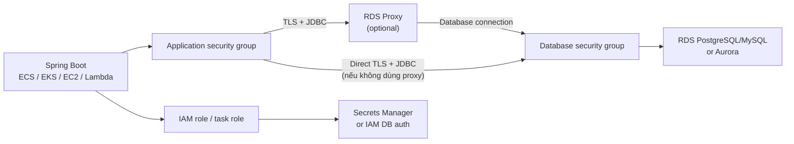
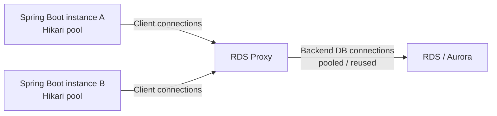

# Kết nối RDS an toàn và điều chỉnh connection pool

> **Chương:** Ứng dụng Java và Spring Boot  
> **Module:** CLOUD_PROVIDERS_AWS  
> **Bối cảnh:** Thiết kế kết nối từ Java/Spring Boot tới Amazon RDS hoặc Aurora trong AWS, quản lý credentials, TLS, IAM database authentication, HikariCP và Amazon RDS Proxy. Mục tiêu là duy trì kết nối an toàn, phục hồi tốt khi failover và giới hạn connections để bảo vệ database.

## Mục tiêu học tập

Sau bài này, người học có thể:

1. Mô tả đường đi kết nối từ ECS/EKS/EC2/Lambda tới RDS/Aurora qua VPC, DNS, security groups và TLS.
2. Phân biệt IAM control-plane permissions, IAM database authentication, database users/roles và SQL privileges.
3. Cấu hình PostgreSQL JDBC hoặc MySQL Connector/J để xác minh CA và hostname.
4. Lấy credentials từ AWS Secrets Manager hoặc dùng IAM authentication mà không hardcode mật khẩu/AWS access keys.
5. Giải thích IAM DB authentication token có hiệu lực 15 phút và tại sao phải tạo token mới khi mở physical connection mới.
6. Tính connection budget theo DB capacity, số application replicas, background jobs, migrations và admin sessions.
7. Điều chỉnh HikariCP: maximum/minimum pool size, connection timeout, validation timeout, idle timeout, max lifetime, keepalive và leak detection.
8. Hiểu RDS Proxy client/backend connections, multiplexing, session pinning và IAM authentication modes.
9. Xử lý reconnect, DNS failover, retry transaction an toàn và idempotency.
10. Đọc metrics HikariCP, RDS, RDS Proxy và SQL engine để tìm pool exhaustion hoặc database saturation.
11. Kiểm tra cấu hình bằng Java, Spring Boot, AWS CLI, IAM policy và CloudFormation.
12. Xây dựng runbook cho credential rotation, connection storm, failover và lỗi TLS/network.

## 1. Kiến trúc kết nối từ Spring Boot tới RDS

Một ứng dụng Spring Boot không nên kết nối database bằng địa chỉ IP tĩnh hay mở port database ra Internet. Luồng phổ biến:



Các lớp cần đúng đồng thời:

- **Network:** application và database nằm trong VPC có route/subnet phù hợp; security group chỉ cho phép nguồn cần thiết.
- **DNS:** ứng dụng dùng RDS/Aurora/Proxy endpoint dạng DNS, không hardcode IP.
- **TLS:** mã hóa đường truyền và xác minh server certificate/hostname.
- **Authentication:** SQL password từ Secrets Manager hoặc IAM database authentication.
- **Authorization:** database user chỉ có SQL privileges cần thiết.
- **Pooling:** HikariCP quản lý số kết nối từ từng application process.
- **Resilience:** xử lý timeout, stale connection, failover và retry ở transaction boundary.

**Một lệnh mô tả DB instance thành công không chứng minh ứng dụng có thể đăng nhập SQL.** IAM control plane, VPC connectivity, TLS, database authentication và SQL grants là các lớp quyền khác nhau.

## 2. Đặt RDS trong private network

### 2.1 Database subnet group và public accessibility

Với backend Java chạy trong AWS:

- Đặt RDS/Aurora vào **private DB subnets** theo topology được hỗ trợ; production HA thường trải qua ít nhất hai Availability Zones.
- Đặt **PubliclyAccessible=false** trừ khi có yêu cầu kiến trúc đặc biệt được phê duyệt.
- Ứng dụng ECS/EKS/EC2 cần route tới các private subnets và DNS resolution trong VPC.
- Nếu dùng RDS Proxy, tạo proxy trong các subnets phù hợp và có security group riêng.
- Không dùng public IP hoặc NAT gateway để biến database thành dịch vụ public.

### 2.2 Security groups theo nguồn kết nối

Ví dụ PostgreSQL port 5432:

| Security group | Inbound | Source |
|---|---|---|
| sg-orders-app | Không cần mở inbound database port | Theo ingress của ứng dụng |
| sg-orders-proxy | TCP 5432 | sg-orders-app |
| sg-orders-db | TCP 5432 | sg-orders-proxy nếu dùng Proxy; nếu direct thì sg-orders-app |

Với MySQL, port thường là 3306. Chỉ mở port từ **application security group** hoặc **proxy security group**, không mở 0.0.0.0/0.

Khi dùng RDS Proxy, database security group nên chỉ nhận kết nối từ Proxy security group. Ứng dụng kết nối Proxy endpoint, không kết nối thẳng database endpoint trong luồng runtime thông thường.

### 2.3 Network ACL, route và DNS

Khi TCP timeout dù security group có vẻ đúng, kiểm tra:

1. Subnet route tables và VPC peering/Transit Gateway nếu app ở VPC khác.
2. Network ACL inbound/outbound và ephemeral ports.
3. DNS resolution/hostnames trong VPC.
4. Security group của cả application, proxy và DB.
5. Port và engine thực tế.
6. VPC endpoints/NAT nếu application cần gọi Secrets Manager, STS hoặc KMS APIs.

Không dùng ping làm bằng chứng database port thông. ICMP có thể bị chặn dù TCP 5432/3306 hoạt động. Kiểm tra TCP từ đúng runtime subnet/SG.

### 2.4 Không dùng IP cố định

RDS endpoint là DNS name. Trong failover, địa chỉ IP phía sau endpoint có thể thay đổi. Nếu ứng dụng lưu IP vào config, cache DNS vô thời hạn, tự tạo JDBC URL bằng IP hoặc dùng custom DNS alias không được hỗ trợ với TLS hostname validation, ứng dụng có thể tiếp tục kết nối tới địa chỉ cũ sau failover. Dùng endpoint chính thức và cấu hình JVM/driver DNS behavior theo hướng dẫn AWS.

## 3. TLS: mã hóa và xác minh danh tính database

**TLS encryption không đồng nghĩa certificate verification.** Với JDBC, cấu hình mặc định của một số driver cho phép ưu tiên TLS nhưng không xác minh đầy đủ hostname/certificate. Cần dùng chế độ verify đúng cho engine và driver.

### 3.1 PostgreSQL JDBC

Ví dụ kết nối trực tiếp hoặc qua RDS Proxy bằng PostgreSQL JDBC driver:

```text
jdbc:postgresql://orders-db.example.ap-southeast-1.rds.amazonaws.com:5432/ordersdb
  ?sslmode=verify-full
  &sslrootcert=/app/certs/global-bundle.pem
```

- **sslmode=verify-full** yêu cầu TLS, xác minh certificate chain và hostname.
- **sslrootcert** trỏ tới RDS CA bundle đã được cung cấp an toàn vào container/host.
- Dùng endpoint hostname thật của RDS/Proxy để hostname verification khớp.
- Không dùng sslmode=disable trong production.
- sslmode=require mã hóa đường truyền nhưng không thay thế verify-full khi cần xác minh danh tính server.

AWS phát hành CA bundles theo Region và có quy trình certificate rotation. Chỉ đưa **root CA certificates** vào trust store theo hướng dẫn; không tự import intermediate certificates nếu tài liệu AWS không yêu cầu, vì có thể gây lỗi khi server certificate tự động rotate.

### 3.2 MySQL Connector/J

Với MySQL Connector/J, có thể dùng chế độ xác minh identity:

```text
jdbc:mysql://orders-db.example.ap-southeast-1.rds.amazonaws.com:3306/ordersdb
  ?sslMode=VERIFY_IDENTITY
  &trustCertificateKeyStoreUrl=file:/app/certs/rds-truststore.jks
```

VERIFY_IDENTITY xác minh certificate và hostname. Truststore phải chứa CA phù hợp, được tạo và cập nhật theo quy trình quản lý chứng thư của tổ chức/AWS. Kiểm tra tên property theo phiên bản Connector/J đang dùng.

| Cấu hình | Ý nghĩa |
|---|---|
| TLS enabled / useSSL=true | Bật kết nối TLS theo driver |
| VERIFY_CA | Xác minh certificate chain |
| VERIFY_IDENTITY | Xác minh certificate chain và hostname |
| PostgreSQL sslmode=verify-full | Xác minh chain và hostname |

### 3.3 Quản lý RDS CA rotation

- Tải CA bundle từ trang AWS chính thức vào quy trình build/deploy có kiểm soát.
- Đưa truststore vào container image hoặc secret/config distribution phù hợp.
- Cập nhật CA bundle trước lịch certificate rotation.
- Kiểm tra ứng dụng có xác minh hostname và kết nối thành công với certificate mới.
- Tránh pin leaf certificate của một DB instance vì certificate có thể được rotate.
- Không tắt verification để “sửa nhanh” lỗi certificate trên production.

### 3.4 TLS tới RDS Proxy

Khi ứng dụng dùng IAM authentication tới RDS Proxy, AWS yêu cầu dùng TLS/SSL. Dùng Proxy endpoint và cấu hình hostname verification với certificate trust phù hợp. RDS Proxy sử dụng certificates do AWS Certificate Manager quản lý; ứng dụng vẫn cần xác minh endpoint.

## 4. Credentials: Secrets Manager và database users

### 4.1 Không dùng master user trong ứng dụng

Tạo user riêng cho mỗi ứng dụng hoặc bounded context:

- orders_app: chỉ quyền cần cho orders schema.
- orders_readonly: chỉ đọc cho reporting.
- migration_user: quyền DDL, chỉ dùng trong deployment pipeline.
- db_admin: quản trị, không nhúng vào application.

Không cấp rds_superuser, schema owner hoặc quyền DDL cho runtime application nếu không cần.

### 4.2 Lưu password trong AWS Secrets Manager

Một secret JSON minh họa:

```json
{
  "engine": "postgres",
  "host": "orders-db.example.ap-southeast-1.rds.amazonaws.com",
  "port": 5432,
  "dbname": "ordersdb",
  "username": "orders_app",
  "password": "REDACTED"
}
```

Trong production, secret được mã hóa bằng KMS và chỉ application role được quyền secretsmanager:GetSecretValue trên đúng secret ARN. Nếu dùng customer-managed KMS key, IAM role và key policy phải cho phép decrypt theo phạm vi cần thiết.

### 4.3 Secrets Manager rotation

Rotation cập nhật credentials trong database và secret. Khi ứng dụng kết nối trực tiếp bằng password:

- Connections đã xác thực có thể tiếp tục hoạt động.
- Physical connections mới cần password hiện hành.
- Nếu pool tiếp tục tạo connections bằng password cũ sau rotation, kết nối mới có thể thất bại.
- Cần cơ chế refresh secret và thay/refresh pool an toàn; không giả định một HikariDataSource đã tạo tự động đọc lại secret.

Có thể dùng RDS Proxy để tách app-side authentication khỏi backend database credentials: Proxy đọc secret và quản lý backend connections. Tuy nhiên phải thiết kế client authentication và backend authentication mode rõ ràng.

**RDS-managed master password secret** thuận tiện cho quản lý master credential, nhưng không có nghĩa ứng dụng nên đăng nhập bằng master user. Tạo application database user riêng và quản lý secret riêng theo policy.

### 4.4 Java: đọc secret bằng AWS SDK for Java v2

Dependencies cần có AWS SDK v2 secretsmanager, Jackson và PostgreSQL/MySQL JDBC driver. Ứng dụng lấy credentials bằng task role/instance role/Pod Identity; không lưu AWS access key trong source.

```java
package example.orders;

import com.fasterxml.jackson.databind.JsonNode;
import com.fasterxml.jackson.databind.ObjectMapper;
import software.amazon.awssdk.regions.Region;
import software.amazon.awssdk.services.secretsmanager.SecretsManagerClient;
import software.amazon.awssdk.services.secretsmanager.model.GetSecretValueRequest;

public record DbCredentials(
        String host,
        int port,
        String database,
        String username,
        String password) {}

public final class DbSecretLoader {
    private static final ObjectMapper JSON = new ObjectMapper();

    private DbSecretLoader() {}

    public static DbCredentials load(
            String secretArn,
            Region region) throws Exception {

        try (SecretsManagerClient client =
                 SecretsManagerClient.builder()
                     .region(region)
                     .build()) {

            var response = client.getSecretValue(
                GetSecretValueRequest.builder()
                    .secretId(secretArn)
                    .build());

            JsonNode secret = JSON.readTree(response.secretString());

            return new DbCredentials(
                secret.path("host").asText(),
                secret.path("port").asInt(),
                secret.path("dbname").asText(),
                secret.path("username").asText(),
                secret.path("password").asText()
            );
        }
    }
}
```

Code trên minh họa đọc một secret dạng JSON. Production cần kiểm tra trường bắt buộc, xử lý SecretBinary nếu tổ chức dùng, caching có thời hạn và không log password/response body.

### 4.5 Tạo HikariDataSource từ credentials

```java
package example.orders;

import com.zaxxer.hikari.HikariConfig;
import com.zaxxer.hikari.HikariDataSource;

public final class OrdersDataSourceFactory {
    private OrdersDataSourceFactory() {}

    public static HikariDataSource create(
            DbCredentials credentials,
            String caBundlePath) {

        String jdbcUrl = "jdbc:postgresql://"
            + credentials.host()
            + ":" + credentials.port()
            + "/" + credentials.database()
            + "?sslmode=verify-full"
            + "&sslrootcert=" + caBundlePath;

        HikariConfig config = new HikariConfig();
        config.setPoolName("orders-db-pool");
        config.setJdbcUrl(jdbcUrl);
        config.setUsername(credentials.username());
        config.setPassword(credentials.password());

        config.setMaximumPoolSize(8);
        config.setMinimumIdle(2);
        config.setConnectionTimeout(3_000);
        config.setValidationTimeout(2_000);
        config.setIdleTimeout(300_000);
        config.setMaxLifetime(1_500_000);

        return new HikariDataSource(config);
    }
}
```

Đây là ví dụ khởi tạo pool bằng credentials tại thời điểm tạo. **Nó không tự xử lý secret rotation.** Khi password rotate, ứng dụng cần refresh credentials rồi thay pool theo chiến lược drain/replace, hoặc dùng integration/proxy được thiết kế cho rotation. Không tạo một HikariDataSource mới cho mỗi request.

## 5. IAM database authentication

IAM DB authentication cho phép ứng dụng dùng IAM-signed authentication token thay database password khi **thiết lập kết nối mới**. AWS hỗ trợ tính năng này cho RDS MariaDB, MySQL, PostgreSQL và các cấu hình Aurora tương thích; kiểm tra engine/version/Region trước khi bật.

### 5.1 Token 15 phút có ý nghĩa gì?

- Token được tạo bằng AWS Signature Version 4.
- Token có thời hạn **15 phút** kể từ lúc tạo.
- Token được dùng trong bước xác thực khi mở connection.
- Khi connection đã được xác thực và thiết lập, token không được kiểm tra lại liên tục trong suốt vòng đời connection.
- Physical connection mới phải dùng token còn hiệu lực.
- Không lưu token vào file config hoặc cache dùng lâu hơn 15 phút.

Với HikariCP, pool giữ các physical connections đã mở. Không tạo token một lần lúc application startup rồi dùng làm password mãi mãi: những connections mới sau khi token hết hạn sẽ bị từ chối.

### 5.2 IAM action và resource ARN

Quyền IAM để mở DB connection là:

```json
{
  "Version": "2012-10-17",
  "Statement": [
    {
      "Sid": "ConnectAsOrdersApp",
      "Effect": "Allow",
      "Action": "rds-db:connect",
      "Resource": "arn:aws:rds-db:ap-southeast-1:111122223333:dbuser:db-RESOURCE-ID/orders_app"
    }
  ]
}
```

Chú ý:

- Action là **rds-db:connect**, không phải rds:Connect.
- Resource dùng **DB resource ID**, không phải DB instance identifier hoặc ARN arn:aws:rds:....
- Với RDS DB instance, dùng DbiResourceId có dạng db-....
- Với Aurora, dùng DbClusterResourceId.
- Với RDS Proxy, dùng proxy resource ID có dạng prx-....
- Giới hạn đúng Region, Account và database username.

### 5.3 Tạo database user cho IAM authentication

Ví dụ PostgreSQL, thực hiện bằng DBA/admin session:

```sql
CREATE ROLE orders_app LOGIN;

GRANT rds_iam TO orders_app;

GRANT CONNECT ON DATABASE ordersdb TO orders_app;
GRANT USAGE ON SCHEMA orders TO orders_app;

GRANT SELECT, INSERT, UPDATE, DELETE
ON ALL TABLES IN SCHEMA orders
TO orders_app;

GRANT USAGE, SELECT, UPDATE
ON ALL SEQUENCES IN SCHEMA orders
TO orders_app;
```

Để cấp quyền cho bảng tạo mới, DBA có thể cấu hình ALTER DEFAULT PRIVILEGES theo schema và owner phù hợp. Không cấp quyền toàn bộ database nếu ứng dụng chỉ cần schema orders.

IAM authentication **không thay thế SQL authorization**. Role vẫn phải có CONNECT, schema usage và table/sequence privileges tương ứng.

### 5.4 Tạo token bằng AWS SDK for Java v2

Ví dụ PostgreSQL direct connection:

```java
import software.amazon.awssdk.regions.Region;
import software.amazon.awssdk.services.rds.RdsUtilities;
import software.amazon.awssdk.services.rds.model.GenerateAuthenticationTokenRequest;

String host = "orders-db.example.ap-southeast-1.rds.amazonaws.com";
int port = 5432;
String username = "orders_app";

RdsUtilities utilities = RdsUtilities.builder()
    .region(Region.AP_SOUTHEAST_1)
    .build();

String token = utilities.generateAuthenticationToken(
    GenerateAuthenticationTokenRequest.builder()
        .hostname(host)
        .port(port)
        .username(username)
        .build()
);
```

Token được dùng làm password trong lúc tạo connection:

```java
import java.sql.Connection;
import java.sql.DriverManager;
import java.util.Properties;

Properties properties = new Properties();
properties.setProperty("user", username);
properties.setProperty("password", token);
properties.setProperty("sslmode", "verify-full");
properties.setProperty("sslrootcert", "/app/certs/global-bundle.pem");

try (Connection connection = DriverManager.getConnection(
        "jdbc:postgresql://" + host + ":" + port + "/ordersdb",
        properties)) {
    // Chạy SQL trong connection này.
}
```

Ví dụ dùng một connection để minh họa token handshake. Trong production, dùng **AWS Advanced JDBC Wrapper IAM plugin** hoặc một DataSource có khả năng tạo token mới mỗi lần Hikari mở physical connection. Wrapper có plugin iam, đọc AWS credential provider chain và tự làm mới token theo cache window nhỏ hơn 15 phút.

### 5.5 IAM plugin trong AWS Advanced JDBC Wrapper

Với PostgreSQL, JDBC URL có dạng:

```text
jdbc:aws-wrapper:postgresql://orders-db.example.ap-southeast-1.rds.amazonaws.com:5432/ordersdb
```

Ví dụ properties:

```java
import java.sql.Connection;
import java.sql.DriverManager;
import java.util.Properties;

Properties properties = new Properties();
properties.setProperty("wrapperPlugins", "iam");
properties.setProperty("iamRegion", "ap-southeast-1");
properties.setProperty("user", "orders_app");

try (Connection connection = DriverManager.getConnection(
        "jdbc:aws-wrapper:postgresql://orders-db.example.ap-southeast-1.rds.amazonaws.com:5432/ordersdb",
        properties)) {
    // IAM token được tạo bởi plugin khi cần mở connection.
}
```

Trong Spring Boot/Hikari, cấu hình driver wrapper và truyền các properties wrapperPlugins=iam, iamRegion, username và AWS credential provider theo tài liệu đúng phiên bản wrapper. Kiểm thử cả connections do pool tạo, health checks, schema migrations và monitoring connections.

AWS SDK credential provider phải tự refresh STS credentials khi dùng ECS task role, EC2 instance profile, EKS Pod Identity/IRSA hoặc SSO. IAM DB token không thể được tạo nếu underlying AWS credentials đã hết hạn.

### 5.6 Khi nào nên chọn IAM auth?

| Trường hợp | Hướng phù hợp |
|---|---|
| Workload AWS có IAM role, cần tránh password tĩnh | Đánh giá IAM DB auth |
| Nhiều app instances mở connections thường xuyên | Kết hợp pooling và cân nhắc RDS Proxy |
| Engine không hỗ trợ IAM DB auth | Secrets Manager/password auth |
| Ứng dụng cần password rotation tích hợp đơn giản | Secrets Manager và refresh pool hoặc RDS Proxy |
| Có yêu cầu SQL grants phức tạp | Vẫn quản lý DB roles/grants dù dùng IAM |

IAM DB authentication có giới hạn/throttling và có thể tăng overhead khi mở connection liên tục. Pooling giúp tái sử dụng established connections; RDS Proxy có thể giảm connection churn. Không dùng IAM auth như lý do bỏ connection pool.

## 6. Spring Boot cấu hình DataSource và HikariCP

Spring Boot thường tự cấu hình HikariCP khi có dependency Hikari và JDBC driver trên classpath. Hikari quản lý pool; Spring quản lý lifecycle transaction thông qua DataSourceTransactionManager/JPA transaction integration.

### 6.1 Cấu hình PostgreSQL direct connection

Ví dụ application.yml:

```yaml
spring:
  datasource:
    url: jdbc:postgresql://orders-db.example.ap-southeast-1.rds.amazonaws.com:5432/ordersdb?sslmode=verify-full&sslrootcert=/app/certs/global-bundle.pem
    username: orders_app
    # Password được inject từ secret provider / environment.
    hikari:
      pool-name: orders-db-pool
      maximum-pool-size: 8
      minimum-idle: 2
      connection-timeout: 3000
      validation-timeout: 2000
      idle-timeout: 300000
      max-lifetime: 1500000
      leak-detection-threshold: 0
```

Password không được commit vào Git. Cấp qua Secrets Manager integration, secret injection của deployment platform hoặc một DataSource factory chuyên dụng. Đừng đặt database master password trong manifest/plaintext environment nếu có giải pháp secret reference.

### 6.2 Cấu hình qua RDS Proxy

Đổi hostname sang Proxy endpoint:

```yaml
spring:
  datasource:
    url: jdbc:postgresql://orders-proxy.proxy-abc123.ap-southeast-1.rds.amazonaws.com:5432/ordersdb?sslmode=verify-full&sslrootcert=/app/certs/global-bundle.pem
    username: orders_app
    hikari:
      pool-name: orders-proxy-pool
      maximum-pool-size: 12
      minimum-idle: 2
      connection-timeout: 3000
      validation-timeout: 2000
      idle-timeout: 300000
      max-lifetime: 1500000
      keepalive-time: 0
```

Các con số là ví dụ để bắt đầu benchmark, không phải giá trị tối ưu mặc định cho mọi DB. Hãy xác định authentication mode:

- **Password client → Proxy:** ứng dụng dùng DB username/password; Proxy dùng Secrets Manager để xác thực với DB.
- **Standard IAM client → Proxy:** ứng dụng tạo IAM token để xác thực tới Proxy; Proxy dùng secret trong Secrets Manager để kết nối DB.
- **End-to-end IAM:** ứng dụng và Proxy đều dùng IAM authentication; database user và IAM permissions phải được cấu hình tương ứng.

Không thay đổi chỉ JDBC URL rồi giả định mọi auth mode tự hoạt động. Credentials, IAM policy, database user và Proxy settings phải khớp.

### 6.3 MySQL Connector/J

Ví dụ JDBC URL với hostname verification:

```yaml
spring:
  datasource:
    url: jdbc:mysql://orders-db.example.ap-southeast-1.rds.amazonaws.com:3306/ordersdb?sslMode=VERIFY_IDENTITY&trustCertificateKeyStoreUrl=file:/app/certs/rds-truststore.jks
    username: orders_app
    hikari:
      maximum-pool-size: 8
      minimum-idle: 2
      connection-timeout: 3000
      validation-timeout: 2000
      max-lifetime: 1500000
```

Truststore phải được quản lý theo Connector/J version và RDS CA bundle. Kiểm thử TLS thực tế bằng driver/runtime production, không chỉ bằng công cụ kiểm tra certificate riêng.

## 7. Tính connection budget trước khi đặt pool size

### 7.1 Pool được tạo theo từng process

Mỗi Spring Boot process thường tạo một Hikari pool riêng cho mỗi DataSource. Nếu Kubernetes/ECS autoscaling tăng số replicas, tổng số DB client connections có thể tăng theo.

Ví dụ:

```text
24 application replicas
× 10 maximumPoolSize per replica
= 240 potential application connections

Plus:
- scheduled jobs
- async workers
- migration process
- reporting services
- monitoring/admin connections
```

Không nhìn maximumPoolSize=10 của một pod rồi kết luận database chỉ có 10 connections.

### 7.2 Công thức ngân sách

Một công thức planning:

```text
pool_max_per_replica <=
  floor(
    (DB_connection_budget
      - reserved_admin_connections
      - other_application_connections
      - safety_buffer)
    / max_application_replicas
  )
```

Ví dụ:

```text
Database max_connections                  = 300
Reserved for admin/maintenance/monitoring = 30
Other services/jobs                      = 50
Safety buffer                             = 60
Remaining for orders-api                 = 160
Maximum replicas                          = 20

Pool maximum per replica <= floor(160 / 20)
                           = 8
```

Bắt đầu benchmark ở 6–8 connections/replica rồi theo dõi pool pending, DB CPU, lock waits và query latency. **Công thức chỉ là giới hạn ngân sách**, không chứng minh 8 connections là mức nhanh nhất. Database có thể bão hòa CPU/IO trước khi đạt max_connections.

Phép tính này áp dụng trực tiếp khi ứng dụng **kết nối thẳng tới RDS/Aurora**. Khi dùng RDS Proxy, số client connections ở phía Hikari không bắt buộc phải nhỏ hơn max_connections của database; Proxy có thể multiplex nhiều client sessions lên một pool backend nhỏ hơn. Khi đó cần tính riêng client-side pool theo concurrency của ứng dụng và backend pool theo MaxConnectionsPercent, headroom, workload pinning và giới hạn database.

### 7.3 Khi autoscaling

Phải tính theo **maximum replicas**, không phải số replicas trung bình. Nếu deployment có HPA/ECS autoscaling tăng tasks, pool size cần chịu được maximum replicas hoặc có biện pháp giới hạn concurrency.

Các cách kiểm soát:

- Giới hạn max replicas.
- Giảm maximumPoolSize mỗi pod.
- Dùng RDS Proxy khi phù hợp.
- Giảm thời gian giữ connection/transaction.
- Tách reporting/batch workload.
- Dùng queue để làm phẳng burst.
- Hạn chế migration jobs chạy đồng thời.

### 7.4 Đừng tăng max_connections để chữa pool exhaustion một cách mù quáng

Nhiều connections hơn có thể tiêu tốn memory và tăng context switching. Nếu pool pending vì query chậm hoặc transaction giữ connection lâu, tăng max_connections có thể làm DB chậm hơn.

Trước khi tăng:

1. Xem active/idle/pending trong Hikari.
2. Xem DatabaseConnections, CPU, FreeableMemory và DB waits.
3. Xem slow queries/locks/long transactions.
4. Đo thời gian borrow connection và thời gian giữ connection.
5. Kiểm tra replicas/background workers có tăng bất thường.
6. Chỉ đổi DB capacity hoặc pool size sau load test.

## 8. Các tham số HikariCP và cách điều chỉnh

### 8.1 Bảng tham số

| Property | Tác dụng | Cách suy nghĩ |
|---|---|---|
| maximumPoolSize | Tổng connections tối đa của pool | Tính theo DB budget và maximum replicas |
| minimumIdle | Số idle connections pool cố gắng duy trì | Đặt thấp hơn max cho workload biến động; bằng max tạo pool cố định |
| connectionTimeout | Thời gian chờ lấy connection từ pool | Đây là pool wait, không phải SQL query timeout |
| validationTimeout | Thời gian tối đa kiểm tra connection còn sống | Phải nhỏ hơn connectionTimeout |
| idleTimeout | Thời gian idle trước khi pool thu hồi connection dư | Chỉ áp dụng khi minimumIdle nhỏ hơn maximumPoolSize |
| maxLifetime | Tuổi tối đa của connection | Đặt ngắn hơn timeout của DB/network/proxy; connection đang dùng không bị đóng giữa chừng |
| keepaliveTime | Ping connection idle để tránh bị network/database đóng | Chỉ áp dụng cho idle connections; phải nhỏ hơn maxLifetime |
| leakDetectionThreshold | Log cảnh báo connection giữ quá lâu | Chẩn đoán tạm thời; không tự đóng connection |
| autoCommit | Auto-commit mặc định | Spring transaction manager thường quản lý transaction; không đổi tùy tiện |
| connectionTestQuery | SQL dùng kiểm tra connection | Với JDBC4 driver, Hikari thường dùng Connection.isValid(); không cần set query nếu không có lý do |

### 8.2 maximumPoolSize

Đặt dựa trên:

- Số replicas tối đa.
- Database max connections và reserve.
- Query concurrency thật.
- DB CPU/memory/IOPS.
- Connection hold time.
- Các consumers khác dùng chung database.

Pool lớn có thể làm tăng số query chạy đồng thời và làm contention nặng hơn. Một pool nhỏ hơn có thể tạo backpressure hữu ích, miễn timeout/queue phù hợp SLO.

### 8.3 minimumIdle

- Nếu đặt thấp hơn maximumPoolSize, Hikari có thể tăng/giảm số idle connections theo tải.
- Nếu không cấu hình, Hikari thường dùng giá trị mặc định khiến minimum idle bằng maximum pool size.
- Workload ổn định, latency-sensitive có thể giữ một số connections nóng.
- Workload autoscaling/burst có thể dùng minimum idle nhỏ để giảm connections nhàn rỗi.

Đừng đặt minimumIdle=maximumPoolSize=100 trên mọi pod khi số replicas có thể tăng mạnh.

### 8.4 connectionTimeout khác query timeout

connectionTimeout là thời gian ứng dụng chờ pool trả connection. Nếu hết thời gian, Hikari ném lỗi lấy connection.

Nó **không** giới hạn thời gian SQL query chạy. Query timeout cần cấu hình ở JDBC/statement/ORM/transaction level theo engine và driver.

Ví dụ:

- Pool wait: connectionTimeout=3000 ms.
- Driver connect timeout: thời gian mở TCP/auth connection.
- Socket/read timeout: thời gian chờ dữ liệu phản hồi.
- SQL query timeout: giới hạn query execution.
- Transaction timeout: giới hạn transaction/business operation.

Không đặt mọi timeout bằng nhau mà không hiểu thứ tự. Thông thường pool wait phải phù hợp request deadline; query/socket timeout không nên cho phép request chờ lâu hơn tổng budget của API.

### 8.5 validationTimeout và connection validation

HikariCP dùng JDBC4 Connection.isValid() với driver hỗ trợ. validationTimeout nên nhỏ hơn connectionTimeout. Không cần đặt connectionTestQuery=SELECT 1 nếu driver hỗ trợ JDBC4 validation đúng cách.

Connection validation không đảm bảo query tiếp theo không gặp failover; lỗi vẫn có thể xảy ra giữa lúc kiểm tra và lúc thực thi SQL.

### 8.6 idleTimeout và minimumIdle

idleTimeout chỉ thu hồi connections vượt minimumIdle. Nếu minimumIdle bằng maximumPoolSize, không có connection dư để retire theo idle timeout.

Với RDS Proxy, IdleClientTimeout mặc định **30 phút**. Nếu muốn Proxy đóng client idle, đặt Hikari idleTimeout thấp hơn Proxy timeout và bảo đảm minimumIdle cho phép thu hồi. Hikari keepalive/ping có thể khiến Proxy thấy hoạt động và không coi connection là idle.

### 8.7 maxLifetime

- Hikari đánh dấu connection hết tuổi và loại khỏi pool khi connection được trả về; không cắt một transaction đang chạy.
- Đặt ngắn hơn giới hạn connection của network/DB/proxy.
- Với RDS Proxy, client connection có giới hạn tuổi tối đa **24 giờ**; cấu hình Hikari ngắn hơn giới hạn này.
- Hikari mặc định thường là 30 phút; xác minh phiên bản đang chạy.
- Không đặt lifetime quá thấp khiến pool liên tục mở lại connections và tạo connection storm.

### 8.8 keepaliveTime

Hikari keepalive chỉ ping connections đang idle; giá trị phải nhỏ hơn maxLifetime và đáp ứng giới hạn tối thiểu của Hikari version.

Với RDS Proxy, health checks/pings từ client có thể khiến Proxy không nhận diện idle client connection, làm connections không bị thu hồi theo IdleClientTimeout. Vì vậy có thể đặt keepaliveTime=0 nếu không cần giữ client connection sống bằng ping. Nếu direct DB có network idle timeout thấp, cân nhắc keepalive sau khi đo và hiểu ảnh hưởng.

### 8.9 leakDetectionThreshold

Bật leak detection trong staging hoặc trong đợt điều tra khi nghi ngờ code quên close connection. Hikari log stack trace khi connection được giữ quá ngưỡng.

Nó **không tự đóng** connection và cảnh báo cũng có thể xuất hiện khi transaction/query thực sự dài. Không để ngưỡng quá thấp trên production nếu log noise lớn.

### 8.10 Không giữ connection qua công việc không cần DB

Ví dụ không tốt:

- Mở transaction.
- Đọc order.
- Gọi HTTP tới payment provider mất 8 giây.
- Gọi message broker.
- Sau đó mới update DB và commit.

Transaction giữ connection trong suốt thời gian gọi external service. Khi tải tăng, pool cạn dù database query ngắn.

Tách thành các bước:

1. Đọc/ghi DB trong transaction ngắn.
2. Commit.
3. Gọi external service qua outbox/event workflow.
4. Ghi kết quả trong transaction mới.
5. Dùng idempotency key để xử lý retry.

## 9. Spring transaction và connection lifecycle

### 9.1 Dùng @Transactional ở business boundary

```java
@Service
public class OrderService {
    private final OrderRepository orders;

    public OrderService(OrderRepository orders) {
        this.orders = orders;
    }

    @Transactional
    public Order createOrder(CreateOrderCommand command) {
        Order order = Order.pending(command);
        return orders.save(order);
    }
}
```

Transaction nên chứa những thao tác DB cần commit/rollback cùng nhau. Không gọi payment provider, HTTP API, email service hoặc sleep trong transaction nếu không cần thiết.

### 9.2 Không giữ Connection trong field singleton

Không làm:

```java
@Component
public class BadDao {
    private Connection connection; // Sai: shared, stale, không thread-safe
}
```

Dùng Spring Data/JdbcTemplate/JPA hoặc lấy connection từ DataSource theo scope thao tác:

```java
try (Connection connection = dataSource.getConnection();
     PreparedStatement statement =
         connection.prepareStatement(
             "SELECT id, status FROM orders WHERE id = ?")) {

    statement.setString(1, orderId);

    try (ResultSet result = statement.executeQuery()) {
        if (result.next()) {
            return result.getString("status");
        }
    }
}
```

Khi close connection được mượn từ Hikari, connection được trả lại pool, không nhất thiết đóng TCP socket ngay.

### 9.3 Tránh transaction dài và lock contention

- Không đợi user interaction trong transaction.
- Không xử lý hàng nghìn records trong một transaction lớn nếu có thể chia batch.
- Chọn isolation level theo consistency requirement.
- Thứ tự cập nhật rows nhất quán để giảm deadlocks.
- Dùng optimistic locking/version khi phù hợp.
- Đặt statement/transaction timeout theo business SLO.
- Không giữ connection khi xử lý CPU-heavy mapping hoặc gọi external service.

### 9.4 Async và thread boundaries

Spring transaction context thường gắn với thread. Không truyền một JDBC Connection sang thread khác hoặc giữ connection trong CompletableFuture tùy tiện. Mỗi async task cần transaction/connection lifecycle riêng và phải tính vào connection budget.

## 10. Amazon RDS Proxy: khi nào cần?

RDS Proxy là managed database proxy có connection pooling và quản lý backend connections. Nó giúp giảm connection churn và làm ứng dụng bền hơn trước một số lỗi database/failover.

### 10.1 Hai loại connections



- **Client connection:** từ application/Hikari tới Proxy.
- **Database connection:** từ Proxy tới DB instance/cluster.

Proxy có thể tái sử dụng backend connections cho nhiều client sessions khi session không bị pinning và protocol/transaction state cho phép. App-side Hikari vẫn hữu ích để tránh liên tục tạo TCP/TLS/auth connections tới Proxy.

### 10.2 RDS Proxy có ích khi

- Nhiều Lambda invocations hoặc application replicas tạo connection bursts.
- Backend database bị giới hạn connections/memory.
- Muốn Proxy quản lý backend pool và kết nối lại trong một số tình huống failover.
- Muốn IAM authentication ở client side hoặc quản lý backend credentials qua Secrets Manager.
- Workload có nhiều client connections ngắn và transactions phù hợp multiplexing.

### 10.3 RDS Proxy không giải quyết mọi bottleneck

Proxy không:

- Tối ưu SQL query chậm.
- Tăng CPU/RAM/IOPS của database.
- Loại bỏ lock contention.
- Làm transaction dài trở thành transaction ngắn.
- Bảo đảm mọi client connection được multiplex.
- Thay thế HikariCP sizing hoặc application concurrency controls.
- Biến một transaction đã mất kết nối giữa commit thành kết quả chắc chắn đã rollback.

Nếu backend DB đã CPU-bound, thêm Proxy không làm database xử lý query nhanh hơn.

### 10.4 Connection pinning

RDS Proxy có thể **pin** client session vào một backend DB connection khi phát hiện session state không thể chia sẻ an toàn. Khi pinned, connection đó không thể được tái sử dụng cho client khác cho tới khi client session kết thúc.

Một số tình huống có thể gây pinning (tùy engine):

- Thay đổi session variables hoặc session configuration.
- Tạo temporary tables/sequences/views.
- Session state phụ thuộc các lệnh trước đó.
- Một số statement hoặc payload đặc biệt; ví dụ câu lệnh có text lớn hơn giới hạn Proxy có thể gây pinning.
- Các hành vi driver/ORM tạo session state.

Không mặc định mọi SET hay mọi prepared statement đều pin ở mọi engine/version. Xem tài liệu pinning đúng engine.

### 10.5 Giảm pinning

- Đưa cấu hình cố định vào DB parameter group thay vì thay session mỗi request khi phù hợp.
- Tránh temporary objects không cần thiết.
- Giữ transaction ngắn.
- Không dùng connection session state như nơi lưu dữ liệu nghiệp vụ.
- Kiểm tra ORM/JDBC driver có gửi initialization SQL hay không.
- Theo dõi metric DatabaseConnectionsCurrentlySessionPinned.

Nếu workload vốn cần session state liên tục, Proxy vẫn có thể hoạt động nhưng multiplexing benefit sẽ giảm. Benchmark bằng workload thật.

### 10.6 Proxy timeout và Hikari

Các giá trị mặc định quan trọng của RDS Proxy:

| Setting | Giá trị tham chiếu | Ý nghĩa |
|---|---:|---|
| IdleClientTimeout | 1.800 giây (30 phút) | Proxy đóng client connection idle |
| Client connection max lifetime | 24 giờ | Giới hạn tuổi client connection, không cấu hình vượt |
| ConnectionBorrowTimeout | 120 giây mặc định | Thời gian Proxy chờ backend connection |
| MaxConnectionsPercent | Theo target group | Giới hạn tỷ lệ backend connections theo max_connections của DB |

AWS khuyến nghị giữ khoảng **30% headroom** giữa số backend connections tối đa dự kiến ở peak và giới hạn Proxy được cấp. Metric MaxDatabaseConnectionsAllowed phản ánh số connections có thể phục vụ workload và không bao gồm một số connections nội bộ dành cho monitoring/failover. Không đặt MaxConnectionsPercent chỉ dựa trên giá trị max_connections mà bỏ qua các connections khác và headroom.

Cấu hình Hikari idleTimeout thấp hơn Proxy idle timeout nếu muốn pool chủ động thu hồi client connections dư. Cấu hình maxLifetime thấp hơn 24 giờ. Tránh health-check ping không cần thiết làm Proxy không thấy client idle.

### 10.7 IAM modes với RDS Proxy

**Standard IAM authentication:**

- Application dùng IAM token để xác thực tới Proxy.
- Proxy lấy database username/password từ AWS Secrets Manager.
- Proxy dùng password đó để xác thực với database.
- Proxy IAM role cần secretsmanager:GetSecretValue và KMS decrypt nếu secret dùng customer-managed key.
- IAM policy của app cấp rds-db:connect cho proxy resource ID và DB username.

**End-to-end IAM authentication:**

- Application xác thực tới Proxy bằng IAM.
- Proxy xác thực tới database bằng IAM.
- Không cần secret database password cho flow này.
- Cần cấu hình IAM database authentication cho DB, database user/plugin phù hợp và role của Proxy có rds-db:connect.

Không trộn IAM authentication với password authentication trên cùng database user nếu AWS docs cảnh báo engine/proxy có thể gặp kết nối bị ngắt hoặc reconnect bất thường. Tạo users/modes rõ ràng và thử trong staging.

## 11. Retry, DNS và failover

### 11.1 Connection pool không thể giữ mọi connection sống mãi

Trong failover, maintenance, reboot hoặc network interruption:

- Existing TCP sessions có thể bị drop.
- Transaction đang chạy có thể thất bại.
- Hikari có thể gặp connection stale.
- Driver có thể cần resolve DNS và mở connection mới.
- RDS Proxy có thể tự nối lại backend nhưng không bảo đảm mọi in-flight transaction thành công.

Ứng dụng phải chấp nhận connection failures là một phần của vận hành database.

### 11.2 Retry tại transaction boundary

Nguyên tắc:

1. Xác định lỗi có khả năng transient (connection reset, failover, deadlock/serialization failure theo policy).
2. Đóng/loại connection lỗi, không tiếp tục dùng connection hỏng.
3. Retry toàn bộ transaction ở business boundary nếu an toàn.
4. Giới hạn số lần retry và dùng exponential backoff + jitter.
5. Có deadline tổng cho request.
6. Không retry vô hạn.

### 11.3 Không retry write mù quáng

Giả sử ứng dụng gửi INSERT order và connection mất sau khi DB commit nhưng trước khi client nhận response. Client không biết commit đã thành công hay chưa. Nếu retry không có idempotency, có thể tạo hai orders.

Dùng:

- Business idempotency key có unique constraint.
- Request ID được lưu cùng transaction.
- INSERT ... ON CONFLICT hoặc cơ chế tương đương phù hợp engine.
- Outbox pattern cho event side effects.
- Reconciliation khi commit outcome không rõ.

### 11.4 Phân biệt timeout

| Timeout | Tầng | Câu hỏi |
|---|---|---|
| Hikari connectionTimeout | Pool | Chờ lấy connection bao lâu? |
| Driver connectTimeout | TCP/auth | Mở connection mới tối đa bao lâu? |
| JDBC socketTimeout / read timeout | Network/driver | Chờ response từ DB bao lâu? |
| Statement/query timeout | SQL engine/driver | Một câu SQL được chạy tối đa bao lâu? |
| Transaction timeout | Spring/business | Toàn bộ transaction được phép kéo dài bao lâu? |
| HTTP request deadline | API | Người dùng chờ kết quả bao lâu? |

Tổng timeout của các lớp phải phù hợp deadline. Không để SQL query chạy lâu hơn request đã bị client đóng mà vẫn giữ connection/lock.

### 11.5 Hikari maxLifetime không thay thế failover handling

Hikari retire connection theo lifetime khi connection được trả về pool. Nó không thể dự đoán chính xác một failover xảy ra giữa hai query. Cần driver validation, error handling, retry/idempotency và test failover thực tế.

## 12. AWS CLI: kiểm tra endpoint, IAM auth và Proxy

> Các lệnh dưới đây chủ yếu là read-only để kiểm kê. Thay identifiers/Region bằng môi trường được phép. Không in secret values ra terminal/log.

### 12.1 Xem RDS endpoint, port, TLS/IAM settings

```bash
aws rds describe-db-instances \
  --db-instance-identifier orders-db-prod \
  --region ap-southeast-1 \
  --query 'DBInstances[].{
    DB:DBInstanceIdentifier,
    Engine:Engine,
    Version:EngineVersion,
    Endpoint:Endpoint.Address,
    Port:Endpoint.Port,
    Public:PubliclyAccessible,
    IAMAuth:IAMDatabaseAuthenticationEnabled,
    ResourceId:DbiResourceId,
    MultiAZ:MultiAZ,
    SecurityGroups:VpcSecurityGroups,
    Subnets:DBSubnetGroup.Subnets
  }' \
  --output json
```

Với Aurora, xem cluster endpoint, reader endpoint và cluster resource ID qua describe-db-clusters.

### 12.2 Xem RDS Proxy

```bash
aws rds describe-db-proxies \
  --region ap-southeast-1 \
  --query 'DBProxies[].{
    Name:DBProxyName,
    Endpoint:Endpoint,
    Status:Status,
    EngineFamily:EngineFamily,
    Auth:Auth,
    RequireTLS:RequireTLS,
    RoleArn:RoleArn,
    IdleTimeout:IdleClientTimeout
  }' \
  --output json
```

Xem target health:

```bash
aws rds describe-db-proxy-targets \
  --db-proxy-name orders-db-proxy \
  --region ap-southeast-1 \
  --output json
```

### 12.3 Xem Secrets Manager metadata, không dump secret

```bash
aws secretsmanager describe-secret \
  --secret-id arn:aws:secretsmanager:ap-southeast-1:111122223333:secret:orders-db-app-abc123 \
  --region ap-southeast-1 \
  --query '{Name:Name,ARN:ARN,RotationEnabled:RotationEnabled,LastRotated:LastRotatedDate,LastChanged:LastChangedDate}' \
  --output json
```

get-secret-value trả credentials. Không chạy lệnh đó trong log CI/public terminal nếu output có thể bị lưu hoặc chia sẻ.

### 12.4 Sinh IAM DB auth token bằng AWS CLI

```bash
aws rds generate-db-auth-token \
  --hostname orders-db.example.ap-southeast-1.rds.amazonaws.com \
  --port 5432 \
  --region ap-southeast-1 \
  --username orders_app
```

Token được in ra terminal để phục vụ client authentication; không ghi vào shell history hoặc CI logs. Token phải được tạo cho đúng hostname/port mà client sẽ kết nối. Nếu kết nối Proxy, dùng **Proxy endpoint**, không dùng DB endpoint để tạo token rồi kết nối qua Proxy.

## 13. IAM permissions và database grants

### 13.1 Application role

Với Secrets Manager password flow, application role chỉ cần quyền đọc secret cụ thể và KMS decrypt nếu cần:

```json
{
  "Version": "2012-10-17",
  "Statement": [
    {
      "Sid": "ReadOrdersDbSecret",
      "Effect": "Allow",
      "Action": ["secretsmanager:GetSecretValue"],
      "Resource": "arn:aws:secretsmanager:ap-southeast-1:111122223333:secret:orders-db-app-*"
    }
  ]
}
```

Nếu secret dùng customer-managed KMS key, thêm kms:Decrypt với key ARN và điều kiện phù hợp theo policy tổ chức. Không cấp secretsmanager:* trên mọi secrets.

### 13.2 IAM DB authentication role

IAM auth policy cần rds-db:connect cho đúng DB resource ID và DB username:

```json
{
  "Version": "2012-10-17",
  "Statement": [
    {
      "Sid": "ConnectOrdersDatabase",
      "Effect": "Allow",
      "Action": ["rds-db:connect"],
      "Resource": "arn:aws:rds-db:ap-southeast-1:111122223333:dbuser:db-EXAMPLE123456789/orders_app"
    }
  ]
}
```

Khi dùng Proxy, resource ID trong ARN là prx-.... Với Aurora, dùng DbClusterResourceId. Không copy một ARN minh họa vào production; lấy resource ID thực từ API/Console.

### 13.3 SQL grants vẫn phải có

Ví dụ PostgreSQL:

```sql
GRANT CONNECT ON DATABASE ordersdb TO orders_app;
GRANT USAGE ON SCHEMA orders TO orders_app;

GRANT SELECT, INSERT, UPDATE, DELETE
ON ALL TABLES IN SCHEMA orders
TO orders_app;
```

Nếu ứng dụng dùng sequences, views, functions hoặc schema khác, cấp đúng quyền tương ứng. IAM auth chỉ chứng minh AWS principal được phép mở connection dưới DB username đó; nó không tự cấp quyền SELECT/INSERT trên bảng.

## 14. CloudFormation: private DB và security groups

Đoạn sau là fragment minh họa các nguyên tắc network. DB subnet group và application SG được giả định đã tạo.

```yaml
Resources:
  OrdersDbSecurityGroup:
    Type: AWS::EC2::SecurityGroup
    Properties:
      GroupDescription: Allow PostgreSQL only from orders application
      VpcId: vpc-0123456789abcdef0
      SecurityGroupIngress:
        - IpProtocol: tcp
          FromPort: 5432
          ToPort: 5432
          SourceSecurityGroupId: sg-orders-app
      Tags:
        - Key: Name
          Value: orders-db-sg

  OrdersDb:
    Type: AWS::RDS::DBInstance
    Properties:
      DBInstanceIdentifier: orders-db-staging
      Engine: postgres
      DBInstanceClass: db.m7g.large
      AllocatedStorage: "100"
      StorageEncrypted: true
      PubliclyAccessible: false
      DBSubnetGroupName: orders-private-db-subnets
      VPCSecurityGroups:
        - !GetAtt OrdersDbSecurityGroup.GroupId
      EnableIAMDatabaseAuthentication: true
      BackupRetentionPeriod: 7
      DeletionProtection: true
```

Đây là fragment học tập, chưa phải stack hoàn chỉnh: cần engine version/class/storage orderable, parameter group, credentials strategy, KMS key, monitoring, maintenance window, deletion policy, subnet group và tags theo environment. Với RDS Proxy, tách security group riêng: Proxy nhận traffic từ app SG; DB SG chỉ nhận từ Proxy SG.

## 15. Monitoring: pool, proxy và database cùng một bức tranh

### 15.1 HikariCP metrics

Nếu dùng Spring Boot Actuator/Micrometer, theo dõi:

- Active connections.
- Idle connections.
- Total connections.
- Pending threads đang chờ pool.
- Connection acquisition time.
- Connection usage/hold time.
- Connection timeout exceptions.
- Leak detection warnings.

Một số tên metric Micrometer phụ thuộc registry/version, thường có prefix hikaricp.connections. Xác minh endpoint metrics của ứng dụng thay vì hardcode tên metric vào alert mà chưa kiểm tra.

### 15.2 RDS CloudWatch metrics

| Metric | Ý nghĩa |
|---|---|
| DatabaseConnections | Số database connections |
| CPUUtilization | CPU utilization |
| FreeableMemory | Memory có thể sử dụng/reclaim |
| FreeStorageSpace | Storage còn trống |
| ReadLatency / WriteLatency | Storage I/O latency |
| ReadIOPS / WriteIOPS | I/O operations |
| Deadlocks (engine hỗ trợ) | Deadlock count |

### 15.3 RDS Proxy metrics

Theo dõi các metric quan trọng:

- ClientConnections: connections từ ứng dụng tới Proxy.
- DatabaseConnections: backend connections từ Proxy tới DB.
- MaxDatabaseConnectionsAllowed: giới hạn backend connections Proxy có thể dùng.
- DatabaseConnectionsCurrentlySessionPinned: số connections đang bị pin.
- DatabaseConnectionsSetupFailed: backend connection setup failures nếu metric được cung cấp cho engine/configuration.
- DatabaseConnectionsBorrowLatency: thời gian Proxy cần để lấy một backend connection từ pool hoặc mở connection mới tới DB.

Tên metric/availability có thể khác theo engine/Region và thay đổi theo dịch vụ. Đối chiếu CloudWatch metrics namespace AWS/RDS và dashboard thực tế.

### 15.4 Các tín hiệu cần cảnh báo

| Tín hiệu | Ý nghĩa có thể | Hành động |
|---|---|---|
| Hikari pending tăng kéo dài | Pool không trả connection đủ nhanh | Kiểm tra query time/transaction/DB capacity |
| Hikari active luôn sát max | Pool saturation hoặc request concurrency cao | Đo hold time và replicas |
| Hikari connection timeout | Không lấy được connection trong deadline | Xem DB, Proxy, network, pool budget |
| DB CPU cao + connections cao | Too much concurrency/query work | Profile SQL, giới hạn pool |
| Proxy pinned connections tăng | Multiplexing efficiency giảm | Tìm session state/temp objects |
| Proxy borrow latency tăng | Backend connections thiếu hoặc DB quá tải | Xem MaxDatabaseConnectionsAllowed/DB metrics |
| RDS failover events | Existing connections có thể stale | Kiểm tra reconnect/error rate |
| TLS/auth errors tăng sau rotation | CA/secret/token/IAM policy không khớp | Kiểm tra cert bundle, secret version, token age |

### 15.5 SQL: kiểm tra PostgreSQL sessions

```sql
SELECT
    state,
    wait_event_type,
    wait_event,
    count(*) AS sessions
FROM pg_stat_activity
WHERE datname = current_database()
GROUP BY state, wait_event_type, wait_event
ORDER BY sessions DESC;
```

Tìm transaction chạy lâu:

```sql
SELECT
    pid,
    usename,
    application_name,
    state,
    now() - xact_start AS transaction_age,
    wait_event_type,
    wait_event
FROM pg_stat_activity
WHERE xact_start IS NOT NULL
ORDER BY xact_start;
```

Không kill sessions chỉ vì query chạy lâu; xác định owner, business operation và tác động lock trước.

### 15.6 SQL: kiểm tra MySQL connections

```sql
SHOW GLOBAL STATUS LIKE 'Threads_connected';
SHOW GLOBAL STATUS LIKE 'Threads_running';
SHOW VARIABLES LIKE 'max_connections';
SHOW FULL PROCESSLIST;
```

Threads_connected là số sessions đã kết nối; Threads_running phản ánh threads đang hoạt động. Cần phân tích processlist/slow query trước khi tăng connection limit.

## 16. Troubleshooting theo triệu chứng

| Triệu chứng | Nguyên nhân có thể | Kiểm tra đầu tiên |
|---|---|---|
| Connection timed out | SG, route, NACL, DNS, endpoint sai | Test TCP từ đúng subnet/SG |
| Connection refused | Sai port, DB/proxy không sẵn sàng, endpoint sai | Engine/port/status/target health |
| PostgreSQL PKIX/certificate error | CA bundle/truststore sai hoặc thiếu | Root CA, sslmode, hostname |
| TLS handshake thành công nhưng hostname không đúng | Dùng require thay verify-full | Bật hostname verification |
| Password authentication failed | Secret cũ, username/database sai, rotation race | Secret version, DB user, rotation status |
| IAM NotAuthorized | Thiếu rds-db:connect hoặc resource ID sai | DBI/cluster/proxy resource ID |
| IAM token expired | Dùng token cũ khi mở physical connection | Generate token mới; wrapper plugin |
| IAM throttling | Mở quá nhiều connections mới trong thời gian ngắn | Hikari pooling/RDS Proxy |
| Hikari Connection is not available | Pool exhausted, query/transaction giữ lâu | Active/idle/pending/hold time |
| DB connections vượt dự kiến | Replicas × pool size hoặc nhiều DataSources | Deployment max replicas và mọi clients |
| Pool active cao nhưng DB CPU thấp | Connections bị giữ, app chờ external calls/locks | Transaction age, thread dump, SQL waits |
| DB CPU cao sau tăng pool | Concurrency tăng quá mức | Hạ pool, tối ưu query |
| RDS Proxy borrow latency cao | Backend pool thiếu hoặc pinning | Proxy metrics, pinning, DB max connections |
| Proxy không multiplex hiệu quả | Session pinning | DatabaseConnectionsCurrentlySessionPinned, session SQL |
| Failover xong app không tự hồi phục | Stale connections/DNS/driver retry | RDS events, pool validation, reconnect |
| Lỗi duplicate order sau retry | Commit outcome không rõ, thiếu idempotency | Unique idempotency key/outbox |
| Connection leak warning | Không close connection hoặc transaction dài | Stack trace, try-with-resources, transaction boundary |
| Connection churn quá cao | maxLifetime/idleTimeout/pool settings quá thấp | Pool creation/close rate, Hikari config |
| Secret rotate xong app lỗi | Pool vẫn dùng password cũ cho connections mới | Refresh secret/rebuild pool hoặc Proxy |
| Database max connections chạm trần | Pools/jobs/admin không có budget | Tổng connections toàn hệ thống |

### 16.1 Runbook: ứng dụng không kết nối được

1. Xác nhận Account/Region và hostname/port đúng.
2. Xem RDS instance/cluster/proxy status.
3. Kiểm tra private subnet, route, SG và NACL.
4. Kiểm tra DNS resolve từ runtime.
5. Kiểm tra TLS verify và CA bundle.
6. Kiểm tra auth mode: password, IAM direct, IAM standard Proxy hay end-to-end IAM.
7. Kiểm tra DB user, rds-db:connect, secret permissions và SQL grants.
8. Kiểm tra Hikari pool metrics và driver exceptions.
9. Chạy connection test từ một pod/task được phép, không mở DB public để debug.
10. Sau khi sửa, đo connection establishment rate và xác minh không tạo connection storm.

### 16.2 Runbook: Hikari pool cạn

1. Đọc active/idle/pending/max.
2. Đo connection acquisition time và usage/hold time.
3. Xem stack traces từ leak detection nếu đã bật.
4. Tìm transaction/query chạy lâu trong DB.
5. Tìm code giữ connection trong HTTP/API calls hoặc async tasks.
6. So sánh tổng pool size theo max replicas với DB budget.
7. Kiểm tra Proxy pinning/borrow latency nếu dùng Proxy.
8. Giảm concurrency hoặc sửa transaction trước khi tăng pool.
9. Load test lại với peak replicas.

### 16.3 Runbook: password rotation gây lỗi

1. Xác nhận secret version hiện tại và rotation status.
2. Xác nhận database user password đã được cập nhật.
3. Kiểm tra application có fetch secret mới hay đang giữ cached password cũ.
4. Kiểm tra connections mới có dùng password mới không.
5. Nếu direct Hikari pool, refresh credentials và replace/drain pool theo cách thread-safe.
6. Nếu RDS Proxy standard mode, kiểm tra Proxy role có secret/KMS permissions và secret association.
7. Test tạo physical connection mới sau rotation.
8. Không restart toàn bộ replicas đồng thời nếu có thể gây connection storm.

## 17. Bảo mật và vận hành theo least privilege

### 17.1 Phân tách role

| Principal | Quyền cần |
|---|---|
| ECS task role / EKS workload role | secretsmanager:GetSecretValue hoặc rds-db:connect theo auth mode |
| RDS Proxy service role | Đọc secret/KMS hoặc rds-db:connect cho end-to-end IAM |
| DBA/deployment role | Describe/modify DB, create parameter group, manage secrets theo change process |
| SQL runtime user | SELECT/INSERT/UPDATE/DELETE trên schema cần thiết |
| Migration user | DDL/schema migration, chỉ dùng pipeline được kiểm soát |

Không cấp AdministratorAccess cho Java service chỉ để nó kết nối database.

### 17.2 Không đưa secrets vào logs

Tránh log:

- Database password.
- IAM auth token.
- AWS access/secret keys.
- Full JDBC URL nếu chứa credentials.
- Secret JSON response.
- SQL literals có PII.

Khi log lỗi, chỉ ghi error category, SQLState, request correlation ID và endpoint đã được sanitize.

### 17.3 Không log raw JDBC properties

Các frameworks có thể log effective configuration lúc startup. Kiểm tra logger levels, actuator config endpoints, heap dumps và crash dumps để không làm lộ credentials.

### 17.4 Database user privilege

Runtime app thường chỉ cần CRUD trên một vài schemas/tables. Tách read-only/reporting user và migration user. Với PostgreSQL, xem default privileges cho objects mới; với MySQL, grant đúng schema/table. Không dùng master user để giải quyết lỗi permission.

## 18. Performance: pool size, query và transaction là một hệ thống

### 18.1 Throughput không tăng tuyến tính theo pool size

Nếu DB có 8 vCPU và workload query CPU-bound, tăng pool từ 20 lên 200 có thể:

- Tăng concurrent SQL execution.
- Tăng context switching.
- Tăng memory per connection.
- Tăng lock contention.
- Làm p95/p99 latency xấu hơn.

Pool lớn hơn chỉ giúp khi có nhiều request cần connection đồng thời và DB còn capacity để xử lý chúng.

### 18.2 Little's Law để hiểu concurrency

Một ước lượng cơ bản:

```text
Concurrent DB operations
≈ request rate × average connection hold time
```

Ví dụ:

```text
200 requests/second
× 0.025 seconds connection hold time
≈ 5 concurrent DB operations (average)
```

Nếu connection hold time tăng lên 200 ms:

```text
200 requests/second × 0.2 seconds
≈ 40 concurrent DB operations
```

Đây là ước lượng trung bình, chưa bao gồm burst, variance và transaction patterns. Dùng để hiểu vì sao giảm query/transaction duration có thể giảm pool demand nhiều hơn tăng pool size.

### 18.3 Tối ưu query trước khi tăng pool

- Dùng index đúng access patterns.
- Tránh N+1 queries.
- Chỉ select columns cần thiết.
- Dùng pagination/keyset pagination khi phù hợp.
- Giảm round trips bằng batch operations.
- Hạn chế long transactions và lock waits.
- Đo execution plan và DB waits.
- Cân nhắc read replica/read endpoint cho read scaling khi consistency requirement cho phép.

### 18.4 Pooling không thay application backpressure

Khi pool hết connection, Hikari tạo hàng đợi chờ. Nếu request rate tiếp tục tăng, pending threads có thể tăng và làm API timeout. Cần giới hạn concurrency, queue depth, request deadlines và overload behavior ở application layer.

Không để hàng nghìn HTTP request đồng thời chờ pool trong khi DB không thể theo kịp.

## 19. Tình huống tổng hợp: Spring Boot orders-api trên ECS

Giả sử:

```text
Service: orders-api
Database: RDS PostgreSQL Multi-AZ
Replicas: 12 bình thường, tối đa 24 ECS tasks
Other consumers: reporting 20 connections, jobs 10
DB max_connections: 300
Reserved admin/monitoring: 30
Safety buffer: 60
```

Connection budget dành cho orders-api:

```text
300 - 20 - 10 - 30 - 60 = 180

Max replicas = 24
180 / 24 = 7.5

Initial maximumPoolSize = 7 connections per task
Potential app connections = 24 × 7 = 168
```

Đây là **starting point**, không phải kết luận hiệu năng. Benchmark với traffic peak và query latency để điều chỉnh.

Phép tính trên giả định orders-api kết nối trực tiếp tới RDS. Nếu đặt RDS Proxy ở giữa, hãy tính backend connection budget ở target group Proxy và kiểm tra session pinning; Hikari pool khi đó là giới hạn client connections tới Proxy.

### 19.1 Nếu dùng RDS Proxy

- App Hikari pools giữ client connections tới Proxy.
- Proxy backend pool giới hạn theo MaxConnectionsPercent.
- Đặt Hikari idleTimeout thấp hơn IdleClientTimeout nếu muốn thu hồi client idle.
- Đặt maxLifetime nhỏ hơn 24h.
- Cân nhắc keepaliveTime=0 để Proxy nhận biết idle.
- Theo dõi DatabaseConnectionsCurrentlySessionPinned.
- Nếu nhiều connections bị pinned, tìm session state/temp objects trước khi tăng backend limit.

### 19.2 Khi ECS autoscaling tăng gấp đôi

Nếu max tasks đổi từ 24 lên 48, potential application connections tăng từ 168 lên 336. Khi đó:

- Pool size 7 không còn phù hợp với DB budget 180.
- Cần giảm pool per task hoặc giới hạn max tasks.
- Có thể dùng RDS Proxy để multiplex nếu workload không bị pinning.
- Tách worker/batch concurrency.
- Đặt scale policy có tính đến DB capacity, không chỉ CPU của container.

### 19.3 Khi failover xảy ra

- Một số active SQL transactions có thể thất bại.
- Hikari loại connections lỗi theo validation/exception path và tạo mới.
- RDS Proxy có thể reconnect backend và giảm thời gian gián đoạn một số flows.
- Application retry transaction nếu operation an toàn.
- Order creation có idempotency key để tránh duplicate khi commit outcome không rõ.
- Health check không nên tạo connection storm tới DB khi service đang recovery.

## 20. Bài lab: cấu hình kết nối RDS an toàn

**Môi trường:** AWS sandbox, một RDS PostgreSQL staging DB trong private subnets, một ECS task/service hoặc EC2 app host, RDS CA bundle, Secrets Manager secret và optional RDS Proxy. Không dùng production master credentials.

### 20.1 Chuẩn bị DB

1. Tạo RDS PostgreSQL instance trong private DB subnet group.
2. Đặt PubliclyAccessible=false.
3. Tạo DB security group chỉ cho phép 5432 từ application SG.
4. Bật encryption at rest và backup retention.
5. Tạo database ordersdb và schema orders.
6. Tạo user orders_app với quyền tối thiểu.
7. Tạo secret JSON trong Secrets Manager.
8. Cấp task role quyền đọc đúng secret.

### 20.2 Kết nối trực tiếp bằng password secret

1. Đưa CA bundle vào container/host.
2. Cấu hình JDBC sslmode=verify-full và sslrootcert.
3. Fetch secret từ Secrets Manager qua AWS SDK v2.
4. Khởi tạo một HikariDataSource dùng lại.
5. Chạy health check SQL nhẹ.
6. Xác nhận database thấy connection TLS.
7. Kiểm tra SQL user không có quyền DDL ngoài phạm vi.
8. Thực hiện secret rotation trong staging.
9. Xác minh ứng dụng tạo được physical connection bằng credentials mới.

### 20.3 Bật IAM DB authentication

1. Bật IAM database authentication cho engine hỗ trợ.
2. Tạo IAM-enabled database user và grants.
3. Gắn policy rds-db:connect đúng resource ID.
4. Chạy token generation từ ECS task role/EC2 role.
5. Kết nối bằng AWS Advanced JDBC Wrapper IAM plugin.
6. Tạo nhiều connections mới sau 15 phút để xác minh token được refresh.
7. Kiểm tra IAM auth failures/throttling.
8. Không in token vào log.

### 20.4 Thêm RDS Proxy

1. Tạo Proxy với private subnets và Proxy SG.
2. DB SG chỉ cho phép từ Proxy SG.
3. Chọn standard IAM hoặc end-to-end IAM mode.
4. Nếu standard mode, associate Secrets Manager secret và Proxy IAM role.
5. Nếu end-to-end, cấu hình DB IAM user và Proxy role rds-db:connect.
6. Cập nhật JDBC hostname sang Proxy endpoint.
7. Kiểm tra TLS hostname verification.
8. Load test và theo dõi client/backend connections cùng pinning.

### 20.5 Pool stress test

Tạo workload mô phỏng:

- 100 request/giây, sau đó 300 request/giây.
- Query ngắn 20 ms và query dài 200 ms.
- 12 replicas rồi tăng tới 24.
- Transaction có external HTTP delay để chứng minh pool hold time.
- Failover/restart staging DB trong maintenance window.
- So sánh direct RDS với RDS Proxy.

Đo:

- API p95/p99.
- Hikari active/idle/pending.
- DB connections, CPU, memory, locks.
- Proxy client/backend/pinned metrics.
- Connection timeout và SQL error rates.

### 20.6 Kết quả mong đợi

| Kiểm tra | Kết quả |
|---|---|
| Private networking | App truy cập DB/Proxy qua private route |
| Security group | Chỉ SG nguồn hợp lệ truy cập port DB |
| TLS | Certificate chain và hostname được verify |
| Secrets | Không có password trong source/log |
| IAM auth | Token mới được tạo khi mở connection mới |
| Hikari | Pool max được tính theo maximum replicas |
| RDS Proxy | Client/backend connections được quan sát; pinning được đo |
| Rotation | New physical connections dùng credential hiện hành |
| Failover | App reconnect và retry transaction an toàn |
| Idempotency | Không tạo duplicate business record sau retry |
| Monitoring | Alert pool pending, DB saturation, proxy borrow/pinning |

## 21. Bài tập tự kiểm tra

**Bài 1 — Network.** Một ECS task không kết nối được RDS PostgreSQL private. Những thành phần VPC/SG/DNS nào phải kiểm tra theo thứ tự?

**Bài 2 — TLS.** Tại sao sslmode=require chưa đủ khi yêu cầu xác minh danh tính RDS server? Dùng mode nào và CA bundle nào?

**Bài 3 — Secrets Manager.** Ứng dụng khởi động với password lấy từ Secrets Manager. Sau rotation, vì sao connection pool có thể vẫn lỗi khi mở physical connection mới?

**Bài 4 — IAM authentication.** Token IAM có thời hạn bao lâu? Token hết hạn có làm một connection đã thiết lập bị đóng ngay không?

**Bài 5 — IAM policy.** Vì sao rds:DescribeDBInstances không cho phép kết nối PostgreSQL? IAM DB auth cần action nào?

**Bài 6 — Resource ID.** IAM rds-db:connect ARN dùng DbiResourceId, DbClusterResourceId hay Proxy resource ID trong từng trường hợp nào?

**Bài 7 — SQL authorization.** User đã được phép rds-db:connect nhưng vẫn nhận permission denied khi SELECT bảng. Thiếu lớp quyền nào?

**Bài 8 — Hikari pool.** Có 30 pods, mỗi pod maximumPoolSize=10. Potential application connections là bao nhiêu? Nếu autoscaling lên 60 pods thì sao?

**Bài 9 — Connection budget.** DB max_connections=400, reserve 40, other workloads 80, safety buffer 80, maximum replicas 40. Pool size tối đa theo budget sơ bộ là bao nhiêu?

**Bài 10 — Timeout.** connectionTimeout=3000 có giới hạn một SQL query chạy trong 3 giây không? Query timeout nằm ở tầng nào?

**Bài 11 — maxLifetime.** Hikari đạt maxLifetime khi connection đang chạy transaction. Nó có đóng connection giữa transaction không?

**Bài 12 — keepalive.** Vì sao ping từ Hikari có thể làm RDS Proxy không coi client connection là idle?

**Bài 13 — RDS Proxy.** Proxy multiplexing khác client-side Hikari pooling thế nào? Hai tầng có thể cùng tồn tại không?

**Bài 14 — Session pinning.** Một ứng dụng tạo temporary tables và SET session variables cho mỗi request. Điều gì có thể xảy ra với RDS Proxy multiplexing?

**Bài 15 — Proxy IAM.** Phân biệt standard IAM authentication và end-to-end IAM authentication cho RDS Proxy.

**Bài 16 — IAM token và Hikari.** Vì sao không cấu hình một token tạo lúc startup làm password tĩnh cho Hikari pool?

**Bài 17 — Failover.** RDS failover xảy ra giữa một transaction. Có thể retry chỉ câu SQL cuối cùng trên connection mới không? Tại sao?

**Bài 18 — Idempotency.** Một INSERT có thể đã commit nhưng client mất response. Thiết kế nào ngăn duplicate khi application retry?

**Bài 19 — Pool leak.** Hikari báo leak detection nhưng DB query thực tế chạy 15 giây. Cảnh báo có chứng minh code quên close connection không?

**Bài 20 — Performance.** Hikari pending cao nhưng DB CPU cũng 95%. Tăng pool size có chắc cải thiện latency không? Cần kiểm tra gì trước?

<details>
<summary>Gợi ý đáp án</summary>

1. Endpoint/port → DNS → route/subnet → NACL → SG app/proxy/DB → DB status/TLS.
2. require mã hóa nhưng không xác minh hostname đầy đủ; dùng PostgreSQL verify-full + RDS root CA bundle.
3. Hikari giữ password đã load; physical connections mới vẫn dùng password cũ nếu app không refresh secret/replace pool.
4. 15 phút; token chỉ dùng cho handshake, established connection không bị token expiry đóng ngay.
5. rds:DescribeDBInstances là control plane; IAM DB auth cần rds-db:connect.
6. RDS instance dùng DbiResourceId, Aurora dùng DbClusterResourceId, Proxy dùng prx-....
7. SQL user/schema/table privileges như CONNECT, USAGE, SELECT; IAM không tự cấp SQL grants.
8. 300; khi 60 pods là 600 potential connections.
9. (400-40-80-80)/40 = 5 connections/pod.
10. Không; connectionTimeout là pool wait. Query timeout ở JDBC statement/driver/database/application layer.
11. Không; connection đang dùng chỉ bị retire khi trả lại pool.
12. Proxy xem ping/SELECT 1 là hoạt động nên idle timer có thể không hết.
13. Hikari giữ client connections phía app; Proxy quản lý backend DB connections và multiplexing. Có thể dùng cả hai.
14. Session state có thể pin client vào backend connection, giảm reuse.
15. Standard: app IAM tới Proxy, Proxy dùng Secrets Manager password tới DB. End-to-end: IAM cả app tới Proxy và Proxy tới DB.
16. Token chỉ sống 15 phút; connections mới sau expiry bị từ chối nếu không tạo token mới.
17. Không; transaction có thể chứa nhiều statements và trạng thái commit không rõ. Retry toàn business transaction khi an toàn.
18. Idempotency key/unique constraint/outbox và logic detect prior commit.
19. Không; threshold có thể thấp hơn legitimate query/transaction duration. Leak detection chỉ log warning.
20. Không chắc; DB CPU saturated. Profile SQL/locks, giảm concurrency, tune queries, benchmark trước khi tăng.

</details>

## 22. Checklist production

- [ ] RDS/Aurora nằm trong private DB subnets và PubliclyAccessible=false khi phù hợp.
- [ ] DB security group chỉ nhận port từ application SG hoặc Proxy SG.
- [ ] Application dùng DNS endpoint chính thức, không hardcode IP.
- [ ] PostgreSQL dùng sslmode=verify-full hoặc MySQL sslMode=VERIFY_IDENTITY với CA trust hợp lệ.
- [ ] RDS CA bundle có quy trình cập nhật/rotation.
- [ ] Application dùng DB user riêng, least privilege; không dùng master user.
- [ ] Password không nằm trong Git, image, plaintext manifest hoặc logs.
- [ ] Secrets Manager access giới hạn đúng secret ARN và KMS key.
- [ ] Secret rotation có chiến lược refresh/recreate pool hoặc Proxy backend secret.
- [ ] IAM DB auth chỉ bật cho engine/version hỗ trợ; token được tạo khi mở physical connection mới.
- [ ] IAM policy dùng rds-db:connect với đúng DBI/cluster/proxy resource ID và DB username.
- [ ] SQL grants được cấp riêng; IAM permission không bị nhầm với SQL authorization.
- [ ] Hikari maximumPoolSize được tính theo maximum replicas và toàn bộ consumers.
- [ ] minimumIdle, connectionTimeout, validationTimeout, idleTimeout, maxLifetime được benchmark.
- [ ] keepaliveTime phù hợp với network và RDS Proxy idle behavior.
- [ ] Leak detection chỉ bật để chẩn đoán và cảnh báo được diễn giải đúng.
- [ ] Connection được trả pool nhanh; transaction không giữ qua external network calls.
- [ ] RDS Proxy được chọn theo workload, auth mode, engine compatibility và cost.
- [ ] Session pinning được theo dõi; session state/temp objects được kiểm soát.
- [ ] Retry chỉ áp dụng cho transient failures ở transaction boundary và có idempotency.
- [ ] Failover, secret rotation, certificate rotation và connection storm được kiểm thử.
- [ ] Hikari/CloudWatch/Proxy/SQL metrics có dashboard và alerts.
- [ ] Có runbook cho network, TLS, auth, pool exhaustion, failover và rotation.
- [ ] Có budget/cost review cho DB connections, Proxy, monitoring, secrets và data transfer.

## Tài liệu AWS và HikariCP chính thức

### Amazon RDS, IAM và TLS

- [Amazon RDS — IAM database authentication](https://docs.aws.amazon.com/AmazonRDS/latest/UserGuide/UsingWithRDS.IAMDBAuth.html)
- [Amazon RDS — Connecting with IAM database authentication](https://docs.aws.amazon.com/AmazonRDS/latest/UserGuide/UsingWithRDS.IAMDBAuth.Connecting.html)
- [Amazon RDS — IAM database access policy](https://docs.aws.amazon.com/AmazonRDS/latest/UserGuide/UsingWithRDS.IAMDBAuth.IAMPolicy.html)
- [Amazon RDS — IAM DB authentication troubleshooting](https://docs.aws.amazon.com/AmazonRDS/latest/UserGuide/UsingWithRDS.IAMDBAuth.Troubleshooting.html)
- [Amazon RDS — SSL/TLS connections and CA bundles](https://docs.aws.amazon.com/AmazonRDS/latest/UserGuide/UsingWithRDS.SSL.html)
- [Amazon RDS for PostgreSQL — SSL connection settings](https://docs.aws.amazon.com/AmazonRDS/latest/UserGuide/PostgreSQL.Concepts.General.SSL.html)
- [Amazon RDS — Password management with Secrets Manager](https://docs.aws.amazon.com/AmazonRDS/latest/UserGuide/rds-secrets-manager.html)
- [AWS Secrets Manager — Rotate RDS database secrets](https://docs.aws.amazon.com/secretsmanager/latest/userguide/rotate-secrets_turn-on-for-db.html)

### RDS Proxy

- [Amazon RDS Proxy — Overview](https://docs.aws.amazon.com/AmazonRDS/latest/UserGuide/rds-proxy.html)
- [Amazon RDS Proxy — How it works](https://docs.aws.amazon.com/AmazonRDS/latest/UserGuide/rds-proxy.howitworks.html)
- [Amazon RDS Proxy — Connection considerations](https://docs.aws.amazon.com/AmazonRDS/latest/UserGuide/rds-proxy-connections.html)
- [Amazon RDS Proxy — CloudWatch metrics](https://docs.aws.amazon.com/AmazonRDS/latest/UserGuide/rds-proxy.monitoring.html)
- [Amazon RDS Proxy — Configuration guidelines](https://docs.aws.amazon.com/AmazonRDS/latest/UserGuide/rds-proxy-best-practices.configuration.html)
- [Amazon RDS Proxy — Avoiding session pinning](https://docs.aws.amazon.com/AmazonRDS/latest/UserGuide/rds-proxy-pinning.html)
- [Amazon RDS Proxy — Connecting with IAM authentication](https://docs.aws.amazon.com/AmazonRDS/latest/UserGuide/rds-proxy-connecting.html)
- [Amazon RDS Proxy — Configuring IAM authentication](https://docs.aws.amazon.com/AmazonRDS/latest/UserGuide/rds-proxy-iam-setup.html)

### Java, JDBC và HikariCP

- [AWS SDK for Java 2.x — RDS utilities](https://sdk.amazonaws.com/java/api/latest/software/amazon/awssdk/services/rds/RdsUtilities.html)
- [AWS Advanced JDBC Wrapper — IAM authentication plugin](https://github.com/aws/aws-advanced-jdbc-wrapper/blob/main/docs/using-the-jdbc-driver/using-plugins/UsingTheIamAuthenticationPlugin.md)
- [AWS Advanced JDBC Wrapper — Driver configuration](https://github.com/aws/aws-advanced-jdbc-wrapper/blob/main/docs/using-the-jdbc-driver/UsingTheJdbcDriver.md)
- [HikariCP — Configuration and pool properties](https://github.com/brettwooldridge/HikariCP)
- [Spring Boot — Configure a DataSource](https://docs.spring.io/spring-boot/reference/data/sql.html)

### AWS CLI

- [AWS CLI — RDS describe-db-instances](https://docs.aws.amazon.com/cli/latest/reference/rds/describe-db-instances.html)
- [AWS CLI — RDS generate-db-auth-token](https://docs.aws.amazon.com/cli/latest/reference/rds/generate-db-auth-token.html)
- [AWS CLI — RDS describe-db-proxies](https://docs.aws.amazon.com/cli/latest/reference/rds/describe-db-proxies.html)
- [AWS CLI — Secrets Manager describe-secret](https://docs.aws.amazon.com/cli/latest/reference/secretsmanager/describe-secret.html)

**Điểm cần ghi nhớ:** Một kết nối RDS an toàn cần đồng thời **private networking, TLS có xác minh hostname, credentials/IAM đúng, SQL grants tối thiểu và connection pool được tính theo số replicas tối đa**. HikariCP kiểm soát client connections từ từng process; RDS Proxy quản lý và có thể multiplex backend connections khi session không bị pinning. Token IAM chỉ sống 15 phút cho bước mở connection, nên phải tạo mới khi cần physical connection mới. Sau failover hoặc credential rotation, ứng dụng cần reconnect và retry transaction an toàn bằng idempotency; tăng pool size không thay thế tối ưu query, transaction và capacity của database.

