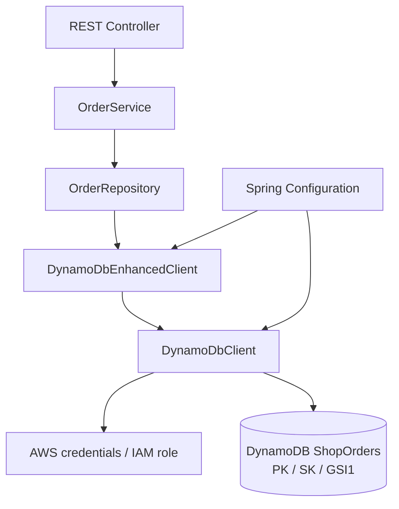
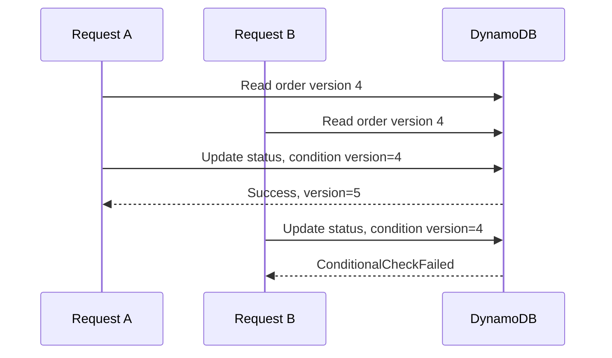
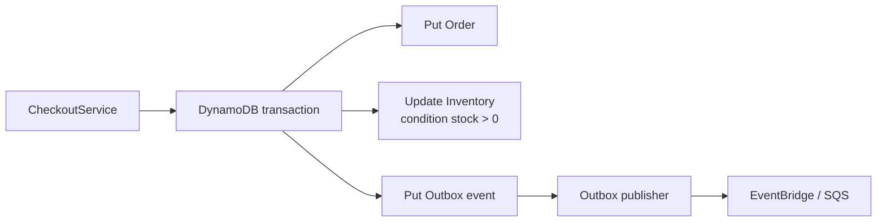

# Sử dụng DynamoDB cho repository theo access pattern

Khi một ứng dụng Spring Boot dùng DynamoDB, **repository cần phản ánh cách nghiệp vụ đọc và ghi dữ liệu**. DynamoDB không phải relational database có thể tùy ý gọi finder theo mọi cột hoặc JOIN nhiều bảng. Một truy vấn hiệu quả thường phải biết partition key, có thể kèm sort key hoặc index. Vì vậy, repository tốt bắt đầu từ access patterns đã được thiết kế, sau đó mới chọn method và query tương ứng.

Trong bài này, ta xây dựng repository cho ứng dụng Shop bằng **AWS SDK for Java v2 DynamoDB Enhanced Client**. Repository cung cấp các thao tác như lấy một order theo customer và order key, liệt kê orders mới nhất của customer, tìm order bằng order ID qua GSI và chuyển trạng thái order có kiểm tra version. Spring Boot quản lý client/repository qua dependency injection; IAM role cung cấp credentials khi ứng dụng chạy trên AWS.

Bài học thuộc chương **Ứng dụng Java và Spring Boot** của module **CLOUD_PROVIDERS_AWS**. Module khám phá Region/AZ, IAM, VPC, compute, storage, databases, integration và serverless để người học có thể lựa chọn, thiết kế, triển khai ứng dụng an toàn, có giám sát, khả năng phục hồi và kiểm soát chi phí. Repository trong bài là lớp truy cập dữ liệu cho ứng dụng Java; nó phải tôn trọng key schema, consistency, pagination, retry và giới hạn của DynamoDB.

## 1. Mục tiêu học tập

Sau bài học, bạn có thể:

1. Giải thích vì sao DynamoDB repository phải được thiết kế theo access patterns.
2. Chuyển yêu cầu nghiệp vụ thành table primary key và secondary index.
3. Phân biệt `GetItem`, `Query`, `Scan` và GSI lookup.
4. Cấu hình AWS SDK for Java v2 Enhanced Client trong Spring Boot.
5. Ánh xạ Java bean với DynamoDB bằng annotations và `TableSchema`.
6. Xây repository interface/implementation có method mang ý nghĩa nghiệp vụ.
7. Dùng `DynamoDbTable`, `DynamoDbIndex`, `QueryConditional` và `QueryEnhancedRequest`.
8. Thực hiện create/read/update với conditional expression và optimistic locking.
9. Trả dữ liệu nhiều trang qua cursor, không tải toàn bộ table vào memory.
10. Phân biệt repository CRUD với transaction nhiều items.
11. Bảo vệ kết nối bằng IAM role, VPC và least privilege.
12. Kiểm thử repository, xử lý lỗi và vận hành ứng dụng có thể quan sát được.

## 2. Vì sao repository phải theo access pattern?

Với SQL, một repository thường có thể tạo truy vấn theo nhiều cột nhờ optimizer và indexes. DynamoDB yêu cầu thiết kế trước những đường truy cập quan trọng. `GetItem` cần toàn bộ primary key; `Query` cần partition key equality và có thể lọc theo sort key; `Scan` đọc phạm vi rộng hơn.

Giả sử Shop cần:

- Lấy một order khi đã biết customer ID và order key.
- Liệt kê orders của customer theo thời gian mới nhất.
- Tìm order khi chỉ có order ID.
- Chuyển order từ `PLACED` sang `PAID` mà không ghi đè thay đổi đồng thời.

Không nên tạo một repository generic như:

```java
findByAnyField(String fieldName, Object value);
findAll();
search(String expression);
```

Các method này che giấu chi phí và có thể khiến code gọi `Scan` khi không có key/index phù hợp. Repository nên bộc lộ **các truy vấn mà domain thực sự cần**:

```java
findByCustomerAndOrderKey(customerId, orderKey);
findRecentOrdersByCustomer(customerId, pageSize, cursor);
findByOrderId(orderId);
transitionStatus(orderKey, expectedStatus, newStatus);
```

### 2.1. Access pattern là gì?

Access pattern mô tả một request thực tế mà ứng dụng cần thực hiện, bao gồm:

- Caller đã có những identifiers nào?
- Cần lấy một item hay một tập items?
- Cần sort theo trường nào?
- Có filter/range condition nào?
- Kết quả có thể phân trang không?
- Cần strong read hay chấp nhận eventual consistency?
- Ghi có cần condition, uniqueness hoặc atomicity không?

### 2.2. Từ yêu cầu đến DynamoDB operation

| Yêu cầu nghiệp vụ | Key đã biết | DynamoDB operation |
|---|---|---|
| Lấy một order của customer | PK và SK | `GetItem` |
| Liệt kê orders theo customer | PK, tùy chọn SK prefix/range | `Query` |
| Tìm order bằng order ID | GSI partition key | `Query` trên GSI |
| Tìm mọi order có status bất kỳ | Không có key phù hợp | Cân nhắc GSI/stream projection; tránh Scan online |
| Cập nhật trạng thái một order | PK và SK | `UpdateItem` với condition/version |
| Xóa một order cụ thể | PK và SK | `DeleteItem` với condition khi cần |

### 2.3. Repository không tự tạo index

Một method `findByOrderId` không làm DynamoDB tự biết cách tìm order ID. Nếu primary key là customer + time, repository cần một **GSI** hoặc một mapping có key phù hợp. Tên method Java không tạo ra index như một số ORM relational.

## 3. Kiến trúc ứng dụng Spring Boot

Ứng dụng sẽ chia trách nhiệm:



- **Controller**: nhận HTTP request, validate DTO và trả response.
- **Service**: thực thi business rules, authorization và state transitions.
- **Repository**: chuyển các access patterns thành DynamoDB operations.
- **Enhanced Client**: ánh xạ Java objects và hỗ trợ query/CRUD.
- **DynamoDbClient**: low-level service client, quản lý HTTP requests, credentials và retry.
- **DynamoDB**: lưu items theo primary key và indexes.

Không đặt truy vấn DynamoDB trực tiếp trong controller. Cũng không đưa business authorization vào repository rồi giả định IAM đã giải quyết quyền của user cuối.

## 4. Thiết kế access patterns cho ShopOrders

Ta chọn một table `ShopOrders` với composite primary key và một GSI.

### 4.1. Primary key

| Attribute | Key role | Ví dụ | Mục đích |
|---|---|---|---|
| `PK` | Partition key | `CUSTOMER#C42` | Gom orders theo customer |
| `SK` | Sort key | `ORDER#2026-11-20T08:00:00Z#O1001` | Sắp xếp theo thời gian và phân biệt order |

### 4.2. GSI1

| Attribute | Index role | Ví dụ | Mục đích |
|---|---|---|---|
| `GSI1PK` | GSI partition key | `ORDER#O1001` | Lookup theo order ID |
| `GSI1SK` | GSI sort key | `META` | Có thể mở rộng các loại records cùng index partition |

Tên index: `GSI1`.

### 4.3. Item mẫu

```json
{
  "PK": "CUSTOMER#C42",
  "SK": "ORDER#2026-11-20T08:00:00Z#O1001",
  "GSI1PK": "ORDER#O1001",
  "GSI1SK": "META",
  "customerId": "C42",
  "orderId": "O1001",
  "createdAt": "2026-11-20T08:00:00Z",
  "status": "PLACED",
  "totalMinorUnits": 125000,
  "version": 1
}
```

JSON trên là biểu diễn dữ liệu dễ đọc. Trong DynamoDB, `totalMinorUnits` và `version` là Number; key attributes là String.

### 4.4. Quy ước key

```text
PK = CUSTOMER#<customerId>
SK = ORDER#<UTC timestamp>#<orderId>

GSI1PK = ORDER#<orderId>
GSI1SK = META
```

Timestamp dùng UTC ISO-8601 với format cố định để sort theo thứ tự thời gian. `orderId` là suffix để hai orders tạo cùng timestamp vẫn có SK khác nhau. Prefix giúp phân biệt loại item nếu sau này table chứa thêm entity types.

### 4.5. Mapping access pattern

| Repository method | Key condition | Operation |
|---|---|---|
| `findByCustomerAndOrderKey` | `PK` + `SK` | Base table `GetItem` |
| `findRecentOrdersByCustomer` | `PK = customer`, `begins_with(SK, ORDER#)` | Base table `Query` descending |
| `findByOrderId` | `GSI1PK = ORDER#id` | GSI1 `Query` |
| `transitionStatus` | `PK` + `SK` + version/status condition | `UpdateItem` |

**GSI không bảo đảm unique** cho order ID. Nếu nghiệp vụ yêu cầu order ID duy nhất toàn hệ thống, ứng dụng phải đảm bảo điều đó khi tạo order, hoặc thiết kế primary key/conditional write/transaction phù hợp. Không dựa vào việc GSI thường trả một kết quả để coi đó là unique constraint.

## 5. Provision table và GSI

Enhanced Client ánh xạ objects; nó không tự tạo schema/index trong production chỉ vì bean có annotations. Table và GSI cần được provision qua IaC/deployment process hoặc công cụ quản trị được tổ chức phê duyệt.

Schema logic:

```text
Table: ShopOrders
  PK: String (HASH)
  SK: String (RANGE)

GSI: GSI1
  GSI1PK: String (HASH)
  GSI1SK: String (RANGE)
  Projection: INCLUDE/ALL theo fields repository cần
```

Chọn projection phù hợp:

- `KEYS_ONLY`: index chỉ chứa key attributes và base table keys.
- `INCLUDE`: thêm các non-key attributes được chỉ định.
- `ALL`: sao chép mọi attributes của item vào index.

GSI projection ảnh hưởng storage, write amplification và read patterns. Nếu `findByOrderId` cần `status`, `createdAt` và `totalMinorUnits`, có thể project các fields này để tránh một lần `GetItem` bổ sung; cân nhắc chi phí và data freshness.

### 5.1. Attribute definitions chỉ dành cho key

Khi tạo DynamoDB table/index, `AttributeDefinitions` chỉ khai báo attributes được dùng làm key trong table/index schema. Không cần khai báo mọi non-key attributes như `status`, `totalMinorUnits` hoặc `createdAt`.

### 5.2. Không tạo table trong mỗi lần khởi động Spring Boot

Production deployment nên quản lý table/GSI qua CloudFormation, CDK, Terraform hoặc quy trình IaC của tổ chức. Ứng dụng runtime cần kết nối và kiểm tra cấu hình cần thiết; không nên tự ý tạo/sửa/xóa production schema mỗi khi một pod khởi động.

## 6. Chọn AWS SDK for Java v2 Enhanced Client

Có hai mức API:

| API | Vai trò | Khi dùng |
|---|---|---|
| `DynamoDbClient` | Low-level API với `AttributeValue` maps | Cần kiểm soát request/response chi tiết, expression hoặc API chưa được Enhanced Client bao phủ |
| `DynamoDbEnhancedClient` | Object mapper và table/index abstractions | Repository Java muốn thao tác với model objects |

Enhanced Client vẫn dùng DynamoDB service API ở bên dưới. Nó không phải ORM SQL và không tự cung cấp joins, arbitrary finder methods hoặc transaction manager kiểu relational.

### 6.1. Maven dependencies

Ví dụ dependencies cho Spring Boot và AWS SDK v2:

```xml
<dependencyManagement>
  <dependencies>
    <dependency>
      <groupId>software.amazon.awssdk</groupId>
      <artifactId>bom</artifactId>
      <version>2.x.y</version>
      <type>pom</type>
      <scope>import</scope>
    </dependency>
  </dependencies>
</dependencyManagement>

<dependencies>
  <dependency>
    <groupId>org.springframework.boot</groupId>
    <artifactId>spring-boot-starter-web</artifactId>
  </dependency>
  <dependency>
    <groupId>software.amazon.awssdk</groupId>
    <artifactId>dynamodb</artifactId>
  </dependency>
  <dependency>
    <groupId>software.amazon.awssdk</groupId>
    <artifactId>dynamodb-enhanced</artifactId>
  </dependency>
  <dependency>
    <groupId>org.springframework.boot</groupId>
    <artifactId>spring-boot-starter-test</artifactId>
    <scope>test</scope>
  </dependency>
</dependencies>
```

`2.x.y` là placeholder cho một release SDK v2 được dự án chọn. Dùng BOM để đồng bộ version của các module AWS SDK; không trộn nhiều versions tùy ý.

## 7. Cấu hình DynamoDbClient trong Spring Boot

Tạo một client dùng chung theo application lifecycle. AWS SDK clients là thread-safe và nên được tái sử dụng; không tạo một `DynamoDbClient` cho mỗi HTTP request.

### 7.1. application.yml

```yaml
app:
  aws:
    region: ap-southeast-1
    dynamodb:
      orders-table: ShopOrders
```

### 7.2. Spring configuration

```java
package example.shop.config;

import org.springframework.beans.factory.annotation.Value;
import org.springframework.context.annotation.Bean;
import org.springframework.context.annotation.Configuration;

import software.amazon.awssdk.enhanced.dynamodb.DynamoDbEnhancedClient;
import software.amazon.awssdk.enhanced.dynamodb.DynamoDbTable;
import software.amazon.awssdk.enhanced.dynamodb.TableSchema;
import software.amazon.awssdk.regions.Region;
import software.amazon.awssdk.services.dynamodb.DynamoDbClient;

import example.shop.persistence.OrderItem;

@Configuration
public class DynamoDbConfiguration {

    @Bean(destroyMethod = "close")
    DynamoDbClient dynamoDbClient(
            @Value("${app.aws.region}") String region) {
        return DynamoDbClient.builder()
                .region(Region.of(region))
                .build();
    }

    @Bean
    DynamoDbEnhancedClient dynamoDbEnhancedClient(
            DynamoDbClient dynamoDbClient) {
        return DynamoDbEnhancedClient.builder()
                .dynamoDbClient(dynamoDbClient)
                .build();
    }

    @Bean
    DynamoDbTable<OrderItem> orderTable(
            DynamoDbEnhancedClient enhancedClient,
            @Value("${app.aws.dynamodb.orders-table}") String tableName) {
        return enhancedClient.table(
                tableName,
                TableSchema.fromBean(OrderItem.class));
    }
}
```

`DefaultCredentialsProvider` được dùng theo credential provider chain mặc định của SDK vì không chỉ định provider khác. Trên AWS, workload nên dùng IAM role tương ứng; local development có thể dùng profile/SSO đã cấu hình. Không hardcode access key/secret vào `application.yml`.

Enhanced Client mặc định nạp optimistic-lock version extension. Nếu cấu hình danh sách extension riêng, danh sách mặc định sẽ bị thay thế; hãy đăng ký lại VersionedRecordExtension nếu vẫn cần optimistic locking. AtomicCounterExtension là extension riêng có thể đăng ký khi ứng dụng dùng atomic counter. Với cấu hình version mặc định, version đầu tiên là 1 (startAt 0, incrementBy 1) và tăng sau mỗi write thành công; có thể cấu hình startAt/incrementBy khác nếu domain yêu cầu.

Nếu chạy DynamoDB Local/LocalStack, cấu hình `endpointOverride` và credentials giả chỉ trong local/test profile. Production dùng endpoint AWS mặc định và IAM workload role; không để endpoint local hoặc credentials giả lọt vào production config.

### 7.3. Vì sao không tạo client trong repository method?

Không nên:

```java
public OrderItem find(String pk, String sk) {
    try (DynamoDbClient client = DynamoDbClient.create()) {
        // ...
    }
}
```

Mỗi request sẽ tạo/đóng HTTP client và connection pools, gây overhead, latency và tài nguyên không cần thiết. Spring quản lý một client singleton theo lifecycle ứng dụng.

## 8. Ánh xạ Java bean với DynamoDB

Enhanced Client có thể tạo `TableSchema` từ annotations. Với `@DynamoDbBean`, class cần constructor không tham số và getter/setter theo JavaBean convention.

### 8.1. OrderItem persistence model

```java
package example.shop.persistence;

import software.amazon.awssdk.enhanced.dynamodb.mapper.annotations.DynamoDbAttribute;
import software.amazon.awssdk.enhanced.dynamodb.mapper.annotations.DynamoDbBean;
import software.amazon.awssdk.enhanced.dynamodb.mapper.annotations.DynamoDbPartitionKey;
import software.amazon.awssdk.enhanced.dynamodb.mapper.annotations.DynamoDbSortKey;
import software.amazon.awssdk.enhanced.dynamodb.mapper.annotations.DynamoDbSecondaryPartitionKey;
import software.amazon.awssdk.enhanced.dynamodb.mapper.annotations.DynamoDbSecondarySortKey;
import software.amazon.awssdk.enhanced.dynamodb.extensions.annotations.DynamoDbVersionAttribute;

@DynamoDbBean
public class OrderItem {
    private String pk;
    private String sk;
    private String gsi1pk;
    private String gsi1sk;
    private String customerId;
    private String orderId;
    private String createdAt;
    private String status;
    private Long totalMinorUnits;
    private Long version;

    public OrderItem() {
    }

    @DynamoDbPartitionKey
    @DynamoDbAttribute("PK")
    public String getPk() { return pk; }
    public void setPk(String pk) { this.pk = pk; }

    @DynamoDbSortKey
    @DynamoDbAttribute("SK")
    public String getSk() { return sk; }
    public void setSk(String sk) { this.sk = sk; }

    @DynamoDbSecondaryPartitionKey(indexNames = "GSI1")
    @DynamoDbAttribute("GSI1PK")
    public String getGsi1pk() { return gsi1pk; }
    public void setGsi1pk(String gsi1pk) { this.gsi1pk = gsi1pk; }

    @DynamoDbSecondarySortKey(indexNames = "GSI1")
    @DynamoDbAttribute("GSI1SK")
    public String getGsi1sk() { return gsi1sk; }
    public void setGsi1sk(String gsi1sk) { this.gsi1sk = gsi1sk; }

    @DynamoDbAttribute("customerId")
    public String getCustomerId() { return customerId; }
    public void setCustomerId(String customerId) {
        this.customerId = customerId;
    }

    @DynamoDbAttribute("orderId")
    public String getOrderId() { return orderId; }
    public void setOrderId(String orderId) { this.orderId = orderId; }

    @DynamoDbAttribute("createdAt")
    public String getCreatedAt() { return createdAt; }
    public void setCreatedAt(String createdAt) {
        this.createdAt = createdAt;
    }

    @DynamoDbAttribute("status")
    public String getStatus() { return status; }
    public void setStatus(String status) { this.status = status; }

    @DynamoDbAttribute("totalMinorUnits")
    public Long getTotalMinorUnits() { return totalMinorUnits; }
    public void setTotalMinorUnits(Long totalMinorUnits) {
        this.totalMinorUnits = totalMinorUnits;
    }

    @DynamoDbVersionAttribute
    @DynamoDbAttribute("version")
    public Long getVersion() { return version; }
    public void setVersion(Long version) { this.version = version; }
}
```

### 8.2. Key factory

Tách quy tắc tạo key thành một helper để không lặp chuỗi ở controller/service/repository:

```java
package example.shop.persistence;

public final class OrderKeys {
    private OrderKeys() {
    }

    public static String customerPk(String customerId) {
        return "CUSTOMER#" + requireValue(customerId);
    }

    public static String orderSk(String createdAt, String orderId) {
        return "ORDER#" + requireValue(createdAt)
                + "#" + requireValue(orderId);
    }

    public static String orderIndexPk(String orderId) {
        return "ORDER#" + requireValue(orderId);
    }

    private static String requireValue(String value) {
        if (value == null || value.isBlank()) {
            throw new IllegalArgumentException("Key component is required");
        }
        return value;
    }
}
```

`OrderKeys` chỉ tạo key từ identifiers đã được validate. Không nhận PK/SK tùy ý từ browser; server phải dựng keys từ identity và domain data đáng tin cậy.

Quy ước separator cũng là một phần key contract: nếu business IDs có thể chứa ký tự #, cần encode/escape chúng trước khi ghép key hoặc chọn một encoding không nhập nhằng. Nếu không, hai tổ hợp components khác nhau có thể tạo ra cùng một key string.

### 8.3. DynamoDB bean không nhất thiết là domain entity

Persistence model phản ánh key attributes và GSI. Domain model có thể có invariants, value objects và methods riêng. Với ứng dụng phức tạp, map `OrderItem` sang `Order` domain object để tránh đưa chi tiết DynamoDB như `PK`, `SK`, `GSI1PK` vào business layer.

## 9. Định nghĩa repository theo nghiệp vụ

Repository interface mô tả use cases của ứng dụng, không phơi bày toàn bộ DynamoDB API cho service/controller.

### 9.1. OrderPage

Kết quả phân trang gồm items của một page và key để lấy page tiếp theo:

```java
package example.shop.persistence;

import java.util.List;
import java.util.Map;

import software.amazon.awssdk.services.dynamodb.model.AttributeValue;

public record OrderPage(
        List<OrderItem> items,
        Map<String, AttributeValue> nextKey) {
}
```

`nextKey` là key map do DynamoDB trả. Trong REST API, không trả trực tiếp map này cho browser như một quyền truy cập; service có thể encode/sign nó thành opaque cursor gắn với customer, filter và page size.

### 9.2. OrderRepository interface

```java
package example.shop.persistence;

import java.util.Map;
import java.util.Optional;

import software.amazon.awssdk.services.dynamodb.model.AttributeValue;

public interface OrderRepository {
    void create(OrderItem order);

    Optional<OrderItem> findByCustomerAndOrderKey(
            String customerId,
            String createdAt,
            String orderId);

    Optional<OrderItem> findByOrderId(String orderId);

    OrderPage findRecentOrdersByCustomer(
            String customerId,
            int pageSize,
            Map<String, AttributeValue> startKey);

    OrderItem transitionStatus(
            String customerId,
            String createdAt,
            String orderId,
            String expectedStatus,
            String newStatus);
}
```

Các method thể hiện đúng những access patterns đã thiết kế. Nếu use case mới xuất hiện, trước hết kiểm tra nó có thể dùng key/index hiện có hay cần thay đổi data model.

## 10. Implement repository bằng DynamoDbEnhancedClient

### 10.1. Repository implementation

```java
package example.shop.persistence;

import java.util.Iterator;
import java.util.List;
import java.util.Map;
import java.util.Optional;

import org.springframework.stereotype.Repository;

import software.amazon.awssdk.enhanced.dynamodb.DynamoDbIndex;
import software.amazon.awssdk.enhanced.dynamodb.DynamoDbTable;
import software.amazon.awssdk.enhanced.dynamodb.Key;
import software.amazon.awssdk.enhanced.dynamodb.model.Page;
import software.amazon.awssdk.enhanced.dynamodb.model.PageIterable;
import software.amazon.awssdk.enhanced.dynamodb.model.QueryConditional;
import software.amazon.awssdk.enhanced.dynamodb.model.QueryEnhancedRequest;
import software.amazon.awssdk.enhanced.dynamodb.model.PutItemEnhancedRequest;
import software.amazon.awssdk.enhanced.dynamodb.Expression;
import software.amazon.awssdk.services.dynamodb.model.AttributeValue;
import software.amazon.awssdk.services.dynamodb.model.ConditionalCheckFailedException;

@Repository
public class DynamoDbOrderRepository implements OrderRepository {
    private static final String ORDER_INDEX = "GSI1";
    private final DynamoDbTable<OrderItem> table;

    public DynamoDbOrderRepository(DynamoDbTable<OrderItem> table) {
        this.table = table;
    }

    @Override
    public void create(OrderItem order) {
        Expression condition = Expression.builder()
                .expression("attribute_not_exists(PK)")
                .build();

        PutItemEnhancedRequest<OrderItem> request =
                PutItemEnhancedRequest.builder(OrderItem.class)
                        .item(order)
                        .conditionExpression(condition)
                        .build();

        try {
            table.putItem(request);
        } catch (ConditionalCheckFailedException exception) {
            throw new OrderConflictException(
                    "Order key already exists", exception);
        }
    }

    @Override
    public Optional<OrderItem> findByCustomerAndOrderKey(
            String customerId,
            String createdAt,
            String orderId) {

        Key key = Key.builder()
                .partitionValue(OrderKeys.customerPk(customerId))
                .sortValue(OrderKeys.orderSk(createdAt, orderId))
                .build();

        return Optional.ofNullable(table.getItem(key));
    }

    @Override
    public Optional<OrderItem> findByOrderId(String orderId) {
        DynamoDbIndex<OrderItem> index = table.index(ORDER_INDEX);
        String indexPk = OrderKeys.orderIndexPk(orderId);

        PageIterable<OrderItem> pages = index.query(request ->
                request.queryConditional(
                        QueryConditional.keyEqualTo(
                                Key.builder()
                                        .partitionValue(indexPk)
                                        .build()))
                        .limit(2));

        Iterator<OrderItem> items = pages.items().iterator();
        if (!items.hasNext()) {
            return Optional.empty();
        }

        OrderItem result = items.next();
        if (items.hasNext()) {
            throw new IllegalStateException(
                    "More than one order uses orderId " + orderId);
        }
        return Optional.of(result);
    }

    @Override
    public OrderPage findRecentOrdersByCustomer(
            String customerId,
            int pageSize,
            Map<String, AttributeValue> startKey) {

        if (pageSize < 1 || pageSize > 100) {
            throw new IllegalArgumentException(
                    "pageSize must be between 1 and 100");
        }

        Key prefix = Key.builder()
                .partitionValue(OrderKeys.customerPk(customerId))
                .sortValue("ORDER#")
                .build();

        QueryEnhancedRequest.Builder request =
                QueryEnhancedRequest.builder()
                        .queryConditional(QueryConditional.sortBeginsWith(prefix))
                        .scanIndexForward(false)
                        .limit(pageSize);

        if (startKey != null && !startKey.isEmpty()) {
            request.exclusiveStartKey(startKey);
        }

        Iterator<Page<OrderItem>> pages =
                table.query(request.build()).iterator();

        if (!pages.hasNext()) {
            return new OrderPage(List.of(), Map.of());
        }

        Page<OrderItem> page = pages.next();
        Map<String, AttributeValue> nextKey = page.lastEvaluatedKey();
        return new OrderPage(
                page.items(),
                nextKey == null ? Map.of() : nextKey);
    }

    @Override
    public OrderItem transitionStatus(
            String customerId,
            String createdAt,
            String orderId,
            String expectedStatus,
            String newStatus) {

        OrderItem current = findByCustomerAndOrderKey(
                customerId, createdAt, orderId)
                .orElseThrow(() -> new OrderNotFoundException(orderId));

        if (!expectedStatus.equals(current.getStatus())) {
            throw new OrderConflictException(
                    "Expected status " + expectedStatus
                            + " but found " + current.getStatus());
        }

        current.setStatus(newStatus);
        try {
            // VersionedRecordExtension adds an optimistic-lock condition.
            return table.updateItem(current);
        } catch (ConditionalCheckFailedException exception) {
            throw new OrderConflictException(
                    "Order changed concurrently; reload and retry", exception);
        }
    }
}
```

Ví dụ trên dùng `VersionedRecordExtension` và `@DynamoDbVersionAttribute` để kiểm tra version khi update. Trong ứng dụng thật, cần định nghĩa các exception `OrderNotFoundException`/`OrderConflictException` theo quy ước của project; đoạn code tập trung minh họa repository flow.

### 10.2. Domain exceptions

```java
package example.shop.persistence;

public class OrderNotFoundException extends RuntimeException {
    public OrderNotFoundException(String orderId) {
        super("Order not found: " + orderId);
    }
}
```

```java
package example.shop.persistence;

public class OrderConflictException extends RuntimeException {
    public OrderConflictException(String message) {
        super(message);
    }

    public OrderConflictException(String message, Throwable cause) {
        super(message, cause);
    }
}
```

Không chuyển mọi `DynamoDbException` thành not found. `ResourceNotFoundException` có thể chỉ table/index không tồn tại; `ConditionalCheckFailedException` là conflict theo điều kiện; `AccessDeniedException` là lỗi quyền.

## 11. Đọc một item bằng GetItem

`GetItem` là lựa chọn phù hợp khi đã biết **toàn bộ primary key**:

```java
Key key = Key.builder()
        .partitionValue("CUSTOMER#C42")
        .sortValue("ORDER#2026-11-20T08:00:00Z#O1001")
        .build();

OrderItem item = orderTable.getItem(key);
```

Nếu item không tồn tại, Enhanced Client trả `null`; repository chuyển thành `Optional.empty()`. Với composite key, không thể chỉ truyền customer PK và kỳ vọng `GetItem` trả mọi orders.

### 11.1. Strongly consistent read

Base table có thể đọc strongly consistent khi request hỗ trợ. Enhanced Client hỗ trợ cấu hình consistent read trong `GetItemEnhancedRequest`:

```java
var request = GetItemEnhancedRequest.builder()
        .key(key)
        .consistentRead(true)
        .build();

OrderItem item = orderTable.getItem(request);
```

Chỉ bật strong read khi business requirement cần read-after-write và chấp nhận chi phí/latency tương ứng. Strong read trên base table không làm GSI trở thành strongly consistent.

## 12. Query theo customer và sort key

Để lấy orders mới nhất của C42, repository Query theo PK và dùng sort key prefix:

```java
Key condition = Key.builder()
        .partitionValue("CUSTOMER#C42")
        .sortValue("ORDER#")
        .build();

var pages = orderTable.query(request -> request
        .queryConditional(QueryConditional.sortBeginsWith(condition))
        .scanIndexForward(false)
        .limit(20));
```

- `partitionValue` xác định item collection của customer.
- `sortBeginsWith` chỉ lấy SK bắt đầu bằng `ORDER#`.
- `scanIndexForward(false)` đọc theo sort key giảm dần.
- `limit(20)` giới hạn số items được đánh giá/trả theo Query request semantics; pagination có thể còn page tiếp.

### 12.1. Query và FilterExpression

Nếu cần lọc status, có thể thêm filter expression:

```java
import java.util.Map;

import software.amazon.awssdk.enhanced.dynamodb.Expression;
import software.amazon.awssdk.enhanced.dynamodb.Key;
import software.amazon.awssdk.enhanced.dynamodb.model.QueryConditional;
import software.amazon.awssdk.enhanced.dynamodb.model.QueryEnhancedRequest;
import software.amazon.awssdk.services.dynamodb.model.AttributeValue;

Key condition = Key.builder()
        .partitionValue("CUSTOMER#C42")
        .sortValue("ORDER#")
        .build();

Expression statusFilter = Expression.builder()
        .expression("#status = :paid")
        .expressionNames(Map.of("#status", "status"))
        .expressionValues(Map.of(
                ":paid", AttributeValue.builder().s("PAID").build()))
        .build();

var request = QueryEnhancedRequest.builder()
        .queryConditional(QueryConditional.sortBeginsWith(condition))
        .filterExpression(statusFilter)
        .scanIndexForward(false)
        .limit(20)
        .build();

var pages = orderTable.query(request);
```

FilterExpression được áp dụng sau khi DynamoDB đọc/đánh giá items. Nếu phần lớn orders không phải PAID, filter vẫn có thể đọc nhiều items. Nếu truy vấn theo status là access pattern nóng, cân nhắc GSI hoặc projection khác thay vì thêm filter vào mọi request.

## 13. Lookup bằng GSI

Khi chỉ có `orderId`, repository Query GSI1:

```java
var orderIndex = orderTable.index("GSI1");

var pages = orderIndex.query(request -> request
        .queryConditional(QueryConditional.keyEqualTo(
                Key.builder()
                        .partitionValue("ORDER#O1001")
                        .build()))
        .limit(2));
```

GSI có eventual consistency. Một order vừa được tạo có thể chưa xuất hiện ngay trong GSI query. Nếu request tạo order cần trả lại dữ liệu vừa ghi, dùng object vừa tạo hoặc đọc base table bằng key đầy đủ thay vì query GSI để xác nhận tức thì.

### 13.1. GSI không phải uniqueness constraint

Một GSI partition key có thể có nhiều items. Nếu repository mong đợi đúng một order, nó nên phát hiện duplicates như ví dụ `findByOrderId`; đồng thời application phải đảm bảo uniqueness ở bước tạo. Nếu order ID cần unique toàn cục, cân nhắc table/key design hoặc conditional transaction để serialize việc claim ID.

## 14. Cập nhật item và optimistic locking

`@DynamoDbVersionAttribute` giúp Enhanced Client theo dõi version. Khi đọc item, version được ánh xạ vào bean. Khi update, extension thêm điều kiện để chỉ cập nhật nếu version trong database vẫn khớp version đã đọc, rồi tăng version.



### 14.1. State transition

Repository/service kiểm tra trạng thái nghiệp vụ:

```java
OrderItem saved = repository.transitionStatus(
        customerId,
        createdAt,
        orderId,
        "PLACED",
        "PAID");
```

Repository đọc item, kiểm tra trạng thái nghiệp vụ, rồi cập nhật với version condition. Nếu một request khác update sau khi item được đọc, optimistic lock phát hiện stale version và trả conflict.

### 14.2. Tất cả writers phải tuân theo version contract

Optimistic locking chỉ hiệu quả nếu các đường ghi đều duy trì version. Một script/worker khác dùng low-level `UpdateItem` nhưng không kiểm tra/increment version có thể phá vỡ giả định. Document version attribute như một phần persistence contract và áp dụng cho mọi writers.

### 14.3. Conditional writes cho create

`PutItem` cùng key có thể thay thế item hiện có. Repository `create` dùng condition `attribute_not_exists(PK)` để từ chối overwrite:

```text
ConditionExpression:
  attribute_not_exists(PK)

Nếu item đã tồn tại:
  ConditionalCheckFailedException
```

Nếu cần tạo nhiều items cùng một đơn vị nghiệp vụ, conditional PutItem đơn lẻ không đủ; xem xét `TransactWriteItems` và idempotency key.

## 15. Transaction khi một nghiệp vụ cập nhật nhiều items

Một repository method có thể chỉ gọi một API, nhưng một use case có thể cần nhiều items thay đổi cùng nhau. Ví dụ checkout cần tạo Order, giảm Inventory và ghi Outbox event. Nếu thực hiện ba writes độc lập, request thứ ba có thể thất bại sau khi hai writes đầu đã thành công.

### 15.1. DynamoDB transaction

`TransactWriteItems` cho phép nhóm nhiều put/update/delete/condition checks trong một transaction theo giới hạn của DynamoDB. Enhanced Client có API `transactWriteItems` và request builder tương ứng để làm việc với mapped tables.



Trong transaction:

- Put Order chỉ khi order key chưa tồn tại.
- Update Inventory chỉ khi số lượng còn đủ.
- Put Outbox event với event ID ổn định.
- Nếu một điều kiện không thỏa, toàn transaction thất bại.

Sau khi transaction commit, publisher đọc Outbox và phát event. Consumer vẫn cần idempotency vì event có thể được giao lại.

### 15.2. Enhanced Client transaction minh họa

```java
import java.util.Map;

import software.amazon.awssdk.enhanced.dynamodb.Expression;
import software.amazon.awssdk.enhanced.dynamodb.model.TransactWriteItemsEnhancedRequest;
import software.amazon.awssdk.services.dynamodb.model.AttributeValue;

Expression stockCondition = Expression.builder()
        .expression("availableQuantity >= :required")
        .expressionValues(Map.of(
                ":required", AttributeValue.builder().n("2").build()))
        .build();

var request = TransactWriteItemsEnhancedRequest.builder()
        .addPutItem(orderTable, orderItem)
        .addUpdateItem(inventoryTable, update -> update
                .item(updatedInventory)
                .conditionExpression(stockCondition))
        .addPutItem(outboxTable, outboxItem)
        .build();

enhancedClient.transactWriteItems(request);
```

Đây là ví dụ rút gọn: các mapped tables và items phải được cấu hình đúng, transaction phải nằm trong giới hạn service và điều kiện cập nhật tồn kho cần được đưa vào request tương ứng. Khi cần condition checks phức tạp, xây transaction request với condition expressions theo API Enhanced Client/low-level phù hợp.

### 15.3. Spring @Transactional không tự quản lý DynamoDB

Không giả định:

```java
@Transactional
public void checkout(...) {
    orderRepository.create(order);
    inventoryRepository.decreaseStock(...);
}
```

`@Transactional` của Spring chỉ có hiệu lực khi có transaction manager quản lý các resource được tham gia. Một `DynamoDbClient` thông thường không tự động tham gia transaction của JDBC/JPA. Dùng DynamoDB transaction API cho các writes trong DynamoDB; nếu trải qua DynamoDB và SQS/EventBridge/payment service, thiết kế outbox, saga hoặc compensation.

## 16. Pagination trong repository

Repository nên trả một page có giới hạn thay vì trả toàn bộ orders của customer. `OrderPage` trong phần 9 mang items và `nextKey`.

### 16.1. Vì sao không trả List vô hạn?

Một customer có thể có hàng trăm nghìn orders. Method:

```java
List<OrderItem> findAllByCustomer(String customerId);
```

có thể buộc service gọi nhiều Query pages rồi giữ toàn bộ kết quả trong heap. API nên giới hạn page size và trả cursor để client lấy tiếp khi cần.

### 16.2. Cursor phải được ràng buộc với access pattern

Một cursor public nên mang đủ context để server tiếp tục đúng truy vấn:

```text
cursor payload (logical):
  version
  customerId / tenantId
  sortOrder
  pageSize
  filter
  lastEvaluatedKey
  expiresAt
```

Server serialize payload, ký HMAC hoặc mã hóa theo yêu cầu, rồi trả opaque cursor. Khi nhận cursor:

1. Verify signature/expiry và cursor version.
2. So sánh customer/tenant với authenticated principal.
3. Kiểm tra filter, sort order và page size không bị thay đổi ngoài policy.
4. Decode key map và truyền vào `exclusiveStartKey`.
5. Trả cursor mới từ `lastEvaluatedKey` của page vừa đọc.

Không tin `customerId` hoặc key map do browser tự gửi. Cursor không phải authorization token; mỗi request vẫn phải xác thực và authorize.

### 16.3. GSI pagination

GSI query cũng có thể có nhiều pages. `LastEvaluatedKey` có thể chứa base table keys và index keys cần thiết để tiếp tục. Lưu toàn bộ map do service trả; không tự tạo map chỉ gồm `GSI1PK`.

### 16.4. Page rỗng vẫn có thể còn cursor

Nếu Query dùng FilterExpression, một page có thể trả zero items nhưng vẫn có `lastEvaluatedKey`. Repository phải trả cursor nếu key còn tồn tại, ngay cả khi `items` rỗng. Không dừng pagination chỉ vì danh sách items của page hiện tại trống.

## 17. Tích hợp repository vào Spring Service và REST Controller

Controller không nên biết `PK`, `SK`, GSI hay `AttributeValue`. Service xác thực user, áp dụng business rules và gọi repository.

### 17.1. Service layer

```java
package example.shop.order;

import java.util.List;
import java.util.Map;

import org.springframework.stereotype.Service;

import example.shop.persistence.OrderPage;
import example.shop.persistence.OrderRepository;
import software.amazon.awssdk.services.dynamodb.model.AttributeValue;

@Service
public class OrderService {
    private final OrderRepository repository;
    private final OrderCursorCodec cursorCodec;

    public OrderService(
            OrderRepository repository,
            OrderCursorCodec cursorCodec) {
        this.repository = repository;
        this.cursorCodec = cursorCodec;
    }

    public OrderPageResponse recentOrders(
            String authenticatedCustomerId,
            int pageSize,
            String cursor) {
        Map<String, AttributeValue> startKey = cursorCodec.decode(
                cursor, authenticatedCustomerId, pageSize);

        OrderPage page = repository.findRecentOrdersByCustomer(
                authenticatedCustomerId, pageSize, startKey);

        String nextCursor = page.nextKey().isEmpty()
                ? null
                : cursorCodec.encode(
                        page.nextKey(), authenticatedCustomerId, pageSize);

        List<OrderSummary> items = page.items().stream()
                .map(OrderSummary::from)
                .toList();
        return new OrderPageResponse(items, nextCursor);
    }

    public OrderSummary payOrder(
            String customerId,
            String createdAt,
            String orderId) {
        return OrderSummary.from(repository.transitionStatus(
                customerId, createdAt, orderId, "PLACED", "PAID"));
    }
}
```

Để response độc lập với persistence model, định nghĩa DTO và cursor contract:

```java
package example.shop.order;

import java.util.List;
import java.util.Map;

import example.shop.persistence.OrderItem;
import software.amazon.awssdk.services.dynamodb.model.AttributeValue;

public record OrderSummary(
        String orderId,
        String createdAt,
        String status,
        Long totalMinorUnits) {

    public static OrderSummary from(OrderItem item) {
        return new OrderSummary(
                item.getOrderId(),
                item.getCreatedAt(),
                item.getStatus(),
                item.getTotalMinorUnits());
    }
}

public record OrderPageResponse(
        List<OrderSummary> items,
        String nextCursor) {
}

public interface OrderCursorCodec {
    Map<String, AttributeValue> decode(
            String cursor, String customerId, int pageSize);

    String encode(
            Map<String, AttributeValue> lastKey,
            String customerId,
            int pageSize);
}
```

Trong project, đặt mỗi public top-level type vào file Java riêng (OrderSummary.java, OrderPageResponse.java và OrderCursorCodec.java). Khi không có cursor đầu vào, codec trả key map rỗng; khi có cursor, codec xác minh chữ ký/expiry và customer context trước khi decode.

`OrderCursorCodec` phải verify signature/expiry và bind cursor với customer, page size cùng sort order của access pattern hiện tại. Nếu API bổ sung filter/sort tùy chọn, đưa chúng vào cursor payload và kiểm tra khi decode. `authenticatedCustomerId` phải lấy từ verified authentication context, không lấy trực tiếp từ query parameter rồi tin đó là quyền của caller.

### 17.2. Controller trả DTO

```java
package example.shop.order;

import org.springframework.web.bind.annotation.GetMapping;
import org.springframework.web.bind.annotation.RequestParam;
import org.springframework.web.bind.annotation.RestController;

@RestController
public class OrderController {
    private final OrderService service;

    public OrderController(OrderService service) {
        this.service = service;
    }

    @GetMapping("/api/orders")
    public OrderPageResponse recentOrders(
            @RequestParam(defaultValue = "20") int limit,
            @RequestParam(required = false) String cursor) {

        // Resolve customerId from authenticated principal in real application.
        String authenticatedCustomerId = currentCustomerId();

        return service.recentOrders(
                authenticatedCustomerId,
                Math.min(Math.max(limit, 1), 100),
                cursor);
    }
}
```

`currentCustomerId` là placeholder cho authentication infrastructure của ứng dụng. Không đưa code rút gọn này vào project mà chưa triển khai việc lấy customer ID từ authenticated principal.

### 17.3. Error mapping

| Exception/domain result | HTTP mapping gợi ý |
|---|---|
| `OrderNotFoundException` | 404 Not Found |
| `OrderConflictException` | 409 Conflict |
| Invalid page size/cursor | 400 Bad Request |
| `AccessDeniedException` từ AWS | 500/503 theo boundary và log; không lộ IAM details |
| Throttling/temporary service failure | 503 Service Unavailable hoặc retry policy nội bộ |
| `ValidationException` do code gửi request sai | 500 + alert; sửa implementation |

Đừng trả raw AWS exception message, ARN nội bộ hoặc request details cho browser. Log correlation ID và exception type ở server.

## 18. IAM, VPC và quyền truy cập dữ liệu

### 18.1. IAM role của workload

Spring Boot chạy trên ECS nên dùng **task role**; chạy trên EC2 dùng instance profile; chạy trên EKS dùng cơ chế workload identity phù hợp; chạy trên Lambda dùng execution role. SDK default credentials provider chain sẽ tìm credentials từ environment/runtime phù hợp.

Policy cần các actions mà repository sử dụng, giới hạn vào table/index:

```json
{
  "Version": "2012-10-17",
  "Statement": [
    {
      "Effect": "Allow",
      "Action": [
        "dynamodb:GetItem",
        "dynamodb:PutItem",
        "dynamodb:UpdateItem",
        "dynamodb:Query",
        "dynamodb:TransactWriteItems"
      ],
      "Resource": [
        "arn:aws:dynamodb:ap-southeast-1:111122223333:table/ShopOrders",
        "arn:aws:dynamodb:ap-southeast-1:111122223333:table/ShopOrders/index/GSI1"
      ]
    }
  ]
}
```

Policy là minh họa. Bổ sung actions/index ARNs đúng theo operations thật; không cấp `dynamodb:*` hoặc `Scan` nếu repository không cần. Kiểm tra SCP, permissions boundary, resource policy/endpoint policy và KMS nếu có.

### 18.2. IAM không thay business authorization

Task role có thể đọc toàn bộ ShopOrders table. Điều đó không có nghĩa mọi khách hàng đều được xem mọi order. Backend phải:

- Xác thực người dùng.
- Lấy customer/tenant ID từ identity claims hoặc membership record tin cậy.
- Dựng PK từ customer ID đã xác thực.
- Kiểm tra resource ownership trước khi trả dữ liệu.
- Không tin order/customer IDs chỉ vì chúng xuất hiện trong URL.

### 18.3. VPC gateway endpoint cho DynamoDB

Nếu ứng dụng chạy trong private subnet và cần truy cập DynamoDB, có thể dùng **DynamoDB gateway VPC endpoint**. Route table được cấu hình để traffic tới DynamoDB đi qua endpoint theo thiết kế; ứng dụng không nhất thiết phải đi qua NAT gateway cho luồng này.

Endpoint policy và IAM policy là hai lớp độc lập. Một policy Allow không vượt qua Deny ở lớp còn lại. Kiểm tra Region, route table, endpoint policy và DNS/network path khi request timeout hoặc AccessDenied.

### 18.4. Encryption và dữ liệu nhạy cảm

DynamoDB hỗ trợ encryption at rest; SDK giao tiếp qua HTTPS/TLS. Không lưu credentials, session tokens hoặc thông tin thanh toán nhạy cảm không cần thiết vào item. Tránh log full item hoặc cursor chứa customer data.

## 19. Consistency, GSI và các quyết định dữ liệu

### 19.1. Base table và GSI

| Read source | Consistency |
|---|---|
| Base table | Eventual hoặc strong consistent read khi API hỗ trợ |
| GSI | Eventual consistency |

Nếu vừa tạo order rồi cần hiển thị ngay:

- Trả object đã tạo từ service response.
- Hoặc đọc base table bằng đầy đủ PK/SK.
- Không dùng GSI query như một synchronous uniqueness/confirmation check.

### 19.2. Không dùng Scan làm finder tổng quát

Method `findByStatus("PAID")` nếu không có key/index phù hợp có thể dẫn tới Scan. Khi table lớn, Scan đọc nhiều dữ liệu và tốn capacity/latency. Nếu đây là access pattern thường xuyên, thiết kế GSI hoặc read model chuyên dụng.

### 19.3. Hot partition

Nếu mọi writes dồn vào một PK như `STATUS#PAID`, partition có thể nóng. Với ShopOrders, customer PK thường phân tán hơn, nhưng một tenant/customer cực lớn vẫn có thể tạo hot key. Theo dõi traffic distribution và thiết kế sharding nếu workload thực sự cần.

### 19.4. GSI thay đổi là thay đổi data contract

Khi thêm GSI, cần:

1. Cập nhật IaC/table deployment.
2. Backfill key attributes cho items cũ nếu cần.
3. Chờ index ACTIVE.
4. Kiểm tra projection và IAM index ARN.
5. Deploy repository code sau khi index sẵn sàng.
6. Đo latency/cost và consistency behavior.

Không deploy code gọi index trước khi index đã được provision và sẵn sàng.
## 20. Kiểm thử repository

Repository là nơi ánh xạ access patterns thành service calls. Cần kiểm thử cả business behavior và request semantics; chỉ mock `DynamoDbTable` không chứng minh key schema/GSI/query hoạt động đúng.

### 20.1. Unit test service

Mock `OrderRepository` để kiểm tra business rules:

```java
import example.shop.persistence.OrderItem;
import example.shop.persistence.OrderRepository;
import org.junit.jupiter.api.Test;
import org.junit.jupiter.api.extension.ExtendWith;
import org.mockito.InjectMocks;
import org.mockito.Mock;
import org.mockito.junit.jupiter.MockitoExtension;

import static org.junit.jupiter.api.Assertions.assertEquals;
import static org.mockito.Mockito.verify;
import static org.mockito.Mockito.when;

@ExtendWith(MockitoExtension.class)
class OrderServiceTest {
    @Mock
    OrderRepository repository;

    @Mock
    OrderCursorCodec cursorCodec;

    @InjectMocks
    OrderService service;

    @Test
    void payOrderRequestsExpectedStateTransition() {
        var item = new OrderItem();
        item.setOrderId("O1001");
        item.setStatus("PAID");

        when(repository.transitionStatus(
                "C42",
                "2026-11-20T08:00:00Z",
                "O1001",
                "PLACED",
                "PAID"))
                .thenReturn(item);

        var result = service.payOrder(
                "C42", "2026-11-20T08:00:00Z", "O1001");

        assertEquals("PAID", result.status());
        verify(repository).transitionStatus(
                "C42",
                "2026-11-20T08:00:00Z",
                "O1001",
                "PLACED",
                "PAID");
    }
}
```

Unit test này kiểm tra service gọi repository với expected transition. Nó không kiểm tra DynamoDB expressions, index hay version behavior.

### 20.2. Repository integration test

Chạy integration test với DynamoDB Local, LocalStack hoặc AWS sandbox cô lập. Cấu hình endpoint/credentials riêng cho test; không trỏ test tự động vào production.

Các bước:

1. Tạo table với PK/SK và GSI1.
2. Chờ table/index sẵn sàng nếu môi trường cần.
3. Tạo repository dùng Enhanced Client thật.
4. Nạp một số OrderItems.
5. Gọi từng method và assert kết quả.
6. Dọn dữ liệu/tài nguyên test theo fixture lifecycle.

### 20.3. Test cases cần có

| Test | Kỳ vọng |
|---|---|
| GetItem với PK/SK đúng | Trả đúng order |
| GetItem với key không tồn tại | `Optional.empty()` |
| Create cùng key lần hai | Conditional failure, không overwrite |
| Query customer descending | Orders mới nhất trước |
| Query nhiều pages | Cursor tiếp tục, không trùng/bỏ sót trong dataset test tĩnh |
| GSI lookup | Tìm được order theo orderId sau khi index cập nhật |
| GSI vừa write | Test chấp nhận eventual propagation; không giả định tức thời |
| Hai writers cùng version | Một update thành công, writer stale nhận conflict |
| Page size 0 hoặc vượt max | Repository từ chối input |
| Customer A dùng cursor của B | Service/controller từ chối trước khi query |

### 20.4. Không chỉ mock AWS SDK trong integration test

Mocking có ích để kiểm tra service orchestration, nhưng không xác minh mapper annotations, query conditions, index names, pagination tokens hoặc optimistic-lock extension. Những hành vi đó cần test với DynamoDB-compatible environment hoặc AWS sandbox có kiểm soát.

## 21. Error handling, retry và observability

### 21.1. Phân loại lỗi

| AWS error | Ý nghĩa thường gặp | Hành động |
|---|---|---|
| `ConditionalCheckFailedException` | Condition/version không còn đúng | Business conflict; đọc lại và quyết định |
| `ResourceNotFoundException` | Sai table/index/Region hoặc resource chưa tồn tại | Kiểm tra IaC, account, Region và deployment order |
| `AccessDeniedException` | IAM/SCP/endpoint policy không cho phép | Kiểm tra principal/action/resource và explicit Deny |
| `ValidationException` | Key/expression/request không hợp lệ | Sửa code/schema/input; không retry mù |
| Throttling / `ProvisionedThroughputExceededException` | Capacity/quota/hot key hoặc burst | Backoff, giới hạn concurrency, xem access pattern |
| Service 5xx/network timeout | Lỗi transient hoặc kết quả không rõ | SDK retry; với writes, kiểm tra idempotency trước khi thử lại |

AWS SDK v2 có retry strategy cho các lỗi transient. Không bọc mọi exception trong vòng lặp retry vô hạn; validation/access-denied/conditional conflict thường cần xử lý khác.

### 21.2. Optimistic lock conflict

Khi `VersionedRecordExtension` phát hiện version cũ, ứng dụng nên:

1. Trả conflict cho caller hoặc đọc lại item.
2. Xác minh state mới có còn cho phép operation không.
3. Chỉ thử lại nếu business rule cho phép.
4. Giới hạn số lần retry và ghi nhận conflict rate.

Không tự động retry chuyển trạng thái `PLACED → PAID` sau khi order đã thành `CANCELLED`.

### 21.3. Metrics và logs

Theo dõi:

- Request count/latency theo repository method.
- `ConsumedReadCapacityUnits` và `ConsumedWriteCapacityUnits`.
- `ReadThrottleEvents`, `WriteThrottleEvents`, `ThrottledRequests`.
- GSI query latency và propagation behavior theo workload.
- Conditional check failures/version conflicts.
- Page count, page size, cursor age và số items trả.
- Application errors, retries và downstream lag.

Log correlation ID, operation name, duration, table/index và error type. Không log full customer item, payment data, credentials hoặc raw cursor payload.

### 21.4. Health checks

Không chạy Scan toàn table trong liveness probe. Liveness/readiness checks nên nhẹ và có timeout; nếu cần kiểm tra DynamoDB dependency, dùng một request nhỏ, có kiểm soát, và phân biệt application liveness với dependency readiness.

## 22. Lab: xây OrderRepository cho Spring Boot

Lab dùng DynamoDB Local/LocalStack hoặc AWS sandbox. Tài nguyên thật có thể phát sinh chi phí; chỉ tạo table lab riêng và không thao tác production.

### 22.1. Chuẩn bị

| Thành phần | Giá trị lab |
|---|---|
| Java | JDK 17+ |
| Framework | Spring Boot |
| SDK | AWS SDK for Java v2 + DynamoDB Enhanced Client |
| Region | `ap-southeast-1` |
| Table | `ShopOrdersLab` |
| Primary key | `PK` String + `SK` String |
| GSI | `GSI1` với `GSI1PK` + `GSI1SK` |
| Data | C42/O1001, C42/O1002, C89/O2001 |

### 22.2. Bước 1 — Provision table/index

Tạo table theo schema ở phần 4, dùng IaC hoặc DynamoDB Local. GSI1 cần key schema đúng và projection đủ attributes cho lookup. Chờ table và index ACTIVE trước khi chạy repository integration tests.

### 22.3. Bước 2 — Cấu hình Spring

Thêm dependencies ở phần 6, `application.yml` ở phần 7 và bean `DynamoDbClient`, `DynamoDbEnhancedClient`, `DynamoDbTable<OrderItem>`. Xác nhận app dùng đúng Region và credentials profile/role.

### 22.4. Bước 3 — Tạo model và key factory

Thêm `OrderItem` và `OrderKeys`. Xác nhận:

- Getter PK được đánh dấu partition key.
- Getter SK được đánh dấu sort key.
- GSI1PK/GSI1SK trỏ tới index GSI1.
- Version attribute được map.
- Bean có no-argument constructor và setters.

### 22.5. Bước 4 — Implement repository

Thêm `OrderPage`, `OrderRepository`, `DynamoDbOrderRepository` và domain exceptions. Chạy:

- Create order với conditional expression.
- Get order theo customer + timestamp + orderId.
- Query recent orders descending.
- Query GSI theo orderId.
- Transition status với version.

### 22.6. Bước 5 — Nạp dữ liệu test

```text
Customer C42
  O1001 at 2026-11-20T08:00:00Z, status PLACED
  O1002 at 2026-11-21T09:30:00Z, status PAID

Customer C89
  O2001 at 2026-11-20T10:30:00Z, status PLACED
```

Tạo keys theo quy ước:

```text
O1001:
  PK=CUSTOMER#C42
  SK=ORDER#2026-11-20T08:00:00Z#O1001
  GSI1PK=ORDER#O1001
  GSI1SK=META
```

Lặp tương tự cho O1002 và O2001. Không hardcode những values này vào production code; dùng fixture/factory của test.

### 22.7. Bước 6 — Kiểm tra từng access pattern

1. `findByCustomerAndOrderKey("C42", ..., "O1001")` trả O1001.
2. `findRecentOrdersByCustomer("C42", 1, emptyCursor)` trả O1002 trước.
3. Dùng `nextKey` để lấy page tiếp theo và nhận O1001.
4. `findByOrderId("O2001")` dùng GSI1 và trả order tương ứng sau khi index cập nhật.
5. `transitionStatus` chuyển O1001 từ PLACED sang PAID.
6. Thử lại transition với expected status PLACED và xác nhận conflict.

### 22.8. Bước 7 — Kiểm tra pagination và cursor

Đặt page size 1 để buộc nhiều pages. Xác nhận:

- Page 1 có order mới nhất.
- Cursor tiếp tục page 2.
- Cursor hết khi `lastEvaluatedKey` rỗng.
- Customer khác không thể dùng cursor của C42.
- Filtered page rỗng vẫn tiếp tục nếu còn key.

### 22.9. Bước 8 — Kiểm thử concurrency

Đọc cùng order hai lần ở hai request contexts. Cả hai cùng có version ban đầu. Update request A trước; request B dùng stale version phải nhận conflict. Ghi lại kết quả và giải thích tại sao optimistic locking ngăn lost update.

### 22.10. Bước 9 — Cleanup

Xóa fixture items hoặc table lab do bạn tạo sau khi xác nhận đúng account/Region và không còn dữ liệu cần giữ. Không xóa table dùng chung hoặc production resource.

## 23. Bài tập tự kiểm tra và đáp án gợi ý

### Bài tập A — Chọn operation

Ứng dụng biết customerId, createdAt và orderId, cần lấy một order.

**Đáp án:** dựng PK/SK và dùng `GetItem`; không dùng Scan hoặc Query nếu đã có đầy đủ key.

### Bài tập B — Tìm order chỉ bằng orderId

Base key là customer + timestamp, caller chỉ có orderId.

**Đáp án:** dùng GSI/lookup được thiết kế cho orderId. Không giả định DynamoDB tự tìm non-key attribute.

### Bài tập C — Vì sao không có findByStatus tự động?

Developer muốn gọi `findByStatus("PAID")`.

**Đáp án:** DynamoDB không tự tạo secondary index từ tên method. Cần access pattern/index phù hợp hoặc một read model khác; tránh Scan cho online query nóng.

### Bài tập D — GSI trả rỗng ngay sau create

Order vừa được PutItem nhưng Query GSI chưa thấy.

**Đáp án:** GSI eventual consistency. Trả object từ write result hoặc đọc base table theo PK/SK; không tạo order trùng.

### Bài tập E — Vì sao GSI không unique?

Hai items cùng `GSI1PK=ORDER#O1001` được ghi vào table.

**Đáp án:** GSI không có unique constraint. Application cần bảo đảm uniqueness bằng key design/conditional write/transaction và phát hiện duplicate khi đọc.

### Bài tập F — Page size 20 có giới hạn tổng số orders?

Repository gọi Query với `limit(20)` và nhận `lastEvaluatedKey`.

**Đáp án:** limit áp dụng cho request page theo semantics Query; có thể còn page tiếp. API phải trả cursor hoặc lặp tiếp theo yêu cầu.

### Bài tập G — Cursor của customer khác

User C89 gửi cursor được tạo cho C42.

**Đáp án:** verify cursor signature và bind tenant/customer với verified identity; từ chối trước khi gọi DynamoDB.

### Bài tập H — Update version cũ

Hai requests cùng đọc version 3; request A cập nhật thành version 4; request B update bằng version 3.

**Đáp án:** B nhận conditional check failure từ optimistic locking. Reload và đánh giá business state; không retry mù.

### Bài tập I — @Transactional có rollback DynamoDB không?

Method có `@Transactional` gọi hai repository writes DynamoDB.

**Đáp án:** không tự động. Spring transaction manager không tự enlist `DynamoDbClient`; dùng DynamoDB transaction API cho writes cùng service hoặc outbox/saga cho nhiều dịch vụ.

### Bài tập J — FilterExpression tiết kiệm capacity?

Query theo customer rồi FilterExpression chỉ giữ status PAID.

**Đáp án:** filter áp dụng sau khi items được đánh giá; không tự giảm read capacity đã dùng. Nếu truy vấn status thường xuyên, cân nhắc GSI/access pattern.

### Bài tập K — Khi nào dùng Scan?

Một admin batch job cần audit toàn bộ table định kỳ.

**Đáp án:** Scan có thể phù hợp cho batch/admin nếu có kiểm soát throughput, pagination, checkpoint và giờ chạy. Không dùng Scan cho mỗi request API lookup.

### Bài tập L — IAM task role đọc được table

Customer C42 đoán URL order của C89.

**Đáp án:** IAM task role chỉ cho phép workload truy cập DynamoDB; backend vẫn phải kiểm tra ownership/tenant authorization trước khi trả order.

### Bài tập M — Enhanced Client tự tạo GSI?

Bean có `@DynamoDbSecondaryPartitionKey(indexNames="GSI1")`, nhưng table chưa có index.

**Đáp án:** annotation chỉ mô tả mapping. Index phải được provision riêng bằng IaC/management workflow.

### Bài tập N — Thay đổi sort key

Developer muốn sửa createdAt của order sau khi lưu vì đó là SK.

**Đáp án:** primary key immutable theo thao tác UpdateItem; cần tạo item mới với key mới rồi xóa item cũ trong transaction/controlled migration. Tốt hơn chọn key ổn định ngay từ đầu.

## 24. Checklist production cho DynamoDB repository

### Access patterns và schema

- [ ] Có danh sách access patterns trước khi định nghĩa repository.
- [ ] Mỗi method biết rõ table/index và key condition được sử dụng.
- [ ] Primary key có cardinality/phân bố phù hợp.
- [ ] Sort key encoding hỗ trợ range/prefix/order cần thiết.
- [ ] GSI projection chỉ chứa fields cần thiết.
- [ ] GSI được provision trước khi deploy code sử dụng index.
- [ ] Không coi GSI là uniqueness constraint.
- [ ] Có kế hoạch backfill khi thêm key/index attributes.

### Spring Boot và SDK

- [ ] AWS SDK v2 BOM đồng bộ versions.
- [ ] `DynamoDbClient` và Enhanced Client được tạo một lần và tái sử dụng.
- [ ] Bean schema có đúng key/index annotations.
- [ ] Version extension được cấu hình nếu dùng `@DynamoDbVersionAttribute`.
- [ ] Persistence model không làm lộ key implementation vào domain/API.
- [ ] Table/index names và Region được cấu hình qua environment/properties.
- [ ] Không hardcode access keys/secrets.

### Repository behavior

- [ ] GetItem luôn dùng đủ primary key.
- [ ] Query có partition key equality.
- [ ] Scan chỉ dùng cho batch/admin có kiểm soát.
- [ ] Pagination có cursor và page size bounded.
- [ ] Cursor gắn với query/tenant context, có ký/mã hóa khi public.
- [ ] Empty page vẫn kiểm tra lastEvaluatedKey.
- [ ] Create có conditional write khi cần chống overwrite.
- [ ] Update có condition/state transition/optimistic locking khi cần.
- [ ] Mọi writers tuân theo version contract.
- [ ] Multi-item atomicity dùng DynamoDB transaction phù hợp.
- [ ] Không giả định Spring `@Transactional` tự rollback DynamoDB.

### Security và operations

- [ ] ECS task role/EC2 profile/EKS workload identity/Lambda role theo runtime.
- [ ] IAM least privilege cho table và index ARNs.
- [ ] Tenant authorization được thực hiện ở application.
- [ ] VPC endpoint/route/security policy được cấu hình khi cần.
- [ ] GSI eventual consistency được phản ánh trong API behavior.
- [ ] SDK retry không lặp validation/authorization/business conflicts.
- [ ] Có metrics consumed capacity, throttling, latency, page counts và conflicts.
- [ ] Logs không chứa PII/secrets/raw cursor payload.
- [ ] Có backup/PITR và restore procedure theo yêu cầu hệ thống.
- [ ] Integration tests xác minh table schema, GSI, pagination và version conflict.

## 25. Tổng kết

Một DynamoDB repository tốt **mô tả access patterns của ứng dụng bằng những method có ý nghĩa nghiệp vụ**:

```text
ShopOrders
  PK = CUSTOMER#C42
  SK = ORDER#<UTC timestamp>#O1001
  GSI1PK = ORDER#O1001
  GSI1SK = META

GetItem -> customer + full order key
Query   -> customer PK + sort key prefix
GSI     -> lookup theo orderId
Update  -> condition + version
```

**Năm nguyên tắc quan trọng:**

1. **Thiết kế access pattern trước repository.** DynamoDB không tự tạo index từ tên finder method.
2. **Dùng đúng operation.** GetItem cho một item có đủ key; Query cho item collection/index; Scan dành cho workload phù hợp và có kiểm soát.
3. **Đóng gói SDK trong repository.** Controller/service không nên tự dựng PK/SK hay gọi DynamoDB trực tiếp.
4. **Bảo vệ tính đúng của dữ liệu.** Conditional writes, versioning, transactions, cursor và idempotency giúp tránh overwrite, lost update và bỏ sót pages.
5. **Bảo mật và quan sát từ đầu.** IAM workload role không thay tenant authorization; theo dõi capacity, throttling, latency và consistency.

Trong module **CLOUD_PROVIDERS_AWS**, xây dựng repository DynamoDB theo access patterns giúp ứng dụng Java/Spring Boot truy cập dữ liệu hiệu quả, phân quyền đúng, chịu tải tốt, phục hồi được sau lỗi và kiểm soát chi phí AWS.

### Tài liệu AWS tham khảo

- [AWS SDK for Java 2.x — DynamoDB Enhanced Client](https://docs.aws.amazon.com/sdk-for-java/latest/developer-guide/ddb-en-client.html)
- [AWS SDK for Java 2.x — Mapping items with annotations](https://docs.aws.amazon.com/sdk-for-java/latest/developer-guide/ddb-en-client-anno-index.html)
- [AWS SDK for Java 2.x — Querying tables](https://docs.aws.amazon.com/sdk-for-java/latest/developer-guide/ddb-en-client-use.html)
- [AWS SDK for Java 2.x — Optimistic locking](https://docs.aws.amazon.com/sdk-for-java/latest/developer-guide/ddb-en-client-extensions.html)
- [Amazon DynamoDB — Core components](https://docs.aws.amazon.com/amazondynamodb/latest/developerguide/HowItWorks.CoreComponents.html)
- [Amazon DynamoDB — Query](https://docs.aws.amazon.com/amazondynamodb/latest/developerguide/Query.html)
- [Amazon DynamoDB — Global secondary indexes](https://docs.aws.amazon.com/amazondynamodb/latest/developerguide/GSI.html)
- [Amazon DynamoDB — Read consistency](https://docs.aws.amazon.com/amazondynamodb/latest/developerguide/HowItWorks.ReadConsistency.html)
- [Amazon DynamoDB — Condition expressions](https://docs.aws.amazon.com/amazondynamodb/latest/developerguide/Expressions.ConditionExpressions.html)
- [Amazon DynamoDB — Transactions](https://docs.aws.amazon.com/amazondynamodb/latest/developerguide/transaction-apis.html)
- [Amazon DynamoDB — IAM identity-based policies](https://docs.aws.amazon.com/amazondynamodb/latest/developerguide/security_iam_id-based-policy-examples.html)
- [Amazon DynamoDB — VPC endpoints](https://docs.aws.amazon.com/amazondynamodb/latest/developerguide/vpc-endpoints.html)
- [Amazon DynamoDB pricing](https://aws.amazon.com/dynamodb/pricing/)
- [Spring Boot reference documentation](https://docs.spring.io/spring-boot/reference/)
