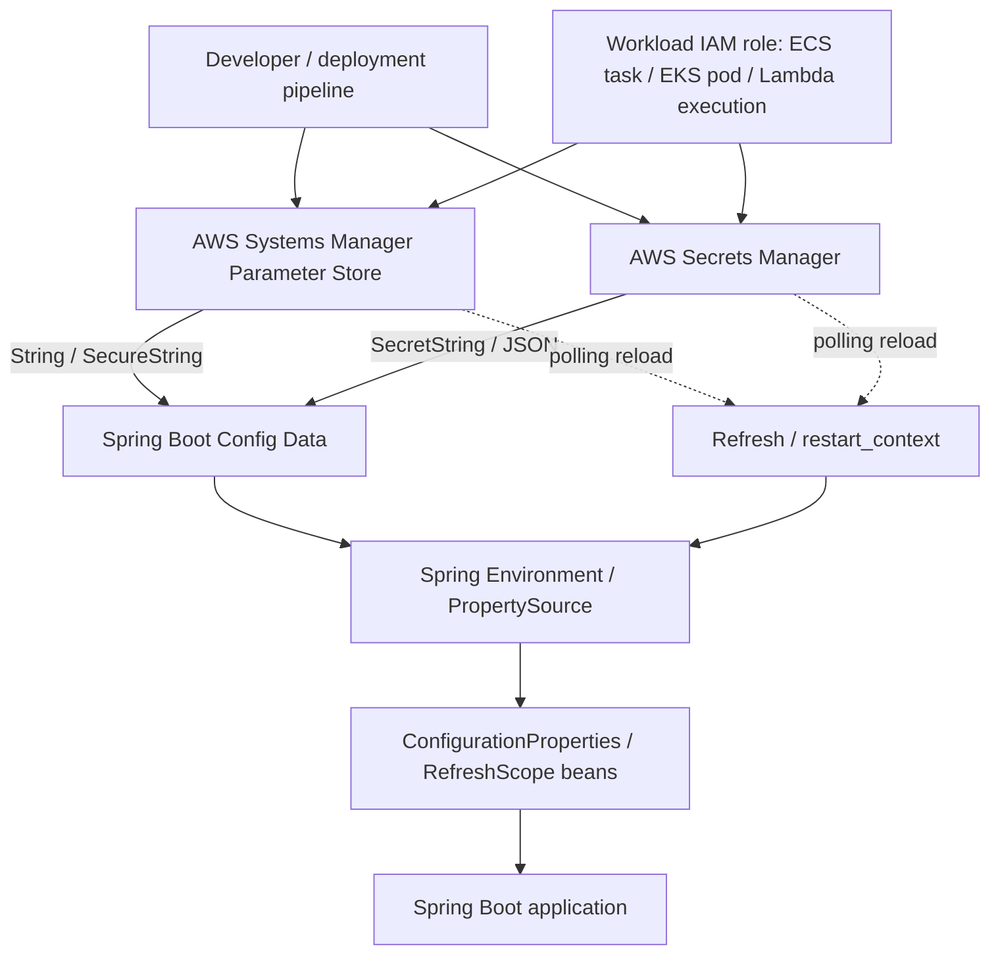
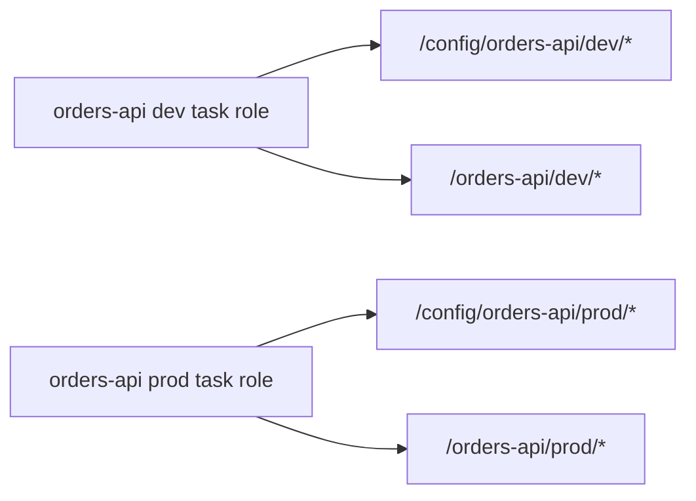
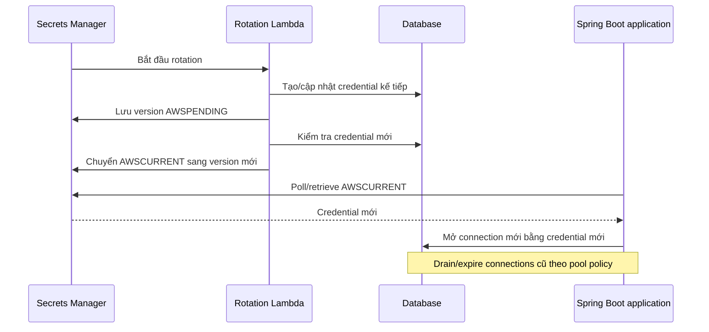
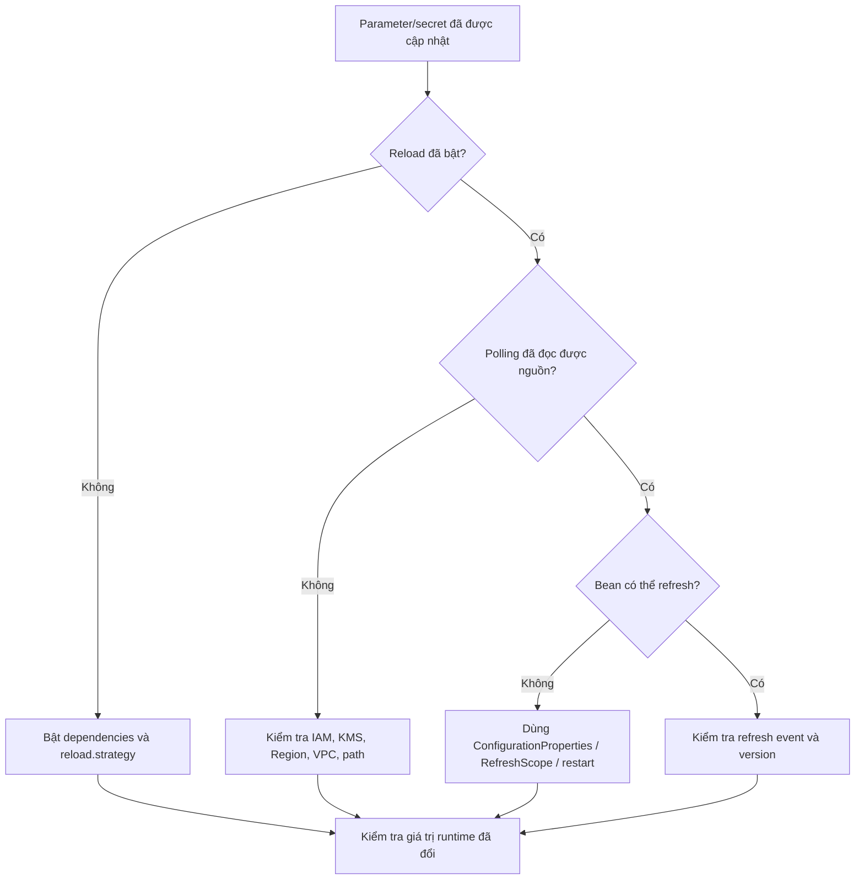

# Nạp và làm mới cấu hình từ Parameter Store, Secrets Manager

> **Chương:** Ứng dụng Java và Spring Boot · **Mô-đun:** `CLOUD_PROVIDERS_AWS`

## 1. Bài toán: cấu hình tập trung cho nhiều môi trường

Một ứng dụng Spring Boot chạy trên Amazon ECS có các cấu hình như endpoint của dịch vụ thanh toán, feature settings, URL database, username/password và API token của nhà cung cấp bên ngoài. Nếu giữ các giá trị này trong `application.yml`, Docker image hoặc biến môi trường, việc triển khai nhiều môi trường sẽ khó quản lý, dễ để lộ secrets và buộc phải build/redeploy mỗi khi cấu hình đổi.

AWS cung cấp hai dịch vụ thường dùng để externalize configuration:

- **AWS Systems Manager Parameter Store** lưu cấu hình theo tên phân cấp; hỗ trợ `String`, `StringList` và `SecureString` được mã hóa bằng AWS KMS.
- **AWS Secrets Manager** chuyên quản lý secrets như database credentials, API keys và tokens; hỗ trợ versioning, rotation và replication.

Spring Cloud AWS (AWSpring) tích hợp hai dịch vụ này vào **Spring Boot Config Data**. Khi ứng dụng khởi động, các giá trị được nạp vào Spring `Environment`, sau đó có thể bind vào `@ConfigurationProperties` hoặc inject qua `@Value`.



**Mục tiêu sau bài học:**

1. Chọn đúng Parameter Store, Secrets Manager hoặc AWS AppConfig theo loại dữ liệu.
2. Thiết kế parameter paths và secret names theo application/environment.
3. Cấu hình Spring Cloud AWS 3.x để nạp Parameter Store và Secrets Manager qua `spring.config.import`.
4. Bind cấu hình có kiểu dữ liệu vào `@ConfigurationProperties`.
5. Cấp quyền IAM/KMS least privilege cho ECS, EKS, Lambda và EC2.
6. Bật reload, phân biệt `refresh` và `restart_context`.
7. Xử lý cache, rotation, connection pools và secret consistency.
8. Kiểm tra lỗi startup, permission, decryption, polling, logging và chi phí.

## 2. Chọn đúng dịch vụ: Parameter Store, Secrets Manager hay AppConfig?

### 2.1. So sánh theo use case

| Tiêu chí | Parameter Store | Secrets Manager | AWS AppConfig |
| --- | --- | --- | --- |
| Dữ liệu điển hình | App config, endpoint, feature setting đơn giản, ID tham chiếu. | Database credentials, API keys, tokens, third-party credentials. | Feature flags, runtime configuration cần rollout an toàn. |
| Kiểu dữ liệu | `String`, `StringList`, `SecureString`. | `SecretString`, `SecretBinary`; có thể chứa JSON. | Configuration profile theo format/content type. |
| Mã hóa | `SecureString` dùng AWS KMS. | Secrets được mã hóa bằng AWS KMS. | Có thể lưu cấu hình mã hóa/được kiểm soát theo nguồn. |
| Versioning | Có parameter versions và labels. | Secret versions và staging labels như `AWSCURRENT`, `AWSPREVIOUS`. | Version/hosted configuration versions và deployment strategy. |
| Rotation | Không có secret rotation workflow chuyên dụng tương đương Secrets Manager. | Có rotation workflow, Lambda rotation templates và tích hợp database được hỗ trợ. | Không phải dịch vụ quản lý password rotation. |
| Dynamic rollout | Có thể polling/reload ở application. | Có thể polling/reload secret source. | Có validation, gradual deployment, bake time và rollback theo CloudWatch alarms. |
| Cách tích hợp Spring | AWSpring Parameter Store starter / SDK `SsmClient`. | AWSpring Secrets Manager starter / SDK `SecretsManagerClient`. |

**Quy tắc chọn:**

- Dùng **Parameter Store `String`** cho log level, URL, timeout, feature setting không nhạy cảm.
- Dùng **Parameter Store `SecureString`** cho giá trị cần mã hóa nhưng không cần rotation workflow phức tạp; ví dụ một account identifier hoặc private endpoint value.
- Dùng **Secrets Manager** cho username/password database, API token, signing secret và credential cần rotation/audit/replication.
- Dùng **AWS AppConfig** khi cần feature flags, kiểm tra schema, rollout từng phần và tự động rollback theo alarm.

AWS khuyến nghị dùng Secrets Manager cho secrets như database credentials, API keys và tokens, kể cả khi Parameter Store có `SecureString`. Đừng chọn Parameter Store chỉ vì muốn tránh thiết kế rotation.

### 2.2. Parameter Store `SecureString` khác Secrets Manager

`SecureString` chỉ mã hóa **parameter value** bằng KMS. Parameter name, description và metadata không được mã hóa. Khi đọc với `WithDecryption=true`, principal phải có quyền đọc parameter và quyền `kms:Decrypt` với key tương ứng.

Secrets Manager được thiết kế cho vòng đời secret: version stages, rotation, cross-Region replication, audit và API dành riêng cho secret retrieval. Dùng một secret JSON cho các trường có quan hệ như username/password, nhưng không gộp mọi secrets của mọi service vào một secret duy nhất.

### 2.3. Ví dụ phân loại cấu hình

| Property | Ví dụ | Nơi lưu khuyến nghị |
| --- | --- | --- |
| `logging.level.com.example` | `INFO` | Parameter Store `String` |
| `payment.provider-url` | `https://payments.example/api` | Parameter Store `String` |
| `feature.checkout-v2-enabled` | `true` | Parameter Store hoặc AppConfig tùy rollout |
| `spring.datasource.username` | Tên user database | Secrets Manager |
| `spring.datasource.password` | Mật khẩu database | Secrets Manager |
| `vendor.api-token` | Token nhà cung cấp | Secrets Manager |
| `db.connection-timeout` | `3s` | Parameter Store `String` |

Không lưu password/token trong `String` hoặc `StringList`. Cũng không đưa secret vào parameter name, secret name, tag, description hoặc log message.

## 3. Thiết kế tên và phân cấp cấu hình

### 3.1. Parameter hierarchy

Parameter Store hỗ trợ đường dẫn phân cấp, ví dụ:

```text
/config/orders-api/dev/spring.datasource.url
/config/orders-api/dev/app.payment-provider-url
/config/orders-api/dev/app.feature.checkout-v2-enabled
/config/orders-api/prod/spring.datasource.url
/config/orders-api/prod/app.payment-provider-url
/config/orders-api/prod/app.feature.checkout-v2-enabled

/restricted/orders-api/prod/vendor-api-token
```

Một naming convention tốt giúp:

- Tách application, environment và nhóm cấu hình.
- IAM policy chỉ cấp quyền đọc đúng path.
- Phân biệt config thông thường với dữ liệu nhạy cảm.
- Dễ tạo parameter theo IaC và kiểm tra drift.

Không cấp quyền đọc path `/config/` cho một service nếu path đó chứa cả thông tin của ứng dụng khác. Với dữ liệu cần hạn chế, tách path riêng và kiểm tra kỹ `GetParametersByPath` (xem mục IAM).

### 3.2. Secret naming

Secrets Manager secret name nên mô tả ứng dụng, environment và mục đích:

```text
/orders-api/dev/database
/orders-api/prod/database
/orders-api/prod/payment-provider
/orders-api/prod/webhook-signing
```

Secret name và tags vẫn là metadata có thể được nhìn thấy bởi principal có quyền describe/list. Không nhúng password hoặc token vào tên.

### 3.3. Tách môi trường và tài khoản

Ưu tiên mỗi environment/account có resource và IAM role riêng:



Không dùng một task role có thể đọc mọi secrets dev/staging/prod chỉ để đơn giản hóa deployment. Khi cần cross-account access, dùng resource policy/assume-role theo kiến trúc đã được phê duyệt; import Secrets Manager bằng ARN có thể dùng khi secret nằm ở account khác và policy cho phép.

## 4. AWSpring và Spring Boot Config Data

### 4.1. Chọn đúng phiên bản tích hợp

Bài này dùng **Spring Cloud AWS 3.x** và Spring Boot Config Data. Tài liệu tham chiếu cụ thể là **Spring Cloud AWS 3.4.1**; luôn kiểm tra compatibility matrix với Spring Boot/Spring Cloud release train đang dùng.

Spring Cloud AWS 3.x dùng:

- `spring.config.import=aws-parameterstore:...`
- `spring.config.import=aws-secretsmanager:...`

Không trộn cú pháp này với cấu hình bootstrap cũ của Spring Cloud AWS 2.x như `aws.paramstore.prefix`, `aws.paramstore.name` hoặc `bootstrap.yml`. Khi nâng 2.x lên 3.x, cần migrate sang Config Data import.

### 4.2. Maven BOM và starter dependencies

Spring Cloud AWS BOM quản lý các phiên bản starter tương thích:

```xml
<dependencyManagement>
    <dependencies>
        <dependency>
            <groupId>io.awspring.cloud</groupId>
            <artifactId>spring-cloud-aws-dependencies</artifactId>
            <version>3.4.1</version>
            <type>pom</type>
            <scope>import</scope>
        </dependency>
    </dependencies>
</dependencyManagement>

<dependencies>
    <dependency>
        <groupId>io.awspring.cloud</groupId>
        <artifactId>spring-cloud-aws-starter-parameter-store</artifactId>
    </dependency>
    <dependency>
        <groupId>io.awspring.cloud</groupId>
        <artifactId>spring-cloud-aws-starter-secrets-manager</artifactId>
    </dependency>
</dependencies>
```

Nếu ứng dụng chỉ cần một dịch vụ, chỉ thêm starter tương ứng. Không thêm cả hai starter chỉ vì ví dụ có cả Parameter Store và Secrets Manager. Nếu cần nâng AWS SDK for Java độc lập với phiên bản mà AWSpring BOM quản lý, khai báo AWS SDK BOM theo hướng dẫn chính thức và kiểm tra tương thích; không để các SDK modules lệch version.

### 4.3. Gradle Kotlin DSL

```kotlin
dependencies {
    implementation(platform("io.awspring.cloud:spring-cloud-aws-dependencies:3.4.1"))

    implementation("io.awspring.cloud:spring-cloud-aws-starter-parameter-store")
    implementation("io.awspring.cloud:spring-cloud-aws-starter-secrets-manager")
}
```

Các version ở đây minh họa theo tài liệu 3.4.1. Dùng một version AWSpring duy nhất, kiểm tra yêu cầu Java/Spring Boot và nâng cấp có kiểm thử.

## 5. Nạp cấu hình từ Parameter Store

### 5.1. Dùng `spring.config.import`

Giả sử Parameter Store có:

| Parameter name | Type | Value minh họa |
| --- | --- | --- |
| `/config/orders-api/prod/app.payment-provider-url` | `String` | `https://payments.example/api` |
| `/config/orders-api/prod/app.checkout-enabled` | `String` | `true` |
| `/config/orders-api/prod/app.http-timeout` | `String` | `3s` |

Trong `application.properties`:

```properties
spring.application.name=orders-api
spring.config.import=aws-parameterstore:/config/orders-api/prod/
```

AWSpring đọc các parameters dưới path và thêm key/value vào Spring `Environment`. Property name được lấy từ phần tên parameter sau path được import. Nếu parameter `/config/orders-api/prod/app.checkout-enabled` có value `true`, ứng dụng có thể bind thành `app.checkout-enabled`.

Nếu path không tồn tại hoặc không đọc được, ứng dụng sẽ thất bại khi khởi động. Chỉ dùng `optional:` khi toàn bộ cấu hình từ path đó thực sự không bắt buộc:

```properties
spring.config.import=optional:aws-parameterstore:/config/orders-api/dev-overrides/
```

Không đánh dấu database endpoint hoặc config cần thiết cho startup là optional chỉ để container luôn lên trạng thái healthy. Điều đó có thể làm ứng dụng chạy với cấu hình mặc định sai.

### 5.2. Nạp nhiều path và prefix

Có thể import nhiều paths:

```properties
spring.config.import=aws-parameterstore:/config/common/;/config/orders-api/prod/
```

Để tránh key collision, dùng `?prefix=`:

```properties
spring.config.import=aws-parameterstore:/config/orders-api/prod/?prefix=app.
```

Với prefix `app.`, parameter key `checkout-enabled` được thêm vào Environment thành `app.checkout-enabled`. Prefix được nối nguyên văn; nếu muốn dấu chấm giữa prefix và key, hãy kết thúc prefix bằng dấu chấm.

Nếu có path bắt buộc và path tùy chọn, khai báo thành các entry riêng:

```properties
spring.config.import[0]=aws-parameterstore=/config/orders-api/prod/
spring.config.import[1]=optional:aws-parameterstore=/config/orders-api/prod/overrides/
```

### 5.3. Parameter arrays và cấu trúc

AWSpring hỗ trợ indexed parameter names để bind thành Spring array/list. Ví dụ:

```text
/config/orders-api/prod/app.allowed-origins_0_ = https://app.example
/config/orders-api/prod/app.allowed-origins_1_ = https://admin.example
```

Spring có thể bind thành `app.allowed-origins[0]` và `[1]`. Kiểm tra convention và binder behavior theo phiên bản AWSpring đang dùng; với cấu trúc phức tạp, cân nhắc lưu JSON trong một Parameter/Secret và parse thành typed object.

### 5.4. Dùng `SsmClient` bean do starter tạo

Starter Parameter Store tự cấu hình `SsmClient` bean trong Spring context. Có thể dùng bean này để đọc/ghi parameters trong service layer:

```java
import org.springframework.stereotype.Service;
import software.amazon.awssdk.services.ssm.SsmClient;
import software.amazon.awssdk.services.ssm.model.GetParameterRequest;

@Service
public class RuntimeParameterReader {
    private final SsmClient ssm;

    public RuntimeParameterReader(SsmClient ssm) {
        this.ssm = ssm;
    }

    public String read(String name) {
        return ssm.getParameter(GetParameterRequest.builder()
                        .name(name)
                        .withDecryption(true)
                        .build())
                .parameter()
                .value();
    }
}
```

Chỉ dùng `withDecryption(true)` khi caller được phép đọc plaintext `SecureString`. Đừng expose method đọc tùy ý parameter name cho HTTP request bên ngoài; validate allowlist/path trong service layer.

## 6. Nạp secrets từ Secrets Manager

### 6.1. SecretString dạng JSON

Một secret tên `/orders-api/prod/database` có thể chứa:

```json
{
  "username": "orders_app",
  "password": "<managed-by-secrets-manager>",
  "engine": "postgres",
  "host": "orders-db.example.internal",
  "port": 5432,
  "dbname": "orders"
}
```

Trong `application.properties`:

```properties
spring.config.import=aws-secretsmanager:/orders-api/prod/database?prefix=db.
```

Khi `SecretString` là JSON object, AWSpring thêm các top-level keys vào Spring Environment. Với prefix `db.`, chúng trở thành `db.username`, `db.password`, `db.engine`, `db.host`, `db.port` và `db.dbname`.

Nếu không cần prefix, có thể import trực tiếp:

```properties
spring.config.import=aws-secretsmanager:/orders-api/prod/database
```

Khi secret không tồn tại, startup mặc định thất bại. Dùng `optional:aws-secretsmanager:` chỉ khi secret thực sự không bắt buộc:

```properties
spring.config.import=optional:aws-secretsmanager:/orders-api/dev/noncritical-integration
```

### 6.2. Secret plain text hoặc binary

Nếu secret chứa plain text, AWSpring có thể đưa value vào Environment theo tên secret. Với `SecretBinary`, xử lý theo API và định dạng bytes riêng; không giả định mọi secret đều là JSON string.

### 6.3. Import nhiều secrets hoặc secret account khác

Có thể nạp nhiều secrets qua Config Data imports, hoặc dùng ARN khi đọc secret ở account/Region khác:

```properties
spring.config.import[0]=aws-secretsmanager=/orders-api/prod/database?prefix=db.
spring.config.import[1]=aws-secretsmanager=/orders-api/prod/payment-provider?prefix=payment.
```

ARN ví dụ có dạng:

```text
arn:aws:secretsmanager:ap-southeast-1:111122223333:secret:orders-api/prod/database-AbCdEf
```

Cross-account access cần resource policy trên secret, IAM permission từ workload role và KMS key policy phù hợp. Dùng ARN chính xác từ AWS; không tự đoán suffix ngẫu nhiên của secret ARN.

### 6.4. Dùng `SecretsManagerClient` bean

AWSpring starter tự cấu hình `SecretsManagerClient` bean:

```java
import org.springframework.stereotype.Service;
import software.amazon.awssdk.services.secretsmanager.SecretsManagerClient;
import software.amazon.awssdk.services.secretsmanager.model.GetSecretValueRequest;

@Service
public class RuntimeSecretReader {
    private final SecretsManagerClient secrets;

    public RuntimeSecretReader(SecretsManagerClient secrets) {
        this.secrets = secrets;
    }

    public String readSecretString(String secretId) {
        return secrets.getSecretValue(GetSecretValueRequest.builder()
                        .secretId(secretId)
                        .build())
                .secretString();
    }
}
```

Nếu secret dùng `SecretBinary`, đọc `secretBinary()` và giải mã theo encoding/format mà producer đã thỏa thuận. Không log giá trị trả về, kể cả ở mức DEBUG.

## 7. Bind cấu hình vào Java types

### 7.1. Dùng `@ConfigurationProperties`

Khi cấu hình có nhiều fields, nên gom thành một typed configuration object thay vì inject nhiều `@Value` rải rác:

```java
import java.net.URI;
import java.time.Duration;
import org.springframework.boot.context.properties.ConfigurationProperties;

@ConfigurationProperties(prefix = "app")
public record AppProperties(
        URI paymentProviderUrl,
        boolean checkoutEnabled,
        Duration httpTimeout) {
}
```

Kích hoạt scanning trong application:

```java
import org.springframework.boot.SpringApplication;
import org.springframework.boot.autoconfigure.SpringBootApplication;
import org.springframework.boot.context.properties.ConfigurationPropertiesScan;

@SpringBootApplication
@ConfigurationPropertiesScan
public class OrdersApplication {
    public static void main(String[] args) {
        SpringApplication.run(OrdersApplication.class, args);
    }
}
```

Ví dụ cấu hình Parameter Store:

```text
/config/orders-api/prod/app.payment-provider-url = https://payments.example/api
/config/orders-api/prod/app.checkout-enabled = true
/config/orders-api/prod/app.http-timeout = 3s
```

Spring Boot binder chuyển các chuỗi thành `URI`, `boolean` và `Duration`. Với cấu hình bắt buộc, khai báo validation như `@NotNull`, `@NotBlank`, `@Min` và thêm Bean Validation dependency tương ứng; ứng dụng nên fail startup nếu cấu hình không hợp lệ.

### 7.2. Bind secret JSON vào credentials type

Nếu Secrets Manager chứa JSON keys `username`, `password`, `host`, `port`, AWSpring prefix `db.` cho phép bind:

```java
import org.springframework.boot.context.properties.ConfigurationProperties;

@ConfigurationProperties(prefix = "db")
public record DatabaseCredentials(
        String username,
        String password,
        String host,
        int port,
        String dbname) {
}
```

Không in record này ra log: Java record `toString()` mặc định sẽ hiển thị password. Nếu cần debug, log trạng thái đã được redacted như `credentialsLoaded=true`, không log object.

### 7.3. `@Value` và cấu hình đơn giản

Với một property đơn giản, có thể dùng:

```java
import java.net.URI;
import org.springframework.beans.factory.annotation.Value;
import org.springframework.stereotype.Component;

@Component
public class PaymentEndpoint {
    private final URI baseUri;

    public PaymentEndpoint(@Value("${app.payment-provider-url}") URI baseUri) {
        this.baseUri = baseUri;
    }
}
```

`@Value` phù hợp với vài giá trị đơn lẻ. Khi có nhiều properties liên quan, validation hoặc refresh, ưu tiên `@ConfigurationProperties` để dễ kiểm thử và quản lý.

### 7.4. Không giả định mọi bean tự thay đổi khi property thay đổi

Spring Environment có thể nhận property source mới, nhưng object đã tạo từ cấu hình lúc startup có thể giữ giá trị cũ:

- Một singleton bean đã copy password vào field `final` không tự cập nhật.
- `DataSource`/Hikari pool có thể tiếp tục giữ connection cũ dù `DatabaseCredentials` đã refresh.
- AWS SDK client, HTTP client, TLS context và các connection pools thường chụp cấu hình khi builder tạo object.
- `@Value` field trong bean thường không tự được inject lại chỉ vì Environment thay đổi.

Muốn refresh runtime, cần chọn bean có thể refresh, thiết kế factory thay thế resource, hoặc restart context theo chính sách đã kiểm thử. Mục 11–13 trình bày cách chọn.

## 8. IAM, KMS và bảo vệ dữ liệu

### 8.1. Dùng đúng workload role

Ứng dụng nên lấy credentials tạm thời từ role của runtime:

| Runtime | Role mà AWS SDK trong ứng dụng sử dụng |
| --- | --- |
| Amazon ECS | **Task role** của container. Task execution role chủ yếu phục vụ agent kéo image/ghi logs. |
| Amazon EKS | EKS Pod Identity hoặc IRSA theo cấu hình. |
| AWS Lambda | Lambda execution role. |
| Amazon EC2 | Instance profile role. |
| Local development | AWS IAM Identity Center/SSO hoặc profile được cấp quyền. |

Không nhúng access key/secret key vào `application.yml`, Dockerfile, image, source code hoặc CI logs. Region phải trỏ tới nơi lưu Parameter/Secret; cross-Region secret cần cấu hình endpoint/ARN và quyền tương ứng.

### 8.2. IAM policy đọc một Parameter Store path

Ví dụ role của `orders-api-prod` chỉ cần đọc path `/config/orders-api/prod/`:

```json
{
  "Version": "2012-10-17",
  "Statement": [
    {
      "Sid": "ReadOrdersApiProductionConfig",
      "Effect": "Allow",
      "Action": [
        "ssm:GetParametersByPath"
      ],
      "Resource": "arn:aws:ssm:ap-southeast-1:111122223333:parameter/config/orders-api/prod/*"
    }
  ]
}
```

Đây là ví dụ theo AWSpring Parameter Store Config Data integration. Nếu code tự gọi `GetParameter`, `GetParameters` hoặc `GetParameterHistory`, cần cấp đúng action đó; đừng cấp `ssm:*` cho tiện.

### 8.3. Rủi ro đặc biệt của `GetParametersByPath`

Parameter Store authorize `GetParametersByPath` theo **path được request**, không đánh giá lại từng child parameter như một hàng rào độc lập. Nếu principal được phép đọc `/config/orders-api/`, principal có thể nhận cả `/config/orders-api/restricted/...` ở dưới path đó. Một deny cho `ssm:GetParameter` trên child không tự chặn một request `ssm:GetParametersByPath` tới ancestor path.

Vì vậy:

- Đặt sensitive parameters trong path tách biệt như `/restricted/orders-api/prod/`.
- Không đặt secrets cạnh config chung rồi kỳ vọng một deny trên ARN child luôn chặn `GetParametersByPath`.
- Nếu cần deny `ssm:GetParametersByPath`, phải xem xét mọi ancestor paths có thể bao gồm parameter đó.
- Kiểm tra bằng IAM Policy Simulator và test thật dưới đúng task role.

### 8.4. `SecureString` cần KMS decrypt

Đọc `SecureString` với decryption cần `ssm:GetParameter`/`ssm:GetParametersByPath` phù hợp và `kms:Decrypt` trên key mã hóa value. Với customer-managed KMS key, giới hạn `kms:Decrypt` vào key cụ thể và policy/key conditions phù hợp.

AWS managed key mặc định của Parameter Store thường không thích hợp khi cần phân tách quyền decrypt chi tiết giữa principals trong cùng account. Dùng customer-managed key cho path nhạy cảm và quản lý key policy cùng IAM policy.

### 8.5. IAM policy đọc một Secrets Manager secret

Ví dụ role chỉ đọc secret database:

```json
{
  "Version": "2012-10-17",
  "Statement": [
    {
      "Sid": "ReadOrdersDatabaseSecret",
      "Effect": "Allow",
      "Action": [
        "secretsmanager:GetSecretValue"
      ],
      "Resource": "arn:aws:secretsmanager:ap-southeast-1:111122223333:secret:orders-api/prod/database-AbCdEf"
    }
  ]
}
```

Nếu secret được mã hóa bằng customer-managed KMS key, role còn cần `kms:Decrypt` trên key và key policy phải cho phép. Secret ARN thường có suffix ngẫu nhiên; dùng ARN thật lấy từ AWS. AWSpring Secrets Manager integration yêu cầu `secretsmanager:GetSecretValue`; một số cache/client components còn cần `DescribeSecret`.

### 8.6. Network path và VPC endpoints

Nếu ECS/EKS/EC2 chạy trong private subnet, ứng dụng cần network path tới AWS APIs:

- NAT Gateway/egress path phù hợp, hoặc
- Interface VPC endpoints cho Systems Manager (`ssm`) và Secrets Manager (`secretsmanager`), cùng endpoint KMS nếu kiến trúc cần truy cập KMS API trực tiếp.

Security groups, DNS private DNS và endpoint policies phải cho phép đúng workload. Nếu config import fail với connection timeout, kiểm tra network trước khi thay IAM policy.

### 8.7. Bảo vệ Spring Actuator và logs

Secret có thể xuất hiện trong Spring Environment, binding errors, exception messages hoặc Actuator endpoints nếu cấu hình không an toàn:

- Không public `/actuator/env`, `/actuator/configprops` hoặc restart endpoint không có authentication/authorization.
- Dùng sanitization mặc định và bổ sung secret-key patterns nếu cần.
- Không log full `Environment`, `ConfigurationProperties` object chứa password hoặc response từ `GetSecretValue`.
- Giới hạn quyền truy cập CloudWatch Logs, CI artifacts và heap dumps.
- Tránh truyền secrets dưới dạng command-line arguments hoặc biến môi trường nếu runtime có cách lấy trực tiếp từ provider an toàn hơn.

## 9. Đọc trực tiếp bằng AWS SDK for Java 2.x và cache secrets

### 9.1. Khi nào dùng SDK trực tiếp?

AWSpring Config Data phù hợp khi cấu hình cần được nạp vào Spring Environment lúc startup và có thể reload theo cơ chế đã cấu hình. Dùng AWS SDK trực tiếp khi:

- Một service cần đọc secret theo tenant hoặc theo request context đã được xác thực.
- Cần chọn secret version/stage cụ thể.
- Cần tự quản lý cache/refresh policy.
- Ứng dụng không dùng Spring Cloud AWS.
- Cần đọc parameter/secret theo logic nghiệp vụ runtime thay vì coi đó là application configuration.

Không gọi Secrets Manager API cho mỗi HTTP request nếu secret chỉ thay đổi theo rotation cadence; cache có TTL/refresh policy hợp lý để giảm latency và API cost.

### 9.2. Maven dependencies cho AWS SDK

Nếu không dùng AWSpring starter, thêm AWS SDK BOM và service modules:

```xml
<dependencyManagement>
    <dependencies>
        <dependency>
            <groupId>software.amazon.awssdk</groupId>
            <artifactId>bom</artifactId>
            <version>2.x.y</version>
            <type>pom</type>
            <scope>import</scope>
        </dependency>
    </dependencies>
</dependencyManagement>

<dependencies>
    <dependency>
        <groupId>software.amazon.awssdk</groupId>
        <artifactId>ssm</artifactId>
    </dependency>
    <dependency>
        <groupId>software.amazon.awssdk</groupId>
        <artifactId>secretsmanager</artifactId>
    </dependency>
</dependencies>
```

`2.x.y` là placeholder cho một AWS SDK 2.x release được tổ chức hỗ trợ. Khi dùng AWSpring, để AWSpring BOM quản lý SDK modules trừ khi có lý do và compatibility test rõ ràng để override.

### 9.3. Đọc một SecureString bằng SsmClient

```java
import software.amazon.awssdk.regions.Region;
import software.amazon.awssdk.services.ssm.SsmClient;
import software.amazon.awssdk.services.ssm.model.GetParameterRequest;

try (SsmClient ssm = SsmClient.builder()
        .region(Region.AP_SOUTHEAST_1)
        .build()) {

    String value = ssm.getParameter(GetParameterRequest.builder()
                    .name("/restricted/orders-api/prod/vendor-account-id")
                    .withDecryption(true)
                    .build())
            .parameter()
            .value();

    // Dùng value trong memory; không log hoặc trả ra HTTP response.
}
```

SDK dùng default credentials provider chain nếu không chỉ định provider; trên ECS ứng dụng nên dùng **task role**. Với `SecureString`, `withDecryption(true)` yêu cầu quyền decrypt KMS key. Đóng client khi resource scope kết thúc; trong Spring service, tạo client singleton bean thay vì tạo mới mỗi lần gọi.

### 9.4. Đọc nhiều parameters theo path

```java
import software.amazon.awssdk.services.ssm.model.GetParametersByPathRequest;

var response = ssm.getParametersByPath(GetParametersByPathRequest.builder()
        .path("/config/orders-api/prod/")
        .recursive(true)
        .withDecryption(true)
        .build());

response.parameters().forEach(parameter -> {
    // Chỉ xử lý trong memory; tránh log parameter.value().
});
```

Đây là một page kết quả. Nếu tự dùng SDK cho path có nhiều parameters, xử lý `nextToken()` để lấy các pages tiếp theo. `GetParametersByPath` có authorization semantics theo requested path; không dùng một path rộng hơn phạm vi quyền mà ứng dụng thực sự cần.

### 9.5. Đọc secret bằng SecretsManagerClient

```java
import software.amazon.awssdk.regions.Region;
import software.amazon.awssdk.services.secretsmanager.SecretsManagerClient;
import software.amazon.awssdk.services.secretsmanager.model.GetSecretValueRequest;

try (SecretsManagerClient client = SecretsManagerClient.builder()
        .region(Region.AP_SOUTHEAST_1)
        .build()) {

    String secretJson = client.getSecretValue(GetSecretValueRequest.builder()
                    .secretId("/orders-api/prod/database")
                    .build())
            .secretString();

    // Parse JSON bằng ObjectMapper và chỉ giữ dữ liệu cần thiết.
    // Không ghi secretJson vào logs.
}
```

`GetSecretValue` trả về `SecretString` hoặc `SecretBinary` tùy secret. Có thể chọn version stage như `AWSCURRENT` hoặc `AWSPREVIOUS` khi cần điều tra/rollback có kiểm soát. Quyền tối thiểu là `secretsmanager:GetSecretValue`; customer-managed KMS key còn cần `kms:Decrypt`.

### 9.6. Cache secrets: giảm latency và API cost

AWS khuyến nghị cache secret values ở client side. Một số lựa chọn:

- AWS Secrets Manager Java caching component.
- Cache nội bộ có TTL, single-flight refresh và bounded size.
- AWSpring property source reload cho cấu hình Spring cần refresh.

Java caching component của Secrets Manager dùng LRU và mặc định refresh mỗi giờ. Tuy nhiên tài liệu AWS lưu ý component này **không có cache invalidation**, không ép garbage collection khi reference bị bỏ và **không được thiết kế như một lớp cache security-hardened**. Nếu dùng, phải tự đánh giá TTL, secret exposure trong memory, rotation detection, invalidation và cách đóng/refresh cache.

Thiết kế cache:

1. Chọn TTL theo thời gian rotation và mức chấp nhận stale.
2. Refresh trước khi secret hết TTL nếu có thể, dùng single-flight để tránh nhiều threads cùng gọi API.
3. Nếu refresh lỗi, xác định có được tiếp tục dùng cached value cũ hay phải fail closed.
4. Sau rotation, refresh secret và tái tạo connection/resource cần credential mới.
5. Không expose cache values qua actuator, metrics labels, logs hoặc exception messages.

**Không có TTL nào tự bảo đảm rotation thành công.** Nếu database đã vô hiệu hóa password cũ nhưng connection pool vẫn cố mở connection bằng credential cũ, ứng dụng sẽ lỗi dù secret cache có thể refresh sau đó.

## 10. Nạp cấu hình khi startup và xử lý thứ tự property sources

### 10.1. Config import xảy ra trong giai đoạn bootstrap

Spring Boot Config Data được xử lý trước khi application context hoàn tất. Do đó:

- IAM credentials, Region và network path phải sẵn sàng ngay khi process khởi động.
- `SsmClient`/`SecretsManagerClient` dùng cho import được AWSpring bootstrap/config-data infrastructure tạo ra; bean application thông thường chưa sẵn sàng để inject vào giai đoạn này.
- Nếu cần tùy chỉnh client dùng cho `spring.config.import`, AWSpring cung cấp bootstrap customizer/`BootstrapRegistryInitializer` phù hợp với service.
- Một lỗi đọc required path/secret có thể làm ứng dụng không start; orchestrator cần restart policy và alert.

### 10.2. Không trộn hai cơ chế đọc

Phân biệt:

| Cơ chế | Thời điểm | Phù hợp |
| --- | --- | --- |
| `spring.config.import` | Startup, sau đó có thể bật AWSpring reload | Application-level configuration |
| Inject `SsmClient`/`SecretsManagerClient` | Runtime theo service logic | Dynamic lookup, per-tenant, explicit version/stage |
| Environment variables | Startup/deployment | Non-secret runtime wiring và overrides |
| `@RefreshScope`/`@ConfigurationProperties` | Khi Spring refresh event xảy ra | Bean cần nhận cấu hình mới |

Không đọc cùng một key từ nhiều nguồn với precedence không rõ ràng. Hãy quy định nguồn có thẩm quyền cho mỗi property và kiểm tra Spring Environment/property source precedence trong profile thực tế.

### 10.3. Optional và required configuration

Chỉ dùng `optional:` cho cấu hình thật sự không cần để service hoạt động. Ví dụ endpoint của một integration chưa bật ở môi trường dev có thể optional; password database, encryption key reference hoặc endpoint thiết yếu không nên optional.

Nếu thiếu required configuration:

1. Fail startup rõ ràng.
2. Log parameter/secret identifier đã được redacted phù hợp (không log value).
3. Tạo alarm cho startup failure/restart loop.
4. Kiểm tra IAM, Region, path/secret ARN, KMS key policy và network.

Không fallback về password hard-coded hoặc config cũ không rõ nguồn để container có vẻ healthy.

## 11. Làm mới property sources khi Parameter Store hoặc secret thay đổi

### 11.1. Reload không tự bật

Trong Spring Cloud AWS 3.4.1, **PropertySource reload mặc định bị tắt**. Chỉ thêm `spring.config.import` thì cấu hình được nạp khi startup; sửa parameter/secret trên AWS không tự làm Spring bean thay đổi.

Để bật reload, thêm các dependencies cần cho Spring refresh:

```xml
<dependency>
    <groupId>org.springframework.boot</groupId>
    <artifactId>spring-boot-starter-actuator</artifactId>
</dependency>
<dependency>
    <groupId>org.springframework.cloud</groupId>
    <artifactId>spring-cloud-commons</artifactId>
</dependency>
<dependency>
    <groupId>org.springframework.cloud</groupId>
    <artifactId>spring-cloud-context</artifactId>
</dependency>
```

Quản lý version của Spring Cloud dependencies theo release train tương thích với Spring Boot đang dùng. Không lấy một version tùy ý từ ví dụ khác rồi trộn với Spring Boot/AWSpring BOM.

### 11.2. Cấu hình reload cho Parameter Store và Secrets Manager

Ví dụ dùng polling mỗi 60 giây:

```yaml
spring:
  cloud:
    aws:
      parameterstore:
        reload:
          strategy: refresh
          period: 60s
      secretsmanager:
        reload:
          strategy: refresh
          period: 60s
```

Hoặc trong `application.properties`:

```properties
spring.cloud.aws.parameterstore.reload.strategy=refresh
spring.cloud.aws.parameterstore.reload.period=60s

spring.cloud.aws.secretsmanager.reload.strategy=refresh
spring.cloud.aws.secretsmanager.reload.period=60s
```

**Lưu ý về tài liệu 3.4.1:** Bảng configuration reference liệt kê property Parameter Store là `spring.cloud.aws.parameterstore.reload.period` và default `15s`; phần mô tả reload trong cùng trang lại nhắc `spring.cloud.aws.parameter.reload.period` và default một phút. Secrets Manager reference cũng có khác biệt giữa mô tả và bảng về default period. Để tránh phụ thuộc vào default/documentation mismatch, hãy đặt `reload.period` tường minh như ví dụ, kiểm tra property metadata của đúng artifact version và test polling trong môi trường của bạn.

### 11.3. Hai chiến lược reload

AWSpring hỗ trợ hai chiến lược:

| Strategy | Hành vi | Khi phù hợp |
| --- | --- | --- |
| `refresh` | Làm mới configuration beans được đánh dấu `@ConfigurationProperties` hoặc `@RefreshScope` thông qua Spring Cloud Context. | Cấu hình có thể cập nhật mà không cần dựng lại toàn bộ application context. |
| `restart_context` | Gracefully restart toàn bộ Spring `ApplicationContext`; beans được tạo lại với config mới. | Thay đổi cần tái tạo nhiều singleton/resources phụ thuộc cấu hình. |

Chọn strategy bằng:

```properties
spring.cloud.aws.parameterstore.reload.strategy=refresh
spring.cloud.aws.secretsmanager.reload.strategy=refresh
```

`refresh` không có nghĩa mọi singleton bean tự động nhận lại giá trị. Bean cần refresh phải được bind/annotate đúng cách và downstream resource phải hỗ trợ cập nhật.

### 11.4. Bean có thể refresh

Ví dụ `@ConfigurationProperties`:

```java
@ConfigurationProperties(prefix = "app")
public record AppProperties(
        URI paymentProviderUrl,
        boolean checkoutEnabled,
        Duration httpTimeout) {
}
```

Với một bean giữ giá trị được inject qua `@Value`, có thể dùng `@RefreshScope`:

```java
import org.springframework.cloud.context.config.annotation.RefreshScope;
import org.springframework.stereotype.Component;
import org.springframework.beans.factory.annotation.Value;

@Component
@RefreshScope
public class PaymentGatewaySettings {
    private final String apiToken;

    public PaymentGatewaySettings(
            @Value("${payment.api-token}") String apiToken) {
        this.apiToken = apiToken;
    }

    public String apiToken() {
        return apiToken;
    }
}
```

Đây là ví dụ minh họa refresh-scoped bean. Không log `apiToken()` và không trả token qua controller/actuator. Nếu một bean khác giữ reference lâu dài tới resource đã tạo từ token cũ, cần refresh/recreate resource đó nữa.

### 11.5. Restart toàn bộ ApplicationContext

Nếu dùng `restart_context`, AWSpring yêu cầu bật và expose Actuator restart endpoint:

```yaml
management:
  endpoint:
    restart:
      enabled: true
  endpoints:
    web:
      exposure:
        include: restart
```

Endpoint này có thể làm application context khởi động lại. **Không expose công khai hoặc không xác thực**. Chỉ cho phép management network/role được kiểm soát, bật authentication/authorization và audit. Nếu không cần restart toàn context, ưu tiên `refresh`.

### 11.6. Polling, consistency và chi phí

Reload hoạt động bằng cách định kỳ đọc lại external property source để kiểm tra thay đổi. Vì vậy:

- Thời gian phát hiện thay đổi tối thiểu gần bằng polling period cộng API/network latency.
- Mỗi replica/task có thể polling riêng; 50 ECS tasks với chu kỳ ngắn sẽ tạo nhiều API calls.
- Khi rollout cấu hình, các replicas có thể nhận giá trị ở những thời điểm khác nhau.
- Nếu API lỗi hoặc network gián đoạn, refresh có thể bị trễ; đừng giả định config đổi là mọi instance cập nhật tức thì.
- Chọn chu kỳ theo yêu cầu freshness, quota và chi phí; tránh polling quá dày.

Với feature flags cần rollout từng phần, validation và automatic rollback, dùng AppConfig thay vì cố biến Parameter Store polling thành một deployment controller.

## 12. Secret rotation và cập nhật tài nguyên đang sử dụng credentials

### 12.1. Secret version và staging labels

Secrets Manager quản lý các version của secret. Những staging labels phổ biến:

- `AWSCURRENT`: version hiện tại mà ứng dụng thông thường nên đọc.
- `AWSPREVIOUS`: version trước đó, hữu ích cho kiểm tra/rollback có kiểm soát.
- `AWSPENDING`: version đang được rotation workflow chuẩn bị.

Khi rotation hoàn tất, label `AWSCURRENT` được chuyển sang version mới. Nếu application đọc secret không chỉ định version stage, Secrets Manager trả current version theo mặc định.

Parameter Store cũng có parameter versions/labels, nhưng không cung cấp rotation workflow chuyên dụng cho database/API credentials như Secrets Manager.

### 12.2. Rotation không đồng nghĩa connection pool tự đổi password

Giả sử secret database thay đổi từ password A sang password B:

1. Secrets Manager rotation workflow tạo/cập nhật credential mới và chuyển `AWSCURRENT`.
2. AWSpring polling hoặc application cache phát hiện secret mới.
3. Spring configuration bean nhận value mới nếu bean được refresh đúng cách.
4. Connection pool phải dùng credential mới khi mở **connection mới**.
5. Connection đang mở có thể vẫn hoạt động bằng session đã authenticate trước đó, cho tới khi database/policy đóng session.

Nếu Hikari pool vẫn giữ password A và chỉ cập nhật một property bean sang B, pool không nhất thiết tự thay datasource hoặc credentials. Cần thiết kế pool lifecycle/recreation, max connection lifetime, graceful drain và retry theo loại database.

### 12.3. Dùng rotation strategy phù hợp với database

Secrets Manager cung cấp rotation templates/Lambda workflows cho các dịch vụ database được hỗ trợ. Với rotation có thể dùng **alternating users** để giảm gián đoạn:



Các bước chi tiết phụ thuộc engine và rotation template. Không tự giả định mọi database rotation đều zero-downtime; test trước với database engine, user model, pool và connection lifetime thật.

### 12.4. Refresh DataSource và client beans

Với credentials được dùng khi tạo `DataSource`, có một số hướng:

- Dùng integration/driver được thiết kế để lấy credentials từ Secrets Manager khi cần mở connection.
- Tạo factory quản lý datasource và hỗ trợ thay thế pool sau khi credentials đổi.
- Dùng refresh-scoped datasource/resource nếu lifecycle và shutdown semantics đã được kiểm thử.
- Dùng `restart_context` hoặc rolling restart ECS khi cần tái tạo toàn bộ singleton beans.

Không chỉ annotate `DatabaseCredentials` rồi kết luận datasource đã đổi. Hãy test: connection hiện hữu, connection mới, pool exhaustion, DB rotation, task restart và rollback.

### 12.5. Rollback sau rotation

`AWSPREVIOUS` có thể hỗ trợ điều tra hoặc khôi phục version label, nhưng **không bảo đảm credential cũ còn hợp lệ trong database**. Nếu rotation Lambda đã vô hiệu hóa user/password cũ, việc chuyển label về version trước không tự phục hồi database account.

Runbook rollback cần phối hợp:

1. Kiểm tra database user/password state.
2. Xác định version secret và staging labels.
3. Khôi phục credential trên database theo rotation procedure.
4. Cập nhật secret version/labels có kiểm soát.
5. Refresh/recreate application pools.
6. Kiểm tra connection success và audit logs.

Không in secret plaintext để so sánh trong incident channel; dùng version IDs/staging labels và thử kết nối an toàn.

## 13. Vận hành, giám sát và troubleshooting

### 13.1. Metrics và events cần theo dõi

| Metric / event | Mục đích |
| --- | --- |
| Config import startup success/failure | Phát hiện ứng dụng không khởi động vì thiếu config hoặc quyền. |
| Last successful refresh timestamp | Biết cấu hình runtime đang stale bao lâu. |
| Reload attempts/success/failure | Theo dõi polling và lỗi refresh. |
| `AccessDenied` / `DecryptionFailure` | Phát hiện IAM/KMS policy sai. |
| `ParameterNotFound` / `ResourceNotFoundException` | Phát hiện sai path, secret name hoặc Region. |
| Secrets Manager rotation status | Phát hiện rotation workflow thất bại hoặc quá hạn. |
| Database pool connection errors | Phát hiện pool vẫn dùng credential cũ. |
| API call count/latency/throttling | Theo dõi polling load, quotas và service availability. |
| CloudTrail API events | Audit principal nào đọc/đổi parameter hoặc secret. |

Log **identifier, version ID, refresh status và error code** khi cần; không log secret value. Tránh dùng parameter name/secret ARN đầy đủ làm high-cardinality metrics label nếu có thể chứa tên tenant hoặc thông tin nội bộ.

### 13.2. Troubleshooting theo triệu chứng

| Triệu chứng | Nguyên nhân cần kiểm tra | Hướng xử lý |
| --- | --- | --- |
| Application fail startup với `ConfigDataLocationNotFoundException`/import error. | Starter thiếu, prefix sai, path/secret không tồn tại hoặc required import bị đánh dấu sai. | Kiểm tra dependency, `spring.config.import`, path và Region. |
| `AccessDeniedException` từ SSM. | Task role thiếu `ssm:GetParametersByPath` hoặc resource ARN/path scope sai. | Kiểm tra đúng ECS task role và IAM policy. |
| `AccessDeniedException` từ Secrets Manager. | Thiếu `secretsmanager:GetSecretValue` hoặc secret resource ARN sai. | Scope policy vào secret ARN thật. |
| `DecryptionFailure` / KMS access denied. | Thiếu `kms:Decrypt`, key policy không cho phép hoặc key sai. | Kiểm tra KMS key ARN, IAM policy và key policy. |
| `ParameterNotFound`. | Sai parameter path, environment hoặc Region. | Kiểm tra path, account và Region. |
| `ResourceNotFoundException` từ Secrets Manager. | Sai secret name/ARN, suffix hoặc Region. | Dùng secret ARN chính xác và kiểm tra resource. |
| `SecureString` trả ciphertext/không đọc được plaintext. | Không bật `WithDecryption` hoặc thiếu KMS decrypt. | Bật decryption khi được phép và cấp quyền KMS hẹp. |
| Config import hoạt động nhưng giá trị không đổi sau update. | Reload chưa bật, thiếu dependencies hoặc bean không refreshable. | Bật PropertySource reload và dùng `@ConfigurationProperties`/`@RefreshScope`. |
| `@Value` vẫn chứa giá trị cũ. | Singleton bean không được refresh. | Chuyển sang refresh-scoped bean hoặc restart context. |
| Secret mới đã vào Environment nhưng DB connection vẫn lỗi. | DataSource/pool giữ credential cũ hoặc DB rotation chưa hoàn tất. | Recreate/drain pool theo rotation runbook. |
| Một số ECS tasks dùng config mới, số khác dùng config cũ. | Polling độc lập, network/API failure hoặc deploy không đồng bộ. | Theo dõi last refresh per task, retry và rollout có kiểm soát. |
| Polling tạo nhiều API calls/throttling. | Chu kỳ quá ngắn, nhiều replicas hoặc import path quá rộng. | Tăng polling interval, giảm path và cân nhắc cache/AppConfig. |
| Parameter Store path trả về secret ngoài ý muốn. | `GetParametersByPath` được cấp quyền ở ancestor path quá rộng. | Tách restricted path, thu hẹp Allow và kiểm tra ancestor access. |
| Secret value xuất hiện trong log/Actuator. | Log object, debug wire logs hoặc expose env/configprops. | Redact, khóa endpoint, rotate secret nếu đã lộ. |
| Spring Cloud AWS 2.x config không được nạp sau upgrade 3.x. | Còn dùng bootstrap properties cũ. | Migrate sang `spring.config.import` và starter 3.x. |

### 13.3. Runbook khi cấu hình không refresh



1. Ghi nhận parameter version hoặc secret version ID/stage đã đổi.
2. Xác nhận đúng account, Region, path/secret ARN và task role.
3. Kiểm tra reload dependencies, strategy và period.
4. Kiểm tra log refresh success/failure; không log plaintext.
5. Xác nhận bean dùng `@ConfigurationProperties` hoặc `@RefreshScope`.
6. Nếu resource được tạo từ config cũ, thay thế resource/pool hoặc restart context.
7. Kiểm tra tất cả replicas/tasks và ghi lại thời điểm refresh cuối.

### 13.4. Security incident: secret đã lộ

Nếu secret xuất hiện trong log, CI artifact, heap dump hoặc response:

1. Coi secret đã bị lộ; không chỉ xóa dòng log.
2. Rotate/revoke credential ở hệ thống đích và cập nhật Secrets Manager.
3. Refresh/recreate application resources sử dụng credential.
4. Xác định phạm vi truy cập logs/artifacts và thời gian lộ.
5. Kiểm tra CloudTrail, application logs đã redacted và downstream access.
6. Sửa nguồn gây lộ, thêm test ngăn tái diễn và dọn bản sao theo retention policy.

## 14. Thực hành AWS CLI an toàn

> Các lệnh dưới đây dùng AWS CLI v2. Tên resource/Region/account là ví dụ; thay bằng giá trị của lab được cấp phép. Lệnh `put`, `update` hoặc `rotate` thay đổi AWS resources và có thể tạo chi phí. Không chạy trong production nếu chưa có change approval.

### 14.1. Tạo và cập nhật parameter không nhạy cảm

```bash
aws ssm put-parameter \
  --region ap-southeast-1 \
  --name "/config/orders-api/dev/app.checkout-enabled" \
  --type String \
  --value "true" \
  --overwrite
```

Kiểm tra metadata/version mà không in value:

```bash
aws ssm get-parameter \
  --region ap-southeast-1 \
  --name "/config/orders-api/dev/app.checkout-enabled" \
  --query "Parameter.{Name:Name,Type:Type,Version:Version,LastModified:LastModifiedDate}" \
  --output table
```

### 14.2. Tạo SecureString

Đặt plaintext trong file được bảo vệ quyền truy cập, ví dụ `parameter-value.txt`, rồi dùng:

```bash
aws ssm put-parameter \
  --region ap-southeast-1 \
  --name "/restricted/orders-api/dev/vendor-account-id" \
  --type SecureString \
  --key-id "arn:aws:kms:ap-southeast-1:111122223333:key/EXAMPLE-KEY-ID" \
  --value "file://parameter-value.txt" \
  --overwrite
```

File chứa plaintext phải được bảo vệ và xóa theo policy sau khi dùng. Không đưa giá trị thật vào shell history, CI output hoặc command transcript. Kiểm tra version metadata mà không in parameter value:

```bash
aws ssm get-parameter \
  --region ap-southeast-1 \
  --name "/restricted/orders-api/dev/vendor-account-id" \
  --with-decryption \
  --query "Parameter.Version" \
  --output text
```

### 14.3. Tạo Secrets Manager secret từ file JSON

Ví dụ file `database-secret.json` được tạo trong thư mục lab với quyền đọc hạn chế:

```json
{
  "username": "orders_app",
  "password": "<insert-lab-password-locally>",
  "host": "orders-db.example.internal",
  "port": 5432,
  "dbname": "orders"
}
```

Tạo secret:

```bash
aws secretsmanager create-secret \
  --region ap-southeast-1 \
  --name "/orders-api/dev/database" \
  --description "Database credentials for orders-api dev" \
  --secret-string "file://database-secret.json"
```

Nếu secret đã tồn tại, cập nhật bằng `put-secret-value` theo quy trình có version/rotation review; không tạo secret trùng tên hoặc ghi đè production secret để thử nghiệm.

### 14.4. Kiểm tra version stages, không đọc plaintext

```bash
aws secretsmanager describe-secret \
  --region ap-southeast-1 \
  --secret-id "/orders-api/dev/database" \
  --query "VersionIdsToStages" \
  --output json
```

Kết quả cho biết version IDs và labels như `AWSCURRENT`/`AWSPREVIOUS`, không cần in SecretString. Khi kiểm thử retrieval thực tế, dùng đúng workload role và không lưu output plaintext vào log hoặc shell transcript.

### 14.5. Kiểm tra parameter path

```bash
aws ssm get-parameters-by-path \
  --region ap-southeast-1 \
  --path "/config/orders-api/dev/" \
  --recursive \
  --query "Parameters[].{Name:Name,Type:Type,Version:Version}" \
  --output table
```

Lệnh này chỉ hiển thị tên/metadata. Nếu cần kiểm tra `SecureString` decryption, hãy dùng principal được cấp quyền và không xuất plaintext ra nơi lưu log.

## 15. Bài tập thực hành và tình huống đánh giá

> **Quy tắc lab:** Chỉ dùng AWS account, Region và IAM role được cấp phép. Các lệnh tạo/cập nhật parameters hoặc secrets có thể thay đổi cấu hình ứng dụng và tạo chi phí. Nếu không có lab, hãy làm thiết kế, policy và expected outputs trên giấy.

### Bài tập 1 — Chọn dịch vụ lưu cấu hình

Một ứng dụng thương mại điện tử có:

1. Log level và HTTP timeout.
2. URL endpoint của nhà cung cấp thanh toán.
3. Database username/password cần rotation.
4. Feature flag bật checkout v2 cho 5% người dùng rồi tăng dần.
5. API token của hệ thống vận chuyển.

Với từng mục:

- Chọn Parameter Store `String`, `SecureString`, Secrets Manager hoặc AppConfig.
- Giải thích yêu cầu mã hóa, rotation, audit và rollout.
- Nêu IAM action tối thiểu.
- Xác định có cần reload runtime hay chỉ cần deploy lại.

**Tiêu chí đạt:** Database/API credentials được quản lý bằng Secrets Manager; feature rollout có yêu cầu gradual deployment được đánh giá với AppConfig.

### Bài tập 2 — Thiết kế parameter hierarchy

Thiết kế paths cho `orders-api` có ba môi trường dev/staging/prod, gồm common config, datasource URL, payment endpoint và restricted merchant identifier.

- Viết naming convention.
- Chọn `String` hay `SecureString` cho mỗi parameter.
- Tách restricted path sao cho task role prod không đọc config dev.
- Viết policy cho `GetParametersByPath`.
- Giải thích vì sao không để restricted child nằm dưới path mà role được phép đọc rộng.

### Bài tập 3 — Cấu hình AWSpring Config Data

Một Spring Boot app cần:

- Parameter Store path `/config/orders-api/prod/`.
- Secret JSON `/orders-api/prod/database` với prefix `db.`.
- Một integration optional chỉ có ở staging.

Hãy viết:

1. Maven BOM và hai starter dependencies.
2. `spring.config.import` dạng indexed list.
3. Prefix cho parameter keys và secret JSON keys.
4. Optional import chỉ cho integration không bắt buộc.
5. Danh sách IAM permissions cần cho task role.

### Bài tập 4 — Typed configuration và validation

Parameter Store có:

```text
app.payment-provider-url = https://payments.example/api
app.checkout-enabled = true
app.http-timeout = 3s
```

Hãy:

1. Viết record `AppProperties` dùng `URI`, `boolean`, `Duration`.
2. Bật `@ConfigurationPropertiesScan`.
3. Thêm validation cho URL bắt buộc và timeout dương.
4. Viết unit test cho valid/invalid configuration.
5. Giải thích vì sao không nên dùng `@Value` cho hàng chục properties.

### Bài tập 5 — Bind secret JSON vào datasource

Secret `/orders-api/prod/database` chứa username, password, host, port và dbname.

- Viết JSON schema/contract cho secret.
- Import với prefix `db.`.
- Bind vào `DatabaseCredentials`.
- Cấu hình datasource theo typed properties.
- Xác định object nào cần refresh khi secret thay đổi.
- Giải thích vì sao password field đổi không tự động thay connection pool.

### Bài tập 6 — Bật Parameter Store/Secrets Manager reload

Một ứng dụng đang nạp config khi startup nhưng không nhận thay đổi.

1. Thêm Actuator, Spring Cloud Commons và Spring Cloud Context dependencies.
2. Bật `spring.cloud.aws.parameterstore.reload.strategy=refresh`.
3. Bật `spring.cloud.aws.secretsmanager.reload.strategy=refresh`.
4. Đặt period tường minh 60 giây.
5. Dùng `@ConfigurationProperties`/`@RefreshScope`.
6. Viết test cập nhật một property rồi xác minh runtime bean nhận giá trị mới.
7. Giải thích polling delay và API calls khi có 30 ECS tasks.

### Bài tập 7 — Rotation database credentials

Database credential trong Secrets Manager được rotation mỗi 30 ngày. Một số request mới vẫn lỗi authentication sau khi secret đã có version `AWSCURRENT` mới.

Hãy:

- Xác định `DatabaseCredentials` đã refresh chưa.
- Kiểm tra DataSource/Hikari có giữ password cũ không.
- Thiết kế connection pool recycle/drain.
- Đánh giá alternating users và rotation Lambda.
- Viết rollback plan dùng database state + secret version stages.
- Chứng minh không có plaintext password trong logs.

### Bài tập 8 — Least privilege và KMS

Một ECS task chỉ cần đọc `/config/orders-api/prod/*` và secret `/orders-api/prod/database`.

1. Viết IAM identity policy cho `ssm:GetParametersByPath`.
2. Viết policy cho `secretsmanager:GetSecretValue`.
3. Thêm KMS decrypt quyền hẹp nếu dùng customer-managed keys.
4. Giải thích khác biệt ECS task role và task execution role.
5. Kiểm tra nguy cơ ancestor path access.
6. Đề xuất VPC endpoints cho private subnet.

### Bài tập 9 — Incident: secret bị lộ qua Actuator

Một nhóm expose `/actuator/env` cho mạng công khai và một response chứa `db.password`.

Lập incident response:

1. Xác định secret nào bị lộ và thời gian truy cập.
2. Rotate/revoke credential tại database.
3. Cập nhật Secrets Manager và refresh/recreate pools.
4. Kiểm tra CloudTrail và access logs.
5. Khóa endpoint, bật auth/authorization và sanitization.
6. Kiểm tra CI logs, heap dumps và support bundles.
7. Thêm regression test ngăn secret xuất hiện trong actuator output.

### Bài tập 10 — Thiết kế dynamic config nhiều replicas

Một ECS service có 40 tasks, Parameter Store reload mỗi 5 giây, Secrets Manager reload mỗi 5 giây. Sau khi scale out, số API calls và throttling tăng.

- Ước lượng số lần polling theo task/giờ.
- Chọn lại reload period theo freshness SLO.
- Phân biệt config cần refresh ngay với config có thể chờ deployment.
- Đánh giá client-side caching và AWS AppConfig.
- Thiết lập metrics last-refresh-age, refresh failure và API throttling.
- Đề xuất rollout/rollback nếu chỉ một số replicas nhận config mới.

### Câu hỏi tự kiểm tra

1. Parameter Store hỗ trợ những parameter types nào?
2. Vì sao `SecureString` không thay thế hoàn toàn Secrets Manager?
3. Khi nào nên dùng AWS AppConfig thay vì polling Parameter Store?
4. Spring Cloud AWS 3.x dùng property nào để import Parameter Store?
5. Spring Cloud AWS 3.x dùng prefix nào để import Secrets Manager?
6. `optional:` thay đổi hành vi startup như thế nào?
7. Secret JSON top-level keys được đưa vào Spring Environment ra sao?
8. `?prefix=db.` có tác dụng gì?
9. Vì sao dùng BOM cho AWSpring starters?
10. ECS app dùng task role hay task execution role để đọc secrets?
11. Đọc `SecureString` cần quyền KMS nào?
12. `GetParametersByPath` authorize theo requested path hay từng child?
13. Vì sao phải tách restricted parameters sang path riêng?
14. Secrets Manager `AWSCURRENT` và `AWSPREVIOUS` có ý nghĩa gì?
15. Reload PropertySource của AWSpring mặc định bật hay tắt?
16. AWSpring `refresh` strategy refresh những loại beans nào?
17. `restart_context` khác `refresh` như thế nào?
18. Vì sao Actuator restart endpoint phải được bảo vệ?
19. Polling period ảnh hưởng latency và API cost ra sao?
20. Vì sao `@Value` singleton không tự thay đổi khi secret đổi?
21. Vì sao datasource pool có thể tiếp tục dùng credential cũ?
22. Rotation secret thành công có đồng nghĩa mọi database connections đã đổi không?
23. AWS Secrets Manager Java caching component có invalidation mặc định không?
24. Vì sao không log object `DatabaseCredentials`?
25. Khi nào nên dùng SDK trực tiếp thay vì `spring.config.import`?
26. VPC private subnet cần network path nào để gọi SSM/Secrets Manager?
27. Vì sao secret rollback bằng `AWSPREVIOUS` không luôn khôi phục database login?
28. Vì sao dynamic feature rollout cần xem xét AppConfig?

## 16. Tài liệu AWS chính thức và checklist production

### 16.1. Spring Cloud AWS / AWSpring

- [Spring Cloud AWS 3.4.1 Reference Guide](https://docs.awspring.io/spring-cloud-aws/docs/3.4.1/reference/html/index.html)
- [Spring Cloud AWS — Parameter Store Integration](https://docs.awspring.io/spring-cloud-aws/docs/3.4.1/reference/html/index.html)
- [Spring Cloud AWS — Secrets Manager Integration](https://docs.awspring.io/spring-cloud-aws/docs/3.4.1/reference/html/index.html)
- [Spring Cloud AWS — BOM and Starter Dependencies](https://docs.awspring.io/spring-cloud-aws/docs/3.4.1/reference/html/index.html)
- [Spring Boot Externalized Configuration / Config Data Imports](https://docs.spring.io/spring-boot/reference/features/external-config.html)

### 16.2. Systems Manager Parameter Store

- [Getting started with Parameter Store](https://docs.aws.amazon.com/systems-manager/latest/userguide/parameter-store-how-to-retrieve.html)
- [Parameter Store parameter types and reference](https://docs.aws.amazon.com/systems-manager/latest/userguide/what-is-a-parameter.html)
- [Parameter Store hierarchy and naming](https://docs.aws.amazon.com/systems-manager/latest/userguide/sysman-paramstore-hierarchies.html)
- [Restricting access to specific parameters and paths](https://docs.aws.amazon.com/systems-manager/latest/userguide/ps-restrict-parameter-access.html)
- [Setting up Parameter Store and KMS encryption](https://docs.aws.amazon.com/systems-manager/latest/userguide/parameter-store-setting-up.html)
- [AWS CLI — get-parameters-by-path](https://docs.aws.amazon.com/cli/latest/reference/ssm/get-parameters-by-path.html)
- [AWS CLI — put-parameter](https://docs.aws.amazon.com/cli/latest/reference/ssm/put-parameter.html)

### 16.3. Secrets Manager

- [Get a secret value using the Java AWS SDK](https://docs.aws.amazon.com/secretsmanager/latest/userguide/retrieving-secrets-java-sdk.html)
- [Get a secret value using Java with client-side caching](https://docs.aws.amazon.com/secretsmanager/latest/userguide/retrieving-secrets_cache-java.html)
- [Secrets Manager caching best practices](https://docs.aws.amazon.com/secretsmanager/latest/userguide/best-practices.html)
- [Rotate AWS Secrets Manager secrets](https://docs.aws.amazon.com/secretsmanager/latest/userguide/rotating-secrets.html)
- [GetSecretValue API reference](https://docs.aws.amazon.com/secretsmanager/latest/apireference/API_GetSecretValue.html)
- [AWS CLI — describe-secret](https://docs.aws.amazon.com/cli/latest/reference/secretsmanager/describe-secret.html)
- [AWS CLI — create-secret](https://docs.aws.amazon.com/cli/latest/reference/secretsmanager/create-secret.html)

### 16.4. AWS AppConfig và AWS SDK for Java

- [AWS AppConfig User Guide](https://docs.aws.amazon.com/appconfig/latest/userguide/what-is-appconfig.html)
- [AWS SDK for Java 2.x — Developer Guide](https://docs.aws.amazon.com/sdk-for-java/latest/developer-guide/home.html)
- [AWS SDK for Java 2.x — Credentials provider chain](https://docs.aws.amazon.com/sdk-for-java/latest/developer-guide/credentials-chain.html)
- [SSM Java SDK API reference](https://sdk.amazonaws.com/java/api/latest/software/amazon/awssdk/services/ssm/SsmClient.html)
- [Secrets Manager Java SDK API reference](https://sdk.amazonaws.com/java/api/latest/software/amazon/awssdk/services/secretsmanager/SecretsManagerClient.html)

### 16.5. Checklist trước production

| Hạng mục | Bằng chứng cần có |
| --- | --- |
| **Đúng dịch vụ** | Parameter Store cho app config, Secrets Manager cho rotating secrets, AppConfig cho rollout có validation/rollback. |
| **Naming convention** | Path/secret name tách application, environment và restricted values. |
| **Spring version compatibility** | AWSpring/Spring Boot/Spring Cloud BOM tương thích, không trộn 2.x bootstrap với 3.x Config Data. |
| **Config import** | Required/optional paths được phân biệt; prefix và key mapping đã test. |
| **Typed binding** | `@ConfigurationProperties` có type conversion và validation. |
| **IAM least privilege** | ECS task role/EKS pod role/Lambda execution role chỉ đọc đúng parameter paths/secret ARNs. |
| **KMS** | `kms:Decrypt` giới hạn vào customer-managed keys phù hợp; key policy đã kiểm tra. |
| **Path authorization** | `GetParametersByPath` không thể đọc restricted child qua ancestor path rộng. |
| **Network** | Private subnet có NAT hoặc VPC endpoints, DNS và SG đúng. |
| **Refresh behavior** | Reload bật tường minh, period phù hợp, bean/resource có lifecycle refresh được. |
| **Rotation** | Rotation test end-to-end, connection pool thay credential, rollback đã diễn tập. |
| **Cache policy** | TTL, stale fallback, refresh failure và memory exposure đã đánh giá. |
| **Actuator/logging** | Env/configprops/restart endpoints được bảo vệ; không có plaintext secrets trong logs. |
| **Observability** | Startup/import errors, refresh age, API errors, rotation status và DB connection errors có alert. |
| **Cost/quota** | Polling period, replicas, API call volume và cache strategy được dự toán. |
| **Runbook** | IAM/KMS/network troubleshooting, refresh/restart, secret rotation và incident response đã ghi rõ. |

**Ghi nhớ:** **Parameter Store** phù hợp với cấu hình ứng dụng phân cấp; **Secrets Manager** quản lý credential và rotation; **AppConfig** dành cho runtime configuration cần rollout an toàn. AWSpring 3.x đưa các nguồn này vào Spring `Environment` bằng `spring.config.import`, còn việc thay đổi giá trị lúc runtime cần bật reload và thiết kế bean/resource có thể cập nhật. Đặc biệt, secret mới trong Spring Environment không tự thay credential trong connection pool đang chạy. Hãy kiểm thử toàn bộ vòng đời từ IAM/KMS, startup, polling, refresh, rotation tới database reconnect trước khi đưa vào production.
