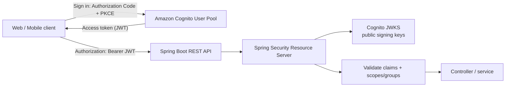
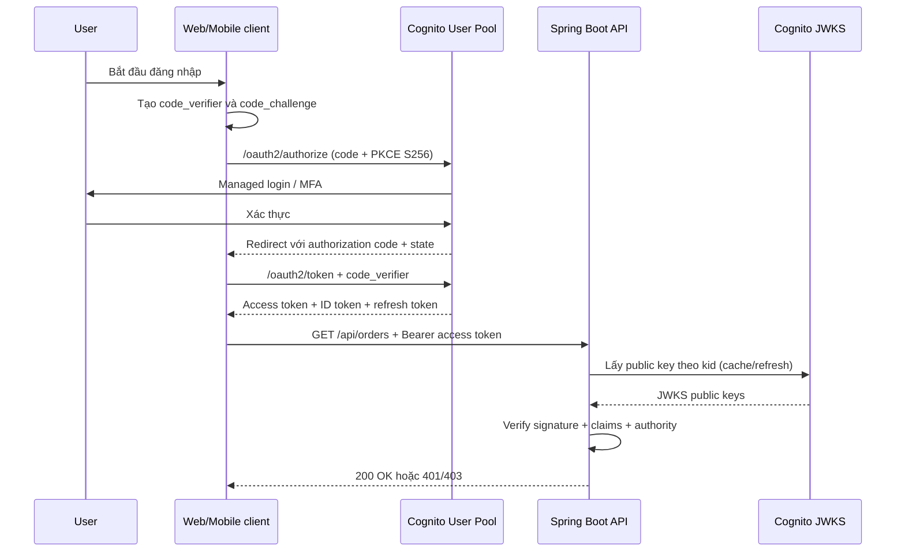
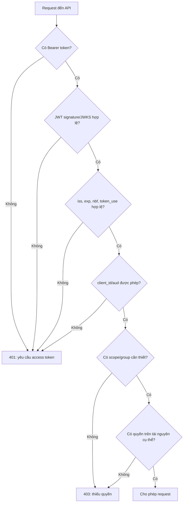

# Bảo vệ Spring Security API bằng Cognito JWT

## Mục tiêu học tập

Sau bài học, bạn có thể:

1. Giải thích vai trò của **Amazon Cognito User Pool**, OAuth 2.0, OpenID Connect (OIDC), JWT và Spring Security Resource Server trong bảo vệ REST API.
2. Phân biệt **access token, ID token và refresh token**, hiểu vì sao API nghiệp vụ phải nhận access token thay vì dùng ID token làm bearer credential.
3. Mô tả luồng **Authorization Code Grant with PKCE** từ ứng dụng client tới Cognito và Spring Boot API.
4. Xác định các claim quan trọng của Cognito JWT: **iss, sub, exp, nbf, iat, kid, token_use, client_id, aud, scope** và **cognito:groups**.
5. Cấu hình Spring Security theo mô hình **OAuth2 Resource Server**, dùng JWKS để xác minh chữ ký RS256 và kiểm tra issuer/thời hạn.
6. Bổ sung validator dành riêng cho Cognito để chỉ chấp nhận access token, app client được phép và audience của API khi sử dụng resource binding.
7. Chuyển custom scopes và Cognito groups thành Spring authorities, bảo vệ endpoint bằng hasAuthority, @PreAuthorize và nguyên tắc least privilege.
8. Kiểm thử authentication/authorization, phân biệt HTTP 401 và 403, xử lý key rotation, token expiration và revocation.
9. Triển khai cấu hình an toàn cho môi trường local, AWS và CI/CD; tránh các lỗi thường gặp như tin JWT chỉ vì decode được, dùng ID token, tắt xác minh TLS hoặc log bearer token.
10. Tạo một Cognito resource server/app client thử nghiệm bằng AWS CLI, lấy access token qua Authorization Code + PKCE và gọi API Spring Boot.

## 1. Bài toán: API cần biết ai đang gọi và họ được phép làm gì

Một hệ thống thương mại điện tử có các dịch vụ Java/Spring Boot:

- catalog-api: đọc danh mục sản phẩm.
- orders-api: xem và tạo đơn hàng.
- admin-api: quản trị sản phẩm, người dùng và cấu hình.
- web-app và mobile-app: giao diện dành cho khách hàng.

Nếu mỗi API tự lưu username/password, tự tạo session hoặc tự triển khai logic xác thực, hệ thống sẽ khó đồng bộ chính sách bảo mật. Ta cần một **Identity Provider (IdP)** chịu trách nhiệm đăng nhập, phát hành token và một cơ chế chuẩn để các API kiểm tra token.

Amazon Cognito User Pool đảm nhận vai trò IdP. Sau khi người dùng đăng nhập, Cognito phát hành JWT. Client gửi access token trong HTTP header:

```http
GET /api/orders HTTP/1.1
Host: api.example.com
Authorization: Bearer <access-token>
```

Spring Security Resource Server xác minh token, chuyển claims thành Authentication/authorities, rồi quyết định request có được phép truy cập endpoint hay không.



**Cognito xác thực danh tính; API vẫn phải tự thực thi authorization.** Một JWT có chữ ký hợp lệ chỉ chứng minh token được phát hành bởi issuer tin cậy và claims chưa bị thay đổi. Nó không tự chứng minh người gọi được phép đọc mọi đơn hàng hoặc sửa mọi tài nguyên.

## 2. Các thành phần cần phân biệt

### 2.1. Cognito User Pool và Identity Pool

| Thành phần | Vai trò | Dùng khi |
| --- | --- | --- |
| **Cognito User Pool** | Directory người dùng và OIDC/OAuth 2.0 authorization server; hỗ trợ đăng nhập, federation, MFA và phát hành ID/access/refresh tokens. | Xác thực người dùng cho web/mobile/API. |
| **Cognito Identity Pool** | Đổi danh tính từ các identity provider thành AWS credentials tạm thời thông qua IAM roles. | Client cần truy cập trực tiếp tài nguyên AWS với quyền IAM giới hạn. |

Trong bài này, **User Pool phát hành JWT cho Spring Boot API**. Identity Pool không phải thành phần bắt buộc để API kiểm tra JWT.

### 2.2. Resource Server là gì?

OAuth 2.0 chia trách nhiệm:

- **Authorization Server:** Cognito xác thực người dùng/client, cấp access token và quản lý scopes.
- **Resource Server:** Spring Boot API nhận bearer token, xác minh token và kiểm tra quyền truy cập tài nguyên.
- **Client:** Web/mobile hoặc service khác lấy token và gửi request đến API.

Spring Boot không cần lưu password của người dùng Cognito. API cũng không cần client secret của Cognito chỉ để xác minh chữ ký JWT. API cần biết issuer, JWKS URI và chính sách claims/scopes được chấp nhận.

### 2.3. Access token, ID token và refresh token

| Token | Mục đích | Có nên gửi tới REST API nghiệp vụ? |
| --- | --- | --- |
| **Access token** | Mang quyền truy cập API, scopes, nhóm người dùng và thông tin client. | **Có.** Đây là bearer token API nên chấp nhận. |
| **ID token** | Chứa claims xác thực/nhận dạng người dùng cho client, có aud là app client ID. | **Không dùng thay access token.** |
| **Refresh token** | Dùng với Cognito token endpoint để xin token mới; không phải JWT access credential cho API. | **Không.** Không gửi refresh token tới resource server. |

ID token và access token được Cognito ký bằng **hai signing keys riêng**. Vì vậy không chỉ kiểm tra chữ ký và issuer: API phải kiểm tra claim token_use bằng access. AWS mô tả access token dùng để authorize API operations, còn ID token dành cho thông tin xác thực/nhận dạng client.

### 2.4. JWT gồm những gì?

JWT thường có ba phần được phân cách bằng dấu chấm:

```text
base64url(header).base64url(payload).signature
```

- **Header:** thuật toán ký alg và key identifier kid.
- **Payload:** các claims như issuer, subject, thời hạn, scope và nhóm.
- **Signature:** chữ ký số bảo vệ tính toàn vẹn của header và payload.

Ví dụ payload access token đã được rút gọn để minh họa:

```json
{
  "sub": "user-subject-id",
  "iss": "https://cognito-idp.ap-southeast-1.amazonaws.com/ap-southeast-1_example",
  "client_id": "example-app-client-id",
  "token_use": "access",
  "scope": "openid orders-api/orders/read orders-api/orders/write",
  "cognito:groups": ["customers"],
  "iat": 1760000000,
  "exp": 1760000900,
  "jti": "unique-token-id"
}
```

Đây chỉ là ví dụ cấu trúc, không phải token thật. Không được tin claims chỉ vì đã decode Base64URL thành công. Kẻ tấn công có thể sửa payload; API phải xác minh signature bằng public key tương ứng với kid từ JWKS.

## 3. Luồng đăng nhập và gọi API

### 3.1. Authorization Code Grant with PKCE

Với ứng dụng web/mobile public client, ưu tiên **Authorization Code Grant + PKCE với S256**:

1. Client tạo code_verifier ngẫu nhiên đủ mạnh.
2. Client băm verifier bằng SHA-256 và Base64URL để tạo code_challenge.
3. Trình duyệt điều hướng tới Cognito /oauth2/authorize với response_type=code, client_id, redirect_uri, scope, state, code_challenge và code_challenge_method=S256.
4. Người dùng đăng nhập/MFA/federation theo chính sách User Pool.
5. Cognito chuyển hướng về callback đã đăng ký với authorization code và state.
6. Client gửi authorization code cùng code_verifier tới /oauth2/token.
7. Cognito xác minh PKCE rồi cấp access token, ID token và refresh token (nếu grant/client policy cho phép).
8. Client gửi **access token** tới Spring API trong Authorization: Bearer.

PKCE ngăn kẻ khác đổi một authorization code bị chặn giữa đường nếu không có verifier ban đầu. Cognito hỗ trợ phương thức S256; không dùng plain.



### 3.2. Vì sao không dùng Implicit Grant?

Implicit Grant trả token trực tiếp trong redirect URL/browser fragment, làm token dễ lộ qua lịch sử trình duyệt, extension, telemetry hoặc các thành phần xử lý URL. AWS khuyến nghị Authorization Code Grant để nhận token và hỗ trợ refresh token; với public clients, thêm PKCE.

### 3.3. Scopes được yêu cầu ở đâu?

Client yêu cầu scopes khi gọi authorization endpoint. Cognito chỉ cấp các scopes hợp lệ được bật cho app client. Nếu không yêu cầu openid, Cognito không trả ID token trong luồng OAuth authorization endpoint; access token vẫn có thể được cấp tùy scopes và cấu hình.

Ví dụ resource server:

- Identifier: orders-api
- Custom scope: orders/read
- Custom scope: orders/write

Trong access token, Cognito biểu diễn custom scope theo dạng:

```text
orders-api/orders/read
orders-api/orders/write
```

Spring Security sẽ ánh xạ scope thành authority có tiền tố SCOPE_, ví dụ SCOPE_orders-api/orders/read.

## 4. Claims Cognito mà API phải hiểu

| Claim | Ý nghĩa | Cách sử dụng |
| --- | --- | --- |
| **iss** | Issuer URL của User Pool. | Phải khớp chính xác issuer được cấu hình. |
| **sub** | Định danh chủ thể trong User Pool. | Dùng làm user ID ổn định; không dựa vào username vì username có thể đổi/không duy nhất theo cách ứng dụng kỳ vọng. |
| **exp** | Thời điểm token hết hạn (Unix time). | Từ chối token hết hạn. |
| **nbf** | Thời điểm token bắt đầu hợp lệ nếu có. | Từ chối token chưa có hiệu lực. |
| **iat** | Thời điểm token được phát hành. | Audit/risk policy; không thay thế kiểm tra exp. |
| **kid** | ID của signing key trong JWT header. | Chọn public key tương ứng trong JWKS. |
| **alg** | Thuật toán ký; Cognito User Pool dùng RS256. | Chỉ tin thuật toán được cho phép, không chấp nhận none hoặc thuật toán tùy ý. |
| **token_use** | Loại token: access hoặc id. | API này chỉ chấp nhận access. |
| **client_id** | App client đã yêu cầu access token. | Chỉ chấp nhận app client ID đã allowlist. |
| **aud** | Resource server mà access token hướng tới nếu dùng resource binding; ID token có audience app client. | Nếu bật resource binding, phải kiểm tra đúng API audience. |
| **scope** | Các quyền OAuth 2.0 được cấp. | Dùng cho authorization theo chức năng API. |
| **cognito:groups** | Danh sách Cognito User Pool groups của user. | Ánh xạ thành authorities/roles nếu nghiệp vụ cần. |
| **jti** | ID duy nhất của JWT. | Hữu ích cho audit hoặc denylist theo chính sách. |
| **origin_jti** | ID liên kết với refresh-token family dùng cho token revocation. | Có thể dùng để phối hợp kiểm tra revocation theo kiến trúc. |

### 4.1. client_id và aud không phải lúc nào cũng giống nhau

Đây là điểm rất dễ cấu hình sai:

- **Access token không dùng resource binding:** Cognito có client_id, thường không có aud. API nên kiểm tra client_id có thuộc danh sách app clients được phép hay không.
- **Access token có resource binding:** Cognito thêm aud chứa resource identifier của API; API nên kiểm tra audience này, đồng thời vẫn kiểm tra client policy nếu ứng dụng giới hạn app clients.
- **ID token:** aud là app client ID, nhưng token có token_use=id nên API này phải từ chối.

Spring Boot property audiences kiểm tra claim aud; nó không tự thay thế chính sách allowlist client_id cho access token Cognito không có resource binding. Hãy chọn một mô hình audience rõ ràng và kiểm tra đúng claim.

Resource binding của Cognito là cơ chế riêng với custom scopes: client gửi tham số resource tới /oauth2/authorize, giá trị resource phải là URL-formatted identifier và Cognito đặt giá trị đó vào aud. Tính năng này áp dụng cho user authorization flows qua Managed Login/OAuth authorization server; không hỗ trợ Client Credentials M2M flow hoặc SDK authentication models. Ví dụ resource server identifier orders-api ở mục 6 dùng làm namespace custom scope, không phải audience resource-binding URL. Nếu muốn resource binding, tạo identifier dạng https://api.example.com và gửi resource=https://api.example.com trong authorization request.

### 4.2. User token và machine-to-machine token

Với Client Credentials flow, Cognito cấp access token cho **ứng dụng/service**, không phải người dùng:

- sub có thể là app client ID.
- Token có client_id, scope, iss, token_use=access, exp...
- Không nên kỳ vọng có username, cognito:groups hoặc origin_jti như user token.

Không viết authorization converter hoặc business logic giả định mọi access token đều có cognito:groups. Với M2M, phân quyền nên dựa trên custom scopes và service identity.

## 5. Xác minh chữ ký bằng JWKS

### 5.1. Issuer và JWKS URI

Với User Pool ở Region ap-southeast-1, issuer có dạng:

```text
https://cognito-idp.ap-southeast-1.amazonaws.com/<userPoolId>
```

JWKS URI:

```text
https://cognito-idp.ap-southeast-1.amazonaws.com/<userPoolId>/.well-known/jwks.json
```

JWKS là tập public keys, không chứa private signing key. JWT header có kid; verifier chọn key có cùng kid, sau đó xác minh chữ ký RSA-SHA256. Public key có thể cache, nhưng phải có cơ chế refresh khi Cognito xoay signing keys.

### 5.2. Những kiểm tra tối thiểu

Một API chỉ chấp nhận Cognito access token nên kiểm tra:

1. JWT có cấu trúc hợp lệ.
2. alg thuộc allowlist; với Cognito User Pool dùng RS256.
3. Chữ ký hợp lệ với public key có kid tương ứng trong JWKS.
4. iss đúng User Pool đã cấu hình.
5. exp chưa qua và nbf đã có hiệu lực (nếu claim có mặt).
6. token_use chính xác là access.
7. client_id thuộc allowlist app clients.
8. Nếu API dùng resource binding, aud phải chứa resource identifier đã cấu hình.
9. Scope/authority đủ để thực hiện hành động cụ thể.

**Decode JWT không phải verify JWT.** Không viết hàm tự tách chuỗi rồi tin payload, không hardcode public key vào source code, không bỏ qua issuer hoặc expiration.

### 5.3. Key rotation

Cognito có thể xoay signing keys. Verifier cần:

- Cache JWKS theo kid, không tải JWKS lại cho từng request.
- Khi nhận JWT có issuer đúng nhưng kid mới chưa có trong cache, refresh JWKS rồi thử xác minh lại theo cơ chế thư viện.
- Có timeout, retry và observability cho JWKS endpoint.
- Không pin duy nhất một public key cố định trong cấu hình production.

Spring Security Resource Server hỗ trợ JWK Set URI và tự xoay public keys khi authorization server công bố key mới. Đảm bảo workload có outbound HTTPS tới JWKS endpoint hoặc có thiết kế cache/egress phù hợp.

### 5.4. JWT self-contained và token revocation

JWT cho phép API xác minh chữ ký và expiration offline, không cần gọi Cognito ở mỗi request. Nhưng **offline signature + exp không tự phát hiện token đã bị revoke** trước thời điểm hết hạn.

Các lựa chọn:

- Đặt access token lifetime ngắn phù hợp với UX và rủi ro.
- Dùng refresh token rotation/revocation đúng quy trình ở client.
- Với yêu cầu thu hồi tức thời, triển khai denylist/token-state check hoặc một cơ chế online verification có cân nhắc latency/availability.
- Dùng jti/origin_jti làm khóa tham chiếu nếu thiết kế revocation store.

Không mặc định logout ở Cognito làm mọi Spring API lập tức từ chối JWT đang còn hạn nếu API chỉ xác minh offline.

## 6. Tạo Cognito Resource Server và App Client

### 6.1. Tạo custom scopes

Trong Cognito Console, mở User Pool → Domain (trong Branding) → Resource servers. Tạo:

- Resource server identifier: orders-api
- Scope orders/read: đọc đơn hàng.
- Scope orders/write: tạo/cập nhật đơn hàng.

Có thể tạo bằng AWS CLI:

```bash
export AWS_REGION=ap-southeast-1
export USER_POOL_ID=ap-southeast-1_Example

aws cognito-idp create-resource-server \
  --region "$AWS_REGION" \
  --user-pool-id "$USER_POOL_ID" \
  --identifier orders-api \
  --name "Orders API" \
  --scopes ScopeName=orders/read,ScopeDescription="Read orders" \
          ScopeName=orders/write,ScopeDescription="Create and update orders"
```

orders-api/orders/read và orders-api/orders/write là các chuỗi scope sẽ xuất hiện trong access token. Identifier là namespace của resource server, không phải tên Spring role.

Ví dụ trên cố ý dùng identifier orders-api để minh họa custom scope; API kiểm tra client_id và không yêu cầu aud. Nếu muốn access token được ràng buộc riêng cho một API, tạo resource server với identifier dạng URL (ví dụ https://api.example.com), bật resource binding và gửi tham số resource=https://api.example.com ở authorization request. Khi đó access token có aud là URL này; đặt COGNITO_API_AUDIENCE đúng giá trị đó. Custom scope vẫn có dạng identifier/scope-name.

Lưu ý: các lệnh InitiateAuth/AdminInitiateAuth chỉ phát hành access token với scope dành riêng aws.cognito.signin.user.admin; chúng không cấp custom API scopes. Để lấy access token có custom scopes, bắt đầu tại OAuth authorization endpoint và đổi authorization code ở token endpoint như lab bên dưới.

### 6.2. Tạo public app client dùng Authorization Code + PKCE

Ví dụ client dành cho SPA/mobile. Không tạo client secret trong public client:

```bash
aws cognito-idp create-user-pool-client \
  --region "$AWS_REGION" \
  --user-pool-id "$USER_POOL_ID" \
  --client-name orders-public-client \
  --no-generate-secret \
  --allowed-o-auth-flows-user-pool-client \
  --allowed-o-auth-flows code \
  --allowed-o-auth-scopes openid profile \
      orders-api/orders/read orders-api/orders/write \
  --callback-urls http://localhost:8080/callback \
  --supported-identity-providers COGNITO \
  --enable-token-revocation \
  --prevent-user-existence-errors ENABLED
```

http://localhost chỉ dùng cho môi trường phát triển; production callback phải là HTTPS và khớp chính xác URI đã đăng ký. Cấu hình domain/Managed Login cho User Pool trước khi gọi authorization endpoint. Lưu ý app client tạo bằng AWS CLI không tự động được gán branding style; cần cấu hình branding style nếu dùng Managed Login. Nếu dùng confidential server-side web client, client secret chỉ được lưu và dùng ở backend, không nhúng vào JavaScript/mobile app.

### 6.3. Tạo Cognito group (tùy chọn)

Nếu API cần role/group, tạo group và thêm user bằng quyền quản trị phù hợp:

```bash
aws cognito-idp create-group \
  --region "$AWS_REGION" \
  --user-pool-id "$USER_POOL_ID" \
  --group-name api-admins \
  --description "Administrators for Orders API"

aws cognito-idp admin-add-user-to-group \
  --region "$AWS_REGION" \
  --user-pool-id "$USER_POOL_ID" \
  --username "<cognito-username>" \
  --group-name api-admins
```

Cognito đưa membership vào claim cognito:groups của token mới. User cần đăng nhập/nhận token mới sau thay đổi group để access token phản ánh membership mới.

### 6.4. Xác định issuer và JWKS

```bash
aws cognito-idp describe-user-pool \
  --region "$AWS_REGION" \
  --user-pool-id "$USER_POOL_ID" \
  --query 'UserPool.{Id:Id,Status:Status,Domain:Domain}'
```

Tạo các biến:

```bash
export COGNITO_ISSUER="https://cognito-idp.$AWS_REGION.amazonaws.com/$USER_POOL_ID"
export COGNITO_JWKS_URI="$COGNITO_ISSUER/.well-known/jwks.json"

curl -sS "$COGNITO_JWKS_URI"
```

curl trả JSON chứa danh sách public signing keys. Không copy private key hoặc token thật vào tài liệu, ticket hay source control.

## 7. Cấu hình Spring Boot Resource Server

### 7.1. Dependencies

Với Maven và Spring Boot dependency management, thêm:

```xml
<dependencies>
    <dependency>
        <groupId>org.springframework.boot</groupId>
        <artifactId>spring-boot-starter-web</artifactId>
    </dependency>

    <dependency>
        <groupId>org.springframework.boot</groupId>
        <artifactId>spring-boot-starter-security</artifactId>
    </dependency>

    <dependency>
        <groupId>org.springframework.boot</groupId>
        <artifactId>spring-boot-starter-oauth2-resource-server</artifactId>
    </dependency>

    <dependency>
        <groupId>org.springframework.boot</groupId>
        <artifactId>spring-boot-starter-test</artifactId>
        <scope>test</scope>
    </dependency>

    <dependency>
        <groupId>org.springframework.security</groupId>
        <artifactId>spring-security-test</artifactId>
        <scope>test</scope>
    </dependency>
</dependencies>
```

Resource Server JWT cần cả spring-security-oauth2-resource-server và spring-security-oauth2-jose; starter Resource Server đưa các thành phần cần thiết vào dependency graph.

### 7.2. Cấu hình application.yml

```yaml
server:
  port: 8080

app:
  security:
    cognito:
      issuer: ${COGNITO_ISSUER}
      jwk-set-uri: ${COGNITO_JWKS_URI}
      allowed-client-ids:
        - ${COGNITO_APP_CLIENT_ID}
      # Chỉ đặt khi Cognito access token có resource binding (aud).
      # Nếu không dùng resource binding, để trống và validate client_id.
      audience: ${COGNITO_API_AUDIENCE:}
```

Các giá trị trên không phải password:

- issuer: URL User Pool phát hành token.
- jwk-set-uri: URL public JWKS.
- allowed-client-ids: app client IDs được phép gọi API.
- audience: resource identifier nếu ứng dụng đã bật Cognito resource binding.

Trong môi trường triển khai, truyền chúng qua environment/config management. Không đưa client secret, access token hay refresh token vào repository.

### 7.3. Vì sao chỉ khai báo issuer-uri đôi khi chưa đủ?

Spring Security Resource Server mặc định có thể xác minh chữ ký JWT, iss, exp, nbf và chuyển scope thành authority SCOPE_. Tuy nhiên, với Cognito API cần thêm quy tắc:

- Chỉ chấp nhận token_use=access.
- Kiểm tra client_id của access token.
- Kiểm tra aud khi đã cấu hình resource binding.

Vì vậy bài này tạo custom JwtDecoder/OAuth2TokenValidator. Ta dùng JWKS URI trực tiếp để Spring không phải discovery metadata endpoint lúc khởi động; vẫn xác minh iss bằng validator.

### 7.4. Custom Cognito JwtDecoder

```java
package com.example.orders.security;

import java.util.List;

import org.springframework.boot.context.properties.bind.Bindable;
import org.springframework.boot.context.properties.bind.Binder;
import org.springframework.context.annotation.Bean;
import org.springframework.context.annotation.Configuration;
import org.springframework.core.env.Environment;
import org.springframework.security.oauth2.core.OAuth2Error;
import org.springframework.security.oauth2.core.OAuth2TokenValidator;
import org.springframework.security.oauth2.core.OAuth2TokenValidatorResult;
import org.springframework.security.oauth2.jose.jws.SignatureAlgorithm;
import org.springframework.security.oauth2.jwt.DelegatingOAuth2TokenValidator;
import org.springframework.security.oauth2.jwt.Jwt;
import org.springframework.security.oauth2.jwt.JwtDecoder;
import org.springframework.security.oauth2.jwt.JwtValidators;
import org.springframework.security.oauth2.jwt.NimbusJwtDecoder;
import org.springframework.util.StringUtils;

@Configuration
public class CognitoJwtDecoderConfig {

    @Bean
    JwtDecoder cognitoJwtDecoder(Environment environment) {
        String issuer = environment.getRequiredProperty("app.security.cognito.issuer");
        String jwkSetUri = environment.getRequiredProperty("app.security.cognito.jwk-set-uri");
        List<String> allowedClientIds = Binder.get(environment)
                .bind("app.security.cognito.allowed-client-ids", Bindable.listOf(String.class))
                .orElse(List.of());
        if (allowedClientIds.isEmpty()) {
            throw new IllegalStateException("At least one Cognito app client ID must be configured");
        }
        String expectedAudience = environment.getProperty("app.security.cognito.audience", "");

        NimbusJwtDecoder decoder = NimbusJwtDecoder
                .withJwkSetUri(jwkSetUri)
                .jwsAlgorithm(SignatureAlgorithm.RS256)
                .build();

        OAuth2TokenValidator<Jwt> issuerAndTimeValidator =
                JwtValidators.createDefaultWithIssuer(issuer);

        OAuth2TokenValidator<Jwt> cognitoAccessTokenValidator = jwt -> {
            if (!"access".equals(jwt.getClaimAsString("token_use"))) {
                return invalidToken("Only Cognito access tokens are accepted");
            }

            String clientId = jwt.getClaimAsString("client_id");
            if (!StringUtils.hasText(clientId) || !allowedClientIds.contains(clientId)) {
                return invalidToken("Untrusted Cognito app client");
            }

            if (StringUtils.hasText(expectedAudience)) {
                List<String> audiences = jwt.getAudience();
                if (audiences == null || !audiences.contains(expectedAudience)) {
                    return invalidToken("Unexpected access-token audience");
                }
            }

            return OAuth2TokenValidatorResult.success();
        };

        decoder.setJwtValidator(new DelegatingOAuth2TokenValidator<>(
                issuerAndTimeValidator,
                cognitoAccessTokenValidator
        ));

        return decoder;
    }

    private static OAuth2TokenValidatorResult invalidToken(String description) {
        OAuth2Error error = new OAuth2Error("invalid_token", description, null);
        return OAuth2TokenValidatorResult.failure(error);
    }
}
```

Đoạn validator trên bind toàn bộ danh sách app client IDs từ cấu hình. Khi audience không rỗng, API bắt buộc access token có aud chứa resource identifier đã cấu hình. Nếu không bật resource binding, để audience trống và dựa vào allowlist client_id.

JwtValidators.createDefaultWithIssuer kiểm tra issuer và timestamp. NimbusJwtDecoder lấy public key từ JWKS, xác minh chữ ký RS256 và chọn key theo kid. Không tự giải mã payload rồi bỏ qua decoder.

**Lưu ý phiên bản:** các API builder/validator trong ví dụ thuộc Spring Security hiện đại (Spring Boot 3.x / Spring Security 6.x trở lên). Hãy dùng BOM của Spring Boot để quản lý version đồng bộ; không nâng riêng một module Spring Security ngoài dependency management.

## 8. Chuyển Cognito scopes/groups thành authorities

### 8.1. Scope mặc định của Spring Security

Spring Security JwtGrantedAuthoritiesConverter đọc claim scope (hoặc scp) và chuyển mỗi scope thành authority có tiền tố SCOPE_.

Ví dụ:

```text
scope = "orders-api/orders/read orders-api/orders/write"

Authorities:
SCOPE_orders-api/orders/read
SCOPE_orders-api/orders/write
```

### 8.2. Ánh xạ cognito:groups

Cognito access token của user có thể chứa cognito:groups là một array. Ta có thể chuyển từng group thành authority GROUP_<group-name>:

```java
package com.example.orders.security;

import java.util.ArrayList;
import java.util.Collection;
import java.util.List;

import org.springframework.context.annotation.Bean;
import org.springframework.context.annotation.Configuration;
import org.springframework.core.convert.converter.Converter;
import org.springframework.security.core.GrantedAuthority;
import org.springframework.security.core.authority.SimpleGrantedAuthority;
import org.springframework.security.oauth2.jwt.Jwt;
import org.springframework.security.oauth2.server.resource.authentication.JwtAuthenticationConverter;
import org.springframework.security.oauth2.server.resource.authentication.JwtGrantedAuthoritiesConverter;

@Configuration
public class CognitoAuthoritiesConfig {

    @Bean
    JwtAuthenticationConverter cognitoJwtAuthenticationConverter() {
        JwtGrantedAuthoritiesConverter scopes = new JwtGrantedAuthoritiesConverter();
        scopes.setAuthoritiesClaimName("scope");
        scopes.setAuthorityPrefix("SCOPE_");

        Converter<Jwt, Collection<GrantedAuthority>> combinedAuthorities = jwt -> {
            Collection<GrantedAuthority> authorities = new ArrayList<>();

            Collection<GrantedAuthority> scopeAuthorities = scopes.convert(jwt);
            if (scopeAuthorities != null) {
                authorities.addAll(scopeAuthorities);
            }

            List<String> groups = jwt.getClaimAsStringList("cognito:groups");
            if (groups != null) {
                groups.stream()
                        .map(group -> new SimpleGrantedAuthority("GROUP_" + group))
                        .forEach(authorities::add);
            }

            return authorities;
        };

        JwtAuthenticationConverter converter = new JwtAuthenticationConverter();
        converter.setJwtGrantedAuthoritiesConverter(combinedAuthorities);
        return converter;
    }
}
```

Với M2M token, cognito:groups có thể không tồn tại; converter trên xử lý trường hợp đó bằng cách chỉ giữ scopes.

Không gộp group và scope thành một khái niệm:

- **Scope** là quyền OAuth client/token được cấp cho API, ví dụ orders-api/orders/read.
- **Group** là membership trong User Pool, ví dụ api-admins.
- **Business authorization** có thể còn phải kiểm tra tenant, ownership hoặc trạng thái tài nguyên trong database.

## 9. Khai báo SecurityFilterChain

### 9.1. Cấu hình API stateless

```java
package com.example.orders.security;

import org.springframework.context.annotation.Bean;
import org.springframework.context.annotation.Configuration;
import org.springframework.http.HttpMethod;
import org.springframework.security.config.annotation.method.configuration.EnableMethodSecurity;
import org.springframework.security.config.annotation.web.builders.HttpSecurity;
import org.springframework.security.config.annotation.web.configurers.AbstractHttpConfigurer;
import org.springframework.security.config.http.SessionCreationPolicy;
import org.springframework.security.oauth2.server.resource.authentication.JwtAuthenticationConverter;
import org.springframework.security.web.SecurityFilterChain;

@Configuration
@EnableMethodSecurity
public class SecurityConfig {

    @Bean
    SecurityFilterChain apiSecurity(
            HttpSecurity http,
            JwtAuthenticationConverter cognitoJwtAuthenticationConverter) throws Exception {

        http
            .csrf(AbstractHttpConfigurer::disable)
            .sessionManagement(session -> session
                    .sessionCreationPolicy(SessionCreationPolicy.STATELESS))
            .authorizeHttpRequests(authorize -> authorize
                    .requestMatchers("/actuator/health").permitAll()
                    .requestMatchers("/api/admin/**").hasAuthority("GROUP_api-admins")
                    .requestMatchers(HttpMethod.GET, "/api/orders/**")
                        .hasAuthority("SCOPE_orders-api/orders/read")
                    .requestMatchers(HttpMethod.POST, "/api/orders/**")
                        .hasAuthority("SCOPE_orders-api/orders/write")
                    .requestMatchers(HttpMethod.PUT, "/api/orders/**")
                        .hasAuthority("SCOPE_orders-api/orders/write")
                    .anyRequest().authenticated()
            )
            .oauth2ResourceServer(oauth2 -> oauth2
                    .jwt(jwt -> jwt
                            .jwtAuthenticationConverter(cognitoJwtAuthenticationConverter))
            );

        return http.build();
    }
}
```

Đây là cấu hình **API chỉ xác thực bằng Bearer token trong Authorization header**, không dùng cookie/session browser. Trong bối cảnh stateless này có thể disable CSRF. Nếu ứng dụng dùng cookie authentication, session login hoặc browser tự động gửi credential qua cookie, không được copy cấu hình disable CSRF này một cách máy móc.

SessionCreationPolicy.STATELESS yêu cầu Spring không tạo HTTP session để lưu security context. CORS vẫn phải cấu hình riêng theo origin/method/header thực tế; CORS không thay thế authentication hoặc authorization.

### 9.2. Quyền ở controller/service

```java
package com.example.orders.api;

import java.util.List;

import org.springframework.security.access.prepost.PreAuthorize;
import org.springframework.security.core.annotation.AuthenticationPrincipal;
import org.springframework.security.oauth2.jwt.Jwt;
import org.springframework.web.bind.annotation.GetMapping;
import org.springframework.web.bind.annotation.PostMapping;
import org.springframework.web.bind.annotation.RequestMapping;
import org.springframework.web.bind.annotation.RestController;

@RestController
@RequestMapping("/api/orders")
public class OrderController {

    @GetMapping
    @PreAuthorize("hasAuthority('SCOPE_orders-api/orders/read')")
    public List<String> getOrders(@AuthenticationPrincipal Jwt jwt) {
        String cognitoSubject = jwt.getSubject();
        return List.of("orders-for-subject-" + cognitoSubject);
    }

    @PostMapping
    @PreAuthorize("hasAuthority('SCOPE_orders-api/orders/write')")
    public String createOrder(@AuthenticationPrincipal Jwt jwt) {
        return "created-for-" + jwt.getSubject();
    }
}
```

Ví dụ chỉ minh họa cách lấy sub. Production phải truy vấn dữ liệu theo sub đã xác minh, kiểm tra ownership/tenant ở tầng service và không cho client tự gửi userId để truy cập đơn của người khác.

### 9.3. Authentication khác authorization

| Request | Kết quả điển hình | Lý do |
| --- | --- | --- |
| Không gửi bearer token tới endpoint bảo vệ | 401 Unauthorized | Chưa xác thực. |
| Token sai chữ ký, sai issuer, hết hạn hoặc token_use=id | 401 Unauthorized | Token không hợp lệ cho API. |
| Token hợp lệ nhưng thiếu scope/group cần thiết | 403 Forbidden | Đã xác thực nhưng không đủ quyền. |
| Token hợp lệ, đúng scope và business ownership | 200 OK/201 Created | Request được phép. |

Không trả 200 rồi tự lọc quyền trong controller cho mọi endpoint; hãy khai báo authorization rules rõ ràng ở filter chain/method security và vẫn kiểm tra quyền trên từng tài nguyên.

## 10. Kiểm thử Spring Security

### 10.1. Kiểm thử endpoint với MockMvc

Spring Security Test cung cấp jwt() request post-processor để tạo JwtAuthenticationToken giả lập. Nó giúp test authorization mà không cần gọi Cognito thật:

```java
import static org.springframework.security.test.web.servlet.request.SecurityMockMvcRequestPostProcessors.jwt;
import static org.springframework.test.web.servlet.request.MockMvcRequestBuilders.get;
import static org.springframework.test.web.servlet.result.MockMvcResultMatchers.status;

import org.junit.jupiter.api.Test;
import org.springframework.beans.factory.annotation.Autowired;
import org.springframework.boot.test.autoconfigure.web.servlet.AutoConfigureMockMvc;
import org.springframework.boot.test.context.SpringBootTest;
import org.springframework.test.web.servlet.MockMvc;

@SpringBootTest(properties = {
        "app.security.cognito.issuer=https://cognito-idp.us-east-1.amazonaws.com/us-east-1_test",
        "app.security.cognito.jwk-set-uri=https://cognito-idp.us-east-1.amazonaws.com/us-east-1_test/.well-known/jwks.json",
        "app.security.cognito.allowed-client-ids[0]=test-client",
        "app.security.cognito.audience="
})
@AutoConfigureMockMvc
class OrderSecurityTest {

    @Autowired
    MockMvc mockMvc;

    @Test
    void readScopeCanAccessOrders() throws Exception {
        mockMvc.perform(get("/api/orders")
                .with(jwt().jwt(jwt -> jwt
                        .claim("token_use", "access")
                        .claim("scope", "orders-api/orders/read"))))
                .andExpect(status().isOk());
    }

    @Test
    void missingReadScopeIsForbidden() throws Exception {
        mockMvc.perform(get("/api/orders")
                .with(jwt().jwt(jwt -> jwt
                        .claim("token_use", "access")
                        .claim("scope", "orders-api/orders/write"))))
                .andExpect(status().isForbidden());
    }
}
```

Test jwt() tạo authentication đã được giả lập, **không kiểm tra chữ ký RS256, JWKS hoặc custom JwtDecoder**. Vì vậy cần có thêm unit test cho claim validators và integration test với JWT đã ký bằng test key/JWKS giả lập hoặc Cognito test User Pool.

### 10.2. Ma trận kiểm thử bắt buộc

| Ca kiểm thử | Kỳ vọng |
| --- | --- |
| Không có Authorization header | 401 |
| Bearer token không phải JWT hợp lệ | 401 |
| Chữ ký không khớp JWKS | 401 |
| kid không tồn tại sau khi refresh JWKS | 401 |
| iss thuộc User Pool khác | 401 |
| exp đã qua hoặc nbf ở tương lai | 401 |
| token_use=id | 401 |
| client_id không thuộc allowlist | 401 |
| aud sai khi resource binding được bật | 401 |
| Access token đúng nhưng thiếu scope | 403 |
| Access token đúng scope | 200/201 theo endpoint |
| User không thuộc api-admins gọi admin endpoint | 403 |
| M2M token không có groups nhưng có scope phù hợp | Được phép theo scope policy |
| User có scope nhưng không sở hữu order | 403 hoặc response theo policy không tiết lộ tài nguyên |

## 11. Lab: gọi Spring Boot API bằng Cognito access token

Lab sử dụng một User Pool đã tồn tại. Không tạo resource trong production hoặc account không được phép. Thay tất cả giá trị Example bằng ID/domain thật của môi trường lab.

### 11.1. Chuẩn bị Spring Boot

Đặt biến môi trường:

```bash
export AWS_REGION=ap-southeast-1
export USER_POOL_ID=ap-southeast-1_Example
export COGNITO_APP_CLIENT_ID=exampleclientid
export COGNITO_ISSUER="https://cognito-idp.$AWS_REGION.amazonaws.com/$USER_POOL_ID"
export COGNITO_JWKS_URI="$COGNITO_ISSUER/.well-known/jwks.json"
export COGNITO_API_AUDIENCE=""
```

Nếu không dùng resource binding, COGNITO_API_AUDIENCE để trống. Nếu đã cấu hình resource binding, đặt đúng identifier URL/URI xuất hiện trong claim aud.

### 11.2. Tạo resource server và app client

Chạy lệnh tạo custom scopes và public app client ở mục 6. App client phải cho phép Authorization Code Grant, các custom scopes và callback URI của môi trường local. Đảm bảo User Pool domain/Managed Login đã được cấu hình.

Kiểm tra cấu hình app client:

```bash
aws cognito-idp describe-user-pool-client \
  --region "$AWS_REGION" \
  --user-pool-id "$USER_POOL_ID" \
  --client-id "$COGNITO_APP_CLIENT_ID"
```

Kiểm tra AllowedOAuthFlows có code, AllowedOAuthFlowsUserPoolClient là true và AllowedOAuthScopes chứa orders-api/orders/read và orders-api/orders/write.

### 11.3. Lấy token bằng Authorization Code + PKCE

Client tạo verifier/challenge theo RFC 7636. Ví dụ authorization URL dạng rút gọn:

```text
https://<cognito-domain>/oauth2/authorize
  ?response_type=code
  &client_id=<app-client-id>
  &redirect_uri=http%3A%2F%2Flocalhost%3A8080%2Fcallback
  &scope=openid%20orders-api%2Forders%2Fread%20orders-api%2Forders%2Fwrite
  &state=<random-state>
  &code_challenge=<base64url-sha256-code-verifier>
  &code_challenge_method=S256
```

Mở URL trong browser, đăng nhập, rồi kiểm tra state ở callback và lấy authorization code. Đổi code tại /oauth2/token bằng code_verifier ban đầu:

Nếu dùng resource binding, thêm tham số resource với URL identifier đã cấu hình, ví dụ resource=https%3A%2F%2Fapi.example.com; Cognito sẽ ghi URL đó vào claim aud của access token. Không thêm tham số này cho ví dụ mặc định orders-api nếu resource server identifier chưa được định nghĩa dưới dạng URL.

```bash
curl -X POST "https://<cognito-domain>/oauth2/token" \
  -H "Content-Type: application/x-www-form-urlencoded" \
  --data-urlencode "grant_type=authorization_code" \
  --data-urlencode "client_id=$COGNITO_APP_CLIENT_ID" \
  --data-urlencode "code=<authorization-code>" \
  --data-urlencode "redirect_uri=http://localhost:8080/callback" \
  --data-urlencode "code_verifier=<original-code-verifier>"
```

Với public app client không có client secret, không gửi client_secret. Confidential client có thể cần xác thực client theo cấu hình; secret chỉ được giữ phía server.

Không thay bước OAuth này bằng lệnh InitiateAuth nếu mục tiêu là thử custom scope: access token từ Cognito User Pool API sign-in chỉ có reserved scope aws.cognito.signin.user.admin.

### 11.4. Chạy API và gửi request

Khởi chạy Spring Boot với environment variables đã cấu hình:

```bash
./mvnw spring-boot:run
```

Gửi access token:

```bash
export ACCESS_TOKEN="<access-token-from-cognito>"

curl -i http://localhost:8080/api/orders \
  -H "Authorization: Bearer $ACCESS_TOKEN"
```

Nếu token có orders-api/orders/read, request có thể trả 200. Thử gọi endpoint yêu cầu write scope bằng token chỉ có read scope; API phải trả 403.

### 11.5. Kiểm tra token và claims trong môi trường lab

Có thể dùng JWT decoder offline để quan sát header/payload, nhưng nhớ rằng decode chỉ là thao tác đọc, không xác minh chữ ký. Xác nhận:

- iss đúng issuer đã cấu hình.
- token_use là access.
- client_id là app client được allowlist.
- scope chứa custom scope đã yêu cầu.
- cognito:groups xuất hiện nếu user thuộc group.
- exp lớn hơn thời điểm hiện tại.
- Nếu dùng resource binding, aud bằng API resource identifier.

Không paste access token thật lên website decoder công cộng. Token bearer có thể bị sử dụng bởi bất kỳ ai sở hữu nó cho đến khi hết hạn hoặc bị từ chối.

## 12. Vận hành và hardening production

### 12.1. Token lifetime và refresh

Cognito cho phép cấu hình access token lifetime theo app client (hiện có thể từ 5 phút tới 1 ngày). Chọn TTL theo độ nhạy API, tần suất refresh và trải nghiệm người dùng. Không mặc định TTL dài là tốt hơn.

Nếu dùng Managed Login, cookie trình duyệt có thời hạn riêng (mặc định một giờ); đặt access token dưới một giờ không làm cookie đăng nhập Managed Login ngắn lại. Đánh giá cả hai cơ chế khi thiết kế session/logout.

Client nên dùng SDK/OIDC library để quản lý refresh token an toàn; không tự lưu refresh token trong localStorage nếu threat model của ứng dụng không cho phép. Không gửi refresh token tới Spring Resource Server.

### 12.2. Revocation và logout

Khi Cognito revoke refresh token/token family, API chỉ xác minh JWT offline có thể vẫn chấp nhận access token đã phát hành cho tới khi token hết hạn, nếu API không kiểm tra trạng thái revocation. Nếu yêu cầu logout tức thời:

- Dùng access token lifetime ngắn.
- Có thể duy trì denylist cho jti hoặc origin_jti đến hết thời hạn token.
- Với endpoint nhạy cảm, kiểm tra session/revocation state theo chiến lược online phù hợp.
- Đánh giá độ trễ, availability và chi phí nếu mỗi request phải gọi dịch vụ bên ngoài.

Không gọi Cognito GetUser chỉ để xác minh chữ ký/expiration ở mọi request; đây không phải phương thức thay thế JWT verification.

### 12.3. TLS, CORS và CSRF

- Bắt buộc HTTPS cho client ↔ API và bảo vệ đường truyền tới Cognito.
- CORS chỉ allow origins/methods/headers cần thiết; không dùng wildcard origin với credentialed requests.
- CORS không phải authorization: request vẫn phải có token hợp lệ và đủ quyền.
- Chỉ disable CSRF khi API dùng bearer token trong header và không dựa vào browser cookie/session tự động gửi.
- Nếu có web app dùng cookie session, giữ CSRF protection cho luồng đó hoặc tách security filter chains theo loại client.

### 12.4. Secrets, logs và observability

- API resource server không cần Cognito app client secret chỉ để verify JWT.
- Không log Authorization header, access token, refresh token hoặc client secret.
- Không trả raw JWT claims nhạy cảm trong error response.
- Log correlation ID, subject đã xác minh (nếu policy cho phép), endpoint, authorization outcome và reason code an toàn.
- Theo dõi tỷ lệ 401/403, lỗi JWKS fetch, key refresh, token expiry, latency và request bất thường.
- Cấu hình clock đồng bộ (NTP); chỉ dùng clock skew nhỏ nếu thật sự cần.

### 12.5. Object-level authorization

Scope orders/read chỉ cho biết client có quyền gọi chức năng đọc orders. Nó **không** có nghĩa user được xem đơn của mọi khách hàng.

Ví dụ kiểm tra ownership:

```java
import org.springframework.security.access.AccessDeniedException;
import org.springframework.security.access.prepost.PreAuthorize;
import org.springframework.security.oauth2.jwt.Jwt;
import org.springframework.stereotype.Service;

@Service
public class OrderService {

    @PreAuthorize("hasAuthority('SCOPE_orders-api/orders/read')")
    public Order getOrder(String orderId, Jwt jwt) {
        Order order = orderRepository.findById(orderId)
                .orElseThrow(OrderNotFoundException::new);

        if (!order.getCustomerSubject().equals(jwt.getSubject())) {
            throw new AccessDeniedException("Not allowed to access this order");
        }

        return order;
    }
}
```

Controller lấy Jwt bằng @AuthenticationPrincipal rồi truyền vào service. Đây là ví dụ minh họa; repository và exception là thành phần ứng dụng. Trong thực tế, đặt logic ownership/tenant trong service hoặc policy component để mọi entry point đều áp dụng cùng quy tắc. Tránh IDOR (Insecure Direct Object Reference) do tin orderId hoặc userId từ request.

### 12.6. API Gateway hay Spring Resource Server?

| Mô hình | Ưu điểm | Lưu ý |
| --- | --- | --- |
| Spring Boot tự xác minh Cognito JWT | API kiểm soát claims, scopes, groups và business authorization ở một chỗ. | Mỗi service cần cấu hình verifier và policy nhất quán. |
| API Gateway JWT/Cognito authorizer trước backend | Chặn token sai tại edge, tập trung route/throttling. | Backend vẫn cần kiểm tra business authorization; không tin header do client tự gửi. |
| Cả API Gateway và Spring Resource Server | Defense in depth, gateway chặn sớm và service xác minh độc lập. | Quản lý policy và error semantics đồng bộ giữa hai lớp. |

Với API Gateway HTTP API JWT authorizer, cấu hình issuer và audience đúng với token. Cognito access token không resource-bound thường dùng client_id; access token có resource binding dùng aud resource identifier. Đừng cấu hình audience theo app client ID rồi kỳ vọng nó khớp một token resource-bound có aud khác.

## 13. Troubleshooting theo triệu chứng

| Triệu chứng | Nguyên nhân thường gặp | Hướng xử lý |
| --- | --- | --- |
| Mọi request trả 401 | Sai issuer/Region/User Pool ID hoặc token từ pool khác. | So sánh iss với cấu hình, kiểm tra User Pool ID. |
| Invalid signature | Chọn sai JWKS, kid chưa được refresh hoặc token bị sửa. | Kiểm tra JWKS URI, kid, key rotation và token nguồn. |
| 401 dù JWT chưa hết hạn | token_use=id, client_id không allowlist hoặc aud sai. | Kiểm tra claims trong môi trường an toàn; kiểm tra custom validator. |
| 401 ngay sau deploy | JWKS endpoint không truy cập được, sai URL hoặc decoder config. | Kiểm tra egress/DNS/TLS/JWKS response và logs. |
| 403 khi GET orders | Token hợp lệ nhưng thiếu orders-api/orders/read. | Kiểm tra app client allowed scopes và authorization request. |
| 403 ở admin endpoint | User không thuộc group api-admins hoặc converter không map group. | Kiểm tra cognito:groups trong access token và authority prefix. |
| Scope không thành SCOPE_... | Converter đọc sai claim hoặc token không có custom scope. | Kiểm tra scope, JwtGrantedAuthoritiesConverter và requested scopes. |
| aud validation fail | API cấu hình resource binding nhưng token không có audience phù hợp. | Xác minh resource parameter và aud; không dùng nhầm app client ID. |
| Token ID bị chấp nhận ở API | Chưa kiểm tra token_use. | Bổ sung validator token_use=access. |
| Token revoke vẫn gọi API được | API chỉ xác minh offline signature/exp. | Shorten TTL hoặc triển khai revocation state/denylist. |
| M2M token bị lỗi ở group converter | Code giả định cognito:groups luôn có mặt. | Xử lý claim null; phân quyền M2M bằng scopes. |
| Token hoạt động trên một service nhưng không ở service khác | Issuer, client allowlist, audience hoặc clock khác nhau. | Đồng bộ cấu hình và kiểm tra thời gian hệ thống. |
| Browser gọi API bị CORS error | Origin/method/header chưa allow. | Cấu hình CORS riêng, cho phép Authorization khi cần. |
| API 401 sau khi signing key rotate | JWK cache cũ và chưa refresh key mới. | Đảm bảo decoder có refresh theo kid/JWKS. |
| API bị IDOR dù scope đúng | Chỉ kiểm tra scope, chưa kiểm tra resource ownership. | Kiểm tra sub, tenant và quyền trên object. |

### Quy trình điều tra 401/403



Không sửa bằng cách tắt JWT verification, chấp nhận mọi issuer, disable authorization hoặc log bearer token. Điều tra từng bước từ token type, issuer, signature tới authority và business ownership.

## 14. Những ngộ nhận thường gặp

**Ngộ nhận 1: “JWT decode được thì token hợp lệ.”**

Không. Decode chỉ đọc payload; phải xác minh chữ ký bằng JWKS và kiểm tra claims.

**Ngộ nhận 2: “ID token và access token đều là JWT nên thay thế nhau được.”**

Không. ID token phục vụ nhận dạng client, có audience app client và token_use=id; API nghiệp vụ phải yêu cầu access token.

**Ngộ nhận 3: “Chỉ kiểm tra exp là đủ.”**

Không. Cần kiểm tra signature, issuer, token_use, client_id, audience (khi áp dụng), scopes và quyền trên tài nguyên.

**Ngộ nhận 4: “Spring Resource Server tự hiểu mọi quy tắc Cognito.”**

Không. Spring xác minh chuẩn JWT/OIDC và map scope, nhưng API cần bổ sung validator Cognito-specific như token_use và client_id.

**Ngộ nhận 5: “Access token luôn có aud bằng app client ID.”**

Không. Access token thông thường có client_id; aud xuất hiện khi resource binding và chứa resource identifier. ID token mới có aud là app client ID.

**Ngộ nhận 6: “Group là scope.”**

Không. cognito:groups là membership; scope là OAuth permission. Có thể map thành hai loại authorities khác nhau.

**Ngộ nhận 7: “Mọi access token đều có username và cognito:groups.”**

Không. M2M token không đại diện user nên có thể không chứa các claims này.

**Ngộ nhận 8: “Logout/revoke lập tức làm mọi API từ chối JWT offline.”**

Không. API offline không biết trạng thái revoke nếu không kiểm tra revocation state; token còn hạn có thể vẫn được chấp nhận.

**Ngộ nhận 9: “Cognito client secret cần đặt trong Spring API để xác minh JWT.”**

Không. Resource Server chỉ cần public JWKS và policy claims. Client secret chỉ dùng trong confidential OAuth client flow, không phải để verify signature.

**Ngộ nhận 10: “CSRF luôn phải disable khi dùng Spring Security JWT.”**

Không. Chỉ disable khi API stateless dùng Authorization bearer header và không dựa vào cookie credential tự động gửi.

**Ngộ nhận 11: “Có scope orders/read nghĩa là user xem được mọi order.”**

Không. Scope cho phép gọi chức năng; API còn phải kiểm tra tenant, ownership và quyền trên từng tài nguyên.

**Ngộ nhận 12: “CORS cho phép gọi API là đã được xác thực.”**

Không. CORS là chính sách trình duyệt; nó không thay thế token validation hoặc authorization.

## 15. Câu hỏi tự kiểm tra

**Câu 1.** Cognito User Pool và Identity Pool khác nhau thế nào?

**Đáp án:** User Pool quản lý người dùng và phát hành OIDC/OAuth tokens; Identity Pool đổi danh tính thành AWS credentials tạm thời qua IAM roles.

**Câu 2.** Token nào nên gửi tới Spring Boot REST API?

**Đáp án:** Access token, với token_use=access.

**Câu 3.** Vì sao không dùng ID token làm API bearer token?

**Đáp án:** ID token dành cho nhận dạng client, có audience app client và token_use=id; API phải kiểm tra access token.

**Câu 4.** JWKS URI của Cognito có dạng gì?

**Đáp án:** https://cognito-idp.<region>.amazonaws.com/<userPoolId>/.well-known/jwks.json

**Câu 5.** Claim kid dùng làm gì?

**Đáp án:** Xác định public key tương ứng trong JWKS để xác minh chữ ký JWT.

**Câu 6.** Spring Resource Server mặc định kiểm tra những gì với JWT?

**Đáp án:** Chữ ký, issuer, thời hạn exp/nbf và ánh xạ scopes thành authorities; Cognito API cần bổ sung kiểm tra token_use và client_id.

**Câu 7.** client_id và aud trong Cognito access token khác nhau ra sao?

**Đáp án:** client_id xác định app client phát hành access token; aud xuất hiện khi resource binding, xác định API resource identifier.

**Câu 8.** Cognito custom scope orders/read của resource server orders-api được ghi trong token như thế nào?

**Đáp án:** orders-api/orders/read.

**Câu 9.** Spring Security map scope thành authority nào?

**Đáp án:** SCOPE_ + tên scope, ví dụ SCOPE_orders-api/orders/read.

**Câu 10.** Claim nào biểu diễn Cognito group?

**Đáp án:** cognito:groups, thường là một array group names trong user access token.

**Câu 11.** Vì sao M2M token không nên phụ thuộc vào cognito:groups?

**Đáp án:** M2M token đại diện app client, không phải user; claim group/username có thể không tồn tại.

**Câu 12.** Authorization Code + PKCE bảo vệ điều gì?

**Đáp án:** Ngăn kẻ khác đổi authorization code bị chặn nếu không có code_verifier khớp code_challenge.

**Câu 13.** Khi nào API trả 401 và khi nào trả 403?

**Đáp án:** 401 khi token thiếu/không hợp lệ; 403 khi token hợp lệ nhưng không đủ scope/group/quyền tài nguyên.

**Câu 14.** Vì sao revoke token không nhất thiết có hiệu lực ngay với API xác minh JWT offline?

**Đáp án:** Chữ ký và exp không cho biết token đã bị revoke; cần kiểm tra revocation state hoặc TTL ngắn.

**Câu 15.** Scope orders/read có đủ để cho user đọc mọi order không?

**Đáp án:** Không. Phải kiểm tra ownership, tenant và quyền trên từng tài nguyên để tránh IDOR.

## Tài liệu chính thức

- [Amazon Cognito — Verifying JSON web tokens](https://docs.aws.amazon.com/cognito/latest/developerguide/amazon-cognito-user-pools-using-tokens-verifying-a-jwt.html)
- [Amazon Cognito — Understanding the access token](https://docs.aws.amazon.com/cognito/latest/developerguide/amazon-cognito-user-pools-using-the-access-token.html)
- [Amazon Cognito — Scopes, M2M, and resource servers](https://docs.aws.amazon.com/cognito/latest/developerguide/cognito-user-pools-define-resource-servers.html)
- [Amazon Cognito — Authorization endpoint](https://docs.aws.amazon.com/cognito/latest/developerguide/authorization-endpoint.html)
- [Amazon Cognito — Authorization Code Grant with PKCE](https://docs.aws.amazon.com/cognito/latest/developerguide/using-pkce-in-authorization-code.html)
- [Amazon Cognito — OAuth 2.0 grants](https://docs.aws.amazon.com/cognito/latest/developerguide/federation-endpoints-oauth-grants.html)
- [Amazon Cognito — Create resource server (AWS CLI)](https://docs.aws.amazon.com/cli/latest/reference/cognito-idp/create-resource-server.html)
- [Amazon Cognito — Create user pool client (AWS CLI)](https://docs.aws.amazon.com/cli/latest/reference/cognito-idp/create-user-pool-client.html)
- [Amazon Cognito — Create group](https://docs.aws.amazon.com/cognito-user-identity-pools/latest/APIReference/API_CreateGroup.html)
- [Amazon Cognito — Add user to group](https://docs.aws.amazon.com/cognito-user-identity-pools/latest/APIReference/API_AdminAddUserToGroup.html)
- [Spring Security — OAuth 2.0 Resource Server JWT](https://docs.spring.io/spring-security/reference/servlet/oauth2/resource-server/jwt.html)
- [Spring Security — Testing OAuth 2.0](https://docs.spring.io/spring-security/reference/servlet/test/mockmvc/oauth2.html)
- [Spring Security — Testing setup with MockMvc](https://docs.spring.io/spring-security/reference/servlet/test/mockmvc/setup.html)
- [Spring Boot — OAuth2 Resource Server](https://docs.spring.io/spring-boot/reference/security/oauth2.html)
- [OAuth 2.0 Security Best Current Practice (RFC 9700)](https://www.rfc-editor.org/rfc/rfc9700.html)
- [Proof Key for Code Exchange (PKCE, RFC 7636)](https://www.rfc-editor.org/rfc/rfc7636.html)
- [JSON Web Token (JWT, RFC 7519)](https://www.rfc-editor.org/rfc/rfc7519.html)

**Ghi nhớ:** Bảo vệ Spring API bằng Cognito JWT không dừng ở việc đọc payload. Hãy nhận **access token**, xác minh RS256 qua JWKS, kiểm tra iss/exp/nbf/token_use/client_id và aud khi dùng resource binding. Sau đó ánh xạ scopes/groups thành authorities, áp dụng least privilege và kiểm tra ownership từng tài nguyên. Dùng Authorization Code + PKCE cho public clients, quản lý key rotation/revocation có chủ đích và kiểm thử cả 401 lẫn 403 trước khi triển khai production.
