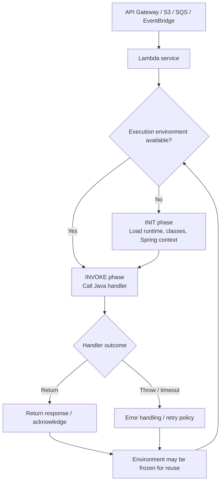
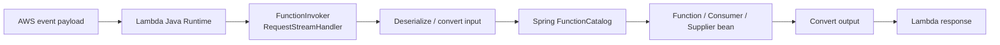
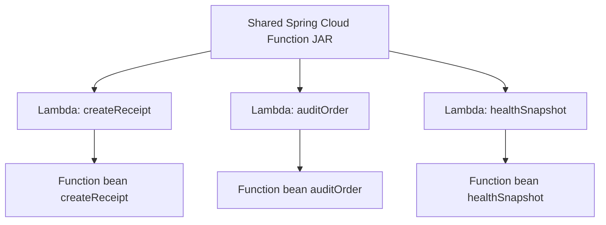
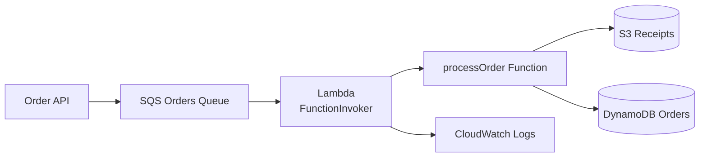

# Triển khai Lambda handler Java và Spring Cloud Function

**AWS Lambda** chạy Java code khi nhận invocation từ một nguồn sự kiện như API Gateway, S3, SQS, EventBridge hoặc một AWS service khác. Điểm vào của chương trình là **handler**: Lambda chuyển event và context cho handler, chờ kết quả rồi xử lý response hoặc lỗi theo kiểu invocation.

Bạn có thể viết handler trực tiếp bằng **AWS Lambda Java Core** với **RequestHandler**/**RequestStreamHandler**, hoặc viết business function bằng **Spring Cloud Function** và để adapter **FunctionInvoker** kết nối với Lambda runtime. Hai cách dùng chung execution model của Lambda, nhưng khác nhau về abstraction, dependency injection, event conversion, routing và thời gian khởi động.

Bài thuộc chương **Ứng dụng Java và Spring Boot** của mô-đun **CLOUD_PROVIDERS_AWS**. Nội dung kết nối Java, Spring Boot, IAM, Region, VPC, AWS SDK for Java 2.x, API Gateway, S3, SQS, EventBridge, DynamoDB, CloudWatch và triển khai bằng AWS SAM/IaC.

> **Nguyên tắc chọn cách triển khai:** Handler Java trực tiếp phù hợp với entry point nhỏ, ít dependency và cần kiểm soát rõ event/context. Spring Cloud Function phù hợp khi muốn tái sử dụng business functions, dependency injection và cùng một function model trên nhiều môi trường. Với ứng dụng Spring MVC hiện có, hãy đánh giá thêm **AWS Serverless Java Container**; đó là một adapter khác, không phải Spring Cloud Function.

## 1. Mục tiêu học tập

Sau bài học, bạn có thể:

1. Giải thích Lambda invocation, execution environment và vị trí của Java handler.
2. Phân biệt RequestHandler, RequestStreamHandler và handler method thông thường.
3. Cấu hình handler string, runtime, event input, output và Lambda Context.
4. Dùng Java record/POJO và AWS Lambda Java Events để xử lý payload từ AWS services.
5. Viết handler Java dùng AWS SDK for Java 2.x và execution role theo least privilege.
6. Phân biệt API Gateway synchronous invocation với SQS/S3/EventBridge asynchronous/event-source processing.
7. Xây Spring Cloud Function bằng Supplier, Function, Consumer và dependency injection.
8. Tích hợp spring-cloud-function-adapter-aws và cấu hình FunctionInvoker.
9. Chọn function definition, routing và số lượng Lambda functions phù hợp với permission/scaling boundaries.
10. Đóng gói JAR/ZIP đúng cách, giữ metadata và service files của Spring.
11. Triển khai bằng AWS SAM và kiểm tra cấu hình Lambda.
12. Quản lý cold start, memory, CPU, timeout, concurrency và Lambda SnapStart.
13. Thiết kế idempotency, retry, partial batch response và dead-letter handling.
14. Bảo mật environment variables, IAM role, VPC access và secret retrieval.
15. Kiểm thử handler, function bean, event payload và triển khai trong sandbox.
16. Theo dõi logs, metrics, traces, chi phí và xây dựng rollback plan.

## 2. Lambda invocation và execution environment

Lambda không giữ một HTTP server Java chạy liên tục như Spring Boot web app thông thường. AWS quản lý execution environments và gọi entry point khi có event.



Một execution environment có thể xử lý nhiều invocations tuần tự trong thời gian tồn tại của nó. Khi Lambda cần thêm concurrency, service có thể tạo thêm environments. Không được giả định một instance Java duy nhất sẽ xử lý mọi requests.

### 2.1. INIT phase

Trong lần khởi tạo environment, Lambda:

- Khởi động managed runtime.
- Load deployment package và các thư viện.
- Khởi tạo static fields và class-level resources.
- Với Spring, tạo ApplicationContext, scan components và khởi tạo beans theo cấu hình.
- Chuẩn bị handler để nhận invocation.

Phần khởi tạo tốn thời gian tạo ra một phần của **cold start**. Một ứng dụng Spring Boot có nhiều starters/auto-configuration có thể mất thời gian INIT lớn hơn handler Java nhỏ.

### 2.2. INVOKE phase

Trong mỗi invocation, Lambda:

1. Nhận event payload.
2. Deserialize payload theo handler contract.
3. Tạo context cho invocation.
4. Gọi handler/function.
5. Serialize kết quả hoặc ghi nhận lỗi.
6. Trả kết quả cho caller hoặc xử lý theo semantics của event source.

### 2.3. Execution environment reuse

Sau invocation, Lambda có thể giữ environment để dùng lại:

- Static clients như S3Client/DynamoDbClient có thể được reuse.
- Immutable configuration và connection pools có thể được giữ.
- Không lưu user/session/request-specific state trong static fields.
- Không giả định local memory là durable storage.
- Kết nối mạng có thể hết hạn/reset; client phải có khả năng reconnect.
- Background threads không được dùng như cơ chế đảm bảo công việc sẽ tiếp tục sau khi handler return.

**Tạo AWS SDK clients ngoài handler method** thường giúp tránh chi phí tạo client cho mỗi invocation. Tuy nhiên, dữ liệu nghiệp vụ cần bền vững phải lưu ở DynamoDB, S3 hoặc service phù hợp.

## 3. Chọn Java runtime cho Lambda

Lambda cung cấp managed Java runtimes. Theo danh sách AWS hiện hành tại thời điểm biên soạn:

| Java | Runtime identifier | Hệ điều hành |
| --- | --- | --- |
| Java 25 | java25 | Amazon Linux 2023 |
| Java 21 | java21 | Amazon Linux 2023 |
| Java 17 | java17.al2023 | Amazon Linux 2023 |
| Java 11 | java11.al2023 | Amazon Linux 2023 |
| Java 8 | java8.al2023 | Amazon Linux 2023 |
| Java 17 (legacy) | java17 | Amazon Linux 2 |
| Java 11 (legacy) | java11 | Amazon Linux 2 |
| Java 8 (legacy) | java8.al2 | Amazon Linux 2 |

Runtime identifiers và deprecation dates có thể thay đổi. Trước khi tạo function mới, xem danh sách runtimes trong AWS Lambda Developer Guide và Region đang triển khai.

### 3.1. Runtime và Java compile target phải tương thích

Nếu chọn runtime Java 21, nên build bytecode ở Java 21 hoặc phiên bản thấp hơn mà runtime hỗ trợ. Ví dụ Maven:

```xml
<properties>
    <maven.compiler.release>21</maven.compiler.release>
    <project.build.sourceEncoding>UTF-8</project.build.sourceEncoding>
</properties>
```

Không compile bằng Java 25 rồi deploy lên Java 21 runtime. Bytecode mới hơn sẽ không chạy trên JVM cũ hơn.

### 3.2. Chọn runtime nào?

- Chọn LTS runtime được tổ chức hỗ trợ và còn vòng đời phù hợp.
- Với dự án mới, cân nhắc Java 21 hoặc Java 25 nếu dependencies/framework tương thích.
- Kiểm tra AWS SDK, Spring Boot, Spring Cloud release train, logging và native libraries.
- Chạy integration tests trên đúng runtime/architecture.
- Theo dõi deprecation timeline và lên kế hoạch nâng cấp trước ngày AWS chặn create/update.

## 4. Java handler contract

AWS Lambda Java Core cung cấp hai interface phổ biến:

- **RequestHandler<I,O>**: Lambda runtime chuyển JSON event thành object kiểu I, gọi handler, rồi serialize kết quả O.
- **RequestStreamHandler**: nhận InputStream, OutputStream và Context; ứng dụng tự kiểm soát đọc/ghi JSON hoặc binary payload.

### 4.1. RequestHandler

```java
package example.lambda;

import com.amazonaws.services.lambda.runtime.Context;
import com.amazonaws.services.lambda.runtime.RequestHandler;

public class UppercaseHandler implements RequestHandler<String, String> {

    @Override
    public String handleRequest(String input, Context context) {
        String requestId = context.getAwsRequestId();

        context.getLogger().log(
            "Processing invocation requestId=" + requestId + "\n"
        );

        if (input == null) {
            throw new IllegalArgumentException("input must not be null");
        }

        return input.toUpperCase();
    }
}
```

Handler configuration:

```text
example.lambda.UppercaseHandler
```

Vì class implement RequestHandler, runtime gọi method handleRequest. Với input là JSON string, payload cần là string JSON hợp lệ, ví dụ:

```json
"hello aws"
```

Response là:

```json
"HELLO AWS"
```

### 4.2. RequestHandler với POJO/record

Với Java 17 trở lên, có thể dùng record cho event data:

```java
package example.lambda;

import com.amazonaws.services.lambda.runtime.Context;
import com.amazonaws.services.lambda.runtime.RequestHandler;

public class OrderHandler
        implements RequestHandler<OrderHandler.OrderCommand, OrderHandler.OrderResult> {

    public record OrderCommand(
        String orderId,
        String customerId,
        long amountInCents
    ) {}

    public record OrderResult(
        String orderId,
        String status
    ) {}

    @Override
    public OrderResult handleRequest(OrderCommand event, Context context) {
        if (event == null || event.orderId() == null || event.orderId().isBlank()) {
            throw new IllegalArgumentException("orderId is required");
        }

        context.getLogger().log(
            "Accepted order requestId=" + context.getAwsRequestId() + "\n"
        );

        // Business logic goes here.
        return new OrderResult(event.orderId(), "ACCEPTED");
    }
}
```

Event mẫu:

```json
{
  "orderId": "ORD-10042",
  "customerId": "CUS-018",
  "amountInCents": 259900
}
```

Runtime tự chuyển JSON thành OrderCommand khi serializer hỗ trợ type đó. Với Java 8/11 hoặc model phức tạp, dùng class POJO và serializer tương thích, ví dụ Jackson. Luôn test serialization bằng payload thật.

### 4.3. RequestStreamHandler

Dùng stream handler khi cần kiểm soát serialization hoặc payload:

```java
package example.lambda;

import com.amazonaws.services.lambda.runtime.Context;
import com.amazonaws.services.lambda.runtime.RequestStreamHandler;
import com.fasterxml.jackson.databind.ObjectMapper;

import java.io.InputStream;
import java.io.OutputStream;
import java.util.Map;

public class StreamHandler implements RequestStreamHandler {
    private static final ObjectMapper MAPPER = new ObjectMapper();

    @Override
    public void handleRequest(
            InputStream input,
            OutputStream output,
            Context context) throws java.io.IOException {

        Map<?, ?> event = MAPPER.readValue(input, Map.class);
        Object rawName = event.get("name");
        String name = rawName == null ? "World" : rawName.toString();

        Map<String, Object> response = Map.of(
            "message", "Hello " + name,
            "requestId", context.getAwsRequestId()
        );

        MAPPER.writeValue(output, response);
    }
}
```

Handler configuration vẫn là class name:

```text
example.lambda.StreamHandler
```

RequestStreamHandler trả void; runtime đọc kết quả từ output stream. Chọn stream handler khi cần xử lý JSON tùy biến, dữ liệu lớn hoặc streaming. Với business event thông thường, RequestHandler đơn giản hơn.

### 4.4. Handler method không implement interface

Lambda Java cũng hỗ trợ class có method theo naming convention:

```java
package example.lambda;

import com.amazonaws.services.lambda.runtime.Context;
import java.util.Map;

public class SimpleHandler {
    public String handle(Map<String, Object> event, Context context) {
        return "received=" + event.size();
    }
}
```

Handler string có dạng:

```text
example.lambda.SimpleHandler::handle
```

Dù có thể dùng cách này, RequestHandler thường rõ ràng hơn vì compiler kiểm tra contract.

## 5. Lambda Context

Lambda truyền Context cho handler. Context cung cấp metadata của function và invocation.

| Method | Dùng để |
| --- | --- |
| getAwsRequestId() | Request ID của invocation hiện tại |
| getFunctionName() | Tên Lambda function |
| getFunctionVersion() | Version đang chạy |
| getInvokedFunctionArn() | ARN được invoke, có thể chứa alias/version |
| getMemoryLimitInMB() | Memory đã cấu hình |
| getRemainingTimeInMillis() | Thời gian còn lại của invocation |
| getLogger() | Ghi log qua Lambda runtime |
| getIdentity() | Cognito identity nếu có |
| getClientContext() | Client context với một số invocation kiểu mobile |

### 5.1. Dùng remaining time để dừng an toàn

Không bắt đầu một thao tác dài nếu thời gian còn lại không đủ:

```java
int remaining = context.getRemainingTimeInMillis();

if (remaining < 2_000) {
    throw new IllegalStateException("Not enough time to start downstream operation");
}
```

Đây là ví dụ minh họa. Với nhiều bước, hãy dành thời gian cho cleanup, ghi checkpoint hoặc trả lỗi để event source retry theo chính sách. Không đợi Lambda timeout rồi mới xử lý.

### 5.2. Request ID của Lambda khác AWS service request ID

context.getAwsRequestId() là định danh invocation Lambda. Khi handler gọi S3/DynamoDB/SQS, các service calls có AWS request IDs riêng trong response metadata. Log chúng ở field riêng để liên kết invocation với downstream requests.

## 6. Event payload: nguồn gọi quyết định hình dạng input

Một Lambda handler không nhận cùng một JSON schema cho mọi trigger. Payload phụ thuộc service gọi Lambda hoặc event source mapping.

| Nguồn | Invocation | Input thường gặp | Hành vi lỗi |
| --- | --- | --- | --- |
| API Gateway | Đồng bộ | HTTP method, path, headers, body, request context | Caller nhận response/error |
| Application Load Balancer | Đồng bộ | ALB request event | ALB nhận response |
| S3 notification | Bất đồng bộ | Bucket, object key, event name, sequencer | Lambda async retry/DLQ theo cấu hình |
| EventBridge | Bất đồng bộ | Event envelope: source, detail-type, detail | Retry policy/event bus DLQ |
| SQS | Event source mapping | Batch records, message IDs, bodies | Batch retry hoặc partial batch response |
| DynamoDB Streams | Event source mapping | Batch stream records | Retry/age/partial failure theo cấu hình |
| Kinesis | Event source mapping | Batch records, partition/shard metadata | Retry, bisect batch, destination theo cấu hình |

### 6.1. API Gateway payload

Với API Gateway HTTP API payload format 2.0, event thường có:

```json
{
  "version": "2.0",
  "routeKey": "POST /orders",
  "rawPath": "/orders",
  "headers": {
    "content-type": "application/json"
  },
  "body": "{\"orderId\":\"ORD-10042\"}",
  "isBase64Encoded": false
}
```

Đừng giả định body đã là Java object. API Gateway gửi body như chuỗi; handler phải parse và validate theo payload format đã cấu hình. Payload REST API 1.0 và HTTP API 2.0 có khác biệt về headers, cookies, path và request context.

### 6.2. AWS Lambda Java Events

AWS cung cấp artifact **com.amazonaws:aws-lambda-java-events** với model cho các event phổ biến như:

- APIGatewayProxyRequestEvent.
- APIGatewayV2HTTPEvent.
- SQSEvent.
- S3Event.
- SNSEvent.
- DynamodbEvent.
- Các model event khác theo phiên bản thư viện.

Ví dụ dependency Maven:

```xml
<dependency>
    <groupId>com.amazonaws</groupId>
    <artifactId>aws-lambda-java-core</artifactId>
    <version>1.2.3</version>
</dependency>
<dependency>
    <groupId>com.amazonaws</groupId>
    <artifactId>aws-lambda-java-events</artifactId>
    <version>3.11.1</version>
</dependency>
```

Version trên là ví dụ theo tài liệu AWS; kiểm tra Maven Central và compatibility trước khi nâng.

### 6.3. API Gateway response là contract riêng

Với Lambda proxy integration, response thường cần statusCode, headers và body. Trả một Java object bất kỳ không tự động biến nó thành HTTP response có status mong muốn.

Ví dụ khái niệm:

```json
{
  "statusCode": 201,
  "headers": {
    "content-type": "application/json"
  },
  "body": "{\"orderId\":\"ORD-10042\",\"status\":\"CREATED\"}",
  "isBase64Encoded": false
}
```

Chọn event/response classes đúng API Gateway integration và payload format. Đừng trộn direct Lambda invocation payload với API Gateway proxy event.

## 7. Ví dụ Java handler gọi AWS SDK for Java 2.x

Handler có thể dùng AWS SDK v2 để ghi receipt vào S3. Tạo client ở class scope để reuse:

```java
package example.lambda;

import com.amazonaws.services.lambda.runtime.Context;
import com.amazonaws.services.lambda.runtime.RequestHandler;
import software.amazon.awssdk.core.sync.RequestBody;
import software.amazon.awssdk.services.s3.S3Client;
import software.amazon.awssdk.services.s3.model.PutObjectRequest;

import java.nio.charset.StandardCharsets;

public class ReceiptHandler
        implements RequestHandler<ReceiptHandler.Order, ReceiptHandler.Result> {

    private static final S3Client S3 = S3Client.builder().build();

    public record Order(String orderId, String item, long amountInCents) {}
    public record Result(String orderId, String receiptKey, String status) {}

    @Override
    public Result handleRequest(Order event, Context context) {
        if (event == null || event.orderId() == null || event.orderId().isBlank()) {
            throw new IllegalArgumentException("orderId is required");
        }

        String bucket = requiredEnv("RECEIPT_BUCKET");
        String key = "receipts/" + event.orderId() + ".txt";

        String receipt = "Order: " + event.orderId()
            + "\nItem: " + event.item()
            + "\nAmount (cents): " + event.amountInCents();

        PutObjectRequest request = PutObjectRequest.builder()
            .bucket(bucket)
            .key(key)
            .contentType("text/plain; charset=utf-8")
            .build();

        S3.putObject(
            request,
            RequestBody.fromBytes(receipt.getBytes(StandardCharsets.UTF_8))
        );

        context.getLogger().log(
            "Receipt stored requestId=" + context.getAwsRequestId() + "\n"
        );

        return new Result(event.orderId(), key, "STORED");
    }

    private static String requiredEnv(String name) {
        String value = System.getenv(name);
        if (value == null || value.isBlank()) {
            throw new IllegalStateException("Missing environment variable: " + name);
        }
        return value;
    }
}
```

Điểm cần lưu ý:

- S3Client dùng default credentials provider chain; trong Lambda, credentials đến từ execution role.
- Không hard-code access key/secret trong source hoặc environment variables.
- Không đóng static client ở cuối mỗi invocation; giữ client để reuse trong execution environment.
- IAM role cần quyền s3:PutObject trên prefix/bucket đích.
- Nếu object key được tạo từ dữ liệu người dùng, validate/normalize key và không cho phép ghi đè ngoài phạm vi nghiệp vụ.
- Nếu handler có thể nhận lại cùng event, thiết kế key/condition/idempotency để tránh side effect không mong muốn.

Dependency AWS SDK v2 nên được quản lý bằng AWS SDK BOM để các modules cùng version:

```xml
<dependencyManagement>
    <dependencies>
        <dependency>
            <groupId>software.amazon.awssdk</groupId>
            <artifactId>bom</artifactId>
            <version>SET_AWS_SDK_V2_BOM_VERSION</version>
            <type>pom</type>
            <scope>import</scope>
        </dependency>
    </dependencies>
</dependencyManagement>

<dependencies>
    <dependency>
        <groupId>software.amazon.awssdk</groupId>
        <artifactId>s3</artifactId>
    </dependency>
</dependencies>
```

Thay placeholder bằng một SDK BOM version được dự án kiểm thử và quản lý tập trung.

## 8. Spring Cloud Function là gì?

Spring Cloud Function cung cấp programming model dựa trên các Java functional interfaces:

| Interface | Ý nghĩa | Input/Output |
| --- | --- | --- |
| Supplier<T> | Tạo dữ liệu | Không có input, trả T |
| Function<I,O> | Nhận và chuyển đổi dữ liệu | I → O |
| Consumer<I> | Nhận và xử lý dữ liệu | I → không trả kết quả |

Spring Cloud Function giúp business logic ít phụ thuộc vào AWS Lambda handler contract. AWS adapter chuyển function bean thành Lambda entry point.

### 8.1. Kiến trúc adapter



AWS adapter cung cấp handler:

```text
org.springframework.cloud.function.adapter.aws.FunctionInvoker::handleRequest
```

FunctionInvoker thực hiện phần integration với Lambda, gồm đọc event, chuyển kiểu dữ liệu và chọn function theo cấu hình/routing. Ứng dụng tập trung vào các function beans.

## 9. Tạo Spring Cloud Function bean

Ví dụ một function tạo receipt:

```java
package example.functions;

import org.springframework.boot.SpringApplication;
import org.springframework.boot.autoconfigure.SpringBootApplication;
import org.springframework.context.annotation.Bean;

import java.util.function.Function;

@SpringBootApplication
public class OrderFunctionsApplication {

    public static void main(String[] args) {
        SpringApplication.run(OrderFunctionsApplication.class, args);
    }

    public record OrderCreated(
        String orderId,
        String customerId,
        long amountInCents
    ) {}

    public record Receipt(
        String orderId,
        String status,
        long amountInCents
    ) {}

    @Bean
    public Function<OrderCreated, Receipt> createReceipt() {
        return order -> new Receipt(
            order.orderId(),
            "CREATED",
            order.amountInCents()
        );
    }
}
```

Trong Lambda, Spring Cloud Function AWS adapter chuyển input JSON thành OrderCreated, gọi function createReceipt, rồi serialize Receipt thành output.

### 9.1. Dùng dependency injection

Không cần nhét mọi business logic vào bean:

```java
@Bean
public Function<OrderCreated, Receipt> createReceipt(ReceiptService service) {
    return service::create;
}
```

ReceiptService có thể dùng constructor injection để nhận repository, AWS SDK clients hoặc domain services. Khởi tạo AWS SDK clients trong bean singleton/managed component và reuse chúng qua invocations.

### 9.2. Consumer và Supplier

Ví dụ Consumer xử lý event không cần response:

```java
@Bean
public Consumer<OrderCreated> auditOrder(AuditService auditService) {
    return auditService::record;
}
```

Ví dụ Supplier tạo dữ liệu khi được invoke:

```java
@Bean
public Supplier<HealthSnapshot> healthSnapshot(HealthService service) {
    return service::snapshot;
}
```

Với event source bất đồng bộ, lỗi không nên bị nuốt rồi trả success giả. Nếu xử lý thất bại, hãy ném exception hoặc trả partial batch response đúng contract để event source thực hiện retry.

## 10. Cài đặt Spring Cloud Function AWS adapter

Dependency chính:

```xml
<dependency>
    <groupId>org.springframework.cloud</groupId>
    <artifactId>spring-cloud-function-adapter-aws</artifactId>
</dependency>
```

Quản lý phiên bản bằng Spring Cloud BOM phù hợp với phiên bản Spring Boot của dự án. Không ghép Spring Boot, Spring Cloud Function và Spring Cloud release trains tùy ý; kiểm tra compatibility matrix và sample chính thức.

Ví dụ dependency management khái niệm:

```xml
<dependencyManagement>
    <dependencies>
        <dependency>
            <groupId>org.springframework.cloud</groupId>
            <artifactId>spring-cloud-dependencies</artifactId>
            <version>SET_COMPATIBLE_SPRING_CLOUD_RELEASE_TRAIN</version>
            <type>pom</type>
            <scope>import</scope>
        </dependency>
    </dependencies>
</dependencyManagement>
```

Khi build adapter, artifact triển khai Lambda cần chứa dependencies và metadata Spring đúng cách. Spring Cloud Function reference hiện hành cung cấp Maven/Gradle samples để tạo shaded JAR. Hãy dùng sample tương ứng release train; tránh upload nhầm thin JAR hoặc Spring Boot executable JAR chưa được chuẩn bị cho Lambda.

## 11. FunctionInvoker và function definition

Nếu application có một function bean, adapter có thể tìm function mặc định. Khi có nhiều beans kiểu Function/Consumer/Supplier, nên khai báo rõ function cần chạy.

Ví dụ environment variable:

```text
spring_cloud_function_definition=createReceipt
```

AWS Lambda environment variable không cho phép dấu chấm trong key. Spring Boot relaxed binding cho phép chuyển:

```text
spring.cloud.function.definition
```

thành:

```text
spring_cloud_function_definition
```

### 11.1. Một JAR, nhiều Lambda functions

Có thể build một Spring Cloud Function JAR rồi triển khai thành nhiều Lambda functions, mỗi function chọn một bean:



| Lambda | Function definition | IAM permission |
| --- | --- | --- |
| orders-create | createReceipt | s3:PutObject |
| orders-audit | auditOrder | dynamodb:PutItem |
| orders-health | healthSnapshot | Chỉ quyền đọc cần thiết |

Cách tách này hữu ích khi function có permission, scaling, timeout hoặc event source khác nhau. Dùng chung JAR không có nghĩa phải dùng chung execution role.

### 11.2. Một Lambda, nhiều function beans

Một Lambda có thể route đến nhiều function beans khi chúng có cùng trust boundary và permission set. Tuy nhiên:

- Phải xác định routing rule rõ ràng.
- Không dùng dữ liệu header do người dùng tùy ý gửi để gọi function nhạy cảm mà không authorization.
- Theo dõi từng function/operation để biết lỗi và latency.
- Nếu function cần IAM khác nhau, tách Lambda functions và execution roles.

### 11.3. Function composition

Spring Cloud Function hỗ trợ composition, ví dụ kết hợp các functions theo thứ tự. Chỉ compose các bước có cùng input/output contract và error semantics. Với workflow dài, retry, compensation hoặc checkpoint phức tạp, đánh giá Step Functions thay vì nhồi mọi bước vào một Lambda.

## 12. Xử lý event từ S3, SQS và EventBridge bằng Spring

Spring Cloud Function có thể dùng AWS-specific event classes nếu cần truy cập metadata gốc.

Thêm dependency `aws-lambda-java-events` vào project khi dùng các event model như S3Event, SQSEvent hoặc SQSBatchResponse:

```xml
<dependency>
    <groupId>com.amazonaws</groupId>
    <artifactId>aws-lambda-java-events</artifactId>
    <version>3.11.1</version>
</dependency>
```

Version trên là ví dụ; kiểm tra release tương thích với Lambda Java Core và build đang dùng.

### 12.1. S3 event

```java
import com.amazonaws.services.lambda.runtime.events.S3Event;
import org.springframework.context.annotation.Bean;

import java.util.function.Function;

@Bean
public Function<S3Event, String> processS3Event(FileProcessor processor) {
    return event -> {
        var records = event.getRecords();
        if (records == null || records.isEmpty()) {
            throw new IllegalArgumentException("S3 event has no records");
        }

        var record = records.get(0);
        String bucket = record.getS3().getBucket().getName();
        String key = record.getS3().getObject().getUrlDecodedKey();

        processor.process(bucket, key);
        return "PROCESSED";
    };
}
```

Một S3 event có thể chứa nhiều records; code production cần lặp qua tất cả records và xử lý từng record theo idempotency key phù hợp.

### 12.2. SQS event và partial batch response

Với SQS, Lambda thường nhận một batch records. Nếu một record lỗi, mặc định batch có thể bị retry toàn bộ tùy event source mapping. Bật **ReportBatchItemFailures** và trả **SQSBatchResponse** để báo chính xác message nào cần retry.

Function signature:

```java
import com.amazonaws.services.lambda.runtime.events.SQSEvent;
import com.amazonaws.services.lambda.runtime.events.SQSBatchResponse;

import java.util.ArrayList;
import java.util.function.Function;

@Bean
public Function<SQSEvent, SQSBatchResponse> processQueue(OrderQueueService service) {
    return event -> {
        var failures = new ArrayList<SQSBatchResponse.BatchItemFailure>();

        for (SQSEvent.SQSMessage message : event.getRecords()) {
            try {
                service.process(message.getBody());
            } catch (Exception error) {
                failures.add(
                    SQSBatchResponse.BatchItemFailure.builder()
                        .itemIdentifier(message.getMessageId())
                        .build()
                );
            }
        }

        return SQSBatchResponse.builder()
            .batchItemFailures(failures)
            .build();
    };
}
```

Cần cấu hình event source mapping để bật ReportBatchItemFailures. Nếu không, Lambda có thể không diễn giải partial response theo cách mong muốn. Consumer vẫn phải idempotent vì SQS Standard có thể giao message nhiều lần.

### 12.3. EventBridge

EventBridge event có envelope như source, detail-type, time, region và detail. Function có thể nhận event model tương ứng hoặc Map/POJO. Xác thực source/detail-type, schema version và dữ liệu trong detail trước khi xử lý.

### 12.4. Chọn typed event hay POJO nghiệp vụ?

| Cách | Khi dùng |
| --- | --- |
| AWS event type (S3Event, SQSEvent) | Cần metadata AWS, message IDs, bucket/key hoặc batch response |
| Business POJO (OrderCreated) | Muốn function độc lập với AWS event schema |
| Map<String,Object> | Payload không ổn định hoặc chưa biết schema |
| InputStream | Cần raw input/custom serialization |

Nếu dùng POJO, đảm bảo adapter chuyển đổi event envelope đúng. Với S3/SQS, không phải event nào cũng chỉ chứa business JSON ở root.

## 13. Đóng gói JAR/ZIP cho Lambda

Lambda cần deployment artifact chứa class code và runtime dependencies. Với Java, có thể dùng ZIP archive hoặc JAR package theo cách triển khai được hỗ trợ.

### 13.1. Java handler trực tiếp

Một ZIP điển hình có thể chứa:

```text
function.zip
├── example/
│   └── lambda/
│       └── OrderHandler.class
└── lib/
    ├── aws-lambda-java-core.jar
    ├── aws-lambda-java-events.jar
    ├── dynamodb-2.x.jar
    └── other-runtime-dependencies.jar
```

Có thể tạo bằng Maven/Gradle plugin hoặc quy trình packaging được kiểm thử. Đảm bảo:

- Handler class nằm trong classpath.
- Runtime dependencies được đóng gói hoặc cung cấp bằng Lambda Layer đã cấu hình.
- Không chứa build/test-only dependencies không cần thiết.
- Không đưa local credentials, .env, IDE files hoặc private config vào artifact.
- Build reproducible và có version/hash để truy vết.

### 13.2. Spring Cloud Function JAR

Với Spring Cloud Function, Lambda artifact thường là **shaded JAR** chứa dependencies. Cần giữ các metadata/service files mà Spring cần để tìm auto-configuration và components.

Các resources cần chú ý tùy phiên bản:

- META-INF/services/* — merge service provider files.
- META-INF/spring.handlers.
- META-INF/spring.schemas.
- META-INF/spring.factories.
- META-INF/spring/org.springframework.boot.autoconfigure.AutoConfiguration.imports.
- Manifest attributes như Start-Class.

Nếu Shade plugin ghi đè các resource thay vì merge, Spring có thể không phát hiện auto-configuration hoặc adapters. Dùng Spring Cloud Function sample phù hợp release train và kiểm tra nội dung JAR sau build.

### 13.3. Phân biệt các artifact

| Artifact | Công dụng |
| --- | --- |
| Plain JAR | Chỉ class/resources của project; thường thiếu dependencies |
| Spring Boot executable JAR | Dùng cơ chế launcher/layout của Spring Boot; không mặc nhiên là Lambda shaded artifact |
| Shaded Lambda JAR | JAR đã gộp runtime dependencies/metadata cần thiết |
| ZIP với lib/ | Code và dependency JARs theo layout Lambda Java |
| Container image | Runtime/dependencies được đóng gói trong image theo Lambda container contract |

Không upload một file JAR bất kỳ rồi giả định Lambda sẽ tìm thấy mọi dependencies.

## 14. Triển khai bằng AWS SAM

AWS SAM mô tả Lambda function, role, event source và các cấu hình hạ tầng dưới dạng template. Ví dụ Spring Cloud Function:

```yaml
AWSTemplateFormatVersion: '2010-09-09'
Transform: AWS::Serverless-2016-10-31
Description: Spring Cloud Function on AWS Lambda

Resources:
  CreateReceiptFunction:
    Type: AWS::Serverless::Function
    Properties:
      FunctionName: orders-create-receipt
      Runtime: java21
      Handler: org.springframework.cloud.function.adapter.aws.FunctionInvoker::handleRequest
      CodeUri: target/order-functions-aws.jar
      MemorySize: 1024
      Timeout: 30
      Environment:
        Variables:
          spring_cloud_function_definition: createReceipt
          RECEIPT_BUCKET: !Ref ReceiptBucket
      Policies:
        - S3WritePolicy:
            BucketName: !Ref ReceiptBucket

  ReceiptBucket:
    Type: AWS::S3::Bucket
```

Đây là template minh họa. Artifact path, policy template và function bean phải khớp project. Với runtime Java 25, thay Runtime theo compatibility và dependencies đã kiểm thử.

### 14.1. SAM build/deploy flow

```bash
# Kiểm tra template và build deployment artifacts.
sam validate
sam build

# Triển khai sandbox; guided mode hỏi stack/bucket/permissions.
sam deploy --guided
```

Sau deploy:

1. Xác nhận function runtime, handler, architecture và package type.
2. Kiểm tra environment variables và execution role.
3. Kiểm tra CloudWatch log group.
4. Invoke bằng event fixture đã chuẩn bị.
5. Kiểm tra response, duration, error và request IDs.
6. Chạy integration tests với AWS resources sandbox.

### 14.2. Direct Java handler SAM config

Nếu dùng handler trực tiếp, cấu hình Handler là class name:

```yaml
Resources:
  OrderHandlerFunction:
    Type: AWS::Serverless::Function
    Properties:
      Runtime: java21
      Handler: example.lambda.OrderHandler
      CodeUri: target/order-handler.zip
      MemorySize: 512
      Timeout: 20
      Environment:
        Variables:
          ORDER_TABLE: !Ref OrdersTable
      Policies:
        - DynamoDBCrudPolicy:
            TableName: !Ref OrdersTable
```

Dùng Handler đúng với interface/handler style. Không đặt FunctionInvoker nếu artifact là direct handler Java.

## 15. IAM execution role và AWS SDK

Mỗi Lambda function có **execution role**. AWS Lambda assume role đó khi chạy function. AWS SDK for Java lấy temporary credentials từ runtime credential provider chain.

### 15.1. Least privilege

Ví dụ function chỉ ghi receipt vào một bucket/prefix:

```json
{
  "Version": "2012-10-17",
  "Statement": [
    {
      "Effect": "Allow",
      "Action": [
        "s3:PutObject"
      ],
      "Resource": "arn:aws:s3:::company-receipts/receipts/*"
    }
  ]
}
```

Không cấp s3:* trên mọi bucket chỉ để code chạy được. Nếu dùng KMS customer-managed key, cần policy phù hợp cho key và service action.

### 15.2. Không dùng IAM user access keys

Không lưu AWS_ACCESS_KEY_ID và AWS_SECRET_ACCESS_KEY cố định trong Lambda environment. Hãy dùng execution role. Khi local development, AWS SDK có thể dùng profile/SSO; trong Lambda, nó dùng credentials do runtime cung cấp.

### 15.3. Secrets Manager và Parameter Store

- Environment variables phù hợp với cấu hình không bí mật như table name, feature flags và function definition.
- Secret như API token/password nên được lưu trong Secrets Manager hoặc Parameter Store SecureString.
- Giới hạn secretsmanager:GetSecretValue/ssm:GetParameter theo ARN cần dùng.
- Cache secret trong memory có TTL phù hợp; refresh khi cần và không log secret.
- Encryption của Lambda environment variables không thay thế secret lifecycle/rotation.

## 16. VPC networking cho Lambda

Lambda không cần gắn vào VPC chỉ để gọi các AWS public service endpoints. Gắn function vào VPC khi cần truy cập private resources như RDS, ElastiCache hoặc internal services.

Nếu function nằm trong private subnet:

- Cần route phù hợp để gọi các dịch vụ bên ngoài VPC.
- NAT Gateway/egress path có thể cần cho public internet endpoints.
- VPC endpoints có thể giúp gọi AWS services qua private network.
- Security Group của Lambda phải được phép tới Security Group/port của resource đích.
- VPC DNS, route tables và NACL phải phù hợp.
- Không giả định private subnet tự động có Internet egress.

Ví dụ: Lambda truy cập RDS private trên TCP 5432 cần SG rule cho Lambda SG đến DB SG. Lambda gọi DynamoDB có thể dùng DynamoDB gateway endpoint; không cần NAT chỉ cho traffic đi qua endpoint đó.

## 17. API Gateway, synchronous và asynchronous invocation

### 17.1. Synchronous invocation

API Gateway gọi Lambda đồng bộ và chờ kết quả. Handler phải hoàn tất trong timeout và trả response theo integration contract.

Dùng cho:

- HTTP APIs.
- Một số direct SDK Invoke requests kiểu RequestResponse.
- ALB Lambda targets.

Khi handler throw exception, caller nhận lỗi; cách ánh xạ status/body phụ thuộc integration. Với API Gateway proxy integration, trả một response object đúng schema để kiểm soát HTTP status và body.

### 17.2. Asynchronous invocation

S3, EventBridge và một số nguồn gọi Lambda bất đồng bộ. Lambda nhận event rồi xử lý; caller không chờ business result cuối cùng.

Khi function lỗi, Lambda có thể retry theo async invocation policy, lưu failed events theo cấu hình hoặc gửi đến destination/DLQ. Vì event có thể được giao lại, business operation phải idempotent.

### 17.3. Event source mapping

SQS, Kinesis và DynamoDB Streams thường dùng event source mapping. Lambda poll source, gom records thành batch và invoke function. Các cấu hình quan trọng:

- Batch size và batching window.
- Maximum concurrency/parallelization theo nguồn.
- Retry/record age limits.
- Bisect batch khi áp dụng.
- Partial batch response.
- On-failure destination hoặc DLQ theo loại nguồn.

Không coi tất cả triggers đều có cùng retry semantics.

## 18. SQS batch failure và idempotency

SQS Standard có at-least-once delivery. Một message có thể xuất hiện nhiều lần, kể cả khi function đã xử lý thành công nhưng acknowledgement/response không được hoàn tất như mong đợi.

Với batch:

- Nếu không bật partial batch response, một record lỗi có thể làm cả batch được retry.
- Với ReportBatchItemFailures, function trả message IDs cần retry.
- Cần cấu hình event source mapping tương ứng.
- Không đánh dấu record thành công trước khi business side effect được lưu bền vững.
- Dùng idempotency key/message ID/business key để tránh ghi trùng.
- Đặt SQS visibility timeout ít nhất bằng **6 lần Lambda timeout**, cộng thêm batching window nếu cấu hình window lớn hơn 0; đây là khuyến nghị AWS để có thời gian retry khi function bị throttled.
- Cấu hình redrive policy/DLQ và alarm cho messages bị chuyển DLQ.

### 18.1. Idempotent consumer

Ví dụ consumer ghi order ID vào bảng xử lý:

```text
messageId / orderId
       |
       v
Check idempotency record
       |
   +---+---+
   |       |
 Already  New
 processed |
   |       v
 Return   Process business action
 success  + write idempotency record
```

Hai thao tác business write và idempotency marker nên được bảo vệ bằng transaction/conditional write phù hợp. Nếu ghi marker trước rồi business action thất bại, message retry có thể bị bỏ qua nhầm.

## 19. Cold start và tối ưu startup

Cold start là thời gian Lambda cần tạo environment mới, khởi động runtime và initialize code trước handler. Với Java, chi phí có thể đến từ:

- JVM startup và class loading.
- Số lượng dependencies.
- Spring component scanning/auto-configuration.
- Static initialization.
- DNS/TLS/SDK client initialization.
- Kết nối tới database/service trong startup.
- Kích thước deployment package.

### 19.1. Giảm công việc trong INIT

- Chỉ thêm dependencies cần thiết.
- Với handler đơn giản, cân nhắc Java handler trực tiếp thay Spring.
- Với Spring, tránh kéo spring-boot-starter-web nếu function không cần web server.
- Thu hẹp component scan và auto-configuration.
- Tạo SDK clients một lần, nhưng tránh gọi network nặng trong static initializer.
- Không chạy truy vấn database lớn hoặc load toàn bộ dataset trong constructor.
- Đo Init Duration trong REPORT/INIT_REPORT logs hoặc Telemetry API; Lambda Insights cũng có metric `init_duration` nếu đã bật. Không suy ra cold start chỉ từ Duration của handler.

### 19.2. Memory và CPU

Lambda phân bổ CPU theo memory configuration. Tăng memory có thể giảm thời gian xử lý và startup, dù giá mỗi millisecond thay đổi theo memory. Dùng benchmark/Power Tuning để chọn điểm cân bằng cost và latency.

### 19.3. SnapStart

SnapStart tạo snapshot execution environment đã initialize khi publish function version, sau đó restore environment từ snapshot để giảm cold start.

Điểm cần nhớ:

- Hỗ trợ managed Java runtimes từ Java 11 trở lên.
- Chỉ dùng với published versions/aliases; không áp dụng $LATEST.
- Không kết hợp SnapStart với Provisioned Concurrency.
- Giá trị tạo ngẫu nhiên/ID/secret trong INIT có thể bị reuse từ snapshot; tạo uniqueness sau restore/invocation.
- Network connections được tạo trong INIT cần được kiểm tra/reconnect khi restore.
- Dùng hooks phù hợp nếu ứng dụng cần xử lý trước/sau snapshot.
- Kiểm thử các thư viện crypto, random generators, pools và background threads.

SnapStart giảm thời gian initialization trong nhiều tình huống, nhưng không thay thế benchmark. Nếu cần latency rất chặt và SnapStart không đáp ứng, đánh giá Provisioned Concurrency.

### 19.4. Provisioned Concurrency và reserved concurrency

| Cấu hình | Mục đích |
| --- | --- |
| Reserved concurrency | Giới hạn concurrency tối đa và giữ một phần concurrency cho function |
| Provisioned concurrency | Giữ sẵn execution environments đã initialize |
| SnapStart | Restore environment từ snapshot đã tạo khi publish version |

Reserved concurrency **không giữ JVM warm**. Provisioned concurrency giữ environments sẵn sàng nhưng phát sinh chi phí riêng. SnapStart không dùng cùng Provisioned Concurrency theo giới hạn dịch vụ hiện hành.

## 20. Timeout và downstream protection

Lambda timeout tối đa 15 phút. Chọn timeout theo workload, không mặc định đặt tối đa.

- API handler nên có deadline ngắn phù hợp HTTP caller.
- SQS consumer phải tương thích với visibility timeout.
- Event source mapping phải có batch processing time phù hợp.
- Database/query/client timeouts phải ngắn hơn thời gian còn lại của Lambda.
- Dùng Context.getRemainingTimeInMillis() để ngăn bắt đầu bước không thể hoàn thành.
- Retry/backoff không được vượt deadline tổng thể.
- Đặt concurrency limit để bảo vệ database và downstream APIs.

Một Lambda scale rất nhanh có thể tạo hàng trăm/thousands concurrent connections nếu mỗi invocation mở một DB connection mới. Dùng connection reuse, RDS Proxy khi phù hợp, queue buffering và concurrency controls để bảo vệ downstream.

## 21. Error handling và response semantics

### 21.1. Synchronous API

Với API Gateway, handler nên trả response rõ ràng:

- 2xx cho kết quả thành công.
- 4xx cho input/auth/business errors do client gây ra.
- 5xx cho lỗi hệ thống/transient.
- Không trả HTTP 200 với body báo lỗi nếu contract không quy định như vậy.

Exception không tự động biến thành một JSON response nghiệp vụ đúng format. Hãy mapping domain errors thành API response tại adapter/boundary.

### 21.2. Asynchronous và event source

- Với S3/EventBridge async invoke, throw exception khi xử lý thất bại để Lambda thực hiện retry/destination theo policy.
- Với SQS, return partial batch response hoặc throw theo cấu hình event source mapping.
- Với Kinesis/DynamoDB Streams, xem checkpoint, retry, bisect batch và record age.
- Không catch mọi exception rồi log xong return success; điều đó có thể làm mất event lỗi.

### 21.3. Phân biệt lỗi có thể retry

| Lỗi | Hành động |
| --- | --- |
| Invalid JSON/schema | Gửi lỗi rõ ràng, quarantine/DLQ nếu phù hợp |
| IAM AccessDenied | Sửa role/policy; retry không giúp |
| Throttling/transient 5xx | Retry có backoff; giảm concurrency hoặc tăng capacity |
| Business validation failure | Đánh dấu permanent failure theo nghiệp vụ |
| Duplicate event | Trả success nếu đã xử lý idempotently |
| Timeout sau side effect | Kiểm tra idempotency state trước khi lặp |

## 22. Observability: CloudWatch Logs, metrics và traces

### 22.1. CloudWatch Logs

Lambda tự gửi runtime logs và stdout/stderr tới CloudWatch Logs khi execution role có quyền logging phù hợp.

Log có cấu trúc nên bao gồm:

- timestamp.
- level.
- functionName và functionVersion.
- awsRequestId (Lambda invocation ID).
- correlationId hoặc trace ID.
- operation/business key đã redacted.
- duration và outcome.
- Error class/code nếu thất bại.

Không log access keys, bearer tokens, secrets, raw PII hoặc payload nhạy cảm.

### 22.2. Metrics quan trọng

| Metric | Ý nghĩa |
| --- | --- |
| Invocations | Số lần function được invoke |
| Duration | Thời gian xử lý invocation |
| Errors | Invocation kết thúc bằng lỗi |
| Throttles | Invocation bị giới hạn concurrency |
| ConcurrentExecutions | Số execution environments chạy đồng thời |
| Init Duration trong REPORT/INIT_REPORT logs; `init_duration` của Lambda Insights nếu bật | Thời gian initialization/cold start; không phải metric mặc định trong namespace AWS/Lambda |
| IteratorAge | Độ trễ record trong stream event source |
| AsyncEventAge | Tuổi của async event trước khi xử lý |
| AsyncEventsDropped | Async events bị drop theo điều kiện service |
| ProvisionedConcurrencyUtilization | Mức sử dụng provisioned concurrency |

Tên metric và tính sẵn có phụ thuộc invocation type/event source. Theo dõi p50/p95/p99 duration, error rate và concurrency cùng lúc.

### 22.3. Tracing

AWS X-Ray hoặc OpenTelemetry giúp nối API Gateway → Lambda → downstream service. Ghi Lambda request ID và trace ID ở field riêng. Khi dùng AWS SDK v2, bật instrumentation tương thích với runtime và framework đã chọn.

### 22.4. Alarms gợi ý

- Errors tăng vượt baseline.
- Throttles khác 0 trong giai đoạn cần SLA.
- p95/p99 Duration gần Timeout.
- ConcurrentExecutions chạm reserved concurrency.
- IteratorAge/AsyncEventAge tăng liên tục.
- DLQ có messages mới.
- InitDuration/cold start tăng sau deployment.
- Cost/invocations tăng bất thường.

## 23. Kiểm thử Lambda Java và Spring Cloud Function

Kiểm thử theo nhiều lớp.

### 23.1. Unit test business logic

Test domain service/function bean mà không gọi AWS thật. Inject fake repository/client hoặc mock dependencies. Các test nên kiểm tra validation, idempotency, domain errors và output mapping.

### 23.2. Handler contract test

- Test JSON input → Java event object.
- Test Java response → JSON output.
- Test null/missing/invalid fields.
- Test Context metadata assumptions.
- Test API Gateway response schema.
- Test SQS batch response và message identifiers.

### 23.3. Event fixture test

Lưu event JSON fixture cho từng nguồn:

```text
src/test/resources/events/
├── api-gateway-v2.json
├── s3-object-created.json
├── sqs-batch.json
└── eventbridge-order-created.json
```

Fixtures cần phản ánh payload format đang cấu hình trên AWS. Đừng dùng payload của API Gateway REST API 1.0 để test function nhận HTTP API 2.0.

### 23.4. SAM local

Có thể dùng AWS SAM CLI để build và invoke local:

```bash
sam validate
sam build
sam local invoke CreateReceiptFunction \
  --event src/test/resources/events/order-created.json
```

Local invoke hữu ích cho serialization/handler smoke tests, nhưng không mô phỏng đầy đủ IAM, VPC, concurrency, retry, SnapStart và service integrations. Vẫn cần integration test trên sandbox.

### 23.5. Spring Cloud Function tests

Có thể test function beans trực tiếp như Java functions bình thường. Ngoài ra, test adapter conversion với event fixtures và kiểm tra function definition/routing. Đừng chỉ test method business rồi giả định JAR/handler config cũng đúng.

## 24. Troubleshooting

| Triệu chứng | Nguyên nhân thường gặp | Cách kiểm tra |
| --- | --- | --- |
| Class not found khi invoke | Sai handler string hoặc class không nằm trong package | Handler config, JAR/ZIP content |
| NoSuchMethodException | Method signature không đúng Lambda handler contract | RequestHandler/RequestStreamHandler, method name |
| ClassNotFoundException dependency | Artifact thiếu runtime dependency | Shaded JAR hoặc lib layout |
| Spring không tìm thấy function bean | Function bean không được scan/khai báo | @Bean, component scan, Start-Class |
| FunctionInvoker không chọn đúng function | Thiếu/sai function definition | spring_cloud_function_definition |
| Spring auto-configuration không chạy | Shade plugin ghi đè META-INF metadata | Merge service files/Spring resources |
| JSON conversion lỗi | Event schema/type mismatch | Event fixture, Jackson config, API payload version |
| API Gateway trả 502 | Lambda error hoặc proxy response sai schema | CloudWatch logs, statusCode/body/headers |
| SQS message lặp | At-least-once delivery hoặc visibility timeout | Idempotency, partial batch response, DLQ |
| S3 event xử lý lặp | Async retry/duplicate notification | Idempotent object processing |
| Cold start cao | Spring context/dependencies/INIT work | InitDuration, package size, SnapStart |
| Lambda timeout | Downstream chậm, batch quá lớn hoặc timeout thấp | Remaining time, client timeouts, metrics |
| AccessDenied | Execution role thiếu permission hoặc policy boundary | IAM role, resource policy, KMS |
| Connection timeout tới RDS | VPC/SG/route/DNS sai | Lambda VPC config, DB SG, subnet |
| Lambda không gọi Internet | Private subnet không có egress | NAT hoặc VPC endpoint phù hợp |
| Throttles tăng | Reserved concurrency/account limit/downstream pressure | Concurrency, event source maximum concurrency |
| Native library không load | Architecture/OS mismatch | x86_64 vs arm64, runtime base image |

### 24.1. Runbook kiểm tra

1. Xác nhận account, Region, function ARN, alias/version.
2. Kiểm tra runtime, architecture, handler string và package type.
3. Xác minh artifact đúng file, có class/dependencies/metadata.
4. Đọc CloudWatch logs theo Lambda request ID.
5. Kiểm tra IAM execution role và resource policies.
6. Kiểm tra environment variables, Secrets Manager/Parameter Store access.
7. Kiểm tra VPC/subnet/SG/NAT/endpoints nếu function gắn VPC.
8. Kiểm tra event source mapping, batch size, retry, DLQ và partial batch response.
9. Kiểm tra timeout, memory, InitDuration, Duration và concurrency.
10. Reproduce bằng event fixture trên sandbox.
11. Rollback alias/version nếu lỗi bắt đầu sau release.

## 25. Chi phí và sizing

Lambda tính phí theo số requests và thời gian thực thi nhân với memory configuration; các tùy chọn concurrency, SnapStart snapshot, data transfer, CloudWatch Logs và downstream services có thể tạo thêm chi phí.

| Thành phần | Tác động |
| --- | --- |
| Requests | Số invocation |
| Duration | Thời gian xử lý được tính phí |
| Memory | Ảnh hưởng GB-seconds và CPU allocation |
| Provisioned Concurrency | Phí giữ execution environments sẵn sàng |
| SnapStart | Snapshot cache/maintenance có thể tính phí theo phiên bản |
| CloudWatch Logs | Ingestion và retention |
| VPC/NAT | NAT Gateway/data processing và transfer |
| Downstream services | S3, DynamoDB, RDS, SQS, EventBridge, KMS |
| Architecture | ARM/x86 pricing/performance khác nhau theo runtime/Region |

### 25.1. Tối ưu theo workload

- Dùng memory benchmark thay vì mặc định thấp nhất.
- Giảm dependency/startup nếu cold start ảnh hưởng latency.
- Chọn SnapStart hoặc Provisioned Concurrency theo SLA và compatibility.
- Batch event source hợp lý nhưng tránh kéo dài thời gian xử lý/visibility timeout.
- Giới hạn concurrency để bảo vệ database.
- Không ghi log debug quá nhiều trong production.
- Đặt retention cho CloudWatch log groups.
- Xóa versions/snapshots và resources không còn dùng theo lifecycle policy.

## 26. Bài thực hành: Order Processor bằng Spring Cloud Function

### 26.1. Bối cảnh

Một ứng dụng nhận order-created events từ SQS. Function validate event, lưu receipt vào S3 và ghi trạng thái vào DynamoDB. Ứng dụng chạy trên Lambda Java 21 trong sandbox.

Kiến trúc:



### 26.2. Nhiệm vụ A — Tạo function bean

Tạo:

```java
public record OrderCreated(
    String orderId,
    String customerId,
    long amountInCents
) {}

@Bean
public Function<OrderCreated, OrderResult> processOrder(OrderService service) {
    return service::process;
}
```

OrderService chịu trách nhiệm validation/idempotency và gọi các repositories. Không đưa toàn bộ AWS integration vào lambda expression.

### 26.3. Nhiệm vụ B — Tạo adapter

Thêm dependency spring-cloud-function-adapter-aws, import Spring Cloud BOM tương thích, build shaded Lambda artifact và cấu hình handler:

```text
Handler:
org.springframework.cloud.function.adapter.aws.FunctionInvoker::handleRequest

Environment:
spring_cloud_function_definition=processOrder
```

### 26.4. Nhiệm vụ C — Thiết kế IAM

Execution role cần:

- s3:PutObject trên đúng receipt bucket prefix.
- dynamodb:GetItem, PutItem hoặc UpdateItem theo operations thật.
- logs:CreateLogGroup, logs:CreateLogStream, logs:PutLogEvents theo logging policy.
- Quyền KMS nếu bucket/table dùng customer-managed keys.

Với SQS event source mapping, execution role của Lambda cần quyền poll queue, thường gồm `sqs:ReceiveMessage`, `sqs:DeleteMessage` và `sqs:GetQueueAttributes`. Giới hạn resource vào đúng queue ARN. Nếu queue dùng AWS KMS customer-managed key, kiểm tra thêm quyền KMS cần thiết. Đây là quyền của Lambda event source mapping; function vẫn chỉ nên được cấp các quyền business S3/DynamoDB mà handler thực sự cần.

### 26.5. Nhiệm vụ D — Cấu hình SQS partial batch response

SAM event mapping:

```yaml
Events:
  OrdersQueue:
    Type: SQS
    Properties:
      Queue: !GetAtt OrdersQueue.Arn
      BatchSize: 10
      FunctionResponseTypes:
        - ReportBatchItemFailures
```

Viết function nhận SQSEvent, trả SQSBatchResponse, đánh dấu message thất bại theo messageId. Kiểm thử một batch có một message hợp lệ và một message lỗi.

### 26.6. Nhiệm vụ E — Kiểm thử và quan sát

1. Unit test OrderService.
2. Tạo fixture sqs-batch.json.
3. Test function conversion và partial response.
4. Chạy sam validate và sam build.
5. Deploy sandbox bằng sam deploy --guided.
6. Gửi một batch SQS test.
7. Kiểm tra S3 object, DynamoDB item và CloudWatch logs.
8. Gửi lại cùng message để kiểm tra idempotency.
9. Tạo một lỗi có chủ đích trong sandbox và xác nhận message retry/DLQ.
10. Đo Duration, Errors, Throttles và ConcurrentExecutions.

### 26.7. Nhiệm vụ F — Đánh giá cold start

So sánh:

- Direct Java handler tối giản.
- Spring Cloud Function cùng business logic.
- Spring Cloud Function với SnapStart nếu runtime/Region/versions hỗ trợ.

Ghi p50/p95/p99 InitDuration/Duration, memory, package size và cost. Không so một lần cold start đơn lẻ rồi kết luận.

## 27. Câu hỏi tự kiểm tra

1. Lambda handler là gì?
2. Lambda INIT và INVOKE phase khác nhau thế nào?
3. Vì sao execution environment có thể được reuse?
4. RequestHandler<I,O> thực hiện serialization nào?
5. Khi nào chọn RequestStreamHandler?
6. Handler string của class implement RequestHandler có dạng gì?
7. Lambda Context cung cấp request ID và remaining time bằng method nào?
8. Vì sao không lưu request-specific data trong static fields?
9. Event API Gateway khác event S3/SQS như thế nào?
10. aws-lambda-java-events dùng để làm gì?
11. API Gateway proxy response cần những trường nào?
12. Spring Cloud Function có những functional bean types nào?
13. AWS adapter artifact Maven là gì?
14. FunctionInvoker đóng vai trò gì?
15. Cấu hình spring.cloud.function.definition được ánh xạ thành environment variable nào?
16. Khi nào nên tách nhiều Lambda functions dù dùng chung một JAR?
17. Vì sao không nên route function nhạy cảm bằng header chưa xác thực?
18. Vì sao Spring Cloud Function Lambda artifact cần shaded JAR?
19. Những META-INF resources nào cần được merge khi shading?
20. Khi nào nên đánh giá AWS Serverless Java Container?
21. Lambda execution role khác developer IAM user credentials thế nào?
22. Khi nào Lambda cần gắn VPC?
23. Vì sao private subnet cần NAT hoặc VPC endpoint cho outbound path phù hợp?
24. SQS partial batch response giải quyết vấn đề gì?
25. Vì sao SQS consumer cần idempotency?
26. Cold start gồm những công việc nào?
27. Memory configuration ảnh hưởng CPU như thế nào?
28. SnapStart áp dụng cho function versions nào?
29. SnapStart có thể gây vấn đề gì với random IDs và network connections?
30. Reserved concurrency khác Provisioned Concurrency thế nào?
31. Vì sao timeout downstream phải nhỏ hơn thời gian còn lại của Lambda?
32. CloudWatch metric nào giúp phát hiện cold start, throttling và stream lag?
33. Vì sao return success sau khi catch lỗi có thể làm mất event?
34. SAM local invoke có giới hạn mô phỏng nào?
35. Rollback Lambda alias/version giúp giảm rủi ro ra sao?

## 28. Tài liệu AWS và Spring chính thức

1. [Building Lambda functions with Java](https://docs.aws.amazon.com/lambda/latest/dg/lambda-java.html).
2. [Define Lambda handler in Java](https://docs.aws.amazon.com/lambda/latest/dg/java-handler.html).
3. [Deploy Java Lambda functions with ZIP/JAR archives](https://docs.aws.amazon.com/lambda/latest/dg/java-package.html).
4. [Deploy Java Lambda functions with container images](https://docs.aws.amazon.com/lambda/latest/dg/java-image.html).
5. [Java Lambda Context object](https://docs.aws.amazon.com/lambda/latest/dg/java-context.html).
6. [Using AWS SDK for Java 2.x in Lambda](https://docs.aws.amazon.com/lambda/latest/dg/java-handler.html).
7. [Lambda Java best practices](https://docs.aws.amazon.com/lambda/latest/dg/java-handler.html).
8. [Lambda execution environment lifecycle](https://docs.aws.amazon.com/lambda/latest/dg/lambda-runtime-environment.html).
9. [Lambda SnapStart](https://docs.aws.amazon.com/lambda/latest/dg/snapstart.html).
10. [Handling uniqueness with SnapStart](https://docs.aws.amazon.com/lambda/latest/dg/snapstart-uniqueness.html).
11. [Lambda concurrency](https://docs.aws.amazon.com/lambda/latest/dg/lambda-concurrency.html).
12. [Lambda provisioned concurrency](https://docs.aws.amazon.com/lambda/latest/dg/provisioned-concurrency.html).
13. [Lambda with SQS](https://docs.aws.amazon.com/lambda/latest/dg/with-sqs.html).
14. [Partial batch responses for SQS](https://docs.aws.amazon.com/lambda/latest/dg/services-sqs-errorhandling.html).
15. [Lambda with S3](https://docs.aws.amazon.com/lambda/latest/dg/with-s3.html).
16. [Lambda with EventBridge](https://docs.aws.amazon.com/lambda/latest/dg/with-eventbridge.html).
17. [Lambda VPC networking](https://docs.aws.amazon.com/lambda/latest/dg/configuration-vpc.html).
18. [Monitoring Lambda functions](https://docs.aws.amazon.com/lambda/latest/dg/monitoring-functions.html).
19. [AWS Serverless Application Model](https://docs.aws.amazon.com/serverless-application-model/latest/developerguide/what-is-sam.html).
20. [Spring Cloud Function — AWS Lambda adapter](https://docs.spring.io/spring-cloud-function/reference/adapters/aws-intro.html).
21. [Spring Cloud Function — Notes on JAR layout](https://docs.spring.io/spring-cloud-function/reference/adapters/aws-intro.html).
22. [Spring Cloud Function reference documentation](https://docs.spring.io/spring-cloud-function/reference/index.html).
23. [AWS Serverless Java Container for Spring Boot](https://github.com/aws/serverless-java-container).
24. [AWS Lambda pricing](https://aws.amazon.com/lambda/pricing/).
25. [Java runtimes for Lambda](https://docs.aws.amazon.com/lambda/latest/dg/lambda-java.html).
26. [Creating and configuring an SQS event source mapping](https://docs.aws.amazon.com/lambda/latest/dg/services-sqs-configure.html).
27. [Viewing Lambda CloudWatch logs and REPORT fields](https://docs.aws.amazon.com/lambda/latest/dg/monitoring-cloudwatchlogs-view.html).

> **Ghi nhớ:** Handler Java trực tiếp dùng RequestHandler/RequestStreamHandler để nhận event và context. Spring Cloud Function dùng các bean Supplier/Function/Consumer và adapter FunctionInvoker để kết nối với Lambda. Hãy chọn đúng event contract, đóng gói artifact có đủ dependencies/metadata, cấp execution role tối thiểu, thiết kế retry/idempotency cho từng trigger, đo cold start/concurrency và triển khai bằng SAM/IaC có thể rollback.
