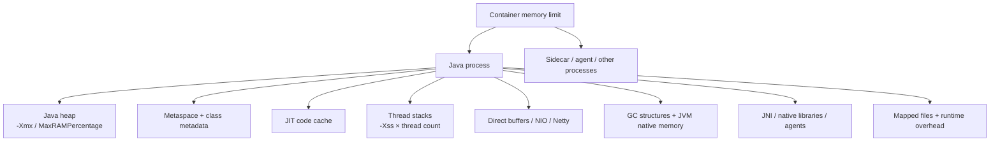
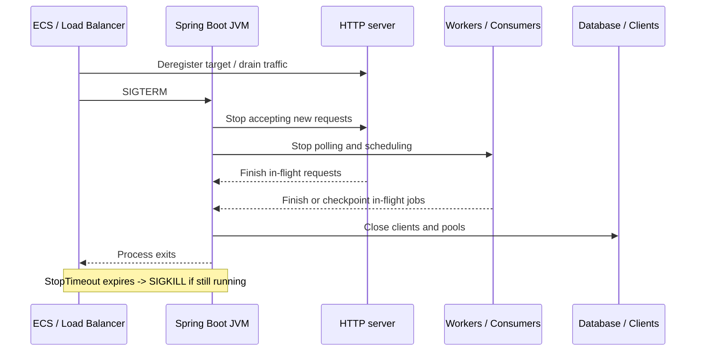

# Tối ưu JVM, bộ nhớ container và graceful shutdown

> **Học phần:** CLOUD_PROVIDERS_AWS  
> **Chương:** Ứng dụng Java và Spring Boot  
> **Bài học:** Tối ưu JVM, bộ nhớ container và graceful shutdown  
> **Bối cảnh:** Vận hành Java 17+/Spring Boot trên Amazon ECS/Fargate, ECS/EC2 hoặc Amazon EKS; kiểm soát CPU/memory, GC, rolling deployment và quá trình dừng ứng dụng an toàn.

## 1. Bài toán: vì sao ứng dụng chạy tốt trên máy dev nhưng lỗi trong container?

Một Course API dùng Spring Boot chạy ổn định trên laptop có RAM 16 GB. Khi deploy lên ECS Fargate với giới hạn 1–2 GiB, ứng dụng bắt đầu gặp các hiện tượng:

- Container bị dừng đột ngột với trạng thái Out Of Memory dù heap chart chưa chạm Xmx.
- JVM tạo quá nhiều GC threads hoặc worker threads khi container chỉ được cấp một vCPU.
- GC pause tăng khi traffic spike, p95/p99 latency vượt SLO.
- Task bị thay thế trong rolling deployment, request đang xử lý bị reset.
- Consumer đang xử lý SQS/Kafka message bị dừng giữa chừng, message bị xử lý lặp hoặc mất trạng thái.
- ECS gửi SIGTERM nhưng Java process không nhận được vì shell script đang là PID 1.
- Spring Boot bắt đầu shutdown nhưng thời gian chờ của JVM dài hơn stopTimeout; ECS gửi SIGKILL trước khi ứng dụng hoàn tất.

Các vấn đề này thường xuất phát từ ba lớp cần phối hợp:

1. **JVM:** nhận biết giới hạn container, chia heap/native memory, chọn GC và quản lý thread.
2. **Application:** quản lý request, background workers, connections, queues và shutdown lifecycle.
3. **Platform:** cấp CPU/memory, health checks, deregistration, signal và thời gian cho container dừng.

Một JVM có heap lớn không tự động chạy nhanh hơn. Một Spring Boot app có graceful shutdown cũng không tự động dừng an toàn nếu container không gửi đúng signal hoặc platform hết thời gian chờ.

### Mục tiêu học tập

Sau bài học, bạn có thể:

1. Giải thích container memory limit, JVM heap và native/off-heap memory.
2. Cấu hình JVM container-aware trên Java 17+.
3. Ước lượng MaxRAMPercentage theo memory budget.
4. Đọc GC logs, thread counts, heap metrics và container metrics.
5. Chẩn đoán Java OutOfMemoryError khác với container OOM kill.
6. Cấu hình G1GC, CPU-aware thread sizing và JVM diagnostics.
7. Bật graceful shutdown trong Spring Boot.
8. Thiết kế shutdown cho HTTP requests, schedulers, SQS/Kafka consumers và DB clients.
9. Căn chỉnh Spring lifecycle timeout với ECS stopTimeout hoặc Kubernetes termination grace period.
10. Kiểm thử shutdown khi rolling deployment, scale-in và task interruption.

## 2. Bộ nhớ container không chỉ là Java heap

Container memory limit là ngân sách cho **toàn bộ tiến trình và các thành phần chạy trong container**. Với Java, heap chỉ là một phần.



### 2.1. Các vùng memory quan trọng

| Thành phần | Nội dung | Triệu chứng khi thiếu |
|---|---|---|
| **Heap** | Objects, arrays, collections, application caches | Java heap space, GC liên tục |
| **Metaspace** | Class metadata, proxy/generated classes | Metaspace OOM, classloader leak |
| **Code cache** | JIT compiled code | Code cache full, JIT bị hạn chế |
| **Thread stacks** | Stack cho mỗi platform thread | Native memory tăng theo thread count |
| **Direct memory** | ByteBuffer.allocateDirect, Netty buffers | Direct buffer OOM hoặc RSS tăng |
| **GC/JVM native** | GC tables, compiler, VM internal structures | Container memory tăng dù heap ổn định |
| **JNI/native libraries** | Native SDKs, compression, TLS, agents | RSS tăng ngoài heap |
| **Mapped files/runtime** | Memory mapping, libc, allocator và overhead | Container vượt limit |

Công thức tư duy:

```text
Container memory
  >= Java heap
   + Metaspace
   + Code cache
   + Thread stacks
   + Direct buffers
   + GC/JVM native memory
   + JNI/native libraries
   + Runtime and process overhead
   + Other containers/processes in the task
```

Không thể lấy Xmx bằng 100% container memory. Nếu heap đã dùng gần hết giới hạn, phần native memory có thể đẩy container vượt cgroup limit trước khi JVM kịp ném OutOfMemoryError.

### 2.2. RSS, heap committed và heap used là các số khác nhau

- **Heap used:** số bytes objects đang dùng trên Java heap.
- **Heap committed:** phần heap JVM đã commit để sử dụng.
- **Heap max:** giới hạn heap tối đa.
- **RSS/container memory:** lượng memory tiến trình/container thực tế đang giữ theo cách đo của OS/cgroup.

Ví dụ:

```text
Container memory limit: 1,024 MiB
Heap max (-Xmx):          614 MiB
Heap used:                420 MiB
Container memory used:    930 MiB
Remaining headroom:        94 MiB
```

Heap còn khoảng 194 MiB trước khi chạm max, nhưng container chỉ còn 94 MiB. Nếu direct buffers, thread stacks hoặc native allocations tăng thêm, container vẫn có thể bị OOM kill.

## 3. Java 17+ và container awareness

HotSpot JVM trên các nền tảng Linux được hỗ trợ có thể đọc giới hạn CPU/memory từ container runtime. Với các bản JDK 17 phù hợp, container support được bật mặc định trên nền tảng hỗ trợ.

- JVM dùng giới hạn memory của môi trường để tính MaxRAM và heap ergonomics.
- JVM có thể nhận biết số CPU khả dụng để tính GC threads và một số thread pools.
- UseContainerSupport có thể bị tắt bằng -XX:-UseContainerSupport; không dùng tùy tiện.
- Container awareness không tự động tối ưu toàn bộ application thread pools, Netty event loops hoặc executor do ứng dụng tự tạo.

### 3.1. Xác minh JVM nhìn thấy bao nhiêu CPU và memory

In số CPU JVM nhận diện:

```java
public final class RuntimeInfo {
    public static void main(String[] args) {
        Runtime runtime = Runtime.getRuntime();

        System.out.println("Available processors: " +
            runtime.availableProcessors());

        System.out.println("Heap max bytes: " +
            runtime.maxMemory());

        System.out.println("Heap total bytes: " +
            runtime.totalMemory());

        System.out.println("Heap free bytes: " +
            runtime.freeMemory());
    }
}
```

Khi cần chẩn đoán container detection, chạy JVM với:

```bash
java -Xlog:os+container=trace -jar app.jar
```

Log này cho biết JVM đọc container/cgroup limits như thế nào trên runtime đang dùng. Kiểm tra cùng image, JDK vendor, version, CPU architecture và platform thực tế.

### 3.2. Kiểm tra cgroup từ Linux container

Với cgroup v2, các file thường dùng:

```bash
cat /sys/fs/cgroup/memory.max
cat /sys/fs/cgroup/memory.current
cat /sys/fs/cgroup/cpu.max
```

Ý nghĩa:

- memory.max: memory limit; giá trị max nghĩa là không đặt hard limit ở cgroup đó.
- memory.current: memory đang được tính cho cgroup.
- cpu.max: quota/period CPU.

Với cgroup v1, đường dẫn có thể là:

```bash
cat /sys/fs/cgroup/memory/memory.limit_in_bytes
cat /sys/fs/cgroup/memory/memory.usage_in_bytes
cat /sys/fs/cgroup/cpu/cpu.cfs_quota_us
cat /sys/fs/cgroup/cpu/cpu.cfs_period_us
```

Đường dẫn thực tế phụ thuộc runtime và mount layout. Đừng hard-code cgroup v1 paths vào mọi image.

### 3.3. CPU quota và ActiveProcessorCount

Runtime.availableProcessors() ảnh hưởng đến GC thread ergonomics và một số libraries/executors. Nếu JVM nhìn thấy nhiều CPU hơn mức workload thực sự được cấp, có thể tạo quá nhiều threads, gây context switching hoặc cạnh tranh CPU.

-XX:ActiveProcessorCount=1 ghi đè số CPU JVM sử dụng khi tính một số cấu hình nội bộ. Chỉ dùng sau khi xác minh container CPU quota và đo workload; ép xuống 1 trong task 2 vCPU có thể làm giảm throughput.

## 4. Tính memory budget cho Spring Boot container

Giả sử ECS Fargate task được cấp 2 GiB memory và chỉ có một container Java:

| Khoản | Ngân sách ví dụ |
|---|---:|
| Container/task limit | 2.048 MiB |
| Heap max | 1.229 MiB (60%) |
| Native/off-heap + metaspace + stacks + code cache | 500 MiB |
| Headroom cho peak/runtime variance | 319 MiB |

Đây là **budget minh họa**, không phải tỷ lệ chuẩn cho mọi Spring Boot application. Workload dùng Netty, compression, TLS, large thread pools, JDBC drivers, agents hoặc native libraries có thể cần phần off-heap lớn hơn.

### 4.1. MaxRAMPercentage và InitialRAMPercentage

Một số JVM flags:

| Flag | Ý nghĩa |
|---|---|
| -XX:MaxRAMPercentage | Tỷ lệ tối đa của memory JVM nhận diện được dùng cho heap |
| -XX:InitialRAMPercentage | Tỷ lệ ban đầu dùng để sizing heap |
| -Xms | Heap initial/minimum size tường minh |
| -Xmx | Heap maximum size tường minh |
| -XX:ActiveProcessorCount | Ghi đè số CPU JVM dùng để tính một số nội bộ |

Theo Java 17 launcher docs, MaxRAMPercentage mặc định là **25%**. Xmx tường minh sẽ quyết định heap max; đừng cấu hình nhiều nguồn sizing mà không hiểu precedence.

Ví dụ bắt đầu cho một container 1 GiB:

```text
Container limit = 1,024 MiB
MaxRAMPercentage = 60
Heap max xấp xỉ = 614 MiB
Phần còn lại = 410 MiB
```

Phần còn lại dành cho native memory, metaspace, stacks, code cache, direct buffers và headroom. Sau đó phải đo RSS và workload thực tế.

### 4.2. Một cấu hình khởi đầu để benchmark

```bash
JAVA_TOOL_OPTIONS="-XX:InitialRAMPercentage=25.0 -XX:MaxRAMPercentage=60.0 -XX:+ExitOnOutOfMemoryError"
```

Đây chỉ là cấu hình bắt đầu. Với ứng dụng cần heap lớn hơn, tăng percentage sau khi xác nhận native memory vẫn đủ. Với ứng dụng Netty hoặc xử lý file lớn, đo direct memory và concurrency trước khi tăng heap.

Không đặt Xmx lớn hơn memory limit container. Không giảm Xss hoặc đặt MaxDirectMemorySize một cách máy móc; các giới hạn này có thể chuyển lỗi sang StackOverflowError hoặc direct-buffer OOM.

### 4.3. Heap dump và OOM exit behavior

```bash
JAVA_TOOL_OPTIONS="-XX:MaxRAMPercentage=60.0 -XX:+ExitOnOutOfMemoryError -XX:+HeapDumpOnOutOfMemoryError -XX:HeapDumpPath=/tmp"
```

- ExitOnOutOfMemoryError kết thúc JVM khi JVM ném OOME; ECS service có thể khởi chạy task thay thế.
- HeapDumpOnOutOfMemoryError tạo heap dump khi JVM có thể xử lý OOME.
- Heap dump có thể rất lớn, chứa dữ liệu nhạy cảm và cần đủ ephemeral storage.
- Kernel/container OOM kill có thể gửi SIGKILL trước khi JVM tạo heap dump; không trông chờ OOME hooks khi container đã bị kill.

Đặt heap dump ở volume có dung lượng/quyền phù hợp, hạn chế quyền truy cập và xóa sau điều tra. Không ghi heap dump lên filesystem nhỏ đã gần đầy.

## 5. Garbage collection: bắt đầu từ G1 defaults

Với Java 17 trên server-class machines, **G1GC là garbage collector mặc định**. G1 cân bằng throughput và pause time, nhưng vẫn cần đủ CPU và memory để hoạt động.

- Đừng thêm UseG1GC chỉ vì thấy ví dụ trên mạng; JVM thường đã chọn G1.
- Đo allocation rate, live set, GC pause, full GC và CPU trước khi đổi collector.
- MaxGCPauseMillis là mục tiêu heuristic, không phải hard real-time guarantee.
- Tăng heap có thể giảm GC frequency nhưng làm tăng container memory pressure và có thể kéo dài một số pauses.
- Giảm heap quá mức có thể tạo GC churn và CPU saturation.

### 5.1. Bật GC logs trên Java 17

```bash
JAVA_TOOL_OPTIONS="-Xlog:gc*,safepoint:stdout:time,uptime,level,tags"
```

Trong ECS, gửi stdout/stderr qua awslogs hoặc log driver đã cấu hình. Tránh ghi log vào filesystem container nếu không có rotation và disk budget.

### 5.2. Những gì cần đọc từ GC logs

| Dấu hiệu | Có thể cho biết |
|---|---|
| Young GC quá dày | Allocation rate cao hoặc young generation cần được đánh giá |
| Old generation tăng liên tục sau GC | Live set tăng, cache giữ object hoặc leak |
| Full GC lặp lại | Heap pressure, humongous allocation hoặc promotion pressure |
| Pause time dài | Heap/live set lớn, CPU contention, memory pressure hoặc GC behavior |
| Concurrent GC không hoàn tất kịp | Allocation vượt tốc độ reclaim hoặc CPU không đủ |
| GC CPU cao nhưng request throughput thấp | Workload đang tốn nhiều thời gian cho collection |

Không chỉnh hàng loạt NewRatio, Xmn, survivor ratios và G1 internals ngay từ đầu. Với G1, đặt generation size thủ công có thể làm mất khả năng adaptive sizing. Thay đổi từng biến, chạy lại cùng load test và so sánh p95/p99, CPU, allocation và memory.

## 6. Container image và JVM options

Một Dockerfile ví dụ cho Spring Boot executable JAR:

```dockerfile
FROM eclipse-temurin:17-jre

WORKDIR /app

COPY target/course-api.jar /app/app.jar

ENV JAVA_TOOL_OPTIONS="-XX:InitialRAMPercentage=25.0 -XX:MaxRAMPercentage=60.0 -XX:+ExitOnOutOfMemoryError -Xlog:gc*,safepoint:stdout:time,uptime,level,tags"

USER 10001:10001

ENTRYPOINT ["java", "-jar", "/app/app.jar"]
```

### 6.1. Vì sao dùng exec-form ENTRYPOINT?

Dùng:

```dockerfile
ENTRYPOINT ["java", "-jar", "/app/app.jar"]
```

JVM trở thành process chính (PID 1) trong container. Khi ECS/Docker gửi SIGTERM, JVM có thể nhận signal và Spring shutdown hook được kích hoạt.

Tránh shell-form như:

```dockerfile
ENTRYPOINT java -jar /app/app.jar
```

Shell có thể trở thành PID 1 và giữ signal; nếu phải dùng shell script, script cần kết thúc bằng exec java -jar ... để thay process shell bằng JVM.

Không tự thêm STOPSIGNAL khác SIGTERM cho Spring Boot trừ khi có lý do rõ ràng. SIGKILL không thể được xử lý bằng shutdown hook.

### 6.2. JAVA_TOOL_OPTIONS và JDK_JAVA_OPTIONS

- JAVA_TOOL_OPTIONS được JVM đọc khi khởi tạo; tiện để truyền options từ container environment.
- JDK_JAVA_OPTIONS được Java launcher thêm vào command line.
- Chọn một cách quản lý nhất quán, tránh lặp hoặc override flags giữa image, task definition và entrypoint.
- Không đưa credentials hoặc secret values vào JVM options; command line và process diagnostics có thể làm lộ chúng.

## 7. Cấp CPU và memory trong Amazon ECS Fargate

ECS Fargate yêu cầu task-level CPU và memory theo các cặp giá trị được hỗ trợ. Ví dụ Linux task **1 vCPU / 2 GiB** là một cấu hình hợp lệ.

```json
{
  "family": "course-api",
  "requiresCompatibilities": ["FARGATE"],
  "networkMode": "awsvpc",
  "cpu": "1024",
  "memory": "2048",
  "containerDefinitions": [
    {
      "name": "app",
      "image": "123456789012.dkr.ecr.ap-southeast-1.amazonaws.com/course-api:1.0.0",
      "essential": true,
      "stopTimeout": 60,
      "portMappings": [
        {
          "containerPort": 8080,
          "protocol": "tcp"
        }
      ],
      "environment": [
        {
          "name": "JAVA_TOOL_OPTIONS",
          "value": "-XX:InitialRAMPercentage=25.0 -XX:MaxRAMPercentage=60.0 -XX:+ExitOnOutOfMemoryError"
        }
      ]
    }
  ]
}
```

Đây là fragment task definition minh họa; thay account, image, Region và task settings theo môi trường. Với Fargate, task-level memory là giới hạn cứng cho task. Nếu có sidecars, tổng bộ nhớ các containers và overhead phải nằm trong task budget.

### 7.1. stopTimeout trên Fargate

- Mặc định: **30 giây**.
- Có thể cấu hình tối đa **120 giây** trên Fargate platform phù hợp.
- Khi hết thời gian chờ, container bị force stop bằng SIGKILL.
- Linux container mặc định nhận SIGTERM nếu image không khai báo stop signal khác.

Ví dụ dùng stopTimeout: 60 để cho ứng dụng một phút hoàn tất shutdown. Đây không phải cách sửa một worker bị treo; cần đo thời gian shutdown thật và thiết kế timeout có giới hạn.

### 7.2. ECS EC2 và Fargate không hoàn toàn giống nhau

Với ECS EC2, stopTimeout phụ thuộc task definition và ECS container agent configuration; nếu không cấu hình, mặc định thường là 30 giây. ECS Managed Instances có giới hạn riêng. Không áp dụng giới hạn Fargate 120 giây cho mọi launch type.

## 8. Theo dõi JVM và container bằng Spring Boot Actuator

Spring Boot Actuator dùng Micrometer để cung cấp JVM, process, system và application metrics.

Các metric thường cần:

| Metric | Dùng để theo dõi |
|---|---|
| jvm.memory.used | Heap/non-heap memory đang dùng |
| jvm.memory.max | Heap/non-heap maximum theo pool |
| jvm.buffer.memory.used | Direct/mapped buffer memory |
| jvm.gc.pause | GC pause duration |
| jvm.threads.live | Thread count hiện tại |
| jvm.classes.loaded | Số classes đang load |
| process.memory.usage | Process memory theo instrumentation |
| process.cpu.usage | CPU của process |
| system.cpu.usage | CPU của host/container environment theo instrumentation |
| disk.free | Filesystem space còn lại |

Bật Actuator và metrics registry phù hợp, ví dụ Prometheus hoặc OTLP. Chỉ expose endpoints cần thiết và giới hạn bằng network/security policy; không mở toàn bộ Actuator endpoints ra Internet.

### 8.1. CloudWatch Container Insights cho ECS

Container Insights có thể hiển thị CPU, memory, network và storage ở các mức cluster/service/task/container tùy chế độ quan sát. Dùng cùng JVM metrics để phân biệt:

- Heap tăng cùng container memory: có thể là heap growth/live set.
- Heap ổn định nhưng container memory tăng: kiểm tra direct buffers, thread stacks, native libraries, agents hoặc file cache.
- Container memory cao nhưng JVM process metrics thấp: kiểm tra sidecars và các processes khác trong task.
- CPU tăng cùng GC pause: đối chiếu GC logs và CPU quota.

ECS MemoryUtilization/Container Insights metrics không thay thế heap metrics; chúng đo các lớp khác nhau.

### 8.2. Health endpoints

Ví dụ cấu hình Spring Boot Actuator:

```yaml
management:
  endpoint:
    health:
      probes:
        enabled: true
  endpoints:
    web:
      exposure:
        include: health,info,prometheus
```

Readiness dùng để xác định ứng dụng có thể nhận traffic; liveness dùng để xác định process có còn hoạt động. Không đưa mọi dependency bên ngoài vào liveness check: khi database tạm thời lỗi, restart toàn bộ app có thể tạo restart storm.

## 9. Chẩn đoán OOM và native memory

Phân biệt hai trường hợp:

| Trường hợp | Dấu hiệu | Hướng điều tra |
|---|---|---|
| Java heap OOM | java.lang.OutOfMemoryError: Java heap space | Heap dump, heap histogram, object retention, cache growth |
| Metaspace OOM | OutOfMemoryError: Metaspace | Classloader leak, dynamic proxies, generated classes |
| Direct buffer OOM | OutOfMemoryError: Direct buffer memory | Netty/NIO pools, direct memory limits |
| Unable to create native thread | Native thread creation failure | Thread count, Xss, process/thread limits, memory |
| Container OOM kill | Task/container bị kill, thường có SIGKILL hoặc exit code 137 | cgroup memory, ECS stopped reason, Container Insights, RSS |
| CPU throttling | CPU cao, latency tăng, GC concurrent work chậm | CPU quota, thread count, service utilization |

**Exit code 137 thường tương ứng process nhận SIGKILL, nhưng không tự chứng minh nguyên nhân là OOM.** Kiểm tra ECS stopped reason, task/container events và memory metrics.

### 9.1. Native Memory Tracking

Bật Native Memory Tracking (NMT) khi cần điều tra JVM native allocations:

```bash
JAVA_TOOL_OPTIONS="-XX:NativeMemoryTracking=summary"
```

Sau khi JVM chạy, nếu image có JDK tools và được phép attach:

```bash
jcmd 1 VM.native_memory summary scale=MB
jcmd 1 GC.heap_info
jcmd 1 Thread.print
```

- NMT phải được bật khi JVM khởi động.
- summary phân nhóm JVM native memory; detail tốn thêm overhead và chỉ nên bật khi cần điều tra sâu.
- NMT không thay thế RSS/cgroup metrics và không theo dõi mọi native allocation của bên thứ ba.
- Một số JRE/distroless images không có jcmd; chuẩn bị diagnostic image hoặc quy trình ECS Exec được kiểm soát.

### 9.2. Quy trình khi container bị OOM

1. Xác định container/task nào bị dừng và exit reason.
2. Đối chiếu memory limit, memory utilization và peak theo thời gian.
3. Xem heap used/max, non-heap, direct buffer và thread count.
4. Kiểm tra GC logs trước thời điểm task chết.
5. Nếu có heap dump, phân tích retained objects và dominator tree.
6. Nếu heap ổn định, kiểm tra native memory, Netty/direct buffers, thread count và agents.
7. Điều chỉnh heap/threads/native allocations theo số đo, rồi load test lại.

Không tăng task memory hoặc giảm heap chỉ để che triệu chứng mà chưa xác định nguồn memory growth.

## 10. Graceful shutdown là gì?

Graceful shutdown là quá trình dừng ứng dụng có trật tự để:

1. Không nhận thêm công việc mới.
2. Cho request đang chạy hoàn tất trong giới hạn thời gian.
3. Dừng polling/consumer/scheduler.
4. Hoàn tất hoặc lưu trạng thái công việc dở dang.
5. Flush logs/traces và metrics.
6. Đóng database connections, HTTP clients và executors.
7. Thoát process trước khi platform gửi SIGKILL.



Graceful shutdown không đảm bảo hoàn tất mọi job vô hạn. Mỗi operation cần deadline, idempotency và checkpoint để có thể tiếp tục sau khi task mới khởi chạy.

## 11. Spring Boot graceful shutdown

Spring Boot hỗ trợ graceful shutdown cho embedded Tomcat, Jetty và Reactor Netty; hành vi chi tiết phụ thuộc server/version. Nên cấu hình tường minh để timeout phù hợp với platform.

Ví dụ application.yml:

```yaml
server:
  shutdown: graceful

spring:
  lifecycle:
    timeout-per-shutdown-phase: 25s
  task:
    execution:
      shutdown:
        await-termination: true
        await-termination-period: 20s
    scheduling:
      shutdown:
        await-termination: true
        await-termination-period: 20s

management:
  endpoint:
    health:
      probes:
        enabled: true
      group:
        readiness:
          include: readinessState
        liveness:
          include: livenessState
```

- server.shutdown=graceful: embedded server ngừng nhận request mới và cho request đang chạy có cơ hội hoàn tất.
- spring.lifecycle.timeout-per-shutdown-phase: thời gian chờ cho mỗi lifecycle phase.
- spring.task.execution.shutdown.await-termination: chờ task executor hoàn tất các task đang chạy/được queue theo executor behavior.
- spring.task.scheduling.shutdown.await-termination: chờ scheduler kết thúc các tasks theo cấu hình.
- Readiness và liveness là hai tín hiệu khác nhau; readiness có thể chuyển sang refusing traffic khi ứng dụng dừng.

Một số Spring Boot versions đã bật web graceful shutdown mặc định. Cấu hình rõ trong application giúp tránh phụ thuộc default của version và làm timeout có thể review.

### 11.1. Readiness và liveness không thay thế nhau

| Probe | Câu hỏi | Khi nào fail |
|---|---|---|
| Liveness | Process còn sống và có khả năng tự phục hồi không? | JVM deadlock/hang hoặc process không còn đáp ứng |
| Readiness | Instance có thể nhận traffic mới không? | App đang startup, draining hoặc dependency bắt buộc không khả dụng |
| Startup | App đã hoàn tất khởi động chưa? | Chưa sẵn sàng sau thời gian startup cho phép |

Khi task bị terminate, cần loại task khỏi traffic routing trước hoặc cùng thời điểm bắt đầu drain. Với ALB, kiểm tra target deregistration delay và health check path. Không dùng liveness để restart app chỉ vì một dependency dùng chung đang gặp outage.

## 12. Dừng background workers, queues và schedulers

Web graceful shutdown chỉ xử lý HTTP server. Background workers có lifecycle riêng.

### 12.1. Thứ tự dừng worker

1. Đánh dấu ứng dụng không nhận job mới.
2. Dừng poller/consumer để không lấy thêm message.
3. Chờ in-flight tasks hoàn tất trong budget.
4. Commit offset hoặc delete/ack message sau khi xử lý thành công.
5. Nếu chưa hoàn tất, lưu checkpoint hoặc để message được retry theo semantics của queue.
6. Đóng executor và downstream clients.

Với Amazon SQS, visibility timeout cần phù hợp thời gian xử lý. Khi shutdown, không delete message trước khi business operation commit. Với Kafka, commit offset sau khi xử lý thành công và hiểu rõ rebalance/consumer group behavior.

### 12.2. Ví dụ worker có thời gian chờ hữu hạn

```java
package example.course.worker;

import jakarta.annotation.PreDestroy;
import org.springframework.stereotype.Component;

import java.util.concurrent.ExecutorService;
import java.util.concurrent.TimeUnit;
import java.util.concurrent.atomic.AtomicBoolean;

@Component
public class ReportWorker {
    private final AtomicBoolean accepting = new AtomicBoolean(true);
    private final ExecutorService executor =
        java.util.concurrent.Executors.newFixedThreadPool(4);

    public void submit(Runnable task) {
        if (!accepting.get()) {
            throw new IllegalStateException("Worker is stopping");
        }
        executor.submit(task);
    }

    @PreDestroy
    public void shutdown() {
        accepting.set(false);

        // Nếu có message poller riêng, hãy stop polling trước khi drain executor.
        executor.shutdown();

        try {
            if (!executor.awaitTermination(20, TimeUnit.SECONDS)) {
                executor.shutdownNow();
            }
        } catch (InterruptedException interrupted) {
            executor.shutdownNow();
            Thread.currentThread().interrupt();
        }
    }
}
```

Đây là ví dụ tối giản cho executor. Production cần phối hợp với lifecycle của queue listener, giới hạn số queued jobs và xác định cách persist/retry công việc bị ngắt. Không chỉ dựa vào PreDestroy nếu consumer framework có lifecycle API riêng.

### 12.3. Spring-managed executors

Nếu dùng ThreadPoolTaskExecutor hoặc ThreadPoolTaskScheduler, cấu hình shutdown behavior trong Spring Boot thay vì tự tạo nhiều thread pools không được quản lý.

- Đặt giới hạn pool size và queue capacity.
- Đặt await-termination period hữu hạn.
- Không cho phép job mới vào khi application đang draining.
- Không để scheduler khởi tạo job dài ngay trước thời điểm shutdown.
- Đảm bảo mọi task có deadline/cancellation strategy.

## 13. Shutdown database clients và AWS SDK clients

Spring quản lý nhiều client qua beans:

- JDBC DataSource/HikariCP.
- MongoDB MongoClient.
- AWS SDK v2 S3Client, S3AsyncClient, DynamoDB client.
- HTTP clients, Redis connections và Kafka/SQS consumers.

Tạo client theo application lifecycle, không tạo/đóng theo từng HTTP request. Khi shutdown:

- Ngừng nhận request và background work trước.
- Chờ các operations đang chạy kết thúc hoặc cancel có kiểm soát.
- Sau đó đóng client/pool để không cắt ngang transaction đang commit.
- Với async clients, chờ futures hoàn tất trong deadline và đóng event loops/client theo ownership.
- Không chờ vô hạn một dependency đang mất kết nối.

Một request bị timeout ở client không chứng minh database chưa commit. Dùng idempotency key, transaction boundary và trạng thái nghiệp vụ để tránh duplicate writes khi retry sau restart.

## 14. ECS task lifecycle và signal handling

ECS task đi qua các trạng thái như RUNNING, DEACTIVATING, STOPPING, DEPROVISIONING và STOPPED.

- Ở DEACTIVATING, ECS có thể deregister target khỏi load balancer.
- Ở STOPPING, Linux container nhận stop signal được cấu hình trong image; mặc định là SIGTERM.
- Khi hết StopTimeout, ECS gửi SIGKILL.
- SIGKILL không thể được xử lý bởi Java shutdown hooks hoặc Spring callbacks.

```text
ECS service scale-in / deployment / StopTask
                 |
                 v
          DEACTIVATING
      Deregister load balancer target
                 |
                 v
             STOPPING
           Send SIGTERM
                 |
        Spring Boot shutdown
                 |
       Wait up to stopTimeout
                 |
          +------+------+
          |             |
       Exits         Still running
          |             |
          v             v
       STOPPED        SIGKILL
```

### 14.1. Căn chỉnh timeout

Ví dụ Fargate:

| Lớp | Timeout mẫu |
|---|---:|
| Spring web/lifecycle phase | 25 giây |
| Worker/executor drain | tối đa 20 giây |
| ECS stopTimeout | 60 giây |
| Safety margin | phần còn lại |

Đây là cấu hình minh họa. spring.lifecycle.timeout-per-shutdown-phase là timeout cho từng phase, nên tổng shutdown thực tế có thể dài hơn một phase. Đo thời gian tệ nhất với nhiều workers và requests đồng thời.

Nếu Fargate stopTimeout chỉ 30 giây mà Spring cần 45 giây, platform có thể kill process trước khi shutdown hoàn tất. Nếu app cần lâu hơn, tăng stopTimeout trong giới hạn Fargate và giảm/giới hạn công việc đang xử lý.

### 14.2. ECS EC2 và Fargate không hoàn toàn giống nhau

Với ECS EC2, stopTimeout phụ thuộc task definition và ECS container agent configuration; nếu không cấu hình, mặc định thường là 30 giây. ECS Managed Instances có giới hạn riêng. Không áp dụng giới hạn Fargate 120 giây cho mọi launch type.

### 14.3. Custom stop signal

ECS Fargate hỗ trợ stop signals được khai báo trong container image cho Linux tasks; nếu không khai báo, mặc định vẫn là SIGTERM. Spring Boot thông thường nên dùng SIGTERM. Chỉ dùng signal khác khi toàn bộ runtime, entrypoint và application shutdown handling đã được kiểm thử.

## 15. Amazon EKS và Kubernetes termination

Nếu Spring Boot chạy trên EKS, Kubernetes cũng gửi termination signal rồi chờ trong grace period trước khi force kill:

```yaml
apiVersion: apps/v1
kind: Deployment
metadata:
  name: course-api
spec:
  replicas: 3
  selector:
    matchLabels:
      app: course-api
  template:
    metadata:
      labels:
        app: course-api
    spec:
      terminationGracePeriodSeconds: 60
      containers:
        - name: app
          image: example/course-api:1.0.0
          ports:
            - containerPort: 8080
          env:
            - name: JAVA_TOOL_OPTIONS
              value: "-XX:MaxRAMPercentage=60.0 -XX:InitialRAMPercentage=25.0"
          readinessProbe:
            httpGet:
              path: /actuator/health/readiness
              port: 8080
            periodSeconds: 5
          livenessProbe:
            httpGet:
              path: /actuator/health/liveness
              port: 8080
            periodSeconds: 10
```

- terminationGracePeriodSeconds mặc định của Pod là 30 giây; ví dụ tăng lên 60 giây.
- preStop hook, nếu có, sử dụng cùng grace period; thời gian hook chạy không được cộng thêm một budget độc lập.
- Kubelet gửi SIGTERM tới process chính; khi hết grace period, gửi SIGKILL.
- Pod terminating được đánh dấu không ready cho traffic thông thường; ứng dụng vẫn cần xử lý in-flight requests và long-lived connections.
- Nếu có sidecars, thứ tự dừng containers có thể ảnh hưởng; kiểm tra lifecycle behavior của từng sidecar.

Không dùng preStop: sleep 30 như một giải pháp chung. Hook chỉ có ích khi thực hiện một bước drain cụ thể và vẫn để đủ thời gian cho ứng dụng hoàn tất.

## 16. Kiểm thử graceful shutdown

### 16.1. Kiểm thử local container

Chạy image và gửi stop signal với thời gian chờ:

```bash
docker run --name course-api -p 8080:8080 course-api:local
```

Ở terminal khác:

```bash
docker stop --time 60 course-api
```

Quan sát logs để xác minh:

- JVM nhận SIGTERM.
- Spring bắt đầu context shutdown.
- HTTP server ngừng nhận requests mới.
- Requests đang chạy hoàn tất hoặc timeout đúng budget.
- Background workers ngừng polling và drain.
- Clients/executors được đóng.
- Process exit trước khi hết 60 giây.

Không chỉ test kill -9; đó là force kill và không phải graceful shutdown.

### 16.2. Kiểm thử trên ECS sandbox

1. Deploy ít nhất hai tasks sau ALB.
2. Gửi request có thời gian xử lý biết trước.
3. Trong lúc request đang chạy, cập nhật service hoặc scale desired count xuống.
4. Quan sát target deregistration, ECS task state và container logs.
5. Xác minh request không bị reset ngoài dự kiến.
6. Kiểm tra SQS/Kafka messages không bị mất hoặc ack sai.
7. Lặp lại với Fargate Spot interruption trong sandbox nếu workload dùng Spot.
8. So sánh shutdown duration với stopTimeout.

### 16.3. Kiểm thử memory và GC

- Tạo load tăng dần đến peak concurrency.
- Ghi heap used/max, RSS/container memory, direct buffers và thread count.
- Theo dõi GC pause p95/p99 và allocation rate.
- Kiểm tra container memory headroom ở peak.
- Test restart/rolling deployment khi heap gần mức cao.
- Chạy test với đúng JDK vendor/version và CPU architecture dùng ở production.

Không dùng số benchmark từ laptop để kết luận container sizing đã đúng.

## 17. Troubleshooting: JVM và container

| Triệu chứng | Nguyên nhân thường gặp | Cách xử lý |
|---|---|---|
| Container OOM nhưng heap chưa đầy | Native/direct memory, thread stacks, sidecar hoặc heap budget quá lớn | So RSS/cgroup với heap, NMT và thread count |
| Java heap space | Heap thiếu hoặc object retention tăng | Heap dump, dominator tree, xem cache/collections |
| Metaspace OOM | Classloader leak hoặc generated classes tăng | Phân tích class loading/unloading và classloaders |
| Direct buffer OOM | Direct ByteBuffers/Netty buffers tăng | Kiểm tra buffer pools, request concurrency và memory limits |
| Unable to create native thread | Thread pool quá lớn, Xss, process limits hoặc native memory | Đo thread count, pool sizing, stack memory |
| GC pause tăng | Heap/live set/alloc rate hoặc CPU contention | Đọc GC logs, đo allocation và CPU throttling |
| CPU thấp nhưng latency cao | Thread blocked, DB/network waits hoặc pool starvation | Thread dump, connection pool metrics và downstream latency |
| CPU 100% trong container nhỏ | JVM nhìn thấy CPU quota thấp hoặc workload quá concurrency | Xác minh CPU quota, availableProcessors, executor sizing |
| Task exit 137 | SIGKILL; có thể do timeout hoặc OOM kill | Kiểm tra ECS stop reason, memory và stopTimeout |
| Request bị reset khi deploy | Target drain/connection handling hoặc app dừng sớm | Kiểm tra ALB deregistration, Spring shutdown và stopTimeout |
| SQS message xử lý lặp | Worker chết trước ack/delete hoặc visibility timeout hết | Idempotency, visibility timeout, checkpoint và retry policy |
| JVM không shutdown khi ECS stop | Shell giữ PID 1 hoặc shutdown hook bị chặn | Exec-form ENTRYPOINT, SIGTERM, bounded waits |
| ECS kill trước khi app dừng | Spring/worker timeout lớn hơn stopTimeout | Đo tổng shutdown, tăng budget hoặc giảm in-flight work |
| Health check flapping | Liveness phụ thuộc DB hoặc timeout quá ngắn | Tách readiness/liveness, điều chỉnh probe |
| Heap dump không được tạo | Container bị SIGKILL, path không writable hoặc disk hết | Dùng writable volume, kiểm tra exit reason và disk budget |

## 18. Runbook tối ưu JVM trong production

Thực hiện theo thứ tự:

1. **Xác nhận giới hạn:** task/container memory, CPU, số containers và sidecars.
2. **Xác nhận runtime:** Java vendor/version, architecture, container support và cgroup version.
3. **Đo baseline:** heap max/used, RSS, direct memory, thread count, GC pauses, CPU và request latency.
4. **Đặt heap budget:** chọn MaxRAMPercentage theo phần native/off-heap thực tế.
5. **Giới hạn concurrency:** web worker threads, async pools, DB pools, message consumers và scheduler.
6. **Đọc GC logs:** xem allocation rate, old-gen growth, full GC và pause distribution.
7. **Chẩn đoán native memory:** NMT, jcmd, cgroup metrics và process RSS.
8. **Kiểm tra OOM path:** heap dump, disk capacity, exit behavior và task replacement.
9. **Thiết kế shutdown:** readiness, request drain, worker stop, client close và bounded timeout.
10. **Kiểm thử platform:** ECS scale-in, rolling deployment, Spot interruption hoặc EKS Pod termination.
11. **Thiết lập alarm:** memory headroom, OOM/restart, GC pause, CPU throttling, task stop reason và shutdown duration.
12. **Ghi lại cấu hình:** image digest, JDK version, task size, JVM flags, Spring Boot version và benchmark evidence.

Chỉ thay đổi một nhóm biến mỗi lần để có thể xác định nguyên nhân cải thiện hoặc regression.

## 19. Lab: triển khai Spring Boot API trên ECS Fargate

**Tình huống:** Course API chạy Java 17/Spring Boot trên ECS Fargate, 1 vCPU/2 GiB. API phục vụ HTTP requests và có worker xử lý báo cáo nền.

### 19.1. Chuẩn bị

1. Tạo Spring Boot application với Actuator.
2. Thêm readiness/liveness health groups.
3. Cấu hình graceful shutdown và bounded worker shutdown.
4. Build Docker image dùng exec-form ENTRYPOINT.
5. Cấu hình JAVA_TOOL_OPTIONS với MaxRAMPercentage ban đầu.
6. Tạo ECS task definition với Fargate CPU/memory hợp lệ và stopTimeout.
7. Tạo ECS service gắn ALB target group và health check readiness.
8. Bật CloudWatch Container Insights hoặc metric collection phù hợp.
9. Gửi logs tới CloudWatch Logs.

### 19.2. Thực hành

- In Runtime.availableProcessors() và heap max khi chạy trong container.
- Bật -Xlog:os+container=trace trong lần debug.
- Load test tăng concurrency; quan sát heap/RSS/direct memory.
- So sánh MaxRAMPercentage=50, 60, 70 trên sandbox.
- Bật GC logs và so pause time, CPU và p99.
- Tạo worker giả lập chạy 10–20 giây; gửi SIGTERM khi job đang chạy.
- Scale ECS service xuống trong lúc HTTP request và worker đang hoạt động.
- Thử giảm stopTimeout xuống 10 giây để quan sát force stop, sau đó phục hồi cấu hình phù hợp.
- Thử cấu hình readiness/liveness khác nhau và quan sát ALB/ECS health.
- Ghi lại thời gian từ SIGTERM đến process exit.

### 19.3. Bảng kết quả

| Thử nghiệm | Task memory | Heap max | Peak container memory | GC pause p99 | Shutdown duration | Kết quả |
|---|---:|---:|---:|---:|---:|---|
| Baseline | 2 GiB | Đo | Đo | Đo | Đo | Pass/Fail |
| MaxRAM 50% | 2 GiB | Đo | Đo | Đo | Đo | Pass/Fail |
| MaxRAM 60% | 2 GiB | Đo | Đo | Đo | Đo | Pass/Fail |
| MaxRAM 70% | 2 GiB | Đo | Đo | Đo | Đo | Pass/Fail |
| Scale-in with request | 2 GiB | Đo | Đo | Đo | Đo | Pass/Fail |
| Scale-in with worker | 2 GiB | Đo | Đo | Đo | Đo | Pass/Fail |

Không điền số benchmark giả. Chạy cùng image, JDK, traffic pattern và Region; ghi rõ task CPU/memory và flags.

### 19.4. Negative tests

| Test | Điều kiện | Kết quả mong đợi |
|---|---|---|
| T1 | MaxRAMPercentage đặt gần 100% | Load test cho thấy native headroom thiếu hoặc task OOM; không dùng làm production default |
| T2 | Shell-form ENTRYPOINT không forward SIGTERM | JVM không shutdown đúng; xác minh bằng logs/process tree |
| T3 | Spring timeout lớn hơn ECS stopTimeout | Task có thể bị SIGKILL trước khi shutdown xong |
| T4 | Liveness check phụ thuộc DB | DB outage có thể làm restart storm |
| T5 | Worker tiếp tục polling sau khi app bắt đầu stop | Có thể nhận thêm jobs trong shutdown |
| T6 | SQS message bị delete trước business commit | Test phát hiện mất work khi process dừng |
| T7 | Direct memory tăng nhưng chỉ theo dõi heap | Container memory tăng ngoài heap chart |
| T8 | Thread pool không giới hạn | Thread count/native memory tăng theo load |
| T9 | Heap dump path không writable | JVM không lưu được dump khi OOME |
| T10 | docker kill/SIGKILL trong khi request chạy | Không có graceful cleanup; client phải retry an toàn |

Không chạy OOM/force-kill tests trên production hoặc với dữ liệu thật.

## 20. Câu hỏi tự kiểm tra

**1. Container memory có bằng Java heap không?**  
Không. Container còn cần metaspace, code cache, thread stacks, direct buffers, GC/JVM native memory, JNI libraries và các processes khác.

**2. Vì sao heap chưa đầy mà container vẫn OOM?**  
Native/off-heap memory hoặc sidecar/process khác có thể đẩy RSS vượt cgroup limit.

**3. MaxRAMPercentage mặc định trong Java 17 là bao nhiêu?**  
25% theo Java 17 launcher documentation.

**4. MaxRAMPercentage=60 có nghĩa container memory luôn dùng 60% không?**  
Không. Đây là tỷ lệ để tính maximum Java heap từ memory JVM nhận diện được; native memory vẫn nằm ngoài heap.

**5. Java 17 có container awareness không?**  
HotSpot có thể nhận biết cgroup memory/CPU limits trên các nền tảng được hỗ trợ; xác minh bằng runtime logs và availableProcessors().

**6. G1GC có phải luôn cần bật thủ công không?**  
Không. G1 là collector mặc định trên server-class configurations của Java 17.

**7. ActiveProcessorCount dùng để làm gì?**  
Ghi đè số CPU JVM sử dụng khi tính một số cấu hình như GC và ForkJoinPool.

**8. OutOfMemoryError và container OOM kill khác nhau thế nào?**  
OOME do JVM ném exception; container OOM kill có thể khiến kernel gửi SIGKILL trước khi JVM xử lý.

**9. Spring Boot graceful shutdown làm gì?**  
Embedded web server ngừng nhận request mới và cho request đang chạy có cơ hội hoàn tất trong lifecycle timeout.

**10. timeout-per-shutdown-phase là tổng timeout toàn ứng dụng không?**  
Không. Đây là timeout cho mỗi lifecycle phase; tổng thời gian có thể dài hơn một phase.

**11. ECS Fargate mặc định chờ bao lâu sau SIGTERM?**  
30 giây nếu không cấu hình stopTimeout; giới hạn tối đa 120 giây.

**12. ECS gửi signal nào theo mặc định cho Linux container?**  
SIGTERM, trừ khi container image cấu hình stop signal khác.

**13. Có thể xử lý SIGKILL trong Java shutdown hook không?**  
Không. SIGKILL không thể bị bắt hoặc chặn.

**14. Vì sao nên dùng exec-form ENTRYPOINT?**  
Để JVM là process chính trong container và nhận signal trực tiếp.

**15. Có nên để SQS consumer tiếp tục poll khi app đang shutdown không?**  
Không. Dừng intake, hoàn tất/checkpoint công việc đang xử lý rồi mới đóng clients.

**16. Readiness và liveness khác nhau thế nào?**  
Readiness quyết định nhận traffic; liveness cho biết process có cần restart hay không.

## 21. Tổng kết và tài liệu tham khảo

Tối ưu Java trong container bắt đầu từ **memory budget và CPU quota**, không bắt đầu bằng cách tăng Xmx. Java heap chỉ là một phần của container memory; cần đo cả RSS, direct buffers, thread stacks, metaspace, GC và native allocations. Java 17 có container awareness trên nền tảng hỗ trợ, nhưng phải xác minh runtime thật và cấu hình heap bằng MaxRAMPercentage có headroom.

Graceful shutdown cần phối hợp **Spring Boot lifecycle, HTTP readiness/draining, background workers và platform stop timeout**. ECS Fargate gửi SIGTERM mặc định và chờ theo stopTimeout trước khi SIGKILL; Kubernetes có terminationGracePeriodSeconds tương tự. Mọi job cần bounded execution, checkpoint/idempotency và retry strategy để hệ thống tiếp tục an toàn khi task bị thay thế.

### Tài liệu tham khảo chính thức

- [Oracle Java 17 — java launcher options](https://docs.oracle.com/en/java/javase/17/docs/specs/man/java.html)
- [Oracle Java 17 — JVM ergonomics](https://docs.oracle.com/en/java/javase/17/gctuning/ergonomics.html)
- [Oracle Java 17 — G1 garbage collector](https://docs.oracle.com/en/java/javase/17/gctuning/garbage-first-g1-garbage-collector1.html)
- [Oracle Java 17 — G1 tuning recommendations](https://docs.oracle.com/en/java/javase/17/gctuning/garbage-first-garbage-collector-tuning.html)
- [Spring Boot — Graceful shutdown](https://docs.spring.io/spring-boot/reference/web/graceful-shutdown.html)
- [Spring Boot — Common application properties](https://docs.spring.io/spring-boot/appendix/application-properties/)
- [Spring Boot Actuator — Metrics and JVM metrics](https://docs.spring.io/spring-boot/reference/actuator/metrics.html)
- [Amazon ECS — Fargate task definition parameters](https://docs.aws.amazon.com/AmazonECS/latest/developerguide/task_definition_parameters.html)
- [Amazon ECS — Task lifecycle](https://docs.aws.amazon.com/AmazonECS/latest/developerguide/task-lifecycle-explanation.html)
- [Amazon ECS — Graceful shutdown best practices](https://aws.amazon.com/blogs/containers/graceful-shutdowns-with-ecs/)
- [Amazon ECS — Container Insights metrics](https://docs.aws.amazon.com/AmazonCloudWatch/latest/monitoring/Container-Insights-metrics-ECS.html)
- [Amazon ECS — Service utilization metrics](https://docs.aws.amazon.com/AmazonECS/latest/developerguide/service_utilization.html)
- [Kubernetes — Pod termination](https://kubernetes.io/docs/concepts/workloads/pods/pod-termination/)

> **Lưu ý thực hành:** Các tỷ lệ heap, timeout, task sizes và CPU values trong bài là cấu hình minh họa. Đo workload trên đúng JDK vendor/version, architecture, ECS launch type và traffic profile trước khi dùng trong production.
