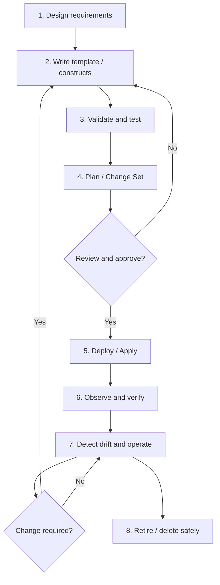
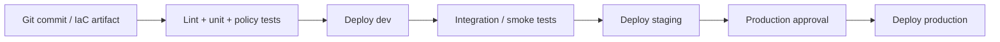

# Nguyên tắc Infrastructure as Code và vòng đời stack

## 1. Vì sao cần Infrastructure as Code?

Một ứng dụng Java cần VPC, subnet, security groups, IAM roles, ECS service, load balancer, DynamoDB table và CloudWatch alarms. Nếu mỗi môi trường được tạo thủ công qua console, cấu hình dev, staging và production rất dễ lệch nhau. Người vận hành có thể quên bật encryption, mở security group quá rộng hoặc tạo một resource sai Region. Khi cần phục hồi môi trường sau sự cố, đội ngũ phải nhớ lại từng thao tác đã thực hiện.

**Infrastructure as Code (IaC)** là cách mô tả hạ tầng bằng các tệp có thể lưu trong version control, review, kiểm thử và triển khai bằng công cụ tự động. Thay vì ghi nhớ một chuỗi thao tác console, đội ngũ định nghĩa tài nguyên, cấu hình, phụ thuộc và chính sách mong muốn trong code.

Trong AWS, IaC thường được triển khai bằng:

- **AWS CloudFormation:** dịch vụ AWS quản lý tài nguyên theo template và stack.
- **AWS Cloud Development Kit (CDK):** mô tả hạ tầng bằng ngôn ngữ lập trình; CDK synthesize thành CloudFormation templates.
- **Terraform:** công cụ IaC của HashiCorp, dùng providers và state để quản lý nhiều loại hạ tầng, bao gồm AWS.
- Các công cụ khác như AWS SAM, eksctl hoặc framework chuyên biệt có thể bổ sung workflow cho một loại workload cụ thể.

Bài học thuộc chương **Hạ tầng dưới dạng mã** của module **CLOUD_PROVIDERS_AWS**. Module khám phá Region/AZ, IAM, VPC, compute, storage, database, integration và serverless; người học cần biết chọn dịch vụ, thiết kế và triển khai ứng dụng an toàn, có giám sát, phục hồi và kiểm soát chi phí. IaC kết nối những thành phần này thành một hệ thống có thể tái tạo và quản lý theo vòng đời.

Sau bài học, bạn sẽ có thể:

- Giải thích các nguyên tắc desired state, repeatability, idempotency, versioning và review.
- Phân biệt imperative và declarative infrastructure.
- Chia hạ tầng thành modules/stacks theo ownership và lifecycle.
- Mô tả vòng đời stack từ thiết kế, triển khai, cập nhật, drift detection đến rollback/deletion.
- Chọn CloudFormation, CDK hoặc Terraform cho một use case AWS.
- Dùng change sets, plan, outputs, dependencies và state an toàn.
- Thiết kế pipeline IaC có kiểm thử, phê duyệt, least privilege và audit trail.

## 2. IaC là gì?

IaC biến cấu hình hạ tầng thành **artifact có thể review và tái sử dụng**. Artifact đó có thể là YAML/JSON template, HCL, Java/TypeScript/Python code hoặc cấu trúc do framework chuyên biệt định nghĩa.

Ví dụ, thay vì vào console tạo một S3 bucket rồi bật versioning và block public access, bạn khai báo các thuộc tính đó trong template. Một pipeline có thể tạo cùng cấu hình cho nhiều account/Region theo tham số đã được kiểm soát.

### 2.1. Những thứ nên quản lý bằng code

IaC không chỉ là tạo EC2 instance. Nó có thể quản lý:

| Nhóm | Ví dụ tài nguyên AWS |
| --- | --- |
| Network | VPC, subnet, route table, NAT gateway, VPC endpoint |
| Identity & security | IAM roles/policies, KMS keys, security groups |
| Compute | EC2, Auto Scaling, ECS, EKS, Lambda |
| Storage | S3 buckets, EBS volumes, EFS |
| Data | DynamoDB tables, RDS/Aurora resources |
| Integration | SQS, SNS, EventBridge, API Gateway |
| Observability | CloudWatch alarms, dashboards, log groups |
| Delivery | CodePipeline, CodeBuild, deployment roles |

Không phải mọi dữ liệu nghiệp vụ đều nên được quản lý như hạ tầng. IaC chủ yếu quản lý **resources và cấu hình nền tảng**; dữ liệu người dùng, secret runtime và dữ liệu giao dịch cần lifecycle/backup/retention riêng.

### 2.2. Infrastructure as Code khác cấu hình ứng dụng

| Infrastructure configuration | Application configuration |
| --- | --- |
| VPC CIDR, subnet, route table | API endpoint của service |
| ECS task/service, desired count | Feature flags, business rules |
| IAM role/policy | Java application properties |
| DynamoDB table/index | Mapping class và repository code |
| KMS key, S3 encryption | Cách ứng dụng mã hóa payload trước khi lưu |

Hai lớp có thể liên kết: IaC tạo DynamoDB table và cấp IAM permissions; ứng dụng Java sử dụng table name/role đã được provision. Không nhúng credential vào application config chỉ vì resource được tạo bởi IaC.

## 3. Những nguyên tắc cốt lõi

### 3.1. Desired state: mô tả trạng thái mong muốn

Trong mô hình declarative, người viết mô tả **kết quả cần có**: một bucket tên theo quy ước, versioning bật, encryption dùng key được chỉ định và public access bị chặn. Công cụ so sánh cấu hình mong muốn với trạng thái hiện tại rồi quyết định cần tạo, sửa hoặc thay thế resource.

Ví dụ desired state cho một S3 bucket:

```yaml
Resources:
  ArtifactBucket:
    Type: AWS::S3::Bucket
    Properties:
      VersioningConfiguration:
        Status: Enabled
      PublicAccessBlockConfiguration:
        BlockPublicAcls: true
        IgnorePublicAcls: true
        BlockPublicPolicy: true
        RestrictPublicBuckets: true
      BucketEncryption:
        ServerSideEncryptionConfiguration:
          - ServerSideEncryptionByDefault:
              SSEAlgorithm: AES256
```

Template mô tả thuộc tính của resource. CloudFormation chịu trách nhiệm tạo/update tài nguyên theo dependency graph và API của dịch vụ.

### 3.2. Declarative và imperative

**Declarative** trả lời “hạ tầng cuối cùng cần trông như thế nào?”. **Imperative** mô tả “chạy những bước nào để tạo hạ tầng?”.

| Tiêu chí | Declarative | Imperative |
| --- | --- | --- |
| Mô tả | Desired state | Chuỗi thao tác |
| Ví dụ | CloudFormation, Terraform, phần lớn CDK workflow sau synth | Script AWS CLI/SDK tự gọi Create/Update/Delete |
| Dependency | Tool phân tích graph từ khai báo | Người viết thường phải sắp xếp thứ tự |
| Reconciliation | Có thể so sánh desired/current state | Script phải tự kiểm tra trạng thái |
| Phù hợp | Hạ tầng có lifecycle dài, cần review/repeat | Bootstrap, tác vụ một lần hoặc automation chuyên biệt |

Imperative không phải luôn sai. Một script có thể phù hợp cho migration hoặc thao tác không được tool IaC hỗ trợ. Nhưng script phải xử lý retries, partial failure, idempotency và cleanup; nếu không, chạy lại có thể tạo duplicate hoặc để lại tài nguyên mồ côi.

### 3.3. Repeatability và consistency

Một deployment được xem là có thể lặp lại khi cùng source, parameters, tool versions và assumptions tạo ra hạ tầng tương đương. Để đạt điều này:

- Pin tool/provider/library versions.
- Lưu template và module trong version control.
- Quản lý environment-specific values qua parameters/context có kiểm soát.
- Tránh phụ thuộc vào trạng thái máy cá nhân hoặc thao tác console không được ghi nhận.
- Tách resource names/IDs theo account, Region và environment.
- Ghi lại những thay đổi có chủ đích và đường nâng cấp.

Repeatability không có nghĩa mọi environment phải có cùng kích thước hoặc account ID; chúng cần **cùng quy tắc và cấu trúc**, với parameters khác nhau đã được review.

### 3.4. Idempotency

Một thao tác idempotent có thể được thực hiện lặp lại mà không làm thay đổi kết quả cuối sau lần đầu thành công. IaC declarative hướng tới tính chất này: deploy cùng desired state không nên tạo thêm một bucket mới mỗi lần chạy.

Tuy vậy, không phải mọi API/construct/script đều idempotent theo cùng cách. Một số resource có physical name duy nhất, replacement semantics hoặc custom resource có side effects. Hãy kiểm tra behavior khi retry và không đặt random value mới vào mỗi lần synth nếu không có chủ đích.

### 3.5. Version control và review

IaC code là code production. Mỗi thay đổi cần:

- Pull request/diff rõ ràng.
- Review security, networking, data retention và cost.
- Kiểm tra linter, static analysis, policy checks và tests.
- Change set/plan trước khi apply.
- Approval cho môi trường production và thay đổi có blast radius lớn.
- Audit được ai thay đổi, ai phê duyệt, deployment nào tạo resource.

Không sửa trực tiếp production bằng console rồi quên cập nhật IaC. Thay đổi ngoài code tạo **configuration drift** và làm source of truth không còn đáng tin.

### 3.6. Reuse, modularity và separation of concerns

Chia hạ tầng thành modules/stacks theo ranh giới có ý nghĩa:

- Ownership: team nào chịu trách nhiệm?
- Lifecycle: resources có được tạo/cập nhật/xóa cùng nhau không?
- Security boundary: permissions và blast radius có thể tách không?
- Dependency: module nào cần output từ module nào?
- Change frequency: network nền tảng có thay đổi ít hơn application service không?

Tránh cả hai cực: một stack khổng lồ khó cập nhật và hàng trăm stacks nhỏ tạo dependency phức tạp. Module tốt có interface rõ, parameters/outputs ổn định và không phụ thuộc vào tên resource nội bộ của module khác.

### 3.7. Immutable infrastructure và controlled replacement

**Immutable infrastructure** ưu tiên thay instance/container/resource bằng phiên bản mới đã được kiểm thử, thay vì SSH vào máy production và chỉnh tay. Ví dụ ECS deploy task definition revision mới, Auto Scaling thay EC2 instances từ launch template mới.

Không phải mọi resource đều có thể thay thế an toàn. Database, S3 bucket và KMS key chứa dữ liệu lâu dài có lifecycle đặc biệt. Phải xem `Update requires: Replacement`, deletion policies, snapshots, retention và migration strategy trước khi thay đổi properties có thể thay physical resource.

## 4. Vòng đời IaC và vòng đời stack

Một stack thường là tập hợp resources được quản lý cùng nhau. Trong CloudFormation, **stack** là đơn vị quản lý resource từ một template. Với Terraform, thuật ngữ stack không phải đơn vị state mặc định như CloudFormation; một **root module/workspace và state** thường là phạm vi quản lý. Với CDK, stack là construct được synthesize thành CloudFormation stack.

Vòng đời tổng quát:



### 4.1. Design

Trước khi viết template, xác định:

1. Business requirement và SLO.
2. Account, Region, environment và ownership.
3. Resource types, dependencies và network topology.
4. Security boundaries, IAM roles, encryption và secret handling.
5. Availability, backup, recovery và data retention.
6. Cost model, scaling và limits.
7. Migration, rollback và deletion behavior.

Một template có thể deploy thành công về mặt kỹ thuật nhưng vẫn sai kiến trúc nếu CIDR overlap, public exposure, IAM wildcard, database không có backup hoặc NAT gateways vượt ngân sách.

### 4.2. Author

Viết template/construct/module với parameters, mappings, conditions, outputs, dependencies và tags có ý nghĩa. Tên logical IDs và module interfaces cần ổn định vì chúng có thể ảnh hưởng đến resource identity/state tracking.

### 4.3. Validate và test

Trước khi tạo tài nguyên:

- Format/lint template hoặc HCL.
- Validate syntax/schema.
- Unit test helper functions/constructs.
- Synthesize CDK và review CloudFormation template.
- Chạy static security/policy checks.
- Chạy plan/change set và review replacement/deletion.
- Test trong sandbox cho những resource/API behavior cần xác minh.

Validation syntax không chứng minh cấu hình có quyền IAM đúng, đạt SLO hoặc không phát sinh chi phí ngoài dự kiến.

### 4.4. Plan và approval

Plan/change set thể hiện sự khác biệt giữa desired state và current state. Reviewer cần nhận biết:

- Resource nào sẽ được tạo, update, replace hoặc delete.
- Property nào thay đổi.
- Có downtime hoặc data loss không?
- Có thay đổi public exposure, IAM trust, routes hoặc encryption không?
- Chi phí có tăng đáng kể không?
- Có cần maintenance window, backup hay migration không?

Nếu tool không thể tính chính xác tác động (ví dụ custom provider/API hoặc runtime conditions), ghi rõ uncertainty và kiểm thử trong môi trường gần production.

### 4.5. Deploy và observe

Triển khai theo thứ tự dependency; chờ trạng thái hoàn tất; kiểm tra health và application integration. Xác minh resource thực tế qua CloudFormation events, Terraform output/state và AWS service APIs. Một stack `CREATE_COMPLETE` không đảm bảo ứng dụng hoạt động đúng: ECS task có thể crash, target group không healthy hoặc IAM role thiếu permission runtime.

### 4.6. Update, rollback và retire

Thay đổi template, tạo plan/change set mới, review, deploy và verify. Khi update thất bại, xác định resource nào đã được thay đổi và trạng thái rollback. Trước khi xóa stack, phân biệt resources tạm thời với resources chứa dữ liệu/keys cần giữ; áp dụng retention/snapshot/migration theo policy.

## 5. Stack, resource, logical ID và physical ID

Trong CloudFormation:

- **Template:** bản mô tả resources và cấu hình mong muốn.
- **Stack:** một instance được triển khai từ template trong một account/Region.
- **Resource:** tài nguyên AWS được stack quản lý.
- **Logical ID:** định danh resource trong template.
- **Physical ID:** định danh resource thực tế do AWS cấp hoặc do người dùng chỉ định.
- **Parameters:** giá trị đầu vào khi tạo/update stack.
- **Outputs:** giá trị đầu ra như VPC ID, bucket name hoặc load balancer DNS.
- **Events:** lịch sử tiến trình tạo/update/delete và lỗi.

Ví dụ cùng template `network.yaml` có thể triển khai thành stack `dev-network` và `prod-network` trong các accounts/Regions khác nhau. Logical ID `AppVpc` giống nhau nhưng physical VPC IDs khác nhau.

### 5.1. Logical ID ổn định

Đổi logical ID có thể khiến CloudFormation xem resource cũ là resource bị xóa và resource mới cần tạo, thay vì update resource hiện tại. Với resource stateful, việc này có thể gây replacement hoặc xóa nhầm dữ liệu nếu deletion policy không bảo vệ. Refactor template phải kiểm tra resource identity và dùng resource import/migration khi cần.

### 5.2. Stack boundaries

Ví dụ một nền tảng có thể chia:

| Stack | Nội dung | Lifecycle |
| --- | --- | --- |
| `network` | VPC, subnet, routes, endpoints | Dài hạn, ít thay đổi |
| `security` | Shared KMS/IAM baseline | Dài hạn, ownership bảo mật |
| `data` | DynamoDB/RDS/S3 data resources | Dài hạn, retention chặt |
| `application` | ECS/Lambda/API Gateway | Theo release ứng dụng |
| `observability` | Alarms, dashboards, log configuration | Theo platform/service |

Đây chỉ là ví dụ tổ chức; số stack và boundaries phụ thuộc ownership, coupling và deployment frequency.

## 6. Dependencies và outputs

IaC engine cần biết resource nào phải tồn tại trước resource nào. Ví dụ ECS service cần cluster, task definition và network; route table association cần subnet và route table.

### 6.1. Dependency graph

CloudFormation suy ra nhiều dependency từ `Ref`, `Fn::GetAtt` và các intrinsic functions. Có thể khai báo `DependsOn` khi cần thứ tự cụ thể mà template reference không biểu diễn. Terraform xây graph từ references giữa resources/data sources.

Không thêm dependencies thủ công không cần thiết: chúng có thể làm giảm khả năng triển khai song song và tăng coupling.

### 6.2. Outputs và cross-stack references

CloudFormation Outputs giúp xuất các giá trị để người vận hành hoặc stack khác sử dụng:

```yaml
Outputs:
  VpcId:
    Description: VPC identifier for application stacks
    Value: !Ref AppVpc
    Export:
      Name: platform-network-vpc-id
```

Stack consumer có thể import giá trị export bằng `Fn::ImportValue`. Đây tạo dependency giữa stacks: stack export không thể bị xóa/đổi export name khi vẫn có stack khác import. Với hệ thống lớn, cân nhắc interface rõ ràng, parameter passing hoặc registry thay vì tạo quá nhiều cross-stack exports cứng.

### 6.3. Parameters, mappings và conditions

- **Parameters:** giá trị đầu vào như environment, CIDR, instance type.
- **Mappings:** lookup tĩnh, ví dụ AMI IDs theo Region/architecture (nếu quy trình cập nhật phù hợp).
- **Conditions:** bật/tắt resource hoặc property theo environment/parameter.
- **Outputs:** công bố IDs/ARNs/endpoints cần thiết.

Không dùng parameter để đưa secret plaintext vào template nếu có thể tham chiếu Secrets Manager/SSM Parameter Store an toàn.

## 7. CloudFormation stack lifecycle

CloudFormation quản lý resources trong một stack bằng template. Mỗi stack thuộc một AWS account và Region; muốn triển khai sang Region/account khác cần tạo stack tương ứng hoặc dùng StackSets.

### 7.1. Tạo stack

Quy trình cơ bản:

1. Chuẩn bị template YAML/JSON.
2. Validate template.
3. Chọn account, Region, stack name và parameters.
4. Chọn capabilities cần thiết (ví dụ IAM resources có tên tùy chỉnh).
5. Tạo stack và theo dõi events.
6. Xác minh resources và outputs sau khi stack hoàn tất.

Ví dụ CLI:

```bash
aws cloudformation validate-template \
  --template-body file://network.yaml \
  --region ap-southeast-1

aws cloudformation create-stack \
  --stack-name dev-network \
  --template-body file://network.yaml \
  --parameters ParameterKey=Environment,ParameterValue=dev \
  --region ap-southeast-1

aws cloudformation describe-stacks \
  --stack-name dev-network \
  --region ap-southeast-1
```

Nếu template chứa IAM resources, cần chỉ định capability phù hợp như `CAPABILITY_IAM` hoặc `CAPABILITY_NAMED_IAM` theo loại resource. Template lớn có thể được upload lên S3 và truyền bằng `--template-url`. Không chạy lệnh create-stack trên account production khi chưa review template/parameters.

### 7.2. Các trạng thái thường gặp

| Trạng thái | Ý nghĩa |
| --- | --- |
| `CREATE_IN_PROGRESS` | Đang tạo stack/resources |
| `CREATE_COMPLETE` | Tạo stack thành công |
| `CREATE_FAILED` | Tạo thất bại; có thể chuyển sang rollback |
| `ROLLBACK_IN_PROGRESS` | Đang hoàn tác những thay đổi có thể rollback |
| `ROLLBACK_COMPLETE` | Stack mới đã rollback về trạng thái không triển khai thành công |
| `UPDATE_IN_PROGRESS` | Đang cập nhật stack |
| `UPDATE_COMPLETE` | Cập nhật thành công |
| `UPDATE_ROLLBACK_IN_PROGRESS` | Đang rollback một update thất bại |
| `UPDATE_ROLLBACK_COMPLETE` | Update thất bại nhưng rollback hoàn tất |
| `UPDATE_ROLLBACK_FAILED` | Rollback update thất bại, cần can thiệp |
| `DELETE_IN_PROGRESS` | Đang xóa stack/resources |
| `DELETE_COMPLETE` | Stack đã xóa |

Một số trạng thái có hậu tố `_CLEANUP_IN_PROGRESS`, `_CLEANUP_COMPLETE`, `_FAILED` hoặc trạng thái đặc biệt khác tùy operation. Đọc `describe-stacks` và stack events để biết resource cụ thể nào đang lỗi; đừng chỉ dựa vào tên trạng thái cuối.

### 7.3. Cập nhật stack

Thay đổi template hoặc parameters rồi gọi update. CloudFormation tính các resource actions, cập nhật theo dependency và trả events:

```bash
aws cloudformation update-stack \
  --stack-name dev-network \
  --template-body file://network.yaml \
  --parameters ParameterKey=Environment,UsePreviousValue=true \
  --region ap-southeast-1
```

Nếu không có thay đổi, CloudFormation có thể báo không có updates để thực hiện. Update một số properties có thể **modify in-place**, trong khi properties khác yêu cầu **replacement**; cần kiểm tra resource specification và change set trước khi chạy.

### 7.4. Change sets

**Change set** cho phép xem trước tác động của một stack update/create-import operation trước khi execute. Nó hiển thị resource sẽ Add/Modify/Remove và replacement behavior theo những gì CloudFormation có thể xác định.

```bash
aws cloudformation create-change-set \
  --stack-name dev-network \
  --change-set-name review-network-update \
  --template-body file://network.yaml \
  --parameters ParameterKey=Environment,UsePreviousValue=true \
  --change-set-type UPDATE \
  --region ap-southeast-1

aws cloudformation describe-change-set \
  --stack-name dev-network \
  --change-set-name review-network-update \
  --region ap-southeast-1
```

Sau khi review và được phê duyệt:

```bash
aws cloudformation execute-change-set \
  --stack-name dev-network \
  --change-set-name review-network-update \
  --region ap-southeast-1
```

Change set **không phải cam kết mọi runtime outcome sẽ được dự đoán chính xác**. Custom resources, replacement constraints, quotas và điều kiện bên ngoài vẫn có thể làm operation thất bại.

### 7.5. Rollback và xử lý failure

Khi tạo/update thất bại, CloudFormation có thể rollback những resources có thể hoàn tác. Tuy nhiên:

- Một số side effects bên ngoài (email, payment, custom resource) không tự được đảo ngược.
- Resource replacement có thể đã tạo resource mới trước khi xóa resource cũ.
- Database migration hoặc thay đổi dữ liệu không tự rollback như một property.
- `UPDATE_ROLLBACK_FAILED` có thể cần sửa nguyên nhân, retry rollback hoặc dùng skip resources theo hướng dẫn CloudFormation.

Trước khi deploy thay đổi stateful, phải có backup, migration/compatibility plan và cách phục hồi dữ liệu. **Rollback template không đồng nghĩa rollback data**.

## 8. Drift detection và quản lý thay đổi ngoài IaC

**Drift** xảy ra khi cấu hình thực tế của resource khác với cấu hình mà stack/template mong muốn. Ví dụ một người sửa security group ingress trong console, đổi S3 bucket policy hoặc tắt logging mà không cập nhật code.

### 8.1. Vì sao drift nguy hiểm?

- Template không còn phản ánh trạng thái đang chạy.
- Deploy lần tiếp theo có thể ghi đè thay đổi thủ công hoặc tạo conflict.
- Security baseline bị phá vỡ mà code review không biết.
- Recovery/rebuild từ IaC tạo ra môi trường khác với production.
- Điều tra sự cố khó vì version control không mô tả đầy đủ trạng thái thực.

### 8.2. CloudFormation drift detection

CloudFormation hỗ trợ drift detection cho các resource types/properties được dịch vụ hỗ trợ. Có thể:

```bash
aws cloudformation detect-stack-drift \
  --stack-name dev-network \
  --region ap-southeast-1

aws cloudformation describe-stack-drift-detection-status \
  --stack-drift-detection-id DETECTION_ID \
  --region ap-southeast-1

aws cloudformation describe-stack-resource-drifts \
  --stack-name dev-network \
  --region ap-southeast-1
```

Kết quả có thể là `IN_SYNC`, `MODIFIED`, `DELETED`, `NOT_CHECKED` hoặc trạng thái detection khác. `NOT_CHECKED` không có nghĩa resource chắc chắn không drift; có thể resource type/property chưa được hỗ trợ hoặc chưa được kiểm tra.

### 8.3. Reconcile drift

Khi phát hiện drift:

1. Xác định ai thay đổi, thời điểm, lý do và impact.
2. Đánh giá thay đổi có hợp lệ hay là unauthorized change.
3. Nếu thay đổi được chấp nhận, cập nhật IaC source để phản ánh desired state mới.
4. Nếu thay đổi không được chấp nhận, tạo plan/change set để đưa resource về cấu hình chuẩn.
5. Kiểm tra data impact, replacement, outage và security trước khi reconcile.
6. Bổ sung guardrails để giảm thao tác ngoài pipeline.

Không chạy deploy tự động ngay sau khi phát hiện drift nếu chưa hiểu lý do. Thay đổi thủ công có thể là hotfix có chủ đích trong incident; ghi nhận và đưa nó trở lại source of truth qua review.

### 8.4. Drift trong Terraform

Terraform so sánh configuration với state và provider đọc trạng thái remote khi refresh/plan. `terraform plan` thường phát hiện nhiều thay đổi ngoài code; tuy nhiên, provider không đọc/so sánh được mọi thuộc tính của mọi resource. Drift detection phụ thuộc provider schema, API và refresh behavior.

Đừng nhầm drift với một resource bị thay đổi trong code nhưng chưa apply: đó là **configuration change** đang chờ plan/apply. Drift là khác biệt giữa remote infrastructure và state/configuration được quản lý.

## 9. Xóa stack và bảo vệ dữ liệu

Xóa stack có thể xóa các resources mà stack quản lý. Với resource chứa dữ liệu, phải định nghĩa deletion/retention behavior trước khi production.

### 9.1. DeletionPolicy

CloudFormation `DeletionPolicy` điều khiển hành vi khi resource bị xóa khỏi stack hoặc stack bị xóa:

| Policy | Ý nghĩa |
| --- | --- |
| `Delete` | Xóa resource (hành vi mặc định cho nhiều loại resource) |
| `Retain` | Giữ resource lại, không xóa cùng stack |
| `Snapshot` | Tạo snapshot trước khi xóa đối với resource types hỗ trợ |

Ví dụ giữ S3 bucket:

```yaml
Resources:
  DataBucket:
    Type: AWS::S3::Bucket
    DeletionPolicy: Retain
    UpdateReplacePolicy: Retain
    Properties:
      VersioningConfiguration:
        Status: Enabled
```

`DeletionPolicy` và `UpdateReplacePolicy` giải quyết hai tình huống khác nhau: resource bị xóa khỏi stack/stack deletion và resource cũ bị thay thế khi update. Cần cấu hình cả hai khi dữ liệu cũ phải được giữ trong replacement.

### 9.2. Retain không phải backup

`Retain` giữ resource nhưng không đảm bảo nội dung được bảo vệ trước corruption, ransomware, accidental overwrite hoặc deletion ở cấp dịch vụ. Dữ liệu cần backup/PITR/versioning/replication và restore drills phù hợp.

Với S3, giữ bucket không đồng nghĩa giữ mọi object nếu lifecycle hoặc application delete objects. Với RDS, `Snapshot` phải được xem xét theo backup retention và khả năng restore. Với KMS keys, deletion scheduling có thể làm dữ liệu không giải mã được nếu key bị xóa.

### 9.3. Stack deletion protection và termination protection

CloudFormation **termination protection** có thể ngăn stack bị xóa ngoài ý muốn. Nó không thay thế `DeletionPolicy`, backup hay quyền IAM. Bật cho stacks quan trọng và yêu cầu quy trình rõ ràng khi cần retire.

### 9.4. Quy trình retire an toàn

1. Xác định resources chứa data, keys, DNS hoặc shared networking.
2. Xác nhận consumers/dependencies đã được chuyển đi.
3. Export/backup dữ liệu theo policy và thử restore.
4. Review deletion plan/change set và Retain/Snapshot policies.
5. Phê duyệt owner của dữ liệu và platform.
6. Xóa stack theo thứ tự dependency.
7. Kiểm tra orphaned resources, retained resources, cost và access policies sau khi xóa.

## 10. Nested stacks, StackSets và nhiều môi trường

### 10.1. Nested stacks

Nested stack cho phép một CloudFormation stack gọi một template khác làm resource `AWS::CloudFormation::Stack`. Phù hợp khi muốn tái sử dụng một nhóm resource có lifecycle gắn với parent stack hoặc chia template lớn thành các phần dễ đọc.

Không lạm dụng nested stacks để chia mọi resource nhỏ: parent-child lifecycle và outputs có thể làm troubleshooting phức tạp. Template child cần được upload ở nơi CloudFormation truy cập được (thường là S3 URL) trong workflow phù hợp.

### 10.2. StackSets

**CloudFormation StackSets** triển khai cùng một stack template tới nhiều accounts và Regions. Dùng cho baseline như IAM roles, Config rules, CloudTrail organization setup hoặc shared security controls.

StackSets phù hợp khi:

- Nhiều accounts phải có cùng baseline.
- Organization/team muốn rollout có kiểm soát.
- Cần quản lý deployment targets và operation preferences tập trung.

Thiết kế StackSets phải xem permissions model (service-managed hoặc self-managed), delegated administrator, concurrency/failure tolerance và account enrollment. Không deploy mọi application stack bằng StackSets chỉ vì có nhiều accounts; application lifecycle có thể khác baseline.

### 10.3. Environment promotion

Một pipeline có thể promote cùng artifact qua dev → test → staging → production:



Mỗi environment có parameters/role riêng; artifact và tool versions được pin để giảm sự khác biệt. Production approval nên dựa trên diff/change set, test evidence, security/cost review và maintenance window.

## 11. AWS Cloud Development Kit (CDK)

AWS CDK cho phép mô tả hạ tầng bằng ngôn ngữ quen thuộc như TypeScript, Python, Java, C# hoặc Go. CDK code được **synthesize** thành CloudFormation template; CloudFormation thực hiện deployment và quản lý stack lifecycle.

Luồng cơ bản:

1. Viết CDK application và constructs.
2. Chọn account/Region qua environment/context.
3. Chạy synth để tạo CloudFormation template.
4. Review template và diff.
5. Bootstrap environment nếu cần.
6. Deploy CDK stack; CloudFormation tạo/update resources.

### 11.1. App, Stack và Construct

| Khái niệm | Vai trò |
| --- | --- |
| `App` | Root của CDK application |
| `Stack` | Đơn vị triển khai tương ứng CloudFormation stack |
| `Construct` | Khối building block mô tả một hoặc nhiều resources |
| L1 construct (`Cfn...`) | Ánh xạ gần như trực tiếp CloudFormation resource |
| L2 construct | Abstraction có defaults, methods và validation tiện dụng |
| L3 pattern | Pattern kết hợp nhiều resources cho một use case |

CDK abstractions giúp giảm boilerplate, nhưng người viết vẫn phải hiểu CloudFormation resource properties và security implications. L2 defaults không thay thế review.

### 11.2. Ví dụ Java CDK

Ví dụ tạo một S3 bucket có versioning và block public access:

```java
import software.amazon.awscdk.App;
import software.amazon.awscdk.Stack;
import software.amazon.awscdk.StackProps;
import software.amazon.awscdk.services.s3.Bucket;
import software.amazon.awscdk.services.s3.BucketEncryption;
import software.amazon.awscdk.services.s3.BlockPublicAccess;

public class StorageStack extends Stack {
    public StorageStack(final App scope, final String id) {
        this(scope, id, null);
    }

    public StorageStack(
            final App scope,
            final String id,
            final StackProps props) {
        super(scope, id, props);

        Bucket.Builder.create(this, "Artifacts")
                .versioned(true)
                .blockPublicAccess(BlockPublicAccess.BLOCK_ALL)
                .encryption(BucketEncryption.S3_MANAGED)
                .build();
    }

    public static void main(String[] args) {
        App app = new App();
        new StorageStack(app, "StorageStack");
        app.synth();
    }
}
```

Đây là ví dụ tối giản về construct; dependency CDK Java và project bootstrap cần được thiết lập theo version CDK v2 đang dùng. `S3_MANAGED` tương ứng SSE-S3; nếu policy yêu cầu customer-managed KMS key, chọn encryption mode và key policy phù hợp. Bucket có thể được tạo với physical name do CloudFormation sinh nếu không chỉ định `bucketName`.

### 11.3. synth, diff, bootstrap và deploy

Các lệnh CLI thường dùng:

```bash
cdk synth
cdk diff StorageStack
cdk bootstrap aws://111122223333/ap-southeast-1
cdk deploy StorageStack
cdk destroy StorageStack
```

- `cdk synth`: tạo CloudFormation template từ CDK app.
- `cdk diff`: so sánh template synth với deployed stack.
- `cdk bootstrap`: chuẩn bị bootstrap resources trong account/Region cho CDK deployment assets/roles theo bootstrap template.
- `cdk deploy`: deploy stack thông qua CloudFormation.
- `cdk destroy`: yêu cầu xóa stack; phải xem retention và deletion policies trước khi dùng.

Bootstrap là hoạt động tạo tài nguyên hỗ trợ deployment, có thể bao gồm S3 asset bucket và IAM roles. Hãy review bootstrap template, trust policy và execution permissions; không cấp quyền admin vô hạn chỉ để chạy CDK.

### 11.4. CDK context và reproducibility

CDK có context lookups cho thông tin environment như VPC, hosted zone hoặc availability zones. Context có thể được cache trong `cdk.context.json`. Đưa context file cần thiết vào version control và review khi refresh lookup; nếu synth phụ thuộc dữ liệu khác nhau trên mỗi máy, template có thể không tái tạo nhất quán.

Pin CDK library/CLI versions và dùng cùng toolchain trong CI. Không gọi API bên ngoài hoặc sinh random physical IDs trong synth mà không có quy tắc ổn định.

## 12. Terraform trên AWS

Terraform mô tả resources bằng HCL và sử dụng AWS provider để gọi AWS APIs. Khác CloudFormation, Terraform quản lý mapping giữa cấu hình và remote objects qua **state**. State là dữ liệu quan trọng: nó lưu resource addresses, IDs và attributes cần để tính plan/update.

### 12.1. Ví dụ HCL tạo S3 bucket

```hcl
terraform {
  required_version = ">= 1.10.0"
  required_providers {
    aws = {
      source  = "hashicorp/aws"
      version = "~> 5.0"
    }
  }
}

provider "aws" {
  region = "ap-southeast-1"
}

resource "aws_s3_bucket" "artifacts" {
  bucket_prefix = "shop-artifacts-"
}

resource "aws_s3_bucket_versioning" "artifacts" {
  bucket = aws_s3_bucket.artifacts.id

  versioning_configuration {
    status = "Enabled"
  }
}

resource "aws_s3_bucket_server_side_encryption_configuration" "artifacts" {
  bucket = aws_s3_bucket.artifacts.id

  rule {
    apply_server_side_encryption_by_default {
      sse_algorithm = "AES256"
    }
  }
}

resource "aws_s3_bucket_public_access_block" "artifacts" {
  bucket                  = aws_s3_bucket.artifacts.id
  block_public_acls       = true
  ignore_public_acls      = true
  block_public_policy     = true
  restrict_public_buckets = true
}
```

Ví dụ pin major provider version theo constraint; trong production nên kiểm soát version cụ thể trong lock file và quy trình upgrade. Bucket name được tạo theo prefix để tránh tên global collision; không giả định tên thực sẽ giống nhau ở mọi environment.

### 12.2. Workflow init, validate, plan và apply

```bash
terraform init
terraform fmt -check
terraform validate
terraform plan -out=tfplan
terraform show tfplan
terraform apply tfplan
```

- `init`: tải providers/modules và khởi tạo backend.
- `fmt`: chuẩn hóa formatting.
- `validate`: kiểm tra cấu trúc/configuration.
- `plan`: tính actions dự kiến.
- `show`: review saved plan.
- `apply`: thực hiện đúng saved plan đã được phê duyệt.

Không nên chạy `terraform apply -auto-approve` trên production pipeline nếu thiếu approval gate và policy checks. Saved plan có thể chứa sensitive values; bảo vệ artifact và xóa theo retention policy.

### 12.3. State và backend

Terraform state cần được lưu an toàn và chia sẻ có kiểm soát khi nhiều người/pipeline cùng quản lý một environment. Remote backend phổ biến trên AWS là S3:

```hcl
terraform {
  backend "s3" {
    bucket       = "company-terraform-state"
    key          = "platform/network/terraform.tfstate"
    region       = "ap-southeast-1"
    encrypt      = true
    use_lockfile = true
  }
}
```

Backend bucket phải được tạo/bootstrap trước khi Terraform dùng nó; không để state bucket phụ thuộc vào chính state mà nó đang lưu nếu chưa có bootstrap strategy. Bật versioning, encryption, Block Public Access, access logging/monitoring phù hợp và IAM least privilege. `use_lockfile` sử dụng cơ chế locking của S3 backend trong các Terraform versions hỗ trợ; pin tool version và theo tài liệu backend hiện hành.

**Không commit state vào Git.** State có thể chứa resource attributes nhạy cảm, connection strings, generated passwords hoặc metadata nội bộ, kể cả khi output không hiển thị chúng. Bảo vệ backend như một kho secrets quan trọng.

### 12.4. State locking và concurrent applies

Chỉ cho một writer thực hiện thay đổi cùng state tại một thời điểm. Locking ngăn hai pipeline đồng thời ghi state và làm hỏng mapping. Nếu lock bị giữ sau crash, kiểm tra owner/process và chỉ force-unlock khi chắc chắn operation cũ đã dừng; force-unlock bừa bãi có thể gây corruption.

### 12.5. Drift và state operations

Các lệnh cần hiểu:

```bash
terraform plan
terraform plan -refresh-only
terraform apply -refresh-only
terraform state list
terraform state show aws_s3_bucket.artifacts
terraform import aws_s3_bucket.artifacts example-existing-bucket
```

`terraform plan` refreshes remote objects theo provider behavior trước khi đề xuất actions. `terraform plan -refresh-only` chỉ tạo plan để review các khác biệt; chạy `terraform apply -refresh-only` nếu muốn ghi nhận thay đổi remote vào state mà **không sửa infrastructure**. `terraform import` liên kết resource hiện có với state; cần có resource block tương ứng và review plan sau import.

`terraform state` commands có thể tác động mapping quan trọng. Không dùng `state rm`, `mv`, `replace-provider` hoặc force-unlock nếu chưa hiểu impact và backup state.

### 12.6. Modules và workspaces

- **Module** đóng gói resources/variables/outputs để tái sử dụng.
- **Root module** là thư mục cấu hình mà Terraform chạy từ đó.
- **Workspace** tách các state instances cho cùng cấu hình trong một backend.

Workspaces hữu ích cho những môi trường tương tự, nhưng không tự tạo isolation security/account. Với production/dev có ownership, permissions hoặc lifecycle khác biệt, có thể dùng root modules/backends/keys riêng và pipeline roles riêng.

## 13. So sánh CloudFormation, CDK và Terraform

| Tiêu chí | CloudFormation | AWS CDK | Terraform |
| --- | --- | --- | --- |
| Ngôn ngữ mô tả | YAML/JSON | Java/TypeScript/Python/C#/Go | HCL |
| Engine triển khai AWS | CloudFormation | Synthesize sang CloudFormation | Terraform core + AWS provider |
| State tracking | CloudFormation stack/resource metadata | CloudFormation stack/resource metadata | Terraform state |
| Preview | Change sets | `cdk diff` và CloudFormation change set khi deploy | `terraform plan` |
| Abstraction | Resource template trực tiếp | Constructs/patterns | Modules/providers/resources |
| Multi-cloud | Tập trung AWS | Chủ yếu AWS (có thể dùng construct ecosystem khác) | Nhiều providers |
| Drift | CloudFormation drift detection theo resource support | Dùng CloudFormation drift detection | Plan/refresh theo provider |
| Hợp với | AWS-native stack lifecycle, governance | Team thích ngôn ngữ lập trình và constructs | Team cần provider ecosystem và state workflow |

Không có công cụ tốt nhất cho mọi tổ chức. Lựa chọn phụ thuộc:

- AWS-only hay nhiều cloud/platforms?
- Team đã có kỹ năng Java/TypeScript, YAML hay HCL?
- Governance yêu cầu CloudFormation-native deployment hay provider workflow?
- Ai sở hữu state, backend, credentials và upgrade?
- Module ecosystem, policy checks và CI/CD hiện có ra sao?
- Tổ chức cần import/adopt resources hiện tại như thế nào?

Tránh quản lý **cùng một resource bằng hai IaC engines** cùng lúc. CloudFormation và Terraform có thể cùng tồn tại trong một account nếu quản lý resource boundaries rõ; nếu cả hai cùng nghĩ mình sở hữu một bucket/security group, update/delete có thể gây drift hoặc mất dữ liệu.

## 14. CI/CD pipeline cho IaC

IaC pipeline biến thay đổi infrastructure thành một quy trình có thể review và audit. Một pipeline tốt tách **kiểm tra code**, **tạo plan**, **phê duyệt** và **thực thi**; production deployment dùng role riêng với quyền vừa đủ.

### 14.1. Pipeline stages

| Stage | Mục đích | Ví dụ |
| --- | --- | --- |
| Source | Lấy commit/tag đã review | Git repository |
| Format/lint | Chuẩn hóa và phát hiện lỗi cú pháp/style | cfn-lint, terraform fmt |
| Static policy | Phát hiện cấu hình nguy hiểm | IAM wildcard, public S3, unencrypted resources |
| Unit tests | Kiểm thử construct/helper functions | CDK assertions, module tests |
| Synthesize/validate | Tạo template và validate schema | cdk synth, CloudFormation validate |
| Plan/change set | Xem resource actions | terraform plan, CloudFormation change set |
| Approval | Kiểm tra security/cost/blast radius | Pull request + production approval |
| Deploy | Thực hiện saved plan/change set | CloudFormation/CDK/Terraform |
| Verify | Kiểm tra stack status và app health | Smoke tests, CloudWatch, service APIs |
| Audit | Lưu evidence và kết quả | Build logs, change set, commit SHA |

### 14.2. Tách quyền pipeline

Nên có roles riêng cho:

- **Plan/validation role:** đọc trạng thái resource, đọc state backend, synthesize/validate; không có quyền delete production resources nếu không cần.
- **Deploy role:** chỉ triển khai stack/resources trong phạm vi account/Region/project được giao.
- **Bootstrap/platform role:** quản lý bootstrap buckets, deployment roles và shared infrastructure; quyền rộng hơn nhưng ít người sử dụng và có approval.
- **Break-glass role:** dùng trong incident theo quy trình audit riêng, không dùng hằng ngày.

CI có thể nhận credentials bằng OIDC federation/STS thay vì lưu long-lived AWS access keys trong repository secrets. Trust policy cần giới hạn repository, branch, environment và audience claims.

### 14.3. Review plan như review code

Một reviewer cần xem:

- Resource create/update/replace/delete.
- IAM policy changes, trust relationships và public access.
- Network routes, ingress/egress và endpoints.
- Encryption, backup, retention và deletion behavior.
- Database replacement/migration và downtime.
- Estimated cost, quotas và scaling limits.
- Outputs/exports thay đổi có ảnh hưởng consumer stack không.

Không approve chỉ vì plan không báo lỗi. Plan cho biết tool dự kiến làm gì; reviewer vẫn cần xác minh thay đổi có đúng requirement và an toàn hay không.

### 14.4. Promotion và artifact integrity

Tốt nhất promote **cùng một source revision/artifact** qua các môi trường, thay đổi parameters/credentials theo environment. Ghi commit SHA, tool versions, provider lock file, plan/change set ID và approval record. Nếu phải synthesize lại CDK theo context khác, review synthesized template tương ứng của từng environment.

Không để developer laptop là nơi duy nhất lưu state/plan. Pipeline và backend cần có owner, backup, retention và quyền truy cập rõ ràng.

## 15. Security và policy as code

IaC có thể tạo hạ tầng an toàn nhất quán, nhưng một template sai có thể nhân bản sai cấu hình sang nhiều accounts. Bảo mật phải được kiểm tra từ design đến runtime.

### 15.1. Secrets và sensitive values

- Không hardcode passwords, access keys, API tokens hoặc private keys trong template, HCL, CDK source hay Git.
- Dùng Secrets Manager hoặc Systems Manager Parameter Store; template tham chiếu dynamic references/secure parameters theo cơ chế hỗ trợ.
- Hạn chế output những giá trị nhạy cảm; CloudFormation outputs không phải secret store.
- Bảo vệ Terraform state, saved plans, CDK assets và CI logs.
- Rotate credentials và audit access.

`NoEcho` trên CloudFormation parameter giúp che giá trị trong một số giao diện/outputs nhưng **không biến template/parameter thành một secret manager**; sensitive values vẫn có thể xuất hiện trong state, logs hoặc resource metadata nếu dùng sai. Ưu tiên tham chiếu secret runtime.

### 15.2. Least privilege và role separation

Một deploy role có thể cần `cloudformation:CreateStack`, `cloudformation:UpdateStack`, `Describe*`, `CreateChangeSet`, `ExecuteChangeSet` cùng quyền service-specific thông qua CloudFormation service role. Không cấp `AdministratorAccess` chỉ để tránh phải hiểu quyền cần thiết. Xem xét:

- Deployment role trust policy và source identity.
- CloudFormation service role (nếu dùng) và permissions của nó.
- IAM capabilities khi template tạo IAM resources.
- SCP, permission boundaries, resource policies và KMS key policies.
- Account/Region/resource ARN scope.

### 15.3. Guardrails

Guardrails có thể thực hiện ở nhiều lớp:

| Lớp | Ví dụ |
| --- | --- |
| Source review | PR review, CODEOWNERS, branch protection |
| Static policy | cfn-guard, Checkov, tfsec/Trivy, OPA policies |
| AWS governance | SCPs, AWS Config rules, CloudFormation Hooks |
| Runtime detection | CloudTrail, Security Hub, GuardDuty, Config |
| Preventive defaults | S3 Block Public Access, encryption, restricted SG rules |

Tool policy không thay thế service-native controls. Một linter có thể bỏ sót custom resource hoặc không hiểu business context; kết hợp nhiều lớp và theo dõi false positives.

### 15.4. Region, account và environment safety

Trước khi deploy, xác minh caller identity và target:

```bash
aws sts get-caller-identity
aws configure get region
```

Trong CI, role assumption và target account/Region nên được truyền tường minh. Có thể dùng deployment guard/approval để chặn lệnh nhắm nhầm production. Không tin tên profile hoặc biến environment nếu chưa xác minh account ID và ARN.

## 16. Testing, observability và cost management

### 16.1. Test nhiều tầng

| Loại test | Điều cần xác minh |
| --- | --- |
| Unit test | Helpers, naming, parameter validation, construct logic |
| Template/schema test | Template hợp lệ, resource properties/outputs đúng |
| Policy test | Không public bucket, không wildcard IAM ngoài policy |
| Integration test | Resources tạo được, endpoints/permissions hoạt động |
| Smoke test | Application healthy sau deployment |
| Drift check | Remote configuration không lệch desired state |
| Recovery test | Restore backup, redeploy hoặc rollback theo runbook |

CDK có assertions/testing utilities để kiểm tra CloudFormation template synthesize. Terraform có test framework/module validation và có thể dùng policy-as-code trong pipeline. CloudFormation template validation chỉ kiểm tra cấu trúc; nó không thay thế deployment integration tests.

### 16.2. Observability cho stack

Theo dõi:

- CloudFormation stack events, resource status và rollback failures.
- Terraform pipeline exit codes, plan/apply logs và backend lock errors.
- AWS CloudTrail để audit API calls.
- AWS Config/CloudFormation drift detection để tìm thay đổi ngoài code.
- CloudWatch metrics/alarms cho health của resources được provision.
- Deployment duration, failed change rate, rollback frequency và recovery time.

Log cần có stack name, environment, Region, commit SHA, operation ID và resource logical ID khi có thể; không ghi secrets, state file hoặc toàn bộ sensitive parameters.

### 16.3. Cost controls

IaC là một điểm kiểm soát chi phí trước khi resources được tạo:

- Review instance sizes, desired counts, autoscaling min/max.
- Xem NAT gateway, load balancer, VPC endpoints và cross-AZ data transfer.
- Đặt retention/lifecycle cho S3, logs, snapshots và backups.
- Dùng tags chuẩn cho owner, environment, application và cost center.
- Thiết lập budgets/alerts và review Cost Explorer sau deployment.
- Hạn chế sandbox resources chạy lâu; dọn tài nguyên thử nghiệm theo policy.

Plan/change set thường không cung cấp dự báo hóa đơn chính xác cho toàn bộ workload. Dùng pricing calculator, historical usage và cost tooling bổ sung; tránh coi một diff nhỏ là không có cost impact.

### 16.4. Recovery và business continuity

IaC có thể dựng lại control plane resources, nhưng không tự khôi phục dữ liệu. Kế hoạch recovery phải phối hợp:

- IaC source và tool versions.
- State/backend backups và access recovery.
- Database backups/PITR, S3 versioning/replication và KMS keys.
- DNS, certificates, secrets và external dependencies.
- Deployment order, capacity/quota và Region availability.
- Runbook, RTO/RPO và restore tests.

Không xóa state backend hoặc key material khi retire stack trước khi xác nhận retention/recovery obligations.

## 17. Case study: triển khai Orders API bằng IaC

Một nhóm xây dựng Java Orders API trên AWS. Hệ thống cần VPC private subnets, ECS Fargate, Application Load Balancer, DynamoDB, S3 invoice bucket, IAM task role và CloudWatch alarms.

### 17.1. Chia stack theo lifecycle

| Stack | Resources | Lý do |
| --- | --- | --- |
| `network` | VPC, subnets, routes, VPC endpoints | Dùng chung, ít thay đổi |
| `data` | DynamoDB table, S3 bucket, KMS key | Stateful, retention/backup riêng |
| `application` | ECS cluster/service, ALB, task definition | Thay đổi theo release |
| `observability` | Log groups, alarms, dashboard | Theo dõi service |

### 17.2. Deployment flow

1. Platform team review CIDR, subnet layout, endpoints và egress.
2. Security team review task role, execution role, KMS policy, bucket public access và encryption.
3. CI chạy lint, unit tests, template synth/validate và policy checks.
4. Tạo CloudFormation change set hoặc Terraform plan; reviewer kiểm tra replacement/deletion và cost.
5. Deploy network/data stacks trước; lấy outputs như VPC ID, subnet IDs và table name.
6. Deploy application stack với references/parameters đã được xác thực.
7. Chạy smoke test: ALB health, ECS tasks, DynamoDB access và S3 upload/download.
8. Ghi deployment evidence, commit SHA và stack status.

### 17.3. Một thay đổi có rủi ro

Developer thay DynamoDB partition key design trong IaC. Change set/plan báo resource replacement. Trước khi approve, team phải:

- Xác định dữ liệu hiện có và migration strategy.
- Tạo backup/PITR restore point.
- Provision table mới, backfill và verify records.
- Chuyển application traffic bằng feature flag/dual-read hoặc cutover plan.
- Giữ table cũ theo retention window rồi mới retire.

Không để tool xóa table cũ chỉ vì một property thay đổi. IaC quản lý lifecycle resource; migration dữ liệu cần workflow riêng có kiểm soát.

### 17.4. Drift sau hotfix

Trong incident, operator tạm mở một security group rule để khôi phục kết nối. Sau incident, IaC pipeline phát hiện drift. Team xác minh rule có cần thiết không; nếu hợp lệ, cập nhật source và review; nếu không, tạo change set/plan để đưa về baseline. Đồng thời thêm alarm/policy ngăn rule tương tự tái diễn.

## 18. Checklist triển khai IaC production

1. **Desired state:** template thể hiện rõ resource configuration và ownership.
2. **Repeatability:** pin tool/provider versions, parameters và context.
3. **Idempotency:** kiểm tra behavior khi retry và tránh random replacement không chủ đích.
4. **Modularity:** chia stack/module theo ownership, security boundary và lifecycle.
5. **Dependencies:** khai báo references/outputs rõ; tránh circular/cross-stack coupling.
6. **Preview:** luôn review change set/plan, nhất là replacement/delete.
7. **State:** bảo vệ Terraform backend, locking, versioning và backup.
8. **Drift:** có detection, owner và quy trình reconcile.
9. **Data protection:** Retain/Snapshot, backup/PITR, migration và restore test.
10. **Security:** least privilege, OIDC roles, secret references, policy checks.
11. **Multi-environment:** promote cùng artifact, parameters và roles riêng.
12. **Testing:** unit, template, policy, integration, smoke và recovery tests.
13. **Observability:** stack events, CloudTrail, Config, metrics và deployment audit.
14. **Cost:** tags, budgets, sizing, retention và cost review.
15. **Retirement:** xác nhận dependencies, data owners, deletion policies và orphan cleanup.

## 19. Câu hỏi tự kiểm tra

**Câu 1.** Infrastructure as Code giải quyết vấn đề gì?

**Gợi ý:** Biến cấu hình hạ tầng thành artifact có versioning/review/test, giúp tái tạo môi trường và giảm thao tác thủ công không nhất quán.

**Câu 2.** Desired state là gì?

**Gợi ý:** Trạng thái hạ tầng mục tiêu được mô tả trong template/configuration; tool tính actions để đưa current state tới desired state.

**Câu 3.** Declarative khác imperative như thế nào?

**Gợi ý:** Declarative mô tả kết quả; imperative mô tả từng bước thực hiện.

**Câu 4.** Vì sao IaC cần idempotency?

**Gợi ý:** Retry/redeploy cùng cấu hình không nên tạo resource duplicate hoặc side effects ngoài ý muốn.

**Câu 5.** CloudFormation stack là gì?

**Gợi ý:** Một instance template trong một account/Region, quản lý tập resources theo lifecycle.

**Câu 6.** Logical ID và physical ID khác nhau thế nào?

**Gợi ý:** Logical ID nằm trong template; physical ID là định danh resource thật trong AWS.

**Câu 7.** Vì sao đổi logical ID có thể nguy hiểm?

**Gợi ý:** CloudFormation có thể xem resource cũ là bị xóa và resource mới cần tạo, dẫn đến replacement/data impact.

**Câu 8.** Change set có thực hiện update không?

**Gợi ý:** Không. Nó preview actions; execute-change-set mới thực hiện.

**Câu 9.** CREATE_COMPLETE có chứng minh application healthy không?

**Gợi ý:** Không. Cần smoke/integration tests và health checks của workload.

**Câu 10.** Drift là gì và reconcile ra sao?

**Gợi ý:** Remote resource khác desired state. Xác định nguyên nhân, quyết định chấp nhận hay revert, cập nhật IaC và review.

**Câu 11.** DeletionPolicy Retain có thay backup không?

**Gợi ý:** Không. Retain giữ resource khi stack deletion/replacement theo policy, nhưng không bảo vệ data corruption/deletion bên trong.

**Câu 12.** UpdateReplacePolicy khác DeletionPolicy thế nào?

**Gợi ý:** Một policy áp dụng resource cũ khi replacement; policy kia áp dụng khi resource bị xóa khỏi stack hoặc stack bị xóa.

**Câu 13.** CDK deploy thực sự triển khai qua dịch vụ nào?

**Gợi ý:** CDK synthesize CloudFormation template; CloudFormation quản lý deployment.

**Câu 14.** Terraform state chứa gì và vì sao cần bảo vệ?

**Gợi ý:** Mapping resource addresses/IDs/attributes; có thể chứa sensitive data, cần remote backend, encryption, access control và locking.

**Câu 15.** `terraform plan` khác `terraform apply` thế nào?

**Gợi ý:** Plan tính actions dự kiến; apply thực hiện thay đổi đã review.

**Câu 16.** Vì sao không quản lý cùng một resource bằng CloudFormation và Terraform?

**Gợi ý:** Hai engines có thể ghi đè, xóa hoặc làm lệch state của nhau; ownership phải rõ.

**Câu 17.** StackSets dùng khi nào?

**Gợi ý:** Rollout cùng template tới nhiều accounts/Regions, thường cho organization-wide baseline.

**Câu 18.** Vì sao cần tách data stack khỏi application stack?

**Gợi ý:** Data lifecycle/retention khác application release; giảm rủi ro xóa hoặc replace dữ liệu khi deploy app.

**Câu 19.** OIDC có lợi gì cho IaC pipeline?

**Gợi ý:** Cho CI nhận temporary role credentials mà không lưu long-lived access keys trong repository.

**Câu 20.** Rollback stack có tự rollback database data migration không?

**Gợi ý:** Không. Data migration/side effects cần backup, compatibility, compensation và recovery workflow riêng.

## 20. Ghi nhớ

**Infrastructure as Code** mô tả hạ tầng bằng code để version, review, test, deploy và phục hồi có kiểm soát. Các nguyên tắc quan trọng là desired state, declarative management, repeatability, idempotency, modularity, least privilege và immutable infrastructure khi phù hợp. IaC cần quản lý cả resource dependencies, parameters, outputs và lifecycle chứ không chỉ tạo resource.

**Vòng đời stack** đi từ design → author → validate/test → plan/change set → approval → deploy → observe → drift detection/reconcile → update hoặc retire. CloudFormation quản lý stack/resource lifecycle; CDK synthesize thành CloudFormation; Terraform dùng providers và state. Change set/plan giúp xem trước actions nhưng không bảo đảm mọi runtime outcome.

**Bảo vệ state và dữ liệu là điều kiện production.** Terraform state và saved plans có thể chứa sensitive values; CloudFormation `DeletionPolicy`/`UpdateReplacePolicy` cần được chọn theo data lifecycle; `Retain` không thay backup. Drift phải được điều tra và reconcile về source of truth. Pipeline cần OIDC/roles, least privilege, policy tests, approval, audit, observability và cost review. IaC có thể tái tạo control plane resources, nhưng dữ liệu và side effects cần backup, migration, idempotency và recovery plan riêng.

### Tài liệu AWS và công cụ tham khảo

- [AWS CloudFormation — What is CloudFormation?](https://docs.aws.amazon.com/AWSCloudFormation/latest/UserGuide/Welcome.html)
- [AWS CloudFormation — Template anatomy](https://docs.aws.amazon.com/AWSCloudFormation/latest/UserGuide/template-anatomy.html)
- [AWS CloudFormation — Stack lifecycle and status codes](https://docs.aws.amazon.com/AWSCloudFormation/latest/UserGuide/using-cfn-describing-stacks.html)
- [AWS CloudFormation — Change sets](https://docs.aws.amazon.com/AWSCloudFormation/latest/UserGuide/using-cfn-updating-stacks-changesets.html)
- [AWS CloudFormation — Detect unmanaged configuration changes](https://docs.aws.amazon.com/AWSCloudFormation/latest/UserGuide/using-cfn-stack-drift.html)
- [AWS CloudFormation — DeletionPolicy attribute](https://docs.aws.amazon.com/AWSCloudFormation/latest/UserGuide/aws-attribute-deletionpolicy.html)
- [AWS CloudFormation — UpdateReplacePolicy attribute](https://docs.aws.amazon.com/AWSCloudFormation/latest/UserGuide/aws-attribute-updatereplacepolicy.html)
- [AWS CloudFormation — StackSets](https://docs.aws.amazon.com/AWSCloudFormation/latest/UserGuide/what-is-cfnstacksets.html)
- [AWS CDK — Developer Guide](https://docs.aws.amazon.com/cdk/v2/guide/home.html)
- [AWS CDK — Bootstrapping](https://docs.aws.amazon.com/cdk/v2/guide/bootstrapping.html)
- [AWS CDK — Testing constructs](https://docs.aws.amazon.com/cdk/v2/guide/testing.html)
- [AWS CDK — Environments](https://docs.aws.amazon.com/cdk/v2/guide/environments.html)
- [Terraform — AWS provider](https://registry.terraform.io/providers/hashicorp/aws/latest/docs)
- [Terraform — S3 backend](https://developer.hashicorp.com/terraform/language/backend/s3)
- [Terraform — State](https://developer.hashicorp.com/terraform/language/state)
- [Terraform — Plan and apply](https://developer.hashicorp.com/terraform/cli/run)
- [AWS Well-Architected Framework](https://docs.aws.amazon.com/wellarchitected/latest/framework/welcome.html)
- [AWS Prescriptive Guidance — Infrastructure as code](https://docs.aws.amazon.com/prescriptive-guidance/latest/choose-iac-tool/introduction.html)

