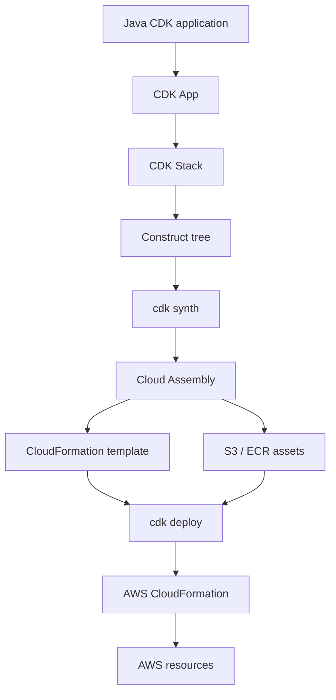
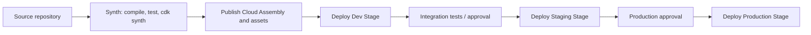
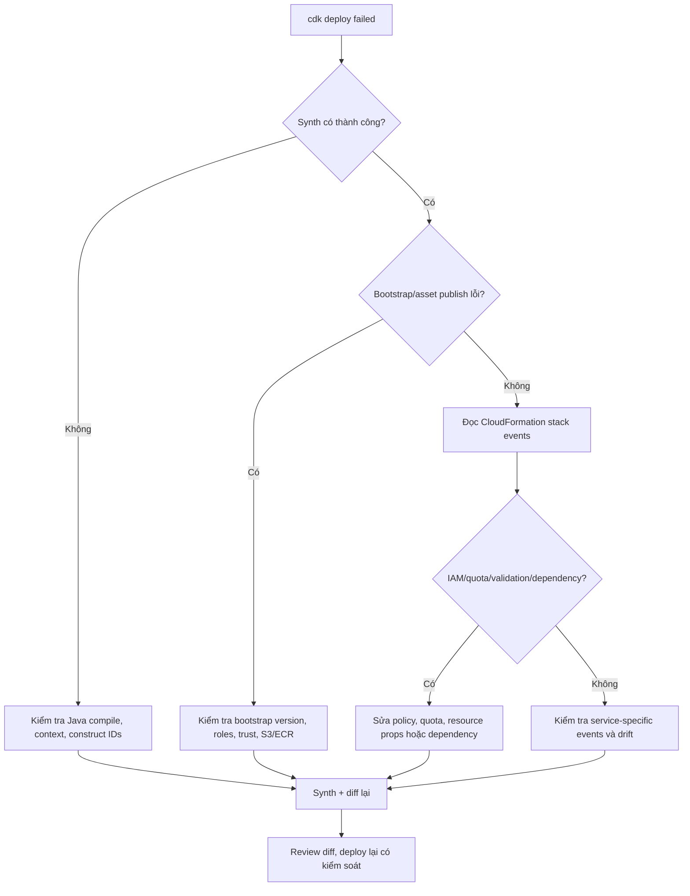

# AWS CDK construct, stack, app và môi trường triển khai

> **Chương:** Hạ tầng dưới dạng mã · **Mô-đun:** `CLOUD_PROVIDERS_AWS`

## 1. Từ mã nguồn đến hạ tầng AWS

Một ứng dụng Java trên AWS có thể cần VPC, subnet, security groups, ECS cluster, load balancer, IAM roles, S3 bucket, database và CloudWatch alarms. Nếu tạo từng resource bằng Console hoặc lệnh rời rạc, cấu hình dễ lệch giữa dev/staging/prod, khó review thay đổi và khó dựng lại môi trường sau sự cố.

**Infrastructure as Code (IaC)** mô tả hạ tầng bằng file có thể version control, review, test và triển khai lặp lại. **AWS Cloud Development Kit (AWS CDK)** cho phép mô tả hạ tầng bằng ngôn ngữ lập trình như Java, TypeScript, Python, C# và Go. CDK chuyển mô hình object/construct thành **CloudFormation templates**; CloudFormation thực hiện create, update và delete AWS resources theo dependency graph.

Luồng cơ bản:



CDK có ba khái niệm cốt lõi:

- **Construct:** thành phần mô tả một hoặc nhiều tài nguyên và hành vi liên quan.
- **Stack:** đơn vị triển khai CloudFormation, là ranh giới quản lý lifecycle và phần lớn phạm vi tài nguyên.
- **App:** gốc của construct tree, tập hợp một hay nhiều stacks/stages và tạo Cloud Assembly khi synthesize.

`cdk synth` chỉ tổng hợp template/assembly; `cdk deploy` mới gửi thay đổi lên AWS. Việc viết mã CDK không tự tạo tài nguyên trên account.

**Mục tiêu sau bài học:**

1. Giải thích quan hệ Construct–Stack–App và construct tree.
2. Phân biệt L1, L2 và L3 constructs.
3. Tạo CDK application bằng Java và AWS CDK v2.
4. Chia tài nguyên thành stacks với ranh giới hợp lý.
5. Chỉ định account/Region và phân biệt environment-specific với environment-agnostic stacks.
6. Hiểu context, tokens, assets và Cloud Assembly.
7. Bootstrap account/Region trước khi deploy.
8. Tổ chức stages cho dev/staging/prod và triển khai an toàn.
9. Dùng CDK CLI để synth, diff, deploy, destroy và troubleshoot.

## 2. AWS CDK v2 và dự án Java

### 2.1. CDK v2 là gì?

AWS CDK v2 gộp các service constructs vào artifact Java `software.amazon.awscdk:aws-cdk-lib`; constructs framework được cung cấp qua `software.constructs:constructs`. CDK v2 dùng một library version thống nhất, thay cho việc quản lý nhiều service packages riêng như CDK v1.

Các thành phần thường gặp:

| Thành phần | Vai trò |
| --- | --- |
| AWS CDK CLI (`cdk`) | Khởi tạo project, liệt kê stacks, synth, diff, bootstrap, deploy và destroy. |
| `aws-cdk-lib` | API constructs cho AWS services và core CDK. |
| `constructs` | Base classes/interfaces cho construct tree. |
| Java JDK | Compile và chạy CDK app. |
| Maven/Gradle | Quản lý dependencies và build Java application. |
| CloudFormation | Provision và quản lý resources sau khi CDK synthesize template. |

Nên dùng **AWS CDK v2** cho project mới. Chọn JDK và CDK CLI version theo release/support matrix của project; giữ CLI/library tương thích và pin version trong build.

### 2.2. Khởi tạo Java CDK project

Cài AWS CDK CLI v2 theo hướng dẫn chính thức, xác minh:

```bash
cdk --version
java -version
mvn -version
```

Tạo project:

```bash
mkdir orders-infrastructure
cd orders-infrastructure
cdk init app --language java
```

Lệnh `cdk init` tạo skeleton, `pom.xml`, `cdk.json`, source code mẫu và cấu hình Maven Exec Plugin cần để CLI chạy Java app. Giữ nguyên convention do template sinh ra rồi chỉnh theo cấu trúc repository.

### 2.3. Dependencies Maven

Project Java CDK v2 cần library và constructs:

```xml
<properties>
    <maven.compiler.release>17</maven.compiler.release>
    <aws.cdk.version>2.x.y</aws.cdk.version>
</properties>

<dependencies>
    <dependency>
        <groupId>software.amazon.awscdk</groupId>
        <artifactId>aws-cdk-lib</artifactId>
        <version>${aws.cdk.version}</version>
    </dependency>
    <dependency>
        <groupId>software.constructs</groupId>
        <artifactId>constructs</artifactId>
        <version>10.x.y</version>
    </dependency>
</dependencies>
```

`2.x.y` và `10.x.y` là placeholders; dùng version tương thích do project pin hoặc do `cdk init` sinh ra. Không copy placeholder vào build thật. Ví dụ dùng Java 17; có thể chọn JDK khác nếu tương thích với CDK release và toolchain của tổ chức.

### 2.4. Cấu trúc project điển hình

```text
orders-infrastructure/
├── cdk.json
├── pom.xml
├── src/
│   ├── main/java/com/example/orders/
│   │   ├── CdkApp.java
│   │   ├── OrdersNetworkStack.java
│   │   └── OrdersApplicationStack.java
│   └── test/java/com/example/orders/
│       └── OrdersApplicationStackTest.java
└── cdk.out/                  # Cloud Assembly, thường không commit
```

Tách code thành constructs/stacks theo domain và lifecycle. Không cần tạo một class cho từng resource nhỏ; mục tiêu là mô hình dễ đọc, tái sử dụng và review.

## 3. Construct và construct tree

### 3.1. Construct là đơn vị composition

Construct là building block trong CDK. Một construct có thể đại diện một resource CloudFormation, một nhóm resources hoặc một pattern hoàn chỉnh.

Một construct nhận:

- `scope`: construct cha chứa nó.
- `id`: định danh duy nhất trong scope cha.
- `props`: cấu hình đầu vào (thường là builder/immutable properties).

Ví dụ một `Bucket` L2:

```java
import software.amazon.awscdk.RemovalPolicy;
import software.amazon.awscdk.services.s3.Bucket;
import software.amazon.awscdk.services.s3.BucketEncryption;
import software.amazon.awscdk.services.s3.BlockPublicAccess;
import software.constructs.Construct;

Bucket bucket = Bucket.Builder.create(this, "OrdersDocuments")
        .versioned(true)
        .encryption(BucketEncryption.S3_MANAGED)
        .blockPublicAccess(BlockPublicAccess.BLOCK_ALL)
        .removalPolicy(RemovalPolicy.RETAIN)
        .build();
```

`this` là scope hiện tại, `OrdersDocuments` là construct ID trong scope đó. CDK tạo construct node, đưa nó vào tree và sinh CloudFormation resource khi synthesize.

### 3.2. Construct tree

Giả sử App có một stack, stack chứa network và storage constructs:

```text
App
└── OrdersProductionStack
    ├── Network
    │   ├── Vpc
    │   ├── PublicSubnetA
    │   └── PrivateSubnetA
    └── Storage
        └── OrdersDocuments
            └── Resource
```

Mỗi construct có một path duy nhất từ root. Path phản ánh cấu trúc code và được CDK sử dụng trong việc tạo logical IDs/metadata. Khi refactor construct IDs hoặc vị trí trong tree, logical IDs của CloudFormation resources có thể thay đổi; điều này có thể khiến CloudFormation xem resource như resource mới hoặc yêu cầu thay thế.

**Không đổi ID/path của resource stateful một cách tùy tiện.** Trước khi refactor construct tree, chạy `cdk diff`, đọc replacement/removal changes và lập kế hoạch migration/retention.

### 3.3. ID phải duy nhất trong scope

Hai siblings không thể có cùng construct ID:

```java
new Bucket(this, "Documents", BucketProps.builder().build());
new Bucket(this, "Documents", BucketProps.builder().build()); // Trùng ID trong cùng scope.
```

Nếu cần tạo nhiều resource theo vòng lặp, tạo ID có ý nghĩa và ổn định:

```java
for (String environment : List.of("dev", "staging", "prod")) {
    new Bucket(this, "Documents" + environment,
            BucketProps.builder().versioned(true).build());
}
```

Không dùng random UUID hoặc timestamp làm construct IDs. ID không ổn định khiến diff thay đổi liên tục và khó giữ resource identity.

### 3.4. Scope và composition

Có thể đóng gói nhóm resource thành construct riêng:

```java
public class OrdersStorage extends Construct {
    private final Bucket documentsBucket;

    public OrdersStorage(Construct scope, String id) {
        super(scope, id);

        this.documentsBucket = Bucket.Builder.create(this, "Documents")
                .versioned(true)
                .blockPublicAccess(BlockPublicAccess.BLOCK_ALL)
                .encryption(BucketEncryption.S3_MANAGED)
                .removalPolicy(RemovalPolicy.RETAIN)
                .build();
    }

    public Bucket getDocumentsBucket() {
        return documentsBucket;
    }
}
```

Một construct tốt đóng gói invariant và expose interface cần thiết. Ví dụ `OrdersStorage` có thể đảm bảo bucket luôn block public access, bật versioning và retain khi stack bị xóa. Consumer không cần biết chi tiết internal resources.

## 4. Ba cấp độ Construct: L1, L2 và L3

### 4.1. L1 — CloudFormation resource constructs

L1 constructs ánh xạ gần như trực tiếp tới CloudFormation resource types, có prefix `Cfn`. Ví dụ `CfnBucket`, `CfnVPC`, `CfnInstance`.

```java
import software.amazon.awscdk.services.s3.CfnBucket;

CfnBucket rawBucket = CfnBucket.Builder.create(this, "RawBucket")
        .bucketName("orders-documents-example-123")
        .versioningConfiguration(
                CfnBucket.VersioningConfigurationProperty.builder()
                        .status("Enabled")
                        .build())
        .build();
```

L1 cung cấp quyền truy cập trực tiếp vào CloudFormation properties. Dùng khi service/resource mới chưa có abstraction L2, hoặc cần một property chưa được L2 expose. Người viết phải tự hiểu defaults, property names, dependencies và security settings của CloudFormation resource.

### 4.2. L2 — Service constructs có abstraction

L2 là lựa chọn mặc định cho nhiều use cases. Chúng cung cấp API Java tiện hơn, validation, sensible defaults và các methods như grant:

```java
Bucket bucket = Bucket.Builder.create(this, "Documents")
        .encryption(BucketEncryption.S3_MANAGED)
        .blockPublicAccess(BlockPublicAccess.BLOCK_ALL)
        .versioned(true)
        .build();

bucket.grantRead(applicationRole);
```

`grantRead` giúp CDK tạo policy statements phù hợp với resource. Tuy vậy, vẫn cần review IAM permissions được synthesize; không mặc định mọi grant là least privilege hoàn hảo cho toàn bộ business flow.

### 4.3. L3 — Patterns

L3 constructs thường đóng gói một pattern nhiều resources, ví dụ application load-balanced Fargate service, Lambda event source mapping hoặc serverless API pattern. Chúng giúp dựng kiến trúc phổ biến với ít code hơn.

L3 phù hợp khi pattern đáp ứng đúng use case. Khi cần kiểm soát chi tiết, có thể dùng L2/L1 hoặc tạo construct nội bộ bọc pattern và bổ sung guardrails.

### 4.4. Chọn cấp độ nào?

| Cấp độ | Khi nên dùng | Trade-off |
| --- | --- | --- |
| L1 (`Cfn*`) | Cần property mới, resource chưa có L2, hoặc kiểm soát sát CloudFormation. | Nhiều chi tiết thấp tầng, ít guardrails. |
| L2 (`Bucket`, `Vpc`, `Function`) | Use case phổ biến, muốn API rõ và defaults tiện. | Cần hiểu defaults và những property L2 expose. |
| L3 (Patterns) | Muốn dựng một kiến trúc hoàn chỉnh đã được đóng gói. | Ít control hơn; cần kiểm tra tài nguyên được tạo bên trong. |

Ưu tiên abstraction cao nhất vẫn đáp ứng yêu cầu, nhưng phải review synthesized template và permissions.

## 5. Stack — đơn vị triển khai CloudFormation

### 5.1. Stack là gì?

Một CDK `Stack` tương ứng với một CloudFormation stack. Stack là đơn vị có:

- Template và parameters/outputs.
- Account/Region triển khai.
- Lifecycle create/update/delete.
- IAM permissions và deployment policy liên quan.
- Logical IDs và resource dependencies trong template.

Không phải mỗi construct đều là một stack. Thông thường một stack chứa nhiều constructs; một app có thể có nhiều stacks.

### 5.2. Tạo stack Java

```java
import software.amazon.awscdk.Stack;
import software.amazon.awscdk.StackProps;
import software.constructs.Construct;

public class OrdersStorageStack extends Stack {
    public OrdersStorageStack(Construct scope, String id, StackProps props) {
        super(scope, id, props);

        Bucket documents = Bucket.Builder.create(this, "Documents")
                .versioned(true)
                .blockPublicAccess(BlockPublicAccess.BLOCK_ALL)
                .encryption(BucketEncryption.S3_MANAGED)
                .removalPolicy(RemovalPolicy.RETAIN)
                .build();

        CfnOutput.Builder.create(this, "DocumentsBucketName")
                .value(documents.getBucketName())
                .description("Name of the orders documents bucket")
                .build();
    }
}
```

Ví dụ minh họa phần thân stack; thêm imports tương ứng cho S3 constructs và `CfnOutput`. `StackProps` chứa các thuộc tính như environment, description và synthesizer.

### 5.3. Chia stack theo lifecycle và ownership

Một hệ thống có thể chia:

| Stack | Tài nguyên | Lý do |
| --- | --- | --- |
| `OrdersNetworkStack` | VPC, subnets, routes, endpoints | Network có lifecycle và ownership riêng. |
| `OrdersDataStack` | RDS/Aurora, subnet groups, DB security groups | Database cần quyền và retention chặt chẽ. |
| `OrdersApplicationStack` | ECS service, ALB, task roles, autoscaling | Có thể deploy thường xuyên hơn network/data. |
| `OrdersObservabilityStack` | Alarms, dashboards, log groups | Có thể quản lý theo monitoring ownership. |

Không chia stack chỉ vì muốn file code ngắn. Mỗi stack thêm dependency, deployment ordering và cross-stack references. Hãy tách khi khác lifecycle, owner, security boundary hoặc deployment cadence.

### 5.4. Cross-stack references

Trong cùng account/Region, CDK có thể tạo CloudFormation exports/imports khi stack này sử dụng resource attribute từ stack khác. Ví dụ application stack nhận VPC từ network stack.

Các references tạo dependency giữa stacks và ảnh hưởng thứ tự deploy/delete. Nếu application stack đang import output của network stack, không thể xóa hoặc đổi export một cách tùy ý khi consumer còn sử dụng.

Với stacks ở account/Region khác nhau, không dùng cross-stack reference trực tiếp như thể cùng một environment. Truyền thông tin qua cơ chế rõ ràng như SSM parameters, outputs được pipeline truyền, resource discovery hoặc resource policies.

### 5.5. Outputs và exports

`CfnOutput` hiển thị thông tin sau deploy như bucket name, load balancer DNS hoặc ARN:

```java
CfnOutput.Builder.create(this, "ServiceUrl")
        .value(loadBalancer.getLoadBalancerDnsName())
        .description("Public DNS name of the service load balancer")
        .build();
```

Outputs hữu ích cho operator/pipeline, nhưng không phải secret store. Không đưa password, token hoặc private key vào CloudFormation Outputs; outputs có thể hiển thị trong CloudFormation console/API.

## 6. App — gốc của CDK application

### 6.1. App tạo construct tree

`App` là root construct. Nó chứa stacks hoặc stages; mỗi stack chứa các constructs con. Khi gọi `app.synth()`, CDK duyệt tree và tạo Cloud Assembly.

Ví dụ app Java tối giản:

```java
import software.amazon.awscdk.App;
import software.amazon.awscdk.StackProps;

public class CdkApp {
    public static void main(String[] args) {
        App app = new App();

        new OrdersStorageStack(
                app,
                "OrdersStorage",
                StackProps.builder().build());

        app.synth();
    }
}
```

Stack ID `OrdersStorage` là logical identity của stack trong App và thường trở thành tên CloudFormation stack mặc định (có thể bị điều chỉnh theo stack name props/CLI). `app.synth()` không gọi CloudFormation; nó tạo template và assembly ở local.

### 6.2. `cdk.json` điều khiển cách CLI chạy app

CDK CLI đọc `cdk.json` để biết lệnh chạy ứng dụng:

```json
{
  "app": "mvn -e -q compile exec:java",
  "watch": {
    "include": ["src/main/**"],
    "exclude": ["target/**", "cdk.out/**"]
  }
}
```

Đây là ví dụ cấu hình. `cdk init app --language java` tạo Maven Exec Plugin và `mainClass` phù hợp với skeleton; nếu đổi package hoặc main class, cập nhật plugin configuration. `cdk.json` cũng có thể chứa context feature flags/project settings.

### 6.3. Một App có nhiều stacks

```java
App app = new App();

new OrdersNetworkStack(app, "OrdersNetwork", commonProps);
new OrdersDataStack(app, "OrdersData", commonProps);
new OrdersApplicationStack(app, "OrdersApplication", commonProps);

app.synth();
```

CLI có thể chọn từng stack hoặc deploy tất cả. Tên stack trong app phải ổn định và duy nhất. Nếu có dependencies giữa stacks, CDK/CloudFormation có thể sắp thứ tự triển khai dựa trên references.

## 7. Môi trường triển khai: account và Region

### 7.1. Environment-specific stack

CDK deployment environment là cặp **AWS account + Region**. Có thể chỉ định rõ bằng `Environment`:

```java
import software.amazon.awscdk.Environment;
import software.amazon.awscdk.StackProps;

Environment production = Environment.builder()
        .account("111122223333")
        .region("ap-southeast-1")
        .build();

StackProps props = StackProps.builder()
        .env(production)
        .description("Production resources for orders API")
        .build();

new OrdersApplicationStack(app, "OrdersProduction", props);
```

Account ID và Region ở đây là ví dụ. Trong CI/CD, truyền chúng qua environment variables hoặc deployment configuration; không hard-code account production vào nhiều classes.

### 7.2. Lấy account/Region từ profile hoặc environment

Có thể dùng CDK CLI profile:

```bash
cdk synth OrdersApplication --profile orders-dev
cdk diff OrdersApplication --profile orders-dev
cdk deploy OrdersApplication --profile orders-dev
```

`--profile` chọn AWS credentials/config profile. Với stack environment-specific, account/Region trong `StackProps.env` quyết định target; profile cung cấp identity có quyền thao tác account đó. Xác minh account bằng `aws sts get-caller-identity` trước deploy.

Trong app Java, có thể đọc giá trị được CDK CLI truyền:

```java
import java.util.Objects;

String account = Objects.requireNonNull(
        System.getenv("CDK_DEFAULT_ACCOUNT"),
        "CDK_DEFAULT_ACCOUNT must be set");
String region = Objects.requireNonNull(
        System.getenv("CDK_DEFAULT_REGION"),
        "CDK_DEFAULT_REGION must be set");

Environment target = Environment.builder()
        .account(account)
        .region(region)
        .build();
```

Nếu biến không có, không tự suy luận target production. Fail fast hoặc yêu cầu người deploy cung cấp profile/account/Region rõ ràng.

### 7.3. Environment-agnostic stack

Nếu không truyền `env` vào `StackProps`, stack là **environment-agnostic**:

```java
new OrdersApplicationStack(
        app,
        "OrdersGeneric",
        StackProps.builder().build());
```

Stack này chưa gắn cứng vào một account/Region lúc synth. CDK có thể dùng tokens cho account, Region và availability zones; một số thao tác cần biết environment cụ thể sẽ bị hạn chế.

Environment-agnostic phù hợp với template có thể deploy ở nhiều accounts/Regions mà không cần context lookups theo environment. Nếu cần `Vpc.fromLookup`, hosted zone lookup hoặc các thông tin chỉ lấy được từ account cụ thể, phải dùng environment-specific stack.

### 7.4. Phân biệt environment và deployment stage

`Environment` xác định **nơi triển khai** (account + Region). `Stage` là một grouping/deployment boundary trong CDK app, thường đại diện một lần triển khai ứng dụng vào một môi trường như dev, staging hoặc prod. Tên `Stage` không thay thế account/Region; mỗi stage vẫn cần environment phù hợp khi deploy.

### 7.5. Một stack hay nhiều stacks cho multi-Region?

Nếu hệ thống triển khai ở Singapore và Tokyo, thường tạo một stack instance cho mỗi environment:

```text
App
├── OrdersSingaporeStack  -> account 1111..., ap-southeast-1
└── OrdersTokyoStack      -> account 1111..., ap-northeast-1
```

Không coi hai Regions là cùng một CloudFormation stack. Mỗi stack có lifecycle, resources, exports và deployment state riêng. Cần kiểm tra service availability, quotas, data residency và replication strategy cho từng Region.

## 8. Context, lookups và feature flags

### 8.1. Context là dữ liệu synth-time

CDK context truyền thông tin vào App/construct tree trong lúc synthesize. Context có thể đến từ:

- `cdk.json` (project context).
- `~/.cdk.json` (user context).
- CLI `-c key=value`.
- Context lookups do CDK CLI thực hiện và cache vào `cdk.context.json`.

Ví dụ đọc context trong Java:

```java
Object environment = app.getNode().tryGetContext("environment");
String envName = environment == null ? "dev" : environment.toString();
```

Có thể truyền context:

```bash
cdk synth -c environment=staging
```

Context là dữ liệu lúc synth, không phải secret manager hay runtime configuration service.

### 8.2. Context lookups

Một số constructs có thể tra cứu thông tin AWS hiện có, ví dụ import VPC bằng ID hoặc tìm VPC theo tags. CDK CLI gọi AWS APIs để lấy kết quả và lưu vào `cdk.context.json`, nhờ vậy lần synth sau dùng dữ liệu đã cache và có thể tái lập.

Ví dụ:

```java
import software.amazon.awscdk.services.ec2.IVpc;
import software.amazon.awscdk.services.ec2.Vpc;

IVpc existingVpc = Vpc.fromLookup(this, "ExistingVpc",
        VpcLookupOptions.builder()
                .vpcId("vpc-0123456789abcdef0")
                .build());
```

`fromLookup` cần stack gắn environment cụ thể vì CDK phải biết account/Region để gọi AWS. Đây là lookup tại synth time, không phải resource được tạo bởi stack.

### 8.3. Commit context lookup results

Nếu project dùng context lookups:

- Commit `cdk.context.json` vào source control để developer/CI synth cùng kết quả.
- Không sửa cache lookup tùy tiện; dùng `cdk context` để xem/reset context khi cần.
- Khi refresh lookup, review diff của context và synthesized template.
- Không lưu credentials hoặc secret values vào context.

Context lookup cache có thể stale nếu VPC/subnet/tags thay đổi. Chủ động refresh cache và review thay đổi trước khi deploy.

### 8.4. Feature flags

CDK có feature flags để kiểm soát behavior defaults giữa các releases. `cdk init` thường tạo một nhóm flags trong `cdk.json`. Giữ các flags này trong source control và chỉ thay đổi sau khi review template diff; bật flag mới có thể làm synthesized template thay đổi dù code construct không đổi.

Không dùng feature flag CDK để bật/tắt feature nghiệp vụ của ứng dụng đang chạy. Dùng AppConfig/Parameter Store hoặc cơ chế runtime configuration cho việc đó.

## 9. Tokens, assets và Cloud Assembly

### 9.1. Tokens đại diện giá trị chỉ biết lúc deploy

Khi viết CDK, bucket name, VPC ID hoặc ARN có thể chưa tồn tại. CDK trả về **token** đại diện giá trị CloudFormation sẽ resolve khi deploy:

```java
String bucketName = bucket.getBucketName();

CfnOutput.Builder.create(this, "BucketName")
        .value(bucketName)
        .build();
```

`bucketName` có thể là token chứ chưa phải literal string. Có thể chuyển token sang property của resource khác để tạo dependency; không nên parse, so sánh hoặc thực hiện Java string logic với giá trị chỉ có lúc deploy.

### 9.2. Assets

CDK assets là file hoặc Docker image được tham chiếu trong Cloud Assembly và cần publish trước khi deploy resource sử dụng chúng:

- **File asset:** Lambda code zip, static files hoặc file cần đưa lên S3.
- **Docker image asset:** container image được build và publish lên ECR.

Ví dụ Lambda code asset:

```java
import software.amazon.awscdk.services.lambda.Code;
import software.amazon.awscdk.services.lambda.Function;
import software.amazon.awscdk.services.lambda.Runtime;

Function handler = Function.Builder.create(this, "OrdersHandler")
        .runtime(Runtime.JAVA_17)
        .handler("com.example.orders.Handler::handleRequest")
        .code(Code.fromAsset("../orders-service/target/orders-service.jar"))
        .build();
```

Đường dẫn asset phải tồn tại trong môi trường synth/build. Nếu dùng Docker asset, Docker daemon/build platform phải sẵn sàng ở CI. Không đưa secret vào Docker build args hoặc file asset nếu không có cơ chế bảo vệ phù hợp.

### 9.3. Cloud Assembly

`cdk synth` tạo thư mục `cdk.out` chứa Cloud Assembly: CloudFormation templates, asset manifests và metadata cần cho deploy. Cloud Assembly là đầu ra build; deploy có thể dùng assembly này mà không cần chạy lại source synthesis nếu artifact được đóng gói đầy đủ và được bảo vệ integrity.

Không sửa thủ công template trong `cdk.out` như nguồn sự thật. Hãy sửa CDK source, synth lại và review thay đổi.

## 10. Bootstrap account và Region

### 10.1. Vì sao cần bootstrap?

Trước lần deploy đầu tiên vào một account/Region, CDK cần **bootstrap environment**. Bootstrap tạo các tài nguyên hỗ trợ publishing assets và triển khai CloudFormation, thường gồm:

- S3 bucket cho file assets.
- ECR repository cho Docker image assets.
- IAM roles cho deployment/publishing/lookup theo bootstrap template.
- SSM parameter lưu bootstrap version.

Bootstrap là thao tác chuẩn bị environment, khác với deploy application stack. Mỗi account/Region target cần được bootstrap theo quy trình của tổ chức.

### 10.2. Bootstrap bằng CDK CLI

```bash
cdk bootstrap aws://111122223333/ap-southeast-1 --profile platform-admin
```

Thay account ID và profile bằng giá trị thực. Principal bootstrap cần quyền tạo bootstrap resources và IAM roles. Trong tổ chức, thao tác này thường do platform/admin pipeline thực hiện, không phải mọi developer.

### 10.3. Bootstrap trust và cross-account deployment

Bootstrap template hiện đại tạo các roles mà CDK CLI sử dụng để publish assets và triển khai CloudFormation. Có thể cấu hình trusted accounts/qualifier/customization theo chính sách tổ chức. Nếu CI ở account tooling triển khai sang workload account, bootstrap target account phải trust deployment account/role đúng cách.

Không thêm `--trust '*'` hoặc cấp administrator rộng chỉ để deploy dễ hơn. Xác định trusted account, deploy role và lookup role cụ thể; review trust policy và permissions boundary.

### 10.4. Kiểm tra bootstrap version

CDK CLI kiểm tra bootstrap resources/version khi deploy. Nếu bootstrap stack quá cũ, cần nâng cấp bằng `cdk bootstrap` theo version CDK CLI/library được pin. Không xóa bootstrap stack như một cách sửa lỗi thông thường: nhiều apps/stacks có thể cùng phụ thuộc asset bucket và roles đó.

### 10.5. Bootstrap là hạ tầng nền

Quản lý bootstrap resources như platform infrastructure:

- Giới hạn quyền update/delete.
- Theo dõi drift và version.
- Dùng account/Region chuẩn hóa.
- Kiểm tra S3 bucket encryption, access controls và ECR lifecycle theo bootstrap template/policy.
- Ghi lại owner, trust relationships và quy trình upgrade.

## 11. Stage — mô hình hóa môi trường triển khai

### 11.1. Stage là gì?

`Stage` là construct nhóm một hoặc nhiều stacks để mô tả một đơn vị ứng dụng có thể triển khai vào một environment. Ví dụ cùng một kiến trúc Orders được triển khai lần lượt vào dev, staging và production.

Stage:

- Không phải CloudFormation stack và không tạo một stack resource riêng.
- Có thể chứa nhiều stacks.
- Có thể nhận account/Region ở `StageProps`; stacks con kế thừa environment nếu không override.
- Có thể được dùng làm đơn vị deployment trong CDK Pipelines.

### 11.2. Tạo một Stage bằng Java

```java
import software.amazon.awscdk.StackProps;
import software.amazon.awscdk.Stage;
import software.amazon.awscdk.StageProps;
import software.constructs.Construct;

public class OrdersStage extends Stage {
    public OrdersStage(Construct scope, String id, StageProps props) {
        super(scope, id, props);

        OrdersNetworkStack network = new OrdersNetworkStack(
                this, "Network", StackProps.builder().build());

        new OrdersApplicationStack(
                this, "Application",
                StackProps.builder().build());
    }
}
```

Đây là cấu trúc minh họa; nếu application stack cần VPC, truyền construct interface/output từ `network` vào constructor của application stack. Các stack trong cùng Stage có thể tham chiếu nhau theo quy tắc cross-stack reference.

### 11.3. Dùng một Stage cho mỗi environment

```java
Environment dev = Environment.builder()
        .account("111122223333")
        .region("ap-southeast-1")
        .build();

Environment prod = Environment.builder()
        .account("444455556666")
        .region("ap-southeast-1")
        .build();

new OrdersStage(app, "Dev",
        StageProps.builder().env(dev).build());

new OrdersStage(app, "Prod",
        StageProps.builder().env(prod).build());
```

Một App có thể chứa nhiều instances của cùng Stage class với environment khác nhau. Nhờ đó cấu trúc stacks/constructs giống nhau nhưng target account khác nhau. Config riêng như CIDR, instance size hoặc desired count nên được truyền qua props/context có kiểu dữ liệu, tránh rải điều kiện `if (environment.equals("prod"))` khắp construct tree.

### 11.4. Stage và CDK Pipelines

CDK Pipelines dùng Stage làm đơn vị triển khai ứng dụng qua các environments:



Stage có thể được thêm vào pipeline dưới dạng deployment stage; pipeline xử lý ordering và asset promotion. Cần phân biệt pipeline infrastructure (pipeline stack) với application stages (các stacks được deploy bởi pipeline).

## 12. Một ví dụ Java end-to-end: App, Stack và Environment

Ví dụ dưới đây tập trung vào một S3 bucket bảo vệ dữ liệu documents. Trong project thật, mỗi public class đặt ở file Java riêng và import đầy đủ.

### 12.1. Stack

```java
import software.amazon.awscdk.CfnOutput;
import software.amazon.awscdk.RemovalPolicy;
import software.amazon.awscdk.Stack;
import software.amazon.awscdk.StackProps;
import software.amazon.awscdk.services.s3.BlockPublicAccess;
import software.amazon.awscdk.services.s3.Bucket;
import software.amazon.awscdk.services.s3.BucketEncryption;
import software.constructs.Construct;

public class OrdersStorageStack extends Stack {
    public OrdersStorageStack(
            Construct scope,
            String id,
            StackProps props) {
        super(scope, id, props);

        Bucket documents = Bucket.Builder.create(this, "Documents")
                .versioned(true)
                .encryption(BucketEncryption.S3_MANAGED)
                .blockPublicAccess(BlockPublicAccess.BLOCK_ALL)
                .enforceSSL(true)
                .removalPolicy(RemovalPolicy.RETAIN)
                .build();

        CfnOutput.Builder.create(this, "DocumentsBucketName")
                .value(documents.getBucketName())
                .build();
    }
}
```

Stack này tạo L2 Bucket, bật versioning, mã hóa server-side, block public access, yêu cầu SSL và retain bucket khi stack bị xóa. `RETAIN` không tự backup object; cần lifecycle, replication và backup/restore strategy theo yêu cầu dữ liệu.

### 12.2. App với environment tường minh

```java
import software.amazon.awscdk.App;
import software.amazon.awscdk.Environment;
import software.amazon.awscdk.StackProps;

public class CdkApp {
    public static void main(String[] args) {
        App app = new App();

        Environment target = Environment.builder()
                .account("111122223333")
                .region("ap-southeast-1")
                .build();

        new OrdersStorageStack(
                app,
                "OrdersStorageDev",
                StackProps.builder()
                        .env(target)
                        .description("Orders document storage - dev")
                        .build());

        app.synth();
    }
}
```

Account ID trong ví dụ không phải account thật. Trong deployment pipeline, lấy environment từ cấu hình đã kiểm soát và bảo đảm credentials đang active thuộc đúng account.

### 12.3. Dùng construct riêng để tái sử dụng

Nếu nhiều stacks cần cùng chuẩn bucket, đóng gói thành `OrdersStorage` construct như mục 3.4. Nếu construct cần account-specific lookups hoặc tạo resource, truyền `scope` và `id`; không tạo `App` mới bên trong construct. Chỉ `App` root mới gọi `synth()`.

## 13. CDK CLI: synth, diff, deploy và destroy

### 13.1. Các lệnh thường dùng

| Lệnh | Mục đích |
| --- | --- |
| `cdk ls` | Liệt kê stacks trong app. |
| `cdk tree` | Hiển thị construct tree. |
| `cdk synth [stack]` | Tổng hợp CloudFormation template và Cloud Assembly. |
| `cdk diff [stack]` | So sánh template hiện tại với deployed stack. |
| `cdk bootstrap aws://ACCOUNT/REGION` | Chuẩn bị bootstrap resources. |
| `cdk deploy [stack]` | Triển khai stack lên AWS. |
| `cdk destroy [stack]` | Xóa stack theo CloudFormation deletion behavior. |
| `cdk context` | Xem context values/cache. |

### 13.2. Quy trình local

```bash
# 1. Xác minh account đang dùng
aws sts get-caller-identity --profile orders-dev

# 2. Liệt kê stacks
cdk ls --profile orders-dev

# 3. Xem construct tree
cdk tree OrdersStorageDev --profile orders-dev

# 4. Sinh template local
cdk synth OrdersStorageDev --profile orders-dev

# 5. Review thay đổi so với deployed stack
cdk diff OrdersStorageDev --profile orders-dev

# 6. Deploy sau khi review
cdk deploy OrdersStorageDev --profile orders-dev
```

Đây là quy trình minh họa. `cdk synth` có thể cần AWS credentials nếu app dùng context lookups; synth không đồng nghĩa deploy.

### 13.3. Đọc `cdk diff`

Diff có thể hiển thị:

- Resource được thêm hoặc xóa.
- Property update.
- Replacement hoặc thay đổi có thể gây downtime/data loss.
- IAM policy broadening.
- Output/export changes.

Đọc kỹ mọi replacement/removal, đặc biệt RDS, EBS, S3, KMS keys, IAM roles và network resources. Diff là công cụ review quan trọng nhưng không phải bảo đảm tuyệt đối rằng deploy không có tác động; CloudFormation change set và service-specific behavior vẫn cần được hiểu.

### 13.4. Approval khi deploy

Có thể yêu cầu approval khi CDK phát hiện IAM permission broadening:

```bash
cdk deploy OrdersStorageDev \
  --profile orders-dev \
  --require-approval broadening
```

Các approval modes gồm `never`, `any-change` và `broadening`. Production pipeline nên có gate phù hợp với risk, code review và change-management policy; không đặt `never` chỉ để CI chạy không tương tác nếu deployment có thay đổi quyền hoặc data resources.

### 13.5. Hotswap và watch

`cdk deploy --hotswap` hoặc `cdk watch` có thể tăng tốc vòng lặp phát triển cho một số resource types bằng cách cập nhật trực tiếp service thay vì chờ CloudFormation deployment đầy đủ.

Hotswap là cơ chế **development-only**:

- Không thay thế CloudFormation deployment trong production.
- Có thể tạo drift giữa trạng thái thực tế và CloudFormation stack.
- Chỉ hỗ trợ một số loại thay đổi/resource.
- Cần synth/redeploy CloudFormation để đưa template và trạng thái về đồng nhất.

### 13.6. Destroy và data retention

`cdk destroy` yêu cầu xóa CloudFormation stack; việc resource có bị xóa hay retain phụ thuộc `RemovalPolicy`, service behavior và deletion protection. S3 bucket còn object thường không thể xóa nếu chưa empty; database có deletion protection/snapshot requirements.

Với production data:

- Dùng `RemovalPolicy.RETAIN` hoặc `SNAPSHOT` phù hợp resource.
- Bật deletion protection cho database quan trọng.
- Có backup/restore và retention policy độc lập.
- Bảo vệ stack bằng termination protection khi cần.
- Không chạy `cdk destroy --all` trong pipeline thông thường.

## 14. Thiết kế triển khai an toàn qua nhiều môi trường

### 14.1. Tách cấu hình theo environment

Không hard-code khác biệt môi trường rải rác trong construct classes. Tạo một props/config object:

```java
public record OrdersEnvironmentConfig(
        String environmentName,
        String account,
        String region,
        String vpcCidr,
        int desiredCount,
        boolean deletionProtection) {
}
```

App/Stage tạo config cho dev/staging/prod và truyền vào stack. Validate invariants ở constructor/config factory, ví dụ production phải có deletion protection, minimum desired count và private subnets.

### 14.2. Không nhúng secrets vào CDK source/context

CDK source, context và synthesized CloudFormation templates có thể được lưu trong Git, CI artifacts hoặc Cloud Assembly. Không đưa password/API token vào:

- Java literals hoặc `cdk.json`.
- CLI `-c key=value`.
- `cdk.context.json`.
- CloudFormation parameters/outputs nếu có thể tránh.
- Docker build args hoặc asset files.

Tạo IAM role cho workload và đọc secrets runtime từ Secrets Manager/Parameter Store theo least privilege. Nếu CloudFormation phải tham chiếu secret, dùng dynamic reference/secret ARN phù hợp và hiểu rõ secret value có bị materialize vào template/logs hay không.

### 14.3. IAM và security review

CDK có thể tạo role/policy qua `grant*` methods và L2 defaults. Trước deploy:

1. Review IAM policy statements và resource scopes trong synthesized template.
2. Hạn chế `Action: *`, `Resource: *` khi không cần.
3. Xác minh trust policy của task/execution/Lambda roles.
4. Bật encryption, block public access và network boundaries theo service.
5. Xem xét permission broadening trong `cdk diff`.
6. Có thể dùng policy validation tools/`cdk-nag` trong CI để phát hiện cấu hình rủi ro.

`grantRead` hoặc `grantWrite` chỉ tạo permissions cần thiết theo construct abstraction; nó không tự thay thế threat modeling hoặc review business access boundaries.

### 14.4. CI/CD pipeline

Một pipeline thực tế có thể gồm:

1. Checkout source và cài JDK/Maven/CDK CLI versions đã pin.
2. Compile Java, chạy unit tests và CDK assertions.
3. Chạy `cdk synth`, lưu Cloud Assembly/template như build artifact.
4. Review `cdk diff` và security scans.
5. Assume deployment role qua OIDC hoặc federation; không lưu long-lived access keys.
6. Deploy dev, chạy integration/smoke tests.
7. Promote cùng artifact qua staging/prod với approval phù hợp.
8. Theo dõi CloudFormation events, application health và rollback procedure.

Không build một template khác cho production chỉ bằng cách thay đổi code giữa các stage. Cùng một source/assembly được promote giúp giảm drift; environment-specific configuration vẫn phải được xác định rõ.

### 14.5. Drift và thay đổi ngoài CDK

Nếu operator sửa resource trực tiếp bằng Console/CLI, trạng thái AWS có thể lệch khỏi template. CDK synth chỉ mô tả desired state từ source; nó không tự sửa mọi drift ngay lập tức.

Quy trình xử lý:

- Phát hiện drift bằng CloudFormation drift detection khi resource hỗ trợ.
- Xác định thay đổi ngoài quy trình có chủ đích hay accidental.
- Nếu thay đổi phải giữ, cập nhật CDK source rồi review/deploy.
- Nếu thay đổi không hợp lệ, khôi phục desired state qua pipeline.
- Tránh chỉnh trực tiếp resource được quản lý bởi CDK nếu không có runbook.

## 15. Testing và troubleshooting

### 15.1. Test synthesized template

CDK Assertions cho phép kiểm tra CloudFormation template trong unit tests mà không deploy lên AWS:

```java
import java.util.Map;
import org.junit.jupiter.api.Test;
import software.amazon.awscdk.App;
import software.amazon.awscdk.StackProps;
import software.amazon.awscdk.assertions.Template;

class OrdersStorageStackTest {
    @Test
    void createsVersionedBucket() {
        App app = new App();
        OrdersStorageStack stack = new OrdersStorageStack(
                app, "TestStack", StackProps.builder().build());

        Template template = Template.fromStack(stack);
        template.resourceCountIs("AWS::S3::Bucket", 1);
        template.hasResourceProperties(
                "AWS::S3::Bucket",
                Map.of("VersioningConfiguration",
                        Map.of("Status", "Enabled")));
    }
}
```

Ví dụ minh họa; thêm imports `App`, `StackProps`, JUnit và assertions dependency. Test xác nhận template contract, không chứng minh resource đã deploy thành công hoặc policy runtime đúng.

### 15.2. Lỗi thường gặp

| Triệu chứng | Nguyên nhân có thể | Cách xử lý |
| --- | --- | --- |
| `cdk` không tìm thấy lệnh. | CLI chưa cài hoặc PATH chưa đúng. | Cài CDK CLI v2 và kiểm tra `cdk --version`. |
| Java app không chạy từ CLI. | `cdk.json` app command/Maven Exec Plugin/main class sai. | Chạy Maven compile, kiểm tra mainClass và app command. |
| `Cannot find module`/dependency error. | Maven dependency version lệch hoặc thiếu `aws-cdk-lib`/`constructs`. | Pin version tương thích, kiểm tra dependency tree. |
| Duplicate construct ID. | Hai constructs cùng ID trong một scope. | Đặt ID duy nhất và ổn định. |
| Environment account/Region không rõ. | Stack không có `env`, profile thiếu hoặc CLI dùng identity khác. | Chỉ định env/profile và xác minh STS caller identity. |
| Context lookup yêu cầu environment cụ thể. | Stack environment-agnostic nhưng dùng `fromLookup`. | Gắn account/Region rõ ràng. |
| Context lookup trả VPC/subnet cũ. | `cdk.context.json` cache stale. | Review/reset context cache rồi synth/diff lại. |
| Bootstrap version mismatch. | Environment bootstrap cũ hơn yêu cầu. | Upgrade bằng `cdk bootstrap` từ CDK version đã pin. |
| Asset publish access denied. | Bootstrap roles/trust/S3/ECR permissions sai. | Kiểm tra bootstrap stack, deploy role và trusted accounts. |
| `cdk diff` cho replacement. | Logical ID/resource property đổi hoặc thuộc tính immutable. | Đọc replacement, plan migration/retention và data backup. |
| CloudFormation export cannot be deleted. | Stack khác còn import output. | Gỡ consumer reference và deploy theo thứ tự. |
| Bucket deletion failed. | Bucket còn objects hoặc `RemovalPolicy.RETAIN`. | Kiểm tra data retention; empty chỉ khi đã được phê duyệt. |
| Stack deploy rollback. | IAM, quota, dependency, network hoặc resource validation failure. | Đọc CloudFormation events và sửa nguyên nhân gốc. |
| Hotswap tạo drift. | Resource được cập nhật ngoài CloudFormation. | Deploy CloudFormation đầy đủ để đồng bộ template/state. |
| Unit test không tìm thấy resource property. | Test đang kỳ vọng sai CloudFormation shape/default. | Inspect `cdk synth`, assertion vào đúng resource type/property. |

### 15.3. Runbook khi deploy thất bại



1. Lưu lại stack name, account, Region, CDK CLI version và commit SHA.
2. Chạy synth và xác nhận Cloud Assembly có template/asset manifests hợp lệ.
3. Kiểm tra bootstrap version, deployment role, trust policy và asset publishing.
4. Đọc CloudFormation events để tìm resource đầu tiên fail; lỗi cuối stack rollback thường chỉ là hậu quả.
5. Kiểm tra IAM, service quotas, resource naming, immutable properties và dependencies.
6. Nếu rollback đã xảy ra, xác minh resource retained/deleted/replaced trước lần deploy kế tiếp.
7. Chạy lại tests, synth, diff; chỉ deploy sau khi reviewer hiểu tác động.

## 16. Bài tập thực hành và tình huống đánh giá

> **Quy tắc lab:** Chỉ bootstrap/deploy vào AWS accounts và Regions được cấp phép. Các lệnh CDK có thể tạo tài nguyên và chi phí. Nếu chưa có lab account, hoàn thành thiết kế, synth và template assertions mà không deploy.

### Bài tập 1 — Vẽ construct tree

Một hệ thống Orders có VPC, hai private subnets, ECS service, ALB, S3 bucket và CloudWatch alarms.

- Vẽ construct tree từ App đến các resources.
- Xác định constructs nào là L1, L2 hoặc L3.
- Đề xuất construct nội bộ để đóng gói storage/network guardrails.
- Chọn construct IDs ổn định và giải thích ảnh hưởng khi đổi ID.

### Bài tập 2 — Chọn L1, L2 hay L3

Một service mới cần tạo Lambda đọc SQS, ghi DynamoDB và phát metrics:

1. Tìm L2 constructs có thể đáp ứng.
2. Xác định khi nào cần L1 `Cfn*`.
3. Xem có L3 pattern nào phù hợp không.
4. So sánh CloudFormation template được synthesize và permissions.
5. Giải thích vì sao L3 abstraction không loại bỏ security review.

### Bài tập 3 — Tổ chức Stack boundaries

Thiết kế stacks cho hệ thống gồm VPC, Aurora, ECS, ALB, S3 và monitoring:

- Chia stacks theo lifecycle, ownership và deployment cadence.
- Xác định references giữa network/data/application stacks.
- Nêu thứ tự deploy và destroy.
- Phân tích rủi ro khi đổi CloudFormation export mà stack consumer vẫn đang import.
- Đề xuất cách truyền thông tin giữa hai account khác nhau.

### Bài tập 4 — Viết Java CDK App

Khởi tạo Java CDK v2 app và tạo một S3 bucket:

1. Thêm `aws-cdk-lib` và `constructs` qua Maven.
2. Viết `CdkApp` tạo `App`, `OrdersStorageStack` và gọi `synth()`.
3. Viết stack bật versioning, encryption, block public access và SSL.
4. Thêm `CfnOutput` hiển thị bucket name.
5. Chạy `cdk ls`, `cdk tree`, `cdk synth`.
6. Giải thích vì sao synth không tạo bucket trên AWS.

### Bài tập 5 — Environment-specific và environment-agnostic

Một app phải deploy vào dev account ở Singapore và prod account ở Tokyo:

- Viết `Environment` cho mỗi target.
- Tạo hai stack instances hoặc Stage instances.
- Xác minh profile/credentials bằng STS trước deploy.
- Giải thích vì sao `Vpc.fromLookup` yêu cầu environment cụ thể.
- Nêu giới hạn của environment-agnostic stacks.

### Bài tập 6 — Context lookup và reproducible synth

Một stack dùng `Vpc.fromLookup` theo VPC ID:

1. Synth lần đầu và quan sát `cdk.context.json`.
2. Commit context cache vào Git.
3. Synth trong CI bằng cùng context.
4. Thay đổi subnet tags ở lab và mô tả cách refresh lookup cache.
5. Review diff của context và CloudFormation template.
6. Giải thích vì sao không lưu credentials/secrets trong context.

### Bài tập 7 — Bootstrap và cross-account deployment

Một CI account triển khai application sang workload account:

- Bootstrap workload account/Region.
- Chỉ định trusted account/role phù hợp.
- Kiểm tra bootstrap roles, asset bucket và ECR repository.
- Xác minh CI role có thể assume deployment role.
- Giải thích rủi ro của trusted account wildcard.
- Lập quy trình nâng bootstrap version.

### Bài tập 8 — Multi-stage CDK app

Tạo `OrdersStage` gồm network và application stacks, sau đó tạo các instances cho dev/staging/prod:

1. Truyền environment bằng `StageProps`.
2. Truyền config qua typed record.
3. Bảo đảm production có deletion protection và retain policy.
4. Tổ chức thứ tự triển khai qua CDK Pipelines.
5. Thêm integration test sau deploy staging.
6. Đề xuất approval gate trước production.

### Bài tập 9 — Review diff và bảo vệ dữ liệu

Một thay đổi refactor construct ID làm `cdk diff` báo xóa và tạo lại database resource:

- Giải thích vì sao logical ID thay đổi.
- Xác định data loss/replacement risk.
- Thiết kế migration/retention/backup.
- Không deploy cho tới khi có phương án được review.
- Thử nghiệm với stack lab và quan sát CloudFormation events.

### Bài tập 10 — Incident tabletop: deployment rollback

Một production deploy thất bại khi publish Docker image asset:

- Thu thập CDK CLI version, stack name, account, Region và commit SHA.
- Kiểm tra bootstrap version, trust relationship, deploy role và ECR permissions.
- Đọc CloudFormation events để tìm lỗi đầu tiên.
- Xác minh các resources đã tạo/retained/replaced.
- Đề xuất remediation và rollback.
- Bổ sung CI test để phát hiện lỗi trước deploy.

### Câu hỏi tự kiểm tra

1. AWS CDK chuyển Java code thành CloudFormation như thế nào?
2. Construct khác Stack ở điểm nào?
3. App là root của cấu trúc nào?
4. L1, L2 và L3 constructs khác nhau ra sao?
5. Khi nào nên dùng `Cfn*` thay vì L2?
6. Construct ID phải duy nhất trong phạm vi nào?
7. Vì sao construct path có thể ảnh hưởng logical ID?
8. Một CDK Stack tương ứng với đơn vị nào của CloudFormation?
9. Vì sao cần chia stacks theo lifecycle và ownership?
10. Cross-stack references tạo dependency gì?
11. Vì sao cross-account stacks không dùng cross-stack references trực tiếp như cùng environment?
12. `CfnOutput` có phải secret store không?
13. App `synth()` tạo ra artifact gì?
14. `cdk.json` dùng để làm gì?
15. Environment của CDK gồm những thành phần nào?
16. Profile cung cấp credentials hay quyết định thay `StackProps.env`?
17. Environment-agnostic stack có hạn chế gì?
18. `Stage` khác `Environment` như thế nào?
19. Context được dùng ở thời điểm nào?
20. Vì sao commit `cdk.context.json`?
21. Vì sao `fromLookup` cần account/Region cụ thể?
22. Token khác literal Java string như thế nào?
23. CDK assets được publish lên dịch vụ nào?
24. Bootstrap tạo những tài nguyên hỗ trợ nào?
25. Vì sao mỗi account/Region cần bootstrap?
26. `cdk diff` có bảo đảm deploy không gây replacement không?
27. Hotswap có phù hợp production không?
28. `RemovalPolicy.RETAIN` có tự backup dữ liệu không?
29. Vì sao cần CDK Assertions trong unit tests?
30. Khi deploy rollback, nên đọc resource event nào trước?

## 17. Tài liệu AWS chính thức và checklist triển khai

### 17.1. AWS CDK v2

- [AWS CDK v2 Developer Guide](https://docs.aws.amazon.com/cdk/v2/guide/home.html)
- [Constructs](https://docs.aws.amazon.com/cdk/v2/guide/constructs.html)
- [Stacks](https://docs.aws.amazon.com/cdk/v2/guide/stacks.html)
- [Environments](https://docs.aws.amazon.com/cdk/v2/guide/environments.html)
- [Stages](https://docs.aws.amazon.com/cdk/v2/guide/stages.html)
- [Context values and lookups](https://docs.aws.amazon.com/cdk/v2/guide/context.html)
- [Assets](https://docs.aws.amazon.com/cdk/v2/guide/assets.html)
- [Bootstrapping](https://docs.aws.amazon.com/cdk/v2/guide/bootstrapping.html)
- [CDK CLI reference](https://docs.aws.amazon.com/cdk/v2/guide/cli.html)
- [Testing CDK applications](https://docs.aws.amazon.com/cdk/v2/guide/testing.html)
- [CDK Pipelines](https://docs.aws.amazon.com/cdk/v2/guide/cdk_pipeline.html)

### 17.2. Java API và CloudFormation

- [AWS CDK Java API Reference](https://docs.aws.amazon.com/cdk/api/v2/java/index.html)
- [AWS CDK v2 Maven package](https://central.sonatype.com/artifact/software.amazon.awscdk/aws-cdk-lib)
- [Constructs library](https://central.sonatype.com/artifact/software.constructs/constructs)
- [AWS CloudFormation User Guide](https://docs.aws.amazon.com/AWSCloudFormation/latest/UserGuide/Welcome.html)
- [CloudFormation stack drift detection](https://docs.aws.amazon.com/AWSCloudFormation/latest/UserGuide/using-cfn-stack-drift.html)
- [CloudFormation change sets](https://docs.aws.amazon.com/AWSCloudFormation/latest/UserGuide/using-cfn-updating-stacks-changesets.html)
- [AWS CDK best practices](https://docs.aws.amazon.com/cdk/v2/guide/best-practices.html)

### 17.3. Checklist trước production deployment

| Hạng mục | Bằng chứng cần có |
| --- | --- |
| **CDK version** | AWS CDK v2, CLI/library versions được pin và tương thích. |
| **Construct tree** | IDs ổn định, composition rõ, không duplicate IDs. |
| **Abstraction level** | L1/L2/L3 được chọn có chủ đích; defaults và resources synth được review. |
| **Stack boundary** | Lifecycle, ownership, deployment cadence và references được xác định. |
| **Environment** | Account/Region explicit; credentials xác minh bằng STS. |
| **Context** | Lookup cache được review/commit; không có secrets trong context. |
| **Assets** | File/Docker assets có thể build/publish từ CI; không đóng gói secrets. |
| **Bootstrap** | Mỗi target account/Region được bootstrap; trust/deployment roles least privilege. |
| **Stages** | Dev/staging/prod dùng cùng application structure và promotion flow rõ ràng. |
| **Synthesis** | `cdk synth` thành công; Cloud Assembly được đóng gói và bảo vệ integrity. |
| **Diff/approval** | Replacement/removal/IAM broadening được review và approval. |
| **Data safety** | Removal policies, deletion protection, snapshots và backup được thiết kế. |
| **Security** | IAM least privilege, encryption, public access và network boundaries được kiểm tra. |
| **Testing** | Unit tests/CDK assertions, security checks và integration tests có bằng chứng. |
| **Operations** | CloudFormation events, drift detection, rollback và bootstrap upgrade runbook sẵn sàng. |

**Ghi nhớ:** **App** là root của CDK construct tree; **Stack** là đơn vị triển khai CloudFormation; **Construct** là building block để composition resources và patterns. **Environment** xác định account/Region, còn **Stage** nhóm stacks thành một lần triển khai ứng dụng cho dev/staging/prod. Hãy giữ IDs ổn định, pin CDK v2, bootstrap từng target environment, review `cdk synth`/`cdk diff`, kiểm tra IAM và bảo vệ stateful resources trước khi deploy.
