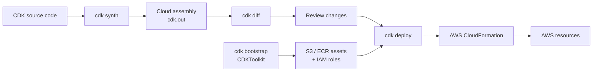
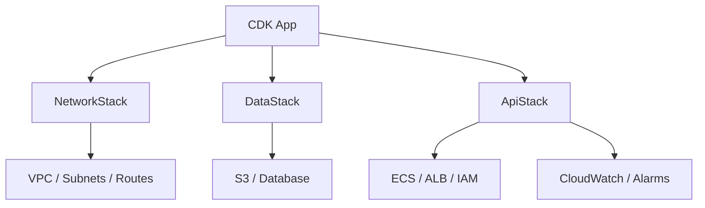
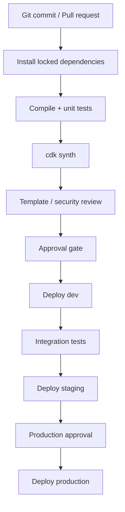

# CDK bootstrap, synth, diff và deploy

> **Học phần:** CLOUD_PROVIDERS_AWS  
> **Chương:** Hạ tầng dưới dạng mã  
> **Bài học:** CDK bootstrap, synth, diff và deploy  
> **Bối cảnh:** Nhóm phát triển Java/Spring Boot định nghĩa hạ tầng AWS bằng AWS Cloud Development Kit (AWS CDK), triển khai qua AWS CloudFormation và quản lý nhiều môi trường development, staging, production.

## 1. Bài toán: biến hạ tầng thành mã nguồn có thể review

Một nhóm phát triển vận hành Course API trên AWS. Hệ thống gồm VPC, private subnets, ECS service, Application Load Balancer, S3 bucket, IAM roles, CloudWatch alarms và database. Khi tạo môi trường staging, nhóm phải lặp lại các thao tác console, dễ quên security group rule, cấu hình khác production hoặc không biết thay đổi nào đã được áp dụng.

Infrastructure as Code (IaC) giải quyết bài toán này bằng cách mô tả hạ tầng trong các file có thể lưu version control, review, test và triển khai lặp lại.

**AWS Cloud Development Kit (AWS CDK)** cho phép định nghĩa AWS resources bằng ngôn ngữ lập trình như TypeScript, Java, Python, C# hoặc Go. CDK chuyển constructs thành CloudFormation templates. AWS CloudFormation thực hiện provisioning và cập nhật tài nguyên.

Quy trình CDK v2 thường gồm bốn bước:

1. **Bootstrap:** chuẩn bị AWS account/Region cho CDK deployment.
2. **Synth:** biên dịch CDK app thành CloudFormation templates và deployment artifacts.
3. **Diff:** so sánh cấu hình sắp triển khai với stack hiện tại.
4. **Deploy:** publish assets và yêu cầu CloudFormation tạo/cập nhật resources.



### Mục tiêu học tập

Sau bài học, bạn có thể:

1. Giải thích vai trò của CDK, constructs, stacks và CloudFormation.
2. Phân biệt CDK app synthesis với CloudFormation deployment.
3. Chuẩn bị CLI, credentials, account và Region.
4. Bootstrap đúng từng AWS environment.
5. Hiểu bootstrap stack, S3/ECR assets, IAM roles, trust và execution policies.
6. Viết CDK app bằng Java hoặc TypeScript.
7. Chạy `cdk synth`, `cdk diff`, `cdk deploy` và kiểm tra kết quả.
8. Quản lý context lookups, environment-specific stacks và outputs.
9. Review security-sensitive changes, rollback và resource retention.
10. Thiết kế quy trình CI/CD và cross-account deployment có least privilege.

## 2. AWS CDK v2 hoạt động như thế nào?

CDK cung cấp abstraction có thể tái sử dụng để định nghĩa AWS resources bằng code. Một CDK app có thể chứa nhiều stacks; mỗi stack là một đơn vị triển khai CloudFormation. Trong stack, bạn tạo constructs từ AWS Construct Library hoặc constructs do nhóm tự xây dựng.

### 2.1. Ba cấp độ constructs

| Cấp độ | Tên | Đặc điểm | Ví dụ |
|---|---|---|---|
| L1 | CloudFormation resources | Ánh xạ gần như trực tiếp tới CloudFormation resource type; kiểm soát chi tiết | `CfnBucket`, `CfnVPC` |
| L2 | Curated constructs | API thân thiện hơn, có defaults và helper methods | `Bucket`, `Vpc`, `Function` |
| L3 | Patterns | Kết hợp nhiều resources thành kiến trúc có mục đích | Application Load Balanced Fargate Service |

Ưu tiên L2/L3 khi đáp ứng yêu cầu; dùng L1 khi cần thuộc tính CloudFormation chưa được expose ở L2 hoặc cần kiểm soát chính xác. Dù dùng construct cấp cao, vẫn phải review CloudFormation template sinh ra.

### 2.2. CDK app, stack và construct

- **App:** root của CDK application; chứa một hoặc nhiều stacks.
- **Stack:** đơn vị CloudFormation deployment, gắn với account/Region nếu environment được chỉ định.
- **Construct:** thành phần tạo ra một hoặc nhiều CloudFormation resources.
- **Cloud assembly:** đầu ra của synthesis; gồm templates, manifests và assets trong thư mục `cdk.out`.
- **Bootstrap stack:** hạ tầng hỗ trợ CDK CLI publish assets và triển khai stacks.



Một stack có thể tham chiếu resources từ stack khác. Khi dùng cross-stack references, cần hiểu dependency order, CloudFormation exports/imports và giới hạn khi thay đổi hoặc xóa stack đang được tham chiếu.

### 2.3. CDK không thay CloudFormation

CDK app chạy trong giai đoạn synthesis để tạo CloudFormation templates. Sau đó CDK CLI gửi cloud assembly và assets tới AWS; CloudFormation mới thực hiện resource provisioning.

Điều này có ý nghĩa:

- Lỗi TypeScript/Java, construct validation hoặc context lookup xảy ra trước deployment.
- Code CDK không chạy liên tục trong lúc CloudFormation tạo resources.
- Muốn chạy logic trong deployment lifecycle, cần cơ chế như CloudFormation custom resource hoặc resource provider; không thể chờ CDK app process nhận callback từ CloudFormation.
- Trạng thái hạ tầng sau deploy được quản lý bởi CloudFormation stack.

## 3. Chuẩn bị công cụ và AWS credentials

### 3.1. Thành phần cần có

| Công cụ | Vai trò |
|---|---|
| AWS CLI v2 | Kiểm tra identity, profile, Region và quản lý credentials |
| Node.js/npm | Chạy AWS CDK CLI |
| AWS CDK CLI v2 | `cdk init`, `bootstrap`, `synth`, `diff`, `deploy` |
| JDK 17+ | Biên dịch CDK app viết bằng Java và ứng dụng Java |
| Maven | Resolve dependencies và chạy Java CDK app |
| Git | Lưu source, review và quản lý thay đổi |
| AWS account/Region | Environment mục tiêu |

CDK CLI được phân phối qua npm kể cả khi CDK application được viết bằng Java. Không cần viết infrastructure bằng JavaScript chỉ vì CLI chạy trên Node.js.

Kiểm tra phiên bản:

```bash
node --version
npm --version
java -version
mvn --version
aws --version
npx aws-cdk --version
```

Ghim phiên bản CDK CLI và `aws-cdk-lib` trong dự án để build/review có thể lặp lại. Tránh dựa vào một bản CLI global không được quản lý.

### 3.2. Xác minh AWS identity và Region

Dùng named profile hoặc IAM Identity Center/SSO theo policy của tổ chức:

```bash
aws configure list --profile dev
aws sts get-caller-identity --profile dev
aws configure get region --profile dev
```

Nếu dùng IAM Identity Center:

```bash
aws sso login --profile dev
aws sts get-caller-identity --profile dev
```

Trước khi bootstrap/deploy, xác nhận:

- Account ID có đúng là sandbox/dev/staging/prod không?
- Region có đúng nơi chứa resources không?
- Profile có đang dùng role dự kiến không?
- Credentials còn hạn không?
- Người thực hiện có quyền bootstrap/deploy trong account đó không?

Không copy access keys vào source code, `cdk.json`, environment files được commit hoặc task definitions.

## 4. AWS environment: account và Region

CDK environment thường được xác định bởi một cặp:

```text
aws://ACCOUNT_ID/REGION

Ví dụ:
aws://123456789012/ap-southeast-1
```

Một CDK stack có thể được cấu hình environment-specific bằng account và Region. Điều này giúp CDK thực hiện context lookups như AZs, VPC attributes và AMI metadata theo đúng environment.

### 4.1. Khai báo environment trong TypeScript

```typescript
import * as cdk from 'aws-cdk-lib';
import { CourseNetworkStack } from '../lib/course-network-stack';

const app = new cdk.App();

const env = {
  account: process.env.CDK_DEFAULT_ACCOUNT,
  region: process.env.CDK_DEFAULT_REGION,
};

new CourseNetworkStack(app, 'CourseNetworkStack', { env });

app.synth();
```

### 4.2. Khai báo environment trong Java

```java
import software.amazon.awscdk.App;
import software.amazon.awscdk.Environment;
import software.amazon.awscdk.StackProps;

public final class CdkApp {
    public static void main(final String[] args) {
        App app = new App();

        Environment env = Environment.builder()
            .account(System.getenv("CDK_DEFAULT_ACCOUNT"))
            .region(System.getenv("CDK_DEFAULT_REGION"))
            .build();

        new CourseNetworkStack(
            app,
            "CourseNetworkStack",
            StackProps.builder().env(env).build()
        );

        app.synth();
    }
}
```

Khi chạy CLI với named profile, CDK CLI có thể cung cấp `CDK_DEFAULT_ACCOUNT` và `CDK_DEFAULT_REGION` theo environment đã chọn. Trong CI/CD, đặt account/Region rõ ràng hoặc truyền chúng từ deployment configuration đáng tin cậy.

### 4.3. Environment-agnostic stacks

Nếu không chỉ định account/Region, stack có thể được tổng hợp theo dạng environment-agnostic. Cách này hữu ích cho một số template tái sử dụng, nhưng có giới hạn:

- Không thể dùng mọi context lookup phụ thuộc environment.
- Các giá trị như số Availability Zones có thể chỉ được xác định ở mức tổng quát.
- Một số thuộc tính ARN/account/Region không thể được resolve đầy đủ tại synthesis.
- Không nên giả định một template agnostic sẽ deploy giống nhau trong mọi Region.

Với ứng dụng cần VPC, AZ lookups, account-specific policies hoặc cross-account deployment, thường nên cấu hình environment cụ thể.

## 5. Bootstrap là gì?

**Bootstrap** chuẩn bị AWS account/Region để CDK deploy. CDK CLI triển khai một CloudFormation stack, mặc định có tên **`CDKToolkit`**, chứa các resources phục vụ synthesis/deployment.

Với modern bootstrap template mặc định, resources thường gồm:

| Resource | Vai trò |
|---|---|
| S3 staging bucket | Lưu file assets và deployment artifacts |
| ECR repository | Lưu container image assets |
| IAM deployment role | Cho phép CDK CLI/CI assume role để khởi tạo deployment |
| CloudFormation execution role | Quyết định CloudFormation được phép tạo/cập nhật resource nào |
| File publishing role | Cho phép publish assets lên S3 staging bucket |
| Image publishing role | Cho phép publish container images lên ECR |
| Lookup role | Cho phép thực hiện read-only context lookups |
| SSM parameter | Lưu bootstrap version để synthesizer/CLI kiểm tra |

Tên resources mặc định có qualifier `hnb659fds`, account ID và Region, ví dụ:

```text
cdk-hnb659fds-assets-123456789012-ap-southeast-1
cdk-hnb659fds-container-assets-123456789012-ap-southeast-1
/cdk-bootstrap/hnb659fds/version
```

Qualifier có thể thay đổi nếu bootstrap được custom. Không hard-code bucket/repository names từ ví dụ vào ứng dụng; default synthesizer sẽ tạo asset references phù hợp với bootstrap contract.

### 5.1. Vì sao phải bootstrap từng account/Region?

AWS environments độc lập. Nếu triển khai cùng một CDK app tới:

- Dev account ở `ap-southeast-1`.
- Staging account ở `ap-southeast-1`.
- Production account ở `ap-southeast-2`.

Thì mỗi cặp account/Region cần bootstrap riêng trước khi deploy vào environment đó.

Bootstrap có thể chạy lại. Nếu stack đã tồn tại, CDK có thể cập nhật bootstrap stack khi template version mới yêu cầu. Hãy review thay đổi bootstrap stack như một thay đổi hạ tầng quan trọng.

### 5.2. Bootstrap không phải deploy application

`cdk bootstrap` tạo hoặc cập nhật tài nguyên hỗ trợ CDK. Nó không tạo VPC/ECS/S3 application stack chỉ vì các stacks đó tồn tại trong source code.

Application stack được triển khai sau bằng `cdk deploy`.

## 6. Thực hiện cdk bootstrap

### 6.1. Kiểm tra account/Region

```bash
aws sts get-caller-identity --profile dev
aws configure get region --profile dev
```

### 6.2. Bootstrap environment

```bash
npx aws-cdk bootstrap aws://123456789012/ap-southeast-1 \
  --profile dev
```

Hoặc chạy từ thư mục CDK project:

```bash
npx aws-cdk bootstrap --profile dev
```

Khi không truyền environment argument, CLI lấy environment từ profile/default sources hoặc stack configuration trong app. Để tránh nhầm account, nên chỉ định rõ environment khi bootstrap môi trường quan trọng.

### 6.3. Kiểm tra bootstrap stack

```bash
aws cloudformation describe-stacks \
  --stack-name CDKToolkit \
  --profile dev \
  --region ap-southeast-1

aws ssm get-parameter \
  --name /cdk-bootstrap/hnb659fds/version \
  --profile dev \
  --region ap-southeast-1
```

Nếu dùng qualifier khác, SSM parameter path sẽ khác. Có thể kiểm tra CloudFormation console, resources và outputs của stack `CDKToolkit`.

### 6.4. Quyền bootstrap

Identity thực hiện bootstrap cần quyền tạo/cập nhật CloudFormation stack và các bootstrap resources, bao gồm S3, ECR, SSM và IAM. Danh sách chính xác phụ thuộc phiên bản bootstrap template.

Không cấp một policy `AdministratorAccess` cho mọi developer chỉ để chạy bootstrap. Tổ chức nên để platform/admin role thực hiện bootstrap có kiểm soát, review template và giới hạn quyền CloudFormation execution role theo loại resources mà pipeline được phép quản lý.

## 7. Bootstrap trust và CloudFormation execution policies

Modern bootstrap hỗ trợ cross-account deployment. Đây là tính năng mạnh nhưng cần hiểu rõ trust boundary.

### 7.1. Tùy chọn --trust

`--trust` khai báo account IDs được phép assume deployment role của target environment. Account thực hiện bootstrap luôn được trust.

Ví dụ account tooling `111111111111` triển khai sang account dev `222222222222`:

```bash
npx aws-cdk bootstrap aws://222222222222/ap-southeast-1 \
  --profile dev-admin \
  --trust 111111111111 \
  --cloudformation-execution-policies arn:aws:iam::aws:policy/PowerUserAccess
```

Ví dụ trên dùng `PowerUserAccess` để minh họa tham số, không phải policy production mặc định. Hãy tạo execution policy theo đúng resources mà CDK app cần quản lý.

**Lưu ý quan trọng:** khi cập nhật `--trust` cho bootstrap stack hiện có, truyền lại toàn bộ danh sách account cần tiếp tục trust. Nếu chỉ truyền account mới, các account trước đó có thể bị loại khỏi trust list.

### 7.2. Tùy chọn --trust-for-lookup

`--trust-for-lookup` cho phép account khác thực hiện context lookups read-only mà không cấp quyền deployment:

```bash
npx aws-cdk bootstrap aws://222222222222/ap-southeast-1 \
  --profile dev-admin \
  --trust-for-lookup 111111111111
```

Lookup trust và deployment trust là hai quyền khác nhau. Chỉ cấp deployment trust khi pipeline/account nguồn thật sự cần triển khai vào target account.

### 7.3. CloudFormation execution policy

CloudFormation execution role quyết định các API actions CloudFormation được phép thực hiện trong target account. Nếu trust một account khác và cấp execution policy quá rộng, code CDK từ account đó có thể triển khai thay đổi có phạm vi quyền tương ứng.

- Giới hạn trust list.
- Dùng custom managed policy hoặc policy theo workload.
- Review ai có quyền sửa bootstrap stack và execution policy.
- Bật CloudTrail và audit deployment identities.
- Bảo vệ production bootstrap stack bằng termination protection.
- Không xóa `CDKToolkit` chỉ để khắc phục lỗi deployment thông thường.
## 8. CDK project structure

Một CDK project thường có cấu trúc:

```text
course-infrastructure/
├── bin/
│   └── course-infrastructure.ts
├── lib/
│   ├── network-stack.ts
│   ├── storage-stack.ts
│   └── application-stack.ts
├── test/
│   └── application-stack.test.ts
├── cdk.json
├── cdk.context.json
├── package.json
├── package-lock.json
└── tsconfig.json
```

Java project có thể có cấu trúc Maven tương tự:

```text
course-infrastructure-java/
├── src/main/java/com/example/cdk/
│   ├── CdkApp.java
│   └── CourseNetworkStack.java
├── src/test/java/com/example/cdk/
├── cdk.json
└── pom.xml
```

Tách stacks theo lifecycle/ownership và dependency rõ ràng. Không tạo một stack khổng lồ chứa toàn bộ hệ thống nếu các phần có vòng đời, quyền sở hữu hoặc blast radius khác nhau.

## 9. Tạo CDK app bằng TypeScript

### 9.1. Khởi tạo project

```bash
mkdir course-infrastructure
cd course-infrastructure

npx aws-cdk init app --language typescript
npm install
```

### 9.2. Định nghĩa S3 bucket

Ví dụ L2 construct cho bucket lưu course assets:

```typescript
import * as cdk from 'aws-cdk-lib';
import { Construct } from 'constructs';
import * as s3 from 'aws-cdk-lib/aws-s3';

export class CourseStorageStack extends cdk.Stack {
  constructor(scope: Construct, id: string, props?: cdk.StackProps) {
    super(scope, id, props);

    const assetsBucket = new s3.Bucket(this, 'CourseAssets', {
      versioned: true,
      blockPublicAccess: s3.BlockPublicAccess.BLOCK_ALL,
      encryption: s3.BucketEncryption.S3_MANAGED,
      enforceSSL: true,
      removalPolicy: cdk.RemovalPolicy.RETAIN,
    });

    new cdk.CfnOutput(this, 'CourseAssetsBucketName', {
      value: assetsBucket.bucketName,
      description: 'Bucket for course assets',
    });
  }
}
```

Các lựa chọn trong ví dụ:

- `versioned: true`: lưu object versions để hỗ trợ recovery.
- `BLOCK_ALL`: chặn public access ở cấp bucket.
- `S3_MANAGED`: dùng SSE-S3 cho encryption at rest.
- `enforceSSL: true`: thêm bucket policy yêu cầu secure transport.
- `RETAIN`: giữ bucket khi stack bị xóa; dữ liệu không tự mất theo stack lifecycle.

Nếu yêu cầu dùng customer managed KMS key, thay encryption configuration bằng `BucketEncryption.KMS` và cấu hình key policy/rotation theo tiêu chuẩn của tổ chức.

### 9.3. Đăng ký stack với App

```typescript
#!/usr/bin/env node
import * as cdk from 'aws-cdk-lib';
import { CourseStorageStack } from '../lib/course-storage-stack';

const app = new cdk.App();

new CourseStorageStack(app, 'CourseStorageStack', {
  env: {
    account: process.env.CDK_DEFAULT_ACCOUNT,
    region: process.env.CDK_DEFAULT_REGION,
  },
});

app.synth();
```

## 10. Tạo CDK app bằng Java

CDK Java dùng package `software.amazon.awscdk` và Construct Library. Java app vẫn được chạy bởi CDK CLI trong giai đoạn synthesis.

### 10.1. Maven dependencies

Sử dụng `aws-cdk-lib` và `constructs` với version được ghim, đã được kiểm thử tương thích. Ví dụ `pom.xml`:

```xml
<properties>
    <maven.compiler.release>17</maven.compiler.release>
    <aws.cdk.version>2.180.0</aws.cdk.version>
</properties>

<dependencies>
    <dependency>
        <groupId>software.amazon.awscdk</groupId>
        <artifactId>aws-cdk-lib</artifactId>
        <version>`{aws.cdk.version}</version>
    </dependency>
    <dependency>
        <groupId>software.constructs</groupId>
        <artifactId>constructs</artifactId>
        <version>10.4.2</version>
    </dependency>
</dependencies>

<build>
    <plugins>
        <plugin>
            <groupId>org.codehaus.mojo</groupId>
            <artifactId>exec-maven-plugin</artifactId>
            <version>3.5.0</version>
            <configuration>
                <mainClass>com.example.cdk.CdkApp</mainClass>
            </configuration>
        </plugin>
    </plugins>
</build>
```

Các version trên là ví dụ minh họa, không phải khuyến nghị dùng nguyên trạng cho mọi dự án. Chọn phiên bản CDK v2 hiện được tổ chức hỗ trợ, ghim versions và kiểm tra compatibility của constructs.

### 10.2. Stack Java tạo S3 bucket

```java
package com.example.cdk;

import software.amazon.awscdk.CfnOutput;
import software.amazon.awscdk.RemovalPolicy;
import software.amazon.awscdk.Stack;
import software.amazon.awscdk.StackProps;
import software.amazon.awscdk.services.s3.BlockPublicAccess;
import software.amazon.awscdk.services.s3.Bucket;
import software.amazon.awscdk.services.s3.BucketEncryption;
import software.constructs.Construct;

public final class CourseStorageStack extends Stack {
    public CourseStorageStack(
            final Construct scope,
            final String id,
            final StackProps props) {
        super(scope, id, props);

        Bucket assetsBucket = Bucket.Builder.create(this, "CourseAssets")
            .versioned(true)
            .blockPublicAccess(BlockPublicAccess.BLOCK_ALL)
            .encryption(BucketEncryption.S3_MANAGED)
            .enforceSSL(true)
            .removalPolicy(RemovalPolicy.RETAIN)
            .build();

        CfnOutput.Builder.create(this, "CourseAssetsBucketName")
            .value(assetsBucket.getBucketName())
            .description("Bucket for course assets")
            .build();
    }
}
```

### 10.3. Java App entry point

```java
package com.example.cdk;

import software.amazon.awscdk.App;
import software.amazon.awscdk.Environment;
import software.amazon.awscdk.StackProps;

public final class CdkApp {
    public static void main(final String[] args) {
        App app = new App();

        Environment env = Environment.builder()
            .account(System.getenv("CDK_DEFAULT_ACCOUNT"))
            .region(System.getenv("CDK_DEFAULT_REGION"))
            .build();

        new CourseStorageStack(
            app,
            "CourseStorageStack",
            StackProps.builder().env(env).build()
        );

        app.synth();
    }
}
```

### 10.4. Cấu hình cdk.json cho Java

```json
{
  "app": "mvn -q compile exec:java"
}
```

Trong project Java, CDK CLI gọi command `app` trong `cdk.json` để chạy Java synthesis. Đảm bảo Maven dependencies resolve thành công và `mainClass` đúng.

## 11. Synthesis: lệnh `cdk synth`

Synthesis chạy CDK app, đánh giá constructs, resolve tokens và tạo Cloud assembly. Đây là bước tạo ra CloudFormation template; nó **không tạo application resources trong AWS**.

```bash
npx aws-cdk synth --profile dev
```

Chỉ định một stack:

```bash
npx aws-cdk synth CourseStorageStack --profile dev
```

Đầu ra mặc định nằm trong thư mục `cdk.out`, ví dụ:

```text
cdk.out/
├── manifest.json
├── tree.json
├── CourseStorageStack.template.json
└── asset.<hash>/
```

### 11.1. Kiểm tra CloudFormation template

Có thể xuất template ra stdout:

```bash
npx aws-cdk synth CourseStorageStack --profile dev
```

Review những nội dung quan trọng:

- Resource types và logical IDs.
- IAM policies/roles được tạo.
- Security groups, ingress/egress rules và network exposure.
- Encryption, public access và retention policies.
- Parameters, outputs, conditions và dependencies.
- Asset references trỏ tới đúng bootstrap resources.

Không chỉ review code CDK. Template là artifact mà CloudFormation nhận để tạo hạ tầng.

### 11.2. Synthesis có thể gọi AWS lookups

Một số constructs cần context lookups như availability zones, hosted zone, VPC hoặc AMI. Với environment-specific stack, CDK CLI có thể cần credentials read-only để lấy dữ liệu từ AWS.

Nếu lookup thay đổi giữa các lần synthesis, output có thể thay đổi. Quản lý context cache và profile/Region để build có tính tái lập.

## 12. Diff: xem trước thay đổi

`cdk diff` so sánh template hiện tại với template được tổng hợp từ source code. Lệnh này giúp review trước khi thay đổi CloudFormation stack.

```bash
npx aws-cdk diff CourseStorageStack --profile dev
```

Nếu cần diff toàn bộ app:

```bash
npx aws-cdk diff --all --profile dev
```

### 12.1. Cách đọc diff

| Loại thay đổi | Ý nghĩa | Mức độ cần review |
|---|---|---|
| Add | Tạo resource mới | Kiểm tra cost, permissions, network exposure |
| Modify | Cập nhật resource hiện có | Kiểm tra thuộc tính có replacement không |
| Remove | Xóa resource | Kiểm tra data loss, dependencies và retention |
| Replacement | Tạo resource mới rồi thay resource cũ | Có thể gây downtime, đổi physical ID hoặc mất dữ liệu nếu không retain |
| IAM policy broadening | Mở rộng quyền | Review principal, actions, resources và conditions |
| Security group ingress | Mở thêm đường vào | Kiểm tra source CIDR/SG và port |

Diff có thể hiển thị rằng resource sẽ bị thay thế. Với stateful resources như database, S3 bucket, KMS key hoặc EFS, replacement là thay đổi có rủi ro lớn.

### 12.2. Security-only diff

Để tập trung vào thay đổi có ý nghĩa bảo mật:

```bash
npx aws-cdk diff CourseStorageStack --security-only --profile dev
```

Tùy phiên bản CLI, có thể dùng phương thức diff khác để so với CloudFormation change set. Hãy kiểm tra CLI help/API version được ghim trong project.

### 12.3. Diff không phải bảo đảm tuyệt đối

`cdk diff` là công cụ review, nhưng:

- Thay đổi do drift ngoài CDK source có thể không được thể hiện đầy đủ nếu không kiểm tra drift riêng.
- Một số resource properties được CloudFormation xử lý theo semantics riêng.
- Dynamic references, tokens và context lookups có thể khiến giá trị chỉ được resolve khi deploy.
- Custom resources có side effects riêng.
- Diff không thay thế change review, backup/restore plan hoặc kiểm tra production data.

## 13. Deploy: triển khai qua CloudFormation

Khi chạy `cdk deploy`, CDK CLI sẽ synthesis app nếu cần, publish assets lên bootstrap S3/ECR repositories rồi gửi CloudFormation template để triển khai.

```bash
npx aws-cdk deploy CourseStorageStack --profile dev
```

Triển khai tất cả stacks:

```bash
npx aws-cdk deploy --all --profile dev
```

Ghi outputs ra file để pipeline hoặc bước tiếp theo sử dụng:

```bash
npx aws-cdk deploy CourseStorageStack \
  --outputs-file cdk-outputs.json \
  --profile dev
```

### 13.1. Quy trình an toàn trước deploy

1. Xác nhận AWS account, Region và profile.
2. Chạy unit tests và compile CDK app.
3. Chạy `cdk synth` và kiểm tra templates.
4. Chạy `cdk diff` và review mọi Add/Modify/Remove/Replacement.
5. Xác nhận IAM, security groups, encryption và resource retention.
6. Kiểm tra bootstrap stack version/roles.
7. Xác nhận backup và rollback plan cho stateful resources.
8. Chỉ sau đó mới deploy vào environment mục tiêu.

### 13.2. Approval prompts

CDK CLI có thể yêu cầu approval khi IAM permissions được thêm hoặc mở rộng. Có thể chọn mức kiểm soát qua:

```bash
npx aws-cdk deploy CourseStorageStack \
  --require-approval broadening \
  --profile dev
```

Các lựa chọn phổ biến:

- `never`: không hỏi approval; chỉ dùng khi CI pipeline đã có review gates tương đương.
- `any-change`: yêu cầu approval cho mọi thay đổi.
- `broadening`: yêu cầu approval khi quyền IAM được mở rộng.

Không đặt `--require-approval never` cho production nếu không có cơ chế phê duyệt khác và quyền deploy được kiểm soát.

### 13.3. CloudFormation deployment lifecycle

Trong quá trình deploy:

- CloudFormation tạo change set/triển khai resource theo dependency graph.
- CDK CLI hiển thị tiến độ deployment.
- Nếu resource tạo/cập nhật lỗi, CloudFormation có thể rollback stack theo update behavior.
- Một số custom resources hoặc side effects bên ngoài CloudFormation có thể cần xử lý riêng.
- Sau deployment, kiểm tra stack status, events, outputs và resource health.

```bash
aws cloudformation describe-stacks \
  --stack-name CourseStorageStack \
  --profile dev \
  --region ap-southeast-1

aws cloudformation describe-stack-events \
  --stack-name CourseStorageStack \
  --profile dev \
  --region ap-southeast-1
```
## 14. Context lookups và tính tái lập

CDK có thể cần đọc thông tin từ AWS environment trong synthesis, ví dụ availability zones, VPC, hosted zone hoặc AMI. Kết quả lookup được lưu trong context cache, thường ở file `cdk.context.json`.

Commit context cache để developer và CI dùng cùng lookup values, giảm thay đổi bất ngờ giữa các lần synthesis. Nếu CDK yêu cầu refresh context, review diff của file này trước khi commit. Không xóa cache tùy tiện trong CI vì mỗi lần build có thể lookup dữ liệu khác.

Ví dụ import VPC hiện có:

```typescript
import * as cdk from 'aws-cdk-lib';
import * as ec2 from 'aws-cdk-lib/aws-ec2';

export class CourseApplicationStack extends cdk.Stack {
  constructor(scope: cdk.App, id: string, props: cdk.StackProps) {
    super(scope, id, props);

    const vpc = ec2.Vpc.fromLookup(this, 'ExistingVpc', {
      vpcId: 'vpc-0123456789abcdef0',
    });

    // Tạo resources trong VPC đã được lookup.
  }
}
```

`fromLookup` là context lookup và thường cần environment cụ thể cùng credentials có quyền đọc metadata VPC. Nếu VPC ID thay đổi giữa dev và prod, dùng context/configuration riêng cho từng environment thay vì hard-code một ID dùng chung.

Các lệnh hữu ích:

```bash
npx aws-cdk context --profile dev
npx aws-cdk context --reset 3 --profile dev
npx aws-cdk synth --profile dev
```

Chỉ reset đúng context key cần refresh. Sau khi refresh, kiểm tra `cdk.context.json`, synth lại và review CloudFormation diff.

## 15. Stack boundaries, outputs và dependencies

### 15.1. Chia stack theo lifecycle

| Stack | Resources | Lifecycle |
|---|---|---|
| NetworkStack | VPC, subnets, routes, endpoints | Nền tảng, ít thay đổi |
| SecurityStack | Shared security groups, KMS keys, policies | Security/platform ownership |
| DataStack | S3, database, backup policies | Stateful, cần retention |
| ApplicationStack | ECS service, ALB, task roles | Thay đổi thường xuyên |
| ObservabilityStack | Alarms, dashboards, log groups | Vận hành |

Tách stack làm giảm blast radius và giúp team phân quyền ownership. Không chia quá nhỏ nếu tạo ra nhiều cross-stack references và dependency phức tạp.

### 15.2. Outputs

Dùng CloudFormation outputs cho các giá trị cần xem hoặc chuyển cho pipeline:

```typescript
new cdk.CfnOutput(this, 'ApiBucketName', {
  value: assetsBucket.bucketName,
  description: 'S3 bucket storing course assets',
});
```

Không output secrets, passwords, private keys hoặc tokens. Output có thể hiển thị trong CloudFormation console, CLI output hoặc CI logs.

### 15.3. Cross-stack references

Nếu ApplicationStack cần bucket từ DataStack, có thể truyền construct/reference qua stack props khi cùng app và deployment model phù hợp. CDK có thể tạo CloudFormation exports/imports để biểu diễn dependency.

- Deploy stack cung cấp resource trước stack tiêu thụ.
- Không xóa export đang được stack khác import.
- Thay đổi physical resource hoặc chuyển resource giữa stacks có thể cần migration nhiều bước.
- Cross-account/cross-Region references có giới hạn; CloudFormation export/import không hoạt động xuyên account hoặc Region.
- Với resource chia sẻ qua account/Region, dùng ARN/configuration, resource policies, SSM parameters hoặc pipeline outputs phù hợp.

## 16. Resource lifecycle, drift và rollback

### 16.1. RemovalPolicy và UpdateReplacePolicy

| Policy | Hành vi |
|---|---|
| `DESTROY` | Xóa resource khi CloudFormation xóa resource khỏi stack |
| `RETAIN` | Giữ resource lại sau khi stack xóa resource |
| `SNAPSHOT` | Tạo snapshot trước khi xóa, nếu resource type hỗ trợ |

Với S3 bucket chứa dữ liệu học tập, database hoặc KMS keys, không dùng `DESTROY` theo thói quen. `RETAIN` giảm nguy cơ xóa dữ liệu khi stack bị xóa, nhưng resource được retain có thể trở thành orphan và vẫn phát sinh chi phí.

`RemovalPolicy` không thay thế backup, versioning hoặc disaster recovery. Kiểm tra `UpdateReplacePolicy` và `DeletionPolicy` trong CloudFormation template sinh ra.

### 16.2. Drift là gì?

Drift xảy ra khi resource thực tế khác với cấu hình mà CloudFormation stack đang quản lý. Ví dụ một người chỉnh security group ingress trực tiếp trên console, trong khi CDK source không thay đổi.

CDK synth/diff chủ yếu so sánh desired template với template/stack hiện tại. Để phát hiện resource drift, dùng CloudFormation drift detection:

```bash
aws cloudformation detect-stack-drift \
  --stack-name CourseStorageStack \
  --profile dev \
  --region ap-southeast-1

aws cloudformation describe-stack-drift-detection-status \
  --stack-drift-detection-id <detection-id> \
  --profile dev \
  --region ap-southeast-1
```

Drift detection không hỗ trợ mọi resource/property và có thể trả kết quả `NOT_CHECKED` cho thuộc tính không thể so sánh. Điều tra drift trước khi deploy; không mặc định deploy sẽ tự giải quyết mọi thay đổi thủ công.

### 16.3. Rollback và recovery

Khi CloudFormation update thất bại, stack có thể chuyển về trạng thái rollback. Quy trình điều tra:

1. Mở stack events và xác định resource đầu tiên thất bại.
2. Đọc nguyên nhân service trả về: quota, IAM, dependency, immutable property hoặc resource conflict.
3. Xác định stack đang ở trạng thái rollback hay rollback failed.
4. Khắc phục nguyên nhân trong CDK source hoặc environment.
5. Synth và diff lại.
6. Chỉ retry deploy khi stack đã ở trạng thái cho phép update.
7. Với stateful resources, xác minh dữ liệu và backup trước khi tiếp tục.

CloudFormation rollback không hoàn tác mọi side effects bên ngoài CloudFormation, chẳng hạn dữ liệu đã ghi vào database, email đã gửi bởi custom resource hoặc thao tác hệ thống bên ngoài.

### 16.4. Termination protection

Bật termination protection cho stack quan trọng để giảm nguy cơ xóa nhầm:

```bash
aws cloudformation update-termination-protection \
  --stack-name CDKToolkit \
  --enable-termination-protection \
  --profile prod \
  --region ap-southeast-1
```

Termination protection ngăn stack bị xóa, nhưng không ngăn mọi resource update hoặc data modification.

## 17. Những lệnh CDK khác và thao tác cần thận trọng

| Lệnh | Mục đích | Lưu ý |
|---|---|---|
| `cdk list` | Liệt kê stacks trong app | Không deploy |
| `cdk doctor` | Kiểm tra môi trường CLI/project | Dùng khi gặp vấn đề toolchain |
| `cdk watch` | Theo dõi source và tự triển khai thay đổi trong workflow phát triển | Chỉ dùng môi trường dev |
| `cdk destroy` | Xóa stack và resources theo deletion policies | Có thể mất dữ liệu hoặc gây downtime |
| `cdk import` | Import resource hiện có vào CloudFormation management trong điều kiện hỗ trợ | Cần lập kế hoạch và kiểm tra resource support |
| `cdk hotswap` | Cập nhật một số resources trực tiếp, bỏ qua CloudFormation cho thay đổi hỗ trợ | Dùng dev; có thể tạo drift |

Hotswap có thể giúp feedback loop nhanh khi phát triển Lambda/ECS hoặc một số resource types được hỗ trợ. Nhưng vì có thao tác trực tiếp qua service API, nó có thể làm trạng thái thực tế khác CloudFormation template. Sau thử nghiệm, chạy deployment CloudFormation bình thường để đưa resource state về đúng desired template. Không dùng hotswap trong production pipeline trừ khi có design/approval riêng.

Trước khi destroy:

- Xác nhận đúng account/Region và stack.
- Review resource deletion/retention policies.
- Kiểm tra bucket objects, database snapshots và KMS dependencies.
- Xác định resource nào sẽ được retain và ai chịu trách nhiệm quản lý orphaned resources.
- Không xóa bootstrap stack như cách cleanup application stack.
## 18. CI/CD và CDK Pipelines

CDK deployment có thể chạy từ workstation hoặc CI/CD service. Với production, pipeline giúp chuẩn hóa credentials, build, approvals và deployment roles.



### 18.1. Các bước pipeline nên có

1. Checkout commit bất biến.
2. Cài dependencies theo lockfile.
3. Compile Java/TypeScript và chạy unit tests.
4. Chạy policy/security checks trên synthesized templates.
5. Tạo Cloud assembly và lưu artifact.
6. Review `cdk diff` hoặc CloudFormation change set.
7. Deploy dev/staging.
8. Chạy smoke/integration tests.
9. Yêu cầu approval theo production policy.
10. Deploy production bằng role giới hạn.
11. Lưu deployment metadata, outputs, commit SHA và CloudFormation events.

Không chạy synth ở một commit rồi deploy source code khác. Artifact được review phải tương ứng chính xác với version được deploy.

### 18.2. CDK Pipelines

CDK Pipelines là construct library để định nghĩa self-mutating CI/CD pipeline bằng CDK. Pipeline có thể tạo stages, waves, validation steps và cross-account deployment actions.

Để CDK Pipelines triển khai sang target account/Region:

- Bootstrap target environments với cấu hình hỗ trợ pipeline.
- Thiết lập `--trust` cho pipeline account.
- Cấp `--cloudformation-execution-policies` phù hợp.
- Đảm bảo asset publishing roles và CloudFormation execution role có quyền cần thiết.
- Dùng account/Region cụ thể trong stages.
- Bảo vệ production stage bằng manual approval hoặc policy gate.

Không dùng `AdministratorAccess` như lựa chọn mặc định cho mọi target. Nếu dùng policy rộng, phải giới hạn người có thể sửa pipeline/source và bảo vệ nhánh/release process tương ứng.

### 18.3. Ví dụ bootstrap cross-account cho pipeline

```bash
npx aws-cdk bootstrap aws://222222222222/ap-southeast-1 \
  --profile target-admin \
  --trust 111111111111 \
  --cloudformation-execution-policies arn:aws:iam::222222222222:policy/CdkProductionExecutionPolicy
```

Ví dụ giả định account tooling `111111111111` và target `222222222222`. Tên policy là minh họa; policy thực tế cần được tạo và review trước. Khi thay trust list, truyền lại đầy đủ các trusted accounts cần giữ.

## 19. Lab: bootstrap, synth, diff và deploy một S3 stack

**Tình huống:** Team Course API cần tạo bucket chứa tài liệu khóa học bằng CDK Java, bật versioning, block public access, encryption và giữ dữ liệu khi stack bị xóa.

### 19.1. Chuẩn bị

1. Cài AWS CLI v2, Node.js/npm, JDK 17, Maven và Git.
2. Có sandbox account/Region và profile được cấp quyền.
3. Tạo Java CDK project.
4. Khai báo `aws-cdk-lib`, `constructs` và Maven exec plugin.
5. Viết `CourseStorageStack` và `CdkApp`.
6. Xác nhận account/Region bằng STS trước khi bootstrap.

### 19.2. Thực hành

```bash
aws sts get-caller-identity --profile dev

npx aws-cdk bootstrap aws://123456789012/ap-southeast-1 \
  --profile dev

npx aws-cdk list --profile dev

npx aws-cdk synth CourseStorageStack --profile dev

npx aws-cdk diff CourseStorageStack --profile dev

npx aws-cdk deploy CourseStorageStack \
  --require-approval broadening \
  --profile dev
```

Sau deploy:

- Xem CloudFormation stack status.
- Đọc output `CourseAssetsBucketName`.
- Kiểm tra bucket versioning, block public access và encryption.
- Xác nhận bucket policy yêu cầu SSL.
- Tạo object thử nghiệm và kiểm tra version ID.
- Chạy drift detection trên stack.
- Thay đổi một thuộc tính trong CDK code, synth/diff lại và review.
- Thử một deployment lỗi trong sandbox rồi đọc CloudFormation events.

### 19.3. Kết quả cần nộp

Báo cáo lab gồm AWS account ID được mask và Region; CDK CLI/JDK/Maven/CDK library versions; bootstrap stack status/version; CloudFormation template đã synth; diff trước deployment; stack status và outputs sau deployment; bằng chứng bucket security settings; kết quả drift detection; và rủi ro nếu thay đổi bucket encryption/removal policy.

### 19.4. Negative tests

| Test | Điều kiện | Kết quả mong đợi |
|---|---|---|
| T1 | Bootstrap sai account/Region | Phát hiện qua STS/stack lookup; không tạo staging resources trong environment dự kiến |
| T2 | Deploy khi chưa bootstrap | CDK báo thiếu bootstrap resources/version hoặc không thể publish assets |
| T3 | Thiếu quyền assume deployment role | AccessDenied khi assume role |
| T4 | CloudFormation execution policy thiếu action | Resource deployment thất bại và stack events chỉ rõ permission |
| T5 | Thêm account vào trust mà quên account cũ | Account cũ không còn được trust sau update |
| T6 | CDK code mở rộng IAM permissions | cdk diff/approval hiển thị policy broadening cần review |
| T7 | Thay thuộc tính yêu cầu resource replacement | Diff cảnh báo replacement; kiểm tra downtime/data retention |
| T8 | Chỉnh security group trực tiếp ngoài CDK | Drift detection có thể báo MODIFIED |
| T9 | Dùng cdk hotswap trong sandbox | Có thể tạo drift so với CloudFormation template |
| T10 | Destroy stack có resource RETAIN | Resource được giữ lại và cần inventory/cleanup riêng |

Không chạy negative tests có khả năng xóa dữ liệu hoặc thay đổi production account.

## 20. Câu hỏi tự kiểm tra

**1. CDK có trực tiếp tạo AWS resources không?**  
CDK synthesis tạo CloudFormation templates và assets; CloudFormation thực hiện provisioning.

**2. Bootstrap tạo những gì?**  
Modern bootstrap mặc định tạo S3/ECR staging resources, IAM roles và SSM parameter để hỗ trợ CDK deployment.

**3. Có cần bootstrap mỗi Region không?**  
Có. Mỗi AWS account/Region environment cần được bootstrap trước khi deploy vào đó.

**4. `cdk synth` có deploy không?**  
Không. Nó tạo Cloud assembly/CloudFormation templates ở local.

**5. `cdk diff` dùng để làm gì?**  
So sánh desired template với stack hiện tại để review thay đổi trước deployment.

**6. `cdk deploy` dùng service nào để provision resources?**  
AWS CloudFormation.

**7. `--trust` và `--trust-for-lookup` khác nhau thế nào?**  
`--trust` cấp quyền assume deployment role; `--trust-for-lookup` cho phép context lookups read-only.

**8. CloudFormation execution policy quyết định điều gì?**  
Các AWS API actions CloudFormation được phép thực hiện khi deploy stack.

**9. Vì sao cần ghim context trong `cdk.context.json`?**  
Để các lần synthesis có lookup values ổn định và tái lập hơn.

**10. L1, L2, L3 constructs khác nhau thế nào?**  
L1 gần CloudFormation resource, L2 cung cấp API curated, L3 đóng gói patterns gồm nhiều resources.

**11. `RemovalPolicy.RETAIN` có thay thế backup không?**  
Không. Nó giữ resource khi stack xóa resource, nhưng không bảo vệ khỏi data corruption hoặc thao tác xóa dữ liệu bên trong.

**12. Diff có phát hiện mọi drift không?**  
Không. Dùng CloudFormation drift detection để kiểm tra thay đổi trực tiếp ngoài stack management.

**13. Có nên dùng AdministratorAccess cho pipeline không?**  
Không mặc định. Dùng execution policy giới hạn theo resources/actions mà pipeline cần.

**14. Hotswap có nên dùng cho production không?**  
Thông thường không; nó có thể cập nhật trực tiếp service resource và tạo drift so với CloudFormation.

**15. Vì sao cần review resource replacement?**  
Replacement có thể đổi physical resource, gây downtime hoặc làm mất dữ liệu nếu retention/backup không được thiết kế.

**16. CDK Pipelines cần bootstrap target accounts như thế nào?**  
Bootstrap từng target account/Region, trust pipeline account và cấp execution policy đã review.

## 21. Tổng kết và tài liệu AWS chính thức

AWS CDK v2 cho phép định nghĩa hạ tầng AWS bằng Java, TypeScript và các ngôn ngữ được hỗ trợ. CDK app được synthesize thành CloudFormation templates và deployment artifacts; CloudFormation thực hiện việc tạo/cập nhật resources.

Quy trình triển khai có thể nhớ theo chuỗi:

- **Bootstrap:** chuẩn bị S3/ECR asset stores, IAM roles và bootstrap version trong từng account/Region.
- **Synth:** tạo Cloud assembly và kiểm tra CloudFormation template.
- **Diff:** review resource changes, IAM broadening và replacement risks.
- **Deploy:** publish assets và triển khai stack qua CloudFormation.

Triển khai production cần xác minh account/Region, bootstrap trust, CloudFormation execution policy, context cache, resource retention, drift, rollback và CI/CD approval. Đừng xem một lệnh deploy thành công là bằng chứng hạ tầng đã đáp ứng đầy đủ security, availability hoặc data recovery requirements.

### Tài liệu AWS chính thức

- [AWS CDK v2 — Getting started](https://docs.aws.amazon.com/cdk/v2/guide/getting_started.html)
- [AWS CDK v2 — Bootstrapping](https://docs.aws.amazon.com/cdk/v2/guide/bootstrapping.html)
- [AWS CDK v2 — Bootstrap your environment](https://docs.aws.amazon.com/cdk/v2/guide/bootstrapping-env.html)
- [AWS CDK v2 — Bootstrap CLI reference](https://docs.aws.amazon.com/cdk/v2/guide/ref-cli-cmd-bootstrap.html)
- [AWS CDK v2 — Deploying CDK applications](https://docs.aws.amazon.com/cdk/v2/guide/deploy.html)
- [AWS CDK v2 — Synth command](https://docs.aws.amazon.com/cdk/v2/guide/ref-cli-cmd-synth.html)
- [AWS CDK v2 — Diff command](https://docs.aws.amazon.com/cdk/v2/guide/ref-cli-cmd-diff.html)
- [AWS CDK v2 — Deploy command](https://docs.aws.amazon.com/cdk/v2/guide/ref-cli-cmd-deploy.html)
- [AWS CDK v2 — Configure environments](https://docs.aws.amazon.com/cdk/v2/guide/environments.html)
- [AWS CDK v2 — Customize stack synthesis](https://docs.aws.amazon.com/cdk/v2/guide/customize-synth.html)
- [AWS CDK v2 — CDK Pipelines](https://docs.aws.amazon.com/cdk/v2/guide/cdk-pipeline.html)
- [AWS CloudFormation — Detect stack drift](https://docs.aws.amazon.com/AWSCloudFormation/latest/UserGuide/using-cfn-stack-drift.html)
- [AWS CloudFormation — Stack updates](https://docs.aws.amazon.com/AWSCloudFormation/latest/UserGuide/using-cfn-updating-stacks.html)

> **Lưu ý thực hành:** Account IDs, Region, bucket names, policy names và version dependencies trong bài là ví dụ. Kiểm tra CDK CLI/library compatibility, bootstrap version, trusted accounts, CloudFormation execution policies và resource replacement trước khi triển khai vào môi trường production.


