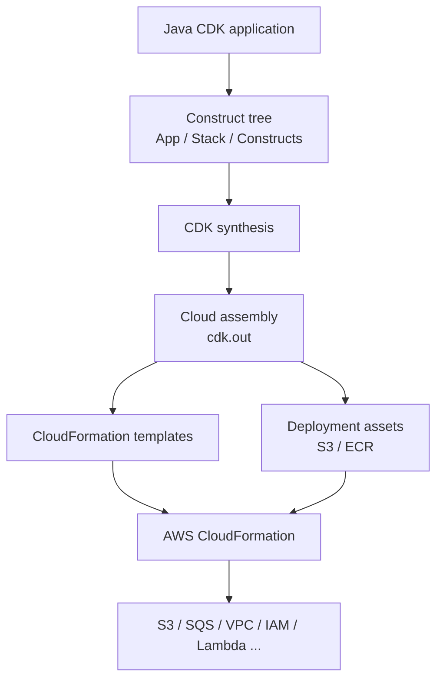
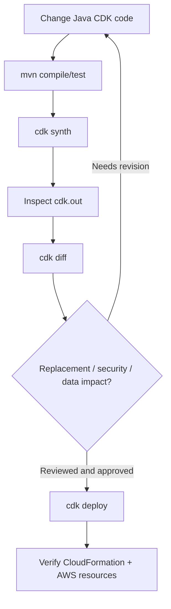

# Viết hạ tầng AWS bằng CDK với Java

**AWS Cloud Development Kit (AWS CDK)** cho phép mô tả hạ tầng AWS bằng ngôn ngữ lập trình quen thuộc. Với Java, bạn tạo các đối tượng **App**, **Stack** và **Construct**, cấu hình tài nguyên qua AWS Construct Library, sau đó dùng CDK CLI để tổng hợp mã thành template **AWS CloudFormation**. CloudFormation thực hiện việc tạo, cập nhật và xóa tài nguyên trên AWS.

CDK đưa hạ tầng vào quy trình phát triển phần mềm: có type checking, tái sử dụng class, tách module, kiểm thử template, review thay đổi bằng Git và triển khai qua CI/CD. Tuy nhiên, mã Java CDK không chạy như ứng dụng Java production trên AWS. Nó chạy ở máy phát triển hoặc CI để **synthesize** CloudFormation template và deployment assets; CloudFormation mới là dịch vụ thực thi deployment.

Bài thuộc chương **Hạ tầng dưới dạng mã** của mô-đun **CLOUD_PROVIDERS_AWS**. Nội dung kết nối Java, Maven, IAM, Region/AZ, VPC, S3, SQS, Lambda, CloudFormation, CloudWatch, bảo mật, kiểm thử và triển khai hạ tầng có thể lặp lại.

> **Nguyên tắc:** CDK là một cách viết CloudFormation bằng code. Hãy review template và diff trước khi deploy, giữ ổn định construct IDs, commit context cache, giới hạn quyền bootstrap/deploy và đặt retention cho tài nguyên có dữ liệu quan trọng.

## 1. Mục tiêu học tập

Sau bài học, bạn có thể:

1. Giải thích mối quan hệ giữa AWS CDK, Construct Library, CDK CLI và CloudFormation.
2. Phân biệt App, Stack, Construct, construct tree và CloudFormation logical ID.
3. Phân biệt L1, L2 và L3 constructs, chọn abstraction phù hợp.
4. Khởi tạo dự án CDK v2 bằng Java, JDK, Maven và Node.js/CDK CLI.
5. Quản lý dependency CDK Java và đồng bộ version giữa CLI với libraries.
6. Viết Stack bằng Java Builder pattern để tạo S3 bucket, SQS queue và các tài nguyên liên quan.
7. Cấu hình account, Region, environment và triển khai multi-account/multi-Region.
8. Hiểu synthesis, cloud assembly, assets, bootstrap và vai trò của CDKToolkit.
9. Dùng context, lookups, tokens, parameters và outputs đúng cách.
10. Quản lý dependencies giữa stacks và tái sử dụng custom constructs.
11. Áp dụng IAM least privilege, encryption, network isolation, tags và removal policies.
12. Kiểm thử CloudFormation template bằng CDK Assertions và JUnit.
13. Dùng CLI để synth, diff, deploy, hotswap và destroy có kiểm soát.
14. Tổ chức CI/CD với CDK Pipelines hoặc pipeline hiện có.
15. Nhận diện drift, replacement, rollback và rủi ro mất dữ liệu.
16. Thiết kế một workflow IaC có thể review, tái lập, kiểm thử và rollback.

## 2. AWS CDK và CloudFormation

Không dùng CDK, đội vận hành có thể viết CloudFormation YAML/JSON trực tiếp. Với CDK, bạn viết Java để mô tả tài nguyên, CDK chuyển cấu trúc đó thành CloudFormation template.



Quy trình có hai giai đoạn:

- **Synthesis:** CDK app chạy ở local/CI, tạo CloudFormation templates và metadata/assets trong cloud assembly.
- **Deployment:** CDK CLI gửi template tới CloudFormation, publish assets lên bootstrap resources và CloudFormation gọi AWS APIs để tạo/cập nhật tài nguyên.

Khi CloudFormation bắt đầu deployment, tiến trình Java CDK đã hoàn tất. Java CDK không tiếp tục chạy để chờ từng resource được tạo. Nếu cần logic thực thi trong lúc CloudFormation triển khai, phải dùng cơ chế như custom resource hoặc service phù hợp.

### 2.1. CDK không thay thế CloudFormation

| Thành phần | Vai trò |
| --- | --- |
| Java CDK app | Mô tả kiến trúc và cấu hình tài nguyên |
| AWS Construct Library | Cung cấp class/abstraction cho AWS resources |
| CDK CLI | Build/synthesize, so sánh và điều phối deployment |
| Cloud assembly | Template và assets được synthesize |
| AWS CloudFormation | Tạo, cập nhật, rollback và quản lý stack |
| AWS resources | Tài nguyên thực tế trong account/Region |

CDK vẫn chịu các quy tắc của CloudFormation: logical IDs, dependency graph, replacement, stack limits, rollback và resource lifecycle. Nếu một thay đổi trong code làm CloudFormation thay thế database hoặc bucket, việc viết bằng Java không loại bỏ rủi ro đó.

### 2.2. CDK v2

Bài sử dụng **AWS CDK v2**:

- Các stable AWS Construct Library modules được gom vào artifact Maven **aws-cdk-lib**.
- Package **constructs** cung cấp construct programming model.
- Các construct còn experimental có thể nằm trong artifact riêng mang hậu tố alpha.
- CDK CLI là công cụ riêng, cài bằng npm và chạy trên Node.js.
- Chọn exact versions và cập nhật có kiểm soát; không dùng dependency version range cho infrastructure build.

CDK v1 đã kết thúc vòng đời hỗ trợ. Với dự án mới, chọn CDK v2 và theo dõi release notes trước khi nâng version.

## 3. Các khái niệm cốt lõi

### 3.1. App

**App** là root của construct tree. Một App có thể chứa nhiều stacks. App là điểm bắt đầu khi CDK CLI chạy Java application.

### 3.2. Stack

**Stack** là đơn vị deployment của CloudFormation. Một stack thường chứa các resources có cùng lifecycle hoặc cùng boundary vận hành.

Ví dụ:

- NetworkStack: VPC, subnet, route tables và endpoints.
- DataStack: S3, DynamoDB, RDS hoặc SQS.
- ApplicationStack: Lambda, API Gateway và permissions.
- ObservabilityStack: alarms, dashboards và log groups.

Không chia stack chỉ theo số lượng resource. Chọn ranh giới theo lifecycle, ownership, permission, blast radius và quan hệ phụ thuộc.

### 3.3. Construct

**Construct** là thành phần xây dựng trong CDK. Một construct có thể đại diện cho một resource hoặc nhóm resources liên quan.

Ví dụ, một construct Application API có thể bao gồm:

- Lambda function.
- Execution role.
- Log group.
- API Gateway integration.
- Permission cho API Gateway invoke function.
- Alarms và outputs.

Construct tree cho phép tổ chức tài nguyên theo các lớp trừu tượng. Mỗi construct có **scope**, **id** và **props**.

### 3.4. Scope, ID và props

Trong Java, construct thường được tạo bằng ba đối số:

- **scope:** construct cha.
- **id:** định danh duy nhất trong scope đó.
- **props:** cấu hình của construct, thường dùng Builder pattern.

Ví dụ:

```java
Bucket bucket = Bucket.Builder.create(this, "ArtifactsBucket")
    .versioned(true)
    .build();
```

**this** là Stack scope; **ArtifactsBucket** là construct ID; **versioned(true)** là cấu hình bucket.

ID phải duy nhất trong cùng scope. Hai constructs ở hai scopes khác nhau có thể dùng cùng một ID.

### 3.5. Construct tree và logical ID

CDK tạo CloudFormation logical IDs dựa trên đường dẫn construct trong tree. CloudFormation dùng logical ID để nhận diện resource thuộc stack.

Ví dụ:

```text
PlatformStack
  ├── ArtifactsBucket
  ├── WorkQueue
  └── DeadLetterQueue
```

Nếu đổi ID hoặc di chuyển construct, logical ID có thể thay đổi. CloudFormation có thể hiểu đó là resource mới và xóa resource cũ sau khi tạo resource mới. Với stateful resources, điều này có thể gây downtime hoặc mất dữ liệu nếu removal policy không phù hợp.

**Giữ construct IDs ổn định sau khi deploy.** Trước khi refactor cây construct, chạy **cdk diff** và kiểm tra resource nào bị replacement.

## 4. Ba cấp độ Construct: L1, L2 và L3

AWS Construct Library có ba cấp độ abstraction. Đây là quy ước thiết kế, không phải ba interface Java riêng biệt.

| Cấp | Tên thường gặp | Đặc điểm | Khi sử dụng |
| --- | --- | --- | --- |
| **L1** | CloudFormation resource | Ánh xạ trực tiếp resource CloudFormation, tên class thường bắt đầu bằng Cfn | Cần property mới hoặc kiểm soát chi tiết |
| **L2** | Curated construct | API hướng theo intent, có defaults, helper methods và grant methods | Lựa chọn mặc định cho phần lớn resource |
| **L3** | Pattern | Kết hợp nhiều L1/L2 thành kiến trúc hoàn chỉnh | Cần triển khai một use case phổ biến nhanh |

### 4.1. L1 construct

L1 class tương ứng trực tiếp với CloudFormation resource, ví dụ **CfnBucket** đại diện cho **AWS::S3::Bucket**. Bạn cấu hình property gần như theo schema CloudFormation.

Ưu điểm:

- Có thể dùng resource/property ngay khi CloudFormation hỗ trợ.
- Kiểm soát sát CloudFormation template.
- Phù hợp khi L2 chưa có API cần thiết.

Hạn chế:

- Phải tự khai báo nhiều chi tiết.
- Ít helper methods và defaults.
- Dễ bỏ sót cấu hình bảo mật nếu không hiểu resource.

### 4.2. L2 construct

L2 như **Bucket**, **Queue**, **Function**, **Vpc** cung cấp API dễ dùng hơn. Chúng có thể tự tạo IAM policies, resource dependencies và các cấu hình cần thiết.

Ví dụ:

```java
Bucket bucket = Bucket.Builder.create(this, "PrivateBucket")
    .blockPublicAccess(BlockPublicAccess.BLOCK_ALL)
    .encryption(BucketEncryption.S3_MANAGED)
    .enforceSSL(true)
    .versioned(true)
    .build();
```

Đây là cách thể hiện intent: bucket versioned, mã hóa và chặn public access. CDK sinh CloudFormation resources tương ứng.

### 4.3. L3 construct

L3 pattern kết hợp nhiều resources để triển khai một kiến trúc. Ví dụ:

- ApplicationLoadBalancedFargateService.
- ScheduledFargateTask.
- LambdaRestApi.
- Các patterns cho event-driven applications.

L3 tiết kiệm thời gian nhưng có opinionated defaults. Đọc API docs và kiểm tra template được sinh trước khi dùng trong production.

### 4.4. Chọn abstraction

Quy tắc thực tế:

1. Tìm L2 phù hợp trước.
2. Dùng L3 khi pattern khớp với yêu cầu và defaults được chấp nhận.
3. Dùng L1 khi cần property chưa có ở L2 hoặc cần ánh xạ chính xác CloudFormation.
4. Có thể kết hợp L1/L2/L3 trong cùng stack.

Không cố dùng L2 bằng mọi giá nếu nó không thể biểu đạt yêu cầu service. Cũng không hạ toàn bộ stack xuống L1 nếu L2 đã có helper và security defaults phù hợp.

## 5. Chuẩn bị môi trường phát triển Java CDK

AWS CDK Java yêu cầu:

- JDK phù hợp với dự án; Java 17 hoặc 21 là lựa chọn thực tế cho nhiều dự án mới.
- Apache Maven; project skeleton do CDK tạo mặc định là Maven.
- Node.js để chạy CDK CLI.
- AWS CDK CLI v2.
- AWS CLI và credentials cho account/Region được phép triển khai.
- IDE có thể import Maven project như IntelliJ IDEA, Eclipse hoặc VS Code.

Java là ngôn ngữ được CDK hỗ trợ ổn định. CDK Java dùng JSII để tương tác với CDK libraries, vì vậy Node.js vẫn cần thiết dù application code viết bằng Java.

### 5.1. Kiểm tra toolchain

```bash
java -version
mvn -version
node --version
npm --version
cdk --version
aws --version
```

Nếu CLI chưa được cài:

```bash
npm install -g aws-cdk
cdk --version
```

Trong CI hoặc dự án cần pin version, dùng local CLI dependency và gọi qua npm/npx hoặc cách quản lý version được tổ chức chọn. Không để mỗi developer dùng một CDK CLI version không kiểm soát.

### 5.2. Tạo Java CDK app

Tạo thư mục dự án riêng, sau đó:

```bash
mkdir orders-infrastructure
cd orders-infrastructure
cdk init app --language java
```

CDK Toolkit tạo Maven project, source tree, **cdk.json**, cấu hình build và một stack mẫu.

Tên thư mục có ảnh hưởng đến tên package/class được sinh. Hãy chọn tên phù hợp Java identifier, không có khoảng trắng và không bắt đầu bằng số.

### 5.3. Cấu trúc project

Một dự án Java CDK thường có dạng:

```text
orders-infrastructure/
├── cdk.json
├── cdk.context.json
├── pom.xml
├── src/
│   ├── main/
│   │   └── java/
│   │       └── com/example/orders/
│   │           ├── OrdersInfrastructureApp.java
│   │           ├── OrdersStack.java
│   │           └── constructs/
│   └── test/
│       └── java/
│           └── com/example/orders/
│               └── OrdersStackTest.java
└── cdk.out/
```

**cdk.out** là thư mục synthesis output, thường không cần commit vì có thể tái tạo. **cdk.context.json** có thể chứa cached environment lookups và nên được commit cùng app để synthesis có tính lặp lại.

## 6. Quản lý dependency Maven

CDK v2 Java dùng Maven artifact chính:

- **software.amazon.awscdk:aws-cdk-lib**
- **software.constructs:constructs**

Ví dụ dependency:

```xml
<properties>
    <maven.compiler.release>21</maven.compiler.release>
    <cdk.version>APPROVED_EXACT_CDK_V2_VERSION</cdk.version>
    <constructs.version>COMPATIBLE_CONSTRUCTS_VERSION</constructs.version>
</properties>

<dependencies>
    <dependency>
        <groupId>software.amazon.awscdk</groupId>
        <artifactId>aws-cdk-lib</artifactId>
        <version>APPROVED_EXACT_CDK_V2_VERSION</version>
    </dependency>

    <dependency>
        <groupId>software.constructs</groupId>
        <artifactId>constructs</artifactId>
        <version>COMPATIBLE_CONSTRUCTS_VERSION</version>
    </dependency>
</dependencies>
```

Các giá trị version là placeholder có chủ đích. Chọn exact versions từ Maven Central và version compatibility của CDK release đang dùng. Không copy một version cũ từ blog mà không kiểm tra.

### 6.1. Quy tắc dependency

- Pin exact version của aws-cdk-lib.
- Chọn constructs version tương thích với CDK library.
- Giữ CDK CLI và library ở các release tương thích; cập nhật có kiểm soát.
- Các experimental modules phải dùng version alpha tương thích với CDK release.
- Commit pom.xml và lock/verification configuration mà build system hỗ trợ.
- Không dùng version range vì Maven có thể resolve dependency khác giữa các lần build.

### 6.2. Cài Construct Library module

Trong CDK v2, phần lớn stable constructs đã nằm trong **aws-cdk-lib**. Namespace Java nằm dưới:

```text
software.amazon.awscdk
software.amazon.awscdk.services.s3
software.amazon.awscdk.services.sqs
software.amazon.awscdk.services.lambda
software.amazon.awscdk.services.ec2
software.amazon.awscdk.assertions
```

Dùng import tường minh cho từng class để code dễ đọc và tránh nhầm tên class trùng nhau giữa các modules.

## 7. CDK CLI và cdk.json

CDK CLI cần biết cách chạy Java application để synthesis. File **cdk.json** do **cdk init** tạo sẽ chứa command **app**.

Một cấu hình Java thường gặp:

```json
{
  "app": "mvn -e -q compile exec:java"
}
```

Command cụ thể có thể khác theo skeleton/plugin Maven. Giữ cấu hình do **cdk init** tạo hoặc điều chỉnh đồng bộ với project build.

### 7.1. Các lệnh quan trọng

| Lệnh | Tác dụng |
| --- | --- |
| **cdk ls** | Liệt kê stacks trong app |
| **cdk synth** | Synthesize CloudFormation templates |
| **cdk diff** | So sánh template local với stack đã deploy |
| **cdk deploy** | Deploy stack qua CloudFormation |
| **cdk destroy** | Xóa stack và resources theo lifecycle policy |
| **cdk context** | Xem và quản lý cached context values |
| **cdk doctor** | Thu thập thông tin hỗ trợ troubleshooting |
| **cdk docs** | Mở tài liệu API tương ứng |

### 7.2. Build Java trước synthesis

Có thể compile để phát hiện lỗi Java trước khi chạy CDK:

```bash
mvn clean test
mvn package
cdk ls
cdk synth
```

CDK CLI có thể tự gọi app command và build theo cấu hình. Tuy nhiên, chạy compile/test riêng trong CI giúp phân biệt lỗi Java compilation, unit test và lỗi synthesis.

## 8. Viết App và Stack bằng Java

Một CDK app có thể chứa nhiều stacks. Ví dụ dưới đây xác định một deployment environment cụ thể bằng account và Region.

### 8.1. App entry point

```java
package com.example.orders;

import software.amazon.awscdk.App;
import software.amazon.awscdk.Environment;
import software.amazon.awscdk.StackProps;

public final class OrdersInfrastructureApp {

    private OrdersInfrastructureApp() {}

    public static void main(String[] args) {
        App app = new App();

        String account = System.getenv("CDK_DEFAULT_ACCOUNT");
        String region = System.getenv("CDK_DEFAULT_REGION");

        if (account == null || account.isBlank()
                || region == null || region.isBlank()) {
            throw new IllegalStateException(
                "Configure AWS credentials and a default account/Region"
            );
        }

        Environment environment = Environment.builder()
            .account(account)
            .region(region)
            .build();

        new OrdersStack(
            app,
            "OrdersStack",
            StackProps.builder()
                .env(environment)
                .build()
        );

        app.synth();
    }
}
```

CDK CLI có thể cung cấp các environment variables dựa trên AWS profile/credentials đang sử dụng. Có thể chỉ định account và Region cố định trong deployment configuration nếu tổ chức yêu cầu. Không hard-code account/Region production trong code dùng chung cho mọi môi trường; hãy lấy chúng từ deployment configuration được kiểm soát.

### 8.2. Stack tạo S3 và SQS

Ví dụ tạo một bucket lưu artifact, một queue nhận công việc và một dead-letter queue.

```java
package com.example.orders;

import software.constructs.Construct;
import software.amazon.awscdk.CfnOutput;
import software.amazon.awscdk.Duration;
import software.amazon.awscdk.RemovalPolicy;
import software.amazon.awscdk.Stack;
import software.amazon.awscdk.StackProps;
import software.amazon.awscdk.services.s3.BlockPublicAccess;
import software.amazon.awscdk.services.s3.Bucket;
import software.amazon.awscdk.services.s3.BucketEncryption;
import software.amazon.awscdk.services.sqs.DeadLetterQueue;
import software.amazon.awscdk.services.sqs.Queue;
import software.amazon.awscdk.services.sqs.QueueEncryption;

public class OrdersStack extends Stack {

    public OrdersStack(
            Construct scope,
            String id,
            StackProps props) {

        super(scope, id, props);

        Bucket artifactsBucket = Bucket.Builder.create(
                this,
                "ArtifactsBucket")
            .blockPublicAccess(BlockPublicAccess.BLOCK_ALL)
            .encryption(BucketEncryption.S3_MANAGED)
            .enforceSSL(true)
            .versioned(true)
            .removalPolicy(RemovalPolicy.RETAIN)
            .build();

        Queue deadLetterQueue = Queue.Builder.create(
                this,
                "OrdersDeadLetterQueue")
            .encryption(QueueEncryption.SQS_MANAGED)
            .retentionPeriod(Duration.days(14))
            .build();

        Queue ordersQueue = Queue.Builder.create(
                this,
                "OrdersQueue")
            .encryption(QueueEncryption.SQS_MANAGED)
            .retentionPeriod(Duration.days(4))
            .visibilityTimeout(Duration.seconds(60))
            .deadLetterQueue(
                DeadLetterQueue.builder()
                    .queue(deadLetterQueue)
                    .maxReceiveCount(5)
                    .build()
            )
            .build();

        CfnOutput.Builder.create(this, "ArtifactsBucketName")
            .value(artifactsBucket.getBucketName())
            .build();

        CfnOutput.Builder.create(this, "OrdersQueueUrl")
            .value(ordersQueue.getQueueUrl())
            .build();
    }
}
```

Stack này thể hiện một số quyết định:

- Bucket chặn public access, bật encryption, TLS-only access và versioning.
- Bucket có RemovalPolicy RETAIN để giữ dữ liệu khi stack bị xóa.
- Queue mã hóa bằng SQS-managed encryption.
- Queue có DLQ và max receive count.
- CfnOutput xuất bucket name và queue URL để stack/operator tham chiếu.

Đây là cấu hình minh họa. Production cần bổ sung lifecycle policy, logging/access monitoring, KMS customer-managed key nếu policy yêu cầu, queue alarms, retention và ownership tags.

### 8.3. Builder pattern trong Java

CDK Java dùng Builder pattern cho props. Ví dụ:

```java
Bucket bucket = Bucket.Builder.create(this, "DataBucket")
    .versioned(true)
    .enforceSSL(true)
    .build();
```

Builder làm rõ từng thuộc tính, hỗ trợ default values và dễ đọc khi construct có nhiều properties. Tránh tạo Builder quá dài với nhiều điều kiện phức tạp; tách helper methods hoặc custom construct khi logic tăng.

### 8.4. Kết nối SQS với Lambda worker

CDK có thể tạo event source mapping và quyền cần thiết giữa queue với Lambda. Ví dụ sau giả định stack đã có biến `ordersQueue` và `artifactsBucket` từ phần trước, đồng thời JAR của worker đã được build:

```java
import java.util.Map;
import software.amazon.awscdk.Duration;
import software.amazon.awscdk.services.lambda.Code;
import software.amazon.awscdk.services.lambda.Function;
import software.amazon.awscdk.services.lambda.Runtime;
import software.amazon.awscdk.services.lambda.eventsources.SqsEventSource;

Function workerFunction = Function.Builder.create(this, "OrdersWorker")
    .runtime(Runtime.JAVA_21)
    .handler("com.example.orders.Handler")
    .code(Code.fromAsset("../orders-service/target/orders-service.jar"))
    .memorySize(1024)
    .timeout(Duration.seconds(10))
    .environment(Map.of(
        "ARTIFACTS_BUCKET", artifactsBucket.getBucketName()
    ))
    .build();

artifactsBucket.grantRead(workerFunction);
ordersQueue.grantConsumeMessages(workerFunction);

workerFunction.addEventSource(
    SqsEventSource.Builder.create(ordersQueue)
        .batchSize(10)
        .build()
);
```

CDK tạo Lambda execution role, policy đọc bucket/consume queue và SQS event source mapping. Với timeout Lambda 10 giây, queue visibility timeout 60 giây trong ví dụ trước đạt mức ít nhất sáu lần function timeout. Trong production, cấu hình batch size, partial batch response (ReportBatchItemFailures), DLQ, concurrency và idempotency theo workload. Build JAR trước synthesis để asset path tồn tại trong CI.

## 9. Tạo custom Construct để tái sử dụng

Khi nhiều stacks cần cùng một chuẩn bucket, hãy đóng gói cấu hình vào custom construct.

```java
package com.example.orders.constructs;

import software.constructs.Construct;
import software.amazon.awscdk.RemovalPolicy;
import software.amazon.awscdk.services.s3.BlockPublicAccess;
import software.amazon.awscdk.services.s3.Bucket;
import software.amazon.awscdk.services.s3.BucketEncryption;

public class SecureArtifactsBucket extends Construct {

    private final Bucket bucket;

    public SecureArtifactsBucket(Construct scope, String id) {
        super(scope, id);

        this.bucket = Bucket.Builder.create(this, "Bucket")
            .blockPublicAccess(BlockPublicAccess.BLOCK_ALL)
            .encryption(BucketEncryption.S3_MANAGED)
            .enforceSSL(true)
            .versioned(true)
            .removalPolicy(RemovalPolicy.RETAIN)
            .build();
    }

    public Bucket getBucket() {
        return bucket;
    }
}
```

Dùng trong Stack:

```java
SecureArtifactsBucket storage =
    new SecureArtifactsBucket(this, "Artifacts");

storage.getBucket().grantRead(processorFunction);
```

Construct có thể expose interface như IBucket thay vì concrete Bucket để hỗ trợ cả resources được tạo mới và resources import từ bên ngoài. Tạo API nhỏ, rõ ownership và không expose toàn bộ implementation nếu caller không cần.

## 10. Dùng IAM grant methods

L2 constructs thường cung cấp helper methods để cấp quyền giữa resources.

Ví dụ:

```java
artifactsBucket.grantRead(processorFunction);
ordersQueue.grantSendMessages(orderApiFunction);
ordersQueue.grantConsumeMessages(workerFunction);
```

CDK tạo policy phù hợp với resource/role tương ứng. Cách này giảm việc tự viết ARN và policy statements.

### 10.1. Grant không thay thế security review

- Kiểm tra action nào được sinh ra.
- Kiểm tra resource scope có đúng bucket, prefix, queue hoặc table không.
- Tránh cấp quyền wildcard nếu không cần.
- Kiểm tra role có được dùng bởi đúng workload không.
- Xem cả permissions boundary, SCP và resource policy.
- Với KMS, kiểm tra key policy và grants cần thiết.

CDK giúp sinh IAM policies nhưng không tự biết business authorization. Hãy review template và policy document được synthesize.

## 11. Synthesis và Cloud Assembly

Lệnh **cdk synth** chạy Java app và sinh template.

```bash
cdk synth
```

Output mặc định nằm trong thư mục **cdk.out**. Cloud assembly có thể gồm:

- CloudFormation template cho từng stack.
- Asset manifests.
- File assets và metadata.
- Stack metadata và deployment instructions.

### 11.1. Kiểm tra template

Có thể yêu cầu CDK in template cho một stack:

```bash
cdk synth OrdersStack
```

Đọc template để kiểm tra:

- Resource types và properties.
- IAM roles/policies.
- Security groups và network rules.
- Encryption và public access.
- Outputs và references.
- Removal/update policies.
- Dependencies và generated logical IDs.

Đừng xem Java code là bằng chứng duy nhất. Template là artifact CloudFormation thực sự được deploy.

### 11.2. Tokens và unresolved values

CDK có các giá trị chỉ biết khi CloudFormation deploy, ví dụ bucket name do AWS tạo. Những giá trị này được biểu diễn thành **tokens** trong lúc synthesis.

Ví dụ:

```java
String bucketName = artifactsBucket.getBucketName();
```

Giá trị này có thể là CloudFormation intrinsic expression chứ không phải tên bucket literal ở thời điểm Java chạy.

Không dùng token như một Java string bình thường để:

- So sánh với giá trị runtime chưa tồn tại.
- Parse bằng string methods và giả định kết quả là tên resource thật.
- Tạo logic phụ thuộc vào giá trị chỉ được AWS resolve khi deploy.

Nếu cần kết hợp token, dùng CDK helpers như Fn, CfnParameter, CfnOutput hoặc construct APIs phù hợp.

### 11.3. CDK app phải deterministic

Cùng source code, context và configuration nên tạo cùng CloudFormation template cho cùng environment. Không gọi AWS SDK hoặc external APIs tùy tiện trong quá trình synthesis để lấy giá trị thay đổi mỗi lần chạy.

Nếu cần lookup resource hiện có, dùng context provider/lookup có cache hoặc chuẩn bị input riêng có kiểm soát.

## 12. Bootstrap AWS environment

Trước deployment đầu tiên, CDK cần **bootstrap** target account và Region. Bootstrap tạo các resources hỗ trợ deployment.

Các resources mặc định thường gồm:

- S3 bucket để lưu file assets/template deployment.
- ECR repository để lưu container assets khi cần.
- IAM roles cho lookup, file publishing, image publishing và CloudFormation deployment.
- Các resources/parameters để CDK CLI xác định bootstrap version và capabilities.

Bootstrap stack thường có tên **CDKToolkit**.

### 12.1. Bootstrap lệnh

Xác định account/Region và profile:

```bash
aws sts get-caller-identity --profile dev
aws configure get region --profile dev

cdk bootstrap aws://123456789012/ap-southeast-1 --profile dev
```

Thay account ID bằng account thực được phê duyệt. Bootstrap từng environment mà CDK sẽ deploy tới: account và Region là một bootstrap boundary.

### 12.2. Bootstrap không phải lệnh local vô hại

Bootstrap tạo hoặc cập nhật resources và IAM roles trong account. Trước khi chạy ở production:

- Review bootstrap template/version.
- Xác định ai được phép assume deployment roles.
- Review CloudFormation execution policy.
- Dùng permissions boundary/SCP theo guardrails của tổ chức.
- Giới hạn trust giữa accounts/pipelines.
- Theo dõi bootstrap stack changes và tags.

### 12.3. Quyền mặc định và least privilege

Bootstrap template mặc định có thể cấp CloudFormation execution role với quyền rất rộng, thường là AdministratorAccess nếu không tùy chỉnh. Điều này giúp triển khai nhiều loại resources nhưng có thể vượt quá policy của tổ chức.

Trong môi trường kiểm soát chặt:

- Tùy chỉnh bootstrap template và execution policy.
- Giới hạn principals được phép assume roles.
- Dùng permission boundaries hoặc SCP để ngăn bypass controls.
- Tách quyền bootstrap, asset publishing và deployment.
- Không cấp quyền admin cho developer chỉ để khắc phục lỗi deploy.

Việc thu hẹp quyền CDK deployment cần được thiết kế cùng guardrails. Policy quá hẹp có thể khiến CloudFormation không đủ quyền rollback hoặc thay thế resource, để stack ở trạng thái cần can thiệp thủ công.

## 13. Cấu hình environment: account và Region

Một CDK Stack có thể là:

- **Environment-specific:** gắn với account/Region cụ thể.
- **Environment-agnostic:** chưa gắn cứng account/Region khi synthesize; một số lookups/behaviors cần environment cụ thể.

Ví dụ:

```java
Environment production = Environment.builder()
    .account("123456789012")
    .region("ap-southeast-1")
    .build();

StackProps props = StackProps.builder()
    .env(production)
    .build();
```

Trong production, lấy account/Region từ pipeline configuration hoặc environment mapping được kiểm soát. Tránh để cùng một stack deploy nhầm sang account vì developer đang dùng default profile khác.

### 13.1. Multi-account, multi-Region

Ví dụ triển khai cùng application vào dev và prod:

```java
Environment dev = Environment.builder()
    .account("111111111111")
    .region("ap-southeast-1")
    .build();

Environment prod = Environment.builder()
    .account("222222222222")
    .region("ap-southeast-1")
    .build();

new OrdersStack(app, "OrdersDevStack",
    StackProps.builder().env(dev).build());

new OrdersStack(app, "OrdersProdStack",
    StackProps.builder().env(prod).build());
```

Hai stacks có thể dùng cùng class nhưng khác environment/configuration. Trong CI/CD, dùng approval gates và role assumption riêng cho từng account.

### 13.2. Không nhầm Region của CDK với Region của tài nguyên tham chiếu

Resources tạo trong stack thường nằm ở Region của stack, nhưng một số resources/global services hoặc ARN imported có semantics riêng. Kiểm tra service-specific constraints khi tham chiếu cross-Region hoặc cross-account.

## 14. Context và lookup resources có sẵn

CDK context là key-value configuration được cung cấp cho App/Stack/Construct. Context có thể đến từ:

- **cdk.json**.
- **cdk.context.json**.
- CLI option **--context**.
- User-level CDK config.
- **node.setContext()** trong construct tree.

Context lookup có thể truy vấn environment để tìm VPC, hosted zone, AMI hoặc availability zones.

Ví dụ lệnh:

```bash
cdk synth --context environment=dev
cdk context
```

Trong Java, đọc context từ construct:

```java
Object environment = getNode().tryGetContext("environment");
```

API cụ thể phụ thuộc scope object; trong một Construct có thể gọi **getNode().tryGetContext(...)**.

### 14.1. Vì sao commit cdk.context.json?

CDK cache các giá trị lookup trong **cdk.context.json**. Ví dụ, danh sách AZ hoặc AMI ID có thể thay đổi theo thời gian/account.

Nếu mỗi lần synthesize tự lookup giá trị mới, template có thể thay đổi dù code không đổi. Commit context file để giữ synthesis ổn định; chỉ reset/refresh lookup khi chủ động muốn chấp nhận giá trị mới.

### 14.2. Lookup VPC có sẵn

Khi VPC đã được tạo ngoài CDK app, dùng `Vpc.fromLookup` để import thông tin VPC theo account/Region và tiêu chí tìm kiếm:

```java
import software.amazon.awscdk.services.ec2.IVpc;
import software.amazon.awscdk.services.ec2.Vpc;
import software.amazon.awscdk.services.ec2.VpcLookupOptions;

IVpc existingVpc = Vpc.fromLookup(
    this,
    "ExistingVpc",
    VpcLookupOptions.builder()
        .isDefault(true)
        .build()
);
```

Lookup được thực hiện khi CDK CLI synthesize, nên stack phải khai báo account/Region cụ thể và máy/CI synthesize phải có quyền đọc thông tin VPC. Kết quả được cache trong `cdk.context.json`. `fromLookup` chỉ import thông tin để tham chiếu; nó không biến VPC có sẵn thành resource do stack hiện tại quản lý.

### 14.2. Refresh context có kiểm soát

```bash
cdk context
cdk context --reset 2
cdk synth
cdk diff
```

Số **2** chỉ là ví dụ index hiển thị trong lệnh **cdk context**. Kiểm tra key thực tế trước khi reset. Không xóa toàn bộ context chỉ để xử lý một lookup bị lỗi.

## 15. Cross-stack references và dependency graph

Khi stack A tạo resource và stack B cần dùng resource đó, CDK có thể tạo cross-stack reference trong cùng environment.

Ví dụ:

```java
NetworkStack network = new NetworkStack(app, "NetworkStack", props);

ApplicationStack application = new ApplicationStack(
    app,
    "ApplicationStack",
    ApplicationStackProps.builder()
        .vpc(network.getVpc())
        .build()
);
```

CDK/CloudFormation có thể tạo exports/imports để truyền VPC ID, subnet IDs hoặc resource ARNs giữa stacks.

### 15.1. Lưu ý

- Hai stacks phải có environment tương thích cho cross-stack references thông thường.
- CDK có thể xác định thứ tự deploy theo dependency graph.
- Tránh circular dependencies.
- Thay đổi hoặc xóa exported values có thể bị CloudFormation chặn nếu stack khác còn import.
- Không tách một resource ra stack mới một cách tùy tiện nếu logical IDs/exports đang được dùng.
- Cross-account/cross-Region references cần cơ chế riêng; không giả định direct reference luôn hoạt động.

### 15.2. Khi nào nên tách Stack?

Tách khi có một trong các lý do:

- Lifecycle khác nhau.
- Security/ownership boundary khác nhau.
- Team khác nhau chịu trách nhiệm.
- Có thể deploy độc lập.
- Cần giảm blast radius.
- Resource stateful cần giữ ổn định lâu dài.

Không tách chỉ vì stack dài. Có thể dùng custom constructs để chia code mà vẫn giữ resources trong cùng stack.

## 16. Resource lifecycle: retain, destroy và replacement

Một stack bị destroy không đồng nghĩa mọi resource phải bị xóa. CDK maps **RemovalPolicy** thành CloudFormation deletion/update policies.

| Policy | Hành vi |
| --- | --- |
| **RemovalPolicy.DESTROY** | Xóa resource khi stack bị xóa nếu service cho phép |
| **RemovalPolicy.RETAIN** | Giữ resource khi stack bị xóa |
| **RemovalPolicy.SNAPSHOT** | Tạo snapshot trước khi xóa với resource hỗ trợ |

Ví dụ:

```java
Bucket bucket = Bucket.Builder.create(this, "DataBucket")
    .removalPolicy(RemovalPolicy.RETAIN)
    .versioned(true)
    .build();
```

### 16.1. Stateful resources cần chính sách riêng

Đặc biệt review lifecycle cho:

- S3 buckets chứa object cần giữ.
- RDS databases và snapshots.
- DynamoDB tables.
- EFS file systems.
- SQS queues có messages quan trọng.
- Secrets và KMS keys.
- OpenSearch/ElastiCache data stores.

**RETAIN không phải backup.** Nó giữ resource sau stack deletion, nhưng không bảo đảm khả năng phục hồi dữ liệu. Cần backup/PITR/snapshot/lifecycle policy theo service.

### 16.2. Replacement và logical ID

Một số property changes khiến CloudFormation phải replacement resource. Construct ID changes cũng có thể làm logical ID mới.

Trước khi deploy:

1. Chạy **cdk diff**.
2. Tìm resource có dấu hiệu replacement hoặc deletion.
3. Kiểm tra dữ liệu và retention.
4. Xác định migration/maintenance window.
5. Có backup và rollback plan.
6. Chỉ deploy khi hiểu tác động.

## 17. Bảo mật khi định nghĩa hạ tầng

CDK code có thể tạo mọi resource và IAM policy mà developer có quyền triển khai. Do đó security review phải bao phủ cả **quyền deploy** và **quyền runtime**.

### 17.1. IAM

- Dùng L2 grant methods khi phù hợp.
- Giới hạn resource ARN và actions.
- Tách execution role theo workload/trust boundary.
- Không tạo role dùng chung quá nhiều service chỉ để giảm số lượng role.
- Review wildcard actions/resources.
- Áp dụng permissions boundary/SCP/Control Tower guardrails.
- Không để deployment pipeline có thể vô hiệu hóa controls.

### 17.2. S3

Các thiết lập cần xem xét:

- Block public access.
- Encryption at rest.
- Enforce SSL.
- Versioning.
- Lifecycle rules.
- Access logging/CloudTrail data events khi cần.
- Bucket policy và access points.
- RemovalPolicy/auto-delete behavior.

Không bật public access chỉ để test nhanh. Với website hosting, thiết kế CloudFront/OAC và bucket policy riêng theo kiến trúc.

### 17.3. VPC và network

- Chọn public/private/isolated subnets đúng nhu cầu.
- Giới hạn Security Group inbound/outbound.
- Dùng VPC endpoints khi phù hợp.
- Tránh public IP cho database/private services.
- Xem xét NAT Gateway cost và egress controls.
- Không mở 0.0.0.0/0 cho management ports.
- Kiểm tra route tables, NACL và DNS.

### 17.4. Encryption và secrets

- Chọn AWS-managed hoặc customer-managed KMS key theo policy.
- Kiểm tra key policy và grants.
- Không hard-code secrets trong CDK source/context.
- Không đưa secret vào CloudFormation Outputs hoặc plain-text parameters.
- Dùng Secrets Manager/SSM SecureString và runtime retrieval.
- Hạn chế log environment values có thể chứa secret.

### 17.5. Tags và governance

Gắn tags để hỗ trợ ownership, billing và policy:

```java
Tags.of(this).add("Application", "Orders");
Tags.of(this).add("Environment", "dev");
Tags.of(this).add("Owner", "platform-team");
Tags.of(this).add("CostCenter", "engineering");
```

Tags nên được chuẩn hóa theo quy định của tổ chức. Không đưa PII, credentials hoặc thông tin nhạy cảm vào tag values.

## 18. Assets và bootstrap publishing

Một số CDK constructs cần deploy file/container assets. Ví dụ:

- Lambda code assets.
- Docker image assets.
- File assets được CloudFormation/custom resources tham chiếu.

CDK CLI chuẩn bị và publish assets lên bootstrap S3 bucket/ECR repository trước khi CloudFormation sử dụng template.

### 18.1. Asset path

Asset path thường được resolve trong lúc synthesis. Đường dẫn phải tồn tại trong CI workspace và không phụ thuộc vào thư mục local của developer.

Ví dụ khái niệm:

```java
Code.fromAsset("../orders-service/target/orders-service.jar")
```

Đảm bảo Maven build tạo JAR trước khi CDK synth/deploy. Trong CI, khai báo build dependency rõ ràng và không dùng file path chỉ tồn tại trên máy cá nhân.

### 18.2. Container assets

Nếu dùng Docker image assets:

- Build context phải có Dockerfile.
- Pin base image theo policy.
- Không đưa secrets vào build args/layers.
- Kiểm tra architecture và runtime.
- Bootstrap environment phải có ECR repository/permissions phù hợp.
- Scan image trước deployment.

## 19. Kiểm thử CDK Java

CDK assertions kiểm tra CloudFormation template được synthesize. Đây là cách kiểm thử hạ tầng trước khi deploy.

Hai nhóm phổ biến:

- **Fine-grained assertions:** kiểm tra resource count, properties, IAM permissions, encryption, network rules.
- **Snapshot tests:** so sánh template với baseline; hữu ích khi quản lý thay đổi lớn nhưng dễ tạo noise khi template thay đổi có chủ đích.

### 19.1. Maven test dependency

Ví dụ JUnit 5:

```xml
<dependency>
    <groupId>org.junit.jupiter</groupId>
    <artifactId>junit-jupiter</artifactId>
    <version>APPROVED_JUNIT_VERSION</version>
    <scope>test</scope>
</dependency>
```

AWS CDK Assertions nằm trong CDK library. Chọn test framework version được dự án hỗ trợ và chạy tests trong Maven lifecycle.

### 19.2. Fine-grained assertion bằng Java

```java
package com.example.orders;

import org.junit.jupiter.api.Test;
import software.amazon.awscdk.App;
import software.amazon.awscdk.Stack;
import software.amazon.awscdk.StackProps;
import software.amazon.awscdk.assertions.Template;

import java.util.Map;

class OrdersStackTest {

    @Test
    void bucketMustBeVersioned() {
        App app = new App();
        Stack stack = new OrdersStack(
            app,
            "TestOrdersStack",
            StackProps.builder().build()
        );

        Template template = Template.fromStack(stack);

        template.resourceCountIs("AWS::S3::Bucket", 1);

        template.hasResourceProperties(
            "AWS::S3::Bucket",
            Map.of(
                "VersioningConfiguration",
                Map.of("Status", "Enabled")
            )
        );
    }
}
```

### 19.3. Test security properties

Có thể kiểm tra:

- Bucket versioning và block public access.
- Encryption configuration.
- SQS redrive policy.
- Lambda runtime/timeout/memory.
- IAM policy action/resource scope.
- Security Group ingress.
- RemovalPolicy/delete/update policies.
- Tags và outputs.

Không chỉ test resource tồn tại. Một bucket public hoặc role có quyền wildcard vẫn có thể pass test chỉ đếm resource.

### 19.4. Test construct riêng

Custom construct nên có tests cho behavior contract của nó. Ví dụ SecureArtifactsBucket phải luôn bật versioning, encryption và block public access. Test này giúp ngăn người dùng construct vô tình bỏ security properties khi refactor.

## 20. Quy trình CLI: synth, diff, deploy

Một quy trình an toàn:



### 20.1. Synthesize

```bash
mvn test
cdk synth OrdersStack
```

### 20.2. Diff

```bash
cdk diff OrdersStack
```

Các ký hiệu thường thấy:

- **[+]**: resource/property được thêm.
- **[-]**: resource/property bị xóa.
- **[~]**: resource/property thay đổi.

Một thay đổi **[~]** không phải lúc nào cũng là in-place update. Có property buộc CloudFormation replacement resource. Dùng diff có change set khi cần thông tin replacement chính xác.

CDK CLI mặc định dùng phương thức diff tự động: thử tạo read-only CloudFormation change set để xác định replacement, sau đó có thể fallback sang template-only diff nếu không tạo được change set. Khi cần kết quả chính xác và muốn lệnh thất bại nếu không tạo được change set, dùng:

```bash
cdk diff OrdersStack --method=change-set
```

Template-only diff nhanh hơn nhưng ít chính xác hơn khi đánh giá replacement. Đảm bảo deploy role có quyền cần thiết để tạo change set.

### 20.3. Deploy

```bash
cdk deploy OrdersStack --profile dev --require-approval broadening
```

CDK CLI sẽ synthesize app, publish assets và yêu cầu CloudFormation triển khai. **--require-approval broadening** yêu cầu approval khi diff mở rộng security permissions theo quy tắc CLI.

Trước khi deploy production, dùng pipeline/role riêng, review change set, kiểm tra backup và yêu cầu approval phù hợp.

### 20.4. Destroy

```bash
cdk destroy OrdersStack --profile sandbox
```

Chỉ destroy stack disposable hoặc đã có kế hoạch xóa được phê duyệt. Resource có **RemovalPolicy.RETAIN** có thể còn tồn tại và tiếp tục phát sinh chi phí. Resource **DESTROY** có thể mất dữ liệu.

## 21. Hotswap và drift

CDK CLI hỗ trợ hotswap để cập nhật trực tiếp một số resources trong development, ví dụ Lambda code, Step Functions và ECS container image.

```bash
cdk deploy OrdersStack --hotswap
```

Hotswap có thể nhanh nhưng **tạo drift** vì thay đổi trực tiếp resource qua service API thay vì CloudFormation. Hotswap không được khuyến nghị cho production. Sau khi dùng hotswap, cần deploy CloudFormation bình thường và reconcile drift theo quy trình CDK.

### 21.1. Drift là gì?

Drift xảy ra khi trạng thái resource thật khác với cấu hình CloudFormation quản lý. Nguyên nhân có thể gồm:

- Hotswap.
- Console/CLI sửa thủ công.
- Một hệ thống khác thay đổi resource.
- Resource property được service tự điều chỉnh.
- Template không còn phản ánh cấu hình đang chạy.

Dùng CloudFormation drift detection và CDK diff phù hợp để điều tra. Không giả định CDK synth sẽ tự đọc toàn bộ trạng thái live và phát hiện mọi drift.

### 21.2. No rollback

CDK CLI có tùy chọn tắt rollback trong một số quy trình phát triển. Khi deployment lỗi, resources đã tạo trước đó có thể vẫn còn. Không dùng no-rollback như mặc định production vì stack có thể dở dang.

## 22. CI/CD với CDK

Một pipeline IaC nên thực hiện:

1. Checkout source và cài JDK/Node/Maven.
2. Resolve dependencies đã pin.
3. Chạy unit tests và CDK assertions.
4. Compile Java CDK app.
5. Synthesize CloudFormation templates.
6. Kiểm tra policy/security/lint và template changes.
7. Tạo diff/change set.
8. Yêu cầu approval cho production hoặc permission broadening.
9. Deploy bằng IAM role của pipeline.
10. Verify stack outputs, events và health checks.
11. Lưu artifact/template, commit SHA và deployment metadata.

### 22.1. CDK Pipelines

CDK Pipelines là construct library để định nghĩa continuous delivery cho CDK applications. Pipeline có thể:

- Build/synthesize app.
- Tạo deployment stages.
- Triển khai stacks vào nhiều accounts/Regions.
- Thêm pre/post deployment validation.
- Tự cập nhật pipeline khi app thay đổi.

Mỗi target environment cần bootstrap phù hợp. Phân tách dev/test/prod accounts và approvals theo blast radius.

### 22.2. Không nhúng credentials vào pipeline source

- Dùng service roles/OIDC/federation theo CI platform.
- Lưu provider tokens trong secret manager.
- Giới hạn role trust policy.
- Không truyền access keys qua command line/logs.
- Giới hạn deployment permissions theo account/stack boundary.
- Ghi audit trail bằng CloudTrail.

## 23. Chi phí và vận hành

CDK không tính phí riêng cho việc viết code hay synthesis. Chi phí đến từ resources mà CloudFormation tạo và các dịch vụ hỗ trợ deployment/operations.

| Thành phần | Tác động chi phí |
| --- | --- |
| S3 bootstrap bucket | Storage và request/transfer |
| ECR bootstrap repository | Image storage và transfer |
| CloudFormation | Theo pricing/service hiện hành; một số stack/registry features có phí liên quan |
| NAT Gateway | Hourly + data processing |
| VPC endpoints | Phí endpoint/service theo loại |
| KMS | Key và API requests |
| CloudWatch | Metrics, logs, alarms, retention |
| Resources trong stacks | S3, RDS, DynamoDB, EC2, Lambda, SQS, v.v. |

### 23.1. Quản lý chi phí bằng IaC

- Gắn owner/environment/cost-center tags.
- Dùng budget/alarms theo account/project.
- Chọn retention/backup theo business requirements.
- Xem xét NAT Gateway và endpoints.
- Xóa stacks sandbox sau khi thực hành.
- Dùng lifecycle policies cho S3 và log groups.
- Review resource replacement để tránh tạo resource song song ngoài ý muốn.

### 23.2. Theo dõi deployment

Sau deploy, kiểm tra:

- CloudFormation stack status.
- Stack events và failed resource reason.
- Resource physical IDs.
- Outputs.
- CloudTrail changes.
- Service metrics/logs.
- Drift và alarms.

CDK diff là một bước review, không thay thế kiểm tra trạng thái sau deploy.

## 24. Troubleshooting

| Triệu chứng | Nguyên nhân có thể | Cách xử lý |
| --- | --- | --- |
| cdk: command not found | CLI chưa cài hoặc PATH sai | Kiểm tra npm global/local install |
| --app is required | Đang chạy ngoài project hoặc thiếu cdk.json | Chạy trong project root, kiểm tra app command |
| Maven compile error | JDK/version/dependency không tương thích | Kiểm tra pom, JDK và constructs version |
| JSII runtime error | Node.js không tương thích hoặc lỗi runtime | Kiểm tra Node/CDK CLI và Java runtime |
| NoSuchMethodError/Class conflict | CDK modules lệch version | Đồng bộ exact CDK/alpha versions |
| NoSuchStack | Stack ID khác tên dự kiến | Chạy cdk ls |
| Lookup context missing | Chưa synthesize với credentials/Region đúng | Kiểm tra account, Region, profile và lookup |
| Bootstrap version too old | CDKToolkit chưa nâng | Review và bootstrap upgrade |
| Asset publish AccessDenied | Deploy role không assume/publish được | Kiểm tra bootstrap roles và trust |
| forbidden: null khi publish | Không có quyền vào bootstrap bucket | Kiểm tra file publishing role |
| CloudFormation AccessDenied | Execution role thiếu permission | Review policy/boundary/SCP |
| Stack stuck rollback | Resource hoặc quyền rollback lỗi | Đọc CloudFormation events, sửa nguyên nhân |
| Resource replacement bất ngờ | Logical ID hoặc replacement property đổi | Review cdk diff và resource lifecycle |
| Export cannot be deleted | Stack khác còn import | Gỡ dependency theo thứ tự |
| Hotswap drift | Resource đổi ngoài CloudFormation | Deploy lại qua CloudFormation/reconcile |
| Bucket name conflict | Tên physical name global đã được dùng | Để CDK tạo tên hoặc chọn namespace duy nhất |
| Context lookup khác CI/local | cdk.context.json không được commit hoặc env khác | Commit context, pin environment |
| Stack tạo resource nhưng dữ liệu bị xóa khi destroy | RemovalPolicy DESTROY | Chọn RETAIN/snapshot và backup phù hợp |

### 24.1. Runbook cơ bản

1. Xác nhận working directory và file cdk.json.
2. Kiểm tra Java, Maven, Node.js và CDK CLI versions.
3. Kiểm tra Maven dependency tree.
4. Chạy mvn test và cdk ls.
5. Chạy cdk synth để tái hiện lỗi synthesis.
6. Xác nhận account/Region/profile bằng AWS CLI.
7. Kiểm tra bootstrap stack và bootstrap roles.
8. Đọc CloudFormation stack events.
9. Kiểm tra asset publishing và IAM errors.
10. Review cdk diff, context cache và logical IDs.
11. Kiểm tra resource state, drift và removal policies.
12. Chỉ retry deploy sau khi xác định nguyên nhân.

## 25. Bài thực hành: xây dựng Orders Infrastructure bằng CDK Java

### 25.1. Bối cảnh

Một ứng dụng xử lý orders cần:

- S3 bucket để lưu artifact/receipt.
- SQS queue nhận công việc.
- Dead-letter queue cho messages lỗi.
- IAM policy để Lambda worker đọc object và consume queue.
- Outputs để ứng dụng/pipeline lấy resource identifiers.

Bạn sẽ mô tả phần storage và messaging bằng CDK Java, sau đó kiểm thử template.

### 25.2. Nhiệm vụ A — Tạo project

1. Cài JDK, Maven, Node.js và CDK CLI v2.
2. Tạo project bằng cdk init app --language java.
3. Xác nhận cdk.json chạy Maven Java app.
4. Pin exact versions cho aws-cdk-lib và constructs.
5. Commit pom.xml, cdk.json và context file khi có lookup.

### 25.3. Nhiệm vụ B — Viết stack

Dùng ví dụ ở mục 8 để tạo:

- Versioned private S3 bucket.
- SQS work queue.
- SQS dead-letter queue.
- Queue redrive policy.
- CloudFormation outputs.

Thêm tags cho Application, Environment, Owner và CostCenter.

### 25.4. Nhiệm vụ C — Thêm worker role

Tạo Lambda worker function hoặc import một function construct phù hợp. Dùng grant methods để cấp quyền:

```java
artifactsBucket.grantRead(workerFunction);
ordersQueue.grantConsumeMessages(workerFunction);
```

Kiểm tra policy được synthesize chỉ có các actions/resources cần thiết. Nếu worker ghi receipt, cấp thêm quyền ghi đúng prefix.

### 25.5. Nhiệm vụ D — Viết assertions

Tạo test để xác minh:

- Có đúng một bucket.
- Bucket bật versioning.
- Bucket chặn public access.
- Bucket bật encryption và enforce SSL.
- Queue có encryption.
- Queue có redrive policy trỏ đúng DLQ.
- Worker role chỉ có các permissions được yêu cầu.

Không chỉ đếm resource; kiểm tra cả security-sensitive properties.

### 25.6. Nhiệm vụ E — Synthesize và review

```bash
mvn clean test
cdk ls
cdk synth OrdersStack
cdk diff OrdersStack
```

Đọc template trong cdk.out, ghi lại:

- Logical IDs.
- Resource types.
- IAM actions/resources.
- Encryption/public access.
- Queue redrive/visibility timeout.
- Outputs.
- Removal/update policies.

### 25.7. Nhiệm vụ F — Deploy sandbox có kiểm soát

Chỉ deploy vào sandbox/account đã được cấp quyền:

```bash
aws sts get-caller-identity --profile sandbox
cdk bootstrap aws://SANDBOX_ACCOUNT/ap-southeast-1 --profile sandbox
cdk diff OrdersStack --profile sandbox
cdk deploy OrdersStack --profile sandbox --require-approval broadening
```

Sau deploy:

1. Xác nhận CloudFormation stack CREATE_COMPLETE/UPDATE_COMPLETE.
2. Kiểm tra bucket/queue/DLQ trong đúng account/Region.
3. Kiểm tra encryption và public access.
4. Kiểm tra queue redrive configuration.
5. Kiểm tra outputs.
6. Kiểm tra CloudTrail và tags.
7. Ghi nhận owner và cost estimate.

Không chạy cdk destroy nếu bucket có dữ liệu cần giữ hoặc stack không thuộc sandbox disposable.

### 25.8. Nhiệm vụ G — Refactor construct

Tạo class SecureArtifactsBucket extends Construct, chuyển bucket configuration vào construct. Chạy tests và diff. Xác nhận logical ID của bucket không bị thay đổi ngoài dự kiến; nếu construct path thay đổi, review replacement risk trước khi deploy.

## 26. Câu hỏi tự kiểm tra

1. AWS CDK là gì?
2. Vì sao CDK vẫn dùng CloudFormation để deploy?
3. Java CDK app chạy ở đâu trong lifecycle?
4. App, Stack và Construct khác nhau thế nào?
5. Scope, ID và props có vai trò gì?
6. Construct ID ảnh hưởng logical ID như thế nào?
7. L1, L2 và L3 constructs khác nhau ở mức abstraction nào?
8. Khi nào nên dùng Cfn resource?
9. Vì sao L2 grant methods hữu ích cho IAM?
10. CDK v2 dùng những Maven artifacts chính nào?
11. Vì sao CDK CLI cần Node.js dù app viết Java?
12. Tại sao nên pin exact versions?
13. File cdk.json dùng để làm gì?
14. cdk synth tạo ra những artifacts nào?
15. Cloud assembly được lưu ở thư mục nào mặc định?
16. Bootstrap tạo resources gì?
17. Vì sao bootstrap cần thực hiện theo account và Region?
18. CloudFormation execution role của bootstrap có rủi ro gì nếu quá rộng?
19. Environment-specific Stack khác environment-agnostic Stack thế nào?
20. Context lookup là gì?
21. Vì sao cần commit cdk.context.json?
22. Token khác Java literal string thế nào?
23. Cross-stack references tạo dependency gì?
24. Khi nào nên tách Stack?
25. RemovalPolicy RETAIN khác DESTROY thế nào?
26. Vì sao đổi construct ID có thể replacement resource?
27. Asset publishing sử dụng bootstrap bucket/ECR như thế nào?
28. CDK Assertions kiểm tra những gì?
29. Fine-grained assertions khác snapshot tests thế nào?
30. cdk diff giúp review deployment ra sao?
31. Hotswap có thể tạo drift vì sao?
32. Vì sao không khuyến nghị hotswap trong production?
33. CI/CD pipeline nên chạy những bước nào trước deploy?
34. Vì sao IAM deploy permissions và runtime permissions cần review riêng?
35. Làm thế nào kiểm tra bucket không public trong synthesized template?
36. Vì sao CloudFormation rollback không thay thế backup?
37. Những resources nào cần removal policy đặc biệt?
38. Khi nào CDK context cần refresh?
39. Làm sao chẩn đoán asset publishing AccessDenied?
40. Vì sao cần kiểm tra CloudFormation events sau deploy?

## 27. Tài liệu AWS chính thức

1. [AWS CDK v2 Developer Guide](https://docs.aws.amazon.com/cdk/v2/guide/home.html).
2. [Working with the AWS CDK in Java](https://docs.aws.amazon.com/cdk/v2/guide/work-with-cdk-java.html).
3. [AWS CDK prerequisites](https://docs.aws.amazon.com/cdk/v2/guide/prerequisites.html).
4. [Getting started with the AWS CDK](https://docs.aws.amazon.com/cdk/v2/guide/getting-started.html).
5. [Create your first AWS CDK app](https://docs.aws.amazon.com/cdk/v2/guide/hello-world.html).
6. [AWS CDK constructs](https://docs.aws.amazon.com/cdk/v2/guide/constructs.html).
7. [AWS Construct Library and construct levels](https://docs.aws.amazon.com/cdk/api/v2/).
8. [Bootstrap your environment](https://docs.aws.amazon.com/cdk/v2/guide/bootstrapping-env.html).
9. [Configure AWS environments](https://docs.aws.amazon.com/cdk/v2/guide/environments.html).
10. [Context values and lookups](https://docs.aws.amazon.com/cdk/v2/guide/context.html).
11. [Identifiers and logical IDs](https://docs.aws.amazon.com/cdk/v2/guide/identifiers.html).
12. [Best practices for AWS CDK](https://docs.aws.amazon.com/cdk/v2/guide/best-practices.html).
13. [CDK security best practices](https://docs.aws.amazon.com/cdk/v2/guide/best-practices-security.html).
14. [Synthesize and deploy CDK applications](https://docs.aws.amazon.com/cdk/v2/guide/deploy.html).
15. [AWS CDK CLI reference](https://docs.aws.amazon.com/cdk/v2/guide/cli.html).
16. [cdk diff command](https://docs.aws.amazon.com/cdk/v2/guide/ref-cli-cmd-diff.html).
17. [cdk deploy command](https://docs.aws.amazon.com/cdk/v2/guide/ref-cli-cmd-deploy.html).
18. [Testing AWS CDK applications](https://docs.aws.amazon.com/cdk/v2/guide/testing.html).
19. [AWS CDK Assertions API for Java](https://docs.aws.amazon.com/cdk/api/v2/java/software/amazon/awscdk/assertions/Template.html).
20. [CDK Pipelines](https://docs.aws.amazon.com/cdk/v2/guide/cdk-pipeline.html).
21. [AWS CloudFormation resource lifecycle and deletion policies](https://docs.aws.amazon.com/AWSCloudFormation/latest/UserGuide/aws-attribute-deletionpolicy.html).
22. [AWS CloudFormation drift detection](https://docs.aws.amazon.com/AWSCloudFormation/latest/UserGuide/using-cfn-stack-drift.html).
23. [AWS CDK Java Lambda Function API](https://docs.aws.amazon.com/cdk/api/v2/java/software/amazon/awscdk/services/lambda/Function.html).
24. [AWS CDK Java SQS event source API](https://docs.aws.amazon.com/cdk/api/v2/java/software/amazon/awscdk/services/lambda/eventsources/SqsEventSource.html).
25. [AWS CDK Java VPC lookup API](https://docs.aws.amazon.com/cdk/api/v2/java/software/amazon/awscdk/services/ec2/Vpc.html).

> **Ghi nhớ:** Java CDK mô tả hạ tầng bằng App, Stack và Constructs, sau đó synthesize thành CloudFormation templates. Dùng L2 constructs và grant methods khi phù hợp, giữ context và IDs ổn định, review cdk diff, kiểm thử template, bootstrap với IAM guardrails và bảo vệ stateful resources bằng backup/removal policies.
