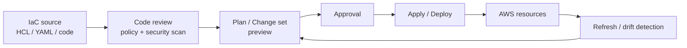
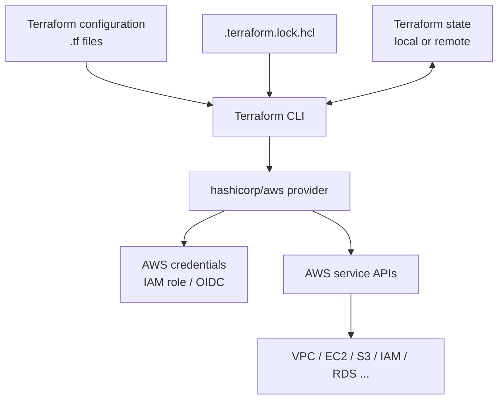
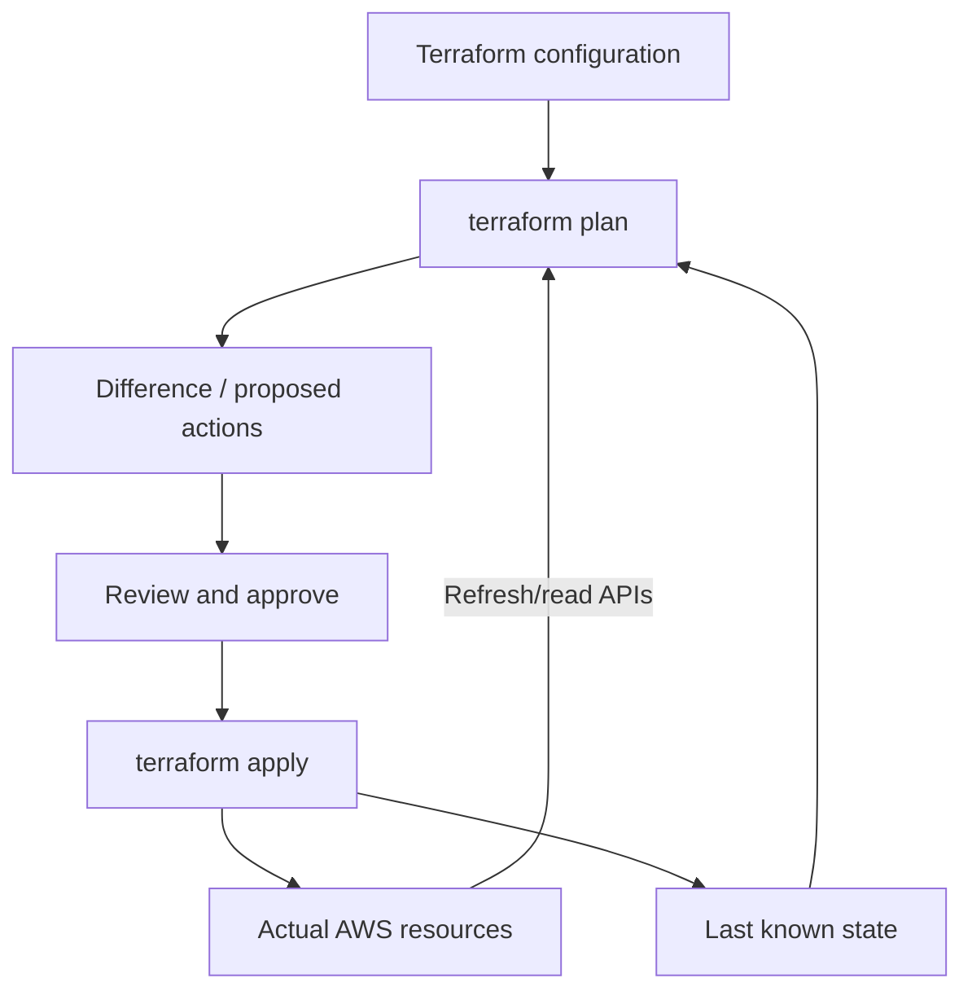
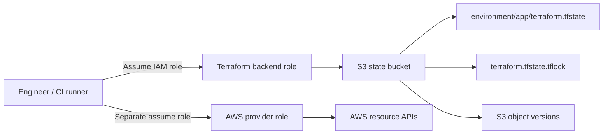
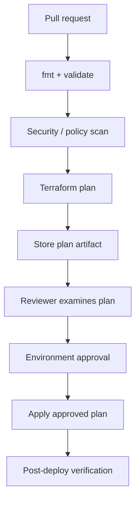
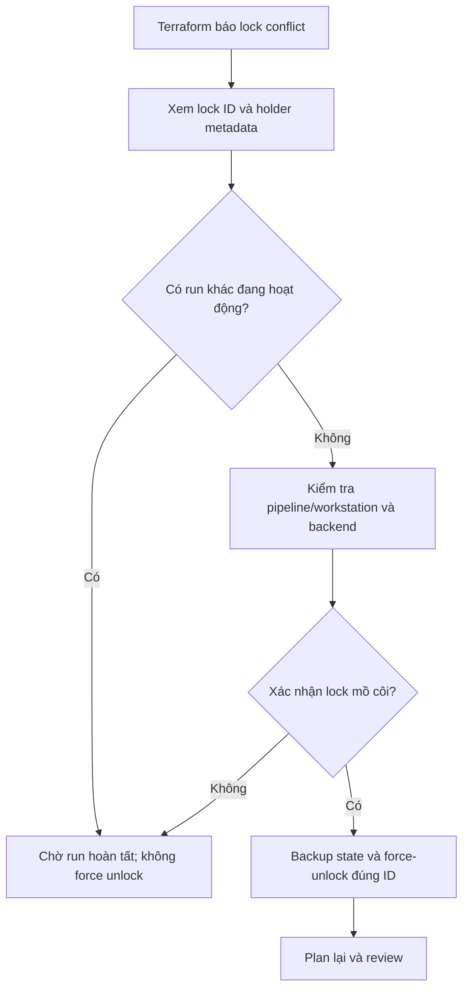

# Terraform AWS provider, remote state và lựa chọn công cụ IaC

## Mục tiêu học tập

Sau bài học, bạn có thể:

1. Giải thích Infrastructure as Code (IaC), mô hình khai báo của Terraform và vòng đời từ cấu hình đến tài nguyên AWS.
2. Phân biệt Terraform CLI, AWS provider, resource, data source, module, state và backend.
3. Khai báo required_providers, ràng buộc phiên bản Terraform/provider và sử dụng .terraform.lock.hcl để tái lập môi trường.
4. Cấu hình AWS provider theo Region, profile, IAM role, assume role, OIDC và provider aliases cho nhiều account/Region.
5. Hiểu vì sao Terraform cần state, cách state liên kết resource address với AWS resource ID và cách phát hiện drift.
6. Thiết kế remote state trên Amazon S3 với versioning, encryption, IAM least privilege và native S3 state locking.
7. Phân biệt quyền truy cập backend S3 với quyền provider dùng để tạo/sửa tài nguyên AWS.
8. Tổ chức state theo application, environment, account và team; hiểu giới hạn của Terraform workspaces.
9. Di chuyển state từ local/DynamoDB backend, phục hồi state từ S3 object versions và xử lý lock an toàn.
10. So sánh Terraform, OpenTofu, CloudFormation, AWS CDK, AWS SAM, Pulumi và Ansible theo yêu cầu dự án.
11. Xây dựng pipeline IaC có plan review, approval, OIDC credentials, kiểm tra bảo mật và kiểm soát apply.
12. Thực hành tạo cấu hình AWS provider, S3 remote backend, resource và quy trình plan/apply/destroy trong môi trường lab.

## 1. Infrastructure as Code giải quyết vấn đề gì?

Một ứng dụng Spring Boot cần VPC, subnet, security group, IAM role, load balancer, database và S3 bucket. Nếu kỹ sư tạo từng tài nguyên thủ công trên AWS Console, cấu hình giữa development, staging và production dễ khác nhau. Khi phải dựng lại môi trường hoặc điều tra thay đổi, nhóm khó biết ai đã tạo tài nguyên, cấu hình ban đầu là gì và cần tái tạo chính xác ra sao.

**Infrastructure as Code (IaC)** mô tả hạ tầng bằng file có thể đọc, review, lưu trong Git, kiểm tra tự động và triển khai lặp lại. Hạ tầng trở thành một phần của vòng đời phát triển phần mềm.



### 1.1. Lợi ích của IaC

- **Repeatability:** dựng nhiều môi trường theo cùng một cấu hình.
- **Version control:** xem lịch sử thay đổi, review diff và rollback theo quy trình.
- **Consistency:** giảm khác biệt do thao tác thủ công.
- **Automation:** tích hợp pipeline CI/CD và quy trình phê duyệt.
- **Auditability:** liên kết commit, người review, pipeline run và thay đổi hạ tầng.
- **Governance:** kiểm tra policy, encryption, network exposure, tags và IAM trước khi apply.
- **Disaster recovery:** có thể tái tạo tài nguyên từ code, state và dữ liệu backup phù hợp.

IaC không tự làm cho hạ tầng an toàn hoặc không lỗi. Một cấu hình sai được tự động triển khai nhanh hơn một thao tác sai thủ công. Vì vậy cần review, kiểm tra policy, phân quyền, theo dõi drift và kế hoạch khôi phục.

### 1.2. Imperative và declarative

| Cách tiếp cận | Cách mô tả | Ví dụ |
| --- | --- | --- |
| **Imperative** | Liệt kê từng bước cần thực hiện theo thứ tự. | Tạo VPC, sau đó tạo subnet, sau đó tạo route table bằng các lệnh API riêng. |
| **Declarative** | Mô tả trạng thái mong muốn; engine xác định các thay đổi cần thực hiện. | Khai báo VPC có CIDR 10.20.0.0/16, hai subnet và route table mong muốn. |

Terraform chủ yếu là công cụ **declarative**. Bạn mô tả kết quả, Terraform xây dựng dependency graph và gọi provider để đưa hạ tầng về trạng thái mong muốn.

### 1.3. Terraform làm việc với AWS như thế nào?

Terraform CLI đọc HCL, tải plugin AWS provider, xác định state hiện tại và gọi AWS APIs thông qua provider. Provider chuyển các resource blocks như aws_vpc hoặc aws_s3_bucket thành các thao tác API tương ứng.



Terraform AWS provider gọi AWS service APIs để đọc, tạo, cập nhật và xóa tài nguyên. CloudFormation và CDK có mô hình triển khai khác, sẽ được so sánh ở phần sau.

## 2. Những khái niệm cốt lõi trong Terraform

| Khái niệm | Vai trò | Ví dụ |
| --- | --- | --- |
| **Terraform CLI** | Đọc cấu hình, khởi tạo provider/backend, tạo plan và thực thi thay đổi. | terraform init, plan, apply. |
| **Provider** | Plugin giao tiếp với API của nền tảng hoặc dịch vụ. | hashicorp/aws. |
| **Resource** | Đối tượng hạ tầng Terraform quản lý vòng đời. | aws_vpc, aws_s3_bucket. |
| **Data source** | Đọc thông tin về đối tượng có sẵn, không quản lý vòng đời tạo/xóa của đối tượng đó. | aws_caller_identity, aws_availability_zones. |
| **Variable** | Đầu vào cấu hình có thể thay đổi theo môi trường. | aws_region, environment. |
| **Local** | Biểu thức dùng lại bên trong module. | Tên resource chuẩn hóa. |
| **Output** | Giá trị module công bố cho module gọi hoặc người vận hành. | VPC ID, subnet IDs. |
| **Module** | Nhóm resource/data/variable/output thành đơn vị tái sử dụng. | Network module. |
| **State** | Ánh xạ resource address với đối tượng thật và lưu metadata. | aws_vpc.main ↔ VPC ID. |
| **Backend** | Nơi lưu state và cơ chế locking nếu backend hỗ trợ. | S3 backend, HCP Terraform. |
| **Workspace** | Nhiều state độc lập dùng chung một cấu hình root module. | dev, test, prod. |

### 2.1. Resource và data source khác nhau

Resource biểu thị tài nguyên Terraform chịu trách nhiệm quản lý:

```hcl
resource "aws_s3_bucket" "artifacts" {
  bucket = var.artifact_bucket_name
}
```

Data source đọc thông tin tài nguyên đã tồn tại:

```hcl
data "aws_caller_identity" "current" {}

data "aws_availability_zones" "available" {
  state = "available"
}

output "account_id" {
  value = data.aws_caller_identity.current.account_id
}
```

Không khai báo một bucket hiện hữu thành resource chỉ để đọc thông tin. Nếu Terraform cần quản lý vòng đời bucket đó, phải import nó vào state bằng quy trình phù hợp.

### 2.2. Resource address

Resource address xác định một instance trong cấu hình:

```text
aws_vpc.main
aws_subnet.private["ap-southeast-1a"]
module.network.aws_vpc.this
module.application[0].aws_s3_bucket.artifacts
```

Address là danh tính ở phía Terraform. AWS resource ID như vpc-0123456789abcdef0 là danh tính đối tượng phía AWS. State giữ liên kết giữa hai phía.

### 2.3. Vòng đời lệnh Terraform

| Lệnh | Mục đích | Có thay đổi hạ tầng? |
| --- | --- | --- |
| terraform init | Tải provider/module, khởi tạo backend và dependency lock file. | Không tạo resource nghiệp vụ. |
| terraform fmt | Chuẩn hóa định dạng HCL. | Không. |
| terraform validate | Kiểm tra cú pháp và tính nhất quán nội bộ. | Không. |
| terraform plan | Tạo bản xem trước thay đổi. | Không, nhưng có thể đọc/refresh AWS và state. |
| terraform apply | Thực thi kế hoạch thay đổi. | Có. |
| terraform destroy | Xóa các resource do cấu hình quản lý. | Có, thường là destructive. |
| terraform output | Hiển thị outputs của state. | Không. |
| terraform state | Kiểm tra/chỉnh sửa liên kết state theo lệnh chuyên dụng. | Có thể thay đổi state; không nhất thiết thay đổi AWS resource. |

Một quy trình làm việc an toàn thường là:

```bash
terraform init
terraform fmt -recursive
terraform validate
terraform plan -out=tfplan
terraform show tfplan
# Review và approval trước khi apply
terraform apply tfplan
```

terraform plan là bước review quan trọng. Không dùng terraform apply -auto-approve như mặc định cho thay đổi production nếu không có một lớp approval/policy tương đương trong pipeline.

## 3. Terraform AWS provider

### 3.1. Khai báo provider dependency

Terraform cần biết source và version của provider. Với AWS provider chính thức:

```hcl
terraform {
  required_version = ">= 1.11.0, < 2.0.0"

  required_providers {
    aws = {
      source  = "hashicorp/aws"
      version = "~> 6.0"
    }
  }
}
```

- source = hashicorp/aws xác định provider trên Terraform Registry.
- version = ~> 6.0 cho phép các bản phát hành tương thích trong nhánh 6.x theo quy tắc pessimistic constraint.
- required_version đặt dải Terraform CLI mà cấu hình hỗ trợ.

Đây là ví dụ ràng buộc cho một root module dùng AWS provider 6.x. Với dự án thực tế, chọn phiên bản provider đã được kiểm thử, xem changelog/upgrade guide và cập nhật có chủ đích. Không lấy latest không giới hạn cho production.

### 3.2. Dependency lock file

Sau lần terraform init, Terraform tạo .terraform.lock.hcl để khóa phiên bản provider đã chọn và checksum gói cài đặt. File này nên được commit vào Git cùng cấu hình root module.

| File/thư mục | Commit vào Git? | Lý do |
| --- | --- | --- |
| *.tf | Có | Hạ tầng mong muốn. |
| .terraform.lock.hcl | Có | Cố định provider versions và checksums. |
| terraform.tfvars có dữ liệu nhạy cảm | Không | Có thể chứa secret hoặc thông tin riêng môi trường. |
| *.tfstate, *.tfstate.backup | Không | Có thể chứa secrets/metadata hạ tầng; lưu ở backend an toàn. |
| .terraform/ | Không | Cache/plugin/backend metadata cục bộ. |
| tfplan | Không commit | Plan có thể chứa dữ liệu nhạy cảm và phản ánh trạng thái cụ thể. |

Chỉ chạy terraform init -upgrade khi có kế hoạch nâng provider/module. Review diff của lock file, chạy validation/test và kiểm tra plan trước khi apply.

### 3.3. Cấu hình AWS provider

Provider block cấu hình Region, tags mặc định và account guardrail:

```hcl
variable "aws_region" {
  description = "AWS Region triển khai"
  type        = string
  default     = "ap-southeast-1"
}

variable "expected_account_id" {
  description = "AWS account ID mà root module được phép thay đổi"
  type        = string
}

provider "aws" {
  region              = var.aws_region
  allowed_account_ids = [var.expected_account_id]

  default_tags {
    tags = {
      ManagedBy   = "Terraform"
      Application = "orders-platform"
      Environment = var.environment
    }
  }
}
```

- region quyết định Region mặc định cho các resource thuộc provider instance.
- allowed_account_ids làm provider từ chối thao tác nếu credentials đang trỏ tới account khác danh sách cho phép.
- default_tags thêm tags chung cho resource hỗ trợ tags; resource có thể ghi đè tag theo quy tắc provider.

Provider block dùng var.environment để gắn tag. Biến này được khai báo cùng các input khác ở mục 4.2 trong root module hoàn chỉnh.

Không đặt access key/secret key trực tiếp trong provider block. Terraform nên dùng AWS credential chain và temporary credentials.

### 3.4. AWS authentication chain

AWS provider có thể lấy credentials từ nhiều nguồn:

- Environment variables, nếu được cấu hình.
- AWS shared config/credentials files và named profile.
- AWS IAM Identity Center (SSO).
- Web identity/OIDC.
- ECS task role hoặc container credentials.
- EC2 instance profile.
- Explicit assume role từ một identity đã được xác thực.

Provider dùng AWS SDK credential chain để tìm credentials; cách xác thực cụ thể phụ thuộc môi trường chạy. Hãy kiểm tra danh tính thực tế bằng aws sts get-caller-identity trước khi chạy Terraform. Không cấu hình đồng thời nhiều nguồn credentials gây khó đoán và không lưu access key lâu dài trong HCL.

Với developer workstation, có thể dùng IAM Identity Center:

```bash
aws configure sso --profile platform-dev
aws sso login --profile platform-dev
aws sts get-caller-identity --profile platform-dev

$env:AWS_PROFILE = "platform-dev"
terraform plan
```

Ví dụ trên dùng PowerShell cho dòng gán environment variable; trong Bash có thể dùng export AWS_PROFILE=platform-dev. Chọn profile và xác minh account trước khi chạy plan/apply.

### 3.5. Assume role

Thông thường người vận hành hoặc pipeline có một identity ban đầu (SSO/OIDC/instance role), sau đó assume deployment role có quyền tối thiểu:

```hcl
variable "deployment_role_arn" {
  type        = string
  description = "ARN role được assume để quản lý AWS resources"
}

provider "aws" {
  region              = var.aws_region
  allowed_account_ids = [var.expected_account_id]

  assume_role {
    role_arn     = var.deployment_role_arn
    session_name = "terraform-network-dev"
  }
}
```

Provider dùng role này để gọi các AWS service APIs. Role cần trust policy cho identity được phép assume và IAM permissions cho các thao tác Terraform cần thực hiện. Có thể dùng external_id khi thiết kế trust cross-account cần external ID.

### 3.6. Provider aliases cho nhiều Region/account

Một cấu hình có thể dùng nhiều provider instances:

```hcl
variable "dr_deployment_role_arn" {
  type        = string
  description = "ARN role trong account disaster recovery"
}

provider "aws" {
  region = "ap-southeast-1"
}

provider "aws" {
  alias  = "dr"
  region = "ap-southeast-2"

  assume_role {
    role_arn     = var.dr_deployment_role_arn
    session_name = "terraform-dr"
  }
}

resource "aws_s3_bucket" "primary" {
  bucket = "example-primary-artifacts"
}

resource "aws_s3_bucket" "disaster_recovery" {
  provider = aws.dr
  bucket   = "example-dr-artifacts"
}
```

aws là provider mặc định; aws.dr là provider instance có alias. Nếu tất cả provider blocks đều có alias, Terraform tạo một implied empty default configuration; resource không chỉ rõ provider có thể dùng cấu hình rỗng ngoài ý muốn. Luôn khai báo provider mặc định hoặc chỉ định provider rõ ràng.

Module con có thể khai báo alias mà nó cần:

```hcl
terraform {
  required_providers {
    aws = {
      source = "hashicorp/aws"
      configuration_aliases = [aws.primary, aws.dr]
    }
  }
}
```

Root module truyền provider instances vào module:

```hcl
module "replicated_storage" {
  source = "./modules/replicated-storage"

  providers = {
    aws.primary = aws
    aws.dr      = aws.dr
  }
}
```

Provider aliases hữu ích cho multi-Region, cross-account networking và deployment resources vào account khác nhau. Tách role theo account/environment để giới hạn blast radius.

## 4. HCL: mô tả hạ tầng AWS

### 4.1. Cấu trúc thư mục đơn giản

```text
infrastructure/
├── versions.tf
├── providers.tf
├── backend.tf
├── variables.tf
├── main.tf
├── outputs.tf
├── terraform.tfvars.example
└── modules/
    └── network/
        ├── main.tf
        ├── variables.tf
        └── outputs.tf
```

Root module là thư mục nơi chạy Terraform CLI. Các file .tf trong cùng thư mục được ghép thành một module; việc chia nhiều file giúp tổ chức nội dung, không tạo ra các module độc lập.

### 4.2. Variables, locals và outputs

```hcl
variable "environment" {
  description = "Tên môi trường"
  type        = string

  validation {
    condition     = contains(["dev", "test", "prod"], var.environment)
    error_message = "environment phải là dev, test hoặc prod."
  }
}

variable "vpc_cidr" {
  description = "CIDR block cho VPC"
  type        = string
  default     = "10.40.0.0/16"
}

locals {
  name_prefix = "orders-${var.environment}"
  common_tags = {
    Application = "orders-platform"
    Environment = var.environment
    ManagedBy   = "Terraform"
  }
}

output "name_prefix" {
  description = "Prefix chuẩn hóa của môi trường"
  value       = local.name_prefix
}
```

Variables cho phép tái sử dụng cùng module ở nhiều môi trường. Validation giúp phát hiện đầu vào không hợp lệ trước khi gọi AWS APIs. Không dùng variable để truyền secret theo cách khiến secret bị lưu trong state.

### 4.3. Resource và dependency graph

Ví dụ tạo VPC, subnet và internet gateway:

```hcl
resource "aws_vpc" "main" {
  cidr_block           = var.vpc_cidr
  enable_dns_support   = true
  enable_dns_hostnames = true

  tags = merge(local.common_tags, {
    Name = "${local.name_prefix}-vpc"
  })
}

resource "aws_subnet" "public_a" {
  vpc_id                  = aws_vpc.main.id
  cidr_block              = "10.40.1.0/24"
  availability_zone       = "ap-southeast-1a"
  map_public_ip_on_launch = true

  tags = merge(local.common_tags, {
    Name = "${local.name_prefix}-public-a"
    Tier = "public"
  })
}

resource "aws_internet_gateway" "main" {
  vpc_id = aws_vpc.main.id

  tags = merge(local.common_tags, {
    Name = "${local.name_prefix}-igw"
  })
}
```

Terraform suy ra dependency từ tham chiếu aws_vpc.main.id. Nó tạo VPC trước khi tạo subnet/IGW. Chỉ dùng depends_on khi có dependency thật mà Terraform không thể suy ra qua tham chiếu thuộc tính.

### 4.4. Data source

Đọc account hiện tại để kiểm tra context:

```hcl
data "aws_caller_identity" "current" {}

data "aws_region" "current" {}

output "deployment_context" {
  value = {
    account_id = data.aws_caller_identity.current.account_id
    region     = data.aws_region.current.name
  }
}
```

Data source giúp cấu hình phản ứng với môi trường thực tế, nhưng không thay thế account guardrail. Với production, vẫn dùng allowed_account_ids hoặc kiểm tra tương đương trong pipeline.

### 4.5. count và for_each

count phù hợp khi các instance gần như giống nhau và có thể định danh theo chỉ số. for_each phù hợp khi từng instance có key ổn định:

```hcl
variable "private_subnets" {
  type = map(object({
    cidr = string
    az   = string
  }))
}

resource "aws_subnet" "private" {
  for_each = var.private_subnets

  vpc_id            = aws_vpc.main.id
  cidr_block        = each.value.cidr
  availability_zone = each.value.az

  tags = merge(local.common_tags, {
    Name = "${local.name_prefix}-private-${each.key}"
    Tier = "private"
  })
}
```

Ví dụ terraform.tfvars:

```hcl
private_subnets = {
  apse1a = {
    cidr = "10.40.11.0/24"
    az   = "ap-southeast-1a"
  }
  apse1b = {
    cidr = "10.40.12.0/24"
    az   = "ap-southeast-1b"
  }
}
```

Stable keys giảm rủi ro Terraform hiểu nhầm instance khi danh sách thay đổi. Tránh dùng count index cho danh sách mà thứ tự có thể thay đổi thường xuyên.

### 4.6. Module tái sử dụng

Một network module có thể nhận CIDR, subnet map và tags rồi xuất VPC ID/subnet IDs. Root module gọi module:

```hcl
module "network" {
  source = "./modules/network"

  name_prefix = local.name_prefix
  vpc_cidr    = var.vpc_cidr

  private_subnets = var.private_subnets
  tags            = local.common_tags
}

output "vpc_id" {
  value = module.network.vpc_id
}
```

Module giúp chuẩn hóa cách tạo network, nhưng không nên tạo module cho mọi resource nhỏ. Module tốt biểu diễn một capability có giao diện đầu vào/đầu ra rõ ràng, có thể được nhiều root modules sử dụng.

Khi gọi module từ Terraform Registry, pin version:

```hcl
module "vpc" {
  source  = "terraform-aws-modules/vpc/aws"
  version = "~> 6.0"

  name = "orders-dev"
  cidr = "10.50.0.0/16"

  azs             = ["ap-southeast-1a", "ap-southeast-1b"]
  private_subnets = ["10.50.1.0/24", "10.50.2.0/24"]
  public_subnets  = ["10.50.101.0/24", "10.50.102.0/24"]
}
```

Đây là minh họa cách pin module; trước khi dùng, kiểm tra module version, input/output, resource behavior và compatibility với AWS provider đã khóa trong dự án.

## 5. Terraform state: vì sao cần và có gì bên trong?

### 5.1. State là bản đồ giữa code và AWS

Terraform cần state để biết resource address nào tương ứng với AWS object nào, thuộc tính đã đọc được và metadata cần thiết cho lần plan tiếp theo.

Ví dụ:

```text
HCL address: aws_vpc.main
AWS object:  vpc-0123456789abcdef0
State:       lưu binding giữa hai danh tính này
```

State không chỉ là cache có thể xóa đi. Nếu mất state, Terraform có thể không biết các AWS resources hiện hữu thuộc cấu hình nào; plan tiếp theo có thể đề xuất tạo resource trùng lặp hoặc không thể quản lý đúng vòng đời.

### 5.2. State lưu những gì?

- Resource addresses và AWS resource IDs.
- Thuộc tính resource đã đọc/ghi.
- Metadata provider và dependency.
- Outputs.
- Một số giá trị nhạy cảm xuất hiện trong cấu hình hoặc provider response.
- Lineage và serial để nhận biết state history.

**State có thể chứa passwords, connection strings, secret values, private endpoints và dữ liệu nhạy cảm.** Đánh dấu variable/output là sensitive chỉ che bớt khi CLI hiển thị; nó không tự xóa giá trị khỏi state.

Không commit state vào Git, không gửi state qua ticket/chat và không chia sẻ rộng quyền đọc state. Dùng remote backend được mã hóa, access control, audit và backup.

### 5.3. Drift là gì?

Drift xảy ra khi AWS resource thực tế khác trạng thái Terraform mong muốn/state, ví dụ một kỹ sư đổi security group rule trên Console. Terraform refresh đọc trạng thái thật; plan có thể đề xuất đưa resource về cấu hình trong code.

Để chỉ xem các khác biệt sau refresh mà chưa yêu cầu Terraform đưa resource về HCL, có thể dùng terraform plan -refresh-only rồi review. Nếu thay đổi ngoài Terraform là chủ ý, cập nhật HCL hoặc import/adopt theo quy trình; không tự động apply một plan có thay đổi chưa hiểu rõ.



Nếu thay đổi trên Console là chủ ý, cập nhật code hoặc import/adopt đúng quy trình để code và thực tế thống nhất. Đừng apply ngay một plan có nhiều thay đổi bất ngờ trước khi hiểu drift.

### 5.4. Local state và remote state

| Tiêu chí | Local backend | Remote backend |
| --- | --- | --- |
| Nơi lưu | File terraform.tfstate trên máy chạy. | Dịch vụ backend như S3 hoặc HCP Terraform. |
| Collaboration | Khó chia sẻ, dễ lệch state giữa máy. | Nhiều người/pipeline dùng chung một state. |
| Locking | Tùy cơ chế local/backend. | Backend có thể hỗ trợ locking phân tán. |
| Backup/recovery | Phụ thuộc backup máy cá nhân. | Có thể dùng S3 Versioning/backup hoặc dịch vụ quản lý. |
| Production suitability | Thường không phù hợp cho team/prod. | Nên dùng backend có access control và locking. |

Khi dùng remote backend, Terraform không lưu state thường xuyên trên local disk. Trong một số lỗi không thể ghi state về backend, Terraform có thể tạo bản local để tránh mất dữ liệu; xử lý theo thông báo của CLI và quy trình phục hồi, không xóa file đó tùy tiện.

## 6. Remote state trên Amazon S3

### 6.1. Kiến trúc đề xuất

S3 là lựa chọn phổ biến cho Terraform state trong AWS vì tích hợp với IAM, encryption, versioning và CloudTrail. Với Terraform hiện đại, S3 backend hỗ trợ native state locking qua object lock file.



Tách backend role và provider role giúp phân biệt:

- **Backend role:** đọc/ghi state và lock object trong S3, dùng KMS nếu bật customer managed key.
- **Provider role:** đọc/tạo/sửa resource AWS như VPC, IAM, EC2, S3, RDS.

Hai vai trò có thể được assume từ cùng một OIDC/SSO identity nhưng nên có policy và trust scope phù hợp. Quyền truy cập state thường nhạy cảm hơn quyền đọc một số resource vì state có thể chứa secret.

### 6.2. Tạo S3 state bucket trước

Backend phải tồn tại trước khi Terraform khởi tạo backend đó. Vì vậy nên có một **bootstrap stack** riêng để tạo bucket, KMS key/policy và các guardrails. Bootstrap stack có thể dùng local state có backup kiểm soát hoặc một backend quản trị sẵn có; không tự phụ thuộc vào chính bucket mà nó đang tạo.

Ví dụ bootstrap stack:

```hcl
variable "state_bucket_name" {
  type        = string
  description = "Tên S3 bucket duy nhất dùng lưu Terraform state"
}

variable "state_kms_key_arn" {
  type        = string
  description = "ARN của KMS key dùng mã hóa state"
}

resource "aws_s3_bucket" "terraform_state" {
  bucket = var.state_bucket_name

  lifecycle {
    prevent_destroy = true
  }

  tags = {
    Name      = "terraform-state"
    ManagedBy = "Terraform"
  }
}

resource "aws_s3_bucket_versioning" "terraform_state" {
  bucket = aws_s3_bucket.terraform_state.id

  versioning_configuration {
    status = "Enabled"
  }
}

resource "aws_s3_bucket_server_side_encryption_configuration" "terraform_state" {
  bucket = aws_s3_bucket.terraform_state.id

  rule {
    apply_server_side_encryption_by_default {
      sse_algorithm     = "aws:kms"
      kms_master_key_id = var.state_kms_key_arn
    }
    bucket_key_enabled = true
  }
}

resource "aws_s3_bucket_public_access_block" "terraform_state" {
  bucket = aws_s3_bucket.terraform_state.id

  block_public_acls       = true
  block_public_policy     = true
  ignore_public_acls      = true
  restrict_public_buckets = true
}

resource "aws_s3_bucket_ownership_controls" "terraform_state" {
  bucket = aws_s3_bucket.terraform_state.id

  rule {
    object_ownership = "BucketOwnerEnforced"
  }
}

resource "aws_s3_bucket_policy" "terraform_state_tls_only" {
  bucket = aws_s3_bucket.terraform_state.id

  policy = jsonencode({
    Version = "2012-10-17"
    Statement = [{
      Sid       = "DenyInsecureTransport"
      Effect    = "Deny"
      Principal = "*"
      Action    = "s3:*"
      Resource = [
        aws_s3_bucket.terraform_state.arn,
        "${aws_s3_bucket.terraform_state.arn}/*"
      ]
      Condition = {
        Bool = {
          "aws:SecureTransport" = "false"
        }
      }
    }]
  })
}
```

Ví dụ dùng KMS key đã có sẵn. KMS key policy và IAM policies phải cho phép role backend dùng các thao tác mã hóa/giải mã cần thiết. prevent_destroy là guardrail ở Terraform; người có quyền AWS trực tiếp vẫn có thể xóa tài nguyên nếu IAM/SCP cho phép. Bảo vệ bucket bằng cả IAM, bucket policy, SCP và quy trình quản trị.

Nên cân nhắc thêm:

- S3 Versioning và quy trình kiểm tra khôi phục object versions.
- CloudTrail data events cho bucket/prefix state để audit đọc/ghi object.
- S3 lifecycle policy phù hợp với retention và yêu cầu audit.
- AWS Backup cho S3 nếu chính sách tổ chức yêu cầu bản backup quản lý tập trung.
- Bucket policy yêu cầu TLS, mã hóa và chặn public access.
- KMS key policy, rotation và separation of duties.

Không cấu hình lifecycle tự động xóa các state versions còn cần cho recovery/audit.

### 6.3. Cấu hình S3 backend

Sau khi bootstrap bucket xong, cấu hình backend trong root module:

```hcl
terraform {
  required_version = ">= 1.11.0, < 2.0.0"

  required_providers {
    aws = {
      source  = "hashicorp/aws"
      version = "~> 6.0"
    }
  }

  backend "s3" {
    bucket       = "company-terraform-state-123456789012"
    key          = "orders-platform/dev/network/terraform.tfstate"
    region       = "ap-southeast-1"
    encrypt      = true
    kms_key_id   = "arn:aws:kms:ap-southeast-1:123456789012:key/11111111-2222-3333-4444-555555555555"
    use_lockfile = true
  }
}
```

Các giá trị bucket/key/region là ví dụ; thay bằng tài nguyên và account thật của tổ chức. Backend config được khởi tạo ở terraform init, nên không thể dùng input variables, locals, data sources hoặc resource attributes trong block backend. Cũng không đặt credentials trong file backend.

use_lockfile = true bật native S3 state locking. Khuyến nghị dùng Terraform 1.11 trở lên theo AWS Prescriptive Guidance; HashiCorp docs hiện mô tả tùy chọn use_lockfile và đánh dấu DynamoDB locking là deprecated.

### 6.4. Lock file hoạt động như thế nào?

Khi một lần plan/apply cần ghi state:

1. Terraform yêu cầu lock cho state.
2. S3 backend tạo object <key>.tflock theo cơ chế conditional write.
3. Nếu một process khác đang giữ lock, lần chạy tiếp theo không thể lấy lock và sẽ dừng.
4. Khi operation hoàn tất, Terraform xóa lock object.

State lock ngăn nhiều writer cập nhật cùng một state đồng thời. Locking không thay thế code review hoặc approval.

Ví dụ nếu state key là:

```text
orders-platform/prod/network/terraform.tfstate
```

Lock object tương ứng là:

```text
orders-platform/prod/network/terraform.tfstate.tflock
```

### 6.5. Vì sao không nên bắt đầu mới bằng DynamoDB lock?

Trước đây S3 backend thường kết hợp DynamoDB table với partition key LockID để lock state. Hiện HashiCorp đánh dấu dynamodb_table locking là deprecated và khuyến nghị native S3 lock file. Dự án mới nên dùng use_lockfile = true, không cần tạo DynamoDB table chỉ để lock Terraform state.

Với hệ thống cũ đang dùng DynamoDB locking, chuyển đổi có thể thực hiện theo giai đoạn:

1. Kiểm kê tất cả workstation và pipeline đang dùng state đó.
2. Nâng Terraform CLI lên phiên bản hỗ trợ S3 native locking theo yêu cầu tổ chức.
3. Thêm use_lockfile = true, tạm giữ dynamodb_table để tương thích trong giai đoạn chuyển đổi.
4. Thực hiện terraform init -reconfigure theo runbook và xác minh lock mới hoạt động.
5. Đảm bảo mọi client đã chuyển sang cấu hình/phiên bản mới.
6. Gỡ dynamodb_table khỏi backend config và cập nhật lại backend.
7. Chỉ xóa DynamoDB table sau khi xác minh không còn state/client nào sử dụng.

Không xóa DynamoDB lock table khi vẫn còn runner cũ có thể truy cập state. Không chạy migration đồng thời với một apply đang diễn ra.

### 6.6. IAM permissions cho backend

Với S3 backend mặc định workspace, role backend thường cần:

| Permission | Resource | Mục đích |
| --- | --- | --- |
| s3:ListBucket | Bucket ARN, giới hạn prefix nếu có thể | Liệt kê path state. |
| s3:GetObject | State object ARN | Đọc state. |
| s3:PutObject | State object ARN | Ghi state. |
| s3:GetObject | Lock object ARN | Kiểm tra lock. |
| s3:PutObject | Lock object ARN | Tạo lock. |
| s3:DeleteObject | Lock object ARN | Gỡ lock khi operation kết thúc. |
| kms:Encrypt, kms:Decrypt, kms:GenerateDataKey | KMS key ARN (khi dùng CMK) | Mã hóa/giải mã state. |

Terraform không cần s3:DeleteObject trên state object trong luồng S3 backend thông thường; quyền delete là cần cho lock object. Workspaces không mặc định cần thiết kế permission y hệt: các workspace bổ sung có các key path riêng và policy phải bao phủ prefix đó.

Ví dụ policy minh họa cho một state key:

```json
{
  "Version": "2012-10-17",
  "Statement": [
    {
      "Sid": "ListTerraformStatePrefix",
      "Effect": "Allow",
      "Action": "s3:ListBucket",
      "Resource": "arn:aws:s3:::company-terraform-state-123456789012",
      "Condition": {
        "StringLike": {
          "s3:prefix": [
            "orders-platform/dev/network/terraform.tfstate",
            "orders-platform/dev/network/terraform.tfstate.tflock"
          ]
        }
      }
    },
    {
      "Sid": "ReadWriteTerraformState",
      "Effect": "Allow",
      "Action": [
        "s3:GetObject",
        "s3:PutObject"
      ],
      "Resource": "arn:aws:s3:::company-terraform-state-123456789012/orders-platform/dev/network/terraform.tfstate"
    },
    {
      "Sid": "ManageTerraformStateLock",
      "Effect": "Allow",
      "Action": [
        "s3:GetObject",
        "s3:PutObject",
        "s3:DeleteObject"
      ],
      "Resource": "arn:aws:s3:::company-terraform-state-123456789012/orders-platform/dev/network/terraform.tfstate.tflock"
    }
  ]
}
```

Đây là policy minh họa cho đúng một key và workspace mặc định. Khi dùng workspace, prefix, nhiều state keys hoặc bucket policy bổ sung, điều chỉnh s3:ListBucket condition và object ARNs theo đường dẫn thực tế. KMS key policy cũng phải cho phép principal tương ứng.

### 6.7. Backend credentials khác provider credentials

Đây là điểm cần nhớ khi cấu hình cross-account:

- Terraform backend được khởi tạo trước khi provider resources được cấu hình đầy đủ.
- backend s3 có credential/assume-role settings riêng.
- provider aws có credential/assume-role settings riêng.
- assume_role trong provider không tự cấp quyền cho backend.
- Backend role có thể chỉ được truy cập bucket state; provider role có quyền quản lý resource trong account đích.

Nếu cả hai dùng chung role, vẫn nên hiểu rõ quyền backend và provider để tránh vô tình cấp rộng quyền đọc state cho pipeline/workload không cần thiết.

S3 backend có cấu hình assume_role riêng. Ví dụ:

```hcl
terraform {
  backend "s3" {
    bucket       = "company-terraform-state-123456789012"
    key          = "orders-platform/dev/network/terraform.tfstate"
    region       = "ap-southeast-1"
    use_lockfile = true

    assume_role = {
      role_arn     = "arn:aws:iam::123456789012:role/TerraformStateAccess"
      session_name = "terraform-backend-state"
    }
  }
}
```

Identity ban đầu cần quyền sts:AssumeRole và role đích cần trust policy phù hợp. Provider role có thể là một role khác với quyền quản lý VPC/application resources. Không đặt access key, secret hoặc session token trong backend block.

### 6.8. Backend partial configuration

Có thể giữ backend config không chứa credential:

```hcl
terraform {
  backend "s3" {}
}
```

Truyền cấu hình không nhạy cảm qua file backend config:

```hcl
bucket       = "company-terraform-state-123456789012"
key          = "orders-platform/dev/network/terraform.tfstate"
region       = "ap-southeast-1"
encrypt      = true
use_lockfile = true
```

Khởi tạo:

```bash
terraform init -backend-config=backend-dev.hcl
```

Không đưa access key/secret/session token vào backend config file hoặc command line. Backend configuration có thể được lưu trong metadata cục bộ của Terraform; credentials nên đến từ environment/profile/OIDC/role chain.

## 7. Tổ chức state theo môi trường và đội nhóm

### 7.1. State key strategy

Một cách tổ chức state key:

```text
company-terraform-state/
└── aws/
    ├── dev/
    │   ├── network/terraform.tfstate
    │   ├── data/terraform.tfstate
    │   └── application/terraform.tfstate
    ├── staging/
    │   ├── network/terraform.tfstate
    │   └── application/terraform.tfstate
    └── prod/
        ├── network/terraform.tfstate
        ├── data/terraform.tfstate
        └── application/terraform.tfstate
```

Tách state theo domain giúp giảm phạm vi ảnh hưởng và lock contention. Nếu mọi resource trong tổ chức dùng chung một state, một thay đổi nhỏ có thể ảnh hưởng plan lớn và mọi người cùng tranh một lock.

### 7.2. Tách theo account và environment

Đối với production, nên cân nhắc:

- AWS account riêng cho dev/staging/prod theo account strategy.
- S3 state bucket riêng hoặc prefix/key isolation phù hợp với boundary bảo mật.
- IAM role riêng cho plan/apply và từng account.
- State key riêng cho network, data, application hoặc platform layer.
- KMS key/policy và audit access theo yêu cầu tổ chức.

State separation cũng giúp giới hạn blast radius khi một pipeline hoặc credential bị xâm phạm.

### 7.3. Terraform workspaces

Workspace cho phép một cấu hình root module có nhiều state:

```bash
terraform workspace list
terraform workspace new dev
terraform workspace new staging
terraform workspace select dev
terraform workspace show
```

Với S3 backend, workspace default lưu tại key đã cấu hình; workspace khác dùng workspace_key_prefix (mặc định env:), tên workspace và key.

Workspaces hữu ích khi các môi trường có cấu trúc gần giống nhau và cùng trust boundary. Tuy nhiên, workspace **không phải security boundary**:

- Các workspace thường cùng cấu hình và quyền AWS của người chạy.
- Người có quyền truy cập backend có thể truy cập nhiều state.
- Dễ apply nhầm workspace nếu không kiểm tra context.
- Không thay thế account separation, IAM roles và approval riêng cho production.

Với production có yêu cầu kiểm soát cao, nhiều tổ chức chọn root module/state key/account riêng cho mỗi environment thay vì chỉ dựa vào workspace.

### 7.4. Chia sẻ outputs giữa state

Terraform có thể đọc output của một state khác bằng terraform_remote_state:

```hcl
data "terraform_remote_state" "network" {
  backend = "s3"

  config = {
    bucket = "company-terraform-state-123456789012"
    key    = "orders-platform/dev/network/terraform.tfstate"
    region = "ap-southeast-1"
  }
}

locals {
  application_vpc_id = data.terraform_remote_state.network.outputs.vpc_id
}
```

Đọc outputs qua remote state yêu cầu quyền đọc state object, tức consumer có thể đọc toàn bộ state snapshot chứ không chỉ một output. Nếu state chứa secrets hoặc metadata nhạy cảm, cân nhắc chia sẻ thông tin cần thiết qua SSM Parameter Store, AWS Secrets Manager, service discovery hoặc một interface khác có quyền hẹp hơn.

## 8. Di chuyển, refactor và khôi phục state

### 8.1. Chuyển local state sang S3 backend

Quy trình tổng quát:

1. Tạo S3 bucket, versioning, encryption, access policy và lockfile permissions.
2. Sao lưu local state và xác minh account/resource ownership.
3. Thêm backend block S3 vào root module.
4. Đảm bảo không có process khác đang chạy cùng state.
5. Chạy terraform init -migrate-state và xác nhận Terraform chuyển state local sang backend.
6. Chạy terraform plan để xác minh không có thay đổi bất ngờ.
7. Bảo quản hoặc xóa bản local backup theo policy; không commit vào Git.

```bash
terraform state pull > state-before-migration.json
terraform init -migrate-state
terraform state list
terraform plan
```

Lệnh state pull in state ra stdout; redirect tạo file local chứa dữ liệu nhạy cảm. Đặt file backup trong thư mục bảo mật, hạn chế quyền truy cập và xóa theo quy trình sau khi đã xác minh backup an toàn.

### 8.2. Chuyển backend mà không di chuyển state

terraform init -reconfigure yêu cầu Terraform khởi tạo lại backend theo cấu hình mới mà không tự động migrate state từ backend cũ. Chỉ dùng khi đã xác định rõ state đang ở đâu và có kế hoạch xử lý state tương ứng. Không chọn -reconfigure theo thói quen thay cho -migrate-state.

### 8.3. Import tài nguyên AWS đã có

Nếu một VPC được tạo thủ công và muốn Terraform quản lý, khai báo resource block rồi import:

```hcl
import {
  to = aws_vpc.imported
  id = "vpc-0123456789abcdef0"
}

resource "aws_vpc" "imported" {
  cidr_block = "10.60.0.0/16"
}
```

Chạy plan để xem import và các khác biệt cấu hình. Có thể dùng terraform import CLI cho quy trình phù hợp, nhưng import chỉ tạo binding trong state; bạn vẫn cần hoàn thiện cấu hình HCL sao cho khớp resource thực tế.

### 8.4. Refactor resource address

Khi đổi tên resource hoặc chuyển resource vào module, dùng moved block để Terraform biết resource address cũ chuyển sang address mới:

```hcl
moved {
  from = aws_s3_bucket.artifacts
  to   = module.storage.aws_s3_bucket.artifacts
}
```

Đây là cách khai báo refactor có thể review và tái lập. Giữ moved block đủ lâu theo policy để các workspace/environment đang nâng cấp có thể áp dụng thay đổi.

### 8.5. State backup và restore

Trước thao tác state rủi ro:

```bash
terraform state pull > state-backup.json
terraform state list
```

S3 Versioning giữ các object versions trước đó. Khi cần phục hồi:

1. Dừng pipeline/workstation có thể ghi vào state.
2. Xác định state key và version ID tốt đã biết.
3. Xác minh thời điểm, serial và lineage của bản state cần phục hồi.
4. Dùng quy trình S3 restore/version copy đã được phê duyệt để phục hồi object.
5. Chạy terraform state pull, state list và plan để kiểm tra.
6. Chỉ cho phép apply trở lại sau khi xác minh state khớp với AWS resources.

Không sửa trực tiếp JSON state bằng editor. Không upload một file state cũ đè lên state mới mà chưa đánh giá lineage/serial và resource changes.

### 8.6. Force unlock

Nếu Terraform bị dừng bất thường và lock còn tồn tại, trước tiên xác minh:

- Không còn process Terraform nào đang chạy với state đó.
- Lock ID thuộc operation của chính bạn.
- Không có pipeline khác đang giữ lock hợp lệ.
- Backend object/permissions/network đã phục hồi.

Chỉ sau đó mới cân nhắc:

```bash
terraform force-unlock <LOCK_ID>
```

force-unlock có thể làm nhiều writer cùng ghi state nếu dùng nhầm lock ID hoặc unlock khi process khác còn chạy. Không xóa .tflock thủ công như cách xử lý mặc định và không dùng -lock=false để né lock conflict.

## 9. Lựa chọn công cụ IaC

Không có công cụ tốt nhất cho mọi tổ chức. Quyết định phụ thuộc vào cloud footprint, ngôn ngữ đội ngũ, state model, governance, portability, ecosystem, chi phí vận hành và năng lực support.

### 9.1. So sánh công cụ phổ biến

| Công cụ | Ngôn ngữ/định dạng | State/deployment model | Điểm mạnh | Cân nhắc |
| --- | --- | --- | --- | --- |
| **Terraform** | HCL | Terraform state + backend như S3/HCP Terraform. | Nhiều providers, multi-cloud, Registry modules và workflow plan/apply rõ ràng. | Phải vận hành state/backend, provider upgrades và governance. |
| **OpenTofu** | HCL, tương thích nhiều cấu hình Terraform | State/backend tương tự hệ sinh thái Terraform, tùy version/provider. | Fork cộng đồng, lựa chọn mở theo định hướng OpenTofu. | Kiểm tra tương thích provider/module, lock files, registry và tính năng theo phiên bản. |
| **AWS CloudFormation** | JSON/YAML | AWS quản lý stack state và lifecycle. | Native AWS, change sets, drift detection, StackSets và tích hợp AWS service. | Tập trung AWS; template có thể dài nếu không trừu tượng hóa. |
| **AWS CDK** | TypeScript, Python, Java, C# và Go theo support hiện hành | Synth ra CloudFormation templates rồi deploy thành stacks. | Construct abstraction, code reuse, phù hợp đội ngũ lập trình. | Cần hiểu cả CDK và CloudFormation; synth output cần review. |
| **AWS SAM** | YAML/JSON template mở rộng CloudFormation | CloudFormation stack, tập trung serverless. | Đơn giản hóa Lambda/API Gateway/event source và local testing. | Phạm vi chuyên về serverless trên AWS. |
| **Pulumi** | TypeScript, Python, Go, C#, Java và YAML theo runtime support | Pulumi state backend như Pulumi Cloud hoặc self-managed backend. | Dùng ngôn ngữ lập trình, multi-cloud và abstraction linh hoạt. | Quản lý state/service, policy và runtime/tooling cần được chuẩn hóa. |
| **Ansible** | YAML playbooks | Task execution/configuration management; không có state graph IaC như Terraform. | Cấu hình OS, package, application deployment và orchestration. | Thường bổ trợ provisioning tool thay vì thay thế hoàn toàn lifecycle IaC. |

### 9.2. Terraform và OpenTofu

OpenTofu là một fork cộng đồng của Terraform. Hai công cụ chia sẻ nhiều cú pháp HCL và khái niệm provider/state, nhưng không nên giả định mọi version, provider binary, lock file, registry, backend feature và workflow đều hoán đổi trực tiếp.

Trước khi chọn:

- Xác định chính sách license/governance của tổ chức.
- Kiểm tra provider/module có hỗ trợ phiên bản CLI dự kiến.
- Test init, plan, apply và state migration trong môi trường thử nghiệm.
- Chốt một CLI/toolchain cho mỗi state; tránh để Terraform và OpenTofu cùng ghi một state khi chưa xác minh tương thích.
- Pin version và quản lý lock file theo toolchain.

### 9.3. Terraform hay CloudFormation?

Chọn Terraform khi cần:

- Một workflow nhất quán qua AWS và nhiều provider khác.
- Hệ sinh thái modules/providers rộng.
- HCL và plan/apply là mô hình phù hợp với đội ngũ.
- Tổ chức chấp nhận vận hành remote state và provider lifecycle.

Chọn CloudFormation khi:

- Hạ tầng chủ yếu hoặc hoàn toàn ở AWS.
- Muốn AWS quản lý stack state, rollback và deployment lifecycle.
- Cần StackSets hoặc native AWS resource support.
- Tổ chức ưu tiên dịch vụ managed AWS-native.

### 9.4. Terraform hay AWS CDK?

AWS CDK phù hợp khi đội ngũ thích TypeScript/Java/Python và muốn dùng constructs, abstraction cấp cao, logic lập trình và thư viện nội bộ. CDK synth thành CloudFormation template; CloudFormation vẫn là engine triển khai stack.

Terraform phù hợp khi muốn HCL declarative, providers đa nền tảng và workflow state/backend riêng. Không chọn CDK chỉ vì đội ngũ biết Java; cũng không chọn Terraform chỉ vì nó phổ biến. Hãy xem ai review code, ai vận hành state, cách test và cách xử lý drift/rollback.

### 9.5. Terraform hay AWS SAM?

SAM dành cho serverless application như Lambda, API Gateway, event sources và local testing. Nếu cần mô tả toàn bộ platform gồm VPC, IAM, RDS, shared networking và nhiều loại resource, Terraform/CDK/CloudFormation thường bao quát hơn; SAM vẫn có thể triển khai serverless stack riêng.

### 9.6. Terraform hay Pulumi?

Pulumi phù hợp khi abstraction bằng ngôn ngữ lập trình, typed APIs và reuse code là ưu tiên. Terraform phù hợp khi HCL, provider registry và cộng đồng module đáp ứng tốt nhu cầu. So sánh state backend, preview semantics, secrets handling, policy engine, CI/CD và support model.

### 9.7. Khi nào dùng Ansible?

Ansible thường mạnh ở cấu hình hệ điều hành, cài package, deploy application và orchestration sau khi VM/network đã tồn tại. Terraform mạnh ở quản lý lifecycle cloud resources qua provider/state graph. Hai công cụ có thể kết hợp: Terraform tạo EC2/VPC, Ansible cấu hình hệ điều hành và deploy phần mềm.

### 9.8. Ma trận lựa chọn nhanh

| Yêu cầu chính | Lựa chọn nên đánh giá đầu tiên |
| --- | --- |
| Multi-cloud và nhiều providers | Terraform hoặc Pulumi |
| AWS-only, native stack lifecycle | CloudFormation |
| AWS-only, muốn abstraction bằng code | AWS CDK |
| Lambda/API/event-driven serverless | AWS SAM hoặc CDK |
| HCL nhưng ưu tiên fork cộng đồng | OpenTofu |
| OS configuration và package orchestration | Ansible |

Đây là điểm bắt đầu để đánh giá, không phải quy tắc cứng. AWS Prescriptive Guidance cũng nhấn mạnh lựa chọn phụ thuộc operating model và yêu cầu tổ chức.

## 10. IaC trong CI/CD và bảo mật

### 10.1. Pipeline đề xuất



Pipeline nên:

- Chạy terraform fmt -check -recursive.
- Chạy terraform init với provider lock file đã commit.
- Chạy terraform validate.
- Chạy security scanning/policy checks cho misconfiguration.
- Tạo plan và lưu artifact có kiểm soát.
- Yêu cầu review/approval trước production apply.
- Áp dụng đúng plan đã review, nếu pipeline model cho phép giữ artifact và state serial không thay đổi.
- Ghi nhận commit SHA, actor, run ID và role ARN để audit.

Plan artifact có thể chứa dữ liệu nhạy cảm. Hạn chế quyền tải xuống, đặt retention ngắn và không publish công khai.

### 10.2. OIDC thay cho long-lived access keys

CI provider như GitHub Actions, GitLab CI hoặc HCP Terraform có thể phát hành OIDC identity token. AWS IAM role trust policy xác minh issuer, audience và subject claims; pipeline đổi token lấy temporary AWS credentials qua STS.

Lợi ích:

- Không lưu IAM access key/secret lâu dài trong CI variables.
- Credentials chỉ có hiệu lực trong thời gian ngắn.
- Trust policy có thể giới hạn repository, branch, environment, workspace hoặc run phase.
- Có thể tách role plan và apply.

Ví dụ trust policy minh họa cho GitHub OIDC environment:

```json
{
  "Version": "2012-10-17",
  "Statement": [{
    "Effect": "Allow",
    "Principal": {
      "Federated": "arn:aws:iam::123456789012:oidc-provider/token.actions.githubusercontent.com"
    },
    "Action": "sts:AssumeRoleWithWebIdentity",
    "Condition": {
      "StringEquals": {
        "token.actions.githubusercontent.com:aud": "sts.amazonaws.com",
        "token.actions.githubusercontent.com:sub": "repo:example-org/infrastructure:environment:production"
      }
    }
  }]
}
```

Trust policy này cần khớp chính xác OIDC provider đã đăng ký và claims mà CI runner phát hành. Với GitHub environment, có thể thêm điều kiện ref hoặc giới hạn environment protection rules; không copy repository/example subject vào production mà chưa kiểm tra claim thực tế.

### 10.3. Tách plan role và apply role

Một mô hình có thể dùng:

- **Plan role:** đọc resource APIs, đọc state và tạo lock object. Một số data sources/plan-time APIs cần quyền đọc bổ sung.
- **Apply role:** các quyền tạo/sửa/xóa resources đúng scope.
- **Backend role:** quyền S3 state/KMS riêng.

Không giả định plan role chỉ cần quyền read-only tuyệt đối: state locking yêu cầu ghi/xóa lock object. Tuy nhiên role plan không nên có quyền mutate application infrastructure nếu không cần.

Với HCP Terraform, AWS Prescriptive Guidance khuyến nghị dynamic credentials qua OIDC và có thể tách role theo run phase (plan/apply). Với CI runner tự quản lý, pipeline cần tự tách job/role và approval.

### 10.4. Policy as Code và security scanning

Có thể kiểm tra:

- S3 bucket public access, encryption và versioning.
- Security group mở SSH/RDP/DB port ra toàn Internet.
- IAM policies có wildcard action/resource quá rộng.
- RDS public accessibility, backup và encryption.
- KMS key usage/rotation theo policy.
- Tags, naming và Region/account restrictions.
- Những resource có nguy cơ bị destroy/replace.

Công cụ có thể dùng gồm Checkov, Trivy config, OPA/Conftest, Sentinel hoặc AWS-native controls tùy hệ sinh thái. Kết quả scanner cần được review theo context; không coi một số điểm pass là bảo đảm hệ thống an toàn.

### 10.5. Guard against wrong account

Trước khi apply, kiểm tra:

```bash
aws sts get-caller-identity
terraform workspace show
terraform plan
```

Kết hợp:

- Provider allowed_account_ids.
- IAM role trust policy giới hạn caller.
- AWS Organizations SCP/permission boundaries.
- Environment approval cho production.
- State key và backend role riêng.
- Pipeline hiển thị account ID/Region trong plan summary.

Không chỉ dựa vào tên workspace prod để bảo vệ production.

## 11. Lab: tạo S3 bucket ứng dụng với Terraform và remote state

Lab này minh họa AWS provider, resource, variables, outputs và S3 backend. Để giữ bài học tập trung, state bucket được giả định đã được bootstrap trước theo mục 6.2.

> Chỉ thực hiện trong AWS account thử nghiệm được phép. S3 bucket name phải duy nhất toàn cầu. Kiểm tra account/Region và chi phí trước khi apply. Không dùng ví dụ này làm cấu hình production chưa qua review.

### 11.1. Chuẩn bị

Yêu cầu:

- Terraform CLI phiên bản từ 1.11 trở lên cho ví dụ S3 native lockfile.
- AWS CLI và AWS profile/SSO/OIDC đã xác thực.
- Một S3 state bucket đã bật versioning, encryption và public access block.
- IAM role có quyền backend và quyền tạo/quản lý bucket lab.

Đăng nhập và xác minh:

```bash
aws sso login --profile platform-dev
aws sts get-caller-identity --profile platform-dev
export AWS_PROFILE=platform-dev
export ARTIFACT_BUCKET=orders-artifacts-learning-123456789012-unique
```

Ví dụ gán AWS_PROFILE và ARTIFACT_BUCKET dùng Bash; trong PowerShell dùng $env:AWS_PROFILE = "platform-dev" và $env:ARTIFACT_BUCKET = "orders-artifacts-learning-123456789012-unique". Xác nhận account ID trả về đúng account lab và bucket name trùng với terraform.tfvars.

### 11.2. Tạo thư mục lab

```text
terraform-s3-lab/
├── versions.tf
├── providers.tf
├── variables.tf
├── main.tf
├── outputs.tf
└── terraform.tfvars
```

### 11.3. versions.tf

```hcl
terraform {
  required_version = ">= 1.11.0, < 2.0.0"

  required_providers {
    aws = {
      source  = "hashicorp/aws"
      version = "~> 6.0"
    }
  }

  backend "s3" {
    bucket       = "replace-with-existing-state-bucket"
    key          = "learning/terraform-s3-lab/dev/terraform.tfstate"
    region       = "ap-southeast-1"
    encrypt      = true
    use_lockfile = true
  }
}
```

Thay bucket bằng bucket state thật đã được bootstrap. Nếu dùng KMS CMK, bổ sung kms_key_id và cấp quyền KMS tương ứng.

### 11.4. providers.tf

```hcl
provider "aws" {
  region              = var.aws_region
  allowed_account_ids = [var.expected_account_id]

  default_tags {
    tags = {
      ManagedBy   = "Terraform"
      Environment = var.environment
      Project     = "terraform-s3-lab"
    }
  }
}
```

### 11.5. variables.tf

```hcl
variable "aws_region" {
  type    = string
  default = "ap-southeast-1"
}

variable "expected_account_id" {
  type        = string
  description = "Account ID của lab"
}

variable "environment" {
  type    = string
  default = "dev"
}

variable "artifact_bucket_name" {
  type        = string
  description = "Tên bucket lab duy nhất toàn cầu"
}
```

### 11.6. main.tf

```hcl
resource "aws_s3_bucket" "artifacts" {
  bucket = var.artifact_bucket_name

  tags = {
    Name = "terraform-lab-artifacts"
  }
}

resource "aws_s3_bucket_versioning" "artifacts" {
  bucket = aws_s3_bucket.artifacts.id

  versioning_configuration {
    status = "Enabled"
  }
}

resource "aws_s3_bucket_server_side_encryption_configuration" "artifacts" {
  bucket = aws_s3_bucket.artifacts.id

  rule {
    apply_server_side_encryption_by_default {
      sse_algorithm = "AES256"
    }
  }
}

resource "aws_s3_bucket_public_access_block" "artifacts" {
  bucket = aws_s3_bucket.artifacts.id

  block_public_acls       = true
  block_public_policy     = true
  ignore_public_acls      = true
  restrict_public_buckets = true
}
```

### 11.7. outputs.tf

```hcl
output "artifact_bucket_name" {
  value = aws_s3_bucket.artifacts.bucket
}

output "artifact_bucket_arn" {
  value = aws_s3_bucket.artifacts.arn
}
```

### 11.8. terraform.tfvars

```hcl
expected_account_id  = "123456789012"
environment          = "dev"
artifact_bucket_name = "orders-artifacts-learning-123456789012-unique"
```

Thay account ID và tên bucket bằng giá trị hợp lệ. Không commit terraform.tfvars nếu file chứa dữ liệu môi trường riêng hoặc secret; có thể commit một file terraform.tfvars.example không nhạy cảm.

### 11.9. Khởi tạo và kiểm tra plan

```bash
terraform init
terraform fmt -recursive
terraform validate
terraform plan -out=tfplan
terraform show tfplan
```

Xác minh:

- Terraform đã khởi tạo S3 backend và native lockfile.
- Provider hashicorp/aws được tải theo lock file.
- allowed_account_ids khớp account lab.
- Plan chỉ đề xuất các resource bucket/versioning/encryption/public access block dự kiến.
- Không có resource production hoặc resource ngoài phạm vi lab.

### 11.10. Apply và kiểm tra AWS

Sau khi review plan:

```bash
terraform apply tfplan

aws s3api get-bucket-versioning \
  --bucket "$ARTIFACT_BUCKET"

aws s3api get-public-access-block \
  --bucket "$ARTIFACT_BUCKET"
```

Kiểm tra output:

```bash
terraform output
terraform state list
terraform state pull
```

Không in terraform state pull ra terminal trong môi trường có dữ liệu nhạy cảm nếu không cần; state có thể chứa secrets.

### 11.11. Quan sát remote state và lock

Trong lúc một plan/apply đang chạy, S3 bucket có thể chứa:

```text
learning/terraform-s3-lab/dev/terraform.tfstate
learning/terraform-s3-lab/dev/terraform.tfstate.tflock
```

Lock file chỉ tồn tại trong thời gian operation giữ lock. Sau khi hoàn tất, object lock được xóa; state object được cập nhật và S3 Versioning giữ các phiên bản cũ.

### 11.12. Cleanup

Chỉ xóa tài nguyên lab sau khi chắc chắn bucket không chứa dữ liệu cần giữ:

```bash
terraform plan -destroy -out=destroy.tfplan
terraform apply destroy.tfplan
```

Bucket có versioning nên có thể còn object versions và delete markers; Terraform không tự xóa toàn bộ lịch sử versions theo mặc định. Kiểm tra bucket sau cleanup và xử lý object versions theo retention policy. **Không xóa state bucket** dùng chung hoặc state object của dự án khác.

## 12. Troubleshooting

| Triệu chứng | Nguyên nhân thường gặp | Hướng xử lý |
| --- | --- | --- |
| No valid credential sources found | Chưa đăng nhập SSO, profile sai hoặc runner thiếu OIDC role. | Kiểm tra profile, aws sts get-caller-identity, environment và trust policy. |
| AccessDenied khi terraform init | Backend role thiếu S3/KMS permission. | Kiểm tra backend role, bucket policy, key ARN và lock object permissions. |
| AccessDenied khi terraform plan | Provider role thiếu quyền đọc resource/data source. | Phân biệt provider role với backend role; cấp quyền tối thiểu đúng API. |
| Error acquiring the state lock | Một run khác đang giữ lock hoặc lock object còn sót sau lỗi. | Kiểm tra run/lock ID; chỉ force-unlock khi chắc chắn không còn writer. |
| S3 backend bucket not found | Bucket chưa bootstrap, sai account/Region/name hoặc profile. | Xác minh bucket tồn tại, region và backend credentials. |
| Backend configuration changed | Backend block/key/region thay đổi. | Xác định cần -migrate-state hay -reconfigure; backup state trước. |
| Provider version mismatch | Constraint không phù hợp hoặc lock file cũ. | Review constraint, terraform init -upgrade có chủ đích và commit lock file. |
| Wrong AWS account | Profile/role assume nhầm account. | Kiểm tra STS identity, allowed_account_ids và role trust. |
| Plan đề xuất recreate nhiều resources | State binding mất/sai, provider/schema đổi hoặc resource drift. | Không apply vội; kiểm tra state, provider version, import/moved mapping và plan details. |
| Resource tồn tại nhưng Terraform muốn tạo mới | Resource chưa được import vào state hoặc address không khớp. | Import resource, kiểm tra address và config. |
| State serial/lineage conflict | Đang thao tác với state cũ hoặc state khác. | Dừng ghi, so sánh lineage/serial, backup và phục hồi theo runbook. |
| KMS AccessDenied | Role thiếu kms:Decrypt, kms:Encrypt, kms:GenerateDataKey hoặc key policy không cho phép. | Kiểm tra IAM policy và KMS key policy. |
| Lock object không được xóa | Thiếu s3:DeleteObject trên .tflock hoặc lỗi network. | Kiểm tra quyền lock object; xác minh không có writer trước khi can thiệp. |
| Terraform báo drift | Có thay đổi ngoài Terraform hoặc resource config không khớp thực tế. | Review plan, xác định thay đổi có chủ ý rồi cập nhật code/import/reconcile. |

### 12.1. Lỗi lock: quy trình xử lý an toàn



Không chạy terraform force-unlock chỉ vì muốn pipeline tiếp tục nhanh. State lock bảo vệ tính toàn vẹn của state dùng chung.

## 13. Những ngộ nhận thường gặp

**Ngộ nhận 1: “Terraform chỉ cần file HCL, không cần state.”**

Không. State ánh xạ resource address với đối tượng AWS và lưu metadata cần cho plan/update.

**Ngộ nhận 2: “Remote state là bản backup đầy đủ.”**

Không. Remote backend hỗ trợ lưu trữ và locking; vẫn cần S3 Versioning, backup/restore runbook và kiểm thử phục hồi.

**Ngộ nhận 3: “S3 backend tự bật lock file.”**

Không. Native S3 locking là opt-in; cần cấu hình use_lockfile = true.

**Ngộ nhận 4: “DynamoDB lock là lựa chọn mặc định cho dự án mới.”**

Không. dynamodb_table locking trong S3 backend đã deprecated; ưu tiên native S3 lockfile cho Terraform mới.

**Ngộ nhận 5: “Sensitive variable không xuất hiện trong state.”**

Không. sensitive chủ yếu che output hiển thị; giá trị vẫn có thể được lưu trong state.

**Ngộ nhận 6: “Provider assume role cũng cấp quyền đọc S3 backend.”**

Không. Backend và provider có cấu hình authentication riêng.

**Ngộ nhận 7: “Workspace là ranh giới bảo mật giữa dev và prod.”**

Không. Workspace chỉ phân tách state; vẫn cần IAM roles, account separation và backend access controls.

**Ngộ nhận 8: “Có terraform_remote_state thì chỉ đọc được outputs.”**

Không. Consumer phải có quyền đọc state snapshot chứa outputs và các metadata khác.

**Ngộ nhận 9: “Import resource là Terraform đã có cấu hình hoàn chỉnh.”**

Không. Import tạo state binding; HCL vẫn phải mô tả đúng resource để plan không đề xuất thay đổi bất ngờ.

**Ngộ nhận 10: “Force unlock luôn giải quyết được lock conflict.”**

Không. Force unlock khi writer còn hoạt động có thể làm hỏng state do nhiều process cùng ghi.

**Ngộ nhận 11: “Terraform là công cụ duy nhất cần có cho mọi AWS infrastructure.”**

Không. CloudFormation, CDK, SAM, OpenTofu, Pulumi và Ansible có các trade-off khác nhau.

**Ngộ nhận 12: “terraform plan không cần quyền AWS.”**

Không. Plan thường cần đọc state và refresh resource/data source từ AWS APIs; backend cũng cần quyền lock nếu bật locking.

## 14. Câu hỏi tự kiểm tra

**Câu 1.** IaC là gì?

**Đáp án:** Cách mô tả và quản lý hạ tầng bằng code/configuration có version control, review và automation.

**Câu 2.** Terraform provider làm nhiệm vụ gì?

**Đáp án:** Là plugin giao tiếp với API của nền tảng, ví dụ AWS provider gọi AWS service APIs.

**Câu 3.** Resource và data source khác nhau thế nào?

**Đáp án:** Resource quản lý lifecycle của đối tượng; data source đọc thông tin đối tượng có sẵn.

**Câu 4.** Vì sao cần .terraform.lock.hcl?

**Đáp án:** Cố định provider versions và checksums để các máy/pipeline cài cùng dependency đã được kiểm thử.

**Câu 5.** Terraform state giữ thông tin gì?

**Đáp án:** Resource addresses, binding tới AWS resource ID, metadata, thuộc tính và outputs; có thể chứa dữ liệu nhạy cảm.

**Câu 6.** Vì sao cần remote state?

**Đáp án:** Hỗ trợ team/pipeline cùng dùng một state, locking, access control, backup và recovery.

**Câu 7.** S3 backend bật native locking bằng tham số nào?

**Đáp án:** use_lockfile = true.

**Câu 8.** Vì sao không nên bắt đầu dự án mới bằng DynamoDB state locking?

**Đáp án:** dynamodb_table locking đã deprecated; native S3 lockfile là hướng được khuyến nghị.

**Câu 9.** State object và lock object khác nhau ra sao?

**Đáp án:** State object lưu state snapshot; lock object .tflock tồn tại trong lúc một operation giữ lock.

**Câu 10.** Quyền nào cần cho S3 lock object?

**Đáp án:** s3:GetObject, s3:PutObject, s3:DeleteObject trên lock object; state object cần GetObject/PutObject, cùng ListBucket theo prefix.

**Câu 11.** Provider role và backend role có nhất thiết giống nhau không?

**Đáp án:** Không. Chúng có cấu hình credentials riêng và nên tách quyền để giới hạn truy cập state.

**Câu 12.** Vì sao workspace không phải security boundary?

**Đáp án:** Workspace phân tách state nhưng không tự tách IAM, account, backend access hoặc quyền người vận hành.

**Câu 13.** terraform init -migrate-state dùng khi nào?

**Đáp án:** Khi cần chuyển state từ backend cũ sang backend mới theo quy trình migration.

**Câu 14.** terraform import có tự tạo HCL đầy đủ không?

**Đáp án:** Không. Import chỉ tạo binding trong state; người vận hành vẫn phải hoàn thiện configuration.

**Câu 15.** Khi nào cân nhắc CloudFormation/CDK thay Terraform?

**Đáp án:** Khi AWS-only, cần native stack lifecycle/state hoặc muốn dùng CDK constructs và ngôn ngữ lập trình trên CloudFormation.

## Tài liệu chính thức

- [Terraform — AWS Provider](https://registry.terraform.io/providers/hashicorp/aws/latest/docs)
- [Terraform — Provider requirements](https://developer.hashicorp.com/terraform/language/providers/requirements)
- [Terraform — Dependency lock file](https://developer.hashicorp.com/terraform/language/files/dependency-lock)
- [Terraform — AWS S3 backend](https://developer.hashicorp.com/terraform/language/backend/s3)
- [Terraform — State](https://developer.hashicorp.com/terraform/language/state)
- [Terraform — State locking](https://developer.hashicorp.com/terraform/language/state/locking)
- [Terraform — Remote state](https://developer.hashicorp.com/terraform/language/state/remote)
- [Terraform — State backends](https://developer.hashicorp.com/terraform/language/state/backends)
- [Terraform — Provider configuration](https://developer.hashicorp.com/terraform/language/providers/configuration)
- [Terraform — Modules](https://developer.hashicorp.com/terraform/language/modules)
- [AWS Prescriptive Guidance — Terraform AWS Provider best practices](https://docs.aws.amazon.com/prescriptive-guidance/latest/terraform-aws-provider-best-practices/introduction.html)
- [AWS Prescriptive Guidance — Backend best practices](https://docs.aws.amazon.com/prescriptive-guidance/latest/terraform-aws-provider-best-practices/backend.html)
- [AWS Prescriptive Guidance — Security best practices](https://docs.aws.amazon.com/prescriptive-guidance/latest/terraform-aws-provider-best-practices/security.html)
- [AWS Prescriptive Guidance — Choosing an IaC tool](https://docs.aws.amazon.com/prescriptive-guidance/latest/choose-iac-tool/choose-tool.html)
- [AWS CloudFormation](https://docs.aws.amazon.com/AWSCloudFormation/latest/UserGuide/Welcome.html)
- [AWS Cloud Development Kit](https://docs.aws.amazon.com/cdk/v2/guide/home.html)
- [AWS Serverless Application Model](https://docs.aws.amazon.com/serverless-application-model/latest/developerguide/what-is-sam.html)
- [OpenTofu documentation](https://opentofu.org/docs/)
- [Pulumi documentation](https://www.pulumi.com/docs/)
- [Ansible documentation](https://docs.ansible.com/)

**Ghi nhớ:** Terraform AWS provider chịu trách nhiệm giao tiếp AWS APIs; Terraform state ghi nhớ resource bindings và metadata. Với team AWS, dùng S3 remote backend có Versioning, encryption, least-privilege IAM và use_lockfile = true; giữ backend role tách biệt provider role. Pin Terraform/provider versions, commit lock file, review plan trước apply và bảo vệ state như dữ liệu nhạy cảm. Chọn Terraform, OpenTofu, CloudFormation, CDK, SAM, Pulumi hay Ansible theo cloud footprint, kỹ năng đội ngũ, state model, governance và cách vận hành lâu dài.
