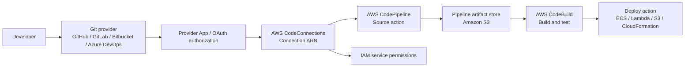
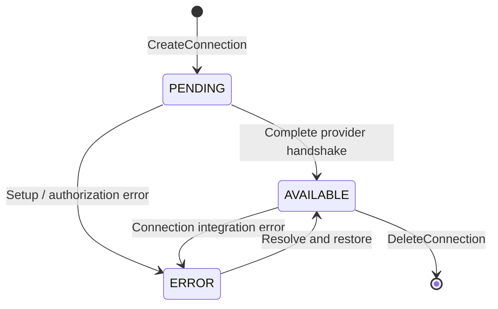
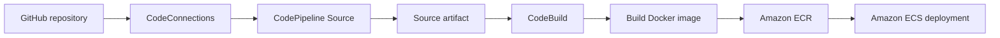
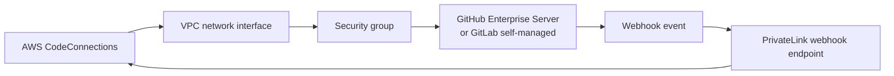
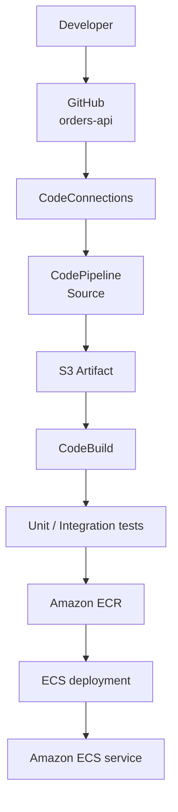

# Kết nối kho mã qua AWS CodeConnections

> **Chương:** CI/CD trên AWS  
> **Module:** CLOUD_PROVIDERS_AWS  
> **Phạm vi:** Tích hợp kho mã nguồn bên thứ ba với AWS thông qua AWS CodeConnections, từ bước cấp quyền cho Git provider, tạo và hoàn tất connection, đến sử dụng connection trong AWS CodePipeline và AWS CodeBuild. Bài học tập trung vào lifecycle, IAM, source action, event triggers, vận hành và xử lý sự cố.

## Mục tiêu học tập

Sau bài này, người học có thể:

1. Giải thích vai trò của AWS CodeConnections trong kiến trúc CI/CD trên AWS.
2. Phân biệt connection, host, provider installation, repository và source action.
3. Nhận biết các provider phổ biến: GitHub, GitHub Enterprise, Bitbucket Cloud, GitLab và Azure DevOps.
4. Phân biệt provider cloud với provider self-managed cần host resource.
5. Tạo connection qua AWS Console và AWS CLI.
6. Giải thích trạng thái PENDING, AVAILABLE và ERROR.
7. Hoàn thành GitHub App/OAuth handshake và giới hạn quyền truy cập repository.
8. Phân biệt service prefix codeconnections với codestar-connections trong ARN và IAM policy.
9. Cấp quyền tối thiểu để CodePipeline và CodeBuild sử dụng connection.
10. Cấu hình CodeStarSourceConnection source action trong CodePipeline.
11. Phân biệt CODE_ZIP và CODEBUILD_CLONE_REF.
12. Cấu hình trigger theo push, branch, tag, pull request và file path.
13. Sử dụng AWS CloudFormation để khai báo connection.
14. Kết nối GitHub Enterprise Server hoặc GitLab self-managed qua host và VPC.
15. Xử lý lỗi Pending, AccessDenied, repository visibility, webhook, host và Region.
16. Thực hành tích hợp một GitHub repository với pipeline triển khai trên AWS.

## 1. AWS CodeConnections là gì?

AWS CodeConnections là dịch vụ quản lý kết nối giữa tài nguyên AWS và kho mã nguồn được lưu trữ tại các nền tảng bên thứ ba.

Ví dụ:

- Mã nguồn ứng dụng Java nằm trong GitHub.
- Nhóm phát triển muốn sử dụng AWS CodePipeline để tự động build và deploy.
- AWS cần một cơ chế xác thực để truy cập repository mà không phải nhúng username/password hoặc personal access token vào pipeline.
- CodeConnections cung cấp connection resource để thiết lập và quản lý quyền truy cập đó.

CodeConnections là lớp tích hợp nguồn mã. Nó không phải Git server, không lưu thay thế repository và không phải dịch vụ build/deploy.

### 1.1 Kiến trúc tổng quát



Quy trình:

1. Developer commit và push code lên repository.
2. Provider phát sinh sự kiện thay đổi mã nguồn.
3. Connection đã được authorize cho phép AWS nhận biết sự kiện và truy cập repository.
4. CodePipeline source action lấy revision tương ứng.
5. Source action tạo artifact hoặc Git clone reference.
6. CodeBuild build/test ứng dụng.
7. Các action tiếp theo triển khai artifact tới môi trường đích.

### 1.2 CodeConnections giải quyết vấn đề gì?

Nếu không có cơ chế tích hợp được quản lý:

- Pipeline có thể phải giữ token truy cập repository.
- Mỗi lần token hết hạn phải có quy trình thay thế.
- Quyền repository khó kiểm soát tập trung.
- Việc đăng ký webhook và xử lý sự kiện có thể phải tự triển khai.
- Việc cấp quyền cho nhiều pipeline trở nên phức tạp.

CodeConnections giúp quản lý connection và provider authorization tập trung, sau đó cho phép các dịch vụ AWS được cấp quyền sử dụng connection đó.

### 1.3 Phân biệt CodeConnections với các dịch vụ CI/CD khác

| Thành phần | Trách nhiệm |
|---|---|
| AWS CodeConnections | Kết nối và authorize external source provider |
| AWS CodePipeline | Điều phối các bước CI/CD |
| AWS CodeBuild | Build và test source code |
| Amazon S3 | Lưu pipeline artifacts |
| AWS CodeDeploy | Điều phối deployment theo mô hình được hỗ trợ |
| AWS IAM | Kiểm soát ai được tạo, quản lý và sử dụng connection |
| GitHub/GitLab/Bitbucket | Lưu trữ source code và phát sinh Git events |

**CodeConnections không thay thế CodePipeline hoặc CodeBuild.** Nó cung cấp khả năng tích hợp repository để các dịch vụ này sử dụng.

## 2. Các khái niệm quan trọng

### 2.1 Connection

Connection là AWS resource đại diện cho mối liên kết đã cấu hình giữa AWS và một third-party source provider.

Connection có:

- Connection name.
- Connection ARN.
- Provider type.
- Connection status.
- Thông tin provider owner.
- Host ARN nếu connection sử dụng provider self-managed có host.

Connection name phải duy nhất trong AWS account và có giới hạn tối đa 32 ký tự. ARN là định danh dùng để tham chiếu resource giữa các dịch vụ AWS.

Ví dụ ARN:

```text
arn:aws:codeconnections:ap-southeast-1:111122223333:connection/abc12345-6789-0000-1111-example
```

ARN trên chỉ là ví dụ minh họa, không phải connection có thật.

Connection ARN được tham chiếu trong cấu hình CodePipeline, IAM policy và các tích hợp AWS tương ứng.

### 2.2 Provider

Provider là nền tảng lưu trữ repository bên ngoài AWS.

Ví dụ:

- GitHub.
- GitHub Enterprise Server.
- Bitbucket Cloud.
- GitLab.com.
- GitLab self-managed.
- Azure DevOps.

Tên provider trong API có thể khác tên hiển thị trên Console.

| Provider trên Console | Provider type thường dùng trong API/CLI |
|---|---|
| GitHub | GitHub |
| GitHub Enterprise Server | GitHubEnterpriseServer |
| Bitbucket | Bitbucket |
| GitLab | GitLab |
| GitLab self-managed | GitLabSelfManaged |
| Azure DevOps | AzureDevOps |

Không được suy luận rằng mọi provider type xuất hiện trong API đều có cùng tính năng trên tất cả dịch vụ AWS. Cần kiểm tra tích hợp của dịch vụ tiêu thụ connection và các giới hạn theo Region.

### 2.3 Host

Host là resource đại diện cho một third-party provider được cài đặt trên hạ tầng riêng, chẳng hạn:

- GitHub Enterprise Server chạy trong EC2.
- GitLab Enterprise Edition chạy trong private VPC.
- GitLab Community Edition self-managed.

Host cung cấp thông tin endpoint và cấu hình kết nối mạng tới hệ thống provider.

Host khác connection:

- Host mô tả nơi provider được cài đặt.
- Connection mô tả quyền truy cập được thiết lập tới provider/repository.

Với provider cloud thông thường như GitHub.com, Bitbucket Cloud hoặc GitLab.com, không cần tạo host.

### 2.4 Provider App / Installation

Một số provider sử dụng ứng dụng tích hợp để authorize AWS:

- GitHub sử dụng AWS Connector for GitHub.
- Bitbucket sử dụng ứng dụng kết nối của AWS.
- GitLab sử dụng ứng dụng tích hợp tương ứng.
- Azure DevOps sử dụng connector authorization.

App installation cho phép AWS được cấp quyền theo phạm vi mà người quản trị provider chấp thuận.

Ví dụ với GitHub App, tổ chức có thể giới hạn các repository mà AWS Connector được truy cập thay vì cho phép toàn bộ repository trong tài khoản.

### 2.5 Repository

Repository là nơi lưu trữ source code, branches, tags, commits và các thông tin Git.

Một connection không đồng nghĩa pipeline được quyền truy cập mọi repository trong tổ chức.

Quyền truy cập thực tế phụ thuộc:

1. Provider account hoặc organization.
2. App installation.
3. Repository permissions đã được cấp.
4. Connection được sử dụng.
5. IAM policy của AWS principal sử dụng connection.

### 2.6 Phân biệt Connection, Host và Repository Link

AWS CodeConnections còn có các resource phục vụ Git sync và những tích hợp khác.

| Resource | Vai trò |
|---|---|
| Connection | Authorize và kết nối tới third-party provider |
| Host | Đại diện hạ tầng provider self-managed |
| Repository Link | Liên kết repository với một tài nguyên hoặc workflow hỗ trợ Git sync |
| Sync Configuration | Cấu hình đồng bộ repository với tài nguyên AWS được hỗ trợ |

Trong bài học này, trọng tâm là Connection và Host. Repository Link và Sync Configuration không phải thành phần bắt buộc để tạo CodePipeline source action thông thường.

## 3. Provider nào được hỗ trợ?

AWS CodeConnections hỗ trợ các provider theo từng tích hợp và tính năng cụ thể.

### 3.1 GitHub và GitHub Enterprise Cloud

**Loại:** Cloud provider

```text
GitHub.com
GitHub Enterprise Cloud
```

Đặc điểm:

- Sử dụng GitHub App.
- Có thể giới hạn repository được truy cập khi cài đặt AWS Connector.
- Connection cần được authorize bởi GitHub account có quyền phù hợp.
- Với repository thuộc organization, owner của organization phải thực hiện hoặc chấp thuận việc cài đặt app theo yêu cầu của AWS.
- Repository không thuộc organization cần quyền owner phù hợp.

Một GitHub App installation có thể được tái sử dụng cho nhiều connection phù hợp trong cùng GitHub account/organization.

Lưu ý: AWS CodeConnections hiện không hỗ trợ GitHub Enterprise Cloud với data residency sử dụng custom domain dạng *.ghe.com theo tài liệu provider compatibility.

### 3.2 Bitbucket Cloud

**Loại:** Cloud provider

Hỗ trợ repository trên Bitbucket Cloud.

Không đồng nghĩa hỗ trợ mọi sản phẩm Bitbucket:

- Bitbucket Cloud: được hỗ trợ.
- Bitbucket Server/Data Center tự cài đặt: không được coi là Bitbucket Cloud connection.

Với Bitbucket workspace, người tạo connection cần quyền administrator theo yêu cầu của provider.

### 3.3 GitLab.com

**Loại:** Cloud provider

Hỗ trợ GitLab.com.

Một số điểm cần lưu ý:

- Tài khoản phải có quyền Owner phù hợp trên repository.
- Repository thuộc group có thể được truy cập theo quyền repository và installation tương ứng.
- AWS CodeConnections hỗ trợ GitLab version 15.x trở lên theo tài liệu provider compatibility.

### 3.4 GitHub Enterprise Server

**Loại:** Self-managed provider

GitHub Enterprise Server chạy trên hạ tầng do tổ chức quản lý.

Ví dụ:

```text
https://github.enterprise.example.com
```

Connection cần host để đại diện cho server cài đặt.

Host có thể cần:

- VPC ID.
- Subnet IDs.
- Security group IDs.
- Provider endpoint.
- TLS certificate nếu sử dụng CA riêng.
- Kết nối mạng giữa AWS CodeConnections và GitHub Enterprise Server.

### 3.5 GitLab self-managed

**Loại:** Self-managed provider

Hỗ trợ GitLab Enterprise Edition hoặc Community Edition self-managed.

Ví dụ:

```text
https://gitlab.internal.example.com
```

Các điểm cần chuẩn bị:

- GitLab instance hoạt động.
- Administrator có thể tạo Personal Access Token với scope `api` để đăng ký host. Nếu GitLab Admin Mode được bật, PAT cần thêm scope `admin_mode`.
- PAT được sử dụng cho quá trình setup host; không nên xem nó như token runtime để nhúng vào application.
- Có thể dùng PAT tạm thời để đăng ký host và thu hồi/xóa PAT sau khi host đã AVAILABLE nếu quy trình tổ chức cho phép.
- Cần cấu hình network connectivity và TLS nếu GitLab nằm trong private network.

### 3.6 Azure DevOps

Azure DevOps cũng có thể được sử dụng làm provider cho CodeConnections và CodePipeline theo hướng dẫn tích hợp tương ứng.

Đặc điểm:

- Kết nối với Azure DevOps account.
- Tạo project và repository trước.
- Cần quyền Administrator trên Azure account để cài đặt connection app theo hướng dẫn.
- Connection chỉ truy cập repository thuộc account đã dùng để tạo và authorize connection.

Phân biệt Azure DevOps Services với các loại Azure provider self-hosted khác. Không mặc định một Azure-hosted server bất kỳ đều được hỗ trợ.

### 3.7 Bảng so sánh provider

| Provider | Loại | Host | Ghi chú |
|---|---|---|---|
| GitHub.com | Cloud | Không | GitHub App |
| GitHub Enterprise Cloud | Cloud | Không | Không hỗ trợ custom data residency domain *.ghe.com |
| Bitbucket Cloud | Cloud | Không | Không bao gồm Bitbucket Server |
| GitLab.com | Cloud | Không | GitLab 15.x trở lên |
| GitHub Enterprise Server | Self-managed | Có | Có thể cần VPC |
| GitLab self-managed | Self-managed | Có | EE hoặc CE |
| Azure DevOps | Cloud service | Không | Cần quyền Administrator phù hợp |

**Quan trọng:** AWS CodeConnections API, AWS CloudFormation resource schema và CodePipeline provider integration có thể có danh sách giá trị không hoàn toàn giống nhau. Kiểm tra tài liệu tương ứng với dịch vụ và phương thức triển khai đang sử dụng trước khi chọn provider.

## 4. Connection lifecycle

Một connection không tự động trở thành AVAILABLE ngay sau khi được tạo bằng CLI hoặc CloudFormation.

### 4.1 Ba trạng thái chính

| Trạng thái | Ý nghĩa |
|---|---|
| **PENDING** | Resource đã được tạo nhưng cần hoàn thành handshake hoặc provider installation. |
| **AVAILABLE** | Connection đã hoàn tất authorization và có thể được các dịch vụ AWS sử dụng nếu IAM permissions hợp lệ. |
| **ERROR** | Connection gặp vấn đề trong quá trình thiết lập hoặc tích hợp; cần kiểm tra provider authorization, trạng thái installation và cấu hình. |

### 4.2 Lifecycle diagram



Sơ đồ mô tả các trạng thái vận hành chính, không phải toàn bộ mọi transition nội bộ của dịch vụ.

### 4.3 Vì sao CLI tạo connection ở trạng thái PENDING?

CLI/API có thể tạo resource nhưng không thay người dùng thực hiện tương tác xác thực trên trang web của provider.

Ví dụ:

1. AWS CLI tạo connection.
2. AWS trả về Connection ARN.
3. Connection có trạng thái PENDING.
4. Người quản trị mở AWS Developer Tools Console.
5. Chọn connection cần hoàn tất.
6. Thực hiện OAuth/App installation handshake.
7. Authorize quyền truy cập.
8. Connection chuyển sang AVAILABLE.

**AWS CLI không thể thay thế bước console handshake cho pending connection theo quy trình hiện hành.**

### 4.4 Kiểm tra connection status

Dùng AWS CLI:

```bash
aws codeconnections list-connections \
  --region ap-southeast-1 \
  --provider-type-filter GitHub
```

Xem thông tin một connection:

```bash
aws codeconnections get-connection \
  --connection-arn arn:aws:codeconnections:ap-southeast-1:111122223333:connection/example-id \
  --region ap-southeast-1
```

Kiểm tra trường ConnectionStatus.

Không đưa Connection ARN minh họa vào production. Sử dụng ARN thật lấy từ output của lệnh tạo connection hoặc AWS Console.

## 5. Tạo connection qua AWS Console

Đây là phương thức phù hợp khi người quản trị muốn thực hiện cả quá trình authorization và provider installation bằng giao diện trực quan.

### 5.1 Chuẩn bị

Trước khi tạo connection GitHub:

- Có AWS account và quyền quản lý CodeConnections.
- Chọn AWS Region có hỗ trợ dịch vụ.
- Đã có GitHub account.
- Đã tạo repository.
- Có quyền owner/admin phù hợp để cài đặt AWS Connector.
- Xác định repository nào được phép cho AWS truy cập.

### 5.2 Các bước tạo GitHub connection


1. Đăng nhập AWS Management Console.
2. Mở Developer Tools Console, mục Settings → Connections.
3. Chọn Create connection.
4. Chọn provider GitHub.
5. Nhập Connection name, ví dụ orders-github-connection.
6. Chọn Connect to GitHub.
7. Chọn Authorize AWS Connector for GitHub.
8. Chọn GitHub account hoặc organization muốn cài đặt App.
9. Chọn repository access phù hợp.
10. Xác nhận Install hoặc Accept new permissions nếu GitHub yêu cầu.
11. Quay lại AWS Console.
12. Chọn installation vừa tạo.
13. Chọn Connect để hoàn tất.

Sau khi hoàn tất, connection hiển thị trong danh sách và có trạng thái AVAILABLE.

### 5.3 Chọn quyền repository tối thiểu

Giả sử organization có:

- orders-api
- payments-api
- customer-service
- internal-tools
- infrastructure-live

Pipeline của orders-api chỉ cần đọc orders-api.

Nên giới hạn GitHub App installation ở repository cần thiết thay vì cấp quyền cho tất cả repository.

Điều này giảm phạm vi truy cập nếu connection hoặc pipeline role bị cấu hình sai.

### 5.4 Quyền người tạo connection

Một số provider yêu cầu quyền cao hơn developer thông thường:

| Provider | Quyền cần chú ý |
|---|---|
| GitHub organization | Organization owner để cài đặt/authorize app |
| GitHub repository cá nhân | Repository owner |
| Bitbucket workspace | Workspace administrator |
| GitLab | Owner của repository |
| Azure DevOps | Administrator trên Azure account theo hướng dẫn |
| GitLab self-managed | Administrator để tạo PAT/thiết lập host |

Không nên cấp quyền admin rộng cho mọi developer chỉ để họ có thể tạo connection. Tổ chức có thể để platform team hoặc administrator quản lý bước authorize, sau đó chia sẻ connection theo cơ chế được AWS hỗ trợ.

## 6. Tạo connection bằng AWS CLI

CLI phù hợp khi cần tạo resource có kiểm soát, ghi nhận vào script provisioning hoặc chuẩn bị infrastructure trước khi hoàn thành authorization.

### 6.1 Tạo GitHub connection

```bash
aws codeconnections create-connection \
  --provider-type GitHub \
  --connection-name orders-github-connection \
  --region ap-southeast-1
```

Ví dụ output:

```json
{
  "ConnectionArn": "arn:aws:codeconnections:ap-southeast-1:111122223333:connection/abcd1234-example"
}
```

Lưu Connection ARN làm output hoặc parameter cho cấu hình pipeline.

Không lưu access token của provider vào file script.

### 6.2 Hoàn tất connection

Sau khi CLI tạo xong:

1. Mở AWS Developer Tools Console.
2. Chọn Region tương ứng.
3. Mở Settings → Connections.
4. Chọn connection đang PENDING.
5. Chọn Update a pending connection.
6. Hoàn thành provider authorization.
7. Chọn Connect/Complete connection.
8. Kiểm tra trạng thái AVAILABLE.

### 6.3 Tạo GitLab connection

```bash
aws codeconnections create-connection \
  --provider-type GitLab \
  --connection-name orders-gitlab-connection \
  --region ap-southeast-1
```

Sau đó hoàn tất authorization trên AWS Console.

### 6.4 Tạo Azure DevOps connection

```bash
aws codeconnections create-connection \
  --provider-type AzureDevOps \
  --connection-name orders-azure-connection \
  --region ap-southeast-1
```

Connection chỉ truy cập các repository thuộc Azure DevOps account đã dùng để authorize.

### 6.5 Liệt kê tất cả connection

```bash
aws codeconnections list-connections \
  --region ap-southeast-1 \
  --output table
```

Có thể lọc provider:

```bash
aws codeconnections list-connections \
  --provider-type-filter GitHub \
  --region ap-southeast-1 \
  --output json
```

### 6.6 Xóa connection

```bash
aws codeconnections delete-connection \
  --connection-arn arn:aws:codeconnections:ap-southeast-1:111122223333:connection/example-id \
  --region ap-southeast-1
```

Xóa connection có thể làm các pipeline đang tham chiếu tới ARN đó không còn truy cập được repository.

Trước khi xóa:

- Xác định pipeline đang dùng connection.
- Xác định các project hoặc tích hợp khác đang tham chiếu.
- Chuẩn bị connection thay thế nếu cần.
- Kiểm tra tác động đến trigger và các lần release đang chờ.

Connection ARN đã xóa không được tái sử dụng cho connection mới.

## 7. Tích hợp với AWS CodePipeline

Đây là use case phổ biến nhất của CodeConnections.

CodePipeline sử dụng connection thông qua source action để:

- Truy cập repository.
- Xác định branch và commit.
- Phát hiện source changes.
- Tạo source artifact.
- Kích hoạt các action tiếp theo.

### 7.1 Action provider và tên dịch vụ

Có một điểm cần phân biệt:

- Tên dịch vụ hiện tại: **AWS CodeConnections**.
- IAM service prefix mới: **codeconnections**.
- CodePipeline source action provider: **CodeStarSourceConnection**.

Không thay giá trị Provider trong ActionTypeId thành CodeConnections một cách tùy tiện.

### 7.2 Các trường cấu hình source action

| Field | Ý nghĩa |
|---|---|
| ConnectionArn | ARN của connection đã AVAILABLE |
| FullRepositoryId | Owner/repository hoặc định danh repository theo provider |
| BranchName | Branch dùng làm source |
| OutputArtifactFormat | Định dạng source artifact |
| DetectChanges | Cho phép hoặc tắt tự động phát hiện thay đổi |

FullRepositoryId phải giữ đúng chữ hoa/chữ thường như tên repository trên provider.

Ví dụ:

```text
Repository owner: my-company
Repository name: Orders-API

FullRepositoryId:
my-company/Orders-API
```

Không tự đổi thành my-company/orders-api nếu tên thực tế có chữ hoa.

### 7.3 Ví dụ CodePipeline source action bằng YAML

```yaml
Name: Source
Actions:
  - Name: GitHubSource
    ActionTypeId:
      Category: Source
      Owner: AWS
      Provider: CodeStarSourceConnection
      Version: "1"
    Configuration:
      ConnectionArn: arn:aws:codeconnections:ap-southeast-1:111122223333:connection/example-id
      FullRepositoryId: my-company/orders-api
      BranchName: main
      OutputArtifactFormat: CODE_ZIP
    OutputArtifacts:
      - Name: SourceArtifact
    RunOrder: 1
```

Đây là fragment của stage source, không phải định nghĩa pipeline đầy đủ. ARN và repository phải thay bằng thông tin thực.

### 7.4 Source action trả về dữ liệu gì?

Thông thường, source action tạo một output artifact chứa source code của revision tương ứng.

Output variables có thể cung cấp:

- BranchName.
- CommitId.
- CommitMessage.
- ConnectionArn.
- FullRepositoryName.
- AuthorDate.

Các biến này có thể được dùng trong các action tiếp theo nếu cấu hình namespace phù hợp.

Ví dụ:

- Gắn commit ID vào Docker image tag.
- Đưa commit message vào deployment notification.
- Ghi nhận source revision vào release metadata.

### 7.5 CODE_ZIP và CODEBUILD_CLONE_REF

Hai cách truyền source code:

| Format | Nội dung | Khi sử dụng |
|---|---|---|
| CODE_ZIP | ZIP chứa snapshot source code | Build/test thông thường |
| CODEBUILD_CLONE_REF | Git URL reference để downstream clone repository | Khi cần Git metadata và thao tác Git trong CodeBuild |

**CODEBUILD_CLONE_REF chỉ dành cho downstream CodeBuild action.**

Khi dùng full clone:

- CodeBuild có thể làm việc với Git repository thực.
- Có thể sử dụng Git history và Git metadata phù hợp.
- CodeBuild service role phải được cấp quyền sử dụng connection.
- Không thể tùy ý chuyển Git URL reference sang một action không hỗ trợ kiểu artifact này.

Nếu build chỉ cần source files, CODE_ZIP thường đơn giản hơn.

### 7.6 Azure DevOps source action

Azure DevOps có hướng dẫn tích hợp riêng trong CodePipeline. Console cho phép chọn Azure DevOps làm source provider.

Đối với Azure DevOps:

- Tạo connection với provider type AzureDevOps.
- Hoàn tất account authorization.
- Chọn repository.
- Chọn artifact format.
- Cấu hình pipeline trigger.

Không mặc định copy nguyên một cấu hình source action của GitHub sang Azure DevOps mà không kiểm tra cấu hình provider tương ứng.

## 8. Tích hợp với AWS CodeBuild

CodeBuild có thể dùng CodeConnections để lấy source từ provider hỗ trợ.

Có hai cách phổ biến:

### 8.1 CodeBuild kết nối trực tiếp tới Git provider

Trong CodeBuild project:

1. Tạo hoặc mở Build project.
2. Chọn Source provider phù hợp.
3. Chọn credential type hỗ trợ GitHub App/connection.
4. Chọn connection đã AVAILABLE.
5. Chọn repository và branch.
6. Cấu hình buildspec.
7. Gắn service role có quyền cần thiết.
8. Chạy build thử nghiệm.

CodeBuild có thể sử dụng connection như account-level credential hoặc custom source credential theo cấu hình project.

### 8.2 CodePipeline gọi CodeBuild

Kiến trúc thường gặp:



Trong mô hình này:

- CodePipeline role cần quyền sử dụng connection ở source action.
- CodeBuild role cần quyền truy cập các tài nguyên mà quá trình build sử dụng.
- Nếu dùng CODEBUILD_CLONE_REF, CodeBuild role còn cần quyền clone từ connection.

### 8.3 Quyền cho CodeBuild full clone

Ví dụ policy giới hạn repository:

```json
{
  "Version": "2012-10-17",
  "Statement": [
    {
      "Effect": "Allow",
      "Action": [
        "codeconnections:UseConnection"
      ],
      "Resource": "arn:aws:codeconnections:ap-southeast-1:111122223333:connection/example-id",
      "Condition": {
        "StringEquals": {
          "codeconnections:FullRepositoryId": "my-company/orders-api"
        }
      }
    }
  ]
}
```

Đây là ví dụ dành cho CodeBuild Git clone với connection ARN mới. Nếu dùng ARN cũ hoặc một tích hợp có service prefix khác, điều chỉnh policy theo đúng ARN và hướng dẫn IAM tương ứng.

Không cấp quyền trên tất cả connections nếu project chỉ cần một repository.

## 9. IAM và phân quyền

IAM là phần quan trọng nhất để kiểm soát việc ai được phép tạo connection, hoàn tất authorization và sử dụng connection.

Cần phân biệt ba nhóm principal.

### 9.1 Connection administrator

Principal này quản lý connection:

- Tạo connection.
- Liệt kê connection.
- Xem trạng thái.
- Hoàn tất handshake.
- Cập nhật hoặc xóa connection.
- Quản lý host nếu sử dụng provider self-managed.

Các quyền thường liên quan:

```text
codeconnections:CreateConnection
codeconnections:DeleteConnection
codeconnections:GetConnection
codeconnections:ListConnections
```

Để hoàn tất handshake trên Console còn cần các IAM policy permissions hỗ trợ quá trình browser-based authorization, chẳng hạn:

```text
codeconnections:GetIndividualAccessToken
codeconnections:GetInstallationUrl
codeconnections:ListInstallationTargets
codeconnections:StartOAuthHandshake
codeconnections:UpdateConnectionInstallation
```

Các quyền handshake nêu trên là các IAM permissions phục vụ luồng Console; không phải tất cả đều là API operations có thể gọi trực tiếp bằng CLI.

Đây là ví dụ nhóm quyền để hiểu vai trò, không phải một policy đầy đủ cho mọi provider.

### 9.2 CodePipeline service role

CodePipeline service role cần được phép sử dụng connection đã cấu hình trong source action.

Ví dụ policy:

```json
{
  "Version": "2012-10-17",
  "Statement": [
    {
      "Sid": "UseOrdersSourceConnection",
      "Effect": "Allow",
      "Action": [
        "codeconnections:UseConnection",
        "codestar-connections:UseConnection"
      ],
      "Resource": "arn:aws:codeconnections:ap-southeast-1:111122223333:connection/example-id"
    }
  ]
}
```

Tại sao có hai action?

AWS duy trì cả hai service prefix:

- codeconnections.
- codestar-connections.

Một số thao tác được thực hiện thông qua code path sử dụng prefix cũ, trong khi các thao tác khác sử dụng prefix mới. AWS hướng dẫn cấp cả hai UseConnection để service role có thể hoạt động với connection ARN thuộc một trong hai prefix.

Điểm quan trọng: **service prefix trong Resource ARN phải khớp với resource thật.**

Nếu ARN thực tế bắt đầu bằng arn:aws:codestar-connections thì Resource policy phải chỉ đúng ARN đó, không thay bằng arn:aws:codeconnections.

### 9.3 CodeBuild service role

CodeBuild service role có thể cần quyền:

- Sử dụng connection khi full clone.
- Đọc source repository.
- Lấy các Git metadata cần thiết.
- Đọc artifact và ghi build outputs.
- Đọc ECR credentials hoặc gọi các dịch vụ khác theo buildspec.

Quyền CodeBuild không thay thế quyền CodePipeline source action.

### 9.4 Không nhầm quyền tạo connection với quyền sử dụng connection

| Permission | Principal thường cần |
|---|---|
| CreateConnection | Connection administrator |
| DeleteConnection | Connection administrator |
| GetConnection | Administrator hoặc role cần xem connection |
| UseConnection | Service role sử dụng connection |
| IAM provider handshake permissions | Người thực hiện authorization qua Console |
| CodeBuild clone permission | CodeBuild project service role khi dùng full clone |

### 9.5 Least privilege

Không nên:

- Cấp codeconnections:* cho tất cả developer.
- Cấp UseConnection trên Resource "*".
- Cho phép app truy cập tất cả repository nếu chỉ cần một repository.
- Dùng AWS account root để quản lý CI/CD thường xuyên.
- Dùng một role quản trị có quyền deploy production cho mọi build.

Nên:

1. Tách administrator role và pipeline role.
2. Giới hạn Resource theo connection ARN.
3. Giới hạn repository bằng condition key khi phù hợp.
4. Phân tách development/staging/production.
5. Theo dõi quyền của Git provider App installation.

## 10. Service prefix và ARN: CodeConnections so với CodeStar Connections

Đây là một phần dễ gây lỗi khi migration hoặc kết hợp tài liệu cũ và mới.

AWS đổi tên dịch vụ từ CodeStar Connections thành CodeConnections.

Tên dịch vụ hiện tại:

```text
AWS CodeConnections
```

IAM service prefix mới:

```text
codeconnections
```

Service prefix cũ:

```text
codestar-connections
```

Cả hai prefix vẫn có thể xuất hiện trong resource và các policy tương thích.

### 10.1 ARN mới

```text
arn:aws:codeconnections:region:account-id:connection/connection-id
```

### 10.2 ARN cũ

```text
arn:aws:codestar-connections:region:account-id:connection/connection-id
```

Từ ngày 1/7/2024, Console tạo connection mới sử dụng service prefix codeconnections trong ARN theo tài liệu AWS. Các resource sử dụng prefix cũ vẫn được hỗ trợ và có thể tiếp tục hiển thị.

### 10.3 Quy tắc khi viết IAM policy

Không làm như sau:

- Copy ARN cũ từ tài liệu nhưng tạo resource mới có ARN prefix mới.
- Chỉ cấp codeconnections:UseConnection trong khi service role còn cần thao tác theo code path cũ.
- Sử dụng ARN của host trong policy dành cho connection.
- Dùng ARN của connection khác Region.

Luôn lấy ARN thật từ Console hoặc CLI và kiểm tra policy Resource.

## 11. Sử dụng Host với provider self-managed

Với GitHub Enterprise Server hoặc GitLab self-managed, AWS cần biết endpoint và cách truy cập tới hệ thống provider.

### 11.1 Host architecture



Đối với provider private, host có thể được cấu hình với VPC để kết nối tới hệ thống nội bộ.

### 11.2 Thông tin cần có

- Provider endpoint.
- VPC ID.
- Subnet IDs.
- Security group IDs.
- TLS certificate nếu dùng private CA.
- Đường truyền network từ host tới provider.
- Quyền administrator trên provider.

Nếu provider chạy trong VPC riêng hoặc data center, cần kết nối thông qua VPC routing, VPN hoặc Direct Connect theo kiến trúc phù hợp.

Mỗi VPC chỉ có thể được liên kết với một host tại một thời điểm. Với GitHub Enterprise Server hoặc GitLab self-managed dùng organization, có thể cần tạo host riêng cho từng connection và giữ nhất quán VPC, subnet, security group giữa các host đó theo hướng dẫn AWS.

### 11.3 Tạo GitLab self-managed host bằng CLI

```bash
aws codeconnections create-host \
  --name orders-gitlab-host \
  --provider-type GitLabSelfManaged \
  --provider-endpoint https://gitlab.internal.example.com \
  --region ap-southeast-1
```

Output minh họa:

```json
{
  "HostArn": "arn:aws:codeconnections:ap-southeast-1:111122223333:host/example-host-id"
}
```

Host vừa tạo có trạng thái PENDING.

### 11.4 Hoàn tất host

1. Mở Developer Tools Console.
2. Chọn Hosts.
3. Chọn host đang PENDING.
4. Chọn Set up host.
5. Nhập thông tin xác thực theo provider.
6. Hoàn thành đăng ký.
7. Kiểm tra host chuyển sang AVAILABLE.

Sau đó mới tạo connection sử dụng host đó.

### 11.5 Tạo connection gắn với host

```bash
aws codeconnections create-connection \
  --host-arn arn:aws:codeconnections:ap-southeast-1:111122223333:host/example-host-id \
  --connection-name orders-gitlab-self-managed \
  --region ap-southeast-1
```

Connection cần hoàn tất provider handshake theo hướng dẫn AWS.

### 11.6 VPC và security group

Đối với host private:

- VPC phải có đường đi tới provider server.
- Subnet phải phù hợp với network topology.
- Security group của host network interface cần kết nối được tới provider.
- Provider server phải cho phép kết nối từ các network interfaces được tạo.
- Webhook event cần đường truyền về endpoint mà AWS provision.
- Nếu sử dụng private CA, cấu hình TLS certificate hợp lệ.

AWS CodeConnections có thể tạo các network resources như network interface và VPC endpoint để hỗ trợ host integration.

Role thực hiện tạo host có VPC configuration cũng cần quyền EC2 phù hợp để tạo/xem/xóa network interface và VPC endpoint. Nếu thiếu các quyền này, host có thể không hoàn tất provisioning dù provider endpoint và credentials đúng.

Không mở toàn bộ provider server ra Internet chỉ để kết nối CI/CD nếu có thể sử dụng private network.

## 12. CloudFormation: quản lý connection bằng IaC

Connection có thể được khai báo bằng CloudFormation.

### 12.1 Resource type

Resource hiện tại:

```text
AWS::CodeConnections::Connection
```

Resource cũ:

```text
AWS::CodeStarConnections::Connection
```

Khi tạo stack mới, ưu tiên resource type hiện hành được hỗ trợ trong Region và schema của CloudFormation.

### 12.2 Ví dụ CloudFormation YAML

```yaml
AWSTemplateFormatVersion: "2010-09-09"

Description: GitHub connection for orders CI/CD pipeline

Resources:
  OrdersGitHubConnection:
    Type: AWS::CodeConnections::Connection
    Properties:
      ConnectionName: orders-github-connection
      ProviderType: GitHub
      Tags:
        - Key: Project
          Value: orders-api
        - Key: Environment
          Value: staging
        - Key: ManagedBy
          Value: cloudformation

Outputs:
  OrdersGitHubConnectionArn:
    Description: ARN of the GitHub source connection
    Value: !GetAtt OrdersGitHubConnection.ConnectionArn

  OrdersGitHubConnectionStatus:
    Description: Current connection status
    Value: !GetAtt OrdersGitHubConnection.ConnectionStatus
```

Đây là template minh họa resource connection. Stack có thể tạo connection nhưng không tự thay thế provider authorization handshake của người quản trị.

### 12.3 Điều cần nhớ khi dùng CloudFormation

Connection được tạo qua CloudFormation ở trạng thái PENDING.

Sau khi stack triển khai:

1. Lấy Connection ARN từ output.
2. Mở Developer Tools Console ở đúng Region.
3. Hoàn tất pending connection.
4. Kiểm tra AVAILABLE.
5. Dùng ARN đó trong CodePipeline.

### 12.4 CloudFormation replacement

Các property như ConnectionName và ProviderType có thể yêu cầu replacement khi thay đổi.

Vì vậy:

- Không đổi provider type tùy tiện trên connection đang dùng production.
- Kiểm tra resource replacement trước khi update stack.
- Xác định các pipeline đang tham chiếu ARN cũ.
- Có kế hoạch chuyển sang connection mới.
- Không xóa connection cũ trước khi pipeline đã chuyển đổi và được kiểm thử.

### 12.5 Giới hạn provider trong CloudFormation

Cần phân biệt:

- AWS CodeConnections API có provider type AzureDevOps.
- AWS CodeConnections CLI có thể tạo AzureDevOps connection.
- CloudFormation resource schema cần được kiểm tra riêng; danh sách Allowed values trong resource reference có thể không trùng hoàn toàn API provider enum.

Vì vậy không giả định một giá trị provider được API chấp nhận chắc chắn cũng được CloudFormation schema chấp nhận trong mọi phiên bản.

Nếu cần Azure DevOps connection nhưng resource schema của Region/stack chưa hỗ trợ, cân nhắc tạo connection bằng CLI/API trong một bước provisioning có kiểm soát và truyền ARN vào stack/pipeline.

## 13. Region và endpoint

CodeConnections là dịch vụ theo Region.

Ví dụ endpoint Singapore:

```text
codeconnections.ap-southeast-1.amazonaws.com
```

Các điểm cần lưu ý:

1. Connection ARN chứa Region.
2. Connection cần được tạo tại Region phù hợp với pipeline/integration.
3. Không lấy ARN ở Region khác rồi giả định mọi dịch vụ sử dụng được.
4. Một số tích hợp có giới hạn Region khác với CodeBuild hoặc CodePipeline.
5. Cross-region connection có quy tắc riêng theo dịch vụ tiêu thụ.

Ví dụ Region:

| Region | Region code | CodeConnections endpoint |
|---|---|---|
| Singapore | ap-southeast-1 | codeconnections.ap-southeast-1.amazonaws.com |
| Tokyo | ap-northeast-1 | codeconnections.ap-northeast-1.amazonaws.com |
| Sydney | ap-southeast-2 | codeconnections.ap-southeast-2.amazonaws.com |
| Mumbai | ap-south-1 | codeconnections.ap-south-1.amazonaws.com |
| N. Virginia | us-east-1 | codeconnections.us-east-1.amazonaws.com |

Đây là một số Region minh họa, không phải danh sách đầy đủ.

### 13.1 Kiểm tra trước khi thiết kế

- CodeConnections có endpoint trong Region không?
- CodePipeline source action cần dùng có được hỗ trợ tại Region không?
- Provider app installation có yêu cầu Region-specific installation không?
- Có giới hạn data residency hoặc opt-in Region không?
- Nếu dùng CodeBuild cross-region connection, connection được tạo ở Region nào và có phải opt-in Region hay không?

Không dựa trên danh sách Region của một dịch vụ khác để suy ra CodeConnections có sẵn.

## 14. Source change detection và triggers

Một trong những giá trị quan trọng của CodeConnections là giúp pipeline nhận biết source changes từ provider.

### 14.1 Push event

Ví dụ:

```text
Developer commits
       |
       v
git push origin main
       |
       v
Git provider event
       |
       v
CodeConnections integration
       |
       v
CodePipeline source action
       |
       v
Pipeline execution
```

Với source action connection, CodePipeline quản lý source change detection. Không cần tự tạo webhook thủ công hoặc chuyển sang polling theo cách cũ cho source action này.

### 14.2 Trigger theo branch

Ví dụ:

- main: triển khai production.
- develop: triển khai development.
- release/*: triển khai staging.
- feature/*: chỉ chạy kiểm tra nếu được cấu hình.

Có thể sử dụng trigger filter để giới hạn branch.

### 14.3 Trigger theo file path

Ví dụ monorepo:

```text
orders-api/
payments-api/
customer-ui/
infrastructure/
```

Pipeline orders-api có thể chỉ chạy khi có thay đổi trong:

```text
orders-api/**
```

Điều này giúp giảm build không cần thiết trong monorepo.

### 14.4 Trigger theo tag

Ví dụ:

```text
release-v1.0.0
release-v1.1.0
release-v2.0.0
```

Pipeline có thể được cấu hình để chỉ chạy khi xuất hiện tag phù hợp.

### 14.5 Trigger theo Pull Request

Các trigger có thể hỗ trợ sự kiện pull request theo provider và event type:

- Open.
- Update.
- Closed.

Use case:

- PR được mở → chạy test.
- PR được cập nhật → chạy lại kiểm tra.
- PR được merge/đóng → thực hiện bước tiếp theo theo policy.

Cần lưu ý cách từng provider biểu diễn Git event có thể khác nhau. Ví dụ việc merge pull request và việc đóng PR không phải lúc nào cũng tạo cùng loại event trên mọi provider.

### 14.6 Tắt automatic change detection

Nếu chỉ muốn chạy pipeline thủ công:

```json
{
  "DetectChanges": "false"
}
```

Không tắt DetectChanges nếu mục tiêu là tự động chạy pipeline sau mỗi commit.

### 14.7 Lưu ý khi dùng nhiều trigger

- Mỗi source action chỉ cấu hình tối đa một trigger; một trigger có thể chứa nhiều filter.
- Push và PR filter có thể tạo nhiều execution khi event giao nhau.
- Khi branch mới được tạo lần đầu, trigger lọc theo file path có thể không chạy vì chưa có danh sách file diff để đối chiếu.
- CodePipeline chỉ kiểm tra tối đa 100 file đầu tiên trong một số luồng file path filter; nếu diff lớn hơn, file khớp filter có thể không nằm trong danh sách được xét.
- Pipeline có nhiều source actions tham chiếu các branch khác nhau của cùng một repository có thể gặp hành vi trigger không như kỳ vọng.

Thiết kế trigger phải được kiểm thử bằng các event thực tế trước khi đưa vào production.

## 15. Tích hợp GitHub với pipeline Java Spring Boot: ví dụ hoàn chỉnh

Giả sử:

- Repository: my-company/orders-api.
- Branch: main.
- Runtime: Amazon ECS.
- Build: AWS CodeBuild.
- Source integration: AWS CodeConnections.
- Pipeline: AWS CodePipeline.

### 15.1 Kiến trúc



### 15.2 Chuẩn bị repository

Repository cần có source code và build files.

Ví dụ:

```text
orders-api/
├── src/
├── pom.xml
├── Dockerfile
├── buildspec.yml
└── README.md
```

### 15.3 Tạo connection

Tạo GitHub connection theo phần Console hoặc CLI ở trên.

Kiểm tra:

- ConnectionStatus = AVAILABLE.
- GitHub App installation đúng organization.
- Repository orders-api đã được cấp quyền.
- AWS Region đúng.

### 15.4 Cấu hình source action

```yaml
Name: Source
Actions:
  - Name: OrdersGitHubSource
    ActionTypeId:
      Category: Source
      Owner: AWS
      Provider: CodeStarSourceConnection
      Version: "1"
    Configuration:
      ConnectionArn: arn:aws:codeconnections:ap-southeast-1:111122223333:connection/example-id
      FullRepositoryId: my-company/orders-api
      BranchName: main
      OutputArtifactFormat: CODE_ZIP
    OutputArtifacts:
      - Name: OrdersSource
    RunOrder: 1
```

### 15.5 Buildspec minh họa

```yaml
version: 0.2

phases:
  install:
    runtime-versions:
      java: corretto21
  pre_build:
    commands:
      - echo "Preparing build"
      - java -version
  build:
    commands:
      - mvn -B clean verify
  post_build:
    commands:
      - echo "Build completed"

artifacts:
  files:
    - target/*.jar
```

Buildspec trên chỉ minh họa phần build Java. Pipeline production có thể bổ sung Docker build, ECR push, test report, artifact packaging và deploy actions.

### 15.6 Kiểm tra hoạt động

1. Push một commit mới lên main.
2. Kiểm tra CodePipeline execution.
3. Kiểm tra Source action thành công.
4. Xác nhận source artifact có revision tương ứng.
5. Kiểm tra CodeBuild nhận đúng artifact.
6. Xem build logs.
7. Xác nhận test và build hoàn tất.
8. Theo dõi deployment action nếu pipeline có triển khai.

## 16. Troubleshooting

### 16.1 Connection vẫn ở PENDING

Nguyên nhân:

- Chưa hoàn thành provider authorization.
- Chưa cài đặt provider App.
- Đang chọn nhầm provider account.
- Người thực hiện không đủ quyền owner/admin.
- Webhook/installation handshake không tới được AWS.

Cách xử lý:

1. Mở Developer Tools Console.
2. Chọn đúng Region.
3. Mở connection PENDING.
4. Thực hiện Update a pending connection.
5. Kiểm tra provider App installation.
6. Authorize lại theo yêu cầu.
7. Xác nhận AVAILABLE.

Không cố dùng CodePipeline với connection PENDING.

### 16.2 AccessDenied khi pipeline lấy source

Thông báo có thể liên quan tới quyền sử dụng connection.

Kiểm tra:

- CodePipeline service role.
- codeconnections:UseConnection.
- codestar-connections:UseConnection.
- Resource ARN có khớp prefix và connection ID không.
- Connection đã AVAILABLE chưa.
- Repository đã được cấp quyền cho provider App chưa.

### 16.3 GitHub repository không xuất hiện

Nguyên nhân:

- Chọn sai GitHub account.
- App installation chưa được cài vào organization.
- Chưa cấp quyền repository.
- Organization owner chưa authorize.
- Connection đang sử dụng một installation khác.

Cách xử lý:

1. Kiểm tra GitHub account/organization.
2. Kiểm tra AWS Connector installation.
3. Kiểm tra Repository Access.
4. Kiểm tra quyền của người tạo connection.
5. Nếu cần, sửa installation permissions rồi thử lại.

### 16.4 Repository name sai

Ví dụ:

```text
Correct: my-company/Orders-API
Wrong:   my-company/orders-api
```

Kiểm tra FullRepositoryId có đúng case-sensitive owner/repository không.

### 16.5 Pipeline không tự chạy sau commit

Kiểm tra:

- DetectChanges.
- Trigger configuration.
- Provider webhook installation.
- Branch filter.
- File path filter.
- Connection status.
- Pipeline source action.

Với source action connection, không tự cấu hình polling hoặc webhook thủ công như workaround đầu tiên. Xác minh event detection và filter trước.

### 16.6 Full clone thất bại

Nếu source action sử dụng CODEBUILD_CLONE_REF:

- CodeBuild downstream action phải là dịch vụ hỗ trợ.
- CodeBuild service role phải có quyền sử dụng connection.
- Resource ARN phải đúng.
- Condition FullRepositoryId phải đúng.
- Không sử dụng Git clone reference với action không hỗ trợ.

### 16.7 Host không chuyển sang AVAILABLE

Với GitHub Enterprise Server hoặc GitLab self-managed:

- Kiểm tra provider endpoint.
- Kiểm tra VPC ID.
- Kiểm tra subnet và security groups.
- Kiểm tra network routing/VPN/Direct Connect.
- Kiểm tra TLS certificate.
- Kiểm tra PAT scope và quyền administrator.
- Kiểm tra host registration webhook.

### 16.8 Webhook không hoạt động

Đối với host self-managed:

- Kiểm tra provider có thể gửi webhook tới endpoint được tạo.
- Kiểm tra firewall/proxy.
- Kiểm tra VPC endpoint và PrivateLink.
- Kiểm tra security group.
- Kiểm tra DNS và TLS.
- Kiểm tra provider app installation.

Nếu connection đang PENDING do không nhận installation webhook, AWS có hướng dẫn khôi phục một số tình huống mà không cần xóa host hoặc connection. Kiểm tra troubleshooting guide trước khi tạo lại resource.

### 16.9 Region không được hỗ trợ

Connection hoặc CodePipeline source action có thể không khả dụng ở một số Region.

Kiểm tra:

1. CodeConnections endpoint.
2. CodePipeline source action availability.
3. Provider support.
4. Region-specific app requirement.
5. Opt-in Region và data residency.

Không chuyển Region connection tùy tiện khi pipeline đã sử dụng ARN hiện tại.

## 17. Bảo mật và vận hành production

### 17.1 Phân tách môi trường

Ví dụ:

| Environment | Connection / Access |
|---|---|
| Development | Repository hoặc branch development |
| Staging | Release branch |
| Production | Main/release branch có approval |
| Shared infrastructure | Repository IaC riêng |

Có thể dùng chung connection trong các pipeline được phép, nhưng phải quản lý quyền và phạm vi truy cập phù hợp.

### 17.2 Giới hạn repository access

- Chỉ cấp repository cần thiết cho App installation.
- Tránh cài app với quyền truy cập toàn bộ organization nếu không cần.
- Tách repository application và infrastructure nếu chính sách bảo mật yêu cầu.
- Review quyền app installation định kỳ.

### 17.3 Quản lý IAM

- Dùng role thay vì access key dài hạn.
- Connection administrator không nên đồng thời là deployment role mặc định.
- CodePipeline service role chỉ có quyền sử dụng connection cần thiết.
- CodeBuild role chỉ có quyền cho source/build tasks.
- Giới hạn Resource theo ARN cụ thể.
- Dùng condition key để giới hạn repository khi phù hợp.

### 17.4 Theo dõi thay đổi

Nên theo dõi:

- Ai tạo connection.
- Ai cập nhật connection.
- Ai xóa connection.
- Khi nào connection chuyển trạng thái.
- Ai thay đổi provider App permissions.
- Pipeline nào đang sử dụng ARN.
- Thay đổi service role permissions.

AWS CloudTrail hỗ trợ audit các hoạt động quản lý dịch vụ AWS. Kết hợp CloudTrail với IAM policy review và quy trình change management.

### 17.5 Xử lý khi nhân viên rời tổ chức

- Xác định connection do người đó tạo hoặc authorize.
- Kiểm tra provider App installation có gắn với account cá nhân không.
- Chuyển quyền quản trị cho owner/team phù hợp.
- Xác minh pipeline không phụ thuộc vào account cá nhân.
- Thu hồi quyền không còn cần thiết.
- Kiểm tra source change detection sau khi thay đổi installation.

Không xóa App installation hoặc connection đang được pipeline production sử dụng mà chưa có kế hoạch thay thế.

## 18. Bài lab: kết nối GitHub repository với AWS CodePipeline

**Mục tiêu:** Tạo connection GitHub và cấu hình CodePipeline source action để tự động lấy source code khi có commit mới.

**Môi trường:** AWS sandbox, GitHub repository thử nghiệm, IAM role được cấp quyền và AWS Region hỗ trợ CodeConnections. Không sử dụng repository chứa secrets hoặc dữ liệu production.

### 18.1 Chuẩn bị GitHub

1. Tạo GitHub account hoặc sử dụng organization thử nghiệm.
2. Tạo repository orders-api-lab.
3. Tạo branch main.
4. Commit một README.md.
5. Xác nhận repository hoạt động bình thường.

### 18.2 Tạo AWS connection

1. Mở AWS Developer Tools Console.
2. Chọn Region ap-southeast-1.
3. Chọn Settings → Connections.
4. Chọn Create connection.
5. Chọn GitHub.
6. Đặt tên orders-api-lab-connection.
7. Chọn Connect to GitHub.
8. Authorize AWS Connector.
9. Chọn GitHub account.
10. Cấp quyền repository orders-api-lab.
11. Chọn Connect.
12. Xác nhận connection AVAILABLE.

### 18.3 Tạo CodePipeline

1. Mở AWS CodePipeline.
2. Chọn Create pipeline.
3. Đặt tên orders-api-lab-pipeline.
4. Chọn service role theo policy được cấp.
5. Chọn source provider GitHub (via GitHub App).
6. Chọn connection orders-api-lab-connection.
7. Chọn repository orders-api-lab.
8. Chọn branch main.
9. Chọn output artifact format mặc định.
10. Lưu source stage.

Nếu chưa có build stage, có thể hoàn thiện source stage trước rồi thêm CodeBuild trong bước tiếp theo.

### 18.4 Kiểm tra source action

1. Chạy pipeline.
2. Mở pipeline execution.
3. Xác nhận Source action thành công.
4. Kiểm tra commit ID.
5. Xác nhận artifact được tạo.
6. Mở execution history và xem source revision.

### 18.5 Kiểm tra tự động trigger

1. Sửa README.md.
2. Commit thay đổi.
3. Push lên main.
4. Theo dõi CodePipeline execution mới.
5. Xác nhận commit mới được lấy đúng.

### 18.6 Kiểm tra IAM

Tạm thời kiểm tra trong sandbox:

- Connection administrator có quyền quản lý connection.
- CodePipeline role có UseConnection đúng ARN.
- Không cấp quyền quản trị provider cho CodePipeline role.
- Không cấp toàn bộ CodeConnections permissions nếu không cần.

Không cố ý làm hỏng pipeline production để kiểm tra AccessDenied.

### 18.7 Kết quả mong đợi

| Kiểm tra | Kết quả |
|---|---|
| GitHub repository | Đã tạo và có branch main |
| AWS connection | AVAILABLE |
| Provider authorization | GitHub App đã được authorize |
| Repository access | Chỉ repository thử nghiệm được cấp |
| IAM service role | Được phép UseConnection |
| Source action | Thành công |
| Artifact | Được tạo trong pipeline |
| Commit trigger | Commit mới kích hoạt execution |
| Security | Không có access token trong source code |

## 19. Bài tập tự kiểm tra

**Bài 1 — Khái niệm.** AWS CodeConnections giải quyết vấn đề gì trong kiến trúc CI/CD? Nó khác CodePipeline như thế nào?

**Bài 2 — Resource.** Phân biệt Connection, Host và Repository.

**Bài 3 — Provider.** Bitbucket Cloud có đồng nghĩa Bitbucket Server được hỗ trợ không? Giải thích.

**Bài 4 — Self-managed.** Khi nào cần tạo Host resource? Cho hai ví dụ.

**Bài 5 — Lifecycle.** Vì sao connection tạo bằng AWS CLI thường ở trạng thái PENDING?

**Bài 6 — Handshake.** Có thể dùng AWS CLI để hoàn tất provider handshake và chuyển pending connection sang AVAILABLE theo quy trình thông thường không?

**Bài 7 — ARN.** Phân biệt service prefix codeconnections và codestar-connections.

**Bài 8 — IAM.** Vì sao CodePipeline service role cần UseConnection?

**Bài 9 — Least privilege.** Pipeline chỉ dùng repository orders-api. Làm thế nào giới hạn phạm vi quyền?

**Bài 10 — Source action.** CodePipeline cần những trường cấu hình chính nào để đọc GitHub repository?

**Bài 11 — Artifact.** CODE_ZIP khác CODEBUILD_CLONE_REF như thế nào?

**Bài 12 — CodeBuild.** Vì sao full clone cần thêm quyền cho CodeBuild service role?

**Bài 13 — Trigger.** Làm thế nào để pipeline chỉ chạy khi có thay đổi trong thư mục orders-api của monorepo?

**Bài 14 — Region.** Tại sao phải kiểm tra Region availability trước khi tạo connection?

**Bài 15 — Troubleshooting.** Connection AVAILABLE nhưng pipeline nhận AccessDenied. Cần kiểm tra những thành phần nào?

**Bài 16 — GitHub.** Repository không xuất hiện trong danh sách kết nối. Những nguyên nhân nào có thể xảy ra?

**Bài 17 — Host.** GitLab self-managed không chuyển sang AVAILABLE. Những thành phần network và authorization nào cần kiểm tra?

**Bài 18 — IaC.** CloudFormation tạo connection thành công nhưng CodePipeline không được trigger. Nguyên nhân có thể là gì?

**Bài 19 — Production.** Vì sao không nên dùng một connection administrator role làm service role cho tất cả pipeline?

**Bài 20 — Migration.** Khi thay một connection ARN cũ bằng connection ARN mới, cần kiểm tra những thành phần nào trước khi xóa connection cũ?

<details>
<summary>Gợi ý đáp án</summary>

1. CodeConnections quản lý provider authorization và connection resource; CodePipeline điều phối các bước CI/CD.
2. Connection là liên kết đã authorize; Host mô tả hạ tầng provider self-managed; Repository là kho mã nguồn.
3. Không. Bitbucket Cloud được hỗ trợ, Bitbucket Server không thuộc cùng provider integration.
4. Với GitHub Enterprise Server hoặc GitLab self-managed.
5. CLI/API tạo resource nhưng không thực hiện browser-based provider handshake.
6. Không. Dùng AWS Developer Tools Console để hoàn tất pending connection.
7. codeconnections là prefix mới; codestar-connections là prefix cũ vẫn được hỗ trợ.
8. Để pipeline được phép sử dụng connection khi source action truy cập repository.
9. Giới hạn Resource theo connection ARN và dùng condition key FullRepositoryId khi phù hợp.
10. ConnectionArn, FullRepositoryId và BranchName; OutputArtifactFormat là tùy chọn.
11. CODE_ZIP truyền source snapshot dạng ZIP; CODEBUILD_CLONE_REF truyền Git reference cho CodeBuild downstream.
12. CodeBuild cần được phép dùng connection để thực hiện Git clone.
13. Cấu hình trigger với branch/file path filter phù hợp.
14. Connection và source action có thể bị giới hạn theo Region.
15. Kiểm tra service role, UseConnection, ARN prefix, Resource ARN và connection status.
16. Sai provider account, app installation, repository access hoặc quyền owner/admin.
17. Kiểm tra host status, VPC, subnet, security group, DNS, TLS, endpoint và PAT scope.
18. Connection có thể vẫn PENDING vì chưa hoàn tất handshake.
19. Vì vi phạm least privilege và làm tăng phạm vi ảnh hưởng khi role bị lạm dụng.
20. Kiểm tra pipeline references, IAM policies, source triggers, CodeBuild full clone và các tích hợp khác.

</details>

## 20. Checklist production

### Connection và provider

- [ ] Provider type được dịch vụ tích hợp hỗ trợ.
- [ ] Repository đã tồn tại và có branch cần thiết.
- [ ] Provider account/organization đúng.
- [ ] Người authorize có quyền owner/admin phù hợp.
- [ ] App installation chỉ được cấp quyền cần thiết.
- [ ] Connection status là AVAILABLE.
- [ ] Host status là AVAILABLE nếu sử dụng self-managed provider.
- [ ] Region có hỗ trợ CodeConnections và source action tương ứng.

### IAM và bảo mật

- [ ] Connection administrator và pipeline service role được tách biệt.
- [ ] CodePipeline service role có UseConnection đúng ARN.
- [ ] Cân nhắc cả codeconnections:UseConnection và codestar-connections:UseConnection theo tài liệu AWS.
- [ ] Resource ARN có đúng service prefix.
- [ ] CodeBuild role có quyền Git clone nếu sử dụng CODEBUILD_CLONE_REF.
- [ ] Repository access được giới hạn.
- [ ] Không hardcode provider access token trong source code/buildspec.
- [ ] IAM permissions tuân theo least privilege.
- [ ] CloudTrail và quy trình audit được thiết lập.

### Pipeline và triggers

- [ ] FullRepositoryId đúng chữ hoa/chữ thường.
- [ ] BranchName chính xác.
- [ ] OutputArtifactFormat phù hợp.
- [ ] CODEBUILD_CLONE_REF chỉ dùng với downstream CodeBuild.
- [ ] DetectChanges được cấu hình đúng.
- [ ] Push/PR/tag/file path triggers được kiểm thử.
- [ ] Pipeline không chạy trùng ngoài mong muốn.
- [ ] Source artifact có commit ID chính xác.

### Vận hành

- [ ] Có owner chịu trách nhiệm cho connection.
- [ ] Có quy trình rotate/re-authorize provider App khi cần.
- [ ] Có quy trình xử lý PENDING và ERROR.
- [ ] Có kế hoạch thay connection trước khi xóa resource đang sử dụng.
- [ ] Có runbook xử lý webhook, repository permissions và IAM AccessDenied.
- [ ] Các thay đổi provider App installation được review.
- [ ] Có quy trình bàn giao khi nhân viên rời tổ chức.

## 21. Tài liệu AWS chính thức

### AWS CodeConnections

- [AWS CodeConnections — Working with connections](https://docs.aws.amazon.com/dtconsole/latest/userguide/connections.html)
- [AWS CodeConnections — How connections work](https://docs.aws.amazon.com/dtconsole/latest/userguide/welcome-connections-how-it-works.html)
- [AWS CodeConnections — Supported providers and versions](https://docs.aws.amazon.com/dtconsole/latest/userguide/supported-versions-connections.html)
- [AWS CodeConnections — Create a connection](https://docs.aws.amazon.com/dtconsole/latest/userguide/connections-create.html)
- [AWS CodeConnections — Create GitHub connection](https://docs.aws.amazon.com/dtconsole/latest/userguide/connections-create-github.html)
- [AWS CodeConnections — Create Azure DevOps connection](https://docs.aws.amazon.com/dtconsole/latest/userguide/connections-create-azure.html)
- [AWS CodeConnections — Update a pending connection](https://docs.aws.amazon.com/dtconsole/latest/userguide/connections-update.html)
- [AWS CodeConnections — Create a host](https://docs.aws.amazon.com/dtconsole/latest/userguide/connections-host-create.html)
- [AWS CodeConnections — IAM permissions](https://docs.aws.amazon.com/dtconsole/latest/userguide/security-iam.html)
- [AWS CodeConnections — Troubleshooting](https://docs.aws.amazon.com/dtconsole/latest/userguide/troubleshooting-connections.html)
- [AWS CodeConnections — Endpoints and quotas](https://docs.aws.amazon.com/general/latest/gr/codeconnections.html)
- [AWS CodeConnections — CreateConnection API](https://docs.aws.amazon.com/codeconnections/latest/APIReference/API_CreateConnection.html)

### AWS CodePipeline

- [AWS CodePipeline — Add third-party source providers using CodeConnections](https://docs.aws.amazon.com/codepipeline/latest/userguide/pipelines-connections.html)
- [AWS CodePipeline — CodeStarSourceConnection action reference](https://docs.aws.amazon.com/codepipeline/latest/userguide/action-reference-CodestarConnectionSource.html)
- [AWS CodePipeline — GitHub connections](https://docs.aws.amazon.com/codepipeline/latest/userguide/connections-github.html)
- [AWS CodePipeline — Azure DevOps connections](https://docs.aws.amazon.com/codepipeline/latest/userguide/connections-azure.html)
- [AWS CodePipeline — Pipeline triggers](https://docs.aws.amazon.com/codepipeline/latest/userguide/pipelines-triggers.html)
- [AWS CodePipeline — Troubleshooting](https://docs.aws.amazon.com/codepipeline/latest/userguide/troubleshooting.html)

### AWS CodeBuild và CloudFormation

- [AWS CodeBuild — GitHub App connections](https://docs.aws.amazon.com/codebuild/latest/userguide/connections-github-app.html)
- [AWS CloudFormation — AWS::CodeConnections::Connection](https://docs.aws.amazon.com/AWSCloudFormation/latest/TemplateReference/aws-resource-codeconnections-connection.html)
- [AWS CLI — codeconnections create-connection](https://docs.aws.amazon.com/cli/latest/reference/codeconnections/create-connection.html)
- [AWS CLI — codeconnections create-host](https://docs.aws.amazon.com/cli/latest/reference/codeconnections/create-host.html)

## Tổng kết

AWS CodeConnections cung cấp lớp tích hợp và quản lý quyền truy cập tới các kho mã nguồn bên thứ ba để những dịch vụ AWS như CodePipeline, CodeBuild và các tích hợp được hỗ trợ có thể sử dụng repository.

Khi triển khai cần nhớ:

1. Connection là resource quản lý authorization; Host đại diện cho provider self-managed.
2. Connection tạo bằng CLI/API hoặc CloudFormation thường bắt đầu ở PENDING và cần hoàn tất handshake qua Console.
3. AWS CodeConnections là tên dịch vụ hiện tại, nhưng CodePipeline source action vẫn sử dụng provider CodeStarSourceConnection trong các cấu hình tương ứng.
4. IAM service role phải có quyền sử dụng đúng Connection ARN; cần chú ý service prefix codeconnections và codestar-connections.
5. CODE_ZIP phù hợp cho source artifact thông thường; CODEBUILD_CLONE_REF dành cho downstream CodeBuild và cần thêm quyền.
6. Repository access, IAM permissions, provider installation và Region phải được kiểm tra đồng thời.
7. Khi vận hành production, cần theo dõi connection status, source triggers, quyền truy cập và thay đổi provider App installation.

**Nguyên tắc cốt lõi:** Kết nối repository thành công không chỉ là tạo được Connection ARN. Connection phải được authorize, đạt trạng thái AVAILABLE, được IAM cho phép sử dụng và được cấu hình chính xác trong source action của dịch vụ CI/CD.

