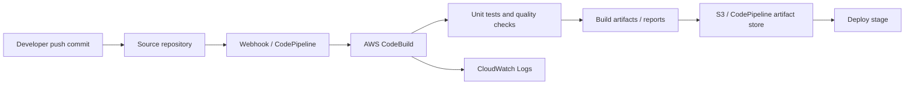

# CodeBuild project, buildspec và môi trường build

## 1. Vai trò của AWS CodeBuild trong CI/CD

Một nhóm phát triển ứng dụng Java Spring Boot cần tự động lấy source code, cài JDK và Maven, chạy unit tests, đóng gói JAR, kiểm tra chất lượng và lưu build artifacts. Nếu mỗi developer tự chạy lệnh trên laptop, kết quả có thể khác nhau do phiên bản JDK, dependency cache, biến môi trường hoặc cấu hình máy.

**AWS CodeBuild** là dịch vụ build được quản lý của AWS. CodeBuild cung cấp môi trường tính toán tạm thời để tải source, thực thi các lệnh build/test theo cấu hình và xuất artifacts/reports/logs. Bạn không phải tự duy trì máy build lâu dài; một build được khởi chạy theo yêu cầu, từ webhook/source event hoặc từ pipeline.

Bài học thuộc chương **CI/CD trên AWS** của module **CLOUD_PROVIDERS_AWS**. Module khám phá Region/AZ, IAM, VPC, compute, storage, database, integration và serverless; người học cần chọn dịch vụ, thiết kế và triển khai ứng dụng an toàn, có giám sát, phục hồi và kiểm soát chi phí. CodeBuild là thành phần thực thi CI trong hệ sinh thái đó: nó biến source revision thành artifacts có thể kiểm thử, ký, lưu trữ và triển khai tiếp.

Sau bài, bạn sẽ có thể:

- Giải thích cấu trúc một CodeBuild project và vòng đời build.
- Chọn source, build environment, compute type, image, artifacts và service role.
- Viết `buildspec.yml` với phases, runtime versions, environment variables, artifacts và reports.
- Quản lý secrets bằng Parameter Store/Secrets Manager và IAM.
- Cấu hình cache, VPC connectivity, CloudWatch Logs và S3 artifacts.
- Tích hợp CodeBuild với CodePipeline, Git webhooks và batch builds.
- Xây dựng Java/Maven pipeline, Docker image build và quy trình troubleshooting.

## 2. CodeBuild project là gì?

**Project** là cấu hình có thể tái sử dụng để khởi chạy các build. Một project xác định source, environment, buildspec, service role, artifacts, cache, logs, network settings, timeout và một số policy khác.

Một project có thể được kích hoạt thủ công bằng API/CLI, qua CodePipeline, webhook hoặc các automation khác. Mỗi lần chạy tạo một **build execution** với source version, environment, phases, logs, kết quả và artifacts riêng.

### 2.1. Các thành phần chính

| Thành phần | Trách nhiệm | Ví dụ |
| --- | --- | --- |
| Source | Nơi CodeBuild lấy input | CodePipeline, GitHub, Bitbucket, S3 |
| Environment | Runtime và compute để chạy build | Linux container, Windows, ARM, custom image |
| Buildspec | Các lệnh và cách xử lý kết quả | `buildspec.yml` |
| Service role | IAM role CodeBuild assume để gọi AWS APIs | Đọc S3 source, lấy secret, push ECR |
| Artifacts | Output sau build | JAR, ZIP, reports, Docker image trong ECR |
| Cache | Dữ liệu có thể tái sử dụng giữa builds | Maven dependencies, package cache |
| Logs | Log output và chẩn đoán | CloudWatch Logs, S3 logs |
| VPC configuration | Network interfaces/subnets/security groups | Kết nối private dependencies |
| Triggers | Cách bắt đầu build | Manual, webhook, CodePipeline |

### 2.2. Project và build execution khác nhau

Project là **bản cấu hình**; build là **một lần thực thi** cấu hình đó. Cùng project có thể chạy nhiều builds theo các source revisions khác nhau. Nếu project cho phép concurrent builds, nhiều build executions có thể chạy đồng thời, chịu giới hạn account/service quotas và compute capacity.

Mỗi build cần được truy vết bằng build ID, project name, source version, start/end time, status và logs. Không suy ra build thành công chỉ vì project tồn tại hoặc pipeline đã khởi chạy.

### 2.3. CodeBuild trong CI/CD workflow



CodeBuild tập trung vào build/test. CodePipeline điều phối các stages và approvals; CodeDeploy, CloudFormation, ECS, Lambda hoặc một deployment tool khác thực hiện release. Không bắt buộc dùng CodePipeline: CodeBuild cũng có thể chạy độc lập hoặc được gọi từ hệ thống CI khác.

## 3. Cấu hình CodeBuild project

### 3.1. Source

Source định nghĩa cách CodeBuild nhận input. Những source types thường gặp:

| Source type | Ý nghĩa |
| --- | --- |
| `CODEPIPELINE` | Source/artifact được CodePipeline truyền vào |
| `GITHUB` | Repository trên GitHub |
| `BITBUCKET` | Repository trên Bitbucket |
| `CODECOMMIT` | Repository AWS CodeCommit nếu account đã có quyền sử dụng dịch vụ |
| `S3` | Source archive trong S3 |
| `GITHUB_ENTERPRISE` | GitHub Enterprise Server |
| `GITLAB` / `GITLAB_SELF_MANAGED` | GitLab SaaS hoặc self-managed |
| `NO_SOURCE` | Build không tải source; commands/buildspec có thể được cung cấp theo project |

Danh sách source integrations và phương thức xác thực có thể thay đổi theo khu vực/dịch vụ. Với GitHub/GitLab/Bitbucket, cấu hình connection/credential theo cơ chế được AWS hỗ trợ và chỉ cấp quyền repository cần thiết.

### 3.2. Source version

Một build nên được gắn với revision có thể tái tạo:

- Git commit SHA là định danh source chính xác.
- Branch/tag là tên tham chiếu; nội dung có thể thay đổi theo thời gian nếu branch tiếp tục nhận commit.
- S3 source version có thể được xác định qua object/version configuration phù hợp.
- CodePipeline truyền source artifact/version metadata cho build action.

Trong release pipeline, ghi nhận commit SHA và build ID vào metadata để biết artifact được tạo từ source nào. Tránh deploy artifact được build từ một branch mutable mà không lưu revision cụ thể.

### 3.3. Environment

Build environment quyết định hệ điều hành, CPU architecture, runtime image, compute resources và các capability mà lệnh build có thể sử dụng. Có thể chọn managed image do AWS duy trì hoặc custom image do tổ chức quản lý.

### 3.4. Buildspec

Buildspec mô tả commands, variables, artifacts, cache và reports. Mặc định CodeBuild tìm file `buildspec.yml` tại thư mục gốc source; có thể chỉ định path khác hoặc cấu hình buildspec inline theo project/API. Buildspec có thể được cung cấp qua source artifact hoặc vị trí được hỗ trợ.

### 3.5. Artifacts

Artifacts là output cần truyền sang bước tiếp theo hoặc lưu trữ. Ví dụ:

- Java JAR/WAR trong S3 hoặc CodePipeline artifact store.
- ZIP deployment package cho Lambda.
- Static web assets.
- Test reports và coverage reports.
- Docker image được push lên Amazon ECR (image không nhất thiết là S3 artifact).

### 3.6. Service role

CodeBuild assume một IAM service role để truy cập AWS resources trong lúc build. Role này phải có đúng quyền cho source, secrets, cache, artifacts, logs, KMS, ECR và những dịch vụ build thực sự dùng. **Service role của CodeBuild khác với IAM role của ứng dụng được deploy**; không dùng chung quyền production runtime nếu build không cần.

## 4. Build environment: image, compute và platform

### 4.1. Managed images và custom images

**Managed image** được AWS cung cấp và duy trì theo các image versions. Nó có sẵn một tập runtime/tooling như Java, Node.js, Python, Docker client hoặc AWS CLI tùy image version. Ưu điểm là dễ bắt đầu và giảm công việc duy trì base image.

**Custom image** phù hợp khi build cần:

- Compiler hoặc SDK nội bộ.
- Tool versions không có trong managed image.
- CA certificates, package mirrors hoặc binary đã được phê duyệt.
- Runtime đặc thù hoặc dependencies được đóng gói trước.

Custom image có thể được lưu trong ECR hoặc registry được hỗ trợ. Team phải chịu trách nhiệm cập nhật OS packages, vá lỗ hổng, kiểm tra provenance, pin image digest/version và kiểm soát quyền pull image.

Nếu custom image nằm trong private ECR, kiểm tra `ImagePullCredentialsType` của project. `CODEBUILD` dùng credentials do CodeBuild quản lý; `SERVICE_ROLE` dùng project service role. Khi chọn `SERVICE_ROLE`, role cần quyền ECR đọc image/layer tương ứng; quyền pull image là một bước riêng với quyền push image được thực hiện trong build commands.

### 4.2. Chọn compute type

Compute type xác định tài nguyên CPU/memory và đôi khi storage/network characteristics cho build. Chọn theo workload:

| Workload | Cân nhắc |
| --- | --- |
| Java unit tests, Maven build nhỏ | Compute nhỏ/vừa nếu build time và memory ổn |
| Multi-module Maven/Gradle | Nhiều memory/CPU hơn, cache dependency |
| Docker image build lớn | CPU, memory, disk và privileged mode khi cần |
| Frontend bundle | CPU, memory và dependency cache |
| Integration tests nhiều containers | Compute/network đủ cho test dependencies |
| Build song song nhiều modules | Tăng compute hoặc tách thành batch/build matrix |

Bắt đầu bằng compute nhỏ đáp ứng ổn định, sau đó đo thời gian, peak memory, disk usage và failure rate. Compute lớn hơn có thể giảm duration nhưng tăng cost per minute; lựa chọn cần dựa trên total cost/build và pipeline throughput.

### 4.3. OS và CPU architecture

CodeBuild hỗ trợ các environment dựa trên Linux, Windows và một số ARM/Graviton options tùy image/compute type. Build native dependencies cần tương thích architecture; không giả định artifact được build trên x86_64 sẽ hoạt động giống trên ARM64.

Với Java bytecode thuần, build có thể ít phụ thuộc CPU architecture hơn, nhưng Docker base image, JNI, native Maven plugins và integration test containers vẫn có thể phụ thuộc architecture.

### 4.4. Privileged mode và Docker builds

Nếu build cần chạy Docker daemon để `docker build` trong Linux container, có thể phải bật `privilegedMode` theo hướng dẫn CodeBuild cho environment đó. Chỉ bật khi thực sự cần. Privileged mode tăng quyền truy cập vào host/container runtime và làm tăng blast radius nếu buildspec hoặc dependency bị kiểm soát bởi nguồn không tin cậy.

Nếu chỉ cần build/push image theo mô hình khác, đánh giá các lựa chọn như managed build environment phù hợp, buildkit/build service hoặc image build service chuyên dụng. Đừng bật privileged mode cho mọi project theo một template chung.

### 4.5. Build timeout và queued timeout

Project có thể cấu hình timeout cho thời gian build và timeout chờ trong queue. Chọn giới hạn dựa trên thời gian build bình thường và worst case có căn cứ. Timeout quá dài giữ compute cho job bị treo; quá ngắn gây lỗi giả cho integration tests hoặc dependency downloads.

## 5. Buildspec: cấu trúc và phiên bản

Buildspec là file YAML mô tả cách CodeBuild thực thi build. Phiên bản thường dùng là `0.2`; version `0.1` có hành vi shell khác khiến state shell/working directory không được giữ giữa từng command như version `0.2`.

Khung cơ bản:

```yaml
version: 0.2

env:
  variables:
    APP_NAME: orders-api

phases:
  install:
    runtime-versions:
      java: corretto21
    commands:
      - java -version
      - mvn -version
  pre_build:
    commands:
      - echo "Preparing build"
  build:
    commands:
      - mvn -B clean verify
  post_build:
    commands:
      - echo "Build finished"

artifacts:
  files:
    - target/*.jar
```

Ví dụ minh họa Java Maven; runtime identifier cần tồn tại trong managed image đang chọn. Nếu dùng custom image, không phải lúc nào `runtime-versions` cũng được hỗ trợ; image có trách nhiệm cung cấp runtime cần thiết.

### 5.1. Các top-level sections

| Section | Mục đích |
| --- | --- |
| `version` | Phiên bản buildspec syntax |
| `env` | Environment variables và exported variables |
| `proxy` | Cấu hình proxy cho build khi cần |
| `phases` | Các giai đoạn lệnh thực thi |
| `artifacts` | Files cần xuất ra |
| `cache` | Paths cần cache |
| `reports` | Test/coverage reports |
| `batch` | Cấu hình batch build |

Không phải project nào cũng cần tất cả sections. Giữ buildspec ngắn và rõ; chuyển logic phức tạp sang script versioned trong repository nếu giúp dễ kiểm thử.

### 5.2. Buildspec path

Mặc định CodeBuild tìm `buildspec.yml` ở root source. Có thể dùng path như `ci/buildspec.yml` khi cấu hình project/build override. Đường dẫn được hiểu theo source directory đã tải; với monorepo cần bảo đảm build action chạy đúng project folder và artifact paths tương ứng.

### 5.3. Working directory và shell behavior

Trong buildspec `0.2`, commands trong cùng phase chạy trong cùng shell instance theo semantics của CodeBuild, vì vậy `cd`, export biến và shell state có thể được giữ qua các commands của phase. Các phase khác nhau được CodeBuild quản lý riêng; không giả định mọi shell state tồn tại xuyên suốt các phase. Nếu cần biến dùng ở phase sau, dùng `env.exported-variables` hoặc ghi file nhỏ trong workspace một cách có kiểm soát.

## 6. Build phases và command execution

CodeBuild buildspec thường có bốn phases chính:

1. `install`: chuẩn bị runtime/tools.
2. `pre_build`: đăng nhập registry, tải metadata hoặc chuẩn bị config.
3. `build`: compile, test, package.
4. `post_build`: publish image, upload metadata hoặc thông báo kết quả.

CodeBuild còn có các bước quản lý source download, artifact upload và finalization bên ngoài những phases mà bạn khai báo trong buildspec.

### 6.1. install

Dùng `install` để chọn runtime version, cài package phụ trợ hoặc kiểm tra toolchain. Ưu tiên managed image có sẵn runtime thay vì chạy package manager cài lại toàn bộ JDK trong mỗi build. Nếu cần custom tools, pin version và verify checksum/signature.

### 6.2. pre_build

Các tác vụ phổ biến:

- In ra Java/Maven versions để audit.
- Xác thực biến bắt buộc và target environment.
- Lấy dependency metadata.
- Đăng nhập ECR bằng service role và `aws ecr get-login-password`.
- Chuẩn bị test database/service endpoint.

Không in access keys, session tokens hoặc secrets trong log. Nếu build chỉ chạy unit tests, đừng thêm bước ECR login không cần thiết.

### 6.3. build

Đây là phase thực thi compile/test/package. Ví dụ Maven:

```bash
mvn -B -ntp clean verify
```

`verify` chạy Maven lifecycle tới phase verify, bao gồm compile/test/package theo Maven project configuration. Nếu tests thất bại, command trả exit code khác 0 và build thường chuyển sang failure; không thêm `|| true` để che lỗi tests.

### 6.4. post_build

`post_build` có thể dùng để:

- In build metadata.
- Push Docker image sau khi build thành công.
- Tạo manifest chứa commit SHA và artifact version.
- Thực hiện bước publish được yêu cầu.

Post-build không nên được dùng để biến một test failure thành success. Nếu một command cần chạy kể cả khi phase thất bại, cân nhắc `finally` với semantics đúng và vẫn giữ nguyên trạng thái failure.

### 6.5. on-failure và finally

Buildspec 0.2 hỗ trợ `on-failure` cho phase/command behavior trong các môi trường được hỗ trợ, với các lựa chọn như `ABORT`, `CONTINUE`, `RETRY`, `RETRY-count` hoặc `RETRY-regex` tùy cú pháp. Dùng retry cho lỗi tạm thời có thể phục hồi, ví dụ dependency endpoint chập chờn; không retry mù các lỗi deterministic như compile failure hoặc test assertion.

`finally` chứa commands cần chạy sau commands thông thường của phase, kể cả khi một command trong phase thất bại. Có thể dùng để tạo diagnostic summary hoặc cleanup tạm thời. Nếu cleanup cần thiết để bảo vệ credentials/files, phải thiết kế sao cho vẫn chạy trong failure path.

## 7. Environment variables, Parameter Store và Secrets Manager

Environment variables giúp truyền cấu hình vào build mà không phải sửa source. CodeBuild hỗ trợ values đặt ở project, buildspec hoặc lúc gọi `StartBuild`, cùng các cơ chế lấy giá trị từ Parameter Store/Secrets Manager.

### 7.1. Thứ tự ưu tiên

Khi cùng một tên biến được đặt ở nhiều nơi, giá trị cấu hình lúc **StartBuild** có ưu tiên cao nhất, tiếp theo là **project configuration**, sau đó là **buildspec**. Hãy xem xét điều này khi debug vì override của pipeline có thể thay giá trị bạn thấy trong buildspec.

### 7.2. Plain variables

```yaml
env:
  variables:
    APP_ENV: test
    APP_REGION: ap-southeast-1
```

Chỉ dùng plain variables cho giá trị không nhạy cảm. Không đặt password, token hoặc access keys trực tiếp trong YAML hoặc project environment variables dạng plaintext.

### 7.3. Parameter Store

```yaml
env:
  parameter-store:
    DB_HOST: /orders/test/database/host
    FEATURE_FLAG: /orders/test/feature-flag
```

CodeBuild service role cần `ssm:GetParameters` và quyền KMS decrypt nếu parameter dùng customer-managed key phù hợp. Chỉ cấp quyền vào parameter paths cần thiết; không cấp đọc toàn bộ namespace.

### 7.4. Secrets Manager

```yaml
env:
  secrets-manager:
    DB_PASSWORD: "orders/test/database:password"
    SIGNING_KEY: "orders/test/signing:private-key"
```

Cú pháp cho phép chỉ định secret name/ARN và JSON key/version selector theo buildspec format. Service role cần `secretsmanager:GetSecretValue` và quyền `kms:Decrypt` khi secret được mã hóa bằng customer-managed key.

### 7.5. Secret hygiene

- Không echo toàn bộ environment hoặc dump `env`/`printenv`.
- Không đưa secrets vào artifact, cache, test report hoặc Docker layer.
- Tránh truyền secrets qua command-line arguments có thể xuất hiện trong process/debug logs.
- Hạn chế buildspec/PR có thể truy cập production secrets.
- Rotate secret và dùng identity-based access thay cho static AWS keys.
- Không dựa hoàn toàn vào log masking: biến đổi/encode secret có thể không được nhận diện để che.

## 8. Runtime versions và dependency management

### 8.1. Managed runtime versions

Một số managed images cho phép chọn runtime qua `runtime-versions`, ví dụ Java Corretto, Node.js hoặc Python version có sẵn trong image. Runtime identifier/version phụ thuộc image version; kiểm tra danh sách runtimes hỗ trợ trước khi pin.

```yaml
phases:
  install:
    runtime-versions:
      java: corretto21
```

Pin image tag và runtime version giúp build reproducible hơn. Nếu managed image được cập nhật, toolchain bên trong có thể thay đổi theo image tag; chọn image version cụ thể, theo dõi deprecation và chủ động nâng cấp.

### 8.2. Maven/Gradle dependencies

Maven:

```bash
mvn -B -ntp -DskipTests dependency:go-offline
mvn -B -ntp clean verify
```

Gradle:

```bash
./gradlew --no-daemon dependencies
./gradlew --no-daemon clean test build
```

Không cần chạy `dependency:go-offline` ở mọi project; nó có thể tăng build time nếu cache đã đủ. Gradle wrapper và Maven wrapper nên được commit để cố định tool version theo repository policy.

### 8.3. Reproducible builds

- Pin JDK, Maven/Gradle, plugins và dependency versions.
- Dùng dependency lock/verification khi ecosystem hỗ trợ.
- Không tải binary không kiểm tra checksum.
- Hạn chế version ranges và snapshot dependencies cho release builds.
- Ghi source commit, build ID, tool versions và artifact checksum.
- Tách dependency repositories/mirrors đáng tin cậy và giới hạn quyền publish.
## 9. Artifacts và test reports

Build output thường gồm binary/package để deploy, cùng báo cáo giúp đánh giá chất lượng. CodeBuild có thể upload artifacts lên S3 hoặc chuyển artifacts trực tiếp giữa các actions của CodePipeline.

### 9.1. Artifacts trong buildspec

Ví dụ Maven JAR:

```yaml
artifacts:
  base-directory: target
  files:
    - "*.jar"
  discard-paths: yes
  name: orders-api-$CODEBUILD_BUILD_NUMBER
```

`base-directory` xác định thư mục gốc tương đối với source workspace; `files` chọn files cần upload. `discard-paths` loại bỏ directory hierarchy nếu cần. Điều chỉnh glob để loại source/Javadoc/test JAR nếu project tạo nhiều loại JAR. Tên artifact nên chứa version/commit/build metadata nếu pipeline cần truy vết; không dùng timestamp đơn lẻ làm định danh release.

Nếu project được gọi từ CodePipeline, cấu hình artifact type `CODEPIPELINE` để CodeBuild trả output cho pipeline action. Nếu project chạy độc lập và lưu output lên S3, cấu hình artifact type `S3` trong project; bucket/key/encryption/packaging phải khớp mục tiêu.

### 9.2. Secondary artifacts

Một build có thể tạo nhiều nhóm output, ví dụ JAR deployable, generated API docs và SBOM. `secondary-artifacts` cho phép khai báo nhiều artifact identifiers và đường dẫn riêng; project phải khai báo tương ứng các secondary artifact destinations. Giữ output cần thiết, tránh upload toàn bộ workspace hoặc files tạm.

### 9.3. Test reports

Buildspec có thể khai báo reports để CodeBuild thu thập kết quả test/coverage:

```yaml
reports:
  unit-tests:
    files:
      - "TEST-*.xml"
    base-directory: target/surefire-reports
    file-format: JUNITXML
  integration-tests:
    files:
      - "TEST-*.xml"
    base-directory: target/failsafe-reports
    file-format: JUNITXML
```

Report group có thể được lưu trong CodeBuild và hiển thị qua console/API. Kiểm tra report files thực sự được tạo; nếu build dừng trước test phase, report có thể không tồn tại. Report retention và permissions cần được xem xét như log artifacts khác.

### 9.4. Artifact integrity

Với release artifacts:

- Gắn source commit SHA và build ID.
- Tạo checksum/SHA-256 manifest.
- Giữ immutable version hoặc bucket versioning phù hợp.
- Dùng artifact bucket encryption và bucket policy hạn chế access.
- Không đóng gói secrets, `.env`, local credentials hoặc test fixtures nhạy cảm.
- Chỉ promote artifact đã qua test/approval; không rebuild khác source để deploy production nếu không có lý do.

## 10. Caching và tối ưu thời gian build

Cache giúp tránh tải lại dependencies hoặc thực hiện lại các bước tốn thời gian. CodeBuild hỗ trợ cache trên S3 và local cache theo environment/cấu hình được hỗ trợ.

### 10.1. S3 cache

```yaml
cache:
  paths:
    - "/root/.m2/**/*"
    - "node_modules/**/*"
```

Buildspec chỉ khai báo các paths cần cache. Cache type (S3 hoặc local) và S3 location được cấu hình trong CodeBuild project. Đường dẫn cache phải phù hợp với build environment và tool. Maven trên một số image chạy bằng user khác hoặc home khác; kiểm tra `HOME` và Maven local repository path thay vì sao chép path mù quáng.

### 10.2. Local cache

Local cache có thể dùng các modes như source cache, Docker layer cache và custom cache theo loại environment hỗ trợ. Docker layer cache cần environment/cấu hình Linux phù hợp và privileged mode. Local cache có thể tăng tốc build liên tiếp trên compute capacity phù hợp nhưng không nên được coi là persistent storage hay source of truth. Build có thể chạy trên host khác và cache không có sẵn.

### 10.3. Cache correctness và security

- Cache chỉ dữ liệu có thể tái tạo, không cache secrets hoặc private keys.
- Tránh dùng cache chung giữa trust boundaries khác nhau, ví dụ fork PR không tin cậy và protected release.
- Pin dependencies; invalidation khi toolchain/lock files thay đổi.
- Đừng để cache cũ làm build bỏ qua dependency update hoặc kiểm thử mới.
- Đo cache hit rate, transfer time và storage cost.

Cache sai có thể làm build nhanh nhưng không reproducible. Nếu nghi cache làm sai kết quả, chạy một build không cache để so sánh và tìm nguyên nhân.

## 11. Cấu hình project bằng CloudFormation

CodeBuild project có thể được quản lý bằng CloudFormation/CDK/Terraform giống các resources AWS khác. Ví dụ sau khai báo project được CodePipeline gọi:

```yaml
Parameters:
  CodeBuildServiceRoleArn:
    Type: String

Resources:
  OrdersBuildProject:
    Type: AWS::CodeBuild::Project
    Properties:
      Name: orders-api-build
      ServiceRole: !Ref CodeBuildServiceRoleArn
      Source:
        Type: CODEPIPELINE
        BuildSpec: buildspec.yml
      Artifacts:
        Type: CODEPIPELINE
      Environment:
        Type: LINUX_CONTAINER
        Image: "aws/codebuild/standard:<supported-image-version>"
        ComputeType: BUILD_GENERAL1_SMALL
        PrivilegedMode: false
        EnvironmentVariables:
          - Name: APP_ENV
            Value: test
            Type: PLAINTEXT
      TimeoutInMinutes: 20
      QueuedTimeoutInMinutes: 60
      LogsConfig:
        CloudWatchLogs:
          Status: ENABLED
      Tags:
        - Key: Application
          Value: orders-api
```

`<supported-image-version>` là placeholder; chọn một image tag còn được AWS hỗ trợ và pin theo quy trình nâng cấp của tổ chức. Service role ARN ở ví dụ được truyền từ bên ngoài; template này không tự tạo role hoặc permissions. `Source.Type` và `Artifacts.Type` là `CODEPIPELINE` vì project được dùng làm CodePipeline build action. Nếu chạy standalone, chọn source/artifact configuration tương ứng.

### 11.1. Project configuration cần được version hóa

Khi thay đổi build image, compute type, service role, buildspec path, environment variables, VPC hoặc log destination, hãy review cùng code. Những thay đổi này có thể ảnh hưởng build reproducibility, permissions, security boundary, cost và artifact compatibility.

## 12. IAM service role và quyền truy cập

CodeBuild project có service role được CodeBuild assume trong quá trình build. Trust policy thường cho phép service principal `codebuild.amazonaws.com` assume role; policy permissions tùy source, artifacts và commands.

### 12.1. Ví dụ quyền theo nhu cầu

| Nhu cầu | Actions thường cần |
| --- | --- |
| Đọc source từ S3 | `s3:GetObject`, có thể `s3:GetObjectVersion` |
| Ghi artifacts vào S3 | `s3:PutObject`, có thể multipart upload actions |
| Đọc secret | `secretsmanager:GetSecretValue` |
| Đọc Parameter Store | `ssm:GetParameters` |
| Decrypt customer-managed key | `kms:Decrypt`, và các quyền KMS cần thiết theo workflow |
| Push image ECR | `ecr:GetAuthorizationToken`, `ecr:BatchCheckLayerAvailability`, `ecr:InitiateLayerUpload`, `ecr:UploadLayerPart`, `ecr:CompleteLayerUpload`, `ecr:PutImage` |
| Ghi CloudWatch Logs | `logs:CreateLogGroup`, `logs:CreateLogStream`, `logs:PutLogEvents` |
| Tạo VPC network interfaces | `ec2:CreateNetworkInterface`, `ec2:DescribeNetworkInterfaces`, `ec2:DeleteNetworkInterface`, `ec2:DescribeSubnets`, `ec2:DescribeSecurityGroups`, `ec2:DescribeVpcs`, `ec2:DescribeDhcpOptions` và `ec2:CreateNetworkInterfacePermission` theo cấu hình |

Đây là danh sách định hướng, không phải policy copy-paste cho mọi project. Quyền cụ thể phụ thuộc source type, artifact mode, KMS key, logs config, VPC và các AWS APIs được build commands gọi. Với VPC integration, giới hạn các EC2 network-interface permissions theo project/subnet/security group và điều kiện mà CodeBuild hỗ trợ.

### 12.2. Phân biệt service role và source credentials

Service role cho phép CodeBuild gọi AWS APIs. Khi truy cập Git provider, CodeBuild còn có thể cần connection/token credentials theo integration. Không đặt Git personal access token trong buildspec; dùng connection/credential store được hỗ trợ và giới hạn repository.

### 12.3. Least privilege theo environment

Một project build/test trên dev không nên đọc secrets production hoặc push image vào mọi ECR repositories. Tạo role/environment riêng cho test, staging và production release. Nếu CodeBuild chỉ tạo artifact, đừng cấp quyền deploy production resources cho role build.

### 12.4. Không dùng access keys tĩnh trong build

Trong build, SDK/CLI có thể sử dụng credentials do CodeBuild cung cấp qua service role. Tránh lưu IAM user access keys trong environment variables, source, cache hoặc artifacts. Role credentials có thời hạn và được quản lý bởi AWS.

## 13. VPC connectivity và network configuration

Theo mặc định, build environment có network behavior do CodeBuild quản lý. Nếu build cần truy cập private resources như RDS, private package registry, internal API hoặc service trong VPC, cấu hình VPC, subnets và security groups cho project.

### 13.1. Khi nào cần VPC configuration?

- Integration tests cần kết nối database private.
- Build tải dependency từ internal artifact repository.
- Build truy cập service chỉ có private endpoint.
- Build deploy/update resource trong network nội bộ.

Nếu build chỉ tải source/public dependencies và ghi artifact qua AWS APIs, không nhất thiết phải đặt nó trong VPC. Thêm VPC configuration làm tăng yêu cầu network/ENI permissions và cần thiết kế egress rõ.

### 13.2. Subnets, security groups và egress

CodeBuild tạo network interfaces trong subnets được chọn để build có thể truy cập tài nguyên VPC. Chọn private subnets có đủ IP addresses và security group egress chỉ tới destinations cần thiết. Build environment không cần inbound access từ Internet cho luồng thông thường; đừng mở inbound rộng chỉ để chạy build.

### 13.3. Internet và VPC endpoints

Build trong private subnet không tự động có Internet access. Nếu cần tải Maven dependencies từ public repositories, cần NAT gateway/egress proxy hoặc một giải pháp network phù hợp. Nếu chỉ cần AWS services, xem xét VPC endpoints (ví dụ S3, ECR, CloudWatch Logs, Secrets Manager, SSM) để hạn chế đường đi qua Internet/NAT và kiểm soát endpoint policies.

Thiết kế network phải tính DNS, route tables, NACLs, security group egress, endpoint policies và KMS access. Một build timeout khi download dependencies có thể là lỗi network chứ không phải lỗi Maven.

### 13.4. Database integration tests

Không nên dùng production database cho build tests. Dùng ephemeral test database, isolated schema/credentials hoặc service giả lập phù hợp. Dọn dữ liệu sau test, giới hạn subnet/security group và đảm bảo concurrent builds không ghi đè cùng test fixtures.

## 14. Logs, metrics và build lifecycle

### 14.1. CloudWatch Logs

CodeBuild có thể gửi build output tới CloudWatch Logs; có thể cấu hình log group/stream và retention. S3 logs cũng là một lựa chọn lưu trữ. Quyền ghi log phải có trong service role theo cấu hình.

Log nên chứa:

- Project name và build ID.
- Source commit/revision.
- Runtime/tool versions.
- Phase bắt đầu/kết thúc.
- Test summary, artifact name/checksum và error context.

Không log access keys, tokens, secret values, private package credentials hoặc toàn bộ environment variables.

### 14.2. Build lifecycle statuses

Build execution đi qua các trạng thái/phase như:

| Phase/status | Ý nghĩa |
| --- | --- |
| `SUBMITTED` / `QUEUED` | Đã nhận yêu cầu hoặc chờ compute |
| `PROVISIONING` | Chuẩn bị build environment |
| `DOWNLOAD_SOURCE` | Tải source input |
| `INSTALL` | Chạy install phase |
| `PRE_BUILD` | Chạy pre_build |
| `BUILD` | Chạy build phase |
| `POST_BUILD` | Chạy post_build |
| `UPLOAD_ARTIFACTS` | Upload output |
| `FINALIZING` | Hoàn tất xử lý cuối |
| `COMPLETED` | Build kết thúc; build status cho biết success/failure |

Các status build thường gồm `SUCCEEDED`, `FAILED`, `FAULT`, `TIMED_OUT`, `STOPPED` hoặc `IN_PROGRESS`. Đọc cả `buildStatus` lẫn `currentPhase`/phase contexts để phân biệt build fail do tests, timeout, provisioning hay artifact upload.

### 14.3. Metrics và alarms

Theo dõi build duration, success/failure rate, queued time, timeout, throttling/concurrency, compute utilization (nếu có metrics phù hợp) và artifact upload failures. Có thể dùng CloudWatch alarms/event rules để phát hiện build thất bại hoặc pipeline bị kẹt; thiết kế notification theo team ownership và mức độ nghiêm trọng.

## 15. Tích hợp CodeBuild với CodePipeline và source webhooks

### 15.1. CodeBuild action trong CodePipeline

CodePipeline có thể truyền source artifact vào CodeBuild action, rồi nhận output artifact để chuyển sang stage kế tiếp. Khi đó:

- CodeBuild project dùng source type `CODEPIPELINE`.
- Artifact input/output của project dùng type `CODEPIPELINE`.
- Pipeline action khai báo input artifacts và output artifacts.
- Buildspec được lưu cùng source hoặc project configuration.
- CodeBuild service role và CodePipeline role có permissions riêng cho nhiệm vụ của từng service.

CodePipeline role gọi CodeBuild và truyền artifact; CodeBuild service role đọc input, thực thi commands và ghi output. Không cấp quyền deploy cho CodeBuild nếu deployment do một action/role khác thực hiện.

### 15.2. Webhooks và build triggers

Với source repository được hỗ trợ, CodeBuild có thể tạo webhook để khởi chạy build khi có sự kiện như push hoặc pull request. Cấu hình webhook filters để chỉ build branch/paths/events cần thiết, tránh kích hoạt production build cho mọi event.

Các lưu ý:

- Dùng protected branches và required status checks.
- Phân biệt pull request từ branch nội bộ và fork không tin cậy.
- Không cấp production secrets hoặc privileged Docker build cho untrusted PR.
- Tránh tạo webhook trùng lặp nếu pipeline đã quản lý trigger.
- Kiểm tra webhook connection/permissions khi event không tạo build.

### 15.3. Build start API/CLI

Có thể khởi chạy build thủ công:

```bash
aws codebuild start-build \
  --project-name orders-api-build \
  --source-version 4d2a7f8c9e10 \
  --region ap-southeast-1
```

Lệnh trả về build ID. Theo dõi:

```bash
aws codebuild batch-get-builds \
  --ids orders-api-build:build-id \
  --region ap-southeast-1
```

`build-id` ở ví dụ là placeholder; thay bằng ID thực tế trong response `start-build`. `StartBuild` có thể override một số cấu hình như environment variables, buildspec, source version hoặc artifacts; quyền override phải được kiểm soát vì nó có thể thay đổi hành vi/security của project.

### 15.4. Build matrix và batch builds

Batch builds cho phép chạy nhiều build executions theo graph/list/matrix configuration. Phù hợp khi cần kiểm thử:

- Nhiều JDK versions.
- Nhiều architecture hoặc operating systems.
- Nhiều modules/services trong monorepo.
- Nhiều test suites độc lập.

Batch build có thể tăng concurrency và throughput nhưng cũng tăng compute usage/cost và áp lực lên dependency registries/test databases. Đặt concurrency limits, batch service role nếu cần, và cô lập test data theo build identifier.

## 16. Ví dụ hoàn chỉnh: build Java Maven project

Giả sử repository có Maven wrapper, source Java, unit tests và output JAR ở `target/`. Build chỉ cần chạy test và tạo artifact cho pipeline.

### 16.1. buildspec.yml

```yaml
version: 0.2

env:
  variables:
    APP_NAME: orders-api
  exported-variables:
    - APP_NAME

phases:
  install:
    runtime-versions:
      java: corretto21
    commands:
      - java -version
      - ./mvnw -version

  pre_build:
    commands:
      - echo "Preparing ${APP_NAME}"
      - test -f pom.xml
      - test -x ./mvnw

  build:
    commands:
      - ./mvnw -B -ntp clean verify

  post_build:
    commands:
      - echo "Build ${CODEBUILD_BUILD_NUMBER} completed"

artifacts:
  base-directory: target
  files:
    - "*.jar"
  discard-paths: yes

reports:
  unit-tests:
    files:
      - "TEST-*.xml"
    base-directory: target/surefire-reports
    file-format: JUNITXML

cache:
  paths:
    - "/root/.m2/repository/**/*"
```

Ví dụ giả định managed Linux image chạy dưới user có Maven home tại `/root/.m2`; hãy kiểm tra home thực tế của image và sửa cache path cho phù hợp. Nếu Maven wrapper không có executable bit, sửa mode trong Git thay vì chạy lệnh chmod thủ công mỗi build.

### 16.2. Project settings

Project cần:

- Source repository hoặc `CODEPIPELINE` artifact.
- Linux managed image có Corretto 21 runtime.
- Compute type phù hợp module và test suite.
- Buildspec path tới file ở trên.
- Service role có quyền đọc source, ghi artifact và logs.
- CloudWatch Logs bật; retention theo policy.
- Timeout đủ cho dependency download và tests.
- Cache S3/local nếu đo được lợi ích.

Nếu chạy trong CodePipeline, output artifact type `CODEPIPELINE`; nếu standalone, cấu hình S3 artifact destination.

### 16.3. Kiểm tra kết quả

Sau build, kiểm tra:

1. Build status là `SUCCEEDED`.
2. `mvn verify` chạy tests và không bỏ qua lỗi.
3. JUnit report group có test counts/failures.
4. Artifact JAR đúng tên/version và checksum.
5. Logs không chứa secrets.
6. Source revision/build ID được ghi lại để truy vết.

## 17. Ví dụ: build và push Docker image lên ECR

Build container image là use case phổ biến của CodeBuild. Project Linux cần `PrivilegedMode: true` khi dùng Docker daemon theo hướng dẫn CodeBuild. ECR repository nên được tạo và quản lý bằng IaC trước; build role chỉ cần quyền push vào repository cụ thể.

### 17.1. Buildspec

Project environment variables không nhạy cảm có thể gồm:

- `AWS_ACCOUNT_ID`: account ID đích.
- `ECR_REPOSITORY`: tên ECR repository.
- `IMAGE_TAG`: tag duy nhất, thường gắn commit SHA hoặc release version.
- `CONTAINER_NAME`: tên container trong ECS task definition nếu dùng CodePipeline ECS deploy action.

Ví dụ:

```yaml
version: 0.2

phases:
  pre_build:
    commands:
      - REGISTRY="$AWS_ACCOUNT_ID.dkr.ecr.$AWS_DEFAULT_REGION.amazonaws.com"
      - aws ecr get-login-password --region "$AWS_DEFAULT_REGION" | docker login --username AWS --password-stdin "$REGISTRY"
  build:
    commands:
      - docker build -t "$AWS_ACCOUNT_ID.dkr.ecr.$AWS_DEFAULT_REGION.amazonaws.com/$ECR_REPOSITORY:$IMAGE_TAG" .
  post_build:
    commands:
      - docker push "$AWS_ACCOUNT_ID.dkr.ecr.$AWS_DEFAULT_REGION.amazonaws.com/$ECR_REPOSITORY:$IMAGE_TAG"
      - printf '[{"name":"%s","imageUri":"%s"}]\n' "$CONTAINER_NAME" "$AWS_ACCOUNT_ID.dkr.ecr.$AWS_DEFAULT_REGION.amazonaws.com/$ECR_REPOSITORY:$IMAGE_TAG" > imagedefinitions.json

artifacts:
  files:
    - imagedefinitions.json
```

Ví dụ minh họa shell flow; project phải cung cấp các biến `AWS_ACCOUNT_ID`, `ECR_REPOSITORY`, `IMAGE_TAG`, `CONTAINER_NAME` và `AWS_DEFAULT_REGION` hợp lệ. File `imagedefinitions.json` dùng schema của CodePipeline ECS standard deploy action. Mỗi phase tự dựng registry/image URI từ các environment variables để không phụ thuộc vào shell variable được gán trong phase trước.

### 17.2. Quyền và security

- `ecr:GetAuthorizationToken` thường cần scope `Resource: "*"`.
- Các upload/push actions được giới hạn vào ECR repository ARN đích.
- Không dùng ECR admin policy hoặc `ecr:*` nếu không cần.
- Tag image bằng commit SHA/release version; `latest` chỉ nên là convenience tag.
- Scan image, kiểm tra base image và provenance trước khi deploy.
- Không truyền Docker build secrets bằng `ARG` hoặc `ENV` nếu chúng có thể bị lưu vào image layers/history; dùng secret mount/build mechanism phù hợp.

## 18. Troubleshooting CodeBuild

| Triệu chứng | Nguyên nhân thường gặp | Cách kiểm tra |
| --- | --- | --- |
| `YAML_FILE_ERROR` | Indentation, syntax hoặc buildspec key sai | Validate YAML/buildspec version; đọc lỗi line/column |
| `COMMAND_EXECUTION_ERROR` | Command trả exit code khác 0 | Xem phase logs và chạy lại command trong image tương đương |
| Không tìm thấy buildspec | Sai path hoặc source root/monorepo directory | Kiểm tra buildspec path trong project và source layout |
| Runtime version không hỗ trợ | Image không có runtime identifier đó | Chọn managed image/runtime pair được hỗ trợ |
| Maven dependency timeout | Network, DNS, NAT, proxy hoặc repository throttling | Kiểm tra VPC routes/endpoints/proxy và Maven mirror |
| `AccessDenied` khi đọc source | Service role thiếu S3/Git/KMS permission | Kiểm tra role, bucket policy, KMS key policy |
| `AccessDenied` khi lấy secret | Thiếu SSM/Secrets Manager/KMS permission | Kiểm tra ARN/path và resource policy |
| Artifact upload failure | S3 permissions, KMS, artifact path hoặc bucket policy | Kiểm tra `artifacts.files`, destination và role |
| Test report không hiển thị | Sai report path/format hoặc test không tạo XML | Xác minh file trong workspace và `file-format` |
| Docker daemon unavailable | Privileged mode chưa bật hoặc image không hỗ trợ | Kiểm tra environment type và privileged mode |
| Docker push bị denied | ECR login sai Region/account hoặc thiếu push permissions | Kiểm tra registry URI, token Region, repository ARN |
| Build không truy cập RDS private | Sai VPC/subnet/SG/route hoặc DB security group | Kiểm tra ENI, egress, DB ingress và DNS |
| Private build không tải được internet dependencies | Không có NAT/proxy hoặc endpoint phù hợp | Kiểm tra egress path, DNS và routes |
| Build queued quá lâu | Concurrency/quota/compute capacity | Kiểm tra queued time, concurrent builds và quotas |
| Build timed out | Timeout thấp, tests treo hoặc download chậm | Xem phase duration, tăng timeout có căn cứ, profile tests |
| Build success nhưng artifact sai | Glob/base-directory hoặc build tạo output khác | Kiểm tra actual workspace path và checksum |

### 18.1. Quy trình chẩn đoán

1. Xác nhận đúng project, build ID, source revision và Region.
2. Đọc `buildStatus`, `currentPhase` và phase contexts trong `batch-get-builds`.
3. Mở CloudWatch Logs tại phase lỗi đầu tiên.
4. Kiểm tra buildspec path/version, image, runtime và compute type.
5. Nếu lỗi AWS API, kiểm tra service role, resource policy và KMS.
6. Nếu lỗi network, kiểm tra VPC/subnet/route/DNS/NAT/VPC endpoints.
7. Kiểm tra artifacts/reports/cache sau khi command thành công.
8. Ghi lại root cause và cập nhật buildspec/project IaC để tránh lặp lại.

## 19. Security, isolation và supply chain

CodeBuild thực thi commands lấy từ source repository/buildspec. Nếu người có thể thay đổi buildspec cũng có thể đọc production secrets hoặc dùng service role rộng, một pull request độc hại có thể trở thành đường thực thi code với quyền AWS.

### 19.1. Trust boundary của source

- Pull request từ fork là input không tin cậy; không cấp production credentials.
- Chỉ build release từ protected branch/tag và revision đã review.
- Tách project/role cho untrusted tests và trusted release builds.
- Không dùng chung privileged Docker build environment cho code không tin cậy.
- Giới hạn webhook filters và quyền override `StartBuild`.

### 19.2. Service role trust policy

Trust policy nên cho phép đúng CodeBuild service assume role, và khi khả thi giới hạn theo project/account để giảm confused-deputy risk. Ví dụ khái niệm:

```json
{
  "Version": "2012-10-17",
  "Statement": [
    {
      "Effect": "Allow",
      "Principal": {
        "Service": "codebuild.amazonaws.com"
      },
      "Action": "sts:AssumeRole",
      "Condition": {
        "StringEquals": {
          "aws:SourceAccount": "111122223333"
        },
        "ArnLike": {
          "aws:SourceArn": "arn:aws:codebuild:ap-southeast-1:111122223333:project/orders-api-build"
        }
      }
    }
  ]
}
```

Thay account/Region/project bằng giá trị thực. Cấu hình trust policy cần tương thích với service integration và project lifecycle của tổ chức; kiểm thử role assumption sau khi thêm conditions.

### 19.3. Build image security

- Ưu tiên managed image hoặc custom image từ registry được kiểm soát.
- Pin image version/digest và cập nhật định kỳ.
- Quét OS packages, runtime, build tools và container layers.
- Không chạy package manager với repository không đáng tin.
- Hạn chế privileged mode, host mounts và Docker socket access.
- Không dùng image có `latest` tag làm build environment production nếu không pin digest/version.

### 19.4. Artifact provenance

Một artifact production nên gắn với source revision, build project, build ID, tool versions và checksum. Có thể bổ sung SBOM, image scan result, signature/attestation và approval record theo supply-chain policy. Bảo vệ artifact bucket/ECR repository để người không có quyền không thể thay thế artifact sau khi build thành công.

### 19.5. KMS và encryption

S3 artifacts/cache, CloudWatch Logs và secrets có thể dùng encryption at rest theo cấu hình dịch vụ. Nếu dùng customer-managed KMS key, cần key policy và IAM permissions cho service role tương ứng. Không chỉ cấp `kms:Decrypt`; upload/download có thể cần những KMS actions khác tùy luồng mã hóa và dịch vụ tích hợp.

## 20. Chi phí và vận hành hiệu quả

CodeBuild tính phí theo build duration và compute/environment lựa chọn, theo pricing model/Region hiện hành. Chi phí tổng thể còn có thể gồm S3 artifacts/cache, CloudWatch Logs, NAT gateway/data transfer, ECR storage và KMS requests.

### 20.1. Các yếu tố tác động chi phí

| Yếu tố | Cách kiểm soát |
| --- | --- |
| Compute type | Chọn CPU/memory vừa đủ theo metrics |
| Build duration | Cache đúng cách, tránh cài tool lặp lại |
| Concurrent builds | Giới hạn concurrency và batch size |
| VPC/NAT | Dùng VPC endpoints khi phù hợp, giảm egress không cần |
| Artifacts | Chỉ upload output cần thiết, lifecycle S3 |
| Logs | Retention theo policy, tránh debug logs vô hạn |
| Docker layers | Cache có kiểm soát và cleanup images cũ |
| Retry | Chỉ retry lỗi tạm thời, không lặp compile/test deterministic |

### 20.2. Đo trước khi tối ưu

Theo dõi:

- Thời gian queue và provisioning.
- Duration từng phase.
- Dependency download time/cache hit.
- Test duration và flaky tests.
- Artifact upload duration/size.
- Build failure/retry rate.
- Cost/build và cost per successful release.

Tối ưu dựa trên bottleneck thực tế. Tăng compute có thể giảm duration nhưng không chắc giảm tổng chi phí; cache quá rộng có thể tăng S3 cost hoặc tạo rủi ro dữ liệu.

### 20.3. Reliability

- Đặt timeout cho build và queued time.
- Retry có giới hạn với dependency/network errors.
- Dùng immutable source revision và deterministic dependencies.
- Tách integration tests phụ thuộc dịch vụ ngoài khỏi unit tests nhanh.
- Đảm bảo test fixtures độc lập khi concurrent builds.
- Có runbook cho webhook failure, quota, role permission và network outage.
- Theo dõi service quotas/concurrent build limits và xin tăng quota trước khi cần.

## 21. Case study: CI cho Orders API

Một nhóm Java xây dựng Orders API trên ECS Fargate. Họ cần kiểm tra mọi pull request, tạo JAR sau khi merge và build container image để phát hành.

### 21.1. Project boundaries

| Project | Trigger | Quyền |
| --- | --- | --- |
| `orders-pr-check` | Pull request | Đọc source, dependency cache, test report; không có production secrets |
| `orders-main-build` | Merge vào protected main | Build/test, ghi JAR artifact vào pipeline store |
| `orders-image-release` | Release tag/approved pipeline | Push ECR image cho repository của Orders API |

Các project có thể dùng image/toolchain tương tự nhưng service roles, environment variables và trigger policy khác nhau.

### 21.2. Pull request flow

1. Webhook khởi chạy `orders-pr-check` cho pull request đã chọn.
2. CodeBuild tải source revision, chạy Maven wrapper và unit tests.
3. JUnit reports được publish để reviewer xem test results.
4. Build thất bại nếu compile/test fail; required status check chặn merge.
5. Project không được đọc production secrets hoặc assume production deploy role.

### 21.3. Main branch flow

1. CodePipeline lấy commit SHA sau merge.
2. CodeBuild chạy `clean verify`, xuất JAR và test reports.
3. Pipeline giữ artifact và source metadata.
4. Security/quality stage kiểm tra dependencies, SBOM và policy.
5. Sau approval, image build project tạo image tag theo commit SHA và push vào ECR.
6. Deployment stage cập nhật ECS task definition/service bằng deploy role riêng.

### 21.4. Một lỗi network

Build trong private subnet bắt đầu timeout khi tải Maven dependencies. Logs cho thấy `BUILD` phase không tiến triển và Maven báo connect timeout. Đội vận hành:

1. Xác nhận build environment được gắn đúng VPC/subnet/security group.
2. Kiểm tra private subnet route table có NAT/egress proxy hoặc repository endpoint phù hợp.
3. Kiểm tra DNS resolution, NACL, security group egress và proxy variables.
4. Nếu repository nằm trong VPC, kiểm tra private DNS và ingress của repository.
5. Chạy lại build sau khi sửa IaC/network configuration và xác minh dependency download.

Không tăng timeout vô hạn để che lỗi route hoặc egress.

## 22. Checklist production cho CodeBuild

1. **Project scope:** source, triggers, buildspec và artifacts rõ ràng.
2. **Source integrity:** build từ commit SHA/tag bất biến; bảo vệ branch/release.
3. **Environment:** pin image/runtime versions và compute type phù hợp.
4. **Buildspec:** version 0.2, phases rõ, exit codes không bị che.
5. **Dependencies:** wrapper/lock files, version pinning và trusted repositories.
6. **Secrets:** Parameter Store/Secrets Manager; không plaintext trong YAML/log/artifact.
7. **IAM:** service role least privilege; role riêng theo environment và trust policy giới hạn.
8. **VPC:** chỉ cấu hình khi cần; subnet IP, routes, endpoints, NAT và SG được kiểm tra.
9. **Privileged mode:** chỉ bật cho Docker use case cần thiết và source tin cậy.
10. **Artifacts:** path/globs chính xác, encryption, checksum, immutable version và retention.
11. **Reports:** JUnit/coverage report paths và formats được xác minh.
12. **Cache:** không chứa secrets; tách trust boundaries; đo hiệu quả.
13. **Logs:** CloudWatch/S3 destination, retention và không lộ sensitive values.
14. **Triggers:** webhook filters, fork PR policy và concurrency limits.
15. **Reliability:** timeout, retry, quota, failure notifications và runbook.
16. **Supply chain:** SBOM, image scanning, signing/attestation khi policy yêu cầu.
17. **Cost:** compute, duration, NAT, logs, cache và artifact storage được theo dõi.
18. **Traceability:** build ID, commit SHA, artifact checksum và approval evidence.

## 23. Câu hỏi tự kiểm tra

**Câu 1.** AWS CodeBuild là gì?

**Gợi ý:** Dịch vụ build được quản lý, thực thi commands trong build environment để tạo artifacts/reports/logs.

**Câu 2.** Project khác build execution như thế nào?

**Gợi ý:** Project là cấu hình có thể tái sử dụng; build execution là một lần chạy project với source revision và kết quả riêng.

**Câu 3.** Buildspec mặc định được tìm ở đâu?

**Gợi ý:** `buildspec.yml` tại root source, trừ khi project/API chỉ định path hoặc nội dung khác.

**Câu 4.** Buildspec 0.2 có ưu điểm gì so với 0.1?

**Gợi ý:** Commands trong cùng phase chia sẻ shell instance; state shell/working directory không bị tách riêng cho từng command như 0.1.

**Câu 5.** Bốn phases thường gặp là gì?

**Gợi ý:** install, pre_build, build và post_build.

**Câu 6.** Khi nào dùng Parameter Store và Secrets Manager?

**Gợi ý:** Truyền cấu hình/secret runtime vào build mà không hardcode plaintext; service role phải có quyền đọc phù hợp.

**Câu 7.** Thứ tự ưu tiên environment variables khi trùng tên là gì?

**Gợi ý:** StartBuild override, sau đó project configuration, cuối cùng buildspec.

**Câu 8.** Vì sao không nên dùng `env` hoặc `printenv` để debug?

**Gợi ý:** Có thể in ra tokens, passwords và các giá trị nhạy cảm khác.

**Câu 9.** Khi nào cần privileged mode?

**Gợi ý:** Một số Docker daemon/image build workflows trong Linux CodeBuild cần; chỉ bật khi cần và source đáng tin.

**Câu 10.** CodeBuild service role có nhiệm vụ gì?

**Gợi ý:** Cấp identity để CodeBuild gọi AWS APIs đọc source, lấy secret, ghi logs/artifacts và push image theo quyền được cấp.

**Câu 11.** Project source type CODEPIPELINE nghĩa là gì?

**Gợi ý:** CodePipeline truyền input artifact cho CodeBuild action; output có thể được trả lại pipeline.

**Câu 12.** Vì sao build trong private subnet không tải được Maven dependencies?

**Gợi ý:** Có thể thiếu NAT/proxy/egress route, DNS hoặc endpoint tới repository.

**Câu 13.** S3 cache có nên lưu secrets không?

**Gợi ý:** Không. Cache chỉ dữ liệu có thể tái tạo; tách trust boundaries.

**Câu 14.** JUnit reports cần cấu hình gì?

**Gợi ý:** Files pattern, base-directory và file-format như JUNITXML; kiểm tra tests thực sự sinh XML.

**Câu 15.** Build success có đảm bảo artifact an toàn để deploy không?

**Gợi ý:** Không. Cần kiểm tra provenance, dependencies, scan, signature/approval và artifact integrity theo policy.

**Câu 16.** Vì sao không cấp production secrets cho pull request từ fork?

**Gợi ý:** Source/buildspec có thể không tin cậy và có thể chạy commands để lấy secrets hoặc dùng role.

**Câu 17.** Batch builds phù hợp trường hợp nào?

**Gợi ý:** Test matrix nhiều JDK/architecture/modules hoặc các test suites độc lập; cần kiểm soát concurrency và cost.

**Câu 18.** Build queued quá lâu nên kiểm tra gì?

**Gợi ý:** Concurrent builds, service quotas, compute capacity, project concurrency và queued timeout.

**Câu 19.** Vì sao image tag nên gắn commit SHA?

**Gợi ý:** Truy vết artifact tới source revision cụ thể và tránh tag mutable như latest là định danh duy nhất.

**Câu 20.** Khi build fail ở UPLOAD_ARTIFACTS, cần xem gì?

**Gợi ý:** Artifact paths/globs, S3 bucket policy, service role, KMS permissions, output size và destination configuration.

## 24. Ghi nhớ

**AWS CodeBuild project** định nghĩa source, build environment, buildspec, service role, artifacts, cache, logs, VPC và timeouts. Mỗi lần chạy tạo một build execution độc lập, có build ID, source revision, phases, status và logs. CodeBuild thường đảm nhiệm compile/test/package; CodePipeline điều phối các stages và deployment service thực hiện release.

**Buildspec 0.2** mô tả phases `install`, `pre_build`, `build`, `post_build`, environment variables, artifacts, cache và reports. Runtime/image cần tương thích; Maven/Gradle wrappers và dependency versions nên được pin. StartBuild overrides có ưu tiên cao hơn project settings, rồi tới buildspec. Secrets cần lấy từ Parameter Store/Secrets Manager bằng service role; không echo environment hoặc lưu secret trong cache/artifacts.

**Build environment và IAM/network quyết định mức độ an toàn của pipeline.** Chọn compute theo metrics, bật privileged mode chỉ khi Docker workflow cần, dùng VPC khi phải truy cập private resources và cấu hình NAT/endpoints đúng. Service role phải least privilege, project untrusted PR không được đọc production secrets, artifacts cần provenance/integrity và logs có retention. Theo dõi duration, queue, failure, reports, cache và cost để duy trì build nhanh, lặp lại và đáng tin cậy.

### Tài liệu AWS tham khảo

- [AWS CodeBuild User Guide](https://docs.aws.amazon.com/codebuild/latest/userguide/welcome.html)
- [Create a build project](https://docs.aws.amazon.com/codebuild/latest/userguide/create-project.html)
- [Buildspec reference](https://docs.aws.amazon.com/codebuild/latest/userguide/build-spec-ref.html)
- [Build environment reference](https://docs.aws.amazon.com/codebuild/latest/userguide/build-env-ref.html)
- [Available runtimes](https://docs.aws.amazon.com/codebuild/latest/userguide/available-runtimes.html)
- [Environment variables in build environments](https://docs.aws.amazon.com/codebuild/latest/userguide/build-env-ref-env-vars.html)
- [Use Parameter Store and Secrets Manager](https://docs.aws.amazon.com/codebuild/latest/userguide/build-spec-ref.html#build-spec.env.secrets-manager)
- [Build caching](https://docs.aws.amazon.com/codebuild/latest/userguide/build-caching.html)
- [Build reports](https://docs.aws.amazon.com/codebuild/latest/userguide/test-reporting.html)
- [Build artifacts](https://docs.aws.amazon.com/codebuild/latest/userguide/build-spec-ref.html#build-spec.artifacts)
- [VPC support](https://docs.aws.amazon.com/codebuild/latest/userguide/vpc-support.html)
- [IAM service role](https://docs.aws.amazon.com/codebuild/latest/userguide/setting-up-service-role.html)
- [CloudWatch Logs](https://docs.aws.amazon.com/codebuild/latest/userguide/build-log-config.html)
- [Use CodeBuild with CodePipeline](https://docs.aws.amazon.com/codepipeline/latest/userguide/action-reference-CodeBuild.html)
- [Batch builds](https://docs.aws.amazon.com/codebuild/latest/userguide/batch-build.html)
- [Docker sample](https://docs.aws.amazon.com/codebuild/latest/userguide/sample-docker.html)
- [AWS CodeBuild pricing](https://aws.amazon.com/codebuild/pricing/)
