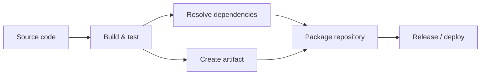
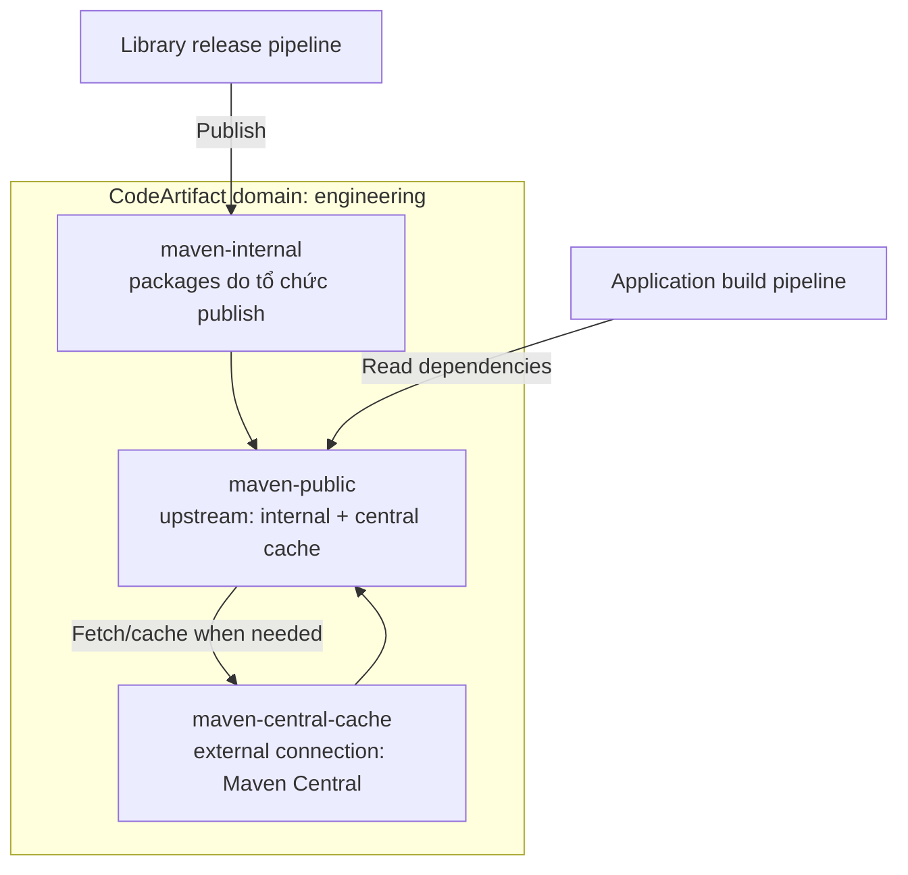
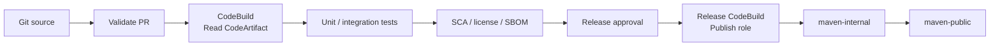

# CodeArtifact repository và quản lý dependency nội bộ

Trong một hệ thống CI/CD, mã nguồn ứng dụng không phải đầu vào duy nhất của bản build. Mỗi lần build còn tải framework, thư viện bên thứ ba, plugin Maven/Gradle và các package nội bộ do những team khác phát hành. Nếu mỗi project truy cập trực tiếp nhiều public registry, tổ chức khó kiểm soát nguồn dependency, khả năng tái lập build, quyền publish, dấu vết kiểm toán và rủi ro supply chain.

**AWS CodeArtifact** cung cấp dịch vụ quản lý package có thể dùng làm kho dependency tập trung cho tổ chức. Team có thể publish package nội bộ, proxy/cache package từ public repositories qua external connection và upstream repositories, rồi cấu hình Maven, Gradle hoặc công cụ tương ứng để chỉ truy cập các endpoint đã được phê duyệt. Trong pipeline, IAM role lấy authorization token ngắn hạn; không cần nhúng access key hay mật khẩu dài hạn vào source code.

Bài học thuộc chương **CI/CD trên AWS** của module **CLOUD_PROVIDERS_AWS**. Module giúp người học khám phá Region/AZ, IAM, VPC, compute, storage, database, integration và serverless để lựa chọn, thiết kế, triển khai ứng dụng an toàn, có khả năng giám sát, phục hồi và kiểm soát chi phí. Trong bối cảnh CI/CD, CodeArtifact là một mắt xích của chuỗi cung ứng phần mềm: nó quản lý đầu vào dependency và đầu ra package của build, phối hợp với IAM, pipeline, network, logging và quy trình release.

## 1. Mục tiêu học tập

Sau bài học, bạn có thể:

1. Giải thích vai trò của package repository trong CI/CD và software supply chain.
2. Phân biệt CodeArtifact domain, repository, upstream repository và external connection.
3. Thiết kế repository topology cho package nội bộ và dependency công khai.
4. Tạo domain/repository và cấu hình upstream cho Maven.
5. Cấp quyền đọc/publish bằng IAM role và repository/domain policies.
6. Lấy CodeArtifact authorization token đúng cách, hiểu thời hạn token và tránh lộ secrets.
7. Cấu hình Maven và Gradle để resolve dependency từ CodeArtifact.
8. Publish package nội bộ từ pipeline mà không cấp quyền publish cho mọi build.
9. Tích hợp CodeArtifact vào AWS CodeBuild/CodePipeline và pipeline dùng OIDC.
10. Quản lý version, package origin, upstream, retention và dependency governance.
11. Kết hợp CodeArtifact với VPC endpoints, encryption, CloudTrail và monitoring.
12. Phân tích lỗi authentication, authorization, endpoint, dependency resolution và publish.
13. Thực hành xây repository dùng chung cho ứng dụng Java.

## 2. Package repository trong chuỗi CI/CD

Một pipeline thường có các bước:



CodeArtifact tham gia ở hai hướng:

- **Dependency consumption**: build tải package nội bộ và bên thứ ba từ repository được tổ chức quản lý.
- **Package publishing**: pipeline release đẩy thư viện, SDK hoặc package đã build lên repository nội bộ để project khác sử dụng.

### 2.1. Nếu mỗi build truy cập public registry trực tiếp

Một cách làm đơn giản là để mọi project cấu hình Maven Central, npm registry hoặc PyPI trực tiếp. Cách này dễ bắt đầu nhưng tạo nhiều vấn đề:

- Mỗi build phụ thuộc vào độ sẵn sàng và giới hạn truy cập của public registry.
- Các project có thể tải cùng dependency từ những nguồn khác nhau.
- Khó kiểm soát package nào được phép dùng hoặc package nào bị thay thế bởi tên gần giống package nội bộ.
- Build có thể thất bại khi registry công khai gián đoạn hoặc bị throttling.
- Không có một nơi tập trung để theo dõi package nội bộ được publish và tiêu thụ.
- Team khó thu hồi hoặc ngừng phân phối một version không còn được phép dùng.

### 2.2. CodeArtifact giải quyết phần nào?

CodeArtifact là managed artifact repository, không phải build server và không thay thế source control:

| Thành phần | Trách nhiệm |
|---|---|
| GitHub/GitLab/CodeCommit | Lưu source code và lịch sử thay đổi |
| CodeBuild/Jenkins/GitHub Actions | Chạy build, test, scan và publish |
| CodePipeline | Điều phối các stage CI/CD |
| CodeArtifact | Lưu package nội bộ, proxy/cache dependency và cung cấp endpoint package |
| S3/ECR | Lưu artifact hoặc container image theo loại và mục đích tương ứng |
| IAM/CloudTrail | Kiểm soát quyền và ghi nhận hoạt động |

CodeArtifact không tự kiểm tra một thư viện có an toàn hay không, không thay thế dependency review, SCA, SBOM hoặc quy trình phê duyệt release. Nó tạo một điểm phân phối có kiểm soát để những quy trình đó vận hành nhất quán hơn.

## 3. Các khái niệm cốt lõi

### 3.1. Domain

**Domain** là ranh giới quản lý cấp cao của CodeArtifact. Một domain gom các repositories, là nơi tổ chức cấu hình encryption và chia sẻ quyền ở cấp domain. Domain có thể được dùng chung bởi nhiều repository trong cùng account/Region và hỗ trợ mô hình chia sẻ giữa các AWS accounts khi cấu hình resource policies phù hợp.

Ví dụ:

```text
Domain: engineering
  Repository: maven-internal
  Repository: maven-central-cache
  Repository: maven-public
  Repository: npm-internal
```

Domain không phải một repository duy nhất. Consumer luôn truy cập endpoint của một repository cụ thể.

### 3.2. Repository

**Repository** là nơi package versions được lưu và phục vụ qua endpoint theo package format. Một repository có thể chứa package nội bộ được publish trực tiếp, package được lấy từ upstream, hoặc kết hợp cả hai tùy thiết kế.

Ví dụ repository Maven:

- `maven-internal`: nơi pipeline publish thư viện của tổ chức.
- `maven-central-cache`: repository có external connection tới Maven Central.
- `maven-public`: repository dành cho consumer, có upstream tới `maven-internal` và `maven-central-cache`.

### 3.3. Upstream repository

**Upstream** là repository khác mà một repository có thể dùng để lấy package khi package chưa có sẵn trong repository hiện tại. Khi consumer yêu cầu package thông qua repository có upstream, CodeArtifact tìm package theo chuỗi upstream đã cấu hình và có thể lưu bản package được lấy về để những lần đọc sau dùng lại.

Upstream cho phép tổ chức tạo một endpoint tiêu chuẩn cho developer/build agent thay vì cấu hình nhiều public registries trực tiếp.

### 3.4. External connection

**External connection** nối một CodeArtifact repository với một public package registry được CodeArtifact hỗ trợ, ví dụ public Maven Central hoặc npm registry. Thường nên để external connection ở repository chuyên cache public packages, rồi cấu hình repository consumer làm upstream của nó.

Không nên để từng project tùy tiện cấu hình public registry riêng nếu mục tiêu là kiểm soát dependency qua một điểm trung tâm.

### 3.5. Package, package version và asset

- **Package**: đơn vị package theo format, ví dụ Maven coordinate `com.example:order-client`.
- **Package version**: một phiên bản cụ thể, ví dụ `2.4.1`.
- **Asset**: file nội dung của package version, ví dụ JAR, POM, module metadata, checksum hoặc archive.
- **Package origin**: nguồn có thể publish hoặc lấy package version, gồm publish trực tiếp và upstream.

Với Maven, coordinate cơ bản là `groupId:artifactId:version`. Với npm là package name/version; với Python là tên package/version theo quy tắc chuẩn hóa của hệ sinh thái đó.

## 4. Thiết kế topology cho dependency nội bộ

Không nên bắt đầu bằng cách tạo một repository duy nhất rồi cho tất cả user đọc/ghi. Hãy tách quyền publish và consume.

### 4.1. Mô hình đề xuất cho Java/Maven



Quy tắc:

1. Pipeline phát hành thư viện có quyền publish vào `maven-internal`.
2. Pipeline build ứng dụng chỉ có quyền read từ `maven-public`.
3. `maven-public` ưu tiên package nội bộ theo upstream order đã cấu hình, sau đó mới tìm public package.
4. Developer local cũng dùng `maven-public` để giảm khác biệt giữa local build và CI.
5. Không cấp quyền publish vào repository consumer cho mọi developer hoặc mọi pull request.

### 4.2. Vì sao tách publish và consume?

Nếu một repository vừa là điểm public dependency vừa cho mọi pipeline publish, một build không đáng tin cậy có thể đẩy package trùng tên hoặc version gây nhầm lẫn với dependency nội bộ. Tách repository giúp:

- Giảm blast radius khi credentials của build job bị lộ.
- Dùng IAM policy khác nhau cho read và publish.
- Áp dụng approval gate trước release.
- Theo dõi package nội bộ được phát hành từ pipeline nào.
- Kiểm soát package origin và thứ tự upstream.

### 4.3. Thứ tự upstream có ý nghĩa

Nếu một repository có nhiều upstream, thứ tự tìm package ảnh hưởng nguồn package được chọn khi nhiều nguồn có cùng coordinate/version. Hãy thiết kế và kiểm thử thứ tự đó, đặc biệt với namespace nội bộ. Không để một package công khai trùng tên có thể che khuất package nội bộ.

Với package nội bộ, nên dùng namespace rõ ràng như `com.mycompany.*`, quản lý package origin controls và tránh dùng groupId/name quá chung chung.

## 5. Chọn package format và quy ước version

CodeArtifact hỗ trợ nhiều package formats như Maven, npm, PyPI, NuGet, Swift, RubyGems, Cargo và Generic. Không phải mọi repository đều cần bật tất cả; tạo repository phù hợp với công cụ build và quy trình release của team.

| Ecosystem | Ví dụ định danh | Công cụ thường dùng |
|---|---|---|
| Maven | `com.mycompany:order-client:2.4.1` | Maven |
| Gradle | Maven coordinates hoặc plugin marker | Gradle |
| npm | `@mycompany/order-ui@2.4.1` | npm |
| PyPI | `company-data-client==2.4.1` | pip/twine |
| NuGet | `Company.Logging 2.4.1` | dotnet/NuGet |
| Generic | tên package + version + assets | AWS CLI/API hoặc tool nội bộ |

### 5.1. Versioning

Với thư viện nội bộ:

- Dùng semantic versioning hoặc quy ước version được tổ chức thống nhất.
- Release version nên bất biến sau khi publish; nếu có lỗi, phát hành version mới thay vì âm thầm thay asset.
- Không dùng dynamic versions trong build production nếu cần kết quả tái lập.
- Pin plugin/build tool versions bên cạnh dependency versions.
- Dùng dependency lockfiles hoặc dependency constraints khi hệ sinh thái hỗ trợ.
- Ghi lại commit, build number và provenance metadata trong release process.

Ví dụ:

```text
com.mycompany.platform:logging-starter:3.2.0
com.mycompany.platform:security-client:1.8.4
com.mycompany.shop:order-contract:2.1.0
```

### 5.2. Tránh dependency confusion

Dependency confusion xảy ra khi tên package nội bộ bị trùng hoặc bị nhầm với package công khai có thể tải từ registry bên ngoài. Phòng ngừa:

1. Đặt namespace nội bộ có chủ đích, ví dụ `com.mycompany`.
2. Cấu hình repository consumer chỉ đi qua CodeArtifact.
3. Kiểm soát package origin để package thuộc namespace nội bộ không được tùy tiện lấy từ upstream public.
4. Hạn chế publish vào repository nội bộ bằng IAM.
5. Review dependency mới và ghi nhận nguồn package trong SBOM/build metadata.

## 6. Tạo domain và repositories

Phần này minh họa bằng AWS CLI v2 tại Region `ap-southeast-1`. Thay domain, account ID và repository names bằng giá trị của môi trường lab. Domain và repositories là tài nguyên có vòng đời; không chạy lệnh xóa trong account production.

### 6.1. Tạo domain

```bash
aws codeartifact create-domain \
  --domain engineering \
  --region ap-southeast-1
```

Domain được tạo trong account/Region hiện tại. Nếu dùng customer managed KMS key, xác định key policy và quyền KMS trước khi tạo domain theo tiêu chuẩn bảo mật của tổ chức.

### 6.2. Tạo repository nội bộ

```bash
aws codeartifact create-repository \
  --domain engineering \
  --repository maven-internal \
  --region ap-southeast-1
```

Repository này là đích publish cho release pipeline của thư viện nội bộ.

### 6.3. Tạo repository kết nối Maven Central

```bash
aws codeartifact create-repository \
  --domain engineering \
  --repository maven-central-cache \
  --external-connections public:maven-central \
  --region ap-southeast-1
```

External connection phải được bật cho repository phù hợp. Quyền sử dụng external connection và package origin controls cần được quản lý, không mở public access trực tiếp.

### 6.4. Tạo repository consumer với upstreams

Tạo file `upstreams.json`:

```json
[
  {
    "repositoryName": "maven-internal"
  },
  {
    "repositoryName": "maven-central-cache"
  }
]
```

Tạo repository:

```bash
aws codeartifact create-repository \
  --domain engineering \
  --repository maven-public \
  --upstreams file://upstreams.json \
  --region ap-southeast-1
```

Sau khi tạo, kiểm tra upstream order và repository details bằng `describe-repository`. Nếu topology đã tồn tại, dùng `update-repository` theo kế hoạch thay đổi đã review; không thay upstream order một cách tùy tiện vì nó có thể thay đổi nguồn dependency được resolve.

### 6.5. Domain owner và endpoint

Trong ví dụ một account, `domain-owner` là account ID sở hữu domain. Với cross-account access, luôn chỉ rõ owner để tránh CLI dùng nhầm account hiện tại. Endpoint được lấy từ API thay vì tự ghép chuỗi:

```bash
aws codeartifact get-repository-endpoint \
  --domain engineering \
  --domain-owner 111122223333 \
  --repository maven-public \
  --format maven \
  --region ap-southeast-1 \
  --query repositoryEndpoint \
  --output text
```

Lệnh trả endpoint Maven cho repository đã chỉ định. Dùng đúng endpoint theo Region, domain, repository và format.

## 7. Authentication và authorization

### 7.1. Authorization token

Package tools như Maven/Gradle cần credentials để truy cập endpoint riêng tư. CodeArtifact cấp authorization token qua API `GetAuthorizationToken`. Token có thời hạn, không phải access key IAM và không nên lưu vào source control.

Lấy token:

```bash
export CODEARTIFACT_AUTH_TOKEN="$(
  aws codeartifact get-authorization-token \
    --domain engineering \
    --domain-owner 111122223333 \
    --region ap-southeast-1 \
    --query authorizationToken \
    --output text
)"
```

Token mặc định có thời hạn 12 giờ. Có thể đặt `--duration-seconds` trong khoảng 900–43.200 giây; nếu caller đang dùng assumed role và muốn token hết hạn cùng session của role, dùng `--duration-seconds 0`. Token không nên được tạo quá sớm rồi lưu để dùng cho những build sau.

### 7.2. IAM permissions cần thiết

Một identity cần quyền lấy token và quyền đọc repository. `sts:GetServiceBearerToken` là quyền cần thiết để lấy service bearer token; điều kiện `sts:AWSServiceName` giới hạn service là CodeArtifact.

Policy minh họa cho **consumer**:

```json
{
  "Version": "2012-10-17",
  "Statement": [
    {
      "Sid": "GetCodeArtifactToken",
      "Effect": "Allow",
      "Action": "codeartifact:GetAuthorizationToken",
      "Resource": "arn:aws:codeartifact:ap-southeast-1:111122223333:domain/engineering"
    },
    {
      "Sid": "GetServiceBearerToken",
      "Effect": "Allow",
      "Action": "sts:GetServiceBearerToken",
      "Resource": "*",
      "Condition": {
        "StringEquals": {
          "sts:AWSServiceName": "codeartifact.amazonaws.com"
        }
      }
    },
    {
      "Sid": "ReadPackages",
      "Effect": "Allow",
      "Action": [
        "codeartifact:GetRepositoryEndpoint",
        "codeartifact:ReadFromRepository"
      ],
      "Resource": "arn:aws:codeartifact:ap-southeast-1:111122223333:repository/engineering/maven-public"
    }
  ]
}
```

Policy minh họa cần được điều chỉnh theo account, domain, repository, SCP, permission boundary và resource policies. Không cấp `codeartifact:*` cho build job chỉ cần tải dependency.

### 7.3. Quyền publish

Release role cần thêm quyền publish package version vào repository đích, ví dụ `codeartifact:PublishPackageVersion` và các quyền package metadata phù hợp với package format/tool. Quyền publish nên giới hạn vào `maven-internal`, không cấp vào `maven-public` cho mọi build.

Tách role:

| Pipeline/job | Quyền tối thiểu theo mục đích |
|---|---|
| Pull request validation | Read từ `maven-public`; không publish |
| Main branch build | Read dependencies và lưu build artifacts theo pipeline |
| Release library | Read dependencies, publish vào `maven-internal` sau approval |
| Admin repository | Quản lý repository/domain policy, upstream, package lifecycle |

### 7.4. Resource policies và cross-account

CodeArtifact hỗ trợ identity-based policies và resource policies ở domain/repository. Với mô hình nhiều AWS accounts:

1. Account platform sở hữu domain và repositories.
2. Account workload tạo IAM role cho build job.
3. Domain/repository policy cho phép principal từ account workload thực hiện các actions cần thiết.
4. Identity policy của role workload cũng phải cho phép các actions tương ứng.
5. `domain-owner` phải trỏ đúng account sở hữu domain khi gọi CLI/API.

Allow ở một policy không tự động vượt qua explicit Deny ở policy khác, SCP hoặc permission boundary. Cross-account access cần kiểm tra cả hai phía.

### 7.5. Không dùng IAM user access key trong pipeline

Ưu tiên:

- CodeBuild service role.
- ECS task role/EC2 instance profile khi build agent chạy trên các dịch vụ đó.
- GitHub Actions/GitLab CI dùng OIDC federation và `AssumeRoleWithWebIdentity` nếu nền tảng hỗ trợ.

Tránh lưu access key dài hạn trong repository variables hoặc file `settings.xml`. Authorization token cũng là secret: chỉ giữ trong job cần thiết, không in ra log, không upload thành artifact và không cache vào workspace dùng chung.

## 8. Cấu hình Maven để consume dependency

### 8.1. Endpoint Maven

Lấy endpoint của `maven-public`:

```bash
export CODEARTIFACT_MAVEN_READ_URL="$(
  aws codeartifact get-repository-endpoint \
    --domain engineering \
    --domain-owner 111122223333 \
    --repository maven-public \
    --format maven \
    --region ap-southeast-1 \
    --query repositoryEndpoint \
    --output text
)"
```

### 8.2. Maven settings.xml

Tạo file `.ci/settings.xml`:

```xml
<settings>
  <mirrors>
    <mirror>
      <id>codeartifact-read</id>
      <mirrorOf>*</mirrorOf>
      <url>${env.CODEARTIFACT_MAVEN_READ_URL}</url>
    </mirror>
  </mirrors>
  <servers>
    <server>
      <id>codeartifact-read</id>
      <username>aws</username>
      <password>${env.CODEARTIFACT_AUTH_TOKEN}</password>
    </server>
    <server>
      <id>codeartifact-publish</id>
      <username>aws</username>
      <password>${env.CODEARTIFACT_AUTH_TOKEN}</password>
    </server>
  </servers>
</settings>
```

File này không chứa token thật. Maven lấy password từ environment variable của tiến trình build. Server IDs trong `settings.xml` phải trùng với IDs được khai báo ở POM; nếu ID khác nhau, Maven có thể không gắn credentials vào repository request.

### 8.3. Cấu hình POM để resolve dependencies

```xml
<project>
  <modelVersion>4.0.0</modelVersion>
  <groupId>com.mycompany.shop</groupId>
  <artifactId>order-service</artifactId>
  <version>1.0.0</version>

  <properties>
    <maven.compiler.release>17</maven.compiler.release>
    <codeartifact.read.url>https://replace-with-repository-endpoint/</codeartifact.read.url>
  </properties>

  <repositories>
    <repository>
      <id>codeartifact-read</id>
      <url>${codeartifact.read.url}</url>
    </repository>
  </repositories>

  <dependencies>
    <dependency>
      <groupId>com.mycompany.platform</groupId>
      <artifactId>logging-starter</artifactId>
      <version>3.2.0</version>
    </dependency>
  </dependencies>
</project>
```

Trong CI, truyền URL được lấy từ AWS CLI bằng system property thay vì commit endpoint giả:

```bash
mvn -s .ci/settings.xml \
  -Dcodeartifact.read.url="$CODEARTIFACT_MAVEN_READ_URL" \
  -B -ntp verify
```

Nếu muốn cấu hình URL qua profile Maven hoặc settings profile, vẫn phải bảo đảm endpoint consumer trỏ vào `maven-public`, không vô tình bypass CodeArtifact bằng `mavenCentral()` hay repository public khác.

### 8.4. Chỉ một điểm resolve dependency

Ví dụ `settings.xml` phía trên dùng mirror ID `codeartifact-read` và `mirrorOf=*` để route dependency/plugin requests qua endpoint CodeArtifact. Server ID của mirror phải khớp server ID có credentials. Mirror policy cần được kiểm tra trong môi trường lab, nhất là khi project có plugin repository hoặc repository đặc biệt; dùng `mvn help:effective-settings` và `mvn help:effective-pom` để xác nhận Maven thực sự dùng endpoint nào.

## 9. Publish Maven package nội bộ

### 9.1. Cấu hình distributionManagement

Pipeline publish cần endpoint của `maven-internal`, khác với endpoint consume:

```bash
export CODEARTIFACT_MAVEN_PUBLISH_URL="$(
  aws codeartifact get-repository-endpoint \
    --domain engineering \
    --domain-owner 111122223333 \
    --repository maven-internal \
    --format maven \
    --region ap-southeast-1 \
    --query repositoryEndpoint \
    --output text
)"
```

Trong POM của thư viện:

```xml
<distributionManagement>
  <repository>
    <id>codeartifact-publish</id>
    <name>Company Maven releases</name>
    <url>${codeartifact.publish.url}</url>
  </repository>
</distributionManagement>
```

Build release job:

```bash
mvn -s .ci/settings.xml \
  -Dcodeartifact.publish.url="$CODEARTIFACT_MAVEN_PUBLISH_URL" \
  -B -ntp clean deploy
```

`deploy` chạy các phase trước đó trong Maven lifecycle rồi publish artifact. Không dùng `-DskipTests` như mặc định cho release pipeline; chỉ bỏ test khi có lý do được phê duyệt và có quality gate thay thế.

### 9.2. Không publish từ pull request không tin cậy

Pull request build chỉ cần read access để compile/test. Release job nên:

1. Chạy từ protected branch/tag.
2. Kiểm tra version và release metadata.
3. Chạy test, lint, SCA và license policy.
4. Tạo SBOM/provenance nếu quy trình yêu cầu.
5. Chờ approval khi cần.
6. Assume role chỉ có publish permission.
7. Publish một lần và lưu build metadata.

Không cấp token/role publish cho code từ fork hoặc pull request không được tin cậy.

## 10. Cấu hình Gradle

Gradle có thể dùng Maven repository endpoint của CodeArtifact cho Maven-compatible packages.

### 10.1. Gradle Groovy DSL — đọc dependency

Trong `settings.gradle` hoặc `build.gradle` theo vị trí cấu hình repository của project:

```groovy
repositories {
    maven {
        name = 'companyCodeArtifact'
        url = uri(System.getenv('CODEARTIFACT_MAVEN_READ_URL'))
        credentials {
            username = 'aws'
            password = System.getenv('CODEARTIFACT_AUTH_TOKEN')
        }
    }
}
```

Không thêm `mavenCentral()` nếu policy yêu cầu toàn bộ dependency đi qua CodeArtifact; nếu vẫn thêm, Gradle có thể tải trực tiếp từ public repository và bypass kiểm soát tập trung.

### 10.2. Publish Gradle library

Với plugin `maven-publish`:

```groovy
import org.gradle.api.publish.maven.MavenPublication

plugins {
    id 'java-library'
    id 'maven-publish'
}

group = 'com.mycompany.platform'
version = '3.2.0'

publishing {
    publications {
        mavenJava(MavenPublication) {
            from components.java
        }
    }
    repositories {
        maven {
            name = 'companyReleases'
            url = uri(System.getenv('CODEARTIFACT_MAVEN_PUBLISH_URL'))
            credentials {
                username = 'aws'
                password = System.getenv('CODEARTIFACT_AUTH_TOKEN')
            }
        }
    }
}
```

Release job chạy:

```bash
./gradlew --no-daemon clean test publish
```

Credentials chỉ được đọc từ environment của job. Không ghi token vào `gradle.properties`, build script, file `gradle.properties` được commit hoặc build scan.

### 10.3. Dependency locking

Với Gradle, bật dependency locking cho configurations phù hợp và commit lockfiles theo quy ước project. Tránh dynamic versions như `1.+` hoặc `latest.release` trong build cần tái lập. Locking giúp giữ phiên bản đã resolve; CodeArtifact cung cấp nguồn phân phối có kiểm soát nhưng không tự thay thế dependency locking.

## 11. Các package formats khác

CodeArtifact có thể dùng cho nhiều hệ sinh thái, nhưng mỗi format có cách cấu hình authentication và repository endpoint riêng.

### 11.1. npm

Ví dụ đăng nhập cho npm:

```bash
aws codeartifact login \
  --tool npm \
  --domain engineering \
  --domain-owner 111122223333 \
  --repository npm-public \
  --region ap-southeast-1
```

Lệnh `login` cập nhật cấu hình npm phù hợp với môi trường hiện tại. Trong CI, kiểm soát file `.npmrc` được tạo, token lifetime và log output; không cache file có token vào workspace dùng chung. Với package private theo scope, cấu hình scope rõ ràng để package nội bộ được resolve qua repository mong muốn.

### 11.2. Python

CodeArtifact hỗ trợ PyPI repositories. Dùng `aws codeartifact login --tool pip` để cấu hình pip cho môi trường hiện tại; publish Python packages thường dùng `twine` và token tương ứng. Không commit URL có token vào `requirements.txt` hoặc file cấu hình chia sẻ.

### 11.3. Chọn công cụ đúng package format

Không dùng Maven endpoint cho npm/PyPI hoặc ngược lại. Repository endpoint được lấy bằng `get-repository-endpoint` với `--format` tương ứng. Kiểm tra tài liệu AWS cho phiên bản CLI và tool được sử dụng vì cách login/configuration có thể khác nhau giữa package formats.

## 12. Tích hợp CodeArtifact vào AWS CodeBuild và CodePipeline

### 12.1. Luồng pipeline



Tách validation job và release job:

- Validation job có quyền read dependencies từ `maven-public`.
- Release job dùng role khác, có quyền publish vào `maven-internal`.
- Approval gate bảo đảm package không được publish chỉ vì một pull request chạy thành công.
- Các job nên dùng build image/toolchain đã pin version để tăng tính tái lập.

### 12.2. CodeBuild environment

Thiết lập environment variables không nhạy cảm trong CodeBuild project hoặc buildspec:

| Variable | Ví dụ |
|---|---|
| `AWS_REGION` | `ap-southeast-1` |
| `CODEARTIFACT_DOMAIN` | `engineering` |
| `CODEARTIFACT_DOMAIN_OWNER` | `111122223333` |
| `CODEARTIFACT_READ_REPOSITORY` | `maven-public` |
| `CODEARTIFACT_PUBLISH_REPOSITORY` | `maven-internal` |

Không đặt authorization token cố định trong project variables. Build job lấy token lúc bắt đầu từ service role.

### 12.3. buildspec.yml cho validation build

Ví dụ buildspec cho project Maven:

```yaml
version: 0.2

env:
  variables:
    AWS_REGION: ap-southeast-1
    CODEARTIFACT_DOMAIN: engineering
    CODEARTIFACT_DOMAIN_OWNER: "111122223333"
    CODEARTIFACT_READ_REPOSITORY: maven-public

phases:
  install:
    runtime-versions:
      java: corretto17
  build:
    commands:
      - |
        export CODEARTIFACT_AUTH_TOKEN="$(
          aws codeartifact get-authorization-token \
            --domain "$CODEARTIFACT_DOMAIN" \
            --domain-owner "$CODEARTIFACT_DOMAIN_OWNER" \
            --region "$AWS_REGION" \
            --duration-seconds 0 \
            --query authorizationToken \
            --output text
        )"
      - |
        export CODEARTIFACT_MAVEN_READ_URL="$(
          aws codeartifact get-repository-endpoint \
            --domain "$CODEARTIFACT_DOMAIN" \
            --domain-owner "$CODEARTIFACT_DOMAIN_OWNER" \
            --repository "$CODEARTIFACT_READ_REPOSITORY" \
            --format maven \
            --region "$AWS_REGION" \
            --query repositoryEndpoint \
            --output text
        )"
      - mvn -s .ci/settings.xml -Dcodeartifact.read.url="$CODEARTIFACT_MAVEN_READ_URL" -B -ntp clean verify
```

Buildspec minh họa sử dụng role credentials của CodeBuild. File `.ci/settings.xml` chỉ chứa username `aws` và tham chiếu environment token như phần Maven settings. Không bật shell tracing (`set -x`) ở đoạn xử lý token; không echo biến token ra log. Trong dự án thực tế, thêm report/test artifacts và timeout theo tiêu chuẩn pipeline.

### 12.4. Release build

Release build dùng CodeBuild project hoặc stage riêng với service role publish. Stage này lấy token và endpoint `maven-internal` tương tự, rồi chạy Maven `deploy` hoặc Gradle `publish`. Không tái sử dụng role publish cho pull request validation.

### 12.5. GitHub Actions/GitLab CI qua OIDC

Nếu pipeline chạy ngoài AWS, dùng OIDC để assume role thay vì tạo IAM user access key. Trust policy cần giới hạn issuer, audience và subject (repository, branch/tag hoặc environment) đúng phạm vi release. Sau khi assume role:

1. AWS CLI nhận temporary role credentials.
2. Job gọi `get-authorization-token`.
3. Maven/Gradle nhận token qua environment.
4. Job thực hiện read hoặc publish theo policy.
5. Job kết thúc, temporary credentials/token hết hạn; không lưu token vào cache/artifact.

Không dùng trust policy wildcard quá rộng như cho mọi repository/branch nếu chỉ một project được phép publish.

## 13. Package origin controls và dependency governance

### 13.1. Package origin

CodeArtifact hỗ trợ quản lý nguồn gốc package versions để kiểm soát việc package được publish trực tiếp hay lấy từ upstream. Với package nội bộ, cần ngăn việc một package cùng tên từ public registry được đưa vào chuỗi resolve ngoài ý muốn.

Thiết kế governance:

- Namespace nội bộ có quy ước và owner rõ ràng.
- Chỉ release role được publish package nội bộ.
- Package origin controls được cấu hình theo policy của tổ chức.
- External connections chỉ mở tới registry được duyệt.
- Upstream order được review và test.
- Package mới hoặc version mới có thể cần review/license/SCA trước khi dùng trong production.

### 13.2. Dependency review

CodeArtifact không tự xác định một dependency có CVE, license không tương thích hoặc malicious behavior hay không. Kết hợp với:

- Software Composition Analysis (SCA).
- License compliance checks.
- SBOM generation và retention.
- Vulnerability remediation process.
- Provenance/attestation cho release artifacts.
- Dependency pinning/lockfiles.

### 13.3. Package immutability và version release

Không nên overwrite cùng một release version. Nếu package đã được phát hành, sửa code và publish version mới. Đối với package version cần ngừng sử dụng, chọn trạng thái phù hợp hoặc xóa/dispose theo retention policy đã review và hiểu rõ tác động đến consumers.

## 14. Quản lý vòng đời package và repository

CodeArtifact cung cấp thao tác quản lý package versions, nhưng tổ chức vẫn phải thiết kế lifecycle policy.

### 14.1. Phân loại package versions

Một quy trình có thể phân biệt:

- Version đang được dùng bởi ứng dụng production.
- Version mới đã publish nhưng chưa được adoption.
- Version lỗi hoặc có lỗ hổng cần ngừng phân phối.
- Version thử nghiệm/temporary.
- Version cũ không còn được tham chiếu và đủ điều kiện cleanup.

### 14.2. Archive, dispose và delete

CodeArtifact cung cấp các thao tác cập nhật trạng thái package version và xóa version. Hiểu sự khác nhau giữa trạng thái package version (ví dụ Published, Unlisted, Archived, Disposed) và thao tác delete trước khi chạy cleanup. Không xóa package chỉ dựa vào tuổi; kiểm tra dependency graph, release manifests và rollback window.

### 14.3. Quy trình cleanup an toàn

1. Liệt kê package versions theo repository/format/namespace.
2. Xác định version nào còn được project hoặc release manifest tham chiếu.
3. Xác định retention window và rollback window.
4. Thực hiện dry-run và review danh sách version sẽ thay đổi.
5. Chuyển trạng thái hoặc xóa theo policy đã phê duyệt.
6. Lưu log kết quả, người/role thực hiện và lý do.

Không tạo lifecycle automation xóa hàng loạt nếu chưa có inventory/owner và quy trình khôi phục.

## 15. Bảo mật, network và encryption

### 15.1. Encryption at rest

CodeArtifact mã hóa dữ liệu lưu trữ. Domain có thể dùng AWS managed key hoặc customer managed KMS key theo lựa chọn khi thiết lập domain. Nếu dùng customer managed key, quản lý key policy, rotation, grants và quyền decrypt/encrypt cần thiết. Mất quyền sử dụng KMS key có thể làm repository không truy cập được.

### 15.2. TLS và token hygiene

- Dùng HTTPS endpoint do CodeArtifact trả về.
- Không ghi token vào POM, Gradle script hoặc repository config đã commit.
- Không in token trong log hoặc shell trace.
- Không đưa settings file chứa token vào build artifact/cache.
- Dùng token lifetime ngắn phù hợp thời gian build.
- Hủy/rotate credentials của role khi có sự cố; kiểm tra CloudTrail.

### 15.3. Private connectivity

Build agents trong VPC có thể truy cập CodeArtifact qua AWS PrivateLink interface VPC endpoints nếu tổ chức yêu cầu private connectivity. CodeArtifact có endpoint cho API và repository traffic; package assets được phân phối qua S3, vì vậy network design cũng cần tính tới S3 endpoint/path theo hướng dẫn AWS.

Khi dùng VPC endpoints, kiểm tra:

- Interface endpoint services đúng Region.
- Private DNS và endpoint security groups.
- Endpoint policy cho phép các actions/resources cần thiết.
- Route, DNS và outbound policy của build subnet.
- S3 connectivity cho package assets.
- IAM identity policy và CodeArtifact resource policies.

Private endpoint không thay IAM authorization. Có endpoint không đồng nghĩa role tự có quyền đọc package.

### 15.4. Network egress và public registries

Nếu CodeArtifact dùng external connection, build job chỉ cần truy cập CodeArtifact endpoint; CodeArtifact xử lý kết nối upstream tới registry công khai. Điều này có thể giảm số điểm egress từ VPC của build agent, nhưng cần thiết kế endpoint, DNS và service integration đúng.

## 16. Quan sát hoạt động và kiểm soát chi phí

### 16.1. Audit

Dùng AWS CloudTrail để ghi nhận các API calls quản trị và truy cập CodeArtifact phù hợp với cấu hình account. Theo dõi:

- Ai tạo/xóa domain hoặc repository?
- Ai thay đổi upstream/external connection?
- Principal nào publish package version?
- Khi nào repository policy/domain policy được sửa?
- Có truy cập bất thường hoặc lỗi authorization tăng đột biến không?

### 16.2. Monitoring

Theo dõi service metrics và pipeline metrics phù hợp:

- Request count và latency.
- HTTP 4xx/5xx hoặc throttling.
- Build duration do dependency resolution.
- Cache hit/giảm tải upstream theo hành vi quan sát được.
- Package storage growth và số package versions.
- Authentication/authorization failures.
- Tần suất publish và package version failures.

Đặt alarm theo baseline của tổ chức, không đặt threshold tùy tiện khi chưa hiểu traffic.

### 16.3. Cost factors

Chi phí CodeArtifact có thể phụ thuộc vào storage, requests, data transfer và các dịch vụ liên quan theo Region/pricing hiện hành. Ngoài ra:

- NAT Gateway có thể phát sinh chi phí nếu build agent tải package qua NAT.
- KMS customer managed key có chi phí riêng theo pricing KMS.
- CloudTrail, CloudWatch logs/metrics và data transfer có thể phát sinh chi phí bổ sung.
- Cache/public package strategy có thể làm thay đổi request volume và storage growth.

Kiểm soát chi phí bằng cách chọn upstream hợp lý, tránh build lặp không cần thiết, dọn package versions theo retention policy, dùng network path phù hợp và theo dõi bill theo account/Region.

## 17. Troubleshooting

| Triệu chứng | Nguyên nhân thường gặp | Cách kiểm tra |
|---|---|---|
| `401 Unauthorized` | Token thiếu, hết hạn hoặc không được truyền | Lấy token mới; kiểm tra env var và Maven server ID |
| `403 Forbidden` | IAM, domain policy hoặc repository policy thiếu quyền | Kiểm tra principal, action, resource, explicit Deny và domain owner |
| Maven không resolve package | Sai endpoint/format, repo không có upstream, version sai | Kiểm tra `get-repository-endpoint`, repository details và coordinate |
| Maven resolve public package nhưng không thấy internal package | Upstream order hoặc repository consumer không trỏ đúng | Kiểm tra upstream order, internal repository và package origin |
| `mvn deploy` bị từ chối | Job chỉ có read permission hoặc distributionManagement sai | Kiểm tra publish role, target repo, server ID và `PublishPackageVersion` |
| Gradle không xác thực | Token không có trong environment của daemon/process | Kiểm tra environment, Gradle daemon và credential configuration |
| Build chạy local nhưng fail trên CodeBuild | Role/Region/account khác hoặc env variables thiếu | So sánh assumed role, Region, domain owner và endpoint |
| Package vừa publish chưa xuất hiện qua consumer path | Upstream/metadata propagation hoặc consumer đang query repo khác | Kiểm tra repo đích và package version status; thử đọc trực tiếp repo publish |
| Timeout khi dùng VPC endpoint | DNS, security group, endpoint policy hoặc S3 path | Kiểm tra API/repository interface endpoints, private DNS và S3 connectivity |

### 17.1. Lệnh chẩn đoán hữu ích

```bash
aws sts get-caller-identity

aws codeartifact describe-domain \
  --domain engineering \
  --domain-owner 111122223333 \
  --region ap-southeast-1

aws codeartifact describe-repository \
  --domain engineering \
  --domain-owner 111122223333 \
  --repository maven-public \
  --region ap-southeast-1

aws codeartifact list-packages \
  --domain engineering \
  --domain-owner 111122223333 \
  --repository maven-internal \
  --format maven \
  --region ap-southeast-1
```

Không đưa output chứa authorization token hoặc secret vào ticket/log công khai. Khi cần chia sẻ log, redact account IDs hoặc thông tin nội bộ theo policy của tổ chức.

## 18. Lab: xây Maven repository nội bộ cho Shop

Lab minh họa domain, internal repository, public cache, consumer repository và một Maven build. Có thể phát sinh chi phí AWS; dùng account lab và dọn tài nguyên theo quy trình sau khi hoàn thành.

### 18.1. Kiến trúc lab

```text
Region: ap-southeast-1
Domain: engineering-lab
Repositories:
  maven-internal
  maven-central-cache
  maven-public

Package nội bộ:
  com.mycompany.platform:logging-starter:1.0.0
```

### 18.2. Bước 1 — Tạo domain và repositories

Tạo domain `engineering-lab`, repository `maven-internal`, repository `maven-central-cache` với external connection `public:maven-central`, rồi repository `maven-public` với upstreams theo thứ tự:

1. `maven-internal`
2. `maven-central-cache`

Kiểm tra domain owner, Region và upstream order bằng AWS CLI.

### 18.3. Bước 2 — Tạo IAM roles

Tạo hai role hoặc hai policy boundary:

- `CodeArtifactReadRole`: lấy token và read từ `maven-public`.
- `CodeArtifactPublishRole`: lấy token, read dependencies và publish vào `maven-internal`.

Không dùng role publish cho build validation.

### 18.4. Bước 3 — Lấy token và endpoint

Assume role phù hợp, lấy authorization token bằng `get-authorization-token`, lấy Maven endpoint bằng `get-repository-endpoint`. Lưu token vào environment tạm của terminal, không ghi vào file.

### 18.5. Bước 4 — Publish thư viện mẫu

Tạo Maven library nhỏ với:

```text
groupId: com.mycompany.platform
artifactId: logging-starter
version: 1.0.0
```

Thêm `distributionManagement` trỏ tới `maven-internal`, settings server ID `codeartifact-publish`, sau đó chạy `mvn clean deploy`. Kiểm tra package version xuất hiện trong repository nội bộ.

### 18.6. Bước 5 — Consume từ ứng dụng

Tạo ứng dụng `order-service`, cấu hình `repositories` trỏ tới `maven-public`, thêm dependency `logging-starter:1.0.0` và chạy `mvn verify`. Kiểm tra build agent chỉ cần read permission trên repository consumer.

### 18.7. Bước 6 — Kiểm tra public dependency

Thêm một dependency công khai có version pin. Build qua `maven-public`; xác minh repository có thể lấy package từ Maven Central upstream và những lần build tiếp theo resolve qua CodeArtifact.

### 18.8. Bước 7 — Kiểm tra quyền

- Dùng read role thử publish vào `maven-internal`: thao tác phải bị từ chối.
- Dùng publish role thử publish vào repository được phép: thành công.
- Dùng role không có read access: dependency resolution thất bại với authorization error.
- Kiểm tra CloudTrail để xác định principal và API calls.

### 18.9. Bước 8 — Cleanup

Liệt kê tài nguyên và package versions lab. Chỉ xóa những domain/repositories do bạn tạo, sau khi xác nhận không còn package cần giữ và domain không được dùng chung. Không xóa domain hoặc repository dùng chung của team.

## 19. Bài tập tự kiểm tra và đáp án gợi ý

### Bài tập A — Domain và repository khác nhau thế nào?

Một team tạo ba Maven repositories trong cùng một domain.

**Đáp án:** domain là ranh giới quản lý cấp cao; repositories là endpoint lưu/phục vụ packages. Consumer gọi repository endpoint chứ không gọi domain như một package repository.

### Bài tập B — Vì sao cần repository consumer?

Developer cần dependency nội bộ và Maven Central.

**Đáp án:** tạo repository consumer có upstream tới internal repository và public cache; developer chỉ cấu hình một endpoint đã được kiểm soát.

### Bài tập C — Vì sao không cấp publish cho pull request?

Pull request từ fork chạy test thành công.

**Đáp án:** build code không tin cậy không nên có quyền publish package. Tách read-only validation role và release role chạy từ protected branch/tag sau approval.

### Bài tập D — Token trong settings.xml

Developer định commit authorization token vào `.m2/settings.xml`.

**Đáp án:** không commit token. Settings file chỉ tham chiếu environment variable; token lấy mới trong job và không log/cache/upload.

### Bài tập E — Build assumed role

Build dùng STS assumed role và muốn token theo thời hạn session.

**Đáp án:** dùng `--duration-seconds 0` khi lấy authorization token để token có thời hạn gắn với session role theo API semantics.

### Bài tập F — `403 Forbidden`

Token vừa được lấy nhưng Maven vẫn bị 403.

**Đáp án:** token không tự cấp quyền; kiểm tra identity policy, domain/repository resource policy, SCP, permission boundary, resource ARN, account owner và endpoint.

### Bài tập G — Dependency confusion

Package nội bộ có tên phổ biến, trùng với public package.

**Đáp án:** dùng namespace nội bộ rõ ràng, kiểm soát package origin, upstream order và publish permissions; không để public package thay thế package nội bộ.

### Bài tập H — Maven deploy bị từ chối

Build resolve dependencies thành công nhưng `mvn deploy` thất bại.

**Đáp án:** read permission không bao gồm publish. Kiểm tra release role, `distributionManagement`, repository endpoint, server ID và các publish permissions.

### Bài tập I — Gradle vẫn tải từ Maven Central

Project khai báo CodeArtifact nhưng vẫn có `mavenCentral()`.

**Đáp án:** Gradle có thể resolve từ public repository trực tiếp. Nếu policy yêu cầu tập trung, loại bỏ bypass hoặc cấu hình repository policy/mirror phù hợp.

### Bài tập J — Package version có thể overwrite?

Team muốn thay nội dung version `1.0.0` sau khi phát hiện bug.

**Đáp án:** release version nên bất biến. Phát hành `1.0.1` hoặc version mới, cập nhật consumer và giữ provenance của bản đã publish.

### Bài tập K — VPC endpoint đã tạo nhưng tải package timeout

Build agent trong private subnet không tải được asset.

**Đáp án:** kiểm tra CodeArtifact API/repository interface endpoints, DNS/security group/endpoint policy và S3 connectivity cho package assets; đồng thời kiểm tra IAM.

### Bài tập L — Có CodeArtifact rồi có cần SCA?

Tổ chức đã proxy mọi package public qua CodeArtifact.

**Đáp án:** vẫn cần SCA, license review, SBOM, dependency pinning và remediation. Repository tập trung không đồng nghĩa package đã an toàn.

## 20. Checklist production

### Domain và repository design

- [ ] Domain/Region có owner rõ ràng.
- [ ] Repository internal và public cache được phân tách.
- [ ] Consumer repository có upstream order được review.
- [ ] External connections chỉ tới public registries được phê duyệt.
- [ ] Package namespaces nội bộ có quy ước.
- [ ] Package origin controls phù hợp với namespace nội bộ.
- [ ] Endpoint và package format đúng với từng tool.

### IAM và secrets

- [ ] Build role dùng temporary credentials/OIDC hoặc service role.
- [ ] Consumer chỉ có read permissions.
- [ ] Release role chỉ publish vào repository đích.
- [ ] `sts:GetServiceBearerToken` có condition service name phù hợp.
- [ ] Domain/repository policies không mở quyền quá rộng.
- [ ] Authorization token được lấy mới trong job và có lifetime phù hợp.
- [ ] Không commit token/access key hoặc log secrets.
- [ ] Pull request/fork không được dùng publish role.

### Maven/Gradle và release

- [ ] Maven server IDs khớp repository IDs trong POM.
- [ ] POM consume trỏ tới CodeArtifact consumer endpoint.
- [ ] `distributionManagement` trỏ tới internal publish endpoint.
- [ ] Gradle không vô tình bypass qua public repository.
- [ ] Dependency/plugin versions được pin hoặc lock.
- [ ] Release version không bị overwrite.
- [ ] Test, SCA, license và approval gate chạy trước publish.
- [ ] SBOM/provenance được lưu theo release policy.

### Operations

- [ ] CloudTrail audit được cấu hình theo yêu cầu.
- [ ] Theo dõi request errors, throttling, latency và storage growth.
- [ ] VPC endpoint/DNS/S3 connectivity được kiểm thử nếu private networking.
- [ ] KMS key policy và recovery được quản lý nếu dùng customer managed key.
- [ ] Package retention/cleanup có dry-run, owner và rollback window.
- [ ] Có hướng dẫn xử lý token expiry, 401/403 và endpoint mismatch.
- [ ] Chi phí request, storage, data transfer, NAT và KMS được theo dõi.

## 21. Tổng kết

AWS CodeArtifact giúp tổ chức xây một điểm phân phối package có kiểm soát cho CI/CD:

```text
engineering domain
  maven-internal       <- release pipeline publishes
  maven-central-cache  <- external connection to Maven Central
  maven-public         <- upstream: internal + public cache

validation pipeline -> read maven-public
release pipeline    -> publish maven-internal
```

**Năm nguyên tắc cần nhớ:**

1. **Tách publish và consume.** Validation job chỉ cần read; release job mới có quyền publish.
2. **Dùng upstream để tập trung dependency.** Consumer truy cập một endpoint được quản lý thay vì nhiều public registries.
3. **Dùng IAM role và token ngắn hạn.** Không lưu access keys hoặc authorization token trong source code.
4. **Bảo vệ supply chain.** Namespace nội bộ, package origin controls, dependency pinning, SCA, SBOM và approval là các lớp bổ trợ.
5. **Vận hành có kiểm soát.** Theo dõi CloudTrail, errors, network, storage, retention và chi phí.

Trong chương **CI/CD trên AWS** của module **CLOUD_PROVIDERS_AWS**, CodeArtifact là nền tảng giúp dependency nội bộ được phân phối nhất quán, build có thể tái lập hơn và pipeline phát hành package được bảo vệ bằng IAM, network controls và quy trình governance.

### Tài liệu AWS tham khảo

- [AWS CodeArtifact User Guide](https://docs.aws.amazon.com/codeartifact/latest/ug/welcome.html)
- [CodeArtifact concepts](https://docs.aws.amazon.com/codeartifact/latest/ug/welcome.html#what-is-codeartifact)
- [Create a repository and connect to a public repository](https://docs.aws.amazon.com/codeartifact/latest/ug/create-repo.html)
- [Connect a Maven repository](https://docs.aws.amazon.com/codeartifact/latest/ug/maven-mvn.html)
- [Configure and use Gradle](https://docs.aws.amazon.com/codeartifact/latest/ug/maven-gradle.html)
- [Configure npm with CodeArtifact](https://docs.aws.amazon.com/codeartifact/latest/ug/npm-auth.html)
- [Configure pip and twine](https://docs.aws.amazon.com/codeartifact/latest/ug/python-configure-pip.html)
- [Authentication and tokens](https://docs.aws.amazon.com/codeartifact/latest/ug/tokens-authentication.html)
- [Identity-based policies](https://docs.aws.amazon.com/codeartifact/latest/ug/auth-and-access-control-iam-identity-based-access-control.html)
- [Resource-based policies](https://docs.aws.amazon.com/codeartifact/latest/ug/repo-policies.html)
- [Package origin controls](https://docs.aws.amazon.com/codeartifact/latest/ug/package-origin-controls.html)
- [Package version status](https://docs.aws.amazon.com/codeartifact/latest/ug/packages-overview.html)
- [VPC endpoints](https://docs.aws.amazon.com/codeartifact/latest/ug/vpc-endpoints.html)
- [AWS CodeArtifact pricing](https://aws.amazon.com/codeartifact/pricing/)
- [AWS CodeBuild buildspec reference](https://docs.aws.amazon.com/codebuild/latest/userguide/build-spec-ref.html)
