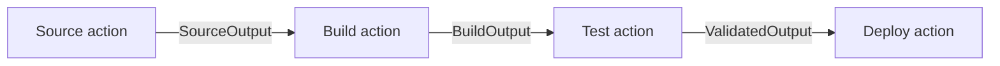
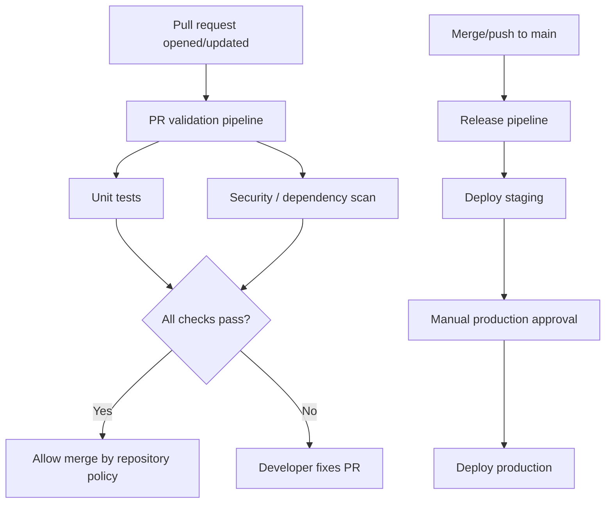
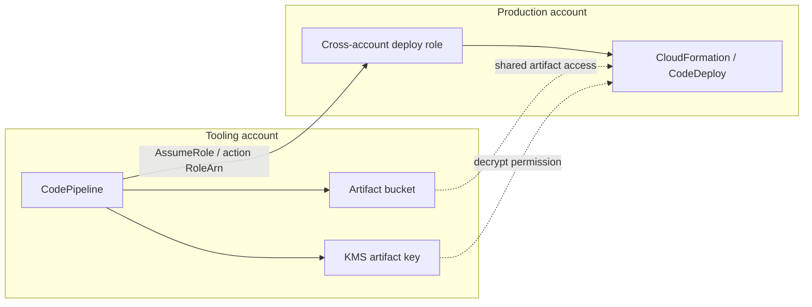
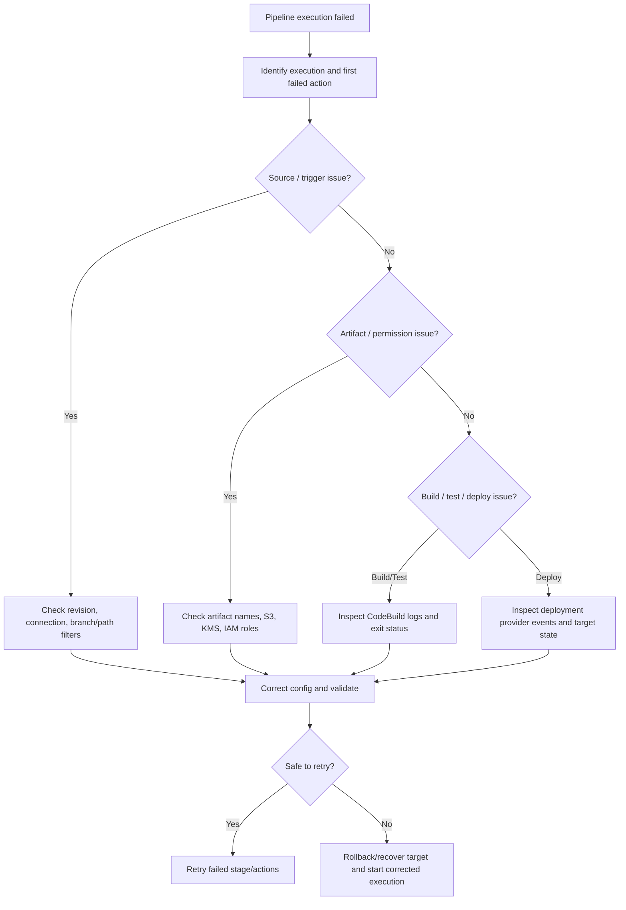

# CodePipeline stage, action, artifact và trigger

> **Chương:** CI/CD trên AWS · **Mô-đun:** `CLOUD_PROVIDERS_AWS`

## 1. Tổng quan: một pipeline thực thi những gì?

Một quy trình CI/CD cho ứng dụng Java có thể bắt đầu khi developer push code lên Git, build bằng CodeBuild, chạy unit/integration tests, đóng gói Docker image, đẩy image lên Amazon ECR, rồi triển khai ECS service hoặc Lambda. Một pipeline production còn cần manual approval, phân tách account, lưu artifact, theo dõi lịch sử và ngăn các lần deploy cạnh tranh nhau.

**AWS CodePipeline** là dịch vụ orchestration CI/CD. Nó điều phối các hành động (actions) theo các giai đoạn (stages), truyền đầu ra giữa actions bằng artifacts và bắt đầu execution theo triggers hoặc yêu cầu thủ công/API.

CodePipeline không tự biên dịch Java hay chạy test. Các công việc đó do action provider như **AWS CodeBuild**, CodeDeploy, CloudFormation, Lambda hoặc partner/custom action thực hiện. CodePipeline điều phối trạng thái và dữ liệu giữa các bước.

```mermaid
flowchart LR
    Git[Git push / tag / PR] --> Trigger[Pipeline trigger]
    Trigger --> Source[Source stage]
    Source -->|Source artifact| Build[Build stage]
    Build -->|Build artifact / image URI| Test[Test stage]
    Test -->|Validated artifact| Approval[Approval stage]
    Approval --> Deploy[Deploy stage]
    Deploy --> Verify[Post-deploy verification]
    Verify --> Done[Pipeline succeeded]
```



**Mục tiêu sau bài học:**

1. Phân biệt pipeline, execution, stage, action và artifact.
2. Hiểu `runOrder`, action dependencies và cách actions chạy song song.
3. Chọn action provider cho source, build, test, approval và deploy.
4. Thiết kế artifact flow và artifact store an toàn.
5. Cấu hình trigger theo branch, tag, file path và pull request.
6. Chọn pipeline type V1/V2 và execution mode phù hợp.
7. Triển khai cross-Region/cross-account với IAM roles và artifact stores.
8. Theo dõi execution, xử lý retry/rollback và vận hành pipeline production.

## 2. Mô hình đối tượng của CodePipeline

### 2.1. Pipeline

Pipeline là workflow cấp cao nhất, chứa:

- Một chuỗi stages theo thứ tự.
- Các actions bên trong mỗi stage.
- Cấu hình artifact store cho pipeline và các Region liên quan.
- Role mà CodePipeline assume để truy cập resources.
- Trigger, execution mode, variables và cấu hình pipeline khác.

Mỗi lần pipeline bắt đầu chạy là một **pipeline execution**. Một execution có ID riêng, source revision riêng và trạng thái riêng như `InProgress`, `Succeeded`, `Failed`, `Stopped`, `Superseded`.

### 2.2. Stage

Stage là một nhóm logic các actions cùng thực hiện một phần của quy trình, ví dụ:

- `Source`: lấy source code.
- `Build`: compile và đóng gói.
- `Test`: unit tests, integration tests, security scans.
- `Approval`: chờ con người phê duyệt.
- `Deploy`: triển khai vào dev/staging/prod.
- `PostDeploy`: smoke tests hoặc kiểm tra health.

Stages được thực thi theo thứ tự được khai báo trong pipeline. Một stage thường có một hoặc nhiều actions; stage là boundary hữu ích để tổ chức quy trình, quan sát tiến độ và đặt approval/transition controls.

### 2.3. Action

Action là một đơn vị công việc cụ thể trong stage. Ví dụ:

| Action category | Ví dụ provider | Công việc |
| --- | --- | --- |
| `Source` | CodeStarSourceConnection, CodeCommit, S3, ECR | Lấy source revision hoặc image metadata. |
| `Build` | CodeBuild | Compile, package, build Docker image. |
| `Test` | CodeBuild, Lambda hoặc partner action | Chạy test/scan/validation. |
| `Approval` | Manual approval | Tạm dừng execution để chờ quyết định. |
| `Deploy` | CodeDeploy, CloudFormation, ECS, S3 hoặc partner action | Triển khai artifact/resource. |
| `Invoke` | Lambda | Gọi function để thực hiện một bước tùy biến. |

Mỗi action có provider, configuration, input artifacts, output artifacts, role/credentials và `runOrder` tùy provider. Không phải action nào cũng cần artifact đầu vào hoặc tạo artifact đầu ra.

### 2.4. Artifact

Artifact là dữ liệu được một action tạo ra và action sau sử dụng. Ví dụ:

- Source action tạo `SourceOutput` chứa source snapshot.
- Build action nhận `SourceOutput`, compile Maven và tạo `BuildOutput`.
- Deploy action nhận `BuildOutput` để deploy.
- Một action có thể tạo image trên ECR; artifact truyền tiếp có thể chỉ chứa image URI, tag, commit SHA hoặc manifest, không nhất thiết chứa toàn bộ image bytes.

Artifact không đồng nghĩa với một S3 bucket bất kỳ hoặc source repository. Trong CodePipeline, artifact được khai báo và liên kết rõ qua tên `inputArtifacts`/`outputArtifacts`.

### 2.5. Trigger

Trigger quyết định **khi nào** tạo execution. Trigger có thể đến từ source repository event, tag/branch change, pull request event, S3 object update, ECR image update, EventBridge rule, API/CLI hoặc lịch được tích hợp qua EventBridge.

Trigger không phải action. Trigger bắt đầu pipeline; actions thực thi sau khi pipeline đã bắt đầu.

### 2.6. Quan hệ tổng thể

| Thành phần | Trả lời câu hỏi | Ví dụ |
| --- | --- | --- |
| Pipeline | Quy trình nào? | `orders-api-release` |
| Execution | Lần chạy nào? | Execution cho commit `a1b2c3d` |
| Stage | Đang ở chặng nào? | `Build`, `Test`, `Production` |
| Action | Chạy công việc gì? | `MavenBuild`, `IntegrationTest`, `DeployEcs` |
| Artifact | Dữ liệu nào được chuyển tiếp? | `SourceOutput`, `BuildOutput` |
| Trigger | Vì sao pipeline bắt đầu? | Push lên `main`, tag `v2.4.0` |

## 3. Stage và thứ tự thực thi actions

### 3.1. Stage chạy theo thứ tự khai báo

Một pipeline đi qua các stages theo thứ tự: Source → Build → Test → Deploy. Stage tiếp theo chỉ được thực thi khi stage trước hoàn tất thành công. Nếu action trong stage thất bại, execution thường dừng tại stage đó cho tới khi xử lý lỗi hoặc retry/restart theo cơ chế hỗ trợ.

Ví dụ:

```text
Pipeline: OrdersRelease
  1. Source
  2. Build
  3. Test
  4. Staging
  5. ProductionApproval
  6. Production
```

### 3.2. `runOrder` điều khiển actions trong một stage

Trong cùng stage:

- Actions có cùng `runOrder` được chạy song song.
- `runOrder` nhỏ hơn chạy trước.
- Actions ở `runOrder` tiếp theo chỉ bắt đầu sau khi nhóm trước hoàn tất thành công.
- Nếu không chỉ định, `runOrder` mặc định là `1`.

Ví dụ:

```text
Stage: Quality
  runOrder 1:
    - UnitTests
    - StaticAnalysis
    - DependencyScan
  runOrder 2:
    - PackageRelease
```

Ba kiểm tra độc lập có thể chạy song song. `PackageRelease` chỉ chạy khi tất cả actions ở `runOrder 1` thành công.

### 3.3. Song song và phụ thuộc dữ liệu

Chỉ đặt actions cùng `runOrder` khi chúng độc lập và artifact đầu vào đã sẵn sàng. Ví dụ unit tests và SAST scan cùng đọc `SourceOutput` là phù hợp. Một action cần kết quả từ action khác phải ở `runOrder` sau hoặc ở stage sau.

CodePipeline không tự suy ra dependency chỉ từ việc action B tham chiếu output artifact của action A. Hãy cấu hình run order/stage rõ ràng để dependency được thực thi đúng.

### 3.4. Stage transition khác manual approval

Hai cơ chế này giải quyết hai nhu cầu khác nhau:

| Cơ chế | Phạm vi | Hành vi |
| --- | --- | --- |
| Disable stage transition | Cổng vào giữa hai stages | Ngăn execution mới đi qua transition cho tới khi được bật lại. |
| Manual approval action | Một action cụ thể trong stage | Execution tạm dừng tại action và chờ người approve/reject. |

Manual approval là một bước hiển thị trong execution history, có thể gắn SNS notification và external review URL. Stage transition phù hợp để tạm ngừng promotion trong lúc bảo trì hoặc incident; nó không thay thế quy trình phê duyệt có audit.

### 3.5. Stage boundaries và trách nhiệm

Một stage nên đại diện cho một bước có thể diễn giải được với người vận hành. Tránh tạo quá nhiều stages chỉ để đặt tên cho từng lệnh shell. Dùng nhiều actions trong stage khi chúng thuộc cùng một chặng và cần phối hợp run order; tách stage khi có boundary rõ như test gate, approval, environment promotion hoặc ownership.

## 4. Action configuration và action providers

### 4.1. Action có những thuộc tính gì?

Một action trong pipeline definition thường có:

- `name`: tên duy nhất trong stage.
- `actionTypeId`: category, owner, provider, version.
- `configuration`: tham số đặc thù provider.
- `inputArtifacts`: artifact đầu vào.
- `outputArtifacts`: artifact đầu ra.
- `runOrder`: thứ tự thực thi trong stage.
- `namespace`: namespace để expose output variables (nếu provider hỗ trợ).
- `roleArn`: role mà action assume khi cần quyền khác.

Ví dụ khái niệm:

```yaml
Name: MavenBuild
ActionTypeId:
  Category: Build
  Owner: AWS
  Provider: CodeBuild
  Version: "1"
InputArtifacts:
  - Name: SourceOutput
OutputArtifacts:
  - Name: BuildOutput
RunOrder: 1
```

`Configuration` không giống `InputArtifacts`: configuration chứa tham số như project name, branch, deployment group hoặc connection ARN; artifact chứa payload được truyền giữa actions.

### 4.2. Source action

Source action lấy revision từ source provider và tạo artifact. Các provider phổ biến gồm:

- AWS CodeCommit.
- GitHub/GitLab/Bitbucket thông qua AWS CodeConnections (trước đây là CodeStar Connections).
- Amazon S3.
- Amazon ECR.

Source output thường là ZIP artifact có source snapshot. Tùy provider, action còn cung cấp metadata như commit ID, branch, repository và revision variables.

Đối với Git provider qua connection, cần tạo/authorize connection trước, cấp quyền sử dụng connection cho pipeline role và chọn repository/branch phù hợp. Connection ARN là cấu hình tham chiếu; nó không chứa source code.

### 4.3. Build action với CodeBuild

CodeBuild action nhận source artifact, khởi chạy build project và có thể tạo output artifact. Build project định nghĩa:

- Compute environment và image.
- Buildspec.
- Environment variables.
- IAM service role.
- Cache/logging/artifact settings.

Ví dụ `buildspec.yml` cho Java Maven:

```yaml
version: 0.2

phases:
  install:
    runtime-versions:
      java: corretto17
  pre_build:
    commands:
      - mvn -B -ntp --version
  build:
    commands:
      - mvn -B -ntp clean verify
  post_build:
    commands:
      - echo "Build and tests completed"

artifacts:
  files:
    - target/orders-api.jar
    - deploy/appspec.yml
    - deploy/taskdef.json
    - deploy/imageDetail.json
  discard-paths: no
```

Đây là buildspec minh họa; tên/đường dẫn files phải khớp artifact mà deploy action cần. Không lưu credentials trong buildspec. Dùng CodeBuild service role, Secrets Manager/Parameter Store và environment variables có kiểm soát.

### 4.4. Test action

Test có thể chạy trong CodeBuild hoặc provider phù hợp:

- Unit tests trong `mvn verify`.
- Integration tests với test environment.
- SAST, dependency scan, license scan và container scan.
- Contract tests/API tests.
- Smoke tests sau deploy.

Một test action nên trả exit code thất bại khi test không đạt. Nếu chỉ in `FAILED` nhưng process exit code bằng 0, CodePipeline có thể đánh dấu action thành công.

### 4.5. Manual approval action

Manual approval thường dùng trước production hoặc bước có rủi ro:

- Gắn `NotificationArn` tới SNS topic nếu cần thông báo.
- Gắn `ExternalEntityLink` trỏ tới change request, test report hoặc release notes.
- Ghi `CustomData` ngắn gọn mô tả nội dung cần review.
- Người có quyền approve/reject thực hiện quyết định.

Một approval action chờ tối đa **7 ngày**; nếu không được quyết định trong thời hạn, action hết hạn và pipeline execution thất bại. Hãy có owner/on-call và escalation cho approval đang chờ.

### 4.6. Deploy action

Deploy provider phụ thuộc kiểu ứng dụng:

| Workload | Provider/approach |
| --- | --- |
| ECS blue/green | CodeDeploy ECS deployment group và appspec/task definition artifacts. |
| ECS rolling update | Amazon ECS deploy action (`ECS`) với image definitions artifact hoặc CloudFormation/custom action theo kiến trúc. |
| Lambda | CloudFormation, CodeDeploy hoặc action phù hợp với deployment strategy. |
| Infrastructure | CloudFormation action hoặc CDK deploy từ CodeBuild. |
| Static website | S3 deploy action hoặc CodeBuild sync theo policy. |
| EKS/Kubernetes | CodeBuild/custom action chạy deploy tool với credentials ngắn hạn. |

Không giả định mọi deploy action nhận cùng một artifact format. Đọc yêu cầu input artifact, role, configuration và rollback behavior của provider được chọn.

### 4.7. Custom và partner actions

Khi provider built-in không đáp ứng, có thể tích hợp partner/custom action. Cần đánh giá:

- Provider owner và cách quản lý credentials.
- Action timeout/retry behavior.
- Input/output artifact contract.
- Network access và data egress.
- Logging, audit, support và versioning.

Custom action có thể chạy code tùy biến; giới hạn quyền và kiểm soát dữ liệu như một workload production.

## 5. Artifacts và artifact store

### 5.1. Artifact flow

Artifacts kết nối actions. Pipeline định nghĩa output artifact của action trước và input artifact của action sau:



Tên artifact là định danh trong pipeline definition, không phải tên S3 object cố định mà ứng dụng nên hard-code. CodePipeline quản lý vị trí và versioning/metadata cần thiết cho mỗi execution.

### 5.2. Một action có thể có nhiều inputs/outputs

Ví dụ một integration test cần source test suite và package đã build:

```yaml
InputArtifacts:
  - Name: BuildOutput
  - Name: TestData
OutputArtifacts:
  - Name: TestReport
```

Artifact `TestReport` có thể được dùng bởi action publish report hoặc audit. Cần giữ artifact contract ổn định: file paths, naming, format và version phải được thống nhất giữa build/deploy actions.

### 5.3. Artifact store là nơi lưu artifacts

CodePipeline dùng Amazon S3 artifact store cho artifacts của pipeline. Pipeline có artifact store mặc định trong Region; với actions ở Region khác, cần khai báo artifact store tương ứng cho Region đó để CodePipeline chuyển artifact qua biên Region.

Artifact store:

- Phải nằm trong Region phù hợp với pipeline/action.
- Có thể dùng KMS customer-managed key để mã hóa.
- Bucket policy/IAM role cần cho phép CodePipeline và action roles truy cập.
- Nên bật encryption, block public access, logging và retention phù hợp.

Không dùng artifact bucket làm nơi lưu source of truth lâu dài hoặc public download endpoint. Artifact retention phải theo nhu cầu audit/release và policy của tổ chức.

### 5.4. Mã hóa artifacts bằng KMS

Pipeline artifact store có thể cấu hình KMS key. Khi dùng customer-managed key:

- Pipeline role cần quyền sử dụng key cho artifact encryption/decryption.
- Key policy phải cho phép principal/role liên quan.
- Cross-account consumers cần quyền trên cả S3 bucket và KMS key.
- Không cấp `kms:*` hoặc `s3:*` rộng chỉ để xử lý AccessDenied.

Encryption at rest không thay thế IAM authorization. Artifact có thể chứa source code, compiled binaries, deployment manifests và test reports; giới hạn ai có thể đọc artifact.

### 5.5. Cross-Region actions

Nếu pipeline ở `ap-southeast-1` nhưng deploy action chạy tại `ap-northeast-1`, cần:

1. Khai báo artifact store trong Region action.
2. Đảm bảo pipeline role có thể ghi/đọc store theo yêu cầu.
3. Cấp quyền KMS tương ứng nếu store dùng customer-managed key.
4. Kiểm tra resource/provider có hỗ trợ Region đích.
5. Xác minh data residency và latency/cost khi chuyển artifact.

Cross-Region action không đồng nghĩa mọi service resource tự được replicate. Chỉ artifact được CodePipeline chuyển theo pipeline configuration; application data và container images cần replication/distribution strategy riêng.

## 6. Trigger: bắt đầu pipeline đúng lúc

### 6.1. Source change detection

CodePipeline có thể bắt đầu execution khi source thay đổi. Cơ chế phát hiện phụ thuộc source provider:

| Source provider | Ví dụ sự kiện |
| --- | --- |
| GitHub/GitLab/Bitbucket qua CodeConnections | Push, branch/tag update hoặc pull request theo trigger/filter được cấu hình. |
| CodeCommit | Repository/branch event. |
| Amazon S3 | Object được tạo/cập nhật tại bucket/key được theo dõi. |
| Amazon ECR | Image được push lên repository. |
| External event | EventBridge rule hoặc automation gọi `StartPipelineExecution`. |

Không phải mọi source action đều dùng chung một cơ chế trigger. Khi thiết kế, kiểm tra source provider, pipeline type và tính năng event detection đang bật.

### 6.2. Pipeline V1 và V2

CodePipeline có hai pipeline types:

| Loại | Đặc điểm |
| --- | --- |
| V1 | Pipeline model cũ, hỗ trợ workflow stages/actions cơ bản. |
| V2 | Bổ sung pipeline-level triggers cho Git sources, pipeline variables và execution modes như `QUEUED`/`PARALLEL`. |

Khi cần trigger filters theo branch/tag/file path/pull request hoặc execution mode, chọn **V2**. V2 có thể có pricing model khác V1; kiểm tra AWS CodePipeline pricing và usage trước khi nâng cấp nhiều pipelines.

### 6.3. Git triggers trong V2

Pipeline V2 có thể khai báo Git trigger cho source action dùng CodeStar/CodeConnections. Trigger tham chiếu chính xác `SourceActionName` và lọc theo push hoặc pull request.

Ví dụ cấu hình khái niệm trong CloudFormation:

```yaml
PipelineType: V2
ExecutionMode: QUEUED
Triggers:
  - ProviderType: CodeStarSourceConnection
    GitConfiguration:
      SourceActionName: GitHubSource
      Push:
        - Branches:
            Includes:
              - main
              - release/*
          FilePaths:
            Excludes:
              - docs/**
              - "*.md"
      PullRequest:
        - Branches:
            Includes:
              - main
          Events:
            - OPEN
            - UPDATED
          FilePaths:
            Includes:
              - src/**
              - pom.xml
```

Đây là ví dụ minh họa cấu trúc filter; provider, action name, branch/file path patterns và event values phải khớp source connection thực tế. Một trigger chỉ hoạt động khi source action và connection đã được cấu hình đúng. Trigger `Push` và `PullRequest` là hai loại sự kiện riêng.

### 6.4. Branch, tag và file path filters

Filter giúp tránh chạy pipeline cho thay đổi không liên quan:

- **Branch filter:** chỉ chạy khi push lên `main` hoặc `release/*`.
- **Tag filter:** chỉ tạo release execution khi tag khớp pattern như `v*`.
- **File path include:** chỉ chạy khi thay đổi nằm trong `src/**`, `pom.xml` hoặc `infra/**`.
- **File path exclude:** bỏ qua thay đổi chỉ nằm trong `docs/**` hoặc file hướng dẫn.
- **Pull request filter:** chạy kiểm tra khi PR được mở/cập nhật, thường nhắm vào branch đích `main`.

Chú ý mono-repo: nếu pipeline chỉ lọc `services/orders/**`, một thay đổi trong shared library có thể ảnh hưởng orders service nhưng không match filter. Hãy thêm shared paths vào include list hoặc tách pipeline dependency rõ ràng.

### 6.5. Pull request trigger không phải approval production

PR trigger thường dùng để kiểm tra code trước merge:



PR validation và manual approval trước production có mục tiêu khác nhau. PR success không có nghĩa production deployment đã được phê duyệt.

### 6.6. Tránh chạy pipeline hai lần cho một thay đổi

Một source provider có thể có automatic change detection. Nếu thêm EventBridge rule/custom trigger cho cùng event mà vẫn giữ cơ chế tự động, một thay đổi có thể tạo nhiều executions.

- Xác định một cơ chế phát hiện change làm nguồn chính.
- Với các source actions hỗ trợ `PollForSourceChanges`, cấu hình `false` khi đã dùng event rule riêng theo hướng dẫn của provider.
- Không copy `PollForSourceChanges` sang provider khác nếu action không hỗ trợ property đó.
- Theo dõi duplicate executions và EventBridge rule targets sau khi thay đổi trigger.

### 6.7. Trigger thủ công/API

Có thể bắt đầu execution thủ công để deploy hotfix, kiểm tra pipeline hoặc chạy lại với variables:

```bash
aws codepipeline start-pipeline-execution \
  --name orders-api-release \
  --region ap-southeast-1
```

API/CLI có thể truyền source revision hoặc pipeline variables tùy API model. Cần giới hạn quyền `codepipeline:StartPipelineExecution`; người có quyền này có thể kích hoạt quy trình deploy và tiêu thụ build/deployment resources.

## 7. Pipeline execution modes và concurrency

### 7.1. Ba execution modes

Pipeline V2 hỗ trợ các mode:

| Mode | Hành vi | Khi phù hợp |
| --- | --- | --- |
| `SUPERSEDED` | Execution mới có thể thay thế execution cũ đang chạy theo semantics của mode; ưu tiên revision mới nhất. | CI liên tục, nơi build cũ không còn giá trị khi có commit mới. |
| `QUEUED` | Executions được xếp hàng và chạy lần lượt theo thứ tự, tránh chạy song song các lần deploy. | Release cần thứ tự và tránh hai deploy cạnh tranh vào cùng environment. |
| `PARALLEL` | Nhiều executions có thể chạy đồng thời. | Branch/tenant/environment độc lập, không ghi đè shared resources. |

Với V1, execution behavior gắn với model cũ; muốn chọn `QUEUED` hoặc `PARALLEL`, dùng V2. `SUPERSEDED` thường là lựa chọn mặc định khi tạo pipeline theo behavior truyền thống.

### 7.2. Chọn mode theo loại workload

**CI branch builds:** `SUPERSEDED` thường hợp lý nếu mỗi commit mới làm commit cũ không còn cần thiết. Điều này tránh lãng phí build cho revisions lỗi thời.

**Production release:** `QUEUED` phù hợp khi phải deploy tuần tự và bảo đảm version N không bị version N+1 ghi đè trong lúc rollout. Pipeline vẫn cần approval và release policy.

**Independent environments:** `PARALLEL` có thể hữu ích nếu mỗi execution deploy vào target độc lập, artifact và resource names tách biệt. Nếu hai executions cùng deploy một ECS service hoặc update cùng CloudFormation stack, concurrency có thể gây conflict.

### 7.3. Execution mode không thay thế deployment lock

Execution mode điều khiển concurrency ở cấp pipeline. Nó không tự khóa tất cả external resources mà action có thể thay đổi. Nếu hai pipelines khác nhau cùng deploy một ECS service/database/schema, mỗi pipeline vẫn có thể chạy song song.

Đối với shared target:

- Dùng một release pipeline làm owner deployment.
- Tách target/environment rõ ràng.
- Dùng external lock/coordination khi nhiều pipelines phải chia sẻ resource.
- Đặt deployment strategy/rollback policy trong CodeDeploy, CloudFormation hoặc orchestrator chuyên biệt.

### 7.4. Stage execution và retry

Một execution thất bại ở action không có nghĩa toàn pipeline tự động chạy lại từ đầu. Operator có thể retry failed actions/stage nếu provider và pipeline state hỗ trợ, hoặc start một execution mới.

Trước khi retry:

1. Xác định action thất bại có side effect hay không.
2. Kiểm tra deploy action có thể đã thực hiện một phần.
3. Đảm bảo thao tác retry idempotent hoặc có rollback.
4. Xác định source revision/artifact đang được retry.
5. Ghi lại quyết định trong incident/release record.

### 7.5. Stop và supersede

Có thể stop execution khi source revision không còn phù hợp hoặc phát hiện rủi ro. Stop pipeline không bảo đảm rollback những thay đổi mà action trước đó đã áp dụng lên AWS. Sau khi stop, kiểm tra trạng thái thực tế của resources và deployment provider.

## 8. Variables và output variables

### 8.1. Pipeline variables

Pipeline V2 có thể khai báo variables để nhận giá trị khi start execution, ví dụ:

- `DeployEnvironment`: `dev`, `staging` hoặc `prod`.
- `ReleaseVersion`: version/tag cần triển khai.
- `RunIntegrationTests`: bật/tắt một bước kiểm tra tùy môi trường.

Variables phù hợp với tham số điều khiển không nhạy cảm. Không truyền password, API token hoặc private key qua pipeline variables; dùng Secrets Manager/Parameter Store và role permissions.

### 8.2. Action output variables và namespace

Một số actions cung cấp output variables như commit metadata, build metadata hoặc image tag. Khai báo `namespace` cho action để các action sau tham chiếu biến:

```text
Source action namespace: SourceVars
Build action namespace: BuildVars

Example reference:
#{SourceVars.CommitId}
#{BuildVars.ImageTag}
```

Tên biến thực tế phụ thuộc provider/action version. Chỉ tham chiếu variables mà provider công bố; không tự giả định mọi action có `CommitId` hoặc `ImageTag`.

### 8.3. Start execution với variable override

Ví dụ CLI:

```bash
aws codepipeline start-pipeline-execution \
  --name orders-api-release \
  --variables name=DeployEnvironment,value=staging
```

Pipeline phải khai báo variable tương ứng. Quyền khởi chạy pipeline và quyền deploy vào target vẫn phải được kiểm soát riêng; variable `prod` không nên tự cấp thêm quyền production cho người gọi.

### 8.4. Variables không phải artifact

Variable là giá trị cấu hình/metadata nhỏ; artifact là payload file/manifest được truyền giữa actions. Dùng variable cho commit ID hoặc environment name; dùng artifact cho JAR, test report, deployment manifest hoặc metadata file cần lưu cùng execution.

## 9. Một pipeline mẫu: Source → Build → Test → Approval → Deploy

### 9.1. Thiết kế workflow

Ứng dụng `orders-api` có thể tổ chức như sau:

| Stage | Action | Input | Output |
| --- | --- | --- | --- |
| Source | Git connection source | Repository/branch | `SourceOutput` |
| Build | CodeBuild Maven package | `SourceOutput` | `BuildOutput` |
| Quality | Unit tests, SAST, dependency scan | `SourceOutput` hoặc `BuildOutput` | Reports |
| Staging | ECS/CodeDeploy deploy | `BuildOutput` | Deployment result |
| Verify | Integration/smoke test | Endpoint/config | Test report |
| ProductionApproval | Manual approval | Release metadata/report | Approval decision |
| Production | Deploy production | Cùng release artifact | Deployment result |

Promote **cùng artifact đã build/test** từ staging sang production. Không build lại từ source sau approval vì có thể tạo binary khác với bản đã được xác minh.

### 9.2. Stage/action order

```text
Source
  SourceConnection (runOrder 1)

Build
  MavenPackage (runOrder 1)

Quality
  UnitTests       (runOrder 1)
  SASTScan        (runOrder 1)
  DependencyScan  (runOrder 1)
  PackageRelease  (runOrder 2)

Staging
  DeployStaging   (runOrder 1)
  SmokeTest       (runOrder 2)

Production
  ManualApproval  (runOrder 1)
  DeployProduction(runOrder 2)
```

Trong production, có thể đặt approval ở stage riêng để rõ ownership và transition. Ví dụ trên chỉ thể hiện thứ tự logic; approval action cần được cấu hình ở vị trí phù hợp trong pipeline thực tế.

### 9.3. Artifact contract

Định nghĩa rõ output của build:

```text
BuildOutput/
  orders-api.jar
  imageDetail.json
  appspec.yaml
  taskdef.json
  reports/
    junit/
    dependency-scan/
```

Đây là cấu trúc minh họa. ECS CodeDeploy blue/green deployment yêu cầu các AppSpec/task definition artifacts đúng schema; rolling deployment có thể dùng manifest/command khác. Không đặt secrets trong artifacts.

## 10. Định nghĩa pipeline bằng CloudFormation

### 10.1. Pipeline resource và stage/action declarations

CodePipeline có thể được định nghĩa bằng Console, AWS CLI, CloudFormation, CDK hoặc SDK. CloudFormation resource `AWS::CodePipeline::Pipeline` thể hiện rõ cấu trúc:

- `RoleArn`: service role mà CodePipeline assume.
- `ArtifactStore`: S3 bucket và encryption key cho Region chính.
- `Stages`: danh sách stages; mỗi stage chứa danh sách actions.
- `PipelineType`: `V1` hoặc `V2`.
- `ExecutionMode`: `SUPERSEDED`, `QUEUED` hoặc `PARALLEL` cho V2.
- `Triggers`: trigger declarations cho pipeline V2.
- `Variables`: pipeline-level variables nếu sử dụng.

Ví dụ rút gọn cho source và build:

```yaml
Resources:
  OrdersPipeline:
    Type: AWS::CodePipeline::Pipeline
    Properties:
      Name: orders-api-release
      PipelineType: V2
      ExecutionMode: QUEUED
      RoleArn: !GetAtt CodePipelineRole.Arn
      ArtifactStore:
        Type: S3
        Location: !Ref PipelineArtifactBucket
        EncryptionKey:
          Type: KMS
          Id: !GetAtt PipelineArtifactKey.Arn
      Stages:
        - Name: Source
          Actions:
            - Name: GitHubSource
              ActionTypeId:
                Category: Source
                Owner: AWS
                Provider: CodeStarSourceConnection
                Version: "1"
              Configuration:
                ConnectionArn: !Ref GitConnectionArn
                FullRepositoryId: example-org/orders-api
                BranchName: main
              OutputArtifacts:
                - Name: SourceOutput
              Namespace: SourceVars
              RunOrder: 1
        - Name: Build
          Actions:
            - Name: MavenBuild
              ActionTypeId:
                Category: Build
                Owner: AWS
                Provider: CodeBuild
                Version: "1"
              Configuration:
                ProjectName: !Ref OrdersBuildProject
              InputArtifacts:
                - Name: SourceOutput
              OutputArtifacts:
                - Name: BuildOutput
              RunOrder: 1
      Variables:
        - Name: DeployEnvironment
          DefaultValue: staging
          Description: Target environment selected by the release workflow.
```

Đây là trích đoạn minh họa cấu trúc, không phải template độc lập: các resources/parameters được tham chiếu phải được định nghĩa, connection phải được authorize và IAM policies phải phù hợp. Bổ sung test/deploy stages, trigger và artifact stores cho các Regions khác nếu pipeline cần.

### 10.2. Thêm test, approval và deploy actions

Các actions tiếp theo có thể khai báo như sau:

```yaml
- Name: Test
  Actions:
    - Name: IntegrationTests
      ActionTypeId:
        Category: Test
        Owner: AWS
        Provider: CodeBuild
        Version: "1"
      Configuration:
        ProjectName: !Ref OrdersIntegrationTestProject
      InputArtifacts:
        - Name: BuildOutput
      RunOrder: 1

- Name: ProductionApproval
  Actions:
    - Name: ApproveRelease
      ActionTypeId:
        Category: Approval
        Owner: AWS
        Provider: Manual
        Version: "1"
      Configuration:
        NotificationArn: !Ref ReleaseApprovalTopic
        ExternalEntityLink: https://change.example.com/orders/release
        CustomData: Review test results and release notes before production.
      RunOrder: 1

- Name: Production
  Actions:
    - Name: DeployOrders
      ActionTypeId:
        Category: Deploy
        Owner: AWS
        Provider: CodeDeploy
        Version: "1"
      Configuration:
        ApplicationName: !Ref OrdersCodeDeployApplication
        DeploymentGroupName: !Ref OrdersProductionDeploymentGroup
      InputArtifacts:
        - Name: BuildOutput
      RunOrder: 1
```

CodeDeploy ECS/Lambda deployments cần provider configuration và artifact format riêng, ví dụ AppSpec, task definition hoặc image detail. Không dùng snippet trên như cấu hình hoàn chỉnh cho mọi loại deployment.

### 10.3. Namespace và variables trong action

Action có thể đặt `Namespace` để expose variables mà provider cung cấp. Các actions phía sau có thể tham chiếu dạng:

```text
#{SourceVars.CommitId}
#{BuildVars.ImageTag}
```

Tên biến là ví dụ. Kiểm tra output variables của đúng provider/action version. Nếu action không expose biến cần thiết, ghi metadata vào artifact hoặc dùng một action tạo output variable có contract rõ.

## 11. IAM, cross-account và cross-Region

### 11.1. Phân biệt các roles

Một pipeline có thể dùng nhiều IAM roles:

| Role | Ai assume role? | Trách nhiệm |
| --- | --- | --- |
| CodePipeline service role | CodePipeline service | Đọc source connection, artifact store, gọi CodeBuild/CodeDeploy/CloudFormation và các APIs cần thiết. |
| CodeBuild service role | CodeBuild service | Đọc source/build artifacts, lấy dependencies/secrets được cấp, ghi logs/output. |
| Action role (`RoleArn`) | CodePipeline khi chạy action | Thực hiện action với permissions riêng, ví dụ deploy vào account khác. |
| Deployment service role | CodeDeploy/CloudFormation hoặc service liên quan | Tạo/cập nhật tài nguyên đích theo deployment model. |

Không gộp tất cả quyền vào một administrator role. Mỗi role chỉ nên có actions/resources cần thiết cho trách nhiệm của nó.

### 11.2. Pipeline service role

Pipeline role thường cần các quyền theo action providers:

- `codeconnections:UseConnection` cho connection source tương ứng.
- `s3:GetObject`, `s3:PutObject`, `s3:GetBucketVersioning` và các quyền artifact store cần thiết.
- KMS permissions trên artifact key nếu dùng customer-managed key.
- `codebuild:StartBuild`, `codebuild:BatchGetBuilds`.
- Các quyền CodeDeploy/CloudFormation/approval/EventBridge phù hợp.
- `iam:PassRole` chỉ cho các service roles cụ thể mà pipeline cần truyền.

Đây là nhóm quyền tham khảo, không phải policy copy/paste. Action provider và pipeline features quyết định chính xác API calls; dùng IAM Access Analyzer/CloudTrail để tinh chỉnh policy.

### 11.3. Cross-account deployment

Mô hình phổ biến:



Để deploy cross-account:

1. Tạo deployment role trong target account.
2. Trust policy chỉ cho phép pipeline role/account được phê duyệt assume.
3. Cấu hình action `RoleArn` nếu provider/action hỗ trợ action role.
4. Cấp quyền đọc artifact bucket và decrypt KMS key cho principal cần thiết.
5. Kiểm tra resource policies, key policies và `iam:PassRole`.
6. Tách dev/staging/prod roles; production approval không nên dựa vào variable do người dùng tự đặt.

Một số action providers có cách assume role/deployment role riêng; xác nhận đúng cơ chế của provider thay vì giả định mọi action đều dùng cùng một trường.

### 11.4. Cross-Region artifact stores

Pipeline chạy action ở Region khác cần artifact store trong Region đó. Mỗi Region store phải:

- Nằm cùng Region với action yêu cầu.
- Có bucket policy/IAM access phù hợp.
- Có KMS key ở Region tương ứng nếu mã hóa bằng customer-managed key.
- Được cấu hình trong pipeline `ArtifactStores`/artifact store map.

KMS keys là regional resources; không thể dùng một KMS key ARN ở Region này để mã hóa bucket artifact tại Region khác. Nếu có nhiều Regions, quản lý bucket/key permissions và lifecycle riêng.

Ví dụ khai báo artifact store bổ sung cho action ở Region Tokyo:

```yaml
ArtifactStores:
  - Region: ap-southeast-1
    ArtifactStore:
      Type: S3
      Location: orders-pipeline-artifacts-singapore
      EncryptionKey:
        Type: KMS
        Id: arn:aws:kms:ap-southeast-1:111122223333:key/EXAMPLE-SINGAPORE-KEY
  - Region: ap-northeast-1
    ArtifactStore:
      Type: S3
      Location: orders-pipeline-artifacts-tokyo
      EncryptionKey:
        Type: KMS
        Id: arn:aws:kms:ap-northeast-1:111122223333:key/EXAMPLE-TOKYO-KEY
```

Tên bucket và key ARN chỉ là ví dụ. Mỗi bucket phải tồn tại/được tạo trong Region tương ứng và policy phải cho phép pipeline sử dụng. Trong một CloudFormation pipeline definition, dùng `ArtifactStores` khi có cross-Region actions; `ArtifactStore` đơn chỉ mô tả store của Region pipeline.

### 11.5. Connection security và credentials

Với Git provider qua CodeConnections:

- Authorize connection bằng identity có quyền kết nối repository.
- Chỉ định repository và branch cụ thể.
- Giới hạn `codeconnections:UseConnection` vào connection ARN.
- Review webhook/event scope và repository permissions.
- Không đưa Git personal access token vào pipeline configuration nếu connection provider được hỗ trợ.

Với build/deploy actions, dùng IAM roles và secrets retrieval thay cho static credentials. Secrets cần được mask và không xuất hiện trong build logs/artifacts.

## 12. Quan sát và vận hành pipeline

### 12.1. Execution history và trạng thái

CodePipeline console/CLI cho phép xem:

- Pipeline execution ID và source revision.
- Stage/action status và timestamps.
- Action execution details, provider error và external execution ID.
- Artifact/variable metadata theo quyền truy cập.
- Approval pending/decision.

Các trạng thái thường gặp gồm `InProgress`, `Succeeded`, `Failed`, `Stopped` và `Superseded`. Đọc lỗi ở action đầu tiên thất bại; stage/pipeline failure sau đó thường chỉ là kết quả tổng hợp.

### 12.2. EventBridge và CloudWatch

CodePipeline phát events về pipeline/stage/action state changes qua Amazon EventBridge. Có thể tạo rules để:

- Gửi SNS notification khi pipeline failed.
- Tạo incident/ticket khi production deployment thất bại.
- Ghi nhận release thành công vào hệ thống audit.
- Bắt approval action chờ quá lâu và nhắc owner.

CloudWatch metrics/alarms có thể theo dõi pipeline execution failures/duration theo metrics mà service cung cấp. CodeBuild/CodeDeploy có logs/metrics riêng; cần liên kết pipeline execution ID, build ID và deployment ID để truy vết end-to-end.

### 12.3. CLI kiểm tra pipeline

```bash
# Xem pipeline definition
aws codepipeline get-pipeline \
  --name orders-api-release \
  --region ap-southeast-1

# Xem trạng thái stages/actions
aws codepipeline get-pipeline-state \
  --name orders-api-release \
  --region ap-southeast-1

# Liệt kê executions
aws codepipeline list-pipeline-executions \
  --pipeline-name orders-api-release \
  --region ap-southeast-1

# Xem chi tiết một execution
aws codepipeline get-pipeline-execution \
  --pipeline-name orders-api-release \
  --pipeline-execution-id EXECUTION_ID \
  --region ap-southeast-1
```

Thay `EXECUTION_ID` bằng ID lấy từ `list-pipeline-executions`. `get-pipeline` có thể trả về cấu hình nhạy cảm về mặt vận hành như ARNs/names; chỉ cấp quyền đọc cho người cần thiết.

### 12.4. Retry stage sau khi sửa lỗi

Nếu action thất bại do lỗi tạm thời và provider cho phép retry failed actions:

```bash
aws codepipeline retry-stage-execution \
  --pipeline-name orders-api-release \
  --stage-name Build \
  --pipeline-execution-id EXECUTION_ID \
  --retry-mode FAILED_ACTIONS \
  --region ap-southeast-1
```

Retry không sửa source, artifact hay IAM policy. Chỉ retry sau khi hiểu nguyên nhân và xác nhận action có thể chạy lại an toàn. Nếu lỗi do source revision sai, hãy tạo execution mới từ revision mong muốn.

## 13. Điều khiển stage transitions và pipeline execution

### 13.1. Disable/enable stage transition

Stage transition là cổng vào stage kế tiếp. Có thể tạm disable transition để dừng promotion trong lúc bảo trì hoặc xử lý incident:

```bash
aws codepipeline disable-stage-transition \
  --pipeline-name orders-api-release \
  --stage-name Production \
  --transition-type Inbound \
  --reason "Production deployment paused during incident review"

aws codepipeline enable-stage-transition \
  --pipeline-name orders-api-release \
  --stage-name Production \
  --transition-type Inbound \
  --reason "Incident review completed"
```

`Inbound` kiểm soát việc execution đi vào stage; `Outbound` kiểm soát việc execution rời stage. Khi disable transition, các executions bị ảnh hưởng có thể chờ ở boundary. Kiểm tra pipeline state và execution history trước/sau khi bật lại để hiểu những executions nào tiếp tục.

Disable transition không phải hủy execution và cũng không rollback action đã chạy. Dùng stop execution riêng khi cần dừng một lần chạy cụ thể.

### 13.2. Stop execution

Nếu execution không còn an toàn để tiếp tục, có thể stop qua Console/API/CLI. Chọn hành vi phù hợp giữa dừng execution và abandon theo API options; sau đó kiểm tra resource state vì action trước đó có thể đã tạo side effects.

Không coi stop là rollback. Với deploy đang chạy, dùng rollback/traffic shifting của deployment provider và runbook ứng dụng.

### 13.3. Retry failed actions

Retry stage phù hợp khi:

- Lỗi là transient, ví dụ API throttling hoặc network timeout.
- Source revision và artifact vẫn đúng.
- Action có thể chạy lại an toàn.
- Deployment provider chưa ở trạng thái nửa hoàn tất gây conflict.

Tạo execution mới phù hợp khi cần source revision mới, sửa pipeline definition hoặc thay đổi pipeline variables. Giữ execution ID và release revision trong audit record để phân biệt retry với release mới.

### 13.4. Trigger theo lịch hoặc sự kiện ngoài Git

Không phải pipeline nào cũng cần Git push trigger. EventBridge có thể gọi `StartPipelineExecution` theo lịch hoặc theo event nghiệp vụ, ví dụ:

- Chạy nightly integration tests.
- Đồng bộ dữ liệu sau khi upstream export hoàn tất.
- Tạo pipeline chạy khi image mới xuất hiện trong ECR.
- Chạy kiểm tra compliance định kỳ.

EventBridge rule cần target role cho phép gọi CodePipeline. Filter event đủ hẹp để tránh kích hoạt quá nhiều executions; dùng idempotency/correlation IDs ở downstream actions khi event có thể được gửi lại.

## 14. Bài tập thực hành và tình huống đánh giá

> **Quy tắc lab:** Chỉ tạo pipeline, connection, artifact bucket và build/deploy resources trong AWS account/Region được cấp phép. Các thao tác có thể phát sinh chi phí. Nếu không có lab, hãy viết pipeline definition, IAM policy và expected behavior trên giấy.

### Bài tập 1 — Vẽ pipeline execution graph

Một ứng dụng Java có source repository, Maven build, unit tests, SAST, integration tests, staging deploy, smoke test và production deploy.

- Vẽ stages và actions.
- Xác định artifact output/input của từng action.
- Đặt `runOrder` cho các bước độc lập và phụ thuộc.
- Chọn vị trí manual approval.
- Nêu trạng thái pipeline khi một test action thất bại.

### Bài tập 2 — Stage, action và artifact

Một build action nhận source, tạo JAR và test reports. Một deploy action chỉ cần JAR và manifest.

1. Đặt tên `SourceOutput`, `BuildOutput` và `TestReport`.
2. Xác định input/output artifacts của từng action.
3. Giải thích vì sao configuration không phải artifact.
4. Thiết kế artifact contract để build và deploy độc lập.
5. Nêu cách xử lý khi build thành công nhưng file JAR không tồn tại.

### Bài tập 3 — Song song bằng runOrder

Trong Quality stage có unit test, dependency scan, SAST và package:

- Đặt ba kiểm tra đầu ở cùng `runOrder`.
- Đặt package ở `runOrder` tiếp theo.
- Giải thích điều kiện để chạy song song an toàn.
- Mô tả điều gì xảy ra nếu một scan thất bại.
- Xác định khi nào nên tách scan thành stage riêng.

### Bài tập 4 — Trigger theo branch và file paths

Một mono-repo chứa:

```text
services/orders/**
services/payments/**
libs/common/**
docs/**
```

Pipeline Orders cần chạy khi thay đổi orders service hoặc shared library, chỉ với push lên `main` và `release/*`.

1. Viết Git push filter cho branch patterns.
2. Viết file path include cho orders và common.
3. Giải thích vì sao không loại trừ shared library.
4. Thiết kế PR trigger cho PR vào `main`.
5. Kiểm tra một push chỉ tạo một execution.

### Bài tập 5 — Chọn pipeline type và execution mode

Một CI pipeline thường nhận commit mới khi execution trước còn đang build. Một production pipeline cần deploy từng release theo thứ tự.

- Chọn V2 cho pipeline cần triggers/variables/execution mode.
- Chọn `SUPERSEDED` cho CI nếu revision mới làm build cũ lỗi thời.
- Chọn `QUEUED` cho production release nếu mọi release phải chạy tuần tự.
- Nêu điều kiện để `PARALLEL` an toàn.
- Phân biệt pipeline execution mode với lock của external resource.

### Bài tập 6 — Artifact store và KMS

Pipeline ở Singapore build artifact và deploy vào Tokyo:

1. Khai báo artifact store cho Region chính và Region action.
2. Chọn S3 bucket encryption và customer-managed KMS keys.
3. Viết IAM permissions cho pipeline role và action role.
4. Thiết kế bucket/key policy cho cross-account consumer.
5. Giải thích vì sao KMS key phải ở Region tương ứng.
6. Đánh giá data residency và transfer cost.

### Bài tập 7 — Manual approval và stage transition

Production đang tạm dừng do incident nhưng staging vẫn tiếp tục nhận releases:

- Thiết kế manual approval action trước production.
- Gắn SNS notification và change request URL.
- Disable inbound transition vào Production trong incident.
- Giải thích khác biệt giữa disable transition và reject approval.
- Lập escalation nếu approval không được quyết định trong 7 ngày.

### Bài tập 8 — Cross-account deploy roles

Tooling account chứa pipeline; workload account chứa production ECS service:

1. Viết trust policy cho deployment role.
2. Cấu hình action `RoleArn` nếu provider hỗ trợ.
3. Cấp quyền artifact S3/KMS tối thiểu.
4. Phân biệt CodePipeline role, CodeBuild role và CodeDeploy service role.
5. Kiểm tra `iam:PassRole` chỉ cho role cụ thể.
6. Thiết kế tách quyền dev và production.

### Bài tập 9 — Debug duplicate triggers

Một Git push tạo hai pipeline executions gần như cùng lúc:

- Kiểm tra CodeConnections trigger filters.
- Kiểm tra EventBridge rules và source change detection.
- Xem `PollForSourceChanges` có được bật ở provider hỗ trợ không.
- Xác định event nào tạo từng execution.
- Chọn một trigger path làm nguồn chính và kiểm thử lại.

### Bài tập 10 — Incident tabletop: deploy action thất bại

Production deploy action báo failed nhưng một số ECS tasks đã chạy image mới:

- Ghi execution ID, artifact version, image digest và deployment ID.
- Kiểm tra CodeDeploy/ECS deployment state.
- Xác định action có side effect một phần hay không.
- Quyết định retry, rollback hoặc tiếp tục deployment.
- Kiểm tra health checks và traffic routing.
- Xác minh pipeline không build lại một binary khác với artifact đã test.

### Câu hỏi tự kiểm tra

1. CodePipeline có trách nhiệm gì trong CI/CD?
2. Pipeline khác pipeline execution như thế nào?
3. Stage khác action như thế nào?
4. Action provider thực hiện công việc gì?
5. Artifact được dùng để làm gì?
6. Trigger khác action ở điểm nào?
7. `runOrder` mặc định là bao nhiêu?
8. Các actions cùng `runOrder` chạy như thế nào?
9. Vì sao artifact reference không tự định nghĩa execution order?
10. Manual approval khác stage transition như thế nào?
11. Manual approval action chờ tối đa bao lâu?
12. CodeBuild action nhận source artifact như thế nào?
13. Buildspec phải làm gì để action thất bại khi test không đạt?
14. Vì sao nên promote cùng artifact từ staging lên production?
15. Artifact store mặc định của CodePipeline dùng dịch vụ nào?
16. Vì sao cross-Region action cần artifact store tại Region đích?
17. Pipeline V1 khác V2 ở những tính năng chính nào?
18. `SUPERSEDED`, `QUEUED` và `PARALLEL` khác nhau ra sao?
19. Khi nào `PARALLEL` có thể gây race condition?
20. Git trigger V2 tham chiếu source action bằng trường nào?
21. Branch/file path filters giúp ích gì cho mono-repo?
22. Vì sao PR validation không thay production approval?
23. Khi nào cần tắt `PollForSourceChanges`?
24. Pipeline variables khác artifacts như thế nào?
25. Action namespace dùng để làm gì?
26. CodePipeline role khác CodeBuild service role ra sao?
27. Cross-account deployment cần trust policy nào?
28. Vì sao KMS key và artifact store phải cùng Region?
29. Stop execution có tự rollback resource changes không?
30. Khi retry failed stage cần kiểm tra idempotency nào?

## 15. Tài liệu AWS chính thức và checklist production

### 15.1. CodePipeline

- [AWS CodePipeline User Guide](https://docs.aws.amazon.com/codepipeline/latest/userguide/welcome.html)
- [Concepts and pipeline structure](https://docs.aws.amazon.com/codepipeline/latest/userguide/concepts.html)
- [Pipeline structure reference](https://docs.aws.amazon.com/codepipeline/latest/userguide/reference-pipeline-structure.html)
- [Actions and action structure](https://docs.aws.amazon.com/codepipeline/latest/userguide/actions.html)
- [Artifacts and artifact stores](https://docs.aws.amazon.com/codepipeline/latest/userguide/welcome-introducing-artifacts.html)
- [Pipeline types and execution modes](https://docs.aws.amazon.com/codepipeline/latest/userguide/pipeline-types.html)
- [Triggers and filtering](https://docs.aws.amazon.com/codepipeline/latest/userguide/pipeline-triggers.html)
- [Pipeline variables](https://docs.aws.amazon.com/codepipeline/latest/userguide/reference-variables.html)
- [Manual approval actions](https://docs.aws.amazon.com/codepipeline/latest/userguide/approvals.html)
- [Cross-Region actions](https://docs.aws.amazon.com/codepipeline/latest/userguide/actions-create-cross-region.html)
- [Cross-account pipeline actions](https://docs.aws.amazon.com/codepipeline/latest/userguide/pipelines-create-cross-account.html)
- [Stage transitions](https://docs.aws.amazon.com/codepipeline/latest/userguide/transitions.html)
- [Troubleshooting CodePipeline](https://docs.aws.amazon.com/codepipeline/latest/userguide/troubleshooting.html)

### 15.2. Action providers và integrations

- [CodeBuild User Guide](https://docs.aws.amazon.com/codebuild/latest/userguide/welcome.html)
- [Buildspec reference](https://docs.aws.amazon.com/codebuild/latest/userguide/build-spec-ref.html)
- [CodeDeploy User Guide](https://docs.aws.amazon.com/codedeploy/latest/userguide/welcome.html)
- [AWS CodeConnections User Guide](https://docs.aws.amazon.com/dtconsole/latest/userguide/welcome-connections.html)
- [Amazon EventBridge User Guide](https://docs.aws.amazon.com/eventbridge/latest/userguide/eb-what-is.html)
- [AWS CloudFormation CodePipeline resource](https://docs.aws.amazon.com/AWSCloudFormation/latest/UserGuide/aws-resource-codepipeline-pipeline.html)
- [AWS CLI CodePipeline command reference](https://docs.aws.amazon.com/cli/latest/reference/codepipeline/index.html)

### 15.3. Checklist trước production

| Hạng mục | Bằng chứng cần có |
| --- | --- |
| **Pipeline model** | Pipeline type V1/V2 và execution mode được chọn theo use case. |
| **Stage boundaries** | Stage names, owners, ordering và approval boundaries rõ ràng. |
| **Action configuration** | Provider/version/configuration, runOrder và IAM role được review. |
| **Artifact contract** | Input/output artifact names, files, schema và revision metadata ổn định. |
| **Artifact store** | S3 bucket theo Region, encryption/KMS, bucket policy và retention. |
| **Triggers** | Branch/tag/file path/PR filters đúng; không có duplicate detection. |
| **Concurrency** | Execution mode phù hợp và shared deployment targets có coordination. |
| **Variables** | Không chứa secrets; output variables có namespace và contract rõ. |
| **IAM** | Pipeline, action, CodeBuild và deployment roles least privilege. |
| **Cross-account/Region** | Trust policies, artifact stores và regional KMS keys được kiểm thử. |
| **Approval** | SNS/review URL/owner/escalation và timeout 7 ngày có runbook. |
| **Testing** | Unit/integration/security tests fail đúng exit code. |
| **Deployment** | Provider artifact schema, health checks, rollback và idempotency đã test. |
| **Observability** | EventBridge notifications, CloudWatch metrics/logs và execution IDs được liên kết. |
| **Operations** | Retry/stop/transition procedures và incident runbook sẵn sàng. |

**Ghi nhớ:** **Stage** chia pipeline thành các chặng; **action** thực hiện công việc cụ thể; **artifact** chuyển dữ liệu giữa actions; **trigger** bắt đầu execution. Dùng `runOrder` để kiểm soát song song trong stage, V2 triggers để lọc sự kiện Git và execution mode để quản lý concurrency. Với production, bảo vệ artifact bằng S3/KMS, phân tách IAM roles, phê duyệt có audit và chỉ promote artifact đã được test.

### 12.5. Approval operations

Manual approval có thể pending trong execution. Operator cần:

- Xác định execution ID, stage/action và release revision.
- Đọc change request/test report/external review link.
- Xác nhận người approve có quyền phù hợp.
- Approve hoặc reject qua console/API theo audit policy.
- Theo dõi thời hạn 7 ngày và escalation.

Không tự động approve production chỉ vì stage trước đã thành công. Approval là quyết định release có trách nhiệm riêng.

### 12.6. Troubleshooting theo triệu chứng

| Triệu chứng | Nguyên nhân cần kiểm tra | Hướng xử lý |
| --- | --- | --- |
| Pipeline không tự chạy khi push. | Trigger/source branch sai, connection chưa authorize hoặc event detection bị tắt. | Kiểm tra source action, V2 trigger filters và connection status. |
| Một push tạo nhiều executions. | Automatic detection và EventBridge/custom trigger cùng phát event. | Chọn một trigger path; tắt detection trùng nếu provider hỗ trợ. |
| Source action `AccessDenied`. | Pipeline role thiếu `UseConnection` hoặc connection ARN sai. | Scope quyền vào connection đúng và kiểm tra authorization. |
| Build không thấy source files. | Input artifact name sai hoặc buildspec path không đúng. | Kiểm tra `SourceOutput`, working directory và artifact contract. |
| Build thành công nhưng không có `BuildOutput`. | Buildspec không khai báo artifact hoặc file path không tồn tại. | Kiểm tra `artifacts.files`, base directory và output artifact name. |
| Deploy action không tìm thấy AppSpec/task definition. | Artifact thiếu file hoặc provider yêu cầu format khác. | Xác minh deploy artifact schema và file paths. |
| Artifact access denied. | S3 bucket policy, pipeline role hoặc action role thiếu quyền. | Kiểm tra bucket policy, object ARN và cross-account principal. |
| KMS `AccessDenied`. | Key policy hoặc `kms:Decrypt`/`kms:Encrypt` thiếu. | Cấp quyền trên đúng regional key và principal. |
| Cross-Region action fail. | Artifact store Region thiếu/sai hoặc KMS key không cùng Region. | Khai báo artifact store và key ở action Region. |
| Action chạy song song ngoài ý muốn. | Actions có cùng `runOrder`. | Tăng runOrder hoặc chuyển action sang stage khác. |
| Pipeline deploy revision cũ. | Execution mode/trigger concurrency hoặc source revision override. | Kiểm tra execution mode và source revision của execution. |
| Pipeline bị superseded. | Có execution mới hơn trong mode `SUPERSEDED`. | Chọn `QUEUED` nếu cần chạy mọi release tuần tự. |
| Production action bị chặn. | Manual approval pending/rejected hoặc stage transition disabled. | Kiểm tra approval state và transition state. |
| Retry gây deploy lặp. | Action có side effect nhưng không idempotent. | Kiểm tra deployment state, thiết kế idempotency/rollback trước retry. |
| Pipeline thành công nhưng app lỗi. | Thiếu post-deploy tests/health check hoặc deploy action báo success trước khi app healthy. | Thêm smoke test, alarm và rollback/traffic-shift policy. |

### 12.7. Runbook khi pipeline thất bại



1. Ghi execution ID, pipeline name, source revision, Region và thời điểm.
2. Xác định action đầu tiên fail, không chỉ đọc pipeline summary.
3. Kiểm tra action provider logs, artifact inputs/outputs và IAM/KMS.
4. Xác minh target có bị thay đổi một phần trước khi action báo lỗi hay không.
5. Chọn retry, rollback hoặc execution mới theo idempotency và release policy.
6. Kiểm tra application health sau deploy; ghi nhận kết quả và nguyên nhân gốc.
